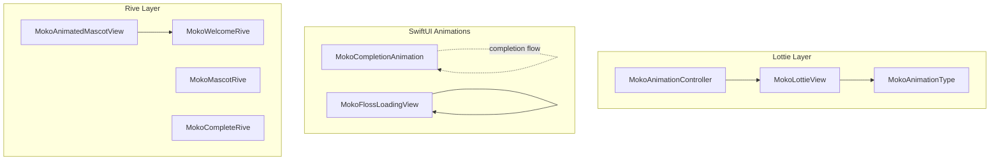
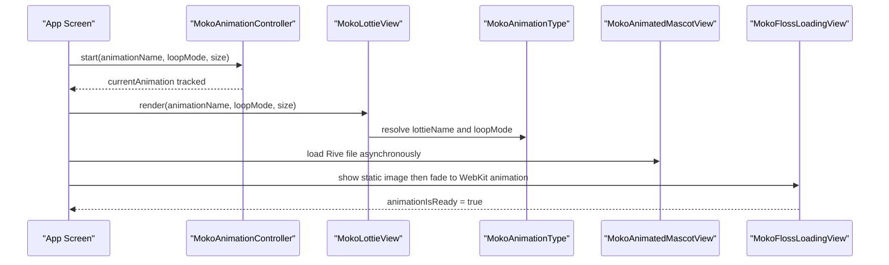
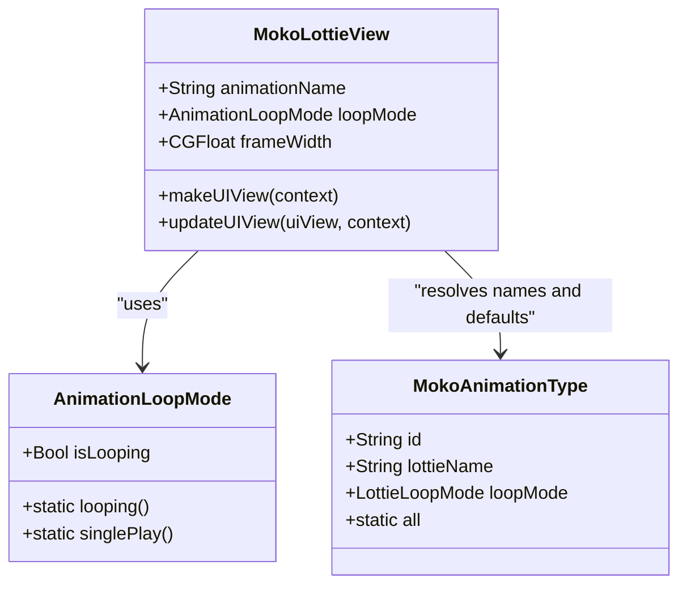
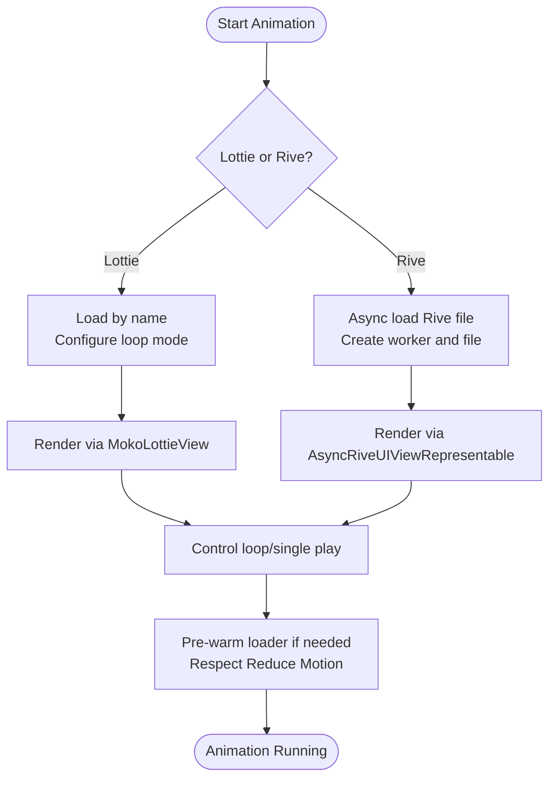
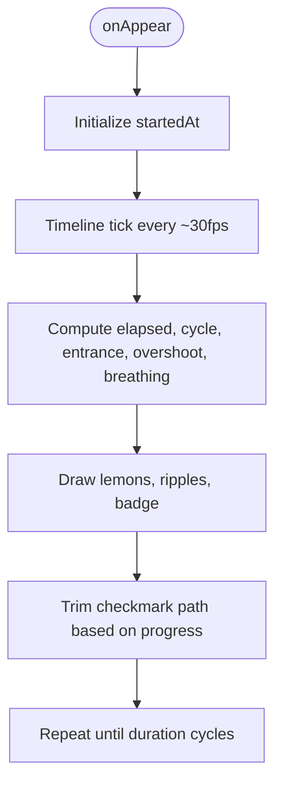
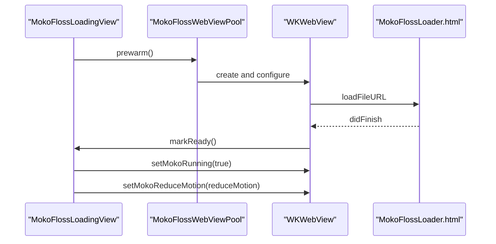
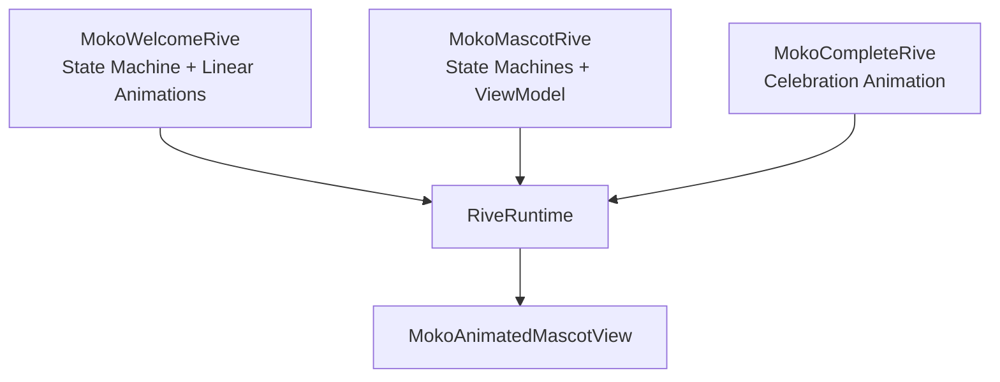
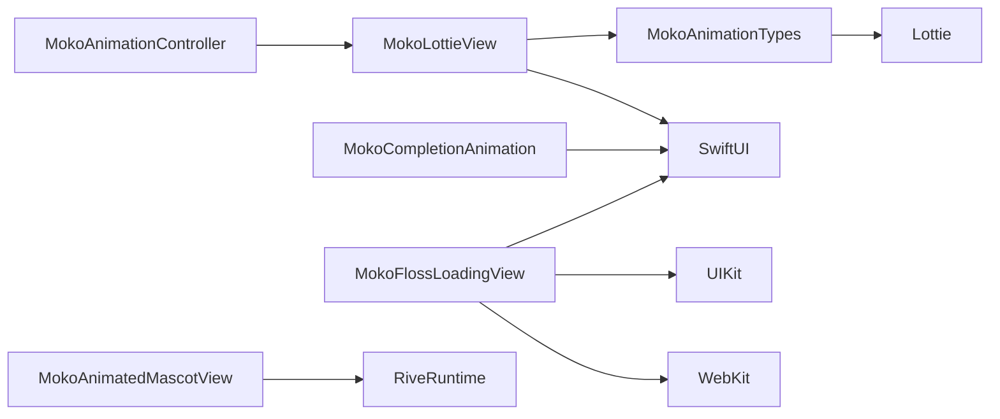

# Animation System

<cite>
**Referenced Files in This Document**
- [MokoLottieView.swift](file://Moko/Features/Animation/MokoLottieView.swift)
- [MokoAnimationController.swift](file://Moko/Moko/Features/Animation/MokoAnimationController.swift)
- [MokoAnimationTypes.swift](file://Moko/Moko/Features/Animation/MokoAnimationTypes.swift)
- [MokoCompletionAnimation.swift](file://Moko/Moko/Features/Animation/MokoCompletionAnimation.swift)
- [MokoFlossLoadingView.swift](file://Moko/Moko/Features/Animation/MokoFlossLoadingView.swift)
- [MokoAnimatedMascotView.swift](file://Moko/Moko/UIScreens/startScreens/MokoAnimatedMascotView.swift)
- [scene.rml (MokoWelcomeRive)](file://Moko/RiveProjects/MokoWelcomeRive/scene.rml)
- [rive.yaml (MokoWelcomeRive)](file://Moko/RiveProjects/MokoWelcomeRive/rive.yaml)
- [scene.rml (MokoMascotRive)](file://Moko/RiveProjects/MokoMascotRive/scene.rml)
- [rive.yaml (MokoMascotRive)](file://Moko/RiveProjects/MokoMascotRive/rive.yaml)
- [scene.rml (MokoCompleteRive)](file://Moko/RiveProjects/MokoCompleteRive/scene.rml)
- [rive.yaml (MokoCompleteRive)](file://Moko/RiveProjects/MokoCompleteRive/rive.yaml)
</cite>

## Table of Contents
1. [Introduction](#introduction)
2. [Project Structure](#project-structure)
3. [Core Components](#core-components)
4. [Architecture Overview](#architecture-overview)
5. [Detailed Component Analysis](#detailed-component-analysis)
6. [Dependency Analysis](#dependency-analysis)
7. [Performance Considerations](#performance-considerations)
8. [Troubleshooting Guide](#troubleshooting-guide)
9. [Conclusion](#conclusion)
10. [Appendices](#appendices)

## Introduction
This document explains Moko’s animation system, focusing on:
- Lottie integration through reusable views and types
- The mascot animation framework for loading, playback control, and performance optimization
- Rive animation projects structure and how they integrate into the app
- Asset management, memory optimization, accessibility, lifecycle, state management, and event handling
- Practical guidance for implementing new animations, customizing existing ones, creating controllers, tuning performance, debugging issues, and maintaining consistency across devices

The goal is to make the system understandable for both newcomers and experienced developers while providing concrete references to the source files that implement each behavior.

## Project Structure
The animation-related code is organized by feature and platform integration:
- Lottie-based mascot rendering and configuration live under the Animation feature
- Rive-powered mascot and celebration animations are defined as Rive projects and consumed from UI screens
- A dedicated completion animation uses SwiftUI Canvas for lightweight, frame-driven effects
- A WebKit-backed loader provides a smooth transition from static asset to vector animation

**Diagram sources**
- [MokoLottieView.swift:10-92](file://Moko/Features/Animation/MokoLottieView.swift#L10-L92)
- [MokoAnimationTypes.swift:5-36](file://Moko/Moko/Features/Animation/MokoAnimationTypes.swift#L5-L36)
- [MokoAnimationController.swift:9-58](file://Moko/Moko/Features/Animation/MokoAnimationController.swift#L9-L58)
- [MokoCompletionAnimation.swift:3-59](file://Moko/Moko/Features/Animation/MokoCompletionAnimation.swift#L3-L59)
- [MokoFlossLoadingView.swift:5-45](file://Moko/Moko/Features/Animation/MokoFlossLoadingView.swift#L5-L45)
- [MokoAnimatedMascotView.swift:4-19](file://Moko/Moko/UIScreens/startScreens/MokoAnimatedMascotView.swift#L4-L19)
- [scene.rml (MokoWelcomeRive):1-11](file://Moko/RiveProjects/MokoWelcomeRive/scene.rml#L1-L11)
- [scene.rml (MokoMascotRive):1-35](file://Moko/RiveProjects/MokoMascotRive/scene.rml#L1-L35)
- [scene.rml (MokoCompleteRive):1-14](file://Moko/RiveProjects/MokoCompleteRive/scene.rml#L1-L14)

**Section sources**
- [MokoLottieView.swift:10-92](file://Moko/Features/Animation/MokoLottieView.swift#L10-L92)
- [MokoAnimationTypes.swift:5-36](file://Moko/Moko/Features/Animation/MokoAnimationTypes.swift#L5-L36)
- [MokoAnimationController.swift:9-58](file://Moko/Moko/Features/Animation/MokoAnimationController.swift#L9-L58)
- [MokoCompletionAnimation.swift:3-59](file://Moko/Moko/Features/Animation/MokoCompletionAnimation.swift#L3-L59)
- [MokoFlossLoadingView.swift:5-45](file://Moko/Moko/Features/Animation/MokoFlossLoadingView.swift#L5-L45)
- [MokoAnimatedMascotView.swift:4-19](file://Moko/Moko/UIScreens/startScreens/MokoAnimatedMascotView.swift#L4-L19)

## Core Components
- MokoLottieView: A SwiftUI wrapper around a Lottie view that renders mascot animations with configurable name, loop mode, and size. It also exposes a convenience View modifier for overlaying animations.
- MokoAnimationType: Centralized enum mapping animation roles to Lottie file names and default loop behaviors.
- MokoAnimationController: A singleton controller intended to manage global animation playback state and lifecycle hooks.
- MokoCompletionAnimation: A SwiftUI Canvas-based completion animation used across relaxation flows, with timed lemons, ripples, badge scaling, and checkmark drawing.
- MokoFlossLoadingView: A transparent loader that shows an immediate static image and cross-fades to a WebKit-rendered vector animation once ready; supports Reduce Motion.
- MokoAnimatedMascotView: A Rive-powered mascot view that asynchronously loads a Rive file and displays it at a fixed aspect ratio.

Key responsibilities:
- Lottie assets are loaded by name and rendered via a UIViewRepresentable wrapper
- Loop modes and animation identities are centralized
- Completion animation is self-contained and accessible
- Loader prewarming improves perceived performance
- Rive mascot integrates via AsyncRiveUIViewRepresentable

**Section sources**
- [MokoLottieView.swift:10-114](file://Moko/Features/Animation/MokoLottieView.swift#L10-L114)
- [MokoAnimationTypes.swift:5-36](file://Moko/Moko/Features/Animation/MokoAnimationTypes.swift#L5-L36)
- [MokoAnimationController.swift:9-58](file://Moko/Moko/Features/Animation/MokoAnimationController.swift#L9-L58)
- [MokoCompletionAnimation.swift:3-59](file://Moko/Moko/Features/Animation/MokoCompletionAnimation.swift#L3-L59)
- [MokoFlossLoadingView.swift:5-45](file://Moko/Moko/Features/Animation/MokoFlossLoadingView.swift#L5-L45)
- [MokoAnimatedMascotView.swift:4-19](file://Moko/Moko/UIScreens/startScreens/MokoAnimatedMascotView.swift#L4-L19)

## Architecture Overview
The animation architecture separates concerns between:
- Rendering layers: Lottie, Rive, SwiftUI Canvas, and WebKit
- Configuration and identity: animation type enums and loop modes
- Lifecycle and coordination: controller and view coordinators
- Accessibility and motion preferences: Reduce Motion support across loaders and views

**Diagram sources**
- [MokoAnimationController.swift:28-58](file://Moko/Moko/Features/Animation/MokoAnimationController.swift#L28-L58)
- [MokoLottieView.swift:60-92](file://Moko/Features/Animation/MokoLottieView.swift#L60-L92)
- [MokoAnimationTypes.swift:5-36](file://Moko/Moko/Features/Animation/MokoAnimationTypes.swift#L5-L36)
- [MokoAnimatedMascotView.swift:8-19](file://Moko/Moko/UIScreens/startScreens/MokoAnimatedMascotView.swift#L8-L19)
- [MokoFlossLoadingView.swift:19-45](file://Moko/Moko/Features/Animation/MokoFlossLoadingView.swift#L19-L45)

## Detailed Component Analysis

### Lottie Integration: MokoLottieView and MokoAnimationType
- MokoLottieView wraps a native Lottie view inside SwiftUI using UIViewRepresentable. It accepts animationName, loopMode, and frameWidth, and creates a configured Lottie view without auto-playing.
- MokoAnimationType centralizes available mascot animations, maps them to Lottie file names, and defines default loop behaviors per animation role.
- A convenience View extension allows overlaying animations with consistent sizing.

**Diagram sources**
- [MokoLottieView.swift:10-92](file://Moko/Features/Animation/MokoLottieView.swift#L10-L92)
- [MokoAnimationTypes.swift:5-36](file://Moko/Moko/Features/Animation/MokoAnimationTypes.swift#L5-L36)

**Section sources**
- [MokoLottieView.swift:10-114](file://Moko/Features/Animation/MokoLottieView.swift#L10-L114)
- [MokoAnimationTypes.swift:5-36](file://Moko/Moko/Features/Animation/MokoAnimationTypes.swift#L5-L36)

### Mascot Animation Framework: Loading, Playback Control, and Optimization
- Loading:
  - Lottie animations are referenced by name and rendered via MokoLottieView
  - Rive mascot is loaded asynchronously using AsyncRiveUIViewRepresentable and a local Rive file
- Playback control:
  - Loop modes are specified per animation type or via explicit configuration
  - MokoAnimationController tracks current animation and provides start/stop methods
- Performance optimization:
  - Pre-warm WebKit loader to reduce first-frame latency
  - Use appropriate loop modes to avoid unnecessary re-renders
  - Keep sizes reasonable and reuse components where possible

**Diagram sources**
- [MokoLottieView.swift:60-92](file://Moko/Features/Animation/MokoLottieView.swift#L60-L92)
- [MokoAnimationController.swift:28-58](file://Moko/Moko/Features/Animation/MokoAnimationController.swift#L28-L58)
- [MokoAnimatedMascotView.swift:8-19](file://Moko/Moko/UIScreens/startScreens/MokoAnimatedMascotView.swift#L8-L19)
- [MokoFlossLoadingView.swift:13-17](file://Moko/Moko/Features/Animation/MokoFlossLoadingView.swift#L13-L17)

**Section sources**
- [MokoLottieView.swift:60-114](file://Moko/Features/Animation/MokoLottieView.swift#L60-L114)
- [MokoAnimationController.swift:28-58](file://Moko/Moko/Features/Animation/MokoAnimationController.swift#L28-L58)
- [MokoAnimatedMascotView.swift:8-19](file://Moko/Moko/UIScreens/startScreens/MokoAnimatedMascotView.swift#L8-L19)
- [MokoFlossLoadingView.swift:13-17](file://Moko/Moko/Features/Animation/MokoFlossLoadingView.swift#L13-L17)

### Completion Animation: Timeline-Based Drawing and Accessibility
- Uses TimelineView to drive time-based animations at a controlled interval
- Draws falling lemons, pulsing ripples, and a scaled badge with a checkmark stroke
- Provides accessibility label and ignores child elements for accessibility traversal
- Resets its timeline on appear to ensure consistent playback

**Diagram sources**
- [MokoCompletionAnimation.swift:17-59](file://Moko/Moko/Features/Animation/MokoCompletionAnimation.swift#L17-L59)
- [MokoCompletionAnimation.swift:61-137](file://Moko/Moko/Features/Animation/MokoCompletionAnimation.swift#L61-L137)

**Section sources**
- [MokoCompletionAnimation.swift:3-59](file://Moko/Moko/Features/Animation/MokoCompletionAnimation.swift#L3-L59)
- [MokoCompletionAnimation.swift:61-137](file://Moko/Moko/Features/Animation/MokoCompletionAnimation.swift#L61-L137)

### WebKit Loader: Prewarming, Cross-Fade, and Reduce Motion
- Shows a static mascot image immediately, then fades to a WebKit-rendered vector animation when ready
- Prewarms a WKWebView early to minimize first paint delay
- Applies Reduce Motion preference to the embedded page and toggles running state
- Recycles web views to reduce allocation overhead

**Diagram sources**
- [MokoFlossLoadingView.swift:13-17](file://Moko/Moko/Features/Animation/MokoFlossLoadingView.swift#L13-L17)
- [MokoFlossLoadingView.swift:47-84](file://Moko/Moko/Features/Animation/MokoFlossLoadingView.swift#L47-L84)
- [MokoFlossLoadingView.swift:86-120](file://Moko/Moko/Features/Animation/MokoFlossLoadingView.swift#L86-L120)
- [MokoFlossLoadingView.swift:123-171](file://Moko/Moko/Features/Animation/MokoFlossLoadingView.swift#L123-L171)

**Section sources**
- [MokoFlossLoadingView.swift:5-45](file://Moko/Moko/Features/Animation/MokoFlossLoadingView.swift#L5-L45)
- [MokoFlossLoadingView.swift:47-171](file://Moko/Moko/Features/Animation/MokoFlossLoadingView.swift#L47-L171)

### Rive Projects: Structure and Integration Plans
- MokoWelcomeRive: Defines a welcome animation with a state machine and linear keyframed properties for pose alternation, hop, and landing effects
- MokoMascotRive: Defines a full mascot rig with state machines for breathing, emotion, eyes/blink, and viewModel bindings for wave, celebrate, calm, and mood
- MokoCompleteRive: Defines a celebration animation with continuous lemon cascade and a crisp completion badge/tick

Integration plan:
- Build Rive projects to output compiled assets into the app bundle
- Consume via AsyncRiveUIViewRepresentable in UI screens
- Use state machines and viewModel properties to control complex mascot behaviors

**Diagram sources**
- [scene.rml (MokoWelcomeRive):1-11](file://Moko/RiveProjects/MokoWelcomeRive/scene.rml#L1-L11)
- [scene.rml (MokoMascotRive):1-35](file://Moko/RiveProjects/MokoMascotRive/scene.rml#L1-L35)
- [scene.rml (MokoCompleteRive):1-14](file://Moko/RiveProjects/MokoCompleteRive/scene.rml#L1-L14)
- [MokoAnimatedMascotView.swift:8-19](file://Moko/Moko/UIScreens/startScreens/MokoAnimatedMascotView.swift#L8-L19)

**Section sources**
- [scene.rml (MokoWelcomeRive):1-111](file://Moko/RiveProjects/MokoWelcomeRive/scene.rml#L1-L111)
- [scene.rml (MokoMascotRive):1-115](file://Moko/RiveProjects/MokoMascotRive/scene.rml#L1-L115)
- [scene.rml (MokoCompleteRive):1-74](file://Moko/RiveProjects/MokoCompleteRive/scene.rml#L1-L74)
- [MokoAnimatedMascotView.swift:8-19](file://Moko/Moko/UIScreens/startScreens/MokoAnimatedMascotView.swift#L8-L19)

## Dependency Analysis
- MokoLottieView depends on Lottie and SwiftUI
- MokoAnimationTypes depends on Lottie for loop mode enumeration
- MokoAnimationController is a coordinator with no direct rendering dependencies
- MokoCompletionAnimation depends only on SwiftUI
- MokoFlossLoadingView depends on SwiftUI, UIKit, and WebKit
- MokoAnimatedMascotView depends on RiveRuntime

**Diagram sources**
- [MokoAnimationTypes.swift:1-3](file://Moko/Moko/Features/Animation/MokoAnimationTypes.swift#L1-L3)
- [MokoLottieView.swift:7-8](file://Moko/Features/Animation/MokoLottieView.swift#L7-L8)
- [MokoCompletionAnimation.swift:1](file://Moko/Moko/Features/Animation/MokoCompletionAnimation.swift#L1)
- [MokoFlossLoadingView.swift:1-4](file://Moko/Moko/Features/Animation/MokoFlossLoadingView.swift#L1-L4)
- [MokoAnimatedMascotView.swift:1-3](file://Moko/Moko/UIScreens/startScreens/MokoAnimatedMascotView.swift#L1-L3)

**Section sources**
- [MokoAnimationTypes.swift:1-36](file://Moko/Moko/Features/Animation/MokoAnimationTypes.swift#L1-L36)
- [MokoLottieView.swift:7-114](file://Moko/Features/Animation/MokoLottieView.swift#L7-L114)
- [MokoCompletionAnimation.swift:1-59](file://Moko/Moko/Features/Animation/MokoCompletionAnimation.swift#L1-L59)
- [MokoFlossLoadingView.swift:1-45](file://Moko/Moko/Features/Animation/MokoFlossLoadingView.swift#L1-L45)
- [MokoAnimatedMascotView.swift:1-19](file://Moko/Moko/UIScreens/startScreens/MokoAnimatedMascotView.swift#L1-L19)

## Performance Considerations
- Prefer pre-warming WebKit loader before showing the loader UI to reduce first-frame latency
- Use appropriate loop modes: single-play for short events, loop for ambient states
- Avoid animating overly large frames; keep canvas and view sizes proportional to device capabilities
- Reuse components where possible (e.g., loader web view pool)
- Respect Reduce Motion to minimize CPU/GPU usage for users who prefer reduced animations
- For Rive, use state machines efficiently and avoid excessive simultaneous animations
- For Lottie, cache animation instances and avoid recreating views frequently

[No sources needed since this section provides general guidance]

## Troubleshooting Guide
Common issues and resolutions:
- Missing loader HTML: If the bundled HTML file is absent, the loader will assert failure. Ensure the HTML resource exists in the app bundle.
- Animation not starting: Verify that the animation name matches the Lottie file and that the loop mode is correctly configured.
- Rive file not found: Confirm that the Rive project outputs the expected file and that the UI screen references the correct local source.
- Excessive memory usage: Limit concurrent animations, recycle web views, and avoid keeping long-lived references to heavy animation objects.
- Accessibility mismatch: Ensure accessibility labels describe animated content and consider ignoring children for complex animations.

**Section sources**
- [MokoFlossLoadingView.swift:60-68](file://Moko/Moko/Features/Animation/MokoFlossLoadingView.swift#L60-L68)
- [MokoLottieView.swift:60-92](file://Moko/Features/Animation/MokoLottieView.swift#L60-L92)
- [MokoAnimatedMascotView.swift:8-19](file://Moko/Moko/UIScreens/startScreens/MokoAnimatedMascotView.swift#L8-L19)

## Conclusion
Moko’s animation system combines Lottie, Rive, SwiftUI Canvas, and WebKit to deliver a flexible, performant, and accessible mascot experience. Centralized types and controllers simplify configuration and lifecycle management, while Rive projects provide rich state-driven animations. By following the guidelines here—pre-warming loaders, respecting Reduce Motion, optimizing sizes and loop modes, and leveraging state machines—you can maintain smooth rendering and consistent experiences across devices.

[No sources needed since this section summarizes without analyzing specific files]

## Appendices

### Implementing New Animations
- Add a new case to MokoAnimationType with the correct Lottie file name and desired loop mode
- Create or update MokoLottieView usage with the new animationName and loopMode
- For Rive, add a new project under RiveProjects, define state machines and animations, build to output, and consume via AsyncRiveUIViewRepresentable

**Section sources**
- [MokoAnimationTypes.swift:5-36](file://Moko/Moko/Features/Animation/MokoAnimationTypes.swift#L5-L36)
- [MokoLottieView.swift:60-92](file://Moko/Features/Animation/MokoLottieView.swift#L60-L92)
- [MokoAnimatedMascotView.swift:8-19](file://Moko/Moko/UIScreens/startScreens/MokoAnimatedMascotView.swift#L8-L19)

### Customizing Existing Animations
- Adjust loopMode per animation role in MokoAnimationType
- Modify MokoCompletionAnimation parameters such as ringDiameter and timing constants
- Update Rive state machines and keyframes to change mascot behaviors

**Section sources**
- [MokoAnimationTypes.swift:22-31](file://Moko/Moko/Features/Animation/MokoAnimationTypes.swift#L22-L31)
- [MokoCompletionAnimation.swift:5-13](file://Moko/Moko/Features/Animation/MokoCompletionAnimation.swift#L5-L13)
- [scene.rml (MokoMascotRive):1-35](file://Moko/RiveProjects/MokoMascotRive/scene.rml#L1-L35)

### Creating Animation Controllers
- Extend MokoAnimationController to coordinate global playback, register observers, and stop animations on deinit
- Integrate with app lifecycle events to start/stop animations appropriately

**Section sources**
- [MokoAnimationController.swift:28-58](file://Moko/Moko/Features/Animation/MokoAnimationController.swift#L28-L58)

### Accessibility and Reduce Motion
- Provide meaningful accessibility labels for animated views
- Honor Reduce Motion by disabling or simplifying animations where appropriate
- Ensure complex animations ignore children for accessibility traversal

**Section sources**
- [MokoCompletionAnimation.swift:54-56](file://Moko/Moko/Features/Animation/MokoCompletionAnimation.swift#L54-L56)
- [MokoFlossLoadingView.swift:10-11](file://Moko/Moko/Features/Animation/MokoFlossLoadingView.swift#L10-L11)
- [MokoFlossLoadingView.swift:116-119](file://Moko/Moko/Features/Animation/MokoFlossLoadingView.swift#L116-L119)

### Maintaining Consistency Across Devices
- Scale animations proportionally using frameWidth or size parameters
- Use state machines and viewModel properties in Rive to adapt behaviors
- Test on multiple screen sizes and device capabilities to ensure smooth rendering

**Section sources**
- [MokoLottieView.swift:68-69](file://Moko/Features/Animation/MokoLottieView.swift#L68-L69)
- [MokoAnimatedMascotView.swift:17-18](file://Moko/Moko/UIScreens/startScreens/MokoAnimatedMascotView.swift#L17-L18)
- [scene.rml (MokoMascotRive):101-114](file://Moko/RiveProjects/MokoMascotRive/scene.rml#L101-L114)