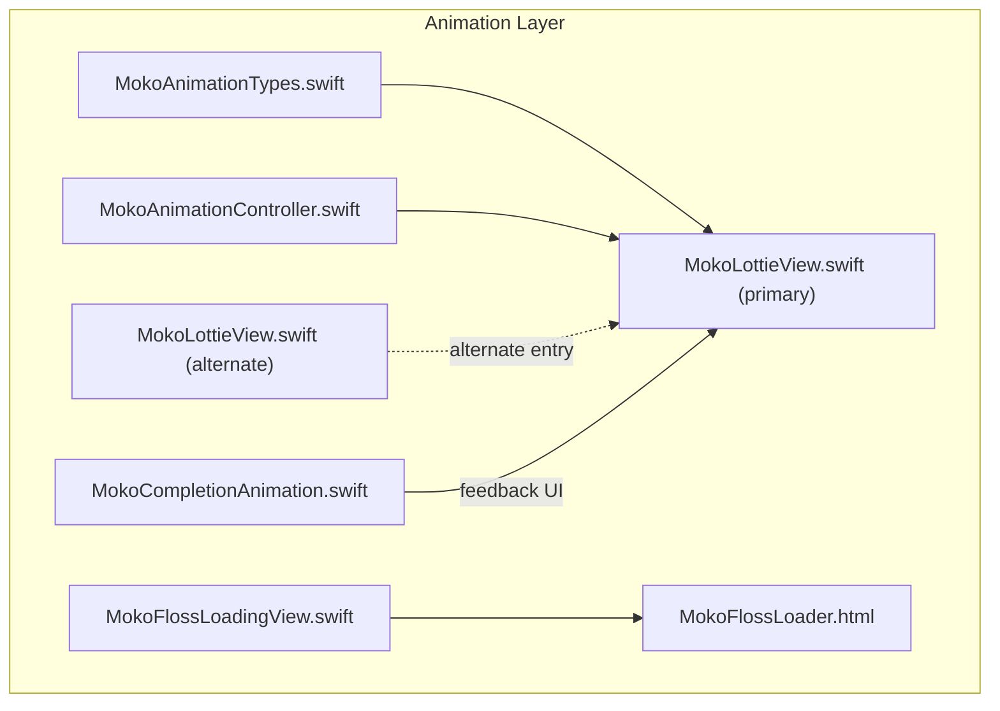
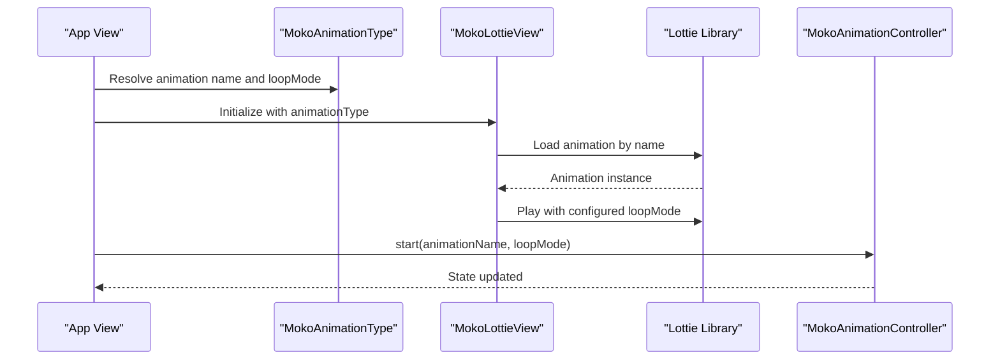
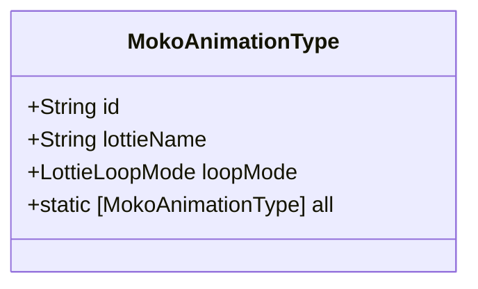
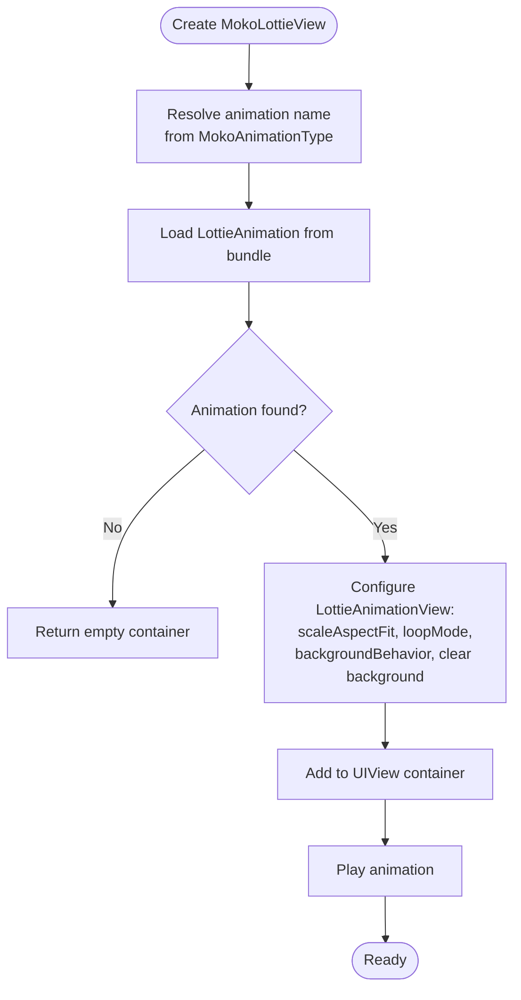
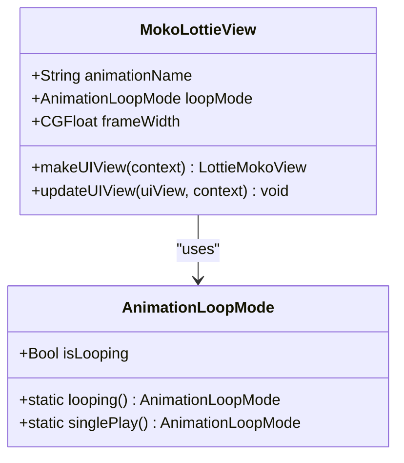
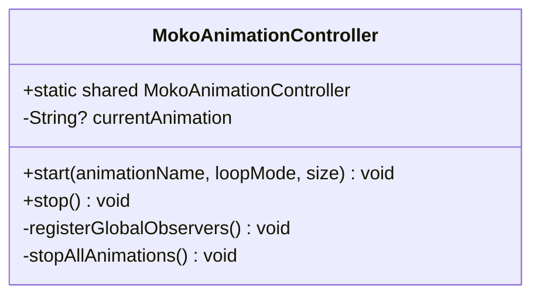
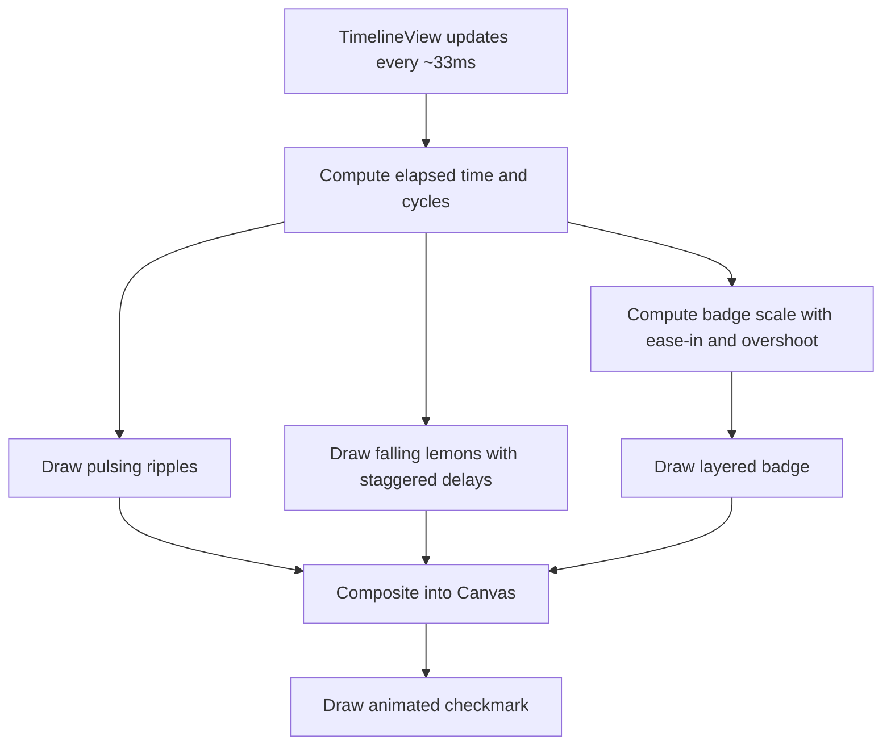
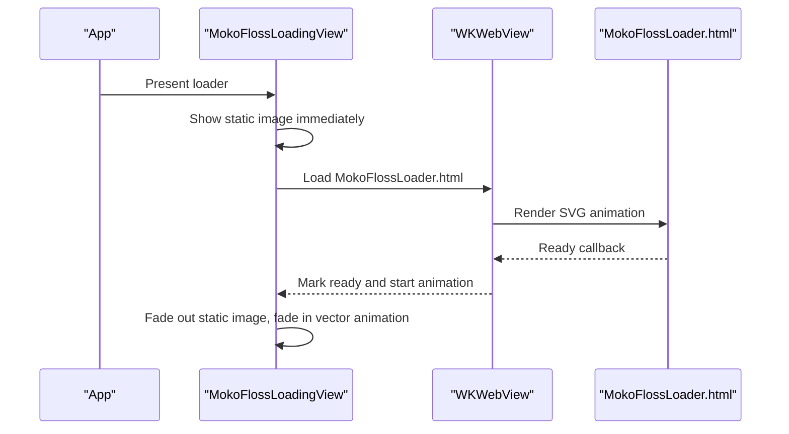
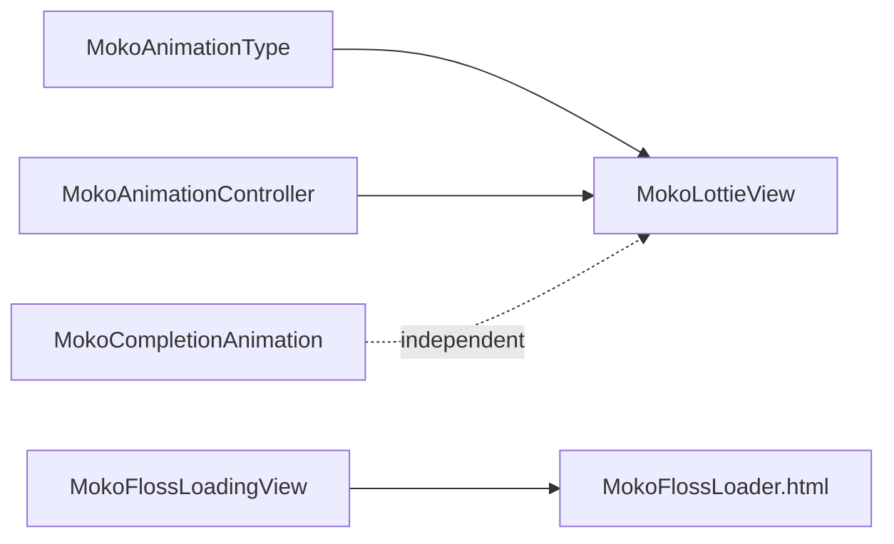

# Lottie Integration

<cite>
**Referenced Files in This Document**
- [MokoLottieView.swift](file://Moko/Features/Animation/MokoLottieView.swift)
- [MokoLottieView.swift](file://Moko/Moko/Features/Animation/MokoLottieView.swift)
- [MokoAnimationController.swift](file://Moko/Moko/Features/Animation/MokoAnimationController.swift)
- [MokoAnimationTypes.swift](file://Moko/Moko/Features/Animation/MokoAnimationTypes.swift)
- [MokoCompletionAnimation.swift](file://Moko/Moko/Features/Animation/MokoCompletionAnimation.swift)
- [MokoFlossLoadingView.swift](file://Moko/Moko/Features/Animation/MokoFlossLoadingView.swift)
- [MokoFlossLoader.html](file://Moko/Moko/MokoFlossLoader.html)
</cite>

## Table of Contents
1. [Introduction](#introduction)
2. [Project Structure](#project-structure)
3. [Core Components](#core-components)
4. [Architecture Overview](#architecture-overview)
5. [Detailed Component Analysis](#detailed-component-analysis)
6. [Dependency Analysis](#dependency-analysis)
7. [Performance Considerations](#performance-considerations)
8. [Troubleshooting Guide](#troubleshooting-guide)
9. [Conclusion](#conclusion)

## Introduction
This document explains Moko’s animation integration system, focusing on how mascot animations are defined, rendered, and controlled across the app. It covers:
- The Lottie-based mascot rendering path through `MokoLottieView`
- Animation type definitions and loop behavior via `MokoAnimationType`
- Playback coordination through `MokoAnimationController`
- Completion feedback using `MokoCompletionAnimation`
- A lightweight vector loader implemented with `MokoFlossLoadingView` and a bundled HTML/SVG animation

The goal is to help you add new animations, configure playback, handle events, optimize performance, and maintain accessibility and memory safety.

## Project Structure
The animation-related code lives under two related locations:
- Legacy or alternate implementation in `Moko/Features/Animation/MokoLottieView.swift`
- Primary implementation under `Moko/Moko/Features/Animation/...`

**Diagram sources**
- [MokoAnimationTypes.swift:6-36](file://Moko/Moko/Features/Animation/MokoAnimationTypes.swift#L6-L36)
- [MokoAnimationController.swift:29-58](file://Moko/Moko/Features/Animation/MokoAnimationController.swift#L29-L58)
- [MokoLottieView.swift:5-23](file://Moko/Moko/Features/Animation/MokoLottieView.swift#L5-L23)
- [MokoLottieView.swift:60-92](file://Moko/Features/Animation/MokoLottieView.swift#L60-L92)
- [MokoCompletionAnimation.swift:5-59](file://Moko/Moko/Features/Animation/MokoCompletionAnimation.swift#L5-L59)
- [MokoFlossLoadingView.swift:7-45](file://Moko/Moko/Features/Animation/MokoFlossLoadingView.swift#L7-L45)
- [MokoFlossLoader.html:1-119](file://Moko/Moko/MokoFlossLoader.html#L1-L119)

**Section sources**
- [MokoLottieView.swift:5-23](file://Moko/Moko/Features/Animation/MokoLottieView.swift#L5-L23)
- [MokoLottieView.swift:60-92](file://Moko/Features/Animation/MokoLottieView.swift#L60-L92)
- [MokoAnimationTypes.swift:6-36](file://Moko/Moko/Features/Animation/MokoAnimationTypes.swift#L6-L36)
- [MokoAnimationController.swift:29-58](file://Moko/Moko/Features/Animation/MokoAnimationController.swift#L29-L58)
- [MokoCompletionAnimation.swift:5-59](file://Moko/Moko/Features/Animation/MokoCompletionAnimation.swift#L5-L59)
- [MokoFlossLoadingView.swift:7-45](file://Moko/Moko/Features/Animation/MokoFlossLoadingView.swift#L7-L45)
- [MokoFlossLoader.html:1-119](file://Moko/Moko/MokoFlossLoader.html#L1-L119)

## Core Components
- `MokoAnimationType`: Central enum that defines available mascot animations, their Lottie file names, and default loop behavior.
- `MokoLottieView`: SwiftUI view that renders Lottie animations. There are two implementations:
  - Primary: pure SwiftUI + Lottie, uses `MokoAnimationType` for naming and loop mode.
  - Alternate: wraps a native `UIViewRepresentable` that instantiates a custom `LottieMokoView`.
- `MokoAnimationController`: Singleton controller intended to coordinate animation playback across app states. Currently provides start/stop hooks and lifecycle cleanup.
- `MokoCompletionAnimation`: Custom Canvas-based completion illustration used as feedback after sessions.
- `MokoFlossLoadingView`: Lightweight loading indicator backed by a WKWebView running an SVG animation from `MokoFlossLoader.html`, with prewarming and Reduce Motion support.

**Section sources**
- [MokoAnimationTypes.swift:6-36](file://Moko/Moko/Features/Animation/MokoAnimationTypes.swift#L6-L36)
- [MokoLottieView.swift:5-23](file://Moko/Moko/Features/Animation/MokoLottieView.swift#L5-L23)
- [MokoLottieView.swift:60-92](file://Moko/Features/Animation/MokoLottieView.swift#L60-L92)
- [MokoAnimationController.swift:29-58](file://Moko/Moko/Features/Animation/MokoAnimationController.swift#L29-L58)
- [MokoCompletionAnimation.swift:5-59](file://Moko/Moko/Features/Animation/MokoCompletionAnimation.swift#L5-L59)
- [MokoFlossLoadingView.swift:7-45](file://Moko/Moko/Features/Animation/MokoFlossLoadingView.swift#L7-L45)

## Architecture Overview
At runtime, views request animations through `MokoAnimationType`, which maps to Lottie assets. The primary `MokoLottieView` loads and plays the animation according to its loop mode. For non-Lottie loaders, `MokoFlossLoadingView` shows a static image immediately and cross-fades into a vector animation once the embedded page is ready. Completion feedback is provided by `MokoCompletionAnimation`.

**Diagram sources**
- [MokoAnimationTypes.swift:6-36](file://Moko/Moko/Features/Animation/MokoAnimationTypes.swift#L6-L36)
- [MokoLottieView.swift:5-23](file://Moko/Moko/Features/Animation/MokoLottieView.swift#L5-L23)
- [MokoAnimationController.swift:29-58](file://Moko/Moko/Features/Animation/MokoAnimationController.swift#L29-L58)

## Detailed Component Analysis

### MokoAnimationType
Defines all available mascot animations and their Lottie asset names. It also provides a default loop mode per animation:
- `.hello` plays once
- `.complete`, `.meditation`, `.listening`, `.idle` loop continuously

It exposes:
- `id` and `lottieName` for SwiftUI list compatibility and Lottie resolution
- `loopMode` mapping to Lottie’s loop behavior
- `all` collection for iteration

**Diagram sources**
- [MokoAnimationTypes.swift:6-36](file://Moko/Moko/Features/Animation/MokoAnimationTypes.swift#L6-L36)

**Section sources**
- [MokoAnimationTypes.swift:6-36](file://Moko/Moko/Features/Animation/MokoAnimationTypes.swift#L6-L36)

### MokoLottieView (Primary Implementation)
The primary SwiftUI view:
- Accepts an `animationType` and optional size
- Resolves the Lottie file name from `MokoAnimationType.lottieName`
- Loads the animation from the bundle, supports multiple search paths
- Configures loop mode based on `MokoAnimationType.loopMode`
- Sets background behavior to pause and restore when off-screen
- Plays automatically upon creation
- Provides an accessibility label

**Diagram sources**
- [MokoLottieView.swift:5-23](file://Moko/Moko/Features/Animation/MokoLottieView.swift#L5-L23)

**Section sources**
- [MokoLottieView.swift:5-23](file://Moko/Moko/Features/Animation/MokoLottieView.swift#L5-L23)

### MokoLottieView (Alternate Implementation)
An alternate wrapper around a custom `LottieMokoView`:
- Exposes configuration properties: `animationName`, `loopMode`, `frameWidth`
- Creates the underlying view in `makeUIView`
- Registers the created view with a coordinator
- Provides a convenience extension on `View` to overlay animations

**Diagram sources**
- [MokoLottieView.swift:60-92](file://Moko/Features/Animation/MokoLottieView.swift#L60-L92)
- [MokoLottieView.swift:38-57](file://Moko/Features/Animation/MokoLottieView.swift#L38-L57)

**Section sources**
- [MokoLottieView.swift:60-92](file://Moko/Features/Animation/MokoLottieView.swift#L60-L92)
- [MokoLottieView.swift:38-57](file://Moko/Features/Animation/MokoLottieView.swift#L38-L57)

### MokoAnimationController
Intended as a central coordinator for animation playback:
- Singleton with `start(animationName, loopMode, size)` and `stop()`
- Tracks the current animation name
- Cleans up in `deinit`
- Contains placeholders for global observers and stopping all animations

**Diagram sources**
- [MokoAnimationController.swift:29-58](file://Moko/Moko/Features/Animation/MokoAnimationController.swift#L29-L58)

**Section sources**
- [MokoAnimationController.swift:29-58](file://Moko/Moko/Features/Animation/MokoAnimationController.swift#L29-L58)

### MokoCompletionAnimation
A self-contained completion illustration:
- Uses `TimelineView` for time-driven animation at ~30fps
- Draws concentric rings, falling lemons, and a checkmark
- Scales a badge with eased entrance and subtle breathing
- Provides accessibility label describing the visual feedback

**Diagram sources**
- [MokoCompletionAnimation.swift:5-59](file://Moko/Moko/Features/Animation/MokoCompletionAnimation.swift#L5-L59)
- [MokoCompletionAnimation.swift:61-137](file://Moko/Moko/Features/Animation/MokoCompletionAnimation.swift#L61-L137)

**Section sources**
- [MokoCompletionAnimation.swift:5-59](file://Moko/Moko/Features/Animation/MokoCompletionAnimation.swift#L5-L59)
- [MokoCompletionAnimation.swift:61-137](file://Moko/Moko/Features/Animation/MokoCompletionAnimation.swift#L61-L137)

### MokoFlossLoadingView and MokoFlossLoader.html
A fast-loading indicator:
- Immediately shows a static mascot image behind a translucent circle
- Cross-fades to a vector animation once the embedded HTML page is ready
- Prewarms a WKWebView before first use to reduce startup latency
- Honors Reduce Motion by slowing down or reducing motion amplitude
- Recycles a single prewarmed WKWebView when possible

**Diagram sources**
- [MokoFlossLoadingView.swift:7-45](file://Moko/Moko/Features/Animation/MokoFlossLoadingView.swift#L7-L45)
- [MokoFlossLoadingView.swift:47-84](file://Moko/Moko/Features/Animation/MokoFlossLoadingView.swift#L47-L84)
- [MokoFlossLoadingView.swift:86-120](file://Moko/Moko/Features/Animation/MokoFlossLoadingView.swift#L86-L120)
- [MokoFlossLoadingView.swift:123-172](file://Moko/Moko/Features/Animation/MokoFlossLoadingView.swift#L123-L172)
- [MokoFlossLoader.html:76-118](file://Moko/Moko/MokoFlossLoader.html#L76-L118)

**Section sources**
- [MokoFlossLoadingView.swift:7-45](file://Moko/Moko/Features/Animation/MokoFlossLoadingView.swift#L7-L45)
- [MokoFlossLoadingView.swift:47-84](file://Moko/Moko/Features/Animation/MokoFlossLoadingView.swift#L47-L84)
- [MokoFlossLoadingView.swift:86-120](file://Moko/Moko/Features/Animation/MokoFlossLoadingView.swift#L86-L120)
- [MokoFlossLoadingView.swift:123-172](file://Moko/Moko/Features/Animation/MokoFlossLoadingView.swift#L123-L172)
- [MokoFlossLoader.html:76-118](file://Moko/Moko/MokoFlossLoader.html#L76-L118)

## Dependency Analysis
- `MokoLottieView` depends on `MokoAnimationType` for asset names and loop behavior.
- `MokoAnimationController` is independent but intended to coordinate playback state.
- `MokoFlossLoadingView` depends on `MokoFlossLoader.html` for the vector animation.
- `MokoCompletionAnimation` is self-contained and does not depend on Lottie.

**Diagram sources**
- [MokoAnimationTypes.swift:6-36](file://Moko/Moko/Features/Animation/MokoAnimationTypes.swift#L6-L36)
- [MokoLottieView.swift:5-23](file://Moko/Moko/Features/Animation/MokoLottieView.swift#L5-L23)
- [MokoAnimationController.swift:29-58](file://Moko/Moko/Features/Animation/MokoAnimationController.swift#L29-L58)
- [MokoFlossLoadingView.swift:7-45](file://Moko/Moko/Features/Animation/MokoFlossLoadingView.swift#L7-L45)
- [MokoFlossLoader.html:1-119](file://Moko/Moko/MokoFlossLoader.html#L1-L119)

**Section sources**
- [MokoAnimationTypes.swift:6-36](file://Moko/Moko/Features/Animation/MokoAnimationTypes.swift#L6-L36)
- [MokoLottieView.swift:5-23](file://Moko/Moko/Features/Animation/MokoLottieView.swift#L5-L23)
- [MokoAnimationController.swift:29-58](file://Moko/Moko/Features/Animation/MokoAnimationController.swift#L29-L58)
- [MokoFlossLoadingView.swift:7-45](file://Moko/Moko/Features/Animation/MokoFlossLoadingView.swift#L7-L45)
- [MokoFlossLoader.html:1-119](file://Moko/Moko/MokoFlossLoader.html#L1-L119)

## Performance Considerations
- Prefer `MokoAnimationType` to resolve animation names consistently and avoid string mismatches.
- Use appropriate loop modes: play-once for short cues; loop for ambient companion animations.
- Keep animation sizes reasonable; large frames increase GPU/CPU load.
- Avoid overlapping many Lottie instances simultaneously; reuse where possible.
- For loaders, use `MokoFlossLoadingView.prewarm()` early to reduce first-frame latency.
- Respect Reduce Motion:
  - Lottie animations can be paused or replaced with static images when motion is reduced.
  - The floss loader reduces motion amplitude and slows cadence automatically.
- Monitor memory:
  - Ensure animations stop when no longer visible.
  - Reuse web views via the built-in pool in the floss loader.

[No sources needed since this section provides general guidance]

## Troubleshooting Guide
- Animation not found:
  - Verify the Lottie file exists in the bundle and matches `MokoAnimationType.lottieName`.
  - If using the alternate wrapper, ensure the custom `LottieMokoView` is linked and initialized correctly.
- Animation not playing:
  - Confirm the view is on screen and not clipped.
  - Ensure auto-play is enabled or explicitly call play on the underlying animation view.
- Stutter or high CPU usage:
  - Reduce animation size or complexity.
  - Avoid too many concurrent animations.
  - Use loop modes appropriately.
- Loader flicker or blank:
  - Call `MokoFlossLoadingView.prewarm()` during app launch or earlier.
  - Ensure `MokoFlossLoader.html` is included in the bundle.
- Accessibility mismatch:
  - Provide meaningful accessibility labels for animated content.
  - Honor Reduce Motion preferences in custom animations.

**Section sources**
- [MokoLottieView.swift:5-23](file://Moko/Moko/Features/Animation/MokoLottieView.swift#L5-L23)
- [MokoLottieView.swift:60-92](file://Moko/Features/Animation/MokoLottieView.swift#L60-L92)
- [MokoFlossLoadingView.swift:14-17](file://Moko/Moko/Features/Animation/MokoFlossLoadingView.swift#L14-L17)
- [MokoFlossLoadingView.swift:60-68](file://Moko/Moko/Features/Animation/MokoFlossLoadingView.swift#L60-L68)

## Conclusion
Moko’s animation system combines a robust Lottie-based mascot renderer with a lightweight vector loader and a custom completion illustration. By centralizing animation definitions in `MokoAnimationType`, controlling playback through `MokoAnimationController`, and providing accessible, performant components like `MokoFlossLoadingView` and `MokoCompletionAnimation`, the app delivers smooth, consistent mascot experiences across different screens and device capabilities. When adding new animations, prefer the centralized types, respect loop modes, and follow the performance and accessibility guidelines outlined here.

[No sources needed since this section summarizes without analyzing specific files]