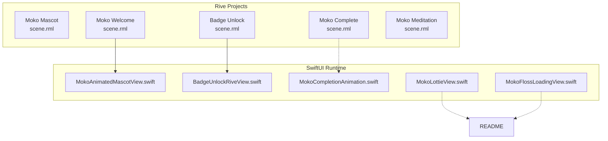
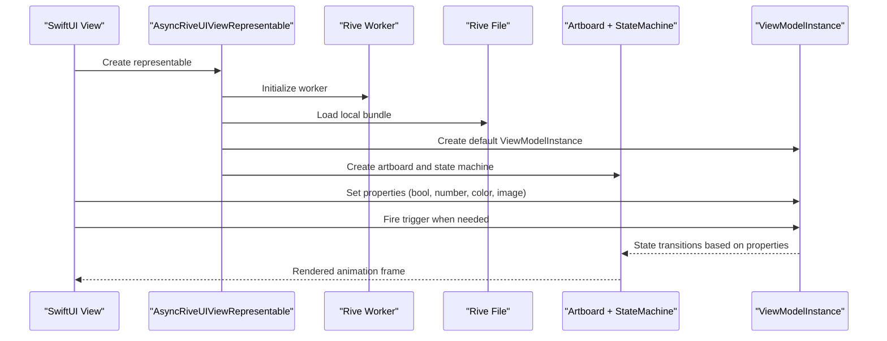
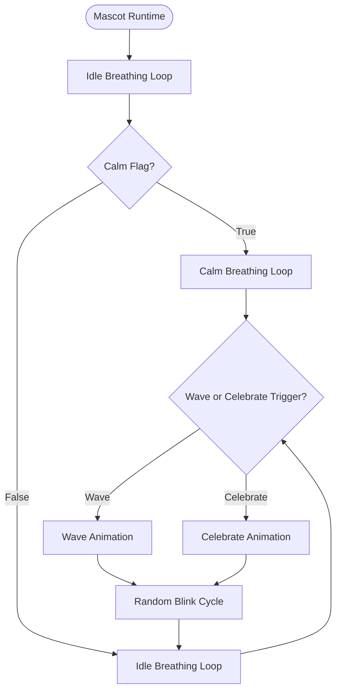
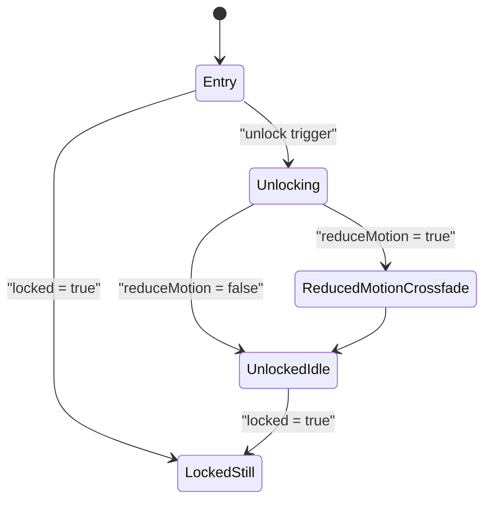
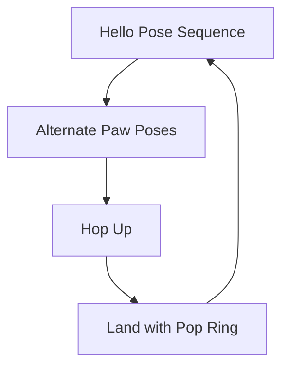
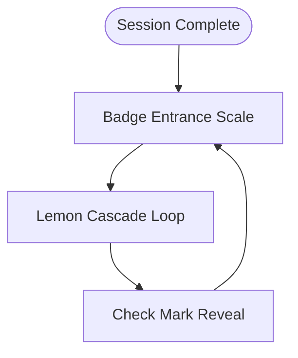
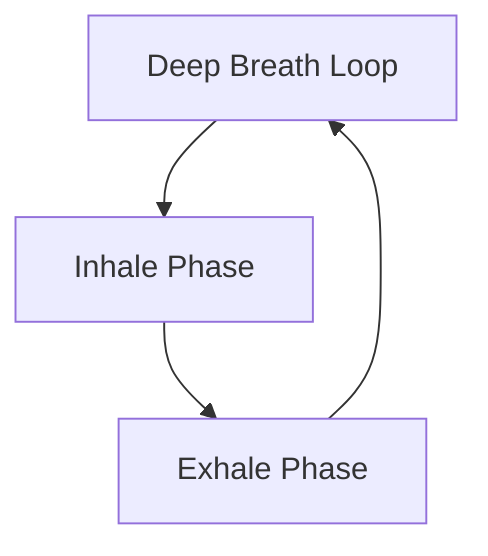
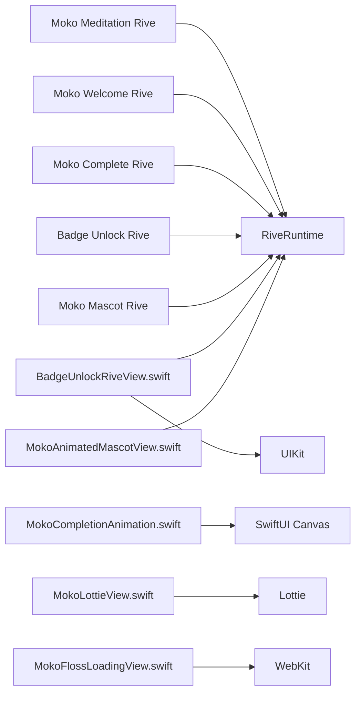

# Rive Animations

<cite>
**Referenced Files in This Document**   
- [README.md](file://README.md)
- [MokoAnimatedMascotView.swift](file://Moko/Moko/UIScreens/startScreens/MokoAnimatedMascotView.swift)
- [BadgeUnlockRiveView.swift](file://Moko/Moko/UIScreens/homeScreens/ProfileOverView/BadgeUnlockRiveView.swift)
- [MokoCompletionAnimation.swift](file://Moko/Moko/Features/Animation/MokoCompletionAnimation.swift)
- [MokoLottieView.swift](file://Moko/Moko/Features/Animation/MokoLottieView.swift)
- [MokoFlossLoadingView.swift](file://Moko/Moko/Features/Animation/MokoFlossLoadingView.swift)
- [MokoAnimationController.swift](file://Moko/Moko/Features/Animation/MokoAnimationController.swift)
- [scene.rml (Moko Mascot)](file://Moko/RiveProjects/MokoMascotRive/scene.rml)
- [scene.rml (Badge Unlock)](file://Moko/RiveProjects/BadgeUnlock/scene.rml)
- [scene.rml (Moko Complete)](file://Moko/RiveProjects/MokoCompleteRive/scene.rml)
- [scene.rml (Moko Welcome)](file://Moko/RiveProjects/MokoWelcomeRive/scene.rml)
- [scene.rml (Moko Meditation)](file://Moko/RiveProjects/MokoMeditationRive/scene.rml)
- [rive.yaml (Badge Unlock)](file://Moko/RiveProjects/BadgeUnlock/rive.yaml)
</cite>

## Table of Contents
1. [Introduction](#introduction)
2. [Project Structure](#project-structure)
3. [Core Components](#core-components)
4. [Architecture Overview](#architecture-overview)
5. [Detailed Component Analysis](#detailed-component-analysis)
6. [Dependency Analysis](#dependency-analysis)
7. [Performance Considerations](#performance-considerations)
8. [Troubleshooting Guide](#troubleshooting-guide)
9. [Conclusion](#conclusion)
10. [Appendices](#appendices)

## Introduction
This document explains Moko’s Rive animation projects and integration plans. It covers the Rive project structure, how each scene.rml defines interactive animations for different app states, and how SwiftUI views consume them. It also documents the mascot animation system, badge unlock celebration, welcome and completion animations, runtime integration patterns, performance considerations compared to Lottie, and guidelines for creating new Rive animations while maintaining consistency with existing Lottie assets.

The current app ships both Lottie-based mascot animations and Rive-based scenes. The plan is to gradually migrate mascot and interaction-heavy animations to Rive while preserving consistent behavior across platforms and accessibility preferences.

## Project Structure
Moko organizes Rive source files under `Moko/RiveProjects`, one folder per animation project. Each project contains:
- A `scene.rml` file defining artboards, state machines, linear animations, view models, and data bindings.
- Optional asset folders referenced by images or fonts.
- A `rive.yaml` configuration that names the main artboard and sets output paths.
- A `build` directory generated by the Rive toolchain.

SwiftUI views load these compiled Rive bundles at runtime using `AsyncRiveUIViewRepresentable`, create a `Worker`, load a local bundle, instantiate an artboard and state machine, and bind view model properties.

**Diagram sources**
- [scene.rml (Moko Mascot):1-115](file://Moko/RiveProjects/MokoMascotRive/scene.rml#L1-L115)
- [scene.rml (Badge Unlock):1-134](file://Moko/RiveProjects/BadgeUnlock/scene.rml#L1-L134)
- [scene.rml (Moko Complete):1-74](file://Moko/RiveProjects/MokoCompleteRive/scene.rml#L1-L74)
- [scene.rml (Moko Welcome):1-111](file://Moko/RiveProjects/MokoWelcomeRive/scene.rml#L1-L111)
- [scene.rml (Moko Meditation):1-165](file://Moko/RiveProjects/MokoMeditationRive/scene.rml#L1-L165)
- [MokoAnimatedMascotView.swift:1-28](file://Moko/Moko/UIScreens/startScreens/MokoAnimatedMascotView.swift#L1-L28)
- [BadgeUnlockRiveView.swift:1-88](file://Moko/Moko/UIScreens/homeScreens/ProfileOverView/BadgeUnlockRiveView.swift#L1-L88)
- [MokoCompletionAnimation.swift:1-149](file://Moko/Moko/Features/Animation/MokoCompletionAnimation.swift#L1-L149)
- [MokoLottieView.swift:1-83](file://Moko/Moko/Features/Animation/MokoLottieView.swift#L1-L83)
- [MokoFlossLoadingView.swift:1-173](file://Moko/Moko/Features/Animation/MokoFlossLoadingView.swift#L1-L173)
- [README.md:111-149](file://README.md#L111-L149)

**Section sources**
- [README.md:180-207](file://README.md#L180-L207)
- [rive.yaml (Badge Unlock):1-7](file://Moko/RiveProjects/BadgeUnlock/rive.yaml#L1-L7)

## Core Components
- Rive animation projects define reusable, interactive scenes through state machines, linear animations, and view model properties.
- SwiftUI views wrap Rive content using `AsyncRiveUIViewRepresentable`, configure view models, and drive state transitions from app logic.
- Existing Lottie components remain for backward compatibility and are documented alongside Rive for migration planning.

Key responsibilities:
- `MokoAnimatedMascotView`: Loads the welcome Rive bundle and displays the mascot greeting loop.
- `BadgeUnlockRiveView`: Configures the badge unlock scene, injects dynamic glyphs and colors, triggers unlock animations, and respects reduce motion.
- `MokoCompletionAnimation`: Provides a native Canvas-based completion illustration that mirrors the intended Rive completion scene.
- `MokoLottieView` and `MokoFlossLoadingView`: Current Lottie-based mascot and loading experiences.
- `MokoAnimationController`: Placeholder controller for centralized animation lifecycle management.

**Section sources**
- [MokoAnimatedMascotView.swift:1-28](file://Moko/Moko/UIScreens/startScreens/MokoAnimatedMascotView.swift#L1-L28)
- [BadgeUnlockRiveView.swift:1-88](file://Moko/Moko/UIScreens/homeScreens/ProfileOverView/BadgeUnlockRiveView.swift#L1-L88)
- [MokoCompletionAnimation.swift:1-149](file://Moko/Moko/Features/Animation/MokoCompletionAnimation.swift#L1-L149)
- [MokoLottieView.swift:1-83](file://Moko/Moko/Features/Animation/MokoLottieView.swift#L1-L83)
- [MokoFlossLoadingView.swift:1-173](file://Moko/Moko/Features/Animation/MokoFlossLoadingView.swift#L1-L173)
- [MokoAnimationController.swift:1-59](file://Moko/Moko/Features/Animation/MokoAnimationController.swift#L1-L59)

## Architecture Overview
At runtime, SwiftUI views request a Rive worker, load a local bundle, create an artboard and state machine, and bind view model properties. State machines react to boolean flags, triggers, numbers, colors, and image assets. Accessibility preferences such as reduce motion are propagated into the Rive view model so animations can adapt automatically.

**Diagram sources**
- [MokoAnimatedMascotView.swift:9-16](file://Moko/Moko/UIScreens/startScreens/MokoAnimatedMascotView.swift#L9-L16)
- [BadgeUnlockRiveView.swift:23-47](file://Moko/Moko/UIScreens/homeScreens/ProfileOverView/BadgeUnlockRiveView.swift#L23-L47)
- [BadgeUnlockRiveView.swift:61-73](file://Moko/Moko/UIScreens/homeScreens/ProfileOverView/BadgeUnlockRiveView.swift#L61-L73)

## Detailed Component Analysis

### Mascot Animation System
The mascot Rive project defines a rich character rig with bones, shapes, and multiple layers:
- Breathing layer switches between idle breathing and calm breathing based on a boolean property.
- Emotion layer plays wave or celebrate animations via trigger properties.
- Eyes and blink layer cycles random blink intervals and returns to neutral.
- A mood-to-smile converter maps a numeric mood value to smile curvature.

**Diagram sources**
- [scene.rml (Moko Mascot):4-35](file://Moko/RiveProjects/MokoMascotRive/scene.rml#L4-L35)
- [scene.rml (Moko Mascot):36-114](file://Moko/RiveProjects/MokoMascotRive/scene.rml#L36-L114)

Integration notes:
- The mascot currently has a dedicated welcome animation in its own Rive project.
- Future work can unify mascot behaviors by importing the mascot rig into other scenes and controlling it through shared view model properties.

**Section sources**
- [scene.rml (Moko Mascot):1-115](file://Moko/RiveProjects/MokoMascotRive/scene.rml#L1-L115)

### Badge Unlock Animation
The badge unlock scene provides:
- A locked silhouette and unlocked face with swappable glyph images.
- An unlock animation with rotation, scaling, and layered reveals.
- A reduced-motion crossfade alternative.
- Dynamic tier colors, badge names, and tilt angle input.

**Diagram sources**
- [scene.rml (Badge Unlock):5-50](file://Moko/RiveProjects/BadgeUnlock/scene.rml#L5-L50)
- [scene.rml (Badge Unlock):53-83](file://Moko/RiveProjects/BadgeUnlock/scene.rml#L53-L83)

Runtime behavior:
- The view renders a dynamic glyph from SF Symbols, decodes it into a Rive image, and binds it to the badge face.
- It sets locked state, reduce motion, tier, tier color, badge name, and initial angle.
- When unlocked, it fires the unlock trigger after a short delay and then settles with haptic feedback.

**Section sources**
- [BadgeUnlockRiveView.swift:1-88](file://Moko/Moko/UIScreens/homeScreens/ProfileOverView/BadgeUnlockRiveView.swift#L1-L88)
- [scene.rml (Badge Unlock):1-134](file://Moko/RiveProjects/BadgeUnlock/scene.rml#L1-L134)

### Welcome Animation
The welcome Rive project animates a friendly greeting with alternating poses, a hop, and landing effects. It uses image assets for pose frames and a pop ring for impact.

**Diagram sources**
- [scene.rml (Moko Welcome):4-10](file://Moko/RiveProjects/MokoWelcomeRive/scene.rml#L4-L10)
- [scene.rml (Moko Welcome):12-98](file://Moko/RiveProjects/MokoWelcomeRive/scene.rml#L12-L98)

Integration:
- `MokoAnimatedMascotView` loads the welcome bundle and sizes the view proportionally to the artboard dimensions.

**Section sources**
- [MokoAnimatedMascotView.swift:1-28](file://Moko/Moko/UIScreens/startScreens/MokoAnimatedMascotView.swift#L1-L28)
- [scene.rml (Moko Welcome):1-111](file://Moko/RiveProjects/MokoWelcomeRive/scene.rml#L1-L111)

### Completion Animation
The completion animation currently exists as a SwiftUI Canvas implementation that draws falling lemons, pulsing rings, and a check mark. The Rive counterpart is defined in the Moko Complete project as a looping lemon cascade with a completion badge and tick.

**Diagram sources**
- [scene.rml (Moko Complete):5-14](file://Moko/RiveProjects/MokoCompleteRive/scene.rml#L5-L14)
- [scene.rml (Moko Complete):16-48](file://Moko/RiveProjects/MokoCompleteRive/scene.rml#L16-L48)
- [MokoCompletionAnimation.swift:17-59](file://Moko/Moko/Features/Animation/MokoCompletionAnimation.swift#L17-L59)

Migration guidance:
- Replace the Canvas-based completion view with the Rive completion scene once UI consumers adopt the Rive runtime consistently.
- Preserve timing and easing to keep user experience stable during transition.

**Section sources**
- [MokoCompletionAnimation.swift:1-149](file://Moko/Moko/Features/Animation/MokoCompletionAnimation.swift#L1-L149)
- [scene.rml (Moko Complete):1-74](file://Moko/RiveProjects/MokoCompleteRive/scene.rml#L1-L74)

### Meditation Animation
The meditation Rive project centers a meditating mascot image behind animated breath rings. The animation loops over a 10-second cycle with subtle scale and opacity changes to guide breathing.

**Diagram sources**
- [scene.rml (Moko Meditation):5-14](file://Moko/RiveProjects/MokoMeditationRive/scene.rml#L5-L14)
- [scene.rml (Moko Meditation):16-137](file://Moko/RiveProjects/MokoMeditationRive/scene.rml#L16-L137)

Usage pattern:
- This scene is suitable for background relaxation visuals where continuous looping and minimal CPU overhead are important.

**Section sources**
- [scene.rml (Moko Meditation):1-165](file://Moko/RiveProjects/MokoMeditationRive/scene.rml#L1-L165)

## Dependency Analysis
Rive projects depend on:
- Local asset references (images, fonts).
- View model properties for interactivity.
- State machines for conditional playback.

SwiftUI dependencies:
- `RiveRuntime` for worker, file, artboard, state machine, and view model APIs.
- UIKit for image rendering when generating dynamic glyphs.
- SwiftUI environment values for accessibility preferences.

Existing Lottie dependencies:
- `Lottie` library for JSON-based mascot animations.
- `UIKit` and `WebKit` for loading helpers and prewarming.

**Diagram sources**
- [MokoAnimatedMascotView.swift:1-28](file://Moko/Moko/UIScreens/startScreens/MokoAnimatedMascotView.swift#L1-L28)
- [BadgeUnlockRiveView.swift:1-88](file://Moko/Moko/UIScreens/homeScreens/ProfileOverView/BadgeUnlockRiveView.swift#L1-L88)
- [MokoCompletionAnimation.swift:1-149](file://Moko/Moko/Features/Animation/MokoCompletionAnimation.swift#L1-L149)
- [MokoLottieView.swift:1-83](file://Moko/Moko/Features/Animation/MokoLottieView.swift#L1-L83)
- [MokoFlossLoadingView.swift:1-173](file://Moko/Moko/Features/Animation/MokoFlossLoadingView.swift#L1-L173)

**Section sources**
- [README.md:151-163](file://README.md#L151-L163)

## Performance Considerations
- Prefer Rive for complex, interactive animations because state machines and view models reduce runtime branching in Swift code.
- Use looping animations sparingly; long-running loops should be lightweight and avoid excessive transforms or large bitmaps.
- Respect `accessibilityReduceMotion` by providing reduced-motion alternatives inside Rive scenes, as demonstrated by the badge unlock animation.
- Avoid frequent creation of workers and files; reuse instances where possible within a screen lifetime.
- Keep asset resolution appropriate for target devices; generate dynamic images at reasonable sizes to limit memory pressure.
- Compare with Lottie: Lottie JSON decoding and composition can be heavier for complex vector hierarchies; Rive’s compiled runtime often yields more predictable performance for interactive scenes.

[No sources needed since this section provides general guidance]

## Troubleshooting Guide
Common issues and resolutions:
- Rive bundle not found: Ensure the bundle name matches the Rive project output and that the resource is included in the app bundle.
- Property binding errors: Verify view model property paths match those defined in `scene.rml`.
- Missing dynamic glyph: Confirm the symbol name exists and the renderer produces valid PNG data before decoding.
- Reduce motion not applied: Pass the environment value into the Rive view model and ensure the scene has a reduced-motion branch.
- Lottie animation not playing: Check the search paths and confirm the JSON file is present in the expected subdirectory.

**Section sources**
- [BadgeUnlockRiveView.swift:23-47](file://Moko/Moko/UIScreens/homeScreens/ProfileOverView/BadgeUnlockRiveView.swift#L23-L47)
- [BadgeUnlockRiveView.swift:61-73](file://Moko/Moko/UIScreens/homeScreens/ProfileOverView/BadgeUnlockRiveView.swift#L61-L73)
- [MokoLottieView.swift:33-76](file://Moko/Moko/Features/Animation/MokoLottieView.swift#L33-L76)

## Conclusion
Moko’s animation strategy blends mature Lottie usage with emerging Rive projects. Rive scenes provide richer interactivity through state machines and view models, while SwiftUI views manage lifecycle and accessibility. The roadmap includes migrating mascot and completion animations to Rive, standardizing runtime integration, and ensuring consistent behavior across both systems. By following the guidelines below, teams can extend the animation system safely and efficiently.

[No sources needed since this section summarizes without analyzing specific files]

## Appendices

### Guidelines for Creating New Rive Animations
- Create a new folder under `Moko/RiveProjects` named after the feature.
- Define a clear state machine with entry states and explicit transitions.
- Use view model properties for all host-driven inputs: booleans for modes, triggers for one-shot actions, numbers for angles or progress, colors for theming, and images for dynamic glyphs.
- Provide reduced-motion branches for every interactive sequence.
- Export assets as small, appropriately sized images; avoid embedding large bitmaps directly in the scene.
- Configure `rive.yaml` with the correct main artboard and output directory.
- Add a SwiftUI wrapper using `AsyncRiveUIViewRepresentable`, initialize a worker, load the local bundle, create the artboard and state machine, bind properties, and fire triggers only when necessary.

**Section sources**
- [rive.yaml (Badge Unlock):1-7](file://Moko/RiveProjects/BadgeUnlock/rive.yaml#L1-L7)
- [BadgeUnlockRiveView.swift:23-47](file://Moko/Moko/UIScreens/homeScreens/ProfileOverView/BadgeUnlockRiveView.swift#L23-L47)

### Migrating from Lottie to Rive
- Identify Lottie animations used for mascot interactions and completion celebrations.
- Recreate the same visual timing and easing in Rive using linear animations and state machines.
- Map Lottie loop modes to Rive looping animations or state machine loops.
- Replace `MokoLottieView` usage with Rive wrappers where interactivity requires view model control.
- Maintain identical accessibility labels and reduce-motion behavior.
- Validate performance on low-end devices and adjust frame rates or asset sizes if needed.

**Section sources**
- [README.md:111-149](file://README.md#L111-L149)
- [MokoLottieView.swift:1-83](file://Moko/Moko/Features/Animation/MokoLottieView.swift#L1-L83)
- [MokoCompletionAnimation.swift:1-149](file://Moko/Moko/Features/Animation/MokoCompletionAnimation.swift#L1-L149)

### Memory Usage Patterns and Compatibility
- Instantiate one worker per screen or feature scope rather than per view.
- Decode dynamic images at the smallest size required for display.
- Avoid holding references to large decoded images longer than necessary.
- Test on iOS versions supported by the app; Rive runtime availability should be verified against deployment targets.
- Keep animation durations and frame counts reasonable to prevent memory spikes during rapid transitions.

[No sources needed since this section provides general guidance]