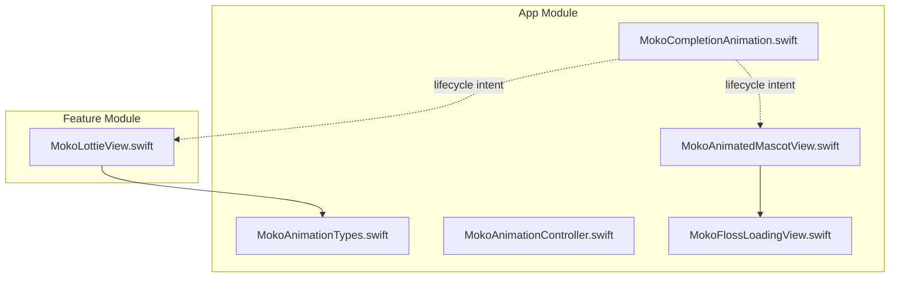
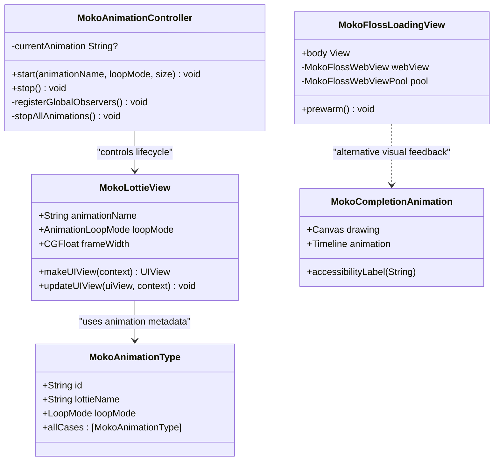
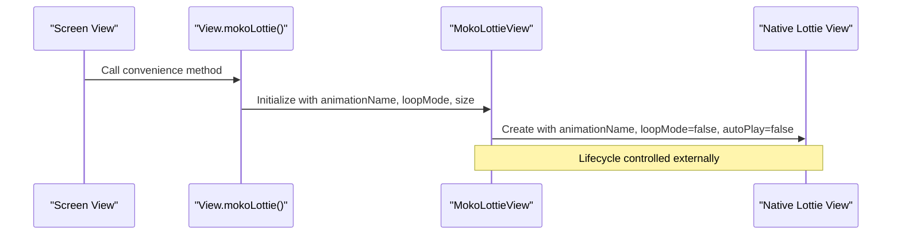
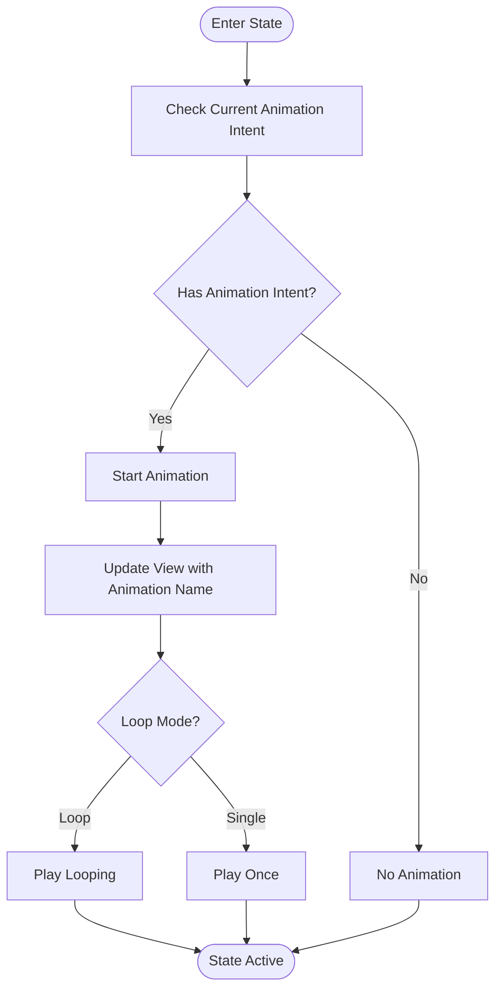
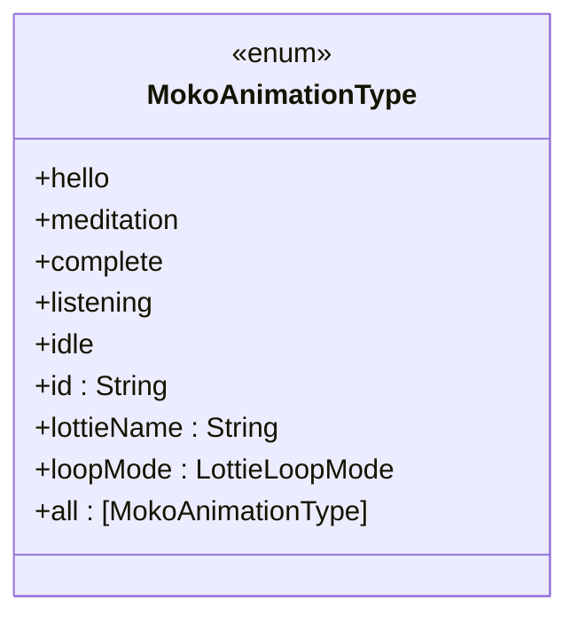
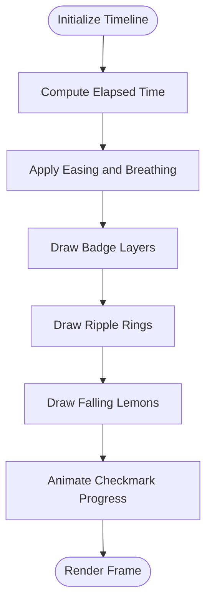
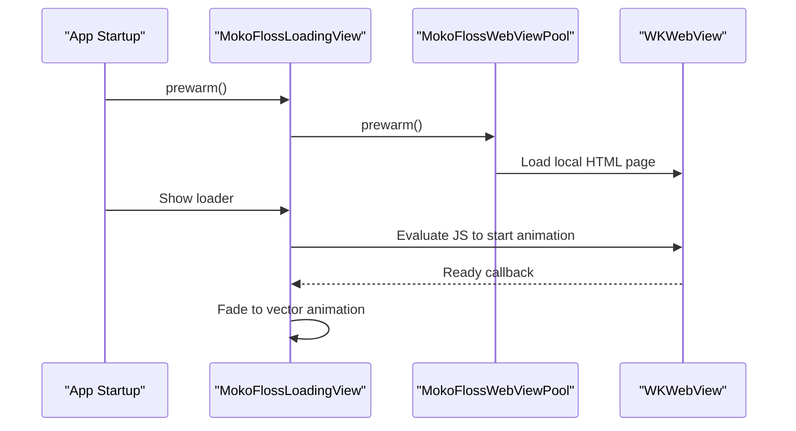
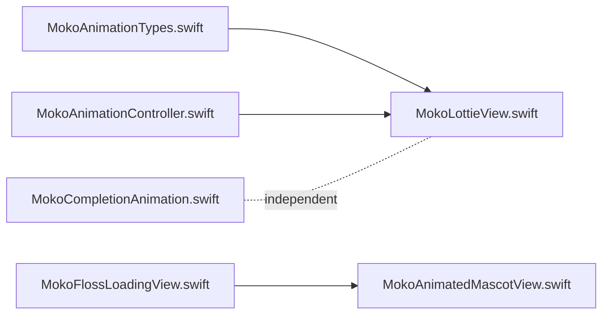

# Animation Architecture

<cite>
**Referenced Files in This Document**
- [MokoLottieView.swift](file://Moko/Features/Animation/MokoLottieView.swift)
- [MokoAnimationController.swift](file://Moko/Moko/Features/Animation/MokoAnimationController.swift)
- [MokoAnimationTypes.swift](file://Moko/Moko/Features/Animation/MokoAnimationTypes.swift)
- [MokoCompletionAnimation.swift](file://Moko/Moko/Features/Animation/MokoCompletionAnimation.swift)
- [MokoFlossLoadingView.swift](file://Moko/Moko/Features/Animation/MokoFlossLoadingView.swift)
- [MokoAnimatedMascotView.swift](file://Moko/Moko/UIScreens/startScreens/MokoAnimatedMascotView.swift)
</cite>

## Table of Contents
1. [Introduction](#introduction)
2. [Project Structure](#project-structure)
3. [Core Components](#core-components)
4. [Architecture Overview](#architecture-overview)
5. [Detailed Component Analysis](#detailed-component-analysis)
6. [Dependency Analysis](#dependency-analysis)
7. [Performance Considerations](#performance-considerations)
8. [User Interaction and State Integration](#user-interaction-and-state-integration)
9. [Accessibility and Fallbacks](#accessibility-and-fallbacks)
10. [Troubleshooting Guide](#troubleshooting-guide)
11. [Conclusion](#conclusion)

## Introduction
This document explains the animation architecture used by the app, focusing on:
- Lottie integration through a reusable animation container.
- Lifecycle management via an animation controller.
- The animation types system that centralizes available animations and their playback behavior.
- Performance strategies for memory, frame rate, and resource loading.
- How animations integrate with user interactions and app state.
- Accessibility considerations and fallback mechanisms for devices with limited capabilities.

The goal is to make the animation system understandable for both developers and product contributors while providing concrete guidance for extending or optimizing it.

## Project Structure
The animation-related code is split between two locations:
- A top-level feature module containing a Lottie-based view wrapper and convenience helpers.
- The main app module containing the animation type registry, lifecycle controller, completion animation, and a WebKit-based loader.

**Diagram sources**
- [MokoLottieView.swift:1-130](file://Moko/Features/Animation/MokoLottieView.swift#L1-L130)
- [MokoAnimationTypes.swift:1-37](file://Moko/Moko/Features/Animation/MokoAnimationTypes.swift#L1-L37)
- [MokoAnimationController.swift:1-59](file://Moko/Moko/Features/Animation/MokoAnimationController.swift#L1-L59)
- [MokoCompletionAnimation.swift:1-149](file://Moko/Moko/Features/Animation/MokoCompletionAnimation.swift#L1-L149)
- [MokoFlossLoadingView.swift:1-173](file://Moko/Moko/Features/Animation/MokoFlossLoadingView.swift#L1-L173)
- [MokoAnimatedMascotView.swift:1-28](file://Moko/Moko/UIScreens/startScreens/MokoAnimatedMascotView.swift#L1-L28)

**Section sources**
- [MokoLottieView.swift:1-130](file://Moko/Features/Animation/MokoLottieView.swift#L1-L130)
- [MokoAnimationTypes.swift:1-37](file://Moko/Moko/Features/Animation/MokoAnimationTypes.swift#L1-L37)
- [MokoAnimationController.swift:1-59](file://Moko/Moko/Features/Animation/MokoAnimationController.swift#L1-L59)
- [MokoCompletionAnimation.swift:1-149](file://Moko/Moko/Features/Animation/MokoCompletionAnimation.swift#L1-L149)
- [MokoFlossLoadingView.swift:1-173](file://Moko/Moko/Features/Animation/MokoFlossLoadingView.swift#L1-L173)
- [MokoAnimatedMascotView.swift:1-28](file://Moko/Moko/UIScreens/startScreens/MokoAnimatedMascotView.swift#L1-L28)

## Core Components
- MokoLottieView: A SwiftUI view wrapper around a native Lottie rendering component. It accepts animation names, loop mode, and size, and provides a convenience extension for overlaying animations onto other views.
- MokoAnimationTypes: Centralized enum defining all mascot animations, mapping each case to its Lottie file name and default loop behavior.
- MokoAnimationController: A shared lifecycle coordinator intended to start and stop animations based on app state. Currently holds current animation intent and exposes lifecycle hooks.
- MokoCompletionAnimation: A pure SwiftUI Canvas-based completion animation used across relaxation flows, independent of Lottie.
- MokoFlossLoadingView: A lightweight loader that shows a static mascot image immediately and cross-fades into a vector animation hosted in a WKWebView, with prewarming and recycling for performance.
- MokoAnimatedMascotView: A Rive-powered mascot view used in the welcome flow, demonstrating how non-Lottie animations coexist with the Lottie system.

**Section sources**
- [MokoLottieView.swift:10-114](file://Moko/Features/Animation/MokoLottieView.swift#L10-L114)
- [MokoAnimationTypes.swift:5-36](file://Moko/Moko/Features/Animation/MokoAnimationTypes.swift#L5-L36)
- [MokoAnimationController.swift:9-58](file://Moko/Moko/Features/Animation/MokoAnimationController.swift#L9-L58)
- [MokoCompletionAnimation.swift:1-59](file://Moko/Moko/Features/Animation/MokoCompletionAnimation.swift#L1-L59)
- [MokoFlossLoadingView.swift:1-45](file://Moko/Moko/Features/Animation/MokoFlossLoadingView.swift#L1-L45)
- [MokoAnimatedMascotView.swift:1-20](file://Moko/Moko/UIScreens/startScreens/MokoAnimatedMascotView.swift#L1-L20)

## Architecture Overview
The animation system follows a layered approach:
- Types layer: Defines available animations and their defaults.
- Container layer: Provides a reusable view for Lottie playback.
- Controller layer: Holds lifecycle intent and coordinates global state changes.
- Composition layer: Uses the container and controller within screens and flows.
- Alternative layers: Includes Rive and Canvas animations where appropriate.

**Diagram sources**
- [MokoAnimationTypes.swift:5-36](file://Moko/Moko/Features/Animation/MokoAnimationTypes.swift#L5-L36)
- [MokoLottieView.swift:59-92](file://Moko/Features/Animation/MokoLottieView.swift#L59-L92)
- [MokoAnimationController.swift:28-58](file://Moko/Moko/Features/Animation/MokoAnimationController.swift#L28-L58)
- [MokoCompletionAnimation.swift:1-59](file://Moko/Moko/Features/Animation/MokoCompletionAnimation.swift#L1-L59)
- [MokoFlossLoadingView.swift:1-45](file://Moko/Moko/Features/Animation/MokoFlossLoadingView.swift#L1-L45)

## Detailed Component Analysis

### Lottie Integration Pattern with MokoLottieView
MokoLottieView is the primary container for Lottie animations. It:
- Accepts an animation name, loop mode, and display size.
- Creates a native Lottie view with configuration such as background behavior and content mode.
- Integrates with SwiftUI via UIViewRepresentable.
- Exposes a convenience extension to overlay animations onto any view.

Key behaviors:
- Animation loading uses a named asset and supports optional subdirectories.
- Playback can be configured to loop or play once.
- The view sets autoPlay to false when constructing the underlying native view, allowing lifecycle control from higher layers.

**Diagram sources**
- [MokoLottieView.swift:59-92](file://Moko/Features/Animation/MokoLottieView.swift#L59-L92)
- [MokoLottieView.swift:96-114](file://Moko/Features/Animation/MokoLottieView.swift#L96-L114)

**Section sources**
- [MokoLottieView.swift:10-114](file://Moko/Features/Animation/MokoLottieView.swift#L10-L114)

### Lifecycle Management with MokoAnimationController
MokoAnimationController is a shared coordinator intended to manage animation playback across app states. It:
- Stores the current animation intent.
- Provides start and stop methods.
- Contains placeholders for global observers and cleanup logic.

Current limitations:
- The controller does not directly interact with the Lottie view; it stores intent rather than controlling playback.
- Global observer registration and cleanup are stubbed out.

Recommended usage pattern:
- Screens call start with the desired animation name and loop mode when entering a state.
- Screens call stop when leaving the state or when transitioning to another animation.
- Higher-level components (e.g., navigation controllers or scene coordinators) should own the lifecycle and propagate state changes to views.

**Diagram sources**
- [MokoAnimationController.swift:28-58](file://Moko/Moko/Features/Animation/MokoAnimationController.swift#L28-L58)

**Section sources**
- [MokoAnimationController.swift:9-58](file://Moko/Moko/Features/Animation/MokoAnimationController.swift#L9-L58)

### Animation Types System
MokoAnimationTypes defines the canonical set of mascot animations:
- hello: Entrance animation, plays once.
- meditation: Meditation animation, loops.
- complete: Celebration animation, loops.
- listening: Conversation animation, loops.
- idle: Companion resting animation, loops.

Each case maps to a Lottie file name and includes a default loop mode. This centralization ensures consistent naming and playback behavior across the app.

**Diagram sources**
- [MokoAnimationTypes.swift:5-36](file://Moko/Moko/Features/Animation/MokoAnimationTypes.swift#L5-L36)

**Section sources**
- [MokoAnimationTypes.swift:5-36](file://Moko/Moko/Features/Animation/MokoAnimationTypes.swift#L5-L36)

### Completion Animation Composition
MokoCompletionAnimation is a self-contained SwiftUI composition using Canvas and TimelineView:
- Draws a badge, ripples, and falling lemons.
- Animates checkmark progress and breathing scale effects.
- Provides accessibility labels describing the visual outcome.

This animation is independent of Lottie and demonstrates how complex animated compositions can be built without external assets.

**Diagram sources**
- [MokoCompletionAnimation.swift:17-59](file://Moko/Moko/Features/Animation/MokoCompletionAnimation.swift#L17-L59)
- [MokoCompletionAnimation.swift:61-137](file://Moko/Moko/Features/Animation/MokoCompletionAnimation.swift#L61-L137)

**Section sources**
- [MokoCompletionAnimation.swift:1-149](file://Moko/Moko/Features/Animation/MokoCompletionAnimation.swift#L1-L149)

### Loading Experience with MokoFlossLoadingView
MokoFlossLoadingView improves perceived performance:
- Immediately shows a static mascot image.
- Cross-fades to a vector animation hosted in WKWebView when ready.
- Prewarms the WebView at app startup to reduce first-frame latency.
- Recycles WebView instances to avoid repeated allocation.

It also respects accessibility preferences by reducing motion when requested.

**Diagram sources**
- [MokoFlossLoadingView.swift:13-45](file://Moko/Moko/Features/Animation/MokoFlossLoadingView.swift#L13-L45)
- [MokoFlossLoadingView.swift:123-171](file://Moko/Moko/Features/Animation/MokoFlossLoadingView.swift#L123-L171)

**Section sources**
- [MokoFlossLoadingView.swift:1-173](file://Moko/Moko/Features/Animation/MokoFlossLoadingView.swift#L1-L173)

### Non-Lottie Mascot with Rive
MokoAnimatedMascotView demonstrates how Rive animations integrate alongside Lottie:
- Loads a Rive file asynchronously.
- Configures size and aspect ratio.
- Provides accessibility label describing the mascot’s greeting and hop behavior.

This shows that the animation architecture supports multiple backends (Lottie, Rive, Canvas) depending on use case.

**Section sources**
- [MokoAnimatedMascotView.swift:1-28](file://Moko/Moko/UIScreens/startScreens/MokoAnimatedMascotView.swift#L1-L28)

## Dependency Analysis
The animation system has clear boundaries:
- MokoAnimationTypes is a pure data definition with no runtime dependencies beyond Lottie types.
- MokoLottieView depends on Lottie and SwiftUI.
- MokoAnimationController is framework-independent but intended to coordinate with views.
- MokoCompletionAnimation depends only on SwiftUI.
- MokoFlossLoadingView depends on SwiftUI and WebKit.
- MokoAnimatedMascotView depends on RiveRuntime.

**Diagram sources**
- [MokoAnimationTypes.swift:1-37](file://Moko/Moko/Features/Animation/MokoAnimationTypes.swift#L1-L37)
- [MokoLottieView.swift:1-130](file://Moko/Features/Animation/MokoLottieView.swift#L1-L130)
- [MokoAnimationController.swift:1-59](file://Moko/Moko/Features/Animation/MokoAnimationController.swift#L1-L59)
- [MokoFlossLoadingView.swift:1-173](file://Moko/Moko/Features/Animation/MokoFlossLoadingView.swift#L1-L173)
- [MokoAnimatedMascotView.swift:1-28](file://Moko/Moko/UIScreens/startScreens/MokoAnimatedMascotView.swift#L1-L28)
- [MokoCompletionAnimation.swift:1-149](file://Moko/Moko/Features/Animation/MokoCompletionAnimation.swift#L1-L149)

**Section sources**
- [MokoAnimationTypes.swift:1-37](file://Moko/Moko/Features/Animation/MokoAnimationTypes.swift#L1-L37)
- [MokoLottieView.swift:1-130](file://Moko/Features/Animation/MokoLottieView.swift#L1-L130)
- [MokoAnimationController.swift:1-59](file://Moko/Moko/Features/Animation/MokoAnimationController.swift#L1-L59)
- [MokoFlossLoadingView.swift:1-173](file://Moko/Moko/Features/Animation/MokoFlossLoadingView.swift#L1-L173)
- [MokoAnimatedMascotView.swift:1-28](file://Moko/Moko/UIScreens/startScreens/MokoAnimatedMascotView.swift#L1-L28)
- [MokoCompletionAnimation.swift:1-149](file://Moko/Moko/Features/Animation/MokoCompletionAnimation.swift#L1-L149)

## Performance Considerations
Memory management:
- MokoFlossLoadingView prewarms and recycles WKWebView instances to avoid repeated allocations and improve responsiveness.
- MokoLottieView constructs the native Lottie view with autoPlay disabled, allowing lifecycle control to prevent unnecessary rendering.

Frame rate control:
- MokoCompletionAnimation uses TimelineView with a minimum interval targeting 30 FPS, balancing smoothness and CPU usage.
- MokoFlossLoadingView reduces motion when accessibility prefers reduced motion, lowering animation workload.

Resource loading:
- MokoLottieView attempts to load animations from multiple paths, improving robustness if assets are located in different bundles or directories.
- MokoFlossLoadingView loads a local HTML file and injects a user script to configure motion preferences before rendering.

Optimization recommendations:
- Centralize animation initialization in MokoAnimationController so it can pause/resume animations based on visibility and app state.
- Cache loaded LottieAnimation objects to avoid repeated parsing overhead.
- Use background queues for heavy asset preparation and ensure UI updates occur on the main thread.
- Limit concurrent animations per screen to reduce GPU pressure.

[No sources needed since this section provides general guidance]

## User Interaction and State Integration
Integration patterns:
- Screens should declare animation intent via MokoAnimationController.start when entering a state and call stop when leaving.
- Views subscribe to state changes and update MokoLottieView parameters accordingly.
- For completion flows, MokoCompletionAnimation provides a self-contained animation that does not require external coordination.

Event handling:
- MokoFlossLoadingView emits a ready callback when the WebView animation is prepared, enabling UI transitions.
- MokoAnimatedMascotView integrates Rive animations independently, showing how different animation backends can coexist.

State-driven composition:
- Use MokoAnimationTypes to select animations based on app state (e.g., idle vs. listening).
- Combine MokoLottieView overlays with content views to provide contextual mascot feedback during user interactions.

**Section sources**
- [MokoAnimationController.swift:43-53](file://Moko/Moko/Features/Animation/MokoAnimationController.swift#L43-L53)
- [MokoFlossLoadingView.swift:35-44](file://Moko/Moko/Features/Animation/MokoFlossLoadingView.swift#L35-L44)
- [MokoAnimatedMascotView.swift:8-19](file://Moko/Moko/UIScreens/startScreens/MokoAnimatedMascotView.swift#L8-L19)

## Accessibility and Fallbacks
Accessibility:
- MokoCompletionAnimation provides an accessibility label describing the session completion animation.
- MokoFlossLoadingView provides an accessibility label indicating that the mascot is dancing while content loads.
- MokoAnimatedMascotView provides an accessibility label describing the mascot’s greeting and hop behavior.

Reduced motion:
- MokoFlossLoadingView reads the accessibility reduce motion environment value and passes it to the WebView to adjust animation intensity.

Fallbacks:
- MokoLottieView attempts to load animations from multiple paths; if none succeed, it returns an empty container without crashing.
- MokoFlossLoadingView asserts if the required HTML file is missing, ensuring developers catch bundle misconfigurations early.

Recommendations:
- Add VoiceOver support for Lottie animations by exposing meaningful labels through the view wrapper.
- Provide static image fallbacks for devices with limited rendering capabilities.
- Ensure animations do not block critical interactions; always allow users to dismiss or skip animations.

**Section sources**
- [MokoCompletionAnimation.swift:54-58](file://Moko/Moko/Features/Animation/MokoCompletionAnimation.swift#L54-L58)
- [MokoFlossLoadingView.swift:42-44](file://Moko/Moko/Features/Animation/MokoFlossLoadingView.swift#L42-L44)
- [MokoFlossLoadingView.swift:116-119](file://Moko/Moko/Features/Animation/MokoFlossLoadingView.swift#L116-L119)
- [MokoAnimatedMascotView.swift:17-19](file://Moko/Moko/UIScreens/startScreens/MokoAnimatedMascotView.swift#L17-L19)

## Troubleshooting Guide
Common issues and resolutions:
- Animation not playing:
  - Verify the animation name matches the Lottie asset.
  - Ensure the lifecycle controller starts the animation and the view receives the updated parameters.
- Missing resources:
  - Confirm the HTML file exists in the bundle for MokoFlossLoadingView.
  - Check that Lottie files are included in the correct bundle path.
- Performance degradation:
  - Reduce concurrent animations.
  - Use prewarming for WebView-based loaders.
  - Avoid heavy computations inside animation frames.

Debugging tips:
- Inspect console logs for successful or failed animation loads.
- Validate accessibility settings to ensure reduced motion is respected.
- Profile GPU and CPU usage during animation-heavy flows.

**Section sources**
- [MokoFlossLoadingView.swift:60-68](file://Moko/Moko/Features/Animation/MokoFlossLoadingView.swift#L60-L68)
- [MokoLottieView.swift:40-76](file://Moko/Features/Animation/MokoLottieView.swift#L40-L76)

## Conclusion
The animation architecture combines a centralized types system, a reusable Lottie container, a lifecycle controller, and alternative animation backends like Rive and Canvas. It emphasizes performance through prewarming, recycling, and careful frame rate control, while maintaining accessibility and fallbacks for diverse device capabilities. Extending the system involves adding new animation types, integrating them into the controller, and composing them within screens with clear lifecycle management.

[No sources needed since this section summarizes without analyzing specific files]