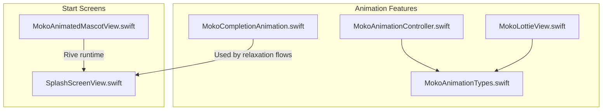
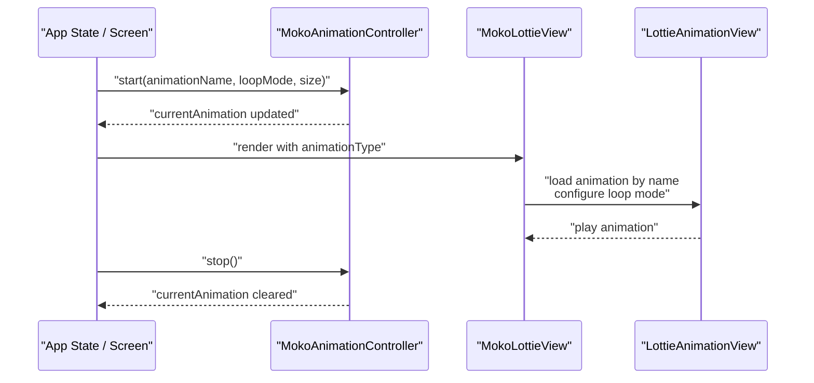
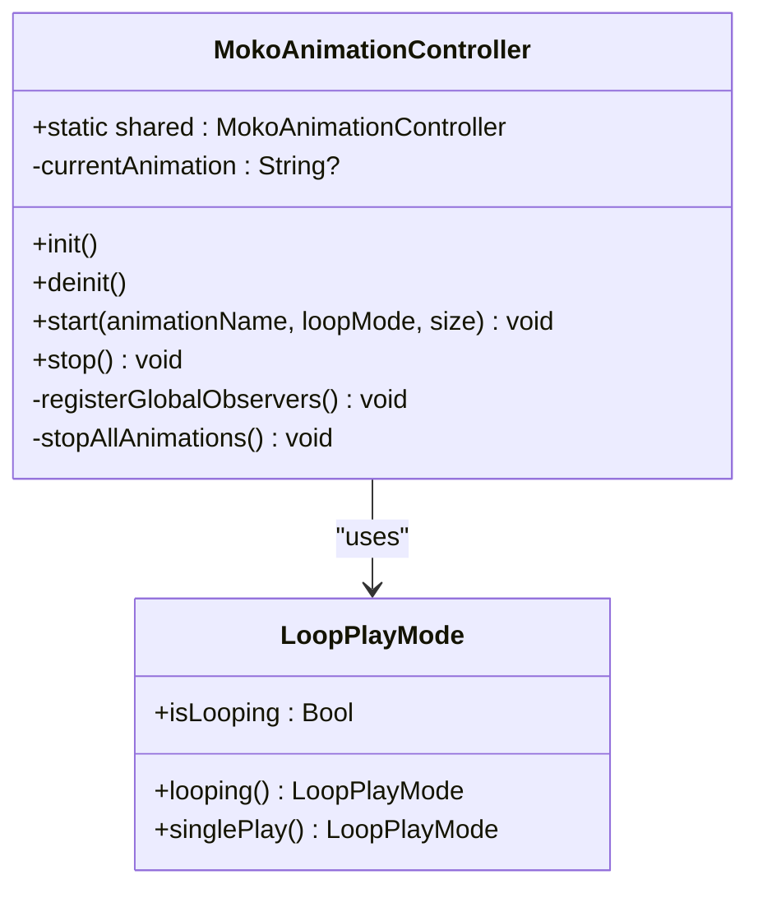
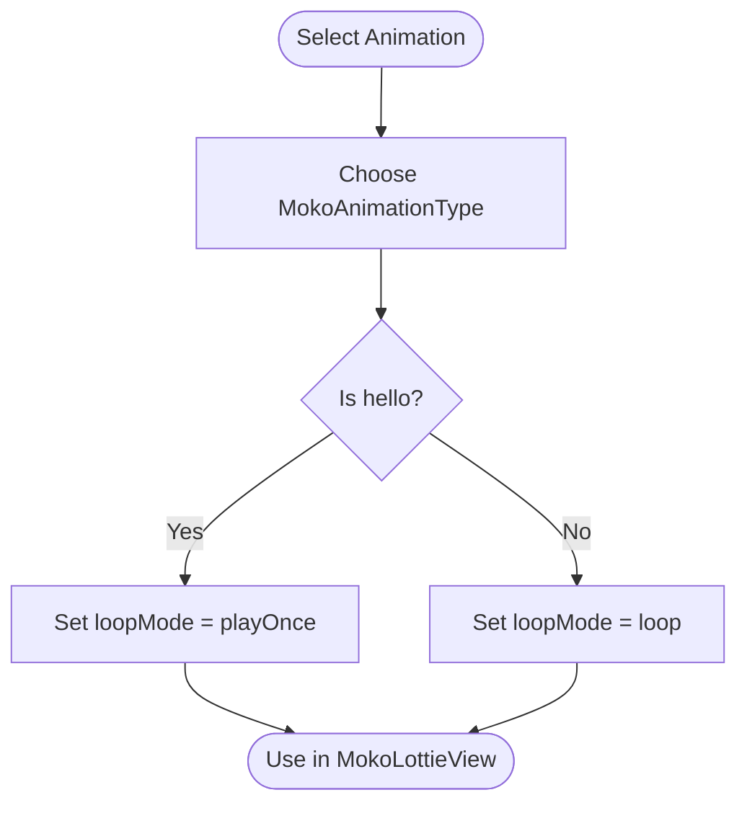
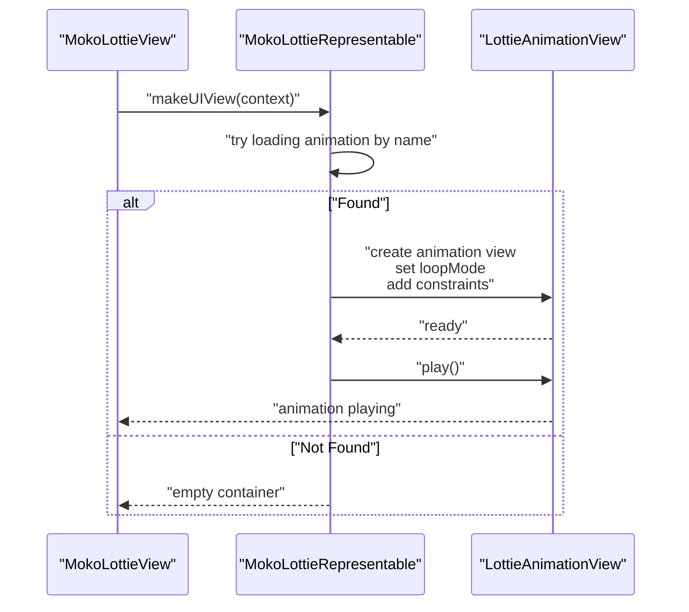
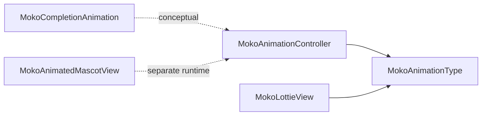

# Animation Controller

<cite>
**Referenced Files in This Document**
- [MokoAnimationController.swift](file://Moko/Moko/Features/Animation/MokoAnimationController.swift)
- [MokoAnimationTypes.swift](file://Moko/Moko/Features/Animation/MokoAnimationTypes.swift)
- [MokoLottieView.swift](file://Moko/Moko/Features/Animation/MokoLottieView.swift)
- [MokoCompletionAnimation.swift](file://Moko/Moko/Features/Animation/MokoCompletionAnimation.swift)
- [MokoAnimatedMascotView.swift](file://Moko/Moko/UIScreens/startScreens/MokoAnimatedMascotView.swift)
- [SplashScreenView.swift](file://Moko/Moko/UIScreens/startScreens/SplashScreenView.swift)
</cite>

## Table of Contents
1. [Introduction](#introduction)
2. [Project Structure](#project-structure)
3. [Core Components](#core-components)
4. [Architecture Overview](#architecture-overview)
5. [Detailed Component Analysis](#detailed-component-analysis)
6. [Dependency Analysis](#dependency-analysis)
7. [Performance Considerations](#performance-considerations)
8. [Troubleshooting Guide](#troubleshooting-guide)
9. [Conclusion](#conclusion)

## Introduction
This document explains the animation controller system for the Moko iOS app, focusing on how `MokoAnimationController` is intended to manage mascot animations across app states. It covers lifecycle management, state transitions, coordination between multiple animations, event-driven behavior, queueing strategies, priority and interruption handling, caching and reuse of animation views, and graceful degradation when animations cannot be rendered.

The current codebase provides:
- A lightweight global controller with a placeholder API for starting and stopping animations.
- A centralized enum describing available mascot animations and their default loop behaviors.
- Lottie-based rendering for mascot animations.
- A SwiftUI completion animation used by relaxation flows.
- A Rive-powered mascot view used during onboarding.

## Project Structure
The animation-related code lives primarily under `Moko/Moko/Features/Animation`, with additional mascot usage in start screens.

**Diagram sources**
- [MokoAnimationController.swift:1-59](file://Moko/Moko/Features/Animation/MokoAnimationController.swift#L1-L59)
- [MokoAnimationTypes.swift:1-37](file://Moko/Moko/Features/Animation/MokoAnimationTypes.swift#L1-L37)
- [MokoLottieView.swift:1-83](file://Moko/Moko/Features/Animation/MokoLottieView.swift#L1-L83)
- [MokoCompletionAnimation.swift:1-149](file://Moko/Moko/Features/Animation/MokoCompletionAnimation.swift#L1-L149)
- [MokoAnimatedMascotView.swift:1-28](file://Moko/Moko/UIScreens/startScreens/MokoAnimatedMascotView.swift#L1-L28)
- [SplashScreenView.swift:1-183](file://Moko/Moko/UIScreens/startScreens/SplashScreenView.swift#L1-L183)

**Section sources**
- [MokoAnimationController.swift:1-59](file://Moko/Moko/Features/Animation/MokoAnimationController.swift#L1-L59)
- [MokoAnimationTypes.swift:1-37](file://Moko/Moko/Features/Animation/MokoAnimationTypes.swift#L1-L37)
- [MokoLottieView.swift:1-83](file://Moko/Moko/Features/Animation/MokoLottieView.swift#L1-L83)
- [MokoCompletionAnimation.swift:1-149](file://Moko/Moko/Features/Animation/MokoCompletionAnimation.swift#L1-L149)
- [MokoAnimatedMascotView.swift:1-28](file://Moko/Moko/UIScreens/startScreens/MokoAnimatedMascotView.swift#L1-L28)
- [SplashScreenView.swift:1-183](file://Moko/Moko/UIScreens/startScreens/SplashScreenView.swift#L1-L183)

## Core Components
- `MokoAnimationController`: Global singleton that tracks the currently requested animation name and exposes `start` and `stop`. It also contains placeholders for global observers and cleanup.
- `LoopPlayMode`: Simple configuration struct indicating whether an animation should loop or play once.
- `MokoAnimationType`: Centralized enumeration of mascot animations with associated Lottie names and default loop modes.
- `MokoLottieView`: SwiftUI wrapper around a Lottie animation, configured per type and size.
- `MokoCompletionAnimation`: Pure SwiftUI animated completion illustration used by relaxation flows.
- `MokoAnimatedMascotView`: Rive-powered mascot view used in onboarding and intro screens.

Key responsibilities:
- Define available mascot animations and their playback defaults.
- Provide a shared controller entry point for orchestrating mascot animations.
- Render Lottie animations inside SwiftUI views.
- Offer a completion animation for session success feedback.
- Display a Rive mascot during onboarding.

**Section sources**
- [MokoAnimationController.swift:9-58](file://Moko/Moko/Features/Animation/MokoAnimationController.swift#L9-L58)
- [MokoAnimationTypes.swift:5-36](file://Moko/Moko/Features/Animation/MokoAnimationTypes.swift#L5-L36)
- [MokoLottieView.swift:4-82](file://Moko/Moko/Features/Animation/MokoLottieView.swift#L4-L82)
- [MokoCompletionAnimation.swift:3-149](file://Moko/Moko/Features/Animation/MokoCompletionAnimation.swift#L3-L149)
- [MokoAnimatedMascotView.swift:4-20](file://Moko/Moko/UIScreens/startScreens/MokoAnimatedMascotView.swift#L4-L20)

## Architecture Overview
At a high level, the animation system separates concerns:
- The controller owns orchestration intent (what animation to show).
- The types define what animations exist and how they should behave by default.
- Views render animations using Lottie or Rive.
- Completion animations are independent SwiftUI compositions.

**Diagram sources**
- [MokoAnimationController.swift:28-58](file://Moko/Moko/Features/Animation/MokoAnimationController.swift#L28-L58)
- [MokoLottieView.swift:25-82](file://Moko/Moko/Features/Animation/MokoLottieView.swift#L25-L82)
- [MokoAnimationTypes.swift:22-31](file://Moko/Moko/Features/Animation/MokoAnimationTypes.swift#L22-L31)

## Detailed Component Analysis

### MokoAnimationController
Responsibilities:
- Maintain a single source of truth for the currently requested mascot animation.
- Expose simple APIs to start and stop animations.
- Prepare hooks for global observers and cleanup.

Current implementation notes:
- Singleton pattern via `shared`.
- Tracks `currentAnimation` string.
- `start` accepts animation name, loop mode, and size; currently only updates internal state.
- `stop` clears the current animation.
- Placeholder methods for observer registration and cleanup.

Lifecycle and state transitions:
- Initialization registers global observers (placeholder).
- On `start`, the controller records the requested animation.
- On `stop`, it clears the request.
- On deinitialization, it attempts to stop all animations (placeholder).

Event-driven architecture:
- The controller is designed to react to app-wide events through `registerGlobalObservers`, which is currently empty. This is where you would subscribe to app lifecycle changes, user interactions, or feature flags to update the active mascot animation.

Queueing and priority:
- Not implemented yet. The controller currently holds a single animation name. To support queues and priorities, you can extend this class to track a list of queued animations and a priority policy.

Interruption handling:
- Not implemented yet. You can add logic to interrupt lower-priority animations when higher-priority ones are requested.

Graceful degradation:
- The controller itself does not handle rendering failures. Delegation to views and Lottie handles missing assets.

**Diagram sources**
- [MokoAnimationController.swift:9-58](file://Moko/Moko/Features/Animation/MokoAnimationController.swift#L9-L58)

**Section sources**
- [MokoAnimationController.swift:28-58](file://Moko/Moko/Features/Animation/MokoAnimationController.swift#L28-L58)

### MokoAnimationType
Responsibilities:
- Enumerate all mascot animations.
- Map each case to its Lottie asset name.
- Provide default loop behavior per animation.

Behavior summary:
- `hello` plays once.
- `complete`, `meditation`, `listening`, and `idle` loop continuously.

Usage:
- Consumers select an animation case and pass it to views like `MokoLottieView`.

**Diagram sources**
- [MokoAnimationTypes.swift:5-31](file://Moko/Moko/Features/Animation/MokoAnimationTypes.swift#L5-L31)

**Section sources**
- [MokoAnimationTypes.swift:5-36](file://Moko/Moko/Features/Animation/MokoAnimationTypes.swift#L5-L36)

### MokoLottieView
Responsibilities:
- Wrap a Lottie animation in SwiftUI.
- Resolve the correct asset path and configure playback.
- Apply accessibility labels and sizing.

Rendering flow:
- Creates a container view.
- Attempts to load the Lottie animation from several possible directories.
- Configures loop mode based on `MokoAnimationType`.
- Adds constraints and starts playback.
- Logs success or failure messages.

Caching and reuse:
- Each instance creates its own `LottieAnimationView`. There is no explicit cache at the view level. For performance, consider caching loaded animations or reusing instances when possible.

Error handling:
- If the animation cannot be found, it logs an error and returns an empty container without crashing.

**Diagram sources**
- [MokoLottieView.swift:25-82](file://Moko/Moko/Features/Animation/MokoLottieView.swift#L25-L82)

**Section sources**
- [MokoLottieView.swift:4-82](file://Moko/Moko/Features/Animation/MokoLottieView.swift#L4-L82)

### MokoCompletionAnimation
Responsibilities:
- Provide a self-contained SwiftUI animation for session completion.
- Animate rings, checkmark progress, falling lemons, and badge scaling.

Characteristics:
- Uses `TimelineView` for time-based animation.
- Computes easing, overshoot, breathing effects, and staggered elements.
- Draws custom graphics using `Canvas`.

Integration:
- Designed to be embedded into relaxation flows and other success screens.

**Section sources**
- [MokoCompletionAnimation.swift:3-149](file://Moko/Moko/Features/Animation/MokoCompletionAnimation.swift#L3-L149)

### MokoAnimatedMascotView
Responsibilities:
- Load and display a Rive-based mascot animation.
- Provide a friendly greeting and periodic hopping motion.

Usage:
- Used in onboarding and intro screens to present the mascot visually.

**Section sources**
- [MokoAnimatedMascotView.swift:4-20](file://Moko/Moko/UIScreens/startScreens/MokoAnimatedMascotView.swift#L4-L20)

### SplashScreenView
Responsibilities:
- Present splash branding and animated elements.
- Coordinate UI animations and auto-advance to onboarding.

Relationship to animation system:
- Does not directly use `MokoAnimationController`; instead, it uses SwiftUI animations and static images.
- Serves as a conceptual example of orchestrating visual sequences before mascot animations take over.

**Section sources**
- [SplashScreenView.swift:10-183](file://Moko/Moko/UIScreens/startScreens/SplashScreenView.swift#L10-L183)

## Dependency Analysis
The primary dependencies among animation components are:
- `MokoLottieView` depends on `MokoAnimationType` for naming and loop behavior.
- `MokoAnimationController` is intended to coordinate animation requests but currently has minimal coupling to views.
- `MokoCompletionAnimation` is independent of the controller and Lottie/Rive systems.
- `MokoAnimatedMascotView` uses Rive runtime and is separate from Lottie.

**Diagram sources**
- [MokoAnimationController.swift:28-58](file://Moko/Moko/Features/Animation/MokoAnimationController.swift#L28-L58)
- [MokoAnimationTypes.swift:5-36](file://Moko/Moko/Features/Animation/MokoAnimationTypes.swift#L5-L36)
- [MokoLottieView.swift:4-82](file://Moko/Moko/Features/Animation/MokoLottieView.swift#L4-L82)
- [MokoCompletionAnimation.swift:3-149](file://Moko/Moko/Features/Animation/MokoCompletionAnimation.swift#L3-L149)
- [MokoAnimatedMascotView.swift:4-20](file://Moko/Moko/UIScreens/startScreens/MokoAnimatedMascotView.swift#L4-L20)

**Section sources**
- [MokoAnimationController.swift:28-58](file://Moko/Moko/Features/Animation/MokoAnimationController.swift#L28-L58)
- [MokoAnimationTypes.swift:5-36](file://Moko/Moko/Features/Animation/MokoAnimationTypes.swift#L5-L36)
- [MokoLottieView.swift:4-82](file://Moko/Moko/Features/Animation/MokoLottieView.swift#L4-L82)
- [MokoCompletionAnimation.swift:3-149](file://Moko/Moko/Features/Animation/MokoCompletionAnimation.swift#L3-L149)
- [MokoAnimatedMascotView.swift:4-20](file://Moko/Moko/UIScreens/startScreens/MokoAnimatedMascotView.swift#L4-L20)

## Performance Considerations
- Avoid creating many Lottie instances simultaneously; prefer caching or reusing animation views where feasible.
- Use appropriate loop modes: play-once for short events, loop for ambient idle/listening states.
- Keep animation sizes reasonable to reduce memory pressure.
- Prefer background threads for heavy work if extending controllers or loaders.
- Monitor logs for missing assets to prevent silent failures.

[No sources needed since this section provides general guidance]

## Troubleshooting Guide
Common issues and resolutions:
- Missing Lottie assets:
  - Symptom: Console prints an error indicating the animation could not be found.
  - Resolution: Ensure the animation file exists in one of the searched directories (`Resources/Animations`, `Animations`, or bundle root).
- No animation playing:
  - Symptom: View renders but nothing animates.
  - Resolution: Verify that `MokoAnimationType.loopMode` matches expected behavior and that `play()` is invoked.
- Controller not coordinating:
  - Symptom: Calling `start` does not change visible animation.
  - Resolution: Extend `registerGlobalObservers` to observe app state changes and propagate to views. Connect `currentAnimation` to view state.

Operational tips:
- Add logging around controller state changes to debug transitions.
- Implement `stopAllAnimations` to release resources when the controller is deallocated.
- Integrate error handling in view layers to fall back gracefully when assets fail to load.

**Section sources**
- [MokoLottieView.swift:40-76](file://Moko/Moko/Features/Animation/MokoLottieView.swift#L40-L76)
- [MokoAnimationController.swift:35-58](file://Moko/Moko/Features/Animation/MokoAnimationController.swift#L35-L58)

## Conclusion
The current animation controller system provides a foundation for managing mascot animations:
- `MokoAnimationController` offers a central place to declare animation intent.
- `MokoAnimationType` standardizes available animations and default behaviors.
- `MokoLottieView` renders Lottie animations with sensible defaults and basic error handling.
- `MokoCompletionAnimation` delivers polished completion visuals.
- `MokoAnimatedMascotView` integrates Rive for onboarding experiences.

To fully realize the controller’s role:
- Implement observer registration to respond to user interactions and app state changes.
- Add queueing and priority management for multiple concurrent animations.
- Introduce interruption handling to prioritize important animations.
- Cache and reuse animation instances to improve performance.
- Enhance graceful degradation paths for missing assets or unsupported environments.

[No sources needed since this section summarizes without analyzing specific files]