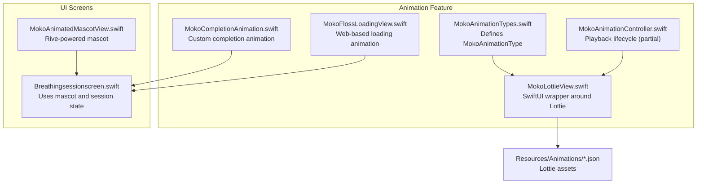
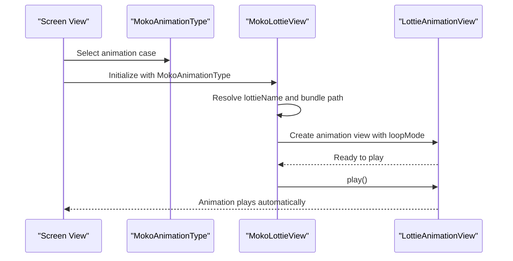
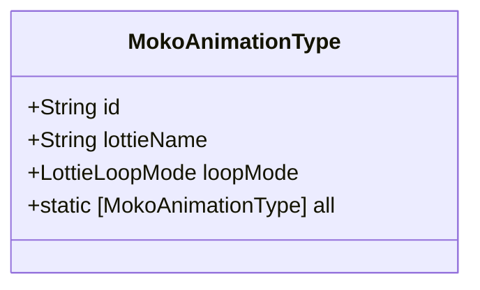
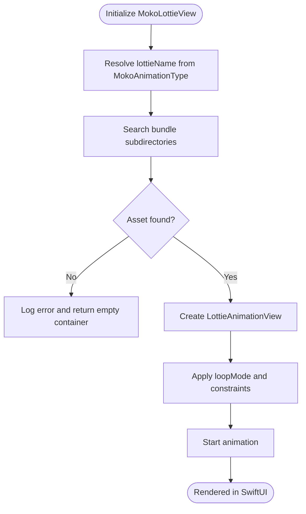
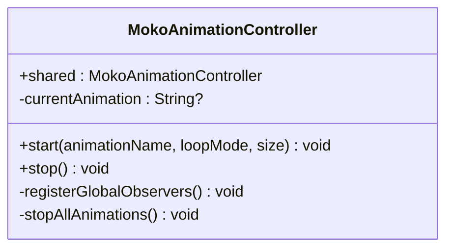
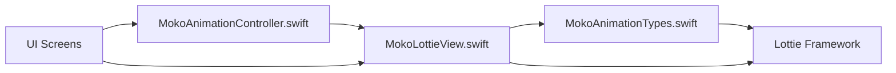

# Animation Types System

<cite>
**Referenced Files in This Document**
- [MokoAnimationTypes.swift](file://Moko/Moko/Features/Animation/MokoAnimationTypes.swift)
- [MokoLottieView.swift](file://Moko/Moko/Features/Animation/MokoLottieView.swift)
- [MokoAnimationController.swift](file://Moko/Moko/Features/Animation/MokoAnimationController.swift)
- [MokoCompletionAnimation.swift](file://Moko/Moko/Features/Animation/MokoCompletionAnimation.swift)
- [MokoFlossLoadingView.swift](file://Moko/Moko/Features/Animation/MokoFlossLoadingView.swift)
- [MokoAnimatedMascotView.swift](file://Moko/Moko/UIScreens/startScreens/MokoAnimatedMascotView.swift)
- [Breathingsessionscreen.swift](file://Moko/Moko/UIScreens/relaxScreens/Breathing/Breathingsessionscreen.swift)
- [README.md](file://README.md)
</cite>

## Table of Contents
1. [Introduction](#introduction)
2. [Project Structure](#project-structure)
3. [Core Components](#core-components)
4. [Architecture Overview](#architecture-overview)
5. [Detailed Component Analysis](#detailed-component-analysis)
6. [Dependency Analysis](#dependency-analysis)
7. [Performance Considerations](#performance-considerations)
8. [Troubleshooting Guide](#troubleshooting-guide)
9. [Conclusion](#conclusion)

## Introduction
This document explains the animation types system used by the app’s mascot and companion animations. It focuses on how `MokoAnimationType` provides a centralized, type-safe registry for supported animation categories, how each type maps to a Lottie asset and playback behavior, and how the rendering layer consumes these types to display animations consistently. It also covers extensibility, configuration options, automatic selection based on context, accessibility integration, and guidance for adding new animation types while preserving backward compatibility.

The mascot animations are primarily Lottie-based JSON files rendered through SwiftUI wrappers. The system is designed so that UI code selects an animation by enum case rather than string literals, reducing errors and making it easier to reason about default behaviors such as looping versus single-play.

## Project Structure
The animation-related code lives under the Animation feature module and integrates with UI screens:

**Diagram sources**
- [MokoAnimationTypes.swift:6-35](file://Moko/Moko/Features/Animation/MokoAnimationTypes.swift#L6-L35)
- [MokoLottieView.swift:5-82](file://Moko/Moko/Features/Animation/MokoLottieView.swift#L5-L82)
- [MokoAnimationController.swift:29-58](file://Moko/Moko/Features/Animation/MokoAnimationController.swift#L29-L58)
- [MokoCompletionAnimation.swift:5-59](file://Moko/Moko/Features/Animation/MokoCompletionAnimation.swift#L5-L59)
- [MokoFlossLoadingView.swift:7-44](file://Moko/Moko/Features/Animation/MokoFlossLoadingView.swift#L7-L44)
- [MokoAnimatedMascotView.swift:5-19](file://Moko/Moko/UIScreens/startScreens/MokoAnimatedMascotView.swift#L5-L19)
- [Breathingsessionscreen.swift:303-321](file://Moko/Moko/UIScreens/relaxScreens/Breathing/Breathingsessionscreen.swift#L303-L321)

**Section sources**
- [README.md:111-149](file://README.md#L111-L149)

## Core Components
- `MokoAnimationType`: Centralized enumeration of supported mascot animations. Each case maps to a Lottie file name and defines default loop behavior.
- `MokoLottieView`: SwiftUI view that renders a selected `MokoAnimationType` using Lottie. It resolves the correct asset path and applies the type’s loop mode.
- `MokoAnimationController`: Lifecycle controller for managing current animation state across app states. Currently exposes start/stop APIs and a shared instance.
- `MokoCompletionAnimation`: Custom animated completion illustration used by relaxation flows. Not part of the Lottie enum but complements the mascot experience.
- `MokoFlossLoadingView`: Lightweight loading animation that cross-fades from a static image to a WebKit-based animation, respecting Reduce Motion.
- `MokoAnimatedMascotView`: Rive-powered mascot view used in the welcome screen. It demonstrates another animation technology alongside Lottie.

Key responsibilities:
- Type safety: UI selects animations via enum cases instead of strings.
- Default behaviors: Looping vs single-play is defined per type.
- Rendering abstraction: Views consume types without knowing asset paths.
- Accessibility: All animation views provide labels and respect motion preferences where applicable.

**Section sources**
- [MokoAnimationTypes.swift:6-35](file://Moko/Moko/Features/Animation/MokoAnimationTypes.swift#L6-L35)
- [MokoLottieView.swift:5-82](file://Moko/Moko/Features/Animation/MokoLottieView.swift#L5-L82)
- [MokoAnimationController.swift:29-58](file://Moko/Moko/Features/Animation/MokoAnimationController.swift#L29-L58)
- [MokoCompletionAnimation.swift:5-59](file://Moko/Moko/Features/Animation/MokoCompletionAnimation.swift#L5-L59)
- [MokoFlossLoadingView.swift:7-44](file://Moko/Moko/Features/Animation/MokoFlossLoadingView.swift#L7-L44)
- [MokoAnimatedMascotView.swift:5-19](file://Moko/Moko/UIScreens/startScreens/MokoAnimatedMascotView.swift#L5-L19)

## Architecture Overview
At runtime, UI components request an animation by passing a `MokoAnimationType`. The Lottie view resolves the corresponding asset, configures playback according to the type’s loop mode, and starts playing. Controllers can coordinate when animations should start or stop across screens.

**Diagram sources**
- [MokoAnimationTypes.swift:18-31](file://Moko/Moko/Features/Animation/MokoAnimationTypes.swift#L18-L31)
- [MokoLottieView.swift:28-72](file://Moko/Moko/Features/Animation/MokoLottieView.swift#L28-L72)

## Detailed Component Analysis

### MokoAnimationType Registry
`MokoAnimationType` is the central registry for all supported mascot animations. It:
- Maps each case to a Lottie asset name.
- Provides a stable identifier (`id`) derived from the raw value.
- Exposes a computed property for the Lottie file name.
- Defines default loop behavior per type:
  - Single-play for greeting/completion-like animations.
  - Continuous loop for ambient or companion animations.

Extending this type is the primary way to add new mascot animations. When adding a new case:
- Add a new case with its Lottie file name.
- Decide whether it should loop or play once and update the loop mode mapping accordingly.
- Optionally expose convenience accessors if needed by UI code.

**Diagram sources**
- [MokoAnimationTypes.swift:6-35](file://Moko/Moko/Features/Animation/MokoAnimationTypes.swift#L6-L35)

**Section sources**
- [MokoAnimationTypes.swift:6-35](file://Moko/Moko/Features/Animation/MokoAnimationTypes.swift#L6-L35)

### MokoLottieView Rendering Layer
`MokoLottieView` is a SwiftUI component that takes a `MokoAnimationType` and renders it inside a fixed square viewport. It:
- Uses the type’s `lottieName` to locate the Lottie asset.
- Searches multiple possible bundle subdirectories for robustness.
- Configures the underlying Lottie view with the type’s loop mode.
- Sets background behavior to pause and restore visibility.
- Applies an accessibility label describing the animation.

**Diagram sources**
- [MokoLottieView.swift:28-76](file://Moko/Moko/Features/Animation/MokoLottieView.swift#L28-L76)

**Section sources**
- [MokoLottieView.swift:5-82](file://Moko/Moko/Features/Animation/MokoLottieView.swift#L5-L82)

### MokoAnimationController Lifecycle
`MokoAnimationController` is intended to manage animation playback across app states. It currently:
- Exposes a shared singleton instance.
- Tracks the currently active animation name.
- Provides `start(animationName:loopMode:size:)` and `stop()` methods.
- Registers global observers and stops all animations during deinitialization.

While the controller currently stores a string-based animation name, the broader system encourages selecting animations via `MokoAnimationType` at the view layer. Future enhancements could align the controller with the type-safe registry.

**Diagram sources**
- [MokoAnimationController.swift:29-58](file://Moko/Moko/Features/Animation/MokoAnimationController.swift#L29-L58)

**Section sources**
- [MokoAnimationController.swift:29-58](file://Moko/Moko/Features/Animation/MokoAnimationController.swift#L29-L58)

### Completion Animation and Loading Animation
- `MokoCompletionAnimation` provides a custom animated completion illustration used by relaxation flows. It includes accessibility labeling and uses a timeline-driven approach to animate rings, lemons, and a checkmark.
- `MokoFlossLoadingView` shows a lightweight loading animation that respects Reduce Motion. It prewarms a WebKit-based animation and cross-fades from a static image to the running animation.

These components complement the mascot animations and demonstrate different animation technologies within the same ecosystem.

**Section sources**
- [MokoCompletionAnimation.swift:5-59](file://Moko/Moko/Features/Animation/MokoCompletionAnimation.swift#L5-L59)
- [MokoFlossLoadingView.swift:7-44](file://Moko/Moko/Features/Animation/MokoFlossLoadingView.swift#L7-L44)

### Mascot Integration Across Screens
- `MokoAnimatedMascotView` uses Rive to render a mascot animation in the welcome flow.
- `Breathingsessionscreen.swift` manages session state and updates accessibility labels based on the current state, demonstrating how mascot presence ties into user context.

**Section sources**
- [MokoAnimatedMascotView.swift:5-19](file://Moko/Moko/UIScreens/startScreens/MokoAnimatedMascotView.swift#L5-L19)
- [Breathingsessionscreen.swift:303-321](file://Moko/Moko/UIScreens/relaxScreens/Breathing/Breathingsessionscreen.swift#L303-L321)

## Dependency Analysis
The animation system has clear boundaries:
- `MokoAnimationType` depends only on Foundation and Lottie for loop mode.
- `MokoLottieView` depends on SwiftUI and Lottie to render the animation.
- `MokoAnimationController` is decoupled from rendering and coordinates lifecycle.
- UI screens depend on the view layer and may use additional technologies like Rive or WebKit for specific animations.

**Diagram sources**
- [MokoAnimationTypes.swift:2-3](file://Moko/Moko/Features/Animation/MokoAnimationTypes.swift#L2-L3)
- [MokoLottieView.swift:1-2](file://Moko/Moko/Features/Animation/MokoLottieView.swift#L1-L2)
- [MokoAnimationController.swift:7-7](file://Moko/Moko/Features/Animation/MokoAnimationController.swift#L7-L7)

**Section sources**
- [MokoAnimationTypes.swift:2-3](file://Moko/Moko/Features/Animation/MokoAnimationTypes.swift#L2-L3)
- [MokoLottieView.swift:1-2](file://Moko/Moko/Features/Animation/MokoLottieView.swift#L1-L2)
- [MokoAnimationController.swift:7-7](file://Moko/Moko/Features/Animation/MokoAnimationController.swift#L7-L7)

## Performance Considerations
- Prefer looping ambient animations sparingly; they run continuously and can impact battery life.
- Use single-play animations for one-off events to avoid unnecessary resource usage.
- Preload or prewarm heavy resources (e.g., WebKit-based loaders) to reduce first-frame latency.
- Keep animation sizes reasonable; large frames increase memory and rendering costs.
- Respect Reduce Motion to minimize processing for users who prefer reduced motion.

[No sources needed since this section provides general guidance]

## Troubleshooting Guide
Common issues and resolutions:
- Asset not found: Ensure the Lottie file exists in the expected bundle subdirectory and matches the `lottieName` from `MokoAnimationType`.
- Incorrect loop behavior: Verify the loop mode mapping in `MokoAnimationType`; adjust per-type defaults if necessary.
- Accessibility concerns: Confirm that each animation view sets an appropriate `accessibilityLabel` and that dynamic content updates reflect user context.
- Motion preferences: For WebKit-based animations, ensure Reduce Motion is propagated to the page and that fallbacks exist for users who prefer reduced motion.

**Section sources**
- [MokoLottieView.swift:40-76](file://Moko/Moko/Features/Animation/MokoLottieView.swift#L40-L76)
- [MokoFlossLoadingView.swift:10-44](file://Moko/Moko/Features/Animation/MokoFlossLoadingView.swift#L10-L44)
- [MokoCompletionAnimation.swift:54-59](file://Moko/Moko/Features/Animation/MokoCompletionAnimation.swift#L54-L59)

## Conclusion
The animation types system centers around `MokoAnimationType`, which provides a type-safe registry for mascot animations and their default behaviors. `MokoLottieView` consumes these types to render animations consistently, while `MokoAnimationController` offers lifecycle coordination. The system supports extensibility by allowing new animation types to be added with minimal changes to existing code. Accessibility is integrated throughout, ensuring meaningful descriptions and respecting user motion preferences. By keeping animation selection type-safe and centralizing configuration, the app maintains clarity, reliability, and a consistent mascot experience across contexts.

[No sources needed since this section summarizes without analyzing specific files]