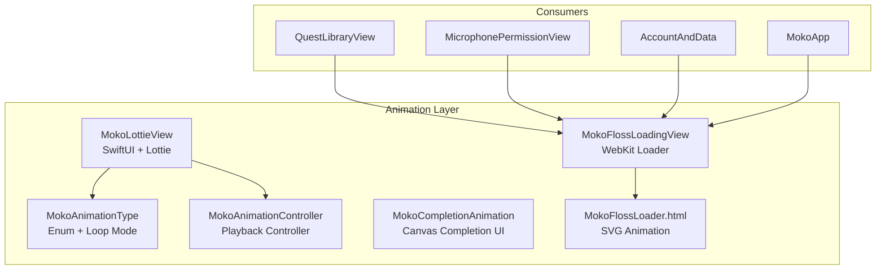
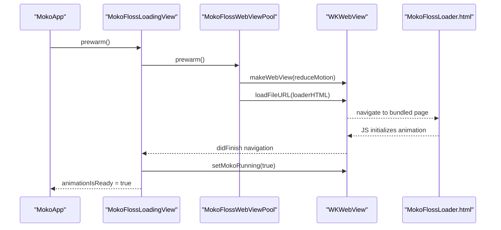
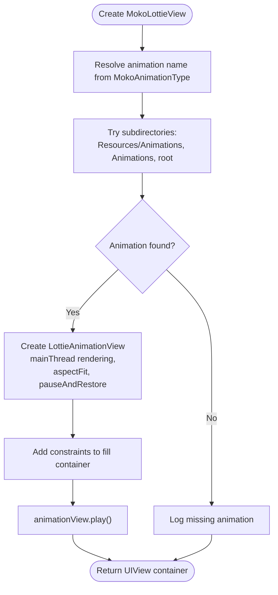
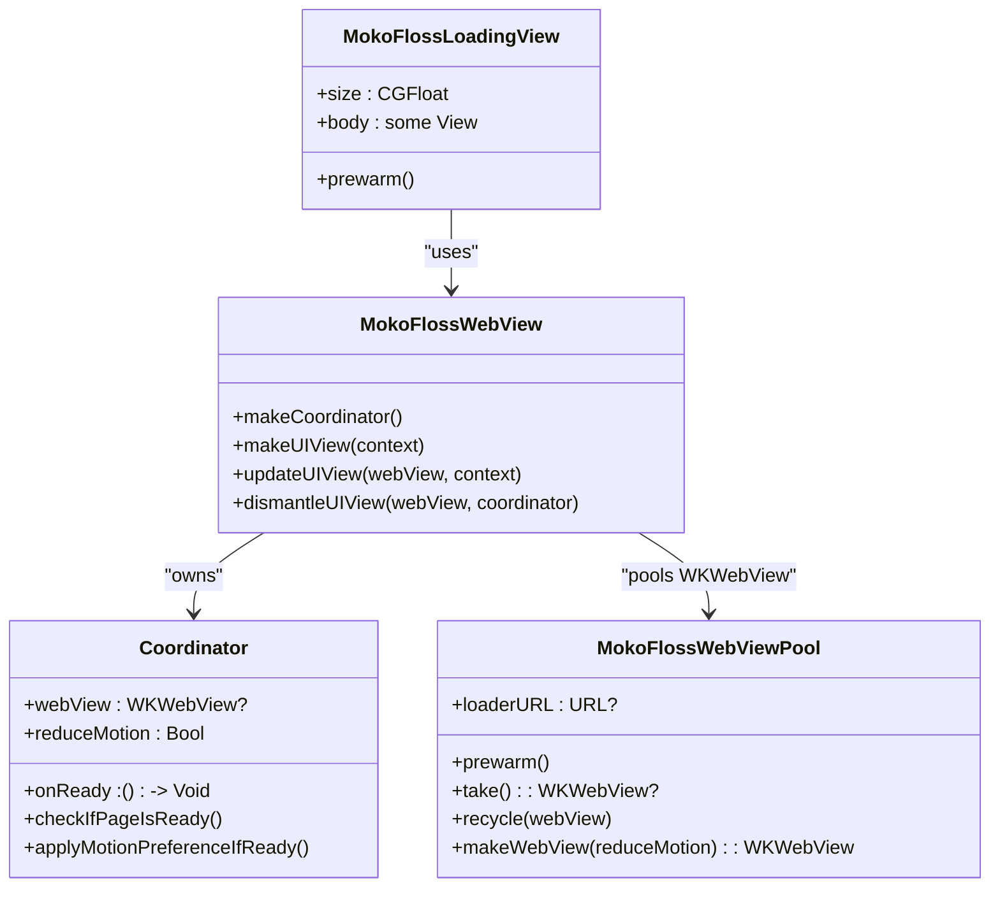
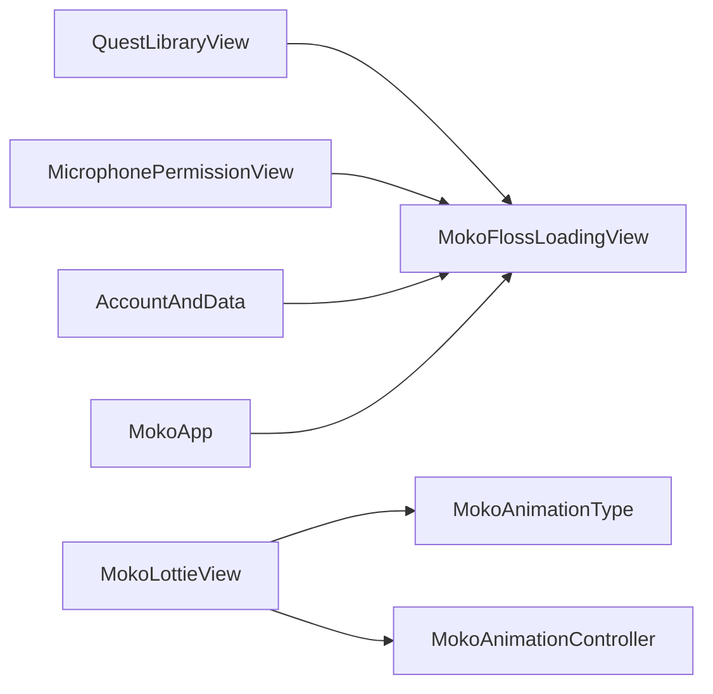

# Lottie Integration

<cite>
**Referenced Files in This Document**
- [MokoLottieView.swift](file://Moko/Features/Animation/MokoLottieView.swift)
- [MokoLottieView.swift](file://Moko/Moko/Features/Animation/MokoLottieView.swift)
- [MokoAnimationTypes.swift](file://Moko/Moko/Features/Animation/MokoAnimationTypes.swift)
- [MokoAnimationController.swift](file://Moko/Moko/Features/Animation/MokoAnimationController.swift)
- [MokoCompletionAnimation.swift](file://Moko/Moko/Features/Animation/MokoCompletionAnimation.swift)
- [MokoFlossLoadingView.swift](file://Moko/Moko/Features/Animation/MokoFlossLoadingView.swift)
- [MokoFlossLoader.html](file://Moko/Moko/MokoFlossLoader.html)
- [MokoApp.swift](file://Moko/Moko/MokoApp.swift)
- [QuestLibraryView.swift](file://Moko/Moko/Features/QuestLibrary/QuestLibraryView.swift)
- [MicrophonePermissionView.swift](file://Moko/Moko/UIScreens/Onboarding_Questions/MicrophonePermissionView.swift)
- [AccountAndData.swift](file://Moko/Moko/UIScreens/homeScreens/ProfileOverView/AccountAndData.swift)
</cite>

## Table of Contents
1. [Introduction](#introduction)
2. [Project Structure](#project-structure)
3. [Core Components](#core-components)
4. [Architecture Overview](#architecture-overview)
5. [Detailed Component Analysis](#detailed-component-analysis)
6. [Dependency Analysis](#dependency-analysis)
7. [Performance Considerations](#performance-considerations)
8. [Troubleshooting Guide](#troubleshooting-guide)
9. [Conclusion](#conclusion)

## Introduction
This document explains the Lottie integration layer used by the application to render JSON-based mascot animations and related loading experiences. It focuses on:
- How MokoLottieView acts as the primary container for Lottie animations.
- Animation asset organization and loading behavior.
- SwiftUI integration patterns, including state binding, property observers, and reactive updates.
- Practical usage examples for custom animations, event handling, and concurrent playback.
- Performance strategies such as preloading, memory optimization, and resource cleanup.
- Troubleshooting guidance and platform-specific considerations.

The repository contains two distinct animation implementations:
- A Lottie-based view that renders JSON animations via the Lottie library.
- A WebKit-based animated loader that cross-fades from a static image to an SVG animation.

## Project Structure
The animation-related code is primarily located under the Features/Animation directory. The project also includes a separate top-level copy of the same file names; this documentation references the implementation under Moko/Moko/Features/Animation unless otherwise noted.

**Diagram sources**
- [MokoLottieView.swift](file://Moko/Moko/Features/Animation/MokoLottieView.swift)
- [MokoAnimationTypes.swift](file://Moko/Moko/Features/Animation/MokoAnimationTypes.swift)
- [MokoAnimationController.swift](file://Moko/Moko/Features/Animation/MokoAnimationController.swift)
- [MokoCompletionAnimation.swift](file://Moko/Moko/Features/Animation/MokoCompletionAnimation.swift)
- [MokoFlossLoadingView.swift](file://Moko/Moko/Features/Animation/MokoFlossLoadingView.swift)
- [MokoFlossLoader.html](file://Moko/Moko/MokoFlossLoader.html)
- [QuestLibraryView.swift](file://Moko/Moko/Features/QuestLibrary/QuestLibraryView.swift)
- [MicrophonePermissionView.swift](file://Moko/Moko/UIScreens/Onboarding_Questions/MicrophonePermissionView.swift)
- [AccountAndData.swift](file://Moko/Moko/UIScreens/homeScreens/ProfileOverView/AccountAndData.swift)
- [MokoApp.swift](file://Moko/Moko/MokoApp.swift)

**Section sources**
- [MokoLottieView.swift](file://Moko/Moko/Features/Animation/MokoLottieView.swift)
- [MokoAnimationTypes.swift](file://Moko/Moko/Features/Animation/MokoAnimationTypes.swift)
- [MokoAnimationController.swift](file://Moko/Moko/Features/Animation/MokoAnimationController.swift)
- [MokoFlossLoadingView.swift](file://Moko/Moko/Features/Animation/MokoFlossLoadingView.swift)
- [MokoFlossLoader.html](file://Moko/Moko/MokoFlossLoader.html)
- [QuestLibraryView.swift](file://Moko/Moko/Features/QuestLibrary/QuestLibraryView.swift)
- [MicrophonePermissionView.swift](file://Moko/Moko/UIScreens/Onboarding_Questions/MicrophonePermissionView.swift)
- [AccountAndData.swift](file://Moko/Moko/UIScreens/homeScreens/ProfileOverView/AccountAndData.swift)
- [MokoApp.swift](file://Moko/Moko/MokoApp.swift)

## Core Components
- MokoLottieView (SwiftUI wrapper around Lottie): Renders JSON animations inside a fixed square viewport, with automatic layout constraints and accessibility labeling.
- MokoAnimationType: Enumerates available animations and maps each case to a Lottie loop mode.
- MokoAnimationController: Intended central controller for managing playback across app states; currently provides configuration scaffolding.
- MokoCompletionAnimation: A Canvas-based completion animation used across relaxation flows.
- MokoFlossLoadingView: A reusable loader that shows a static mascot image immediately, then cross-fades to a WebKit-rendered SVG animation once ready.
- MokoFlossLoader.html: Bundled HTML/SVG/JS animation driving the loader’s dancing mascot.

Key responsibilities:
- Asset discovery and loading for Lottie animations.
- Declarative SwiftUI composition and lifecycle management.
- Preloading and pooling for the WebKit loader.
- Accessibility and reduced-motion support.

**Section sources**
- [MokoLottieView.swift](file://Moko/Moko/Features/Animation/MokoLottieView.swift)
- [MokoAnimationTypes.swift](file://Moko/Moko/Features/Animation/MokoAnimationTypes.swift)
- [MokoAnimationController.swift](file://Moko/Moko/Features/Animation/MokoAnimationController.swift)
- [MokoCompletionAnimation.swift](file://Moko/Moko/Features/Animation/MokoCompletionAnimation.swift)
- [MokoFlossLoadingView.swift](file://Moko/Moko/Features/Animation/MokoFlossLoadingView.swift)
- [MokoFlossLoader.html](file://Moko/Moko/MokoFlossLoader.html)

## Architecture Overview
The Lottie integration follows a layered approach:
- Presentation layer: SwiftUI views compose animation components declaratively.
- Rendering layer: LottieAnimationView renders JSON assets; WKWebView renders the SVG loader.
- Coordination layer: Controllers and enums define playback modes and asset identity.
- Resource layer: Bundle resources include JSON animations and the HTML loader.

**Diagram sources**
- [MokoApp.swift](file://Moko/Moko/MokoApp.swift)
- [MokoFlossLoadingView.swift](file://Moko/Moko/Features/Animation/MokoFlossLoadingView.swift)
- [MokoFlossLoader.html](file://Moko/Moko/MokoFlossLoader.html)

## Detailed Component Analysis

### MokoLottieView (Lottie-based)
MokoLottieView is a SwiftUI View that wraps a UIViewRepresentable to host a LottieAnimationView. It:
- Accepts an animation type enum and optional size.
- Locates the JSON asset by name across multiple possible subdirectories.
- Configures the Lottie view with main-thread rendering, aspect-fit scaling, pause-and-restore background behavior, and clipping.
- Starts playback automatically upon creation.
- Provides an accessibility label for screen readers.

Initialization pattern:
- Construct with a specific MokoAnimationType and optional size.
- The internal representable resolves the correct bundle path and creates the Lottie view.

Lifecycle:
- makeUIView constructs the container and LottieAnimationView, sets constraints, and calls play().
- updateUIView is intentionally minimal because the view is constrained to a fixed SwiftUI frame.

Configuration options:
- Size can be provided; defaults are applied when not specified.
- Looping behavior is derived from MokoAnimationType.loopMode.

Accessibility:
- The view exposes an accessibility label describing the animation context.

**Diagram sources**
- [MokoLottieView.swift](file://Moko/Moko/Features/Animation/MokoLottieView.swift)
- [MokoAnimationTypes.swift](file://Moko/Moko/Features/Animation/MokoAnimationTypes.swift)

**Section sources**
- [MokoLottieView.swift](file://Moko/Moko/Features/Animation/MokoLottieView.swift)
- [MokoAnimationTypes.swift](file://Moko/Moko/Features/Animation/MokoAnimationTypes.swift)

### MokoAnimationType
MokoAnimationType enumerates available mascot animations and maps each case to a LottieLoopMode:
- hello plays once.
- meditation, complete, listening, idle loop continuously.

It also exposes:
- id and lottieName properties for SwiftUI list identification and asset naming.
- allCases for iteration.

Usage:
- Passed into MokoLottieView to select the JSON asset and playback behavior.

**Section sources**
- [MokoAnimationTypes.swift](file://Moko/Moko/Features/Animation/MokoAnimationTypes.swift)

### MokoAnimationController
MokoAnimationController is intended to coordinate animation playback across app states:
- Provides a shared singleton instance.
- Tracks current animation name.
- Exposes start and stop methods.
- Includes deinit to stop all animations.

Current status:
- Playback control methods are placeholders; they do not yet interact with Lottie instances.
- Global observer registration is empty.

Recommendation:
- Extend this controller to own LottieAnimationView instances or a cache, and expose lifecycle hooks for start/stop based on view visibility and app state changes.

**Section sources**
- [MokoAnimationController.swift](file://Moko/Moko/Features/Animation/MokoAnimationController.swift)

### MokoCompletionAnimation
MokoCompletionAnimation is a Canvas-based completion animation used across relaxation flows. It:
- Uses TimelineView for time-driven updates at a target frame rate.
- Draws concentric rings, falling lemons, and a checkmark overlay.
- Applies easing, overshoot, and breathing effects.
- Respects accessibility preferences.

Integration notes:
- Not a Lottie component; it demonstrates a performant alternative using native Canvas drawing.
- Useful for complex animated sequences where Lottie may be overkill.

**Section sources**
- [MokoCompletionAnimation.swift](file://Moko/Moko/Features/Animation/MokoCompletionAnimation.swift)

### MokoFlossLoadingView and MokoFlossLoader.html
MokoFlossLoadingView provides a fast-loading placeholder experience:
- Immediately shows a static mascot image.
- Loads a WKWebView-backed HTML/SVG animation.
- Cross-fades to the vector animation once ready.
- Supports reduced motion through environment variables and JavaScript injection.

Preloading strategy:
- MokoFlossLoadingView.prewarm() initializes a WKWebView early in app launch.
- MokoApp invokes prewarm during app startup to reduce first-frame latency.

WebView lifecycle:
- Coordinator handles WKNavigationDelegate callbacks.
- On finish, it checks if the page is ready, enables the animation, and notifies the SwiftUI view.
- When the view is dismantled, it stops the animation and recycles the WKWebView.

Resource cleanup:
- Dismantle removes navigation delegate, stops animation, and returns the WKWebView to the pool.
- Prewarmed WKWebView is reused and recycled after use.

Accessibility and reduced motion:
- Environment variable reduces motion preference is propagated to the HTML page via JavaScript.
- The HTML script listens for system reduced-motion changes and toggles animation intensity accordingly.

**Diagram sources**
- [MokoFlossLoadingView.swift](file://Moko/Moko/Features/Animation/MokoFlossLoadingView.swift)
- [MokoFlossLoader.html](file://Moko/Moko/MokoFlossLoader.html)

**Section sources**
- [MokoFlossLoadingView.swift](file://Moko/Moko/Features/Animation/MokoFlossLoadingView.swift)
- [MokoFlossLoader.html](file://Moko/Moko/MokoFlossLoader.html)
- [MokoApp.swift](file://Moko/Moko/MokoApp.swift)

### SwiftUI Integration Patterns
- Declarative composition: Views are composed using standard SwiftUI primitives and overlays.
- State binding: MokoFlossLoadingView uses @State to track readiness and drives opacity transitions.
- Property observers: Environment values like accessibilityReduceMotion are observed and passed down to the WebKit layer.
- Reactive updates: TimelineView drives frame-by-frame updates for the completion animation.

Practical usage examples:
- Loading custom animations:
  - Use MokoLottieView with a specific MokoAnimationType or provide a custom animation name string depending on the variant you choose.
  - Ensure the JSON file exists in one of the searched subdirectories.
- Handling animation events:
  - For Lottie, extend MokoLottieRepresentable to observe completion or progress and emit callbacks via a coordinator or Combine publishers.
  - For the WebKit loader, use the onReady callback to trigger UI transitions.
- Managing multiple concurrent animations:
  - Instantiate multiple MokoLottieView instances with different animation types.
  - For heavy scenes, consider using MokoCompletionAnimation or caching LottieAnimation objects to avoid repeated parsing.

**Section sources**
- [MokoLottieView.swift](file://Moko/Moko/Features/Animation/MokoLottieView.swift)
- [MokoFlossLoadingView.swift](file://Moko/Moko/Features/Animation/MokoFlossLoadingView.swift)
- [MokoCompletionAnimation.swift](file://Moko/Moko/Features/Animation/MokoCompletionAnimation.swift)

## Dependency Analysis
The following diagram shows how consumers depend on the animation components.

**Diagram sources**
- [QuestLibraryView.swift](file://Moko/Moko/Features/QuestLibrary/QuestLibraryView.swift)
- [MicrophonePermissionView.swift](file://Moko/Moko/UIScreens/Onboarding_Questions/MicrophonePermissionView.swift)
- [AccountAndData.swift](file://Moko/Moko/UIScreens/homeScreens/ProfileOverView/AccountAndData.swift)
- [MokoApp.swift](file://Moko/Moko/MokoApp.swift)
- [MokoLottieView.swift](file://Moko/Moko/Features/Animation/MokoLottieView.swift)
- [MokoAnimationTypes.swift](file://Moko/Moko/Features/Animation/MokoAnimationTypes.swift)
- [MokoAnimationController.swift](file://Moko/Moko/Features/Animation/MokoAnimationController.swift)

**Section sources**
- [QuestLibraryView.swift](file://Moko/Moko/Features/QuestLibrary/QuestLibraryView.swift)
- [MicrophonePermissionView.swift](file://Moko/Moko/UIScreens/Onboarding_Questions/MicrophonePermissionView.swift)
- [AccountAndData.swift](file://Moko/Moko/UIScreens/homeScreens/ProfileOverView/AccountAndData.swift)
- [MokoApp.swift](file://Moko/Moko/MokoApp.swift)
- [MokoLottieView.swift](file://Moko/Moko/Features/Animation/MokoLottieView.swift)
- [MokoAnimationTypes.swift](file://Moko/Moko/Features/Animation/MokoAnimationTypes.swift)
- [MokoAnimationController.swift](file://Moko/Moko/Features/Animation/MokoAnimationController.swift)

## Performance Considerations
- Preloading:
  - Call MokoFlossLoadingView.prewarm() early (already done in app startup) to initialize the WKWebView and load the HTML page before the loader appears.
- Memory optimization:
  - Reuse WKWebView instances via MokoFlossWebViewPool to avoid allocation overhead.
  - Stop animations when views are dismantled to release resources promptly.
- Rendering engine:
  - LottieAnimationView is configured to render on the main thread; ensure heavy work is offloaded elsewhere if needed.
- Asset locality:
  - MokoLottieView searches multiple subdirectories for JSON files; keep animation files organized to minimize lookup failures.
- Reduced motion:
  - Respect system preferences by propagating reduceMotion to both Swift and JavaScript layers.

[No sources needed since this section provides general guidance]

## Troubleshooting Guide
Common issues and resolutions:
- Animation not found:
  - Symptom: Console logs indicate missing animation.
  - Cause: JSON file not present in Resources/Animations, Animations, or bundle root.
  - Resolution: Place the JSON file in one of the expected locations or adjust the search paths.
- Missing HTML loader:
  - Symptom: Assertion failure indicating MokoFlossLoader.html is missing.
  - Cause: HTML file not included in the app bundle.
  - Resolution: Ensure MokoFlossLoader.html is added to the target’s bundle resources.
- Animation does not start:
  - Symptom: No visible animation after view appears.
  - Cause: LottieAnimationView.play() not called or view hidden.
  - Resolution: Verify makeUIView triggers play() and that the view is visible.
- High CPU usage:
  - Symptom: Device warms up or battery drains quickly.
  - Cause: Too many concurrent animations or heavy Canvas updates.
  - Resolution: Limit concurrent animations, reuse instances, and prefer static images or simpler animations where possible.
- Accessibility concerns:
  - Symptom: Screen reader does not announce animation context.
  - Cause: Missing accessibility labels.
  - Resolution: Add appropriate accessibilityLabel to animation containers.

Platform-specific notes:
- iOS:
  - WKWebView initialization and lifecycle are managed on the main thread.
  - System reduced-motion preference is respected via environment and JavaScript injection.
- Bundle resources:
  - Ensure JSON and HTML assets are included in the app target’s bundle.

**Section sources**
- [MokoLottieView.swift](file://Moko/Moko/Features/Animation/MokoLottieView.swift)
- [MokoFlossLoadingView.swift](file://Moko/Moko/Features/Animation/MokoFlossLoadingView.swift)
- [MokoFlossLoader.html](file://Moko/Moko/MokoFlossLoader.html)

## Conclusion
The Lottie integration layer combines a SwiftUI-native Lottie renderer with a high-performance WebKit loader. MokoLottieView provides a simple, declarative way to display JSON animations, while MokoFlossLoadingView ensures a smooth loading experience with immediate feedback and graceful transitions. MokoAnimationType centralizes animation identity and playback behavior, and MokoAnimationController offers a foundation for future centralized lifecycle management. By leveraging preloading, pooling, and reduced-motion support, the system balances performance and accessibility across the app.

[No sources needed since this section summarizes without analyzing specific files]