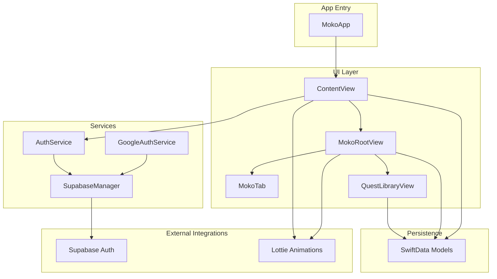
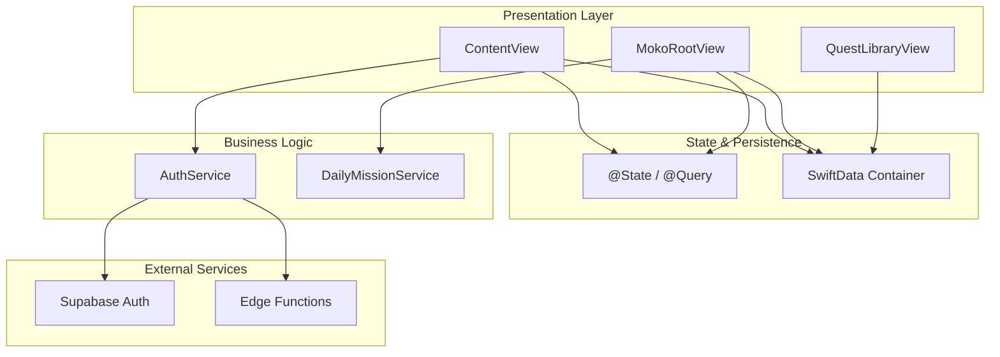
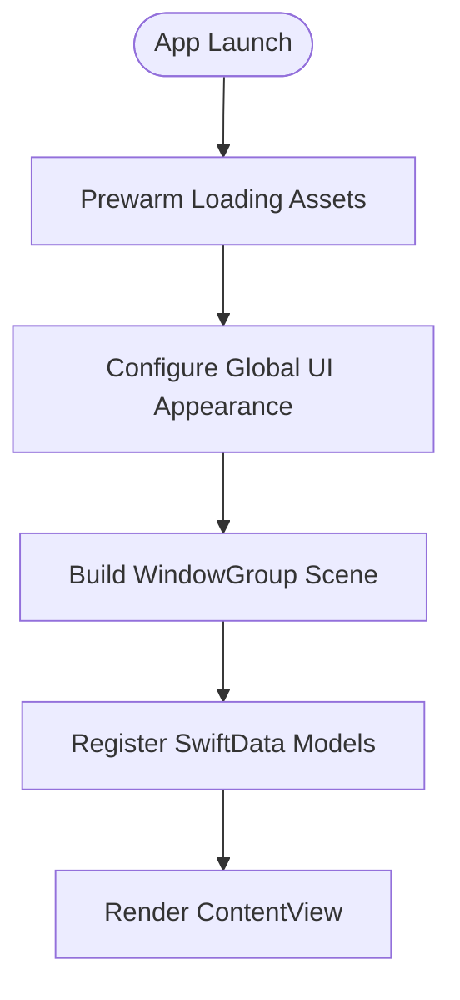
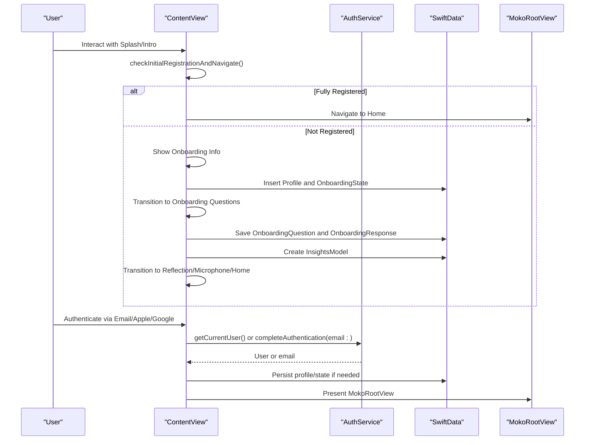
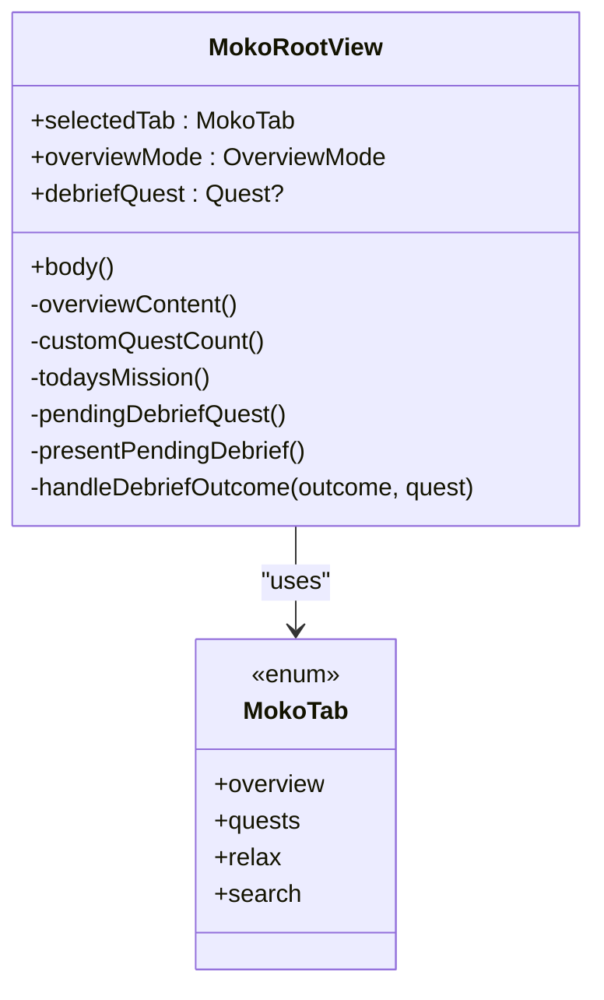
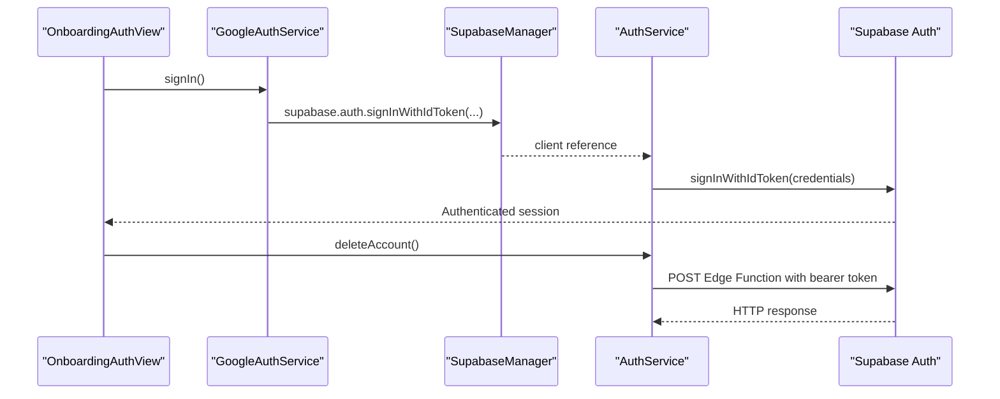
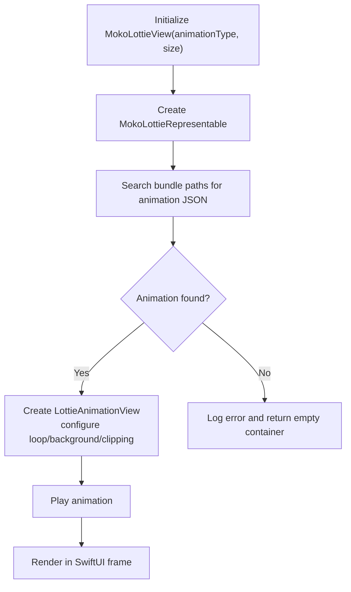
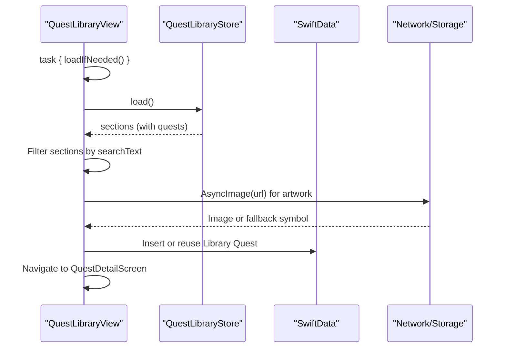
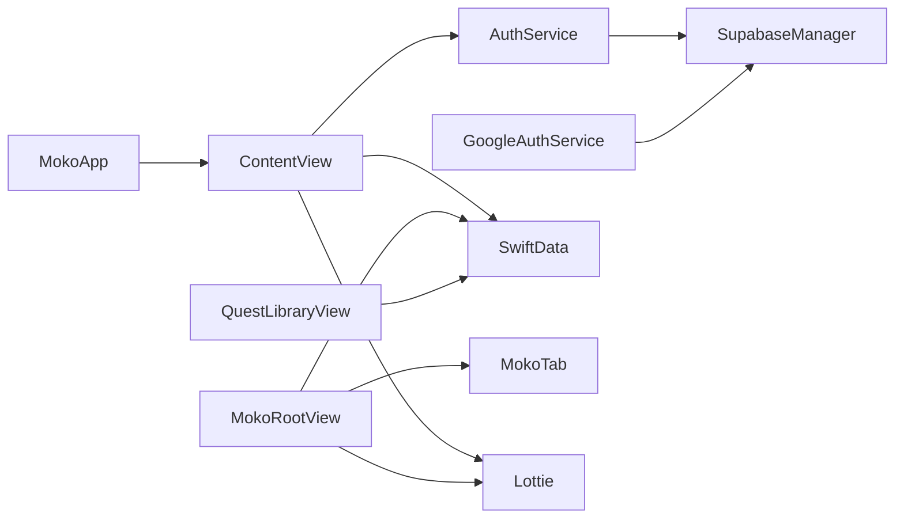

# Architecture Overview

<cite>
**Referenced Files in This Document**
- [MokoApp.swift](file://Moko/Moko/MokoApp.swift)
- [ContentView.swift](file://Moko/Moko/ContentView.swift)
- [MokoRootView.swift](file://Moko/Moko/MokoRootView.swift)
- [MokoTab.swift](file://Moko/Moko/Models/MokoTab.swift)
- [AuthService.swift](file://Moko/Moko/AuthService.swift)
- [GoogleAuthService.swift](file://Moko/Moko/GoogleAuthService.swift)
- [SupabaseManager.swift](file://Moko/Moko/SupabaseManager.swift)
- [MokoLottieView.swift](file://Moko/Moko/Features/Animation/MokoLottieView.swift)
- [QuestLibraryView.swift](file://Moko/Moko/Features/QuestLibrary/QuestLibraryView.swift)
</cite>

## Table of Contents
1. [Introduction](#introduction)
2. [Project Structure](#project-structure)
3. [Core Components](#core-components)
4. [Architecture Overview](#architecture-overview)
5. [Detailed Component Analysis](#detailed-component-analysis)
6. [Dependency Analysis](#dependency-analysis)
7. [Performance Considerations](#performance-considerations)
8. [Troubleshooting Guide](#troubleshooting-guide)
9. [Conclusion](#conclusion)

## Introduction
This document describes the Moko iOS app architecture using a layered MVVM approach with SwiftUI for the UI, SwiftData for local persistence, and a service layer for authentication and external integrations. It explains how MokoApp initializes the app lifecycle and data layer, how ContentView drives the onboarding and session flow, and how MokoRootView provides tab navigation across Overview, Quests, Relax, and Explore features. It also documents data flows from user input through state management to model updates and UI refreshes, and it highlights integration points with Lottie animations, Supabase authentication, and external services.

## Project Structure
The project is organized by feature and responsibility:
- App entry point and lifecycle: MokoApp
- Top-level screen routing and onboarding: ContentView
- Main application shell and tabs: MokoRootView
- Shared tab enum: MokoTab
- Authentication services: AuthService, GoogleAuthService, SupabaseManager
- Animation components: MokoLottieView
- Feature screens: QuestLibraryView and other UIScreens under UIScreens and Features directories
- Data models and persistence: SwiftData models registered in MokoApp

**Diagram sources**
- [MokoApp.swift:11-44](file://Moko/Moko/MokoApp.swift#L11-L44)
- [ContentView.swift:12-210](file://Moko/Moko/ContentView.swift#L12-L210)
- [MokoRootView.swift:5-100](file://Moko/Moko/MokoRootView.swift#L5-L100)
- [MokoTab.swift:10-17](file://Moko/Moko/Models/MokoTab.swift#L10-L17)
- [AuthService.swift:15-58](file://Moko/Moko/AuthService.swift#L15-L58)
- [GoogleAuthService.swift:8-60](file://Moko/Moko/GoogleAuthService.swift#L8-L60)
- [SupabaseManager.swift:6-18](file://Moko/Moko/SupabaseManager.swift#L6-L18)
- [MokoLottieView.swift:5-22](file://Moko/Moko/Features/Animation/MokoLottieView.swift#L5-L22)
- [QuestLibraryView.swift:13-84](file://Moko/Moko/Features/QuestLibrary/QuestLibraryView.swift#L13-L84)

**Section sources**
- [MokoApp.swift:11-44](file://Moko/Moko/MokoApp.swift#L11-L44)
- [ContentView.swift:12-210](file://Moko/Moko/ContentView.swift#L12-L210)
- [MokoRootView.swift:5-100](file://Moko/Moko/MokoRootView.swift#L5-L100)

## Core Components
- MokoApp: Application entry point that prewarms loading assets, configures global UI appearance, creates the root ContentView, and registers SwiftData models into a shared container.
- ContentView: Orchestrates the top-level app flow (splash, intro, auth, onboarding info, onboarding questions, reflection, microphone permission, account deletion, home). It manages local state, persists onboarding data to SwiftData, and delegates authentication to AuthService.
- MokoRootView: Provides the main tabbed interface (Overview, Quests, Relax, Explore), manages overview modes, debrief presentation, and daily mission initialization via DailyMissionService.
- MokoTab: Centralized enum defining the four primary tabs used by the tab bar.
- AuthService: Encapsulates Supabase authentication operations (sign up, sign in, sign out, current user) and calls an authenticated Edge Function for account deletion.
- GoogleAuthService: Handles Google Sign-In and exchanges tokens with Supabase OpenID Connect.
- SupabaseManager: Singleton providing a configured Supabase client instance.
- MokoLottieView: SwiftUI wrapper around Lottie animations with UIViewRepresentable.
- QuestLibraryView: Feature screen for browsing quest library content, integrating with SwiftData and async image loading.

**Section sources**
- [MokoApp.swift:11-44](file://Moko/Moko/MokoApp.swift#L11-L44)
- [ContentView.swift:12-308](file://Moko/Moko/ContentView.swift#L12-L308)
- [MokoRootView.swift:5-174](file://Moko/Moko/MokoRootView.swift#L5-L174)
- [MokoTab.swift:10-17](file://Moko/Moko/Models/MokoTab.swift#L10-L17)
- [AuthService.swift:15-58](file://Moko/Moko/AuthService.swift#L15-L58)
- [GoogleAuthService.swift:8-60](file://Moko/Moko/GoogleAuthService.swift#L8-L60)
- [SupabaseManager.swift:6-18](file://Moko/Moko/SupabaseManager.swift#L6-L18)
- [MokoLottieView.swift:5-82](file://Moko/Moko/Features/Animation/MokoLottieView.swift#L5-L82)
- [QuestLibraryView.swift:13-344](file://Moko/Moko/Features/QuestLibrary/QuestLibraryView.swift#L13-L344)

## Architecture Overview
The system follows MVVM with SwiftUI views as the View layer, SwiftData models as the Model layer, and services handling business logic and external integrations. Navigation state is centralized in ContentView during onboarding and transitions to MokoRootView for the main app shell. Data flows from user interactions through @State and @Environment values, persisted via SwiftData, and reflected back into the UI automatically.

**Diagram sources**
- [ContentView.swift:12-308](file://Moko/Moko/ContentView.swift#L12-L308)
- [MokoRootView.swift:5-174](file://Moko/Moko/MokoRootView.swift#L5-L174)
- [AuthService.swift:15-58](file://Moko/Moko/AuthService.swift#L15-L58)
- [MokoApp.swift:31-44](file://Moko/Moko/MokoApp.swift#L31-L44)

## Detailed Component Analysis

### MokoApp Lifecycle and Data Initialization
MokoApp initializes global UI styling, prewarming of loading assets, and sets up the SwiftData container with all required models. The root scene hosts ContentView.

**Diagram sources**
- [MokoApp.swift:14-29](file://Moko/Moko/MokoApp.swift#L14-L29)
- [MokoApp.swift:31-44](file://Moko/Moko/MokoApp.swift#L31-L44)

**Section sources**
- [MokoApp.swift:11-44](file://Moko/Moko/MokoApp.swift#L11-L44)

### ContentView Flow and State Management
ContentView controls the high-level app flow using an internal AppScreen enum and @State variables. It integrates with SwiftData to persist onboarding information and insights, and uses AuthService for authentication.

**Diagram sources**
- [ContentView.swift:21-32](file://Moko/Moko/ContentView.swift#L21-L32)
- [ContentView.swift:73-210](file://Moko/Moko/ContentView.swift#L73-L210)
- [ContentView.swift:217-308](file://Moko/Moko/ContentView.swift#L217-L308)
- [AuthService.swift:39-42](file://Moko/Moko/AuthService.swift#L39-L42)

**Section sources**
- [ContentView.swift:12-308](file://Moko/Moko/ContentView.swift#L12-L308)

### Tab Navigation System (MokoRootView)
MokoRootView defines the main tab structure using MokoTab and manages overview modes, debrief presentation, and daily mission setup.

**Diagram sources**
- [MokoRootView.swift:5-174](file://Moko/Moko/MokoRootView.swift#L5-L174)
- [MokoTab.swift:10-17](file://Moko/Moko/Models/MokoTab.swift#L10-L17)

**Section sources**
- [MokoRootView.swift:5-174](file://Moko/Moko/MokoRootView.swift#L5-L174)
- [MokoTab.swift:10-17](file://Moko/Moko/Models/MokoTab.swift#L10-L17)

### Authentication Integration (AuthService, GoogleAuthService, SupabaseManager)
AuthService wraps Supabase auth operations and calls an Edge Function for account deletion. GoogleAuthService handles Google Sign-In and token exchange with Supabase. SupabaseManager provides a singleton client configuration.

**Diagram sources**
- [GoogleAuthService.swift:11-60](file://Moko/Moko/GoogleAuthService.swift#L11-L60)
- [AuthService.swift:44-58](file://Moko/Moko/AuthService.swift#L44-L58)
- [SupabaseManager.swift:6-18](file://Moko/Moko/SupabaseManager.swift#L6-L18)

**Section sources**
- [AuthService.swift:15-58](file://Moko/Moko/AuthService.swift#L15-L58)
- [GoogleAuthService.swift:8-60](file://Moko/Moko/GoogleAuthService.swift#L8-L60)
- [SupabaseManager.swift:6-18](file://Moko/Moko/SupabaseManager.swift#L6-L18)

### Animation Integration (Lottie)
MokoLottieView encapsulates Lottie animations within SwiftUI using UIViewRepresentable. It searches multiple bundle paths for animation resources and plays them with appropriate configuration.

**Diagram sources**
- [MokoLottieView.swift:5-22](file://Moko/Moko/Features/Animation/MokoLottieView.swift#L5-L22)
- [MokoLottieView.swift:25-82](file://Moko/Moko/Features/Animation/MokoLottieView.swift#L25-L82)

**Section sources**
- [MokoLottieView.swift:5-82](file://Moko/Moko/Features/Animation/MokoLottieView.swift#L5-L82)

### Quest Library Feature (QuestLibraryView)
QuestLibraryView loads categorized quests, supports search filtering, displays cards with artwork from Supabase Storage, and integrates with SwiftData to create or reuse library quests for debriefing.

**Diagram sources**
- [QuestLibraryView.swift:13-84](file://Moko/Moko/Features/QuestLibrary/QuestLibraryView.swift#L13-L84)
- [QuestLibraryView.swift:266-344](file://Moko/Moko/Features/QuestLibrary/QuestLibraryView.swift#L266-L344)

**Section sources**
- [QuestLibraryView.swift:13-344](file://Moko/Moko/Features/QuestLibrary/QuestLibraryView.swift#L13-L344)

## Dependency Analysis
The following diagram shows key dependencies between core components and external services.

**Diagram sources**
- [MokoApp.swift:31-44](file://Moko/Moko/MokoApp.swift#L31-L44)
- [ContentView.swift:12-210](file://Moko/Moko/ContentView.swift#L12-L210)
- [AuthService.swift:15-58](file://Moko/Moko/AuthService.swift#L15-L58)
- [GoogleAuthService.swift:8-60](file://Moko/Moko/GoogleAuthService.swift#L8-L60)
- [SupabaseManager.swift:6-18](file://Moko/Moko/SupabaseManager.swift#L6-L18)
- [MokoRootView.swift:5-100](file://Moko/Moko/MokoRootView.swift#L5-L100)
- [MokoTab.swift:10-17](file://Moko/Moko/Models/MokoTab.swift#L10-L17)
- [QuestLibraryView.swift:13-84](file://Moko/Moko/Features/QuestLibrary/QuestLibraryView.swift#L13-L84)
- [MokoLottieView.swift:5-22](file://Moko/Moko/Features/Animation/MokoLottieView.swift#L5-L22)

**Section sources**
- [MokoApp.swift:31-44](file://Moko/Moko/MokoApp.swift#L31-L44)
- [ContentView.swift:12-210](file://Moko/Moko/ContentView.swift#L12-L210)
- [AuthService.swift:15-58](file://Moko/Moko/AuthService.swift#L15-L58)
- [GoogleAuthService.swift:8-60](file://Moko/Moko/GoogleAuthService.swift#L8-L60)
- [SupabaseManager.swift:6-18](file://Moko/Moko/SupabaseManager.swift#L6-L18)
- [MokoRootView.swift:5-100](file://Moko/Moko/MokoRootView.swift#L5-L100)
- [MokoTab.swift:10-17](file://Moko/Moko/Models/MokoTab.swift#L10-L17)
- [QuestLibraryView.swift:13-84](file://Moko/Moko/Features/QuestLibrary/QuestLibraryView.swift#L13-L84)
- [MokoLottieView.swift:5-22](file://Moko/Moko/Features/Animation/MokoLottieView.swift#L5-L22)

## Performance Considerations
- Pre-warming: MokoApp prewarms the floss loader to reduce perceived latency when loading states appear.
- Efficient rendering: Lottie animations are constrained to fixed frames and use background behaviors to pause and restore, minimizing unnecessary redraws.
- Query-driven UI: ContentView and MokoRootView leverage @Query to reactively update UI based on SwiftData changes without manual refresh logic.
- Lazy loading: QuestLibraryView defers network requests until needed and shows loading indicators while fetching data.
- Accessibility: Animation components respect reduced motion preferences where applicable.

[No sources needed since this section provides general guidance]

## Troubleshooting Guide
- Authentication failures: Verify Supabase credentials and Edge Function deployment; ensure Google Sign-In returns valid tokens and that Supabase accepts OpenID Connect credentials.
- Missing animations: Confirm Lottie JSON files exist in the expected bundle paths and that the animation name matches the enum mapping.
- SwiftData issues: Ensure all models are registered in the model container and that context.save() is called after insertions.
- Session state: When signing out or deleting accounts, confirm that in-memory state is cleared and navigation routes reset appropriately.

**Section sources**
- [AuthService.swift:44-58](file://Moko/Moko/AuthService.swift#L44-L58)
- [GoogleAuthService.swift:11-60](file://Moko/Moko/GoogleAuthService.swift#L11-L60)
- [MokoLottieView.swift:40-76](file://Moko/Moko/Features/Animation/MokoLottieView.swift#L40-L76)
- [MokoApp.swift:31-44](file://Moko/Moko/MokoApp.swift#L31-L44)

## Conclusion
Moko’s architecture cleanly separates concerns across UI, state, persistence, and services. ContentView orchestrates onboarding and session flow, MokoRootView provides the main tabbed experience, and services encapsulate authentication and external integrations. SwiftData ensures consistent local persistence, while Lottie animations enhance user experience. This design supports scalable feature growth, maintainable code organization, and clear data flows from user input to UI updates.

[No sources needed since this section summarizes without analyzing specific files]