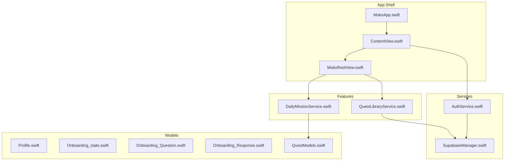
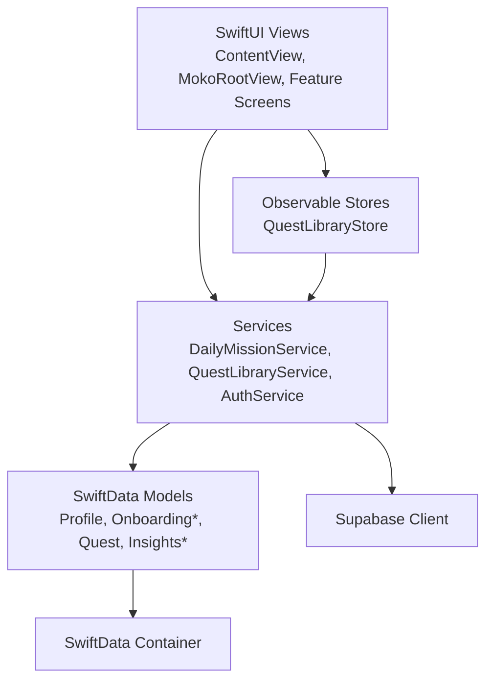
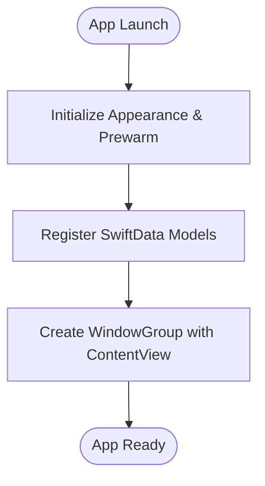
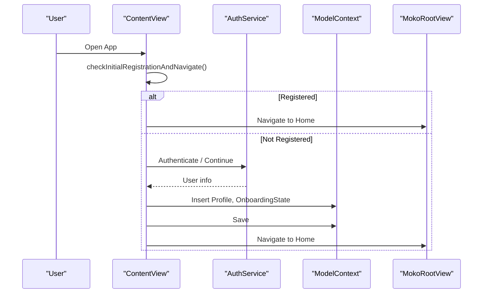
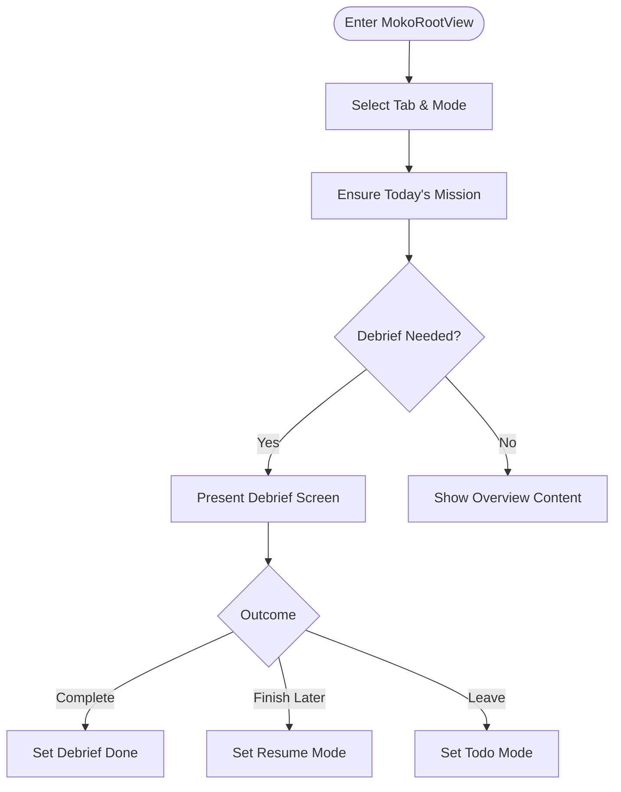
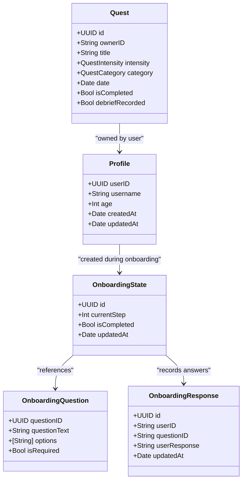
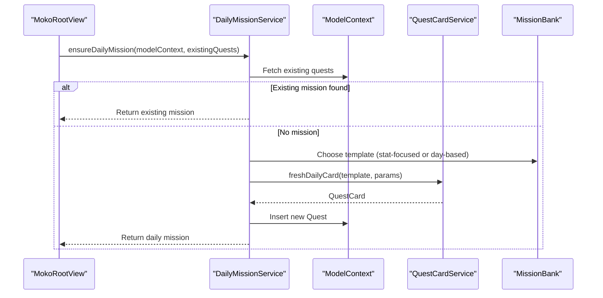
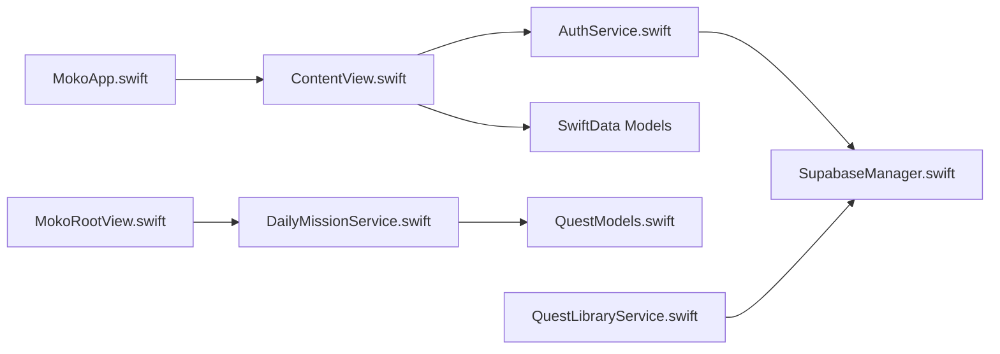

# Core Architecture

<cite>
**Referenced Files in This Document**
- [MokoApp.swift](file://Moko/Moko/MokoApp.swift)
- [ContentView.swift](file://Moko/Moko/ContentView.swift)
- [MokoRootView.swift](file://Moko/Moko/MokoRootView.swift)
- [Profile.swift](file://Moko/Moko/Models/Profile.swift)
- [Onboarding_state.swift](file://Moko/Moko/Models/Onboarding_state.swift)
- [Onboarding_Question.swift](file://Moko/Moko/Models/Onboarding_Question.swift)
- [Onboarding_Response.swift](file://Moko/Moko/Models/Onboarding_Response.swift)
- [QuestModels.swift](file://Moko/Moko/Models/QuestModels.swift)
- [DailyMissionService.swift](file://Moko/Moko/Features/AFM/DailyMissionService.swift)
- [QuestLibraryService.swift](file://Moko/Moko/Features/QuestLibrary/QuestLibraryService.swift)
- [AuthService.swift](file://Moko/Moko/AuthService.swift)
- [SupabaseManager.swift](file://Moko/Moko/SupabaseManager.swift)
</cite>

## Table of Contents
1. [Introduction](#introduction)
2. [Project Structure](#project-structure)
3. [Core Components](#core-components)
4. [Architecture Overview](#architecture-overview)
5. [Detailed Component Analysis](#detailed-component-analysis)
6. [Dependency Analysis](#dependency-analysis)
7. [Performance Considerations](#performance-considerations)
8. [Troubleshooting Guide](#troubleshooting-guide)
9. [Conclusion](#conclusion)

## Introduction
This document explains the core architecture of the Moko iOS app with a focus on:
- MVVM implemented using SwiftUI for presentation, SwiftData for local persistence, and a service layer for business logic.
- The application entry point and how SwiftData models are registered.
- The roles of ContentView as the main container and MokoRootView for routing and state management.
- Separation of concerns across Features, Models, UIScreens, and Resources.
- Design principles such as single responsibility, dependency inversion, and testability.

## Project Structure
The app organizes code by feature and layer:
- Models: SwiftData entities representing user profile, onboarding data, quests, and insights.
- Features: Business logic and services (e.g., daily mission generation, quest library loading).
- UIScreens: SwiftUI views grouped by flow (onboarding, home screens, relax screens, start screens).
- Resources: Static assets like animations.
- App shell: Entry point, root view, and navigation orchestration.

**Diagram sources**
- [MokoApp.swift:11-44](file://Moko/Moko/MokoApp.swift#L11-L44)
- [ContentView.swift:12-309](file://Moko/Moko/ContentView.swift#L12-L309)
- [MokoRootView.swift:5-174](file://Moko/Moko/MokoRootView.swift#L5-L174)
- [Profile.swift:12-59](file://Moko/Moko/Models/Profile.swift#L12-L59)
- [Onboarding_state.swift:4-23](file://Moko/Moko/Models/Onboarding_state.swift#L4-L23)
- [Onboarding_Question.swift:11-36](file://Moko/Moko/Models/Onboarding_Question.swift#L11-L36)
- [Onboarding_Response.swift:11-35](file://Moko/Moko/Models/Onboarding_Response.swift#L11-L35)
- [QuestModels.swift:50-127](file://Moko/Moko/Models/QuestModels.swift#L50-L127)
- [DailyMissionService.swift:19-225](file://Moko/Moko/Features/AFM/DailyMissionService.swift#L19-L225)
- [QuestLibraryService.swift:13-90](file://Moko/Moko/Features/QuestLibrary/QuestLibraryService.swift#L13-L90)
- [AuthService.swift:15-59](file://Moko/Moko/AuthService.swift#L15-L59)
- [SupabaseManager.swift:6-19](file://Moko/Moko/SupabaseManager.swift#L6-L19)

**Section sources**
- [MokoApp.swift:11-44](file://Moko/Moko/MokoApp.swift#L11-L44)
- [README.md:180-207](file://README.md#L180-L207)

## Core Components
- Application entry point: MokoApp initializes global UI appearance, prewarming utilities, and registers SwiftData models via modelContainer.
- Main container: ContentView orchestrates the app’s high-level flows (splash, intro, auth, onboarding, reflection, microphone prompt, account deletion, and home). It manages screen state, persists onboarding data to SwiftData, and injects environment actions for session termination.
- Root tab container: MokoRootView provides the tabbed interface (Overview, Quests, Relax, Explore), maintains selected tab and overview mode, handles debrief flows, and ensures a daily mission exists through DailyMissionService.
- Data models: SwiftData @Model classes represent Profile, OnboardingState, OnboardingQuestion, OnboardingResponse, and Quest along with related enums and helpers.
- Service layer: DailyMissionService generates tailored daily missions; QuestLibraryService fetches library content from Supabase; AuthService wraps Supabase Auth operations; SupabaseManager centralizes client configuration.

Key responsibilities:
- Presentation: SwiftUI Views render UI and react to state changes.
- State: @State, @Environment, @Query, and @Observable manage UI and store state.
- Persistence: SwiftData ModelContext is used to insert, update, and query entities.
- Business logic: Services encapsulate algorithms for mission generation and remote data access.

**Section sources**
- [MokoApp.swift:11-44](file://Moko/Moko/MokoApp.swift#L11-L44)
- [ContentView.swift:12-309](file://Moko/Moko/ContentView.swift#L12-L309)
- [MokoRootView.swift:5-174](file://Moko/Moko/MokoRootView.swift#L5-L174)
- [Profile.swift:12-59](file://Moko/Moko/Models/Profile.swift#L12-L59)
- [Onboarding_state.swift:4-23](file://Moko/Moko/Models/Onboarding_state.swift#L4-L23)
- [Onboarding_Question.swift:11-36](file://Moko/Moko/Models/Onboarding_Question.swift#L11-L36)
- [Onboarding_Response.swift:11-35](file://Moko/Moko/Models/Onboarding_Response.swift#L11-L35)
- [QuestModels.swift:50-127](file://Moko/Moko/Models/QuestModels.swift#L50-L127)
- [DailyMissionService.swift:19-225](file://Moko/Moko/Features/AFM/DailyMissionService.swift#L19-L225)
- [QuestLibraryService.swift:13-90](file://Moko/Moko/Features/QuestLibrary/QuestLibraryService.swift#L13-L90)
- [AuthService.swift:15-59](file://Moko/Moko/AuthService.swift#L15-L59)
- [SupabaseManager.swift:6-19](file://Moko/Moko/SupabaseManager.swift#L6-L19)

## Architecture Overview
The app follows an MVVM pattern:
- View: SwiftUI components (ContentView, MokoRootView, and feature-specific screens).
- ViewModel: Not explicit classes here; state is managed via SwiftUI’s @State/@Environment and Observable stores (e.g., QuestLibraryStore).
- Model: SwiftData entities (@Model) and domain types (Quest, enums).
- Services: Business logic and external integrations (DailyMissionService, QuestLibraryService, AuthService).

**Diagram sources**
- [ContentView.swift:12-309](file://Moko/Moko/ContentView.swift#L12-L309)
- [MokoRootView.swift:5-174](file://Moko/Moko/MokoRootView.swift#L5-L174)
- [QuestLibraryService.swift:35-90](file://Moko/Moko/Features/QuestLibrary/QuestLibraryService.swift#L35-L90)
- [DailyMissionService.swift:19-225](file://Moko/Moko/Features/AFM/DailyMissionService.swift#L19-L225)
- [Profile.swift:12-59](file://Moko/Moko/Models/Profile.swift#L12-L59)
- [QuestModels.swift:50-127](file://Moko/Moko/Models/QuestModels.swift#L50-L127)
- [SupabaseManager.swift:6-19](file://Moko/Moko/SupabaseManager.swift#L6-L19)

## Detailed Component Analysis

### Application Entry Point: MokoApp
Responsibilities:
- Initializes global UI appearance and prewarms loading resources.
- Registers SwiftData models via modelContainer so all views can use @Query and @Environment(\.modelContext).
- Provides the root WindowGroup containing ContentView.

**Diagram sources**
- [MokoApp.swift:14-44](file://Moko/Moko/MokoApp.swift#L14-L44)

**Section sources**
- [MokoApp.swift:11-44](file://Moko/Moko/MokoApp.swift#L11-L44)

### Main Container: ContentView
Responsibilities:
- Orchestrates high-level app flows using an internal enum-based screen state machine.
- Handles authentication flow and transitions to onboarding or home based on registration status.
- Persists onboarding information and responses into SwiftData using ModelContext.
- Injects environment actions (e.g., endSession) consumed by child views.

**Diagram sources**
- [ContentView.swift:217-236](file://Moko/Moko/ContentView.swift#L217-L236)
- [ContentView.swift:250-308](file://Moko/Moko/ContentView.swift#L250-L308)
- [AuthService.swift:15-59](file://Moko/Moko/AuthService.swift#L15-L59)

**Section sources**
- [ContentView.swift:12-309](file://Moko/Moko/ContentView.swift#L12-L309)

### Root Tab Container: MokoRootView
Responsibilities:
- Manages tab selection and overview modes (todo, resume, debrief done).
- Presents debrief full-screen cover and updates overview state based on outcomes.
- Ensures a daily mission exists via DailyMissionService and seeds category variety.
- Resumes pending debriefs across sessions using PendingDebriefStore.

**Diagram sources**
- [MokoRootView.swift:14-174](file://Moko/Moko/MokoRootView.swift#L14-L174)
- [DailyMissionService.swift:127-225](file://Moko/Moko/Features/AFM/DailyMissionService.swift#L127-L225)

**Section sources**
- [MokoRootView.swift:5-174](file://Moko/Moko/MokoRootView.swift#L5-L174)

### Data Models: SwiftData Entities
Entities:
- Profile: User profile with identity, personal details, activity metrics, and timestamps.
- OnboardingState: Tracks onboarding progress and completion.
- OnboardingQuestion: Defines question metadata for onboarding.
- OnboardingResponse: Records user answers keyed by user and question identifiers.
- Quest: Represents custom or library quests with scheduling, intensity, category, and lifecycle flags.

**Diagram sources**
- [Profile.swift:12-59](file://Moko/Moko/Models/Profile.swift#L12-L59)
- [Onboarding_state.swift:4-23](file://Moko/Moko/Models/Onboarding_state.swift#L4-L23)
- [Onboarding_Question.swift:11-36](file://Moko/Moko/Models/Onboarding_Question.swift#L11-L36)
- [Onboarding_Response.swift:11-35](file://Moko/Moko/Models/Onboarding_Response.swift#L11-L35)
- [QuestModels.swift:50-127](file://Moko/Moko/Models/QuestModels.swift#L50-L127)

**Section sources**
- [Profile.swift:12-59](file://Moko/Moko/Models/Profile.swift#L12-L59)
- [Onboarding_state.swift:4-23](file://Moko/Moko/Models/Onboarding_state.swift#L4-L23)
- [Onboarding_Question.swift:11-36](file://Moko/Moko/Models/Onboarding_Question.swift#L11-L36)
- [Onboarding_Response.swift:11-35](file://Moko/Moko/Models/Onboarding_Response.swift#L11-L35)
- [QuestModels.swift:50-127](file://Moko/Moko/Models/QuestModels.swift#L50-L127)

### Service Layer: Business Logic and External Integrations
- DailyMissionService: Generates today’s featured mission, adapts to lowest-scored stats, prepares stepping-stone missions before upcoming custom quests, and seeds category variety.
- QuestLibraryService: Loads active library quests from Supabase and exposes them via an Observable store.
- AuthService: Wraps Supabase Auth operations (sign up, sign in, sign out, get current user, delete account).
- SupabaseManager: Centralizes Supabase client configuration.

**Diagram sources**
- [DailyMissionService.swift:127-225](file://Moko/Moko/Features/AFM/DailyMissionService.swift#L127-L225)
- [QuestModels.swift:50-127](file://Moko/Moko/Models/QuestModels.swift#L50-L127)

**Section sources**
- [DailyMissionService.swift:19-307](file://Moko/Moko/Features/AFM/DailyMissionService.swift#L19-L307)
- [QuestLibraryService.swift:13-90](file://Moko/Moko/Features/QuestLibrary/QuestLibraryService.swift#L13-L90)
- [AuthService.swift:15-59](file://Moko/Moko/AuthService.swift#L15-L59)
- [SupabaseManager.swift:6-19](file://Moko/Moko/SupabaseManager.swift#L6-L19)

### Separation of Concerns Across Directories
- Models: Pure data and persistence definitions using SwiftData.
- Features: Domain logic and services that coordinate data and external systems.
- UIScreens: Presentation-only SwiftUI views organized by user flows.
- Resources: Static assets (animations, images) consumed by views.

Benefits:
- Single Responsibility: Each directory has a clear purpose.
- Cohesion: Related code is grouped together.
- Coupling Control: Views depend on services and models without tight coupling to implementation details.

**Section sources**
- [README.md:180-207](file://README.md#L180-L207)

## Dependency Analysis
High-level dependencies:
- MokoApp depends on SwiftData and UIKit for initialization and model registration.
- ContentView depends on AuthService and SwiftData for authentication and persistence.
- MokoRootView depends on DailyMissionService and SwiftData for mission management.
- DailyMissionService depends on QuestModels and MissionBank templates.
- QuestLibraryService depends on SupabaseClient via SupabaseManager.
- AuthService depends on SupabaseManager.

**Diagram sources**
- [MokoApp.swift:11-44](file://Moko/Moko/MokoApp.swift#L11-L44)
- [ContentView.swift:12-309](file://Moko/Moko/ContentView.swift#L12-L309)
- [MokoRootView.swift:5-174](file://Moko/Moko/MokoRootView.swift#L5-L174)
- [DailyMissionService.swift:19-225](file://Moko/Moko/Features/AFM/DailyMissionService.swift#L19-L225)
- [QuestLibraryService.swift:13-90](file://Moko/Moko/Features/QuestLibrary/QuestLibraryService.swift#L13-L90)
- [AuthService.swift:15-59](file://Moko/Moko/AuthService.swift#L15-L59)
- [SupabaseManager.swift:6-19](file://Moko/Moko/SupabaseManager.swift#L6-L19)

**Section sources**
- [MokoApp.swift:11-44](file://Moko/Moko/MokoApp.swift#L11-L44)
- [ContentView.swift:12-309](file://Moko/Moko/ContentView.swift#L12-L309)
- [MokoRootView.swift:5-174](file://Moko/Moko/MokoRootView.swift#L5-L174)
- [DailyMissionService.swift:19-225](file://Moko/Moko/Features/AFM/DailyMissionService.swift#L19-L225)
- [QuestLibraryService.swift:13-90](file://Moko/Moko/Features/QuestLibrary/QuestLibraryService.swift#L13-L90)
- [AuthService.swift:15-59](file://Moko/Moko/AuthService.swift#L15-L59)
- [SupabaseManager.swift:6-19](file://Moko/Moko/SupabaseManager.swift#L6-L19)

## Performance Considerations
- Pre-warming: MokoApp prewarms loading resources to reduce perceived latency during splash.
- Asynchronous seeding: DailyMissionService seeds additional categories in background tasks to avoid blocking UI.
- Minimum loader duration: QuestLibraryStore enforces a minimum display time for loaders to prevent flicker.
- Efficient queries: Using @Query and FetchDescriptor reduces unnecessary recomputation and improves list performance.

Recommendations:
- Keep heavy computations off the main thread where possible.
- Use pagination or lazy loading for large lists (e.g., quest library).
- Cache frequently accessed data locally and invalidate when necessary.

[No sources needed since this section provides general guidance]

## Troubleshooting Guide
Common issues and resolutions:
- Missing daily mission on Overview: Verify DailyMissionService.ensureDailyMission runs on app launch and that existing quests are passed correctly.
- Debrief not resuming after relaunch: Check PendingDebriefStore usage and that the debrief quest exists in SwiftData before presenting it.
- Authentication failures: Validate Supabase credentials and network connectivity; inspect AuthService error handling.
- Library load errors: Inspect QuestLibraryStore.errorMessage and ensure Supabase permissions allow reading quest_library.

**Section sources**
- [MokoRootView.swift:87-99](file://Moko/Moko/MokoRootView.swift#L87-L99)
- [DailyMissionService.swift:127-225](file://Moko/Moko/Features/AFM/DailyMissionService.swift#L127-L225)
- [QuestLibraryService.swift:56-90](file://Moko/Moko/Features/QuestLibrary/QuestLibraryService.swift#L56-L90)
- [AuthService.swift:15-59](file://Moko/Moko/AuthService.swift#L15-L59)

## Conclusion
Moko’s architecture cleanly separates concerns:
- SwiftUI views handle presentation and user interactions.
- SwiftData models provide structured, typed persistence.
- Services encapsulate business logic and external integrations.
- The app entry point configures the environment and registers models, while ContentView and MokoRootView coordinate flows and state.
This design supports maintainability, testability, and scalability, aligning with single responsibility, dependency inversion, and clear separation between UI, state, and data layers.

[No sources needed since this section summarizes without analyzing specific files]