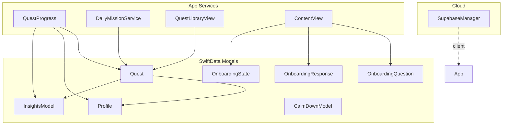
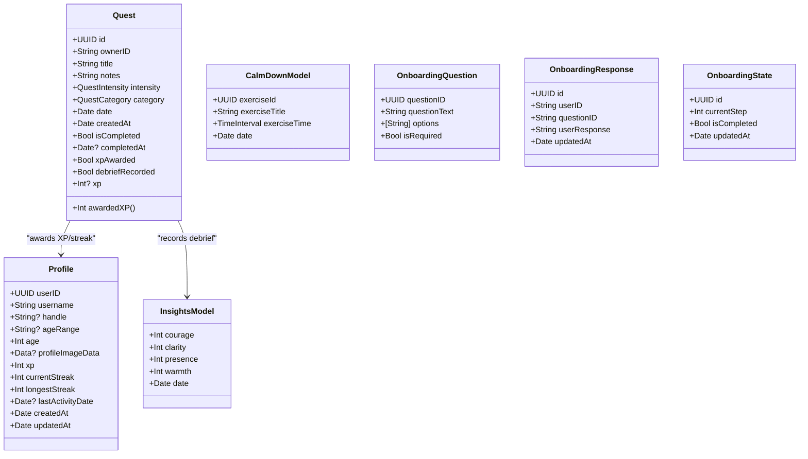
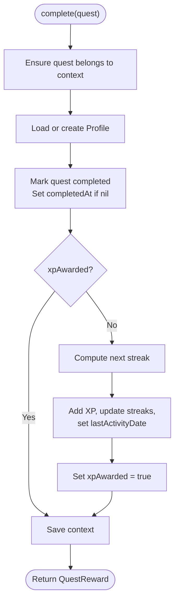
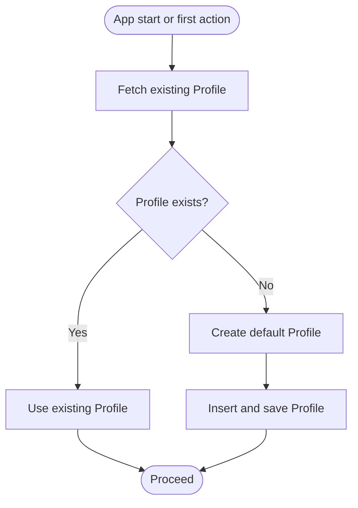
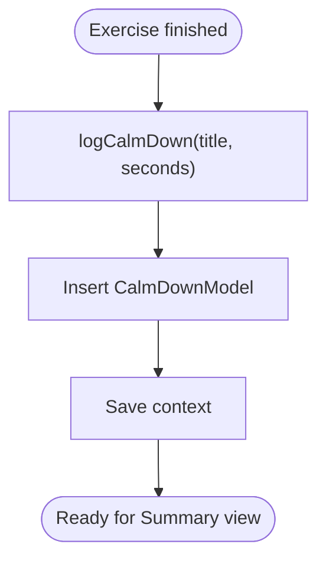
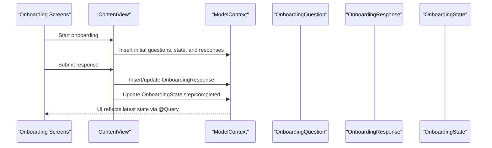
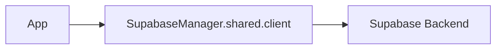
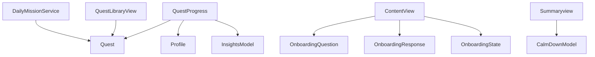

# Data Layer Architecture

<cite>
**Referenced Files in This Document**
- [QuestModels.swift](file://Moko/Moko/Models/QuestModels.swift)
- [Profile.swift](file://Moko/Moko/Models/Profile.swift)
- [InsightsModel.swift](file://Moko/Moko/Models/InsightsModel.swift)
- [CalmDownModel.swift](file://Moko/Moko/Models/CalmDownModel.swift)
- [Onboarding_Question.swift](file://Moko/Moko/Models/Onboarding_Question.swift)
- [Onboarding_Response.swift](file://Moko/Moko/Models/Onboarding_Response.swift)
- [Onboarding_state.swift](file://Moko/Moko/Models/Onboarding_state.swift)
- [QuestProgress.swift](file://Moko/Moko/Models/QuestProgress.swift)
- [SupabaseManager.swift](file://Moko/Moko/SupabaseManager.swift)
- [ContentView.swift](file://Moko/Moko/ContentView.swift)
- [DailyMissionService.swift](file://Moko/Moko/Features/AFM/DailyMissionService.swift)
- [QuestLibraryView.swift](file://Moko/Moko/Features/QuestLibrary/QuestLibraryView.swift)
- [Summaryview.swift](file://Moko/Moko/UIScreens/homeScreens/Summary_CalmDown/Summaryview.swift)
</cite>

## Table of Contents
1. [Introduction](#introduction)
2. [Project Structure](#project-structure)
3. [Core Components](#core-components)
4. [Architecture Overview](#architecture-overview)
5. [Detailed Component Analysis](#detailed-component-analysis)
6. [Dependency Analysis](#dependency-analysis)
7. [Performance Considerations](#performance-considerations)
8. [Troubleshooting Guide](#troubleshooting-guide)
9. [Conclusion](#conclusion)

## Introduction
This document explains the data layer architecture for the app, focusing on SwiftData models, relationships, persistence strategies, and how local storage integrates with cloud synchronization via Supabase. It covers:
- Entity definitions and constraints
- Model relationships (quests, profile, insights, calm-down sessions, onboarding)
- Data flow from user input through state management to model updates and UI refreshes
- Migration and caching approaches
- Performance optimization techniques
- How the data layer supports quest tracking, insights calculation, and user profile management

## Project Structure
The data layer is primarily implemented using SwiftData `@Model` entities under `Moko/Moko/Models`. The application uses a single persistent container for quests and related entities, while previews use an in-memory container. Cloud connectivity is exposed through a shared Supabase client.



**Diagram sources**
- [QuestModels.swift:51-100](file://Moko/Moko/Models/QuestModels.swift#L51-L100)
- [Profile.swift:12-59](file://Moko/Moko/Models/Profile.swift#L12-L59)
- [InsightsModel.swift:11-26](file://Moko/Moko/Models/InsightsModel.swift#L11-L26)
- [CalmDownModel.swift:11-37](file://Moko/Moko/Models/CalmDownModel.swift#L11-L37)
- [Onboarding_Question.swift:11-36](file://Moko/Moko/Models/Onboarding_Question.swift#L11-L36)
- [Onboarding_Response.swift:11-35](file://Moko/Moko/Models/Onboarding_Response.swift#L11-L35)
- [Onboarding_state.swift:4-23](file://Moko/Moko/Models/Onboarding_state.swift#L4-L23)
- [QuestProgress.swift:17-139](file://Moko/Moko/Models/QuestProgress.swift#L17-L139)
- [DailyMissionService.swift:130-270](file://Moko/Moko/Features/AFM/DailyMissionService.swift#L130-L270)
- [QuestLibraryView.swift:341-341](file://Moko/Moko/Features/QuestLibrary/QuestLibraryView.swift#L341-L341)
- [ContentView.swift:14-17](file://Moko/Moko/ContentView.swift#L14-L17)
- [SupabaseManager.swift:6-19](file://Moko/Moko/SupabaseManager.swift#L6-L19)

**Section sources**
- [QuestModels.swift:151-166](file://Moko/Moko/Models/QuestModels.swift#L151-L166)
- [SupabaseManager.swift:6-19](file://Moko/Moko/SupabaseManager.swift#L6-L19)

## Core Components
- Quest: A custom quest entity with intensity, category, scheduling, completion flags, XP awards, and debrief recording.
- Profile: User profile with identity, personal details, image data, XP, streaks, and timestamps.
- InsightsModel: Aggregated scores per activity date.
- CalmDownModel: Records completed relaxation exercises with duration and timestamp.
- Onboarding models: Question definitions, responses, and progress state.
- QuestProgress: Business logic for completing quests, awarding XP/streaks, and persisting debrief insights.
- SupabaseManager: Shared client configuration for cloud operations.

Key responsibilities:
- Local persistence via SwiftData containers
- Computation of rewards and streaks
- Creation and querying of quests and insights
- UI binding through SwiftUI queries

**Section sources**
- [QuestModels.swift:12-100](file://Moko/Moko/Models/QuestModels.swift#L12-L100)
- [Profile.swift:12-59](file://Moko/Moko/Models/Profile.swift#L12-L59)
- [InsightsModel.swift:11-26](file://Moko/Moko/Models/InsightsModel.swift#L11-L26)
- [CalmDownModel.swift:11-37](file://Moko/Moko/Models/CalmDownModel.swift#L11-L37)
- [Onboarding_Question.swift:11-36](file://Moko/Moko/Models/Onboarding_Question.swift#L11-L36)
- [Onboarding_Response.swift:11-35](file://Moko/Moko/Models/Onboarding_Response.swift#L11-L35)
- [Onboarding_state.swift:4-23](file://Moko/Moko/Models/Onboarding_state.swift#L4-L23)
- [QuestProgress.swift:17-139](file://Moko/Moko/Models/QuestProgress.swift#L17-L139)
- [SupabaseManager.swift:6-19](file://Moko/Moko/SupabaseManager.swift#L6-L19)

## Architecture Overview
The data layer follows a layered approach:
- Presentation layer binds to SwiftData models using SwiftUI’s `@Query`.
- Domain logic encapsulates reward calculations, streak computation, and insight creation in `QuestProgress`.
- Persistence is handled by SwiftData containers (`MokoDatabase.shared` for production, `preview` for previews).
- Cloud synchronization is configured via `SupabaseManager`, which exposes a shared client instance.

```mermaid
sequenceDiagram
participant UI as "UI Screens"
participant VM as "ViewModel / Service"
participant DP as "QuestProgress"
participant SD as "SwiftData Context"
participant DB as "SwiftData Container"
participant CL as "SupabaseManager"
UI->>VM : User completes quest or debrief
VM->>DP : complete(quest) or saveDebrief(result)
DP->>SD : Update Quest, Profile, Insights
SD->>DB : Save changes
Note over DP,DB : Streak and XP computed locally
VM->>CL : Optional sync operation (future)
CL-->>VM : Async result
VM-->>UI : State updated; UI refreshes via @Query
```

**Diagram sources**
- [QuestProgress.swift:49-119](file://Moko/Moko/Models/QuestProgress.swift#L49-L119)
- [QuestModels.swift:151-166](file://Moko/Moko/Models/QuestModels.swift#L151-L166)
- [SupabaseManager.swift:6-19](file://Moko/Moko/SupabaseManager.swift#L6-L19)

## Detailed Component Analysis

### SwiftData Entities and Relationships
- Quest owns:
  - ownerID linking to CurrentUser.localID
  - Completion and debrief flags that drive insights and rewards
- Profile stores:
  - Identity fields, image data, XP, streaks, last activity date
- InsightsModel stores:
  - Courage, clarity, presence, warmth scores per date
- CalmDownModel stores:
  - Exercise title, duration, date
- Onboarding models store:
  - Questions, responses, and step state



**Diagram sources**
- [QuestModels.swift:51-100](file://Moko/Moko/Models/QuestModels.swift#L51-L100)
- [Profile.swift:12-59](file://Moko/Moko/Models/Profile.swift#L12-L59)
- [InsightsModel.swift:11-26](file://Moko/Moko/Models/InsightsModel.swift#L11-L26)
- [CalmDownModel.swift:11-37](file://Moko/Moko/Models/CalmDownModel.swift#L11-L37)
- [Onboarding_Question.swift:11-36](file://Moko/Moko/Models/Onboarding_Question.swift#L11-L36)
- [Onboarding_Response.swift:11-35](file://Moko/Moko/Models/Onboarding_Response.swift#L11-L35)
- [Onboarding_state.swift:4-23](file://Moko/Moko/Models/Onboarding_state.swift#L4-L23)

**Section sources**
- [QuestModels.swift:51-100](file://Moko/Moko/Models/QuestModels.swift#L51-L100)
- [Profile.swift:12-59](file://Moko/Moko/Models/Profile.swift#L12-L59)
- [InsightsModel.swift:11-26](file://Moko/Moko/Models/InsightsModel.swift#L11-L26)
- [CalmDownModel.swift:11-37](file://Moko/Moko/Models/CalmDownModel.swift#L11-L37)
- [Onboarding_Question.swift:11-36](file://Moko/Moko/Models/Onboarding_Question.swift#L11-L36)
- [Onboarding_Response.swift:11-35](file://Moko/Moko/Models/Onboarding_Response.swift#L11-L35)
- [Onboarding_state.swift:4-23](file://Moko/Moko/Models/Onboarding_state.swift#L4-L23)

### Quest Tracking and Progress Logic
Quest completion and debrief handling are centralized in `QuestProgress`:
- Completing a quest marks it done, sets completion time, and awards XP once.
- Streak calculation considers same-day activity, next-day extension, and one rest day after a week-long streak.
- Saving a debrief creates an `InsightsModel` entry and prevents duplicate recordings.



**Diagram sources**
- [QuestProgress.swift:49-83](file://Moko/Moko/Models/QuestProgress.swift#L49-L83)

**Section sources**
- [QuestProgress.swift:17-83](file://Moko/Moko/Models/QuestProgress.swift#L17-L83)

### Insights Calculation and Debrief Recording
When a debrief is saved:
- The system ensures the quest has been completed and rewarded.
- Scores are normalized to avoid zero values.
- An `InsightsModel` record is inserted and the quest’s debrief flag is set.

```mermaid
sequenceDiagram
participant UI as "Debrief Screen"
participant DP as "QuestProgress.saveDebrief"
participant SD as "ModelContext"
participant Q as "Quest"
participant P as "Profile"
participant I as "InsightsModel"
UI->>DP : saveDebrief(result, quest)
DP->>DP : complete(quest)
DP->>SD : Insert InsightsModel with normalized scores
DP->>Q : Set debriefRecorded = true
DP->>SD : Save context
SD-->>UI : Changes persisted; UI refreshes
```

**Diagram sources**
- [QuestProgress.swift:85-119](file://Moko/Moko/Models/QuestProgress.swift#L85-L119)
- [InsightsModel.swift:11-26](file://Moko/Moko/Models/InsightsModel.swift#L11-L26)

**Section sources**
- [QuestProgress.swift:85-119](file://Moko/Moko/Models/QuestProgress.swift#L85-L119)
- [InsightsModel.swift:11-26](file://Moko/Moko/Models/InsightsModel.swift#L11-L26)

### User Profile Management
Profile management includes:
- Creating a default profile when none exists.
- Updating XP, streaks, and last activity date upon quest completion.
- Storing optional profile image data externally.



**Diagram sources**
- [QuestProgress.swift:121-129](file://Moko/Moko/Models/QuestProgress.swift#L121-L129)
- [Profile.swift:12-59](file://Moko/Moko/Models/Profile.swift#L12-L59)

**Section sources**
- [QuestProgress.swift:121-129](file://Moko/Moko/Models/QuestProgress.swift#L121-L129)
- [Profile.swift:12-59](file://Moko/Moko/Models/Profile.swift#L12-L59)

### Calm Down Sessions
Calm down sessions are recorded with title, duration, and date. A convenience method on `ModelContext` inserts and saves these records.



**Diagram sources**
- [CalmDownModel.swift:27-37](file://Moko/Moko/Models/CalmDownModel.swift#L27-L37)

**Section sources**
- [CalmDownModel.swift:11-37](file://Moko/Moko/Models/CalmDownModel.swift#L11-L37)

### Onboarding Data Flow
Onboarding involves questions, responses, and state:
- `OnboardingQuestion` defines available questions and options.
- `OnboardingResponse` stores user answers keyed by question ID.
- `OnboardingState` tracks current step and completion status.
- `ContentView` initializes and manages these entities during onboarding.



**Diagram sources**
- [ContentView.swift:14-17](file://Moko/Moko/ContentView.swift#L14-L17)
- [Onboarding_Question.swift:11-36](file://Moko/Moko/Models/Onboarding_Question.swift#L11-L36)
- [Onboarding_Response.swift:11-35](file://Moko/Moko/Models/Onboarding_Response.swift#L11-L35)
- [Onboarding_state.swift:4-23](file://Moko/Moko/Models/Onboarding_state.swift#L4-L23)

**Section sources**
- [ContentView.swift:14-17](file://Moko/Moko/ContentView.swift#L14-L17)
- [Onboarding_Question.swift:11-36](file://Moko/Moko/Models/Onboarding_Question.swift#L11-L36)
- [Onboarding_Response.swift:11-35](file://Moko/Moko/Models/Onboarding_Response.swift#L11-L35)
- [Onboarding_state.swift:4-23](file://Moko/Moko/Models/Onboarding_state.swift#L4-L23)

### Cloud Synchronization Strategy
- `SupabaseManager` provides a shared `SupabaseClient` instance configured with project URL and anonymous key.
- The current codebase focuses on local persistence; cloud sync endpoints are not yet integrated into model operations.
- Recommended pattern: perform local writes first, then queue background sync tasks using the shared client.



**Diagram sources**
- [SupabaseManager.swift:6-19](file://Moko/Moko/SupabaseManager.swift#L6-L19)

**Section sources**
- [SupabaseManager.swift:6-19](file://Moko/Moko/SupabaseManager.swift#L6-L19)

## Dependency Analysis
- `QuestProgress` depends on `Quest`, `Profile`, and `InsightsModel`.
- `ContentView` observes multiple SwiftData entities via `@Query`.
- `DailyMissionService` interacts with `Quest` to ensure daily missions exist.
- `QuestLibraryView` inserts library-based quests.
- `Summaryview` consumes `CalmDownModel` records.



**Diagram sources**
- [QuestProgress.swift:49-119](file://Moko/Moko/Models/QuestProgress.swift#L49-L119)
- [ContentView.swift:14-17](file://Moko/Moko/ContentView.swift#L14-L17)
- [DailyMissionService.swift:130-270](file://Moko/Moko/Features/AFM/DailyMissionService.swift#L130-L270)
- [QuestLibraryView.swift:341-341](file://Moko/Moko/Features/QuestLibrary/QuestLibraryView.swift#L341-L341)
- [Summaryview.swift:867-919](file://Moko/Moko/UIScreens/homeScreens/Summary_CalmDown/Summaryview.swift#L867-L919)

**Section sources**
- [QuestProgress.swift:49-119](file://Moko/Moko/Models/QuestProgress.swift#L49-L119)
- [ContentView.swift:14-17](file://Moko/Moko/ContentView.swift#L14-L17)
- [DailyMissionService.swift:130-270](file://Moko/Moko/Features/AFM/DailyMissionService.swift#L130-L270)
- [QuestLibraryView.swift:341-341](file://Moko/Moko/Features/QuestLibrary/QuestLibraryView.swift#L341-L341)
- [Summaryview.swift:867-919](file://Moko/Moko/UIScreens/homeScreens/Summary_CalmDown/Summaryview.swift#L867-L919)

## Performance Considerations
- Use in-memory containers for previews to avoid disk I/O overhead.
- Batch updates within a single `ModelContext` transaction to reduce write amplification.
- Avoid redundant computations by gating XP awards and debrief recordings with boolean flags.
- Prefer fetching minimal datasets with targeted descriptors where possible.
- Keep large binary data (e.g., profile images) external to the database to reduce payload size.

[No sources needed since this section provides general guidance]

## Troubleshooting Guide
Common issues and resolutions:
- Save failures: Inspect error logs from context save operations and verify entity constraints.
- Duplicate insights: Ensure debrief recording is guarded by flags to prevent re-insertion.
- Missing profile: Confirm profile initialization logic runs before reward calculations.
- Preview vs production mismatch: Verify correct container usage (`preview` vs `shared`).

**Section sources**
- [QuestProgress.swift:131-137](file://Moko/Moko/Models/QuestProgress.swift#L131-L137)
- [CalmDownModel.swift:27-37](file://Moko/Moko/Models/CalmDownModel.swift#L27-L37)
- [QuestModels.swift:151-166](file://Moko/Moko/Models/QuestModels.swift#L151-L166)

## Conclusion
The data layer leverages SwiftData for robust local persistence, with clear separation between domain logic (`QuestProgress`) and UI bindings (`@Query`). Relationships among quests, profiles, and insights enable accurate tracking of progress and gamification elements. While cloud synchronization infrastructure is present via `SupabaseManager`, the current implementation prioritizes local-first reliability. Future enhancements should integrate background sync, conflict resolution, and migration strategies as the schema evolves.

[No sources needed since this section summarizes without analyzing specific files]