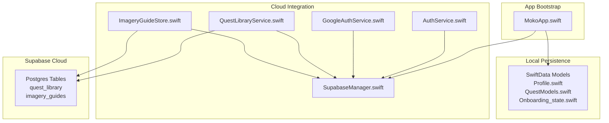
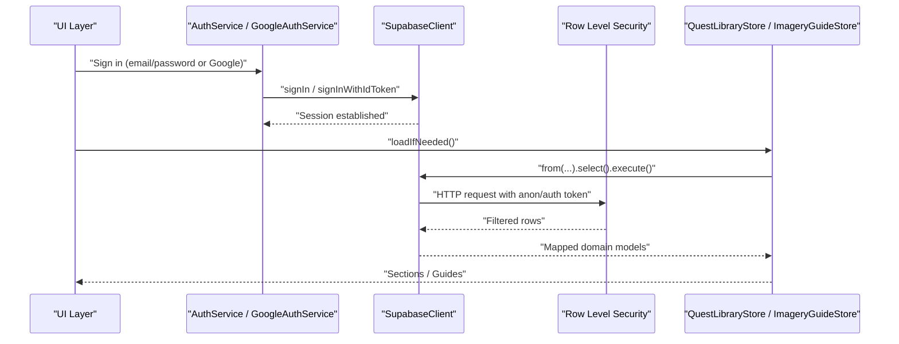
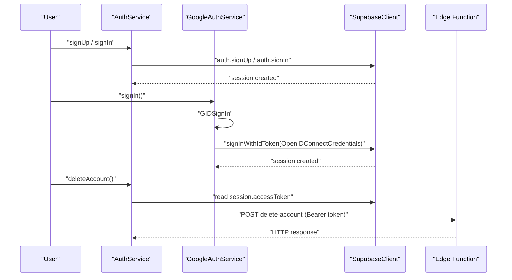
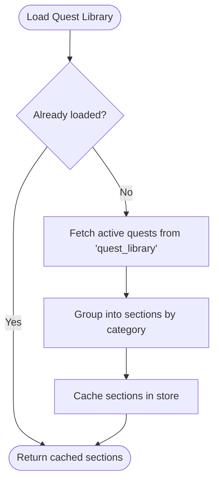
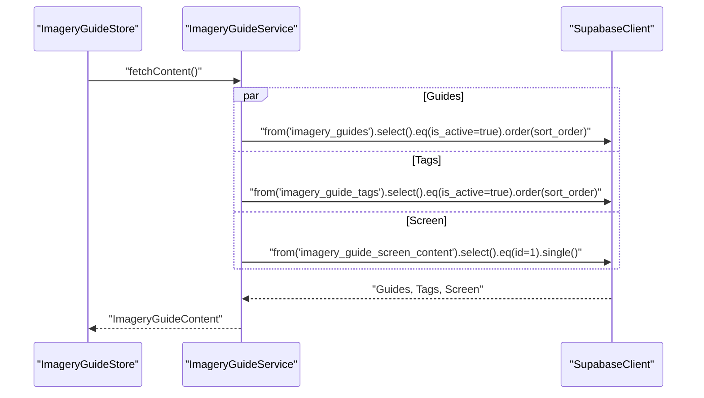
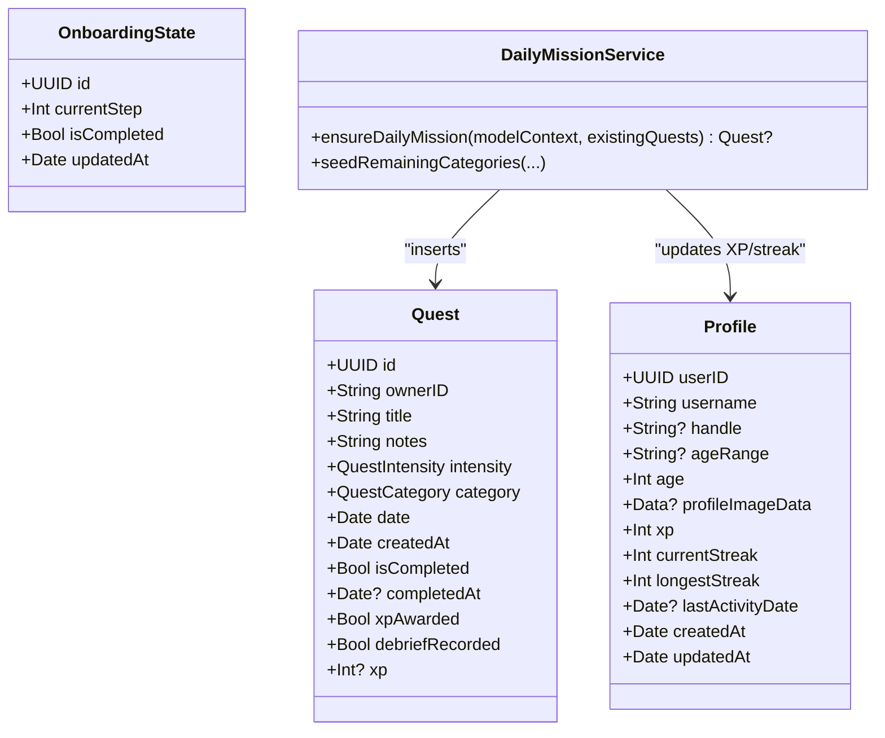
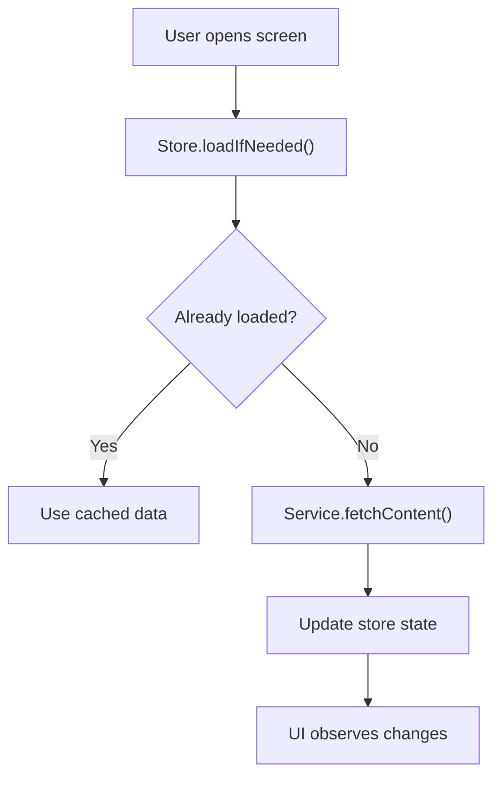
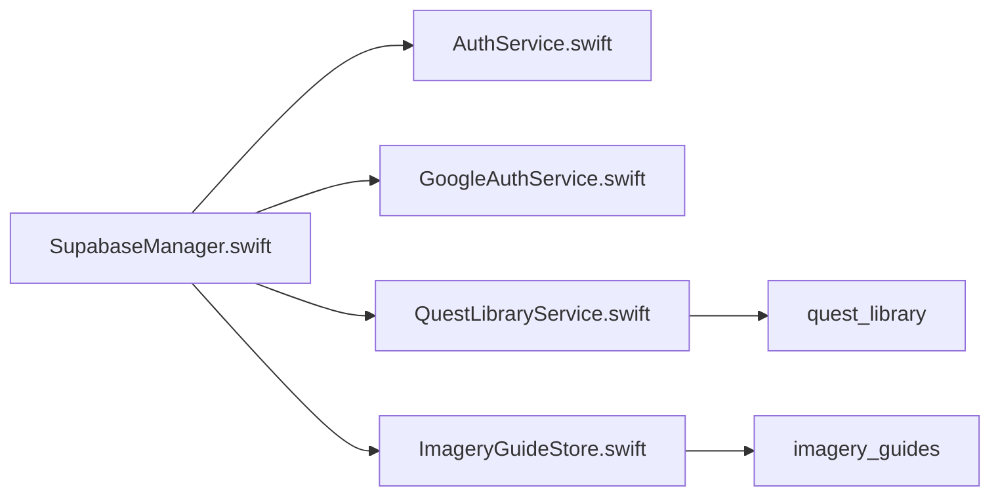
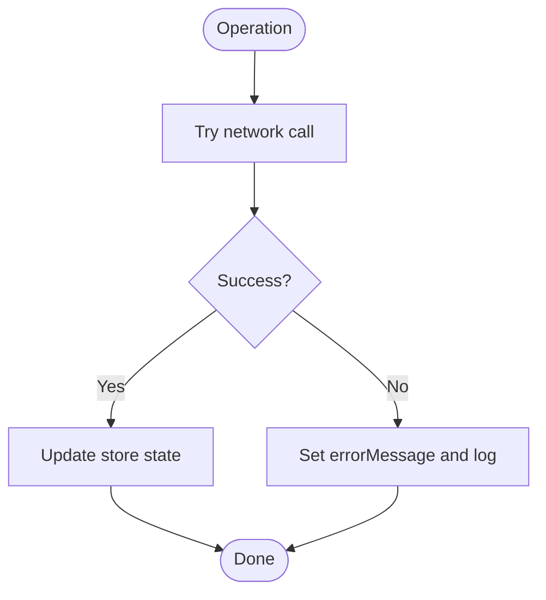

# Data Synchronization

<cite>
**Referenced Files in This Document**
- [SupabaseManager.swift](file://Moko/Moko/SupabaseManager.swift)
- [AuthService.swift](file://Moko/Moko/AuthService.swift)
- [GoogleAuthService.swift](file://Moko/Moko/GoogleAuthService.swift)
- [MokoApp.swift](file://Moko/Moko/MokoApp.swift)
- [Profile.swift](file://Moko/Moko/Models/Profile.swift)
- [QuestModels.swift](file://Moko/Moko/Models/QuestModels.swift)
- [Onboarding_state.swift](file://Moko/Moko/Models/Onboarding_state.swift)
- [DailyMissionService.swift](file://Moko/Moko/Features/AFM/DailyMissionService.swift)
- [QuestLibraryService.swift](file://Moko/Moko/Features/QuestLibrary/QuestLibraryService.swift)
- [ImageryGuideStore.swift](file://Moko/Moko/UIScreens/relaxScreens/ImageryGuide/ImageryGuideStore.swift)
- [20261101120000_create_quest_library.sql](file://supabase/migrations/20261101120000_create_quest_library.sql)
- [20261103120000_create_imagery_guides.sql](file://supabase/migrations/20261103120000_create_imagery_guides.sql)
</cite>

## Table of Contents
1. [Introduction](#introduction)
2. [Project Structure](#project-structure)
3. [Core Components](#core-components)
4. [Architecture Overview](#architecture-overview)
5. [Detailed Component Analysis](#detailed-component-analysis)
6. [Dependency Analysis](#dependency-analysis)
7. [Performance Considerations](#performance-considerations)
8. [Troubleshooting Guide](#troubleshooting-guide)
9. [Conclusion](#conclusion)

## Introduction
This document explains how the app integrates with Supabase for authentication and read-only content, and how local SwiftData models relate to cloud data. It focuses on:
- Authentication flow with email/password and Google Sign-In via Supabase Auth
- Read-only content synchronization from Supabase tables (Quest Library and Imagery Guides)
- Local data persistence using SwiftData (Profiles, Quests, Onboarding state)
- Current sync boundaries: no automatic two-way sync is implemented; user-generated data remains local unless explicitly synced later
- Error handling patterns used by stores and services
- Security considerations based on current configuration and RLS policies

## Project Structure
The app uses a layered approach:
- App bootstrap and SwiftData container setup
- Supabase client initialization and shared access
- Authentication services for email/password and Google Sign-In
- Feature-specific services that fetch read-only content from Supabase
- Local SwiftData models for user-generated content

**Diagram sources**
- [MokoApp.swift:31-44](file://Moko/Moko/MokoApp.swift#L31-L44)
- [SupabaseManager.swift:6-19](file://Moko/Moko/SupabaseManager.swift#L6-L19)
- [AuthService.swift:15-58](file://Moko/Moko/AuthService.swift#L15-L58)
- [GoogleAuthService.swift:8-60](file://Moko/Moko/GoogleAuthService.swift#L8-L60)
- [QuestLibraryService.swift:13-31](file://Moko/Moko/Features/QuestLibrary/QuestLibraryService.swift#L13-L31)
- [ImageryGuideStore.swift:14-59](file://Moko/Moko/UIScreens/relaxScreens/ImageryGuide/ImageryGuideStore.swift#L14-L59)
- [20261101120000_create_quest_library.sql:6-27](file://supabase/migrations/20261101120000_create_quest_library.sql#L6-L27)
- [20261103120000_create_imagery_guides.sql:22-47](file://supabase/migrations/20261103120000_create_imagery_guides.sql#L22-L47)

**Section sources**
- [MokoApp.swift:31-44](file://Moko/Moko/MokoApp.swift#L31-L44)
- [SupabaseManager.swift:6-19](file://Moko/Moko/SupabaseManager.swift#L6-L19)

## Core Components
- Supabase client singleton: provides a single configured SupabaseClient instance for all network operations.
- Authentication services: handle sign-up/sign-in/sign-out and third-party login via Google.
- Content services: fetch read-only content from Supabase tables and expose it to UI through stores.
- SwiftData models: represent local user data such as Profile, Quest, and OnboardingState.

Key responsibilities:
- SupabaseManager: initialize and share the Supabase client.
- AuthService: manage Supabase Auth flows and call an Edge Function for account deletion.
- GoogleAuthService: bridge Google Sign-In to Supabase Auth using OpenID Connect.
- QuestLibraryService: fetch active quest library rows from PostgREST.
- ImageryGuideStore: fetch imagery guides, tags, and screen copy concurrently.
- SwiftData models: persist user-generated content locally.

**Section sources**
- [SupabaseManager.swift:6-19](file://Moko/Moko/SupabaseManager.swift#L6-L19)
- [AuthService.swift:15-58](file://Moko/Moko/AuthService.swift#L15-L58)
- [GoogleAuthService.swift:8-60](file://Moko/Moko/GoogleAuthService.swift#L8-L60)
- [QuestLibraryService.swift:13-31](file://Moko/Moko/Features/QuestLibrary/QuestLibraryService.swift#L13-L31)
- [ImageryGuideStore.swift:14-59](file://Moko/Moko/UIScreens/relaxScreens/ImageryGuide/ImageryGuideStore.swift#L14-L59)
- [Profile.swift:12-59](file://Moko/Moko/Models/Profile.swift#L12-L59)
- [QuestModels.swift:51-100](file://Moko/Moko/Models/QuestModels.swift#L51-L100)
- [Onboarding_state.swift:4-23](file://Moko/Moko/Models/Onboarding_state.swift#L4-L23)

## Architecture Overview
The current architecture separates local persistence from cloud content:
- Local data (Profile, Quest, OnboardingState) is stored in SwiftData and not automatically synchronized to Supabase.
- Cloud content (Quest Library, Imagery Guides) is read-only and fetched from Supabase at runtime.
- Authentication is handled via Supabase Auth, supporting email/password and Google Sign-In.
- There is no built-in conflict resolution or real-time sync layer; changes remain device-local unless future code adds sync logic.

**Diagram sources**
- [AuthService.swift:19-42](file://Moko/Moko/AuthService.swift#L19-L42)
- [GoogleAuthService.swift:12-59](file://Moko/Moko/GoogleAuthService.swift#L12-L59)
- [QuestLibraryService.swift:22-31](file://Moko/Moko/Features/QuestLibrary/QuestLibraryService.swift#L22-L31)
- [ImageryGuideStore.swift:22-59](file://Moko/Moko/UIScreens/relaxScreens/ImageryGuide/ImageryGuideStore.swift#L22-L59)
- [20261101120000_create_quest_library.sql:62-74](file://supabase/migrations/20261101120000_create_quest_library.sql#L62-L74)
- [20261103120000_create_imagery_guides.sql:167-202](file://supabase/migrations/20261103120000_create_imagery_guides.sql#L167-L202)

## Detailed Component Analysis

### Authentication Flow
Email/password and Google Sign-In are integrated with Supabase Auth. The session is used to protect subsequent requests and to call server-side functions when needed.

**Diagram sources**
- [AuthService.swift:19-58](file://Moko/Moko/AuthService.swift#L19-L58)
- [GoogleAuthService.swift:12-59](file://Moko/Moko/GoogleAuthService.swift#L12-L59)

**Section sources**
- [AuthService.swift:15-58](file://Moko/Moko/AuthService.swift#L15-L58)
- [GoogleAuthService.swift:8-60](file://Moko/Moko/GoogleAuthService.swift#L8-L60)

### Read-Only Content Sync: Quest Library
The Quest Library is read-only content managed in Supabase. The app fetches active quests ordered by category and sort order.

**Diagram sources**
- [QuestLibraryService.swift:22-31](file://Moko/Moko/Features/QuestLibrary/QuestLibraryService.swift#L22-L31)
- [QuestLibraryService.swift:50-81](file://Moko/Moko/Features/QuestLibrary/QuestLibraryService.swift#L50-L81)
- [20261101120000_create_quest_library.sql:6-27](file://supabase/migrations/20261101120000_create_quest_library.sql#L6-L27)

**Section sources**
- [QuestLibraryService.swift:13-31](file://Moko/Moko/Features/QuestLibrary/QuestLibraryService.swift#L13-L31)
- [QuestLibraryService.swift:50-81](file://Moko/Moko/Features/QuestLibrary/QuestLibraryService.swift#L50-L81)
- [20261101120000_create_quest_library.sql:6-27](file://supabase/migrations/20261101120000_create_quest_library.sql#L6-L27)

### Read-Only Content Sync: Imagery Guides
The Imagery feature loads guides, tags, and screen copy concurrently.

**Diagram sources**
- [ImageryGuideStore.swift:22-59](file://Moko/Moko/UIScreens/relaxScreens/ImageryGuide/ImageryGuideStore.swift#L22-L59)
- [20261103120000_create_imagery_guides.sql:22-47](file://supabase/migrations/20261103120000_create_imagery_guides.sql#L22-L47)

**Section sources**
- [ImageryGuideStore.swift:14-59](file://Moko/Moko/UIScreens/relaxScreens/ImageryGuide/ImageryGuideStore.swift#L14-L59)
- [20261103120000_create_imagery_guides.sql:22-47](file://supabase/migrations/20261103120000_create_imagery_guides.sql#L22-L47)

### Local Data Models and Background Generation
Local user data is persisted with SwiftData. Daily missions may be generated in the background and inserted into SwiftData.

**Diagram sources**
- [Profile.swift:12-59](file://Moko/Moko/Models/Profile.swift#L12-L59)
- [QuestModels.swift:51-100](file://Moko/Moko/Models/QuestModels.swift#L51-L100)
- [Onboarding_state.swift:4-23](file://Moko/Moko/Models/Onboarding_state.swift#L4-L23)
- [DailyMissionService.swift:127-151](file://Moko/Moko/Features/AFM/DailyMissionService.swift#L127-L151)
- [DailyMissionService.swift:255-273](file://Moko/Moko/Features/AFM/DailyMissionService.swift#L255-L273)

**Section sources**
- [Profile.swift:12-59](file://Moko/Moko/Models/Profile.swift#L12-L59)
- [QuestModels.swift:51-100](file://Moko/Moko/Models/QuestModels.swift#L51-L100)
- [Onboarding_state.swift:4-23](file://Moko/Moko/Models/Onboarding_state.swift#L4-L23)
- [DailyMissionService.swift:127-151](file://Moko/Moko/Features/AFM/DailyMissionService.swift#L127-L151)
- [DailyMissionService.swift:255-273](file://Moko/Moko/Features/AFM/DailyMissionService.swift#L255-L273)

### Data Transformation Layer
There is no explicit transformation layer between local models and Supabase schemas because:
- User-generated data (Profile, Quest, OnboardingState) is not synchronized to Supabase in the current codebase.
- Cloud content (Quest Library, Imagery Guides) is read-only and mapped directly to domain types consumed by the UI.

If future sync is added, recommended transformations would include:
- Mapping UUIDs and timestamps consistently
- Normalizing enums to strings and vice versa
- Handling optional fields and nullability
- Enforcing RLS constraints during writes

[No sources needed since this section describes conceptual mapping without analyzing specific files]

### Real-Time Sync, Background Jobs, and Manual Triggers
- Real-time sync: Not implemented in the analyzed files.
- Background jobs: Daily mission generation runs asynchronously and inserts local records.
- Manual triggers: Stores expose load() methods for pull-to-refresh or explicit refresh actions.

**Diagram sources**
- [QuestLibraryService.swift:50-81](file://Moko/Moko/Features/QuestLibrary/QuestLibraryService.swift#L50-L81)
- [ImageryGuideStore.swift:82-102](file://Moko/Moko/UIScreens/relaxScreens/ImageryGuide/ImageryGuideStore.swift#L82-L102)

**Section sources**
- [QuestLibraryService.swift:50-81](file://Moko/Moko/Features/QuestLibrary/QuestLibraryService.swift#L50-L81)
- [ImageryGuideStore.swift:82-102](file://Moko/Moko/UIScreens/relaxScreens/ImageryGuide/ImageryGuideStore.swift#L82-L102)
- [DailyMissionService.swift:127-151](file://Moko/Moko/Features/AFM/DailyMissionService.swift#L127-L151)

## Dependency Analysis
High-level dependencies:
- All network calls go through SupabaseManager.shared.client.
- Authentication services depend on Supabase Auth.
- Content services depend on PostgREST endpoints exposed by Supabase.
- Local data is independent of Supabase until explicit sync is added.

**Diagram sources**
- [SupabaseManager.swift:6-19](file://Moko/Moko/SupabaseManager.swift#L6-L19)
- [AuthService.swift:15-58](file://Moko/Moko/AuthService.swift#L15-L58)
- [GoogleAuthService.swift:8-60](file://Moko/Moko/GoogleAuthService.swift#L8-L60)
- [QuestLibraryService.swift:13-31](file://Moko/Moko/Features/QuestLibrary/QuestLibraryService.swift#L13-L31)
- [ImageryGuideStore.swift:14-59](file://Moko/Moko/UIScreens/relaxScreens/ImageryGuide/ImageryGuideStore.swift#L14-L59)
- [20261101120000_create_quest_library.sql:6-27](file://supabase/migrations/20261101120000_create_quest_library.sql#L6-L27)
- [20261103120000_create_imagery_guides.sql:22-47](file://supabase/migrations/20261103120000_create_imagery_guides.sql#L22-L47)

**Section sources**
- [SupabaseManager.swift:6-19](file://Moko/Moko/SupabaseManager.swift#L6-L19)
- [QuestLibraryService.swift:13-31](file://Moko/Moko/Features/QuestLibrary/QuestLibraryService.swift#L13-L31)
- [ImageryGuideStore.swift:14-59](file://Moko/Moko/UIScreens/relaxScreens/ImageryGuide/ImageryGuideStore.swift#L14-L59)

## Performance Considerations
- Concurrent fetching: ImageryGuideService fetches multiple resources concurrently to reduce latency.
- Minimum loading duration: QuestLibraryStore ensures a minimum loader duration for better UX.
- Local-first rendering: SwiftData provides immediate UI updates for local content.

Recommendations:
- Add caching strategies for offline scenarios.
- Debounce repeated refreshes.
- Use pagination for large datasets.

[No sources needed since this section provides general guidance]

## Troubleshooting Guide
Common issues and where to look:
- Network errors when loading content: check store error messages and logs.
- Authentication failures: verify credentials and session validity.
- Missing content: ensure RLS policies allow reading active rows.

Error handling patterns:
- Stores set errorMessage and isLoading flags.
- Services print diagnostic logs.
- Edge function calls validate HTTP status codes.

**Diagram sources**
- [QuestLibraryService.swift:65-81](file://Moko/Moko/Features/QuestLibrary/QuestLibraryService.swift#L65-L81)
- [ImageryGuideStore.swift:88-102](file://Moko/Moko/UIScreens/relaxScreens/ImageryGuide/ImageryGuideStore.swift#L88-L102)
- [AuthService.swift:46-58](file://Moko/Moko/AuthService.swift#L46-L58)

**Section sources**
- [QuestLibraryService.swift:65-81](file://Moko/Moko/Features/QuestLibrary/QuestLibraryService.swift#L65-L81)
- [ImageryGuideStore.swift:88-102](file://Moko/Moko/UIScreens/relaxScreens/ImageryGuide/ImageryGuideStore.swift#L88-L102)
- [AuthService.swift:46-58](file://Moko/Moko/AuthService.swift#L46-L58)

## Conclusion
The current implementation provides:
- Robust authentication via Supabase Auth (email/password and Google)
- Read-only content synchronization from Supabase for Quest Library and Imagery Guides
- Local persistence of user-generated data using SwiftData

There is no automatic two-way sync, conflict resolution, or real-time synchronization in the analyzed code. Future enhancements should introduce:
- Explicit sync orchestration with retry policies and offline queueing
- Conflict resolution strategies (e.g., last-write-wins or merge rules)
- Secure transmission and encryption at rest
- Monitoring and debugging tooling for sync operations

[No sources needed since this section summarizes without analyzing specific files]