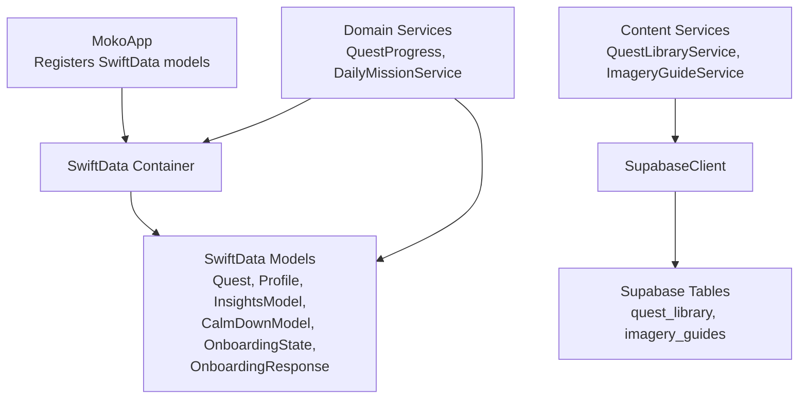
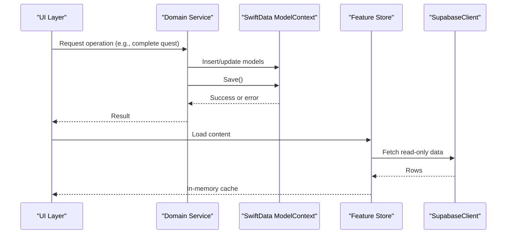
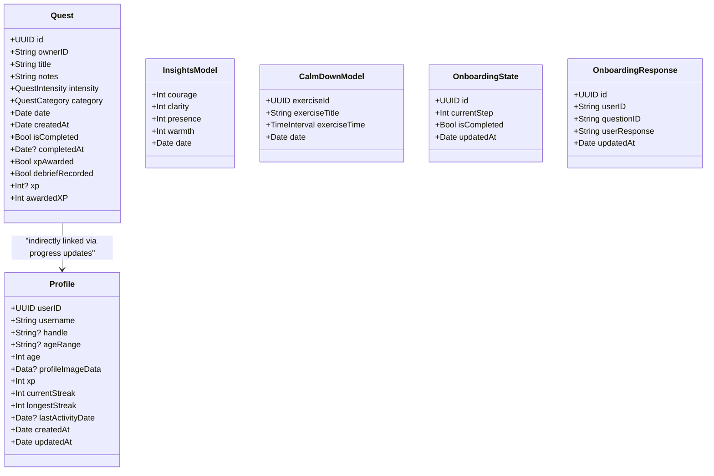
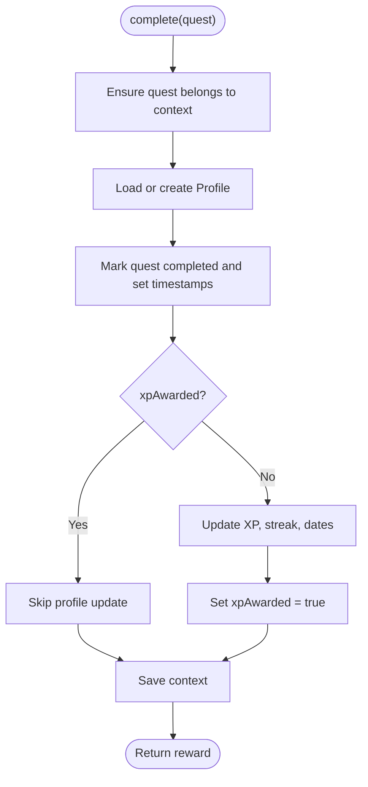
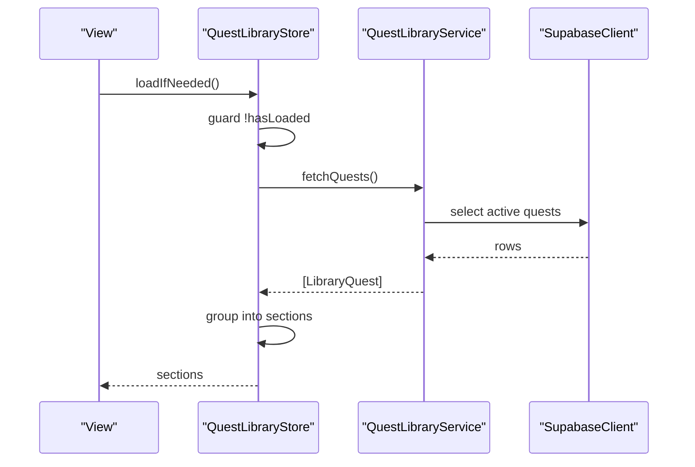
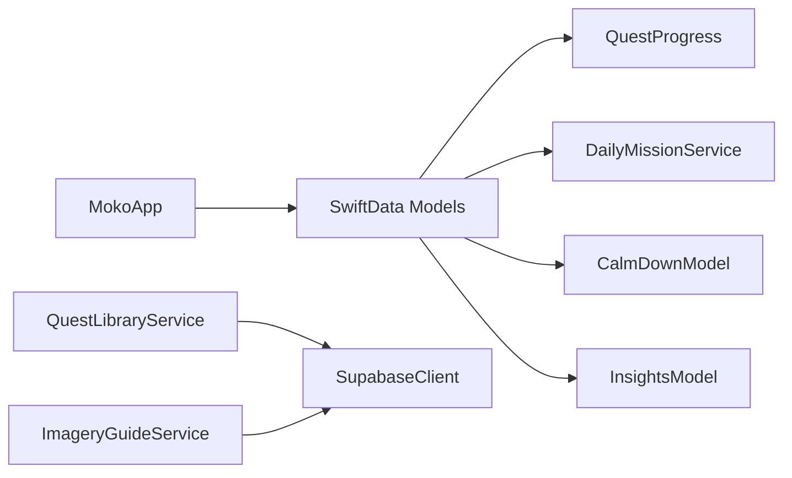

# Persistence Strategies

<cite>
**Referenced Files in This Document**
- [MokoApp.swift](file://Moko/Moko/MokoApp.swift)
- [QuestModels.swift](file://Moko/Moko/Models/QuestModels.swift)
- [Profile.swift](file://Moko/Moko/Models/Profile.swift)
- [QuestProgress.swift](file://Moko/Moko/Models/QuestProgress.swift)
- [CalmDownModel.swift](file://Moko/Moko/Models/CalmDownModel.swift)
- [InsightsModel.swift](file://Moko/Moko/Models/InsightsModel.swift)
- [Onboarding_state.swift](file://Moko/Moko/Models/Onboarding_state.swift)
- [Onboarding_Response.swift](file://Moko/Moko/Models/Onboarding_Response.swift)
- [DailyMissionService.swift](file://Moko/Moko/Features/AFM/DailyMissionService.swift)
- [QuestLibraryService.swift](file://Moko/Moko/Features/QuestLibrary/QuestLibraryService.swift)
- [ImageryGuideStore.swift](file://Moko/Moko/UIScreens/relaxScreens/ImageryGuide/ImageryGuideStore.swift)
- [SupabaseManager.swift](file://Moko/Moko/SupabaseManager.swift)
- [README.md](file://README.md)
- [supabase README.md](file://supabase/README.md)
</cite>

## Table of Contents
1. [Introduction](#introduction)
2. [Project Structure](#project-structure)
3. [Core Components](#core-components)
4. [Architecture Overview](#architecture-overview)
5. [Detailed Component Analysis](#detailed-component-analysis)
6. [Dependency Analysis](#dependency-analysis)
7. [Performance Considerations](#performance-considerations)
8. [Troubleshooting Guide](#troubleshooting-guide)
9. [Conclusion](#conclusion)
10. [Appendices](#appendices)

## Introduction
This document explains the persistence strategies used by the app, focusing on local storage with SwiftData and read-only synchronization with Supabase. It covers initialization, context management, transaction handling, caching for offline-first behavior, data synchronization patterns, error handling, conflict resolution, rollback considerations, CRUD examples, batch operations, query optimization, integrity constraints, memory management, background tasks, performance tuning, and testing approaches.

The app uses SwiftData for user-owned state such as quests, profile, insights, calm-down sessions, and onboarding progress. Read-only content like the Quest Library and Imagery Guides is fetched from Supabase and cached in-memory within feature stores.

## Project Structure
The persistence layer spans several areas:
- App-level SwiftData container registration
- Domain models persisted with SwiftData
- Services that perform reads/writes against ModelContext
- Read-only services that fetch content from Supabase and cache it locally

**Diagram sources**
- [MokoApp.swift:31-44](file://Moko/Moko/MokoApp.swift#L31-L44)
- [QuestModels.swift:51-100](file://Moko/Moko/Models/QuestModels.swift#L51-L100)
- [Profile.swift:12-59](file://Moko/Moko/Models/Profile.swift#L12-L59)
- [InsightsModel.swift:11-26](file://Moko/Moko/Models/InsightsModel.swift#L11-L26)
- [CalmDownModel.swift:12-25](file://Moko/Moko/Models/CalmDownModel.swift#L12-L25)
- [Onboarding_state.swift:4-23](file://Moko/Moko/Models/Onboarding_state.swift#L4-L23)
- [Onboarding_Response.swift:11-35](file://Moko/Moko/Models/Onboarding_Response.swift#L11-L35)
- [QuestLibraryService.swift:13-31](file://Moko/Moko/Features/QuestLibrary/QuestLibraryService.swift#L13-L31)
- [ImageryGuideStore.swift:14-49](file://Moko/Moko/UIScreens/relaxScreens/ImageryGuide/ImageryGuideStore.swift#L14-L49)
- [SupabaseManager.swift:6-19](file://Moko/Moko/SupabaseManager.swift#L6-L19)

**Section sources**
- [MokoApp.swift:31-44](file://Moko/Moko/MokoApp.swift#L31-L44)
- [QuestModels.swift:51-100](file://Moko/Moko/Models/QuestModels.swift#L51-L100)
- [Profile.swift:12-59](file://Moko/Moko/Models/Profile.swift#L12-L59)
- [InsightsModel.swift:11-26](file://Moko/Moko/Models/InsightsModel.swift#L11-L26)
- [CalmDownModel.swift:12-25](file://Moko/Moko/Models/CalmDownModel.swift#L12-L25)
- [Onboarding_state.swift:4-23](file://Moko/Moko/Models/Onboarding_state.swift#L4-L23)
- [Onboarding_Response.swift:11-35](file://Moko/Moko/Models/Onboarding_Response.swift#L11-L35)
- [QuestLibraryService.swift:13-31](file://Moko/Moko/Features/QuestLibrary/QuestLibraryService.swift#L13-L31)
- [ImageryGuideStore.swift:14-49](file://Moko/Moko/UIScreens/relaxScreens/ImageryGuide/ImageryGuideStore.swift#L14-L49)
- [SupabaseManager.swift:6-19](file://Moko/Moko/SupabaseManager.swift#L6-L19)

## Core Components
- SwiftData container registration at app launch wires up all persistent models.
- Domain models represent user-owned entities: Quest, Profile, InsightsModel, CalmDownModel, OnboardingState, OnboardingResponse.
- Services encapsulate business logic and persist changes through ModelContext.
- Read-only content services fetch from Supabase and expose in-memory caches to UI.

Key responsibilities:
- Initialization: MokoApp registers SwiftData models; SupabaseManager provides a shared client.
- Context management: Services receive ModelContext to insert, update, delete, and save.
- Transactions: Save calls wrap related mutations; errors are caught and logged.
- Caching: Feature stores keep fetched content in memory until refreshed.
- Synchronization: The app reads from Supabase but does not write to those tables.

**Section sources**
- [MokoApp.swift:31-44](file://Moko/Moko/MokoApp.swift#L31-L44)
- [SupabaseManager.swift:6-19](file://Moko/Moko/SupabaseManager.swift#L6-L19)
- [QuestModels.swift:51-100](file://Moko/Moko/Models/QuestModels.swift#L51-L100)
- [Profile.swift:12-59](file://Moko/Moko/Models/Profile.swift#L12-L59)
- [QuestProgress.swift:49-137](file://Moko/Moko/Models/QuestProgress.swift#L49-L137)
- [DailyMissionService.swift:129-224](file://Moko/Moko/Features/AFM/DailyMissionService.swift#L129-L224)
- [QuestLibraryService.swift:20-31](file://Moko/Moko/Features/QuestLibrary/QuestLibraryService.swift#L20-L31)
- [ImageryGuideStore.swift:21-49](file://Moko/Moko/UIScreens/relaxScreens/ImageryGuide/ImageryGuideStore.swift#L21-L49)

## Architecture Overview
The system combines an offline-first local database with read-only remote content.

**Diagram sources**
- [QuestProgress.swift:49-137](file://Moko/Moko/Models/QuestProgress.swift#L49-L137)
- [DailyMissionService.swift:129-224](file://Moko/Moko/Features/AFM/DailyMissionService.swift#L129-L224)
- [QuestLibraryService.swift:20-31](file://Moko/Moko/Features/QuestLibrary/QuestLibraryService.swift#L20-L31)
- [ImageryGuideStore.swift:21-49](file://Moko/Moko/UIScreens/relaxScreens/ImageryGuide/ImageryGuideStore.swift#L21-L49)

## Detailed Component Analysis

### SwiftData Initialization and Container Management
- The app registers all persistent models in the root scene using modelContainer.
- A separate MokoDatabase helper exists for creating isolated containers, including an in-memory variant for previews.

Recommendations:
- Prefer the app-scoped container for runtime use.
- Use the preview container for SwiftUI previews and tests.

**Section sources**
- [MokoApp.swift:31-44](file://Moko/Moko/MokoApp.swift#L31-L44)
- [QuestModels.swift:151-166](file://Moko/Moko/Models/QuestModels.swift#L151-L166)

### Data Models and Integrity Constraints
- Quest: Unique id, ownerID, scheduling fields, completion flags, XP tracking.
- Profile: User identity, streaks, XP, last activity date, external image data.
- InsightsModel: Daily debrief scores.
- CalmDownModel: Exercise logs.
- OnboardingState and OnboardingResponse: Onboarding flow state and answers.

Constraints and relationships:
- Unique identifiers where appropriate.
- Owner scoping via ownerID and CurrentUser.localID.
- External storage attribute for large binary data.

**Diagram sources**
- [QuestModels.swift:51-100](file://Moko/Moko/Models/QuestModels.swift#L51-L100)
- [Profile.swift:12-59](file://Moko/Moko/Models/Profile.swift#L12-L59)
- [InsightsModel.swift:11-26](file://Moko/Moko/Models/InsightsModel.swift#L11-L26)
- [CalmDownModel.swift:12-25](file://Moko/Moko/Models/CalmDownModel.swift#L12-L25)
- [Onboarding_state.swift:4-23](file://Moko/Moko/Models/Onboarding_state.swift#L4-L23)
- [Onboarding_Response.swift:11-35](file://Moko/Moko/Models/Onboarding_Response.swift#L11-L35)

**Section sources**
- [QuestModels.swift:51-100](file://Moko/Moko/Models/QuestModels.swift#L51-L100)
- [Profile.swift:12-59](file://Moko/Moko/Models/Profile.swift#L12-L59)
- [InsightsModel.swift:11-26](file://Moko/Moko/Models/InsightsModel.swift#L11-L26)
- [CalmDownModel.swift:12-25](file://Moko/Moko/Models/CalmDownModel.swift#L12-L25)
- [Onboarding_state.swift:4-23](file://Moko/Moko/Models/Onboarding_state.swift#L4-L23)
- [Onboarding_Response.swift:11-35](file://Moko/Moko/Models/Onboarding_Response.swift#L11-L35)

### Transaction Handling and Error Handling
- QuestProgress.complete updates a Quest and its associated Profile, then saves once.
- QuestProgress.saveDebrief ensures debrief recording happens only once and inserts an InsightsModel.
- CalmDownModel.ModelContext.logCalmDown wraps insertion and save in a single call.
- Errors during save are caught and logged; no explicit retry or rollback is implemented.

Best practices observed:
- Group related mutations before calling save.
- Guard against duplicate awards using flags like xpAwarded and debriefRecorded.

Error handling gaps:
- Logging without user-facing feedback.
- No explicit rollback strategy beyond discarding uncommitted changes.

**Diagram sources**
- [QuestProgress.swift:49-83](file://Moko/Moko/Models/QuestProgress.swift#L49-L83)
- [QuestProgress.swift:121-137](file://Moko/Moko/Models/QuestProgress.swift#L121-L137)

**Section sources**
- [QuestProgress.swift:49-137](file://Moko/Moko/Models/QuestProgress.swift#L49-L137)
- [CalmDownModel.swift:27-37](file://Moko/Moko/Models/CalmDownModel.swift#L27-L37)

### Offline-First Caching Strategy
- Feature stores hold fetched content in memory.
- QuestLibraryStore loads once per session and exposes sections grouped by category.
- ImageryGuideStore fetches guides, tags, and screen copy concurrently and returns a combined payload.

Implications:
- Fast UI rendering from memory after first load.
- Network failures surface as error messages in the store.
- Refresh triggers re-fetching and replacing the in-memory cache.

**Diagram sources**
- [QuestLibraryService.swift:20-31](file://Moko/Moko/Features/QuestLibrary/QuestLibraryService.swift#L20-L31)
- [QuestLibraryService.swift:50-81](file://Moko/Moko/Features/QuestLibrary/QuestLibraryService.swift#L50-L81)

**Section sources**
- [QuestLibraryService.swift:20-81](file://Moko/Moko/Features/QuestLibrary/QuestLibraryService.swift#L20-L81)
- [ImageryGuideStore.swift:21-49](file://Moko/Moko/UIScreens/relaxScreens/ImageryGuide/ImageryGuideStore.swift#L21-L49)

### Data Synchronization with Supabase
- SupabaseManager provides a shared client configured with URL and anon key.
- Read-only services fetch content from Supabase tables and do not write back.
- Supabase documentation outlines schema migrations and seed files.

Synchronization pattern:
- Local writes affect only SwiftData.
- Remote content is read-only and refreshed on demand.

Security note:
- Only the public anon key is used in the app.

**Section sources**
- [SupabaseManager.swift:6-19](file://Moko/Moko/SupabaseManager.swift#L6-L19)
- [QuestLibraryService.swift:20-31](file://Moko/Moko/Features/QuestLibrary/QuestLibraryService.swift#L20-L31)
- [ImageryGuideStore.swift:21-49](file://Moko/Moko/UIScreens/relaxScreens/ImageryGuide/ImageryGuideStore.swift#L21-L49)
- [supabase README.md:1-48](file://supabase/README.md#L1-L48)

### CRUD Operations Examples

- Create
  - DailyMissionService creates a new Quest and inserts it into ModelContext, then saves.
  - CalmDownModel.ModelContext.logCalmDown inserts a new log entry and saves.

- Read
  - Quest.overviewMission selects the next mission based on completion and timing rules.
  - DailyMissionService.lowestScoredStat queries InsightsModel to compute averages.

- Update
  - QuestProgress.complete marks a quest completed and updates Profile metrics.
  - QuestProgress.saveDebrief records debrief data and marks debriefRecorded.

- Delete
  - Not directly shown in the referenced files; deletion would follow the same pattern of removing objects from ModelContext and saving.

Batch processing:
- DailyMissionService seeds multiple quests across categories in a loop and performs a single save afterward.

Query optimization:
- Using FetchDescriptor with SortDescriptor for efficient ordering.
- Filtering in-memory arrays after fetching when appropriate.

**Section sources**
- [DailyMissionService.swift:129-224](file://Moko/Moko/Features/AFM/DailyMissionService.swift#L129-L224)
- [DailyMissionService.swift:231-273](file://Moko/Moko/Features/AFM/DailyMissionService.swift#L231-L273)
- [DailyMissionService.swift:40-58](file://Moko/Moko/Features/AFM/DailyMissionService.swift#L40-L58)
- [QuestModels.swift:110-127](file://Moko/Moko/Models/QuestModels.swift#L110-L127)
- [CalmDownModel.swift:27-37](file://Moko/Moko/Models/CalmDownModel.swift#L27-L37)
- [QuestProgress.swift:49-137](file://Moko/Moko/Models/QuestProgress.swift#L49-L137)

### Conflict Resolution and Rollback Mechanisms
- Idempotency: Flags like xpAwarded and debriefRecorded prevent duplicate rewards and insights entries.
- Rollbacks: SwiftData automatically rolls back uncommitted changes if save fails; there is no explicit manual rollback path.
- Conflict resolution: Since Supabase is read-only for the app, conflicts between local and remote data are avoided by design.

Recommendations:
- Add structured error types and propagate them to UI.
- Implement retry logic for transient network errors when reading from Supabase.
- Consider optimistic concurrency tokens if future write synchronization is added.

**Section sources**
- [QuestProgress.swift:65-83](file://Moko/Moko/Models/QuestProgress.swift#L65-L83)
- [QuestProgress.swift:98-119](file://Moko/Moko/Models/QuestProgress.swift#L98-L119)

### Memory Management and Background Tasks
- Large binary data uses external storage attributes to avoid bloating the SQLite store.
- Background seeding: DailyMissionService uses Task to seed remaining categories asynchronously after creating the daily mission.
- Preview containers: An in-memory ModelContainer is provided for previews to avoid disk I/O.

Optimization tips:
- Avoid loading entire datasets into memory unnecessarily; paginate or filter server-side when possible.
- Reuse ModelContext instances within a scope to reduce overhead.

**Section sources**
- [Profile.swift:21-23](file://Moko/Moko/Models/Profile.swift#L21-L23)
- [DailyMissionService.swift:143-150](file://Moko/Moko/Features/AFM/DailyMissionService.swift#L143-L150)
- [DailyMissionService.swift:214-222](file://Moko/Moko/Features/AFM/DailyMissionService.swift#L214-L222)
- [QuestModels.swift:151-166](file://Moko/Moko/Models/QuestModels.swift#L151-L166)

### Testing Approaches
- Use the preview ModelContainer for unit and integration tests to isolate data.
- Mock SupabaseClient via dependency injection in service initializers.
- Manage test data by inserting known fixtures into the preview container before assertions.
- Validate idempotency by invoking operations multiple times and ensuring no duplicates.

Testing checklist:
- Verify create/read/update/delete flows against the preview container.
- Assert error paths for network failures in content services.
- Confirm background tasks do not interfere with synchronous test expectations.

**Section sources**
- [QuestModels.swift:151-166](file://Moko/Moko/Models/QuestModels.swift#L151-L166)
- [QuestLibraryService.swift:13-18](file://Moko/Moko/Features/QuestLibrary/QuestLibraryService.swift#L13-L18)
- [README.md:244-261](file://README.md#L244-L261)

## Dependency Analysis
The persistence layer has clear boundaries:
- App initializes SwiftData and exposes ModelContext to views and services.
- Domain services depend on SwiftData models and operate within a given context.
- Content services depend on SupabaseClient and provide in-memory caches.

**Diagram sources**
- [MokoApp.swift:31-44](file://Moko/Moko/MokoApp.swift#L31-L44)
- [QuestProgress.swift:49-137](file://Moko/Moko/Models/QuestProgress.swift#L49-L137)
- [DailyMissionService.swift:129-224](file://Moko/Moko/Features/AFM/DailyMissionService.swift#L129-L224)
- [CalmDownModel.swift:27-37](file://Moko/Moko/Models/CalmDownModel.swift#L27-L37)
- [InsightsModel.swift:11-26](file://Moko/Moko/Models/InsightsModel.swift#L11-L26)
- [QuestLibraryService.swift:20-31](file://Moko/Moko/Features/QuestLibrary/QuestLibraryService.swift#L20-L31)
- [ImageryGuideStore.swift:21-49](file://Moko/Moko/UIScreens/relaxScreens/ImageryGuide/ImageryGuideStore.swift#L21-L49)

**Section sources**
- [MokoApp.swift:31-44](file://Moko/Moko/MokoApp.swift#L31-L44)
- [QuestProgress.swift:49-137](file://Moko/Moko/Models/QuestProgress.swift#L49-L137)
- [DailyMissionService.swift:129-224](file://Moko/Moko/Features/AFM/DailyMissionService.swift#L129-L224)
- [CalmDownModel.swift:27-37](file://Moko/Moko/Models/CalmDownModel.swift#L27-L37)
- [InsightsModel.swift:11-26](file://Moko/Moko/Models/InsightsModel.swift#L11-L26)
- [QuestLibraryService.swift:20-31](file://Moko/Moko/Features/QuestLibrary/QuestLibraryService.swift#L20-L31)
- [ImageryGuideStore.swift:21-49](file://Moko/Moko/UIScreens/relaxScreens/ImageryGuide/ImageryGuideStore.swift#L21-L49)

## Performance Considerations
- Batch writes: Group related mutations and call save once to reduce overhead.
- Efficient queries: Use FetchDescriptor with SortDescriptor and targeted filters.
- Avoid heavy payloads: Use external storage for large images.
- Minimize redundant work: Cache read-only content in memory and refresh only when needed.
- Background tasks: Offload non-critical seeding to background tasks to keep UI responsive.

[No sources needed since this section provides general guidance]

## Troubleshooting Guide
Common issues and remedies:
- Save failures: Errors are logged; ensure the correct ModelContext is used and that required fields are present.
- Duplicate rewards: Verify idempotency flags are checked before updating profiles or inserting insights.
- Empty daily mission: Ensure ensureDailyMission runs and that existing quests are passed correctly.
- Network errors: Content services surface error messages; check connection and retry logic.

Operational checks:
- Confirm SwiftData container includes all models.
- Validate Supabase configuration and table availability.
- Review background task execution and error logging.

**Section sources**
- [QuestProgress.swift:131-137](file://Moko/Moko/Models/QuestProgress.swift#L131-L137)
- [DailyMissionService.swift:129-224](file://Moko/Moko/Features/AFM/DailyMissionService.swift#L129-L224)
- [QuestLibraryService.swift:56-81](file://Moko/Moko/Features/QuestLibrary/QuestLibraryService.swift#L56-L81)
- [ImageryGuideStore.swift:21-49](file://Moko/Moko/UIScreens/relaxScreens/ImageryGuide/ImageryGuideStore.swift#L21-L49)

## Conclusion
The app’s persistence strategy centers on SwiftData for local, user-owned data and read-only Supabase access for curated content. Transactions are concise and idempotent, with background tasks improving responsiveness. While robust, the implementation can be enhanced with richer error propagation, explicit retry mechanisms, and more comprehensive testing harnesses. The architecture cleanly separates concerns, making it easier to extend synchronization features in the future while preserving offline-first behavior.

[No sources needed since this section summarizes without analyzing specific files]

## Appendices

### Appendix A: Key File Responsibilities
- MokoApp.swift: Registers SwiftData models at app launch.
- QuestModels.swift: Defines Quest, enums, and database helpers.
- Profile.swift: Stores user profile and streak metrics.
- QuestProgress.swift: Implements completion and debrief workflows.
- CalmDownModel.swift: Logs calm-down sessions.
- InsightsModel.swift: Represents debrief insights.
- Onboarding_state.swift and Onboarding_Response.swift: Persist onboarding state and responses.
- DailyMissionService.swift: Generates and seeds daily missions.
- QuestLibraryService.swift: Loads library quests from Supabase.
- ImageryGuideStore.swift: Loads imagery guides from Supabase.
- SupabaseManager.swift: Provides shared Supabase client.

**Section sources**
- [MokoApp.swift:31-44](file://Moko/Moko/MokoApp.swift#L31-L44)
- [QuestModels.swift:51-100](file://Moko/Moko/Models/QuestModels.swift#L51-L100)
- [Profile.swift:12-59](file://Moko/Moko/Models/Profile.swift#L12-L59)
- [QuestProgress.swift:49-137](file://Moko/Moko/Models/QuestProgress.swift#L49-L137)
- [CalmDownModel.swift:12-37](file://Moko/Moko/Models/CalmDownModel.swift#L12-L37)
- [InsightsModel.swift:11-26](file://Moko/Moko/Models/InsightsModel.swift#L11-L26)
- [Onboarding_state.swift:4-23](file://Moko/Moko/Models/Onboarding_state.swift#L4-L23)
- [Onboarding_Response.swift:11-35](file://Moko/Moko/Models/Onboarding_Response.swift#L11-L35)
- [DailyMissionService.swift:129-224](file://Moko/Moko/Features/AFM/DailyMissionService.swift#L129-L224)
- [QuestLibraryService.swift:20-31](file://Moko/Moko/Features/QuestLibrary/QuestLibraryService.swift#L20-L31)
- [ImageryGuideStore.swift:21-49](file://Moko/Moko/UIScreens/relaxScreens/ImageryGuide/ImageryGuideStore.swift#L21-L49)
- [SupabaseManager.swift:6-19](file://Moko/Moko/SupabaseManager.swift#L6-L19)