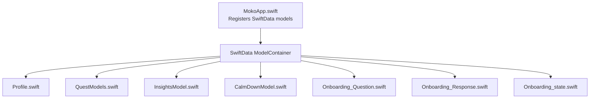
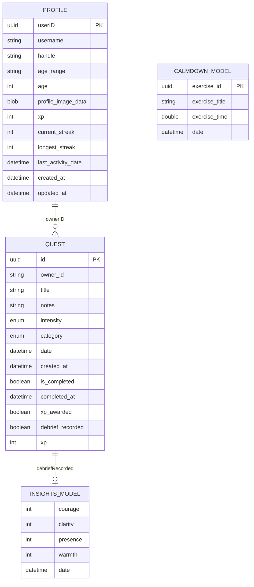
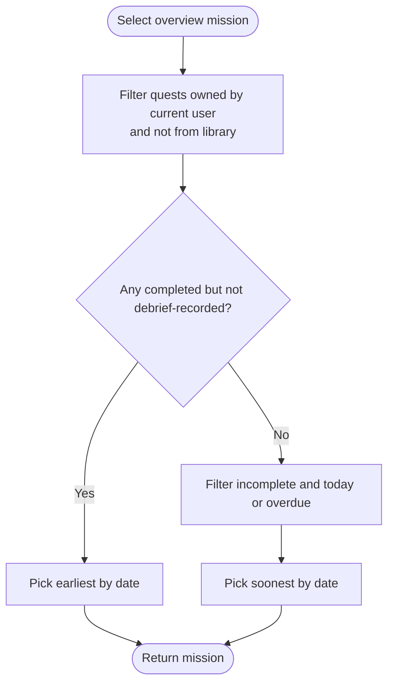
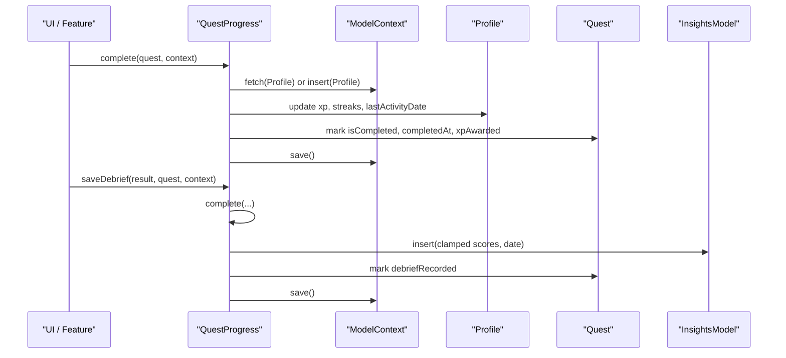
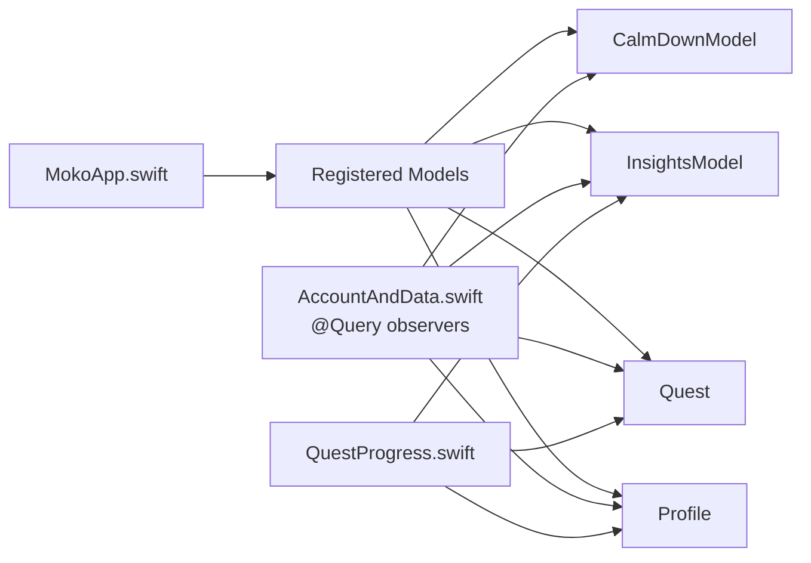

# SwiftData Models

<cite>
**Referenced Files in This Document**
- [MokoApp.swift](file://Moko/Moko/MokoApp.swift)
- [Profile.swift](file://Moko/Moko/Models/Profile.swift)
- [QuestModels.swift](file://Moko/Moko/Models/QuestModels.swift)
- [InsightsModel.swift](file://Moko/Moko/Models/InsightsModel.swift)
- [CalmDownModel.swift](file://Moko/Moko/Models/CalmDownModel.swift)
- [QuestProgress.swift](file://Moko/Moko/Models/QuestProgress.swift)
- [Onboarding_Question.swift](file://Moko/Moko/Models/Onboarding_Question.swift)
- [Onboarding_Response.swift](file://Moko/Moko/Models/Onboarding_Response.swift)
- [Onboarding_state.swift](file://Moko/Moko/Models/Onboarding_state.swift)
- [AccountAndData.swift](file://Moko/Moko/UIScreens/homeScreens/ProfileOverView/AccountAndData.swift)
</cite>

## Table of Contents
1. Introduction
2. Project Structure
3. Core Components
4. Architecture Overview
5. Detailed Component Analysis
6. Dependency Analysis
7. Performance Considerations
8. Troubleshooting Guide
9. Conclusion

## Introduction
This document describes the SwiftData data model used by the application, focusing on the Profile, Quest, InsightsModel, and CalmDownModel entities. It explains field definitions, data types, constraints, relationships, validation rules, lifecycle operations, query patterns, performance considerations, and migration guidance.

## Project Structure
The SwiftData models are defined under Moko/Moko/Models and registered with the app’s ModelContainer at launch. The main app also wires up additional onboarding-related models for completeness.

**Diagram sources**
- [MokoApp.swift:31-44](file://Moko/Moko/MokoApp.swift#L31-L44)

**Section sources**
- [MokoApp.swift:31-44](file://Moko/Moko/MokoApp.swift#L31-L44)

## Core Components
This section summarizes each SwiftData entity, its fields, types, constraints, and business logic embedded in or closely associated with the model.

- Profile
  - Purpose: User profile with identity, basic demographics, gamification metrics, timestamps, and optional profile image data.
  - Key fields: userID (UUID), username (String), handle (String?), ageRange (String?), age (Int), profileImageData (Data? external storage), xp (Int), currentStreak (Int), longestStreak (Int), lastActivityDate (Date?), createdAt (Date), updatedAt (Date).
  - Constraints: None explicitly declared beyond standard SwiftData persistence; profileImageData is marked for external storage to avoid embedding large blobs in the database.
  - Validation: No explicit validation in the model; defaults are provided via initializer parameters.

- Quest
  - Purpose: A user-owned task or challenge with scheduling, categorization, intensity, completion state, and XP tracking.
  - Key fields: id (UUID, unique), ownerID (String), title (String), notes (String), intensity (enum), category (enum), date (Date), createdAt (Date), isCompleted (Bool), completedAt (Date?), xpAwarded (Bool), debriefRecorded (Bool), xp (Int?).
  - Derived properties: awardedXP (computed from xp or intensity), isFromLibrary (derived from whether xp was set by library content).
  - Business logic: overviewMission selects the next mission based on completion/debrief status and scheduling rules.
  - Constraints: id is unique; ownerID ties quests to a user context.

- InsightsModel
  - Purpose: Stores debrief scores (courage, clarity, presence, warmth) with a timestamp.
  - Key fields: courage (Int), clarity (Int), presence (Int), warmth (Int), date (Date).
  - Validation: Values are clamped to meaningful ranges by the progress service before insertion.

- CalmDownModel
  - Purpose: Records completed calm-down exercises with title, duration, and timestamp.
  - Key fields: exerciseId (UUID), exerciseTitle (String), exerciseTime (TimeInterval), date (Date).
  - Helper: ModelContext extension provides logCalmDown to persist a new record safely.

- Onboarding models (for context)
  - OnboardingQuestion: questionID (UUID), questionText (String), options ([String]), isRequired (Bool).
  - OnboardingResponse: id (UUID, unique), userID (String), questionID (String), userResponse (String), updatedAt (Date).
  - OnboardingState: id (UUID), currentStep (Int), isCompleted (Bool), updatedAt (Date).

**Section sources**
- [Profile.swift:12-59](file://Moko/Moko/Models/Profile.swift#L12-L59)
- [QuestModels.swift:50-127](file://Moko/Moko/Models/QuestModels.swift#L50-L127)
- [InsightsModel.swift:11-26](file://Moko/Moko/Models/InsightsModel.swift#L11-L26)
- [CalmDownModel.swift:11-37](file://Moko/Moko/Models/CalmDownModel.swift#L11-L37)
- [Onboarding_Question.swift:11-36](file://Moko/Moko/Models/Onboarding_Question.swift#L11-L36)
- [Onboarding_Response.swift:11-35](file://Moko/Moko/Models/Onboarding_Response.swift#L11-L35)
- [Onboarding_state.swift:4-23](file://Moko/Moko/Models/Onboarding_state.swift#L4-L23)

## Architecture Overview
The data layer centers around four primary entities:
- Profile represents the user’s persistent state and gamification metrics.
- Quest represents user-created or library-sourced tasks tied to a user via ownerID.
- InsightsModel captures post-quest debrief scores.
- CalmDownModel logs relaxation exercise sessions.

Relationships:
- One-to-many: Profile to Quest (via ownerID).
- One-to-many: Quest to InsightsModel (one debrief per quest, recorded once).
- Independent: CalmDownModel is independent of Quest and Profile but often viewed alongside them in summaries.

**Diagram sources**
- [Profile.swift:12-59](file://Moko/Moko/Models/Profile.swift#L12-L59)
- [QuestModels.swift:50-127](file://Moko/Moko/Models/QuestModels.swift#L50-L127)
- [InsightsModel.swift:11-26](file://Moko/Moko/Models/InsightsModel.swift#L11-L26)
- [CalmDownModel.swift:11-37](file://Moko/Moko/Models/CalmDownModel.swift#L11-L37)

## Detailed Component Analysis

### Profile Entity
- Fields and types:
  - userID: UUID (default generated)
  - username: String
  - handle: String?
  - ageRange: String?
  - age: Int
  - profileImageData: Data? (external storage)
  - xp: Int
  - currentStreak: Int
  - longestStreak: Int
  - lastActivityDate: Date?
  - createdAt: Date
  - updatedAt: Date
- Constraints and indexes:
  - No explicit index declarations; default indexing applies.
  - profileImageData uses external storage to keep DB size small.
- Validation and defaults:
  - Defaults provided in initializer; no runtime validation in the model.
- Lifecycle:
  - Created implicitly when first needed by progress logic if missing.
  - Updated when completing quests or updating activity timestamps.

**Section sources**
- [Profile.swift:12-59](file://Moko/Moko/Models/Profile.swift#L12-L59)

### Quest Entity
- Fields and types:
  - id: UUID (unique)
  - ownerID: String
  - title: String
  - notes: String
  - intensity: enum (Easy/Medium/Hard)
  - category: enum (Work/Dating/Friends/Family/Others)
  - date: Date
  - createdAt: Date
  - isCompleted: Bool
  - completedAt: Date?
  - xpAwarded: Bool
  - debriefRecorded: Bool
  - xp: Int?
- Derived behavior:
  - awardedXP returns library-set xp or intensity-based default.
  - isFromLibrary indicates library-sourced quests.
  - overviewMission computes the next mission to show based on completion/debrief and scheduling.
- Constraints and indexes:
  - id is unique.
  - ownerID acts as a foreign key conceptually linking to Profile.
- Lifecycle:
  - Created by users or imported from the library.
  - Marked complete and debrief-recorded through progress helpers.

**Diagram sources**
- [QuestModels.swift:102-127](file://Moko/Moko/Models/QuestModels.swift#L102-L127)

**Section sources**
- [QuestModels.swift:50-127](file://Moko/Moko/Models/QuestModels.swift#L50-L127)

### InsightsModel Entity
- Fields and types:
  - courage: Int
  - clarity: Int
  - presence: Int
  - warmth: Int
  - date: Date
- Validation:
  - Scores are clamped to minimum values by the progress helper before insertion to ensure meaningful measurements.
- Relationship:
  - Associated with a Quest via debriefRecorded flag; one InsightsModel per debrief.

**Section sources**
- [InsightsModel.swift:11-26](file://Moko/Moko/Models/InsightsModel.swift#L11-L26)
- [QuestProgress.swift:85-119](file://Moko/Moko/Models/QuestProgress.swift#L85-L119)

### CalmDownModel Entity
- Fields and types:
  - exerciseId: UUID
  - exerciseTitle: String
  - exerciseTime: TimeInterval
  - date: Date
- Persistence helper:
  - ModelContext.logCalmDown inserts and saves a new record with safe time handling.

**Section sources**
- [CalmDownModel.swift:11-37](file://Moko/Moko/Models/CalmDownModel.swift#L11-L37)

### Progress and Relationships Logic
- QuestProgress orchestrates:
  - Completing a quest and awarding XP/streak exactly once.
  - Updating Profile metrics (xp, streaks, lastActivityDate).
  - Creating an InsightsModel entry for debriefs with score clamping.
  - Ensuring a Profile exists (creating a minimal one if necessary).

**Diagram sources**
- [QuestProgress.swift:49-119](file://Moko/Moko/Models/QuestProgress.swift#L49-L119)

**Section sources**
- [QuestProgress.swift:17-138](file://Moko/Moko/Models/QuestProgress.swift#L17-L138)

## Dependency Analysis
- Registration: All models are registered in the app’s ModelContainer.
- Query usage: UI components use @Query to observe lists of Profile, Quest, CalmDownModel, InsightsModel, and OnboardingResponse.
- Cross-entity dependencies:
  - QuestProgress depends on Profile and Quest and creates InsightsModel.
  - CalmDownModel is observed independently.

**Diagram sources**
- [MokoApp.swift:31-44](file://Moko/Moko/MokoApp.swift#L31-L44)
- [AccountAndData.swift:5-11](file://Moko/Moko/UIScreens/homeScreens/ProfileOverView/AccountAndData.swift#L5-L11)
- [QuestProgress.swift:17-138](file://Moko/Moko/Models/QuestProgress.swift#L17-L138)

**Section sources**
- [MokoApp.swift:31-44](file://Moko/Moko/MokoApp.swift#L31-L44)
- [AccountAndData.swift:5-11](file://Moko/Moko/UIScreens/homeScreens/ProfileOverView/AccountAndData.swift#L5-L11)
- [QuestProgress.swift:17-138](file://Moko/Moko/Models/QuestProgress.swift#L17-L138)

## Performance Considerations
- External storage for images:
  - Profile.profileImageData uses external storage to prevent bloating the SQLite store.
- Indexes and queries:
  - No custom indexes are declared. For high-volume datasets, consider adding indexes on frequently filtered columns such as ownerID and date.
- Batch operations:
  - Use ModelContext.save() after multiple changes to reduce transaction overhead.
- Query optimization:
  - Prefer FetchDescriptor filters and sorting in SwiftData rather than in-memory filtering where possible.
- Streak computation:
  - nextStreak performs calendar arithmetic; cache results in UI to avoid repeated computations during list rendering.

[No sources needed since this section provides general guidance]

## Troubleshooting Guide
- Save failures:
  - QuestProgress.save catches and prints errors; check console logs for “Quest progress save failed”.
- Calm down save failures:
  - ModelContext.logCalmDown prints “Calm down save failed” on error; verify context availability and valid parameters.
- Missing Profile:
  - QuestProgress ensures a Profile exists; if none is found, it inserts a minimal Profile automatically.
- Duplicate debriefs:
  - debriefRecorded prevents duplicate InsightsModel entries for the same quest.

**Section sources**
- [QuestProgress.swift:131-137](file://Moko/Moko/Models/QuestProgress.swift#L131-L137)
- [CalmDownModel.swift:27-37](file://Moko/Moko/Models/CalmDownModel.swift#L27-L37)
- [QuestProgress.swift:121-129](file://Moko/Moko/Models/QuestProgress.swift#L121-L129)

## Conclusion
The SwiftData model set centers on Profile, Quest, InsightsModel, and CalmDownModel, with clear ownership and lifecycle management handled by QuestProgress. Constraints like unique IDs and external storage for large data help maintain performance. UI observes these entities via @Query, enabling reactive updates. Future enhancements can include explicit indexes for frequent filters and more robust validation within the models themselves.