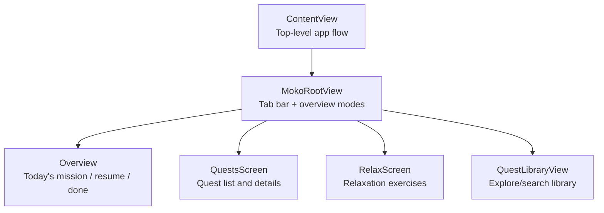
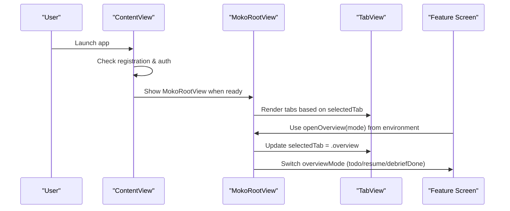
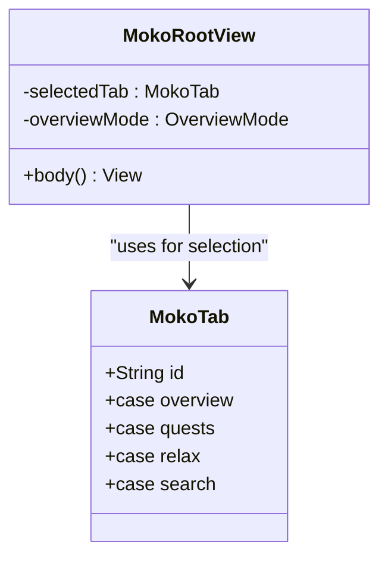
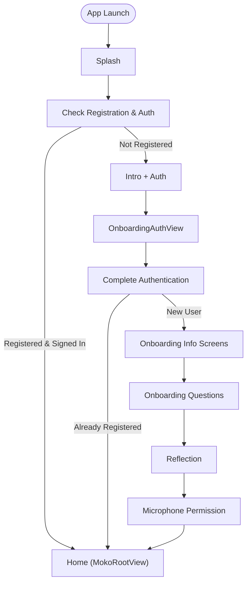
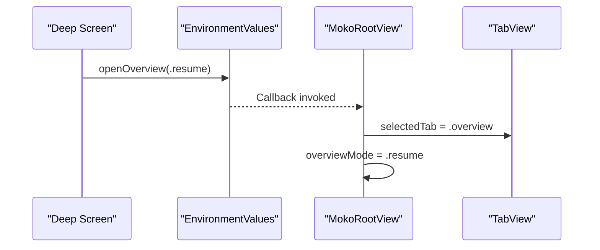
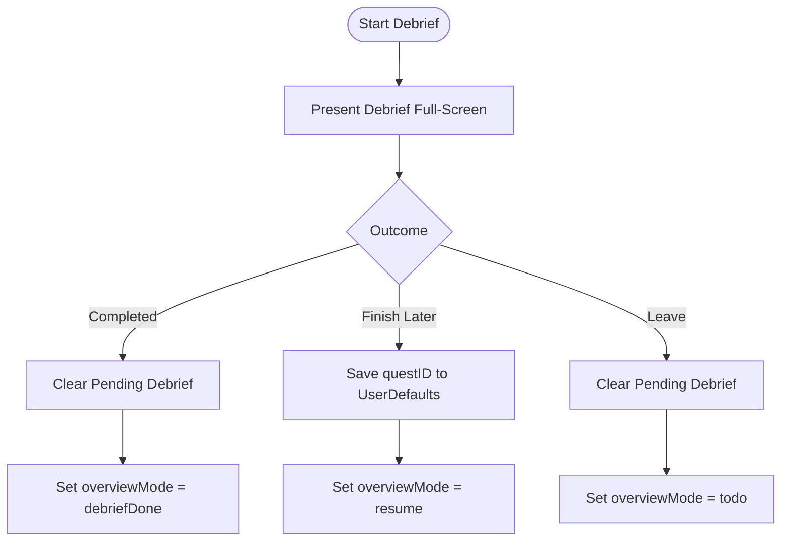
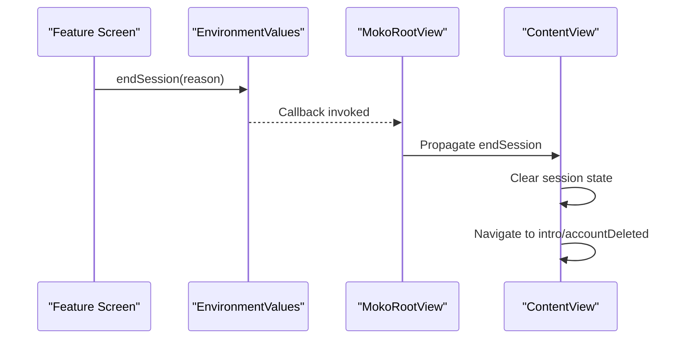
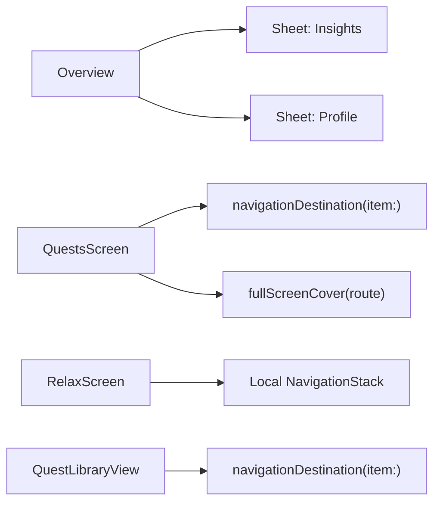
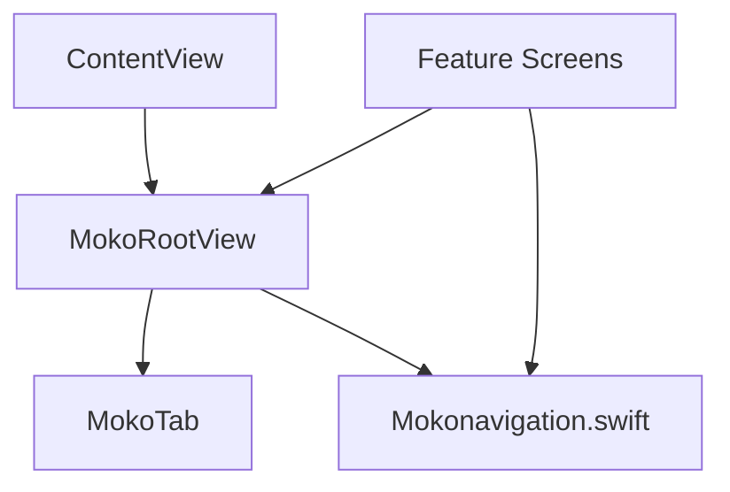

# Navigation System

<cite>
**Referenced Files in This Document**
- [MokoTab.swift](file://Moko/Moko/Models/MokoTab.swift)
- [ContentView.swift](file://Moko/Moko/ContentView.swift)
- [MokoRootView.swift](file://Moko/Moko/MokoRootView.swift)
- [Mokonavigation.swift](file://Moko/Moko/UIScreens/Quests/Mokonavigation.swift)
- [Overview.swift](file://Moko/Moko/UIScreens/homeScreens/Overview.swift)
- [Questsscreen.swift](file://Moko/Moko/UIScreens/Quests/Questsscreen.swift)
- [RelaxScreen.swift](file://Moko/Moko/UIScreens/relaxScreens/RelaxScreen.swift)
- [QuestLibraryView.swift](file://Moko/Moko/Features/QuestLibrary/QuestLibraryView.swift)
</cite>

## Table of Contents
1. [Introduction](#introduction)
2. [Project Structure](#project-structure)
3. [Core Components](#core-components)
4. [Architecture Overview](#architecture-overview)
5. [Detailed Component Analysis](#detailed-component-analysis)
6. [Dependency Analysis](#dependency-analysis)
7. [Performance Considerations](#performance-considerations)
8. [Troubleshooting Guide](#troubleshooting-guide)
9. [Conclusion](#conclusion)

## Introduction
This document explains the navigation system architecture for the app, focusing on:
- Tab-based navigation using a centralized MokoTab enum
- Navigation flow across onboarding, relaxation exercises, quests, and profile sections
- State management for navigation history and deep linking support
- Integration with the overall app structure and back button behavior
- Common navigation issues such as nested stacks and parameter passing

The goal is to provide both high-level understanding and code-level traceability so that developers can reason about navigation flows confidently.

## Project Structure
At a high level, navigation spans three layers:
- App shell and top-level routing: ContentView orchestrates the initial app flow (splash, intro, auth, onboarding, home).
- Main tabbed root: MokoRootView hosts the primary tabs (Overview, Quests, Relax, Explore) and manages overview modes and debrief flows.
- Feature screens: Each tab content screen owns its own local navigation stack and presentation patterns.

**Diagram sources**
- [ContentView.swift:78-210](file://Moko/Moko/ContentView.swift#L78-L210)
- [MokoRootView.swift:14-100](file://Moko/Moko/MokoRootView.swift#L14-L100)
- [Overview.swift:104-116](file://Moko/Moko/UIScreens/homeScreens/Overview.swift#L104-L116)
- [Questsscreen.swift:97-101](file://Moko/Moko/UIScreens/Quests/Questsscreen.swift#L97-L101)
- [RelaxScreen.swift](file://Moko/Moko/UIScreens/relaxScreens/RelaxScreen.swift)
- [QuestLibraryView.swift:80](file://Moko/Moko/Features/QuestLibrary/QuestLibraryView.swift#L80)

**Section sources**
- [ContentView.swift:78-210](file://Moko/Moko/ContentView.swift#L78-L210)
- [MokoRootView.swift:14-100](file://Moko/Moko/MokoRootView.swift#L14-L100)

## Core Components
- Centralized tab model: MokoTab defines the four main tabs and their identifiers.
- Top-level app flow: ContentView drives the pre-home journey and injects session termination into MokoRootView via environment.
- Root tab container: MokoRootView renders TabView with MokoTab selection, manages overview modes, and presents full-screen debriefs.
- Navigation helpers: Mokonavigation.swift provides environment keys for cross-cutting navigation actions like switching to an overview mode or ending a session.

Key responsibilities:
- MokoTab: Single source of truth for tab identity and ordering.
- ContentView: Orchestrates authentication and onboarding; transitions to MokoRootView when ready.
- MokoRootView: Owns selected tab, overview mode, and debrief state; wires environment callbacks.
- Mokonavigation.swift: Defines shared enums and environment keys used by feature screens to navigate upward.

**Section sources**
- [MokoTab.swift:10-17](file://Moko/Moko/Models/MokoTab.swift#L10-L17)
- [ContentView.swift:19-38](file://Moko/Moko/ContentView.swift#L19-L38)
- [MokoRootView.swift:5-13](file://Moko/Moko/MokoRootView.swift#L5-L13)
- [Mokonavigation.swift:11-46](file://Moko/Moko/UIScreens/Quests/Mokonavigation.swift#L11-L46)

## Architecture Overview
The navigation architecture uses a layered approach:
- Top-level routing in ContentView selects between splash, intro/auth, onboarding, and home.
- Home is implemented as a TabView rooted at MokoRootView with MokoTab-driven selection.
- Within each tab, screens use SwiftUI’s NavigationStack and presentation APIs (sheet, fullScreenCover, navigationDestination) for local navigation.
- Cross-tab navigation is achieved through environment values provided by MokoRootView and consumed by deeper screens.

**Diagram sources**
- [ContentView.swift:217-236](file://Moko/Moko/ContentView.swift#L217-L236)
- [MokoRootView.swift:14-100](file://Moko/Moko/MokoRootView.swift#L14-L100)
- [Mokonavigation.swift:36-46](file://Moko/Moko/UIScreens/Quests/Mokonavigation.swift#L36-L46)

## Detailed Component Analysis

### Centralized Tabs with MokoTab
- MokoTab enumerates all top-level tabs and implements Identifiable and Hashable for stable selection.
- MokoRootView binds TabView.selection to selectedTab and maps each case to a concrete screen.

**Diagram sources**
- [MokoTab.swift:10-17](file://Moko/Moko/Models/MokoTab.swift#L10-L17)
- [MokoRootView.swift:10-11](file://Moko/Moko/MokoRootView.swift#L10-L11)

**Section sources**
- [MokoTab.swift:10-17](file://Moko/Moko/Models/MokoTab.swift#L10-L17)
- [MokoRootView.swift:14-58](file://Moko/Moko/MokoRootView.swift#L14-L58)

### Top-Level App Flow and Back Button Behavior
- ContentView maintains currentScreen and switches between splash, intro/auth, onboarding info/questions, reflection, microphone permission, account deleted, and home.
- The auth screen is presented via navigationDestination inside a NavigationStack, which preserves the system back button behavior.
- On successful authentication, ContentView transitions to either home or onboarding depending on registration status.

**Diagram sources**
- [ContentView.swift:78-210](file://Moko/Moko/ContentView.swift#L78-L210)
- [ContentView.swift:227-236](file://Moko/Moko/ContentView.swift#L227-L236)

**Section sources**
- [ContentView.swift:78-210](file://Moko/Moko/ContentView.swift#L78-L210)
- [ContentView.swift:217-236](file://Moko/Moko/ContentView.swift#L217-L236)

### Tab-Based Navigation and Overview Modes
- MokoRootView hosts TabView with four tabs: Overview, Quests, Relax, Explore.
- Selected tab is bound to selectedTab; overviewMode controls which version of the Overview tab is shown (today’s mission, resume unfinished debrief, or debrief completed).
- Environment value openOverview allows deep screens to switch to the Overview tab with a specific mode.

**Diagram sources**
- [Mokonavigation.swift:36-46](file://Moko/Moko/UIScreens/Quests/Mokonavigation.swift#L36-L46)
- [MokoRootView.swift:70-74](file://Moko/Moko/MokoRootView.swift#L70-L74)
- [MokoRootView.swift:104-128](file://Moko/Moko/MokoRootView.swift#L104-L128)

**Section sources**
- [MokoRootView.swift:14-100](file://Moko/Moko/MokoRootView.swift#L14-L100)
- [MokoRootView.swift:104-128](file://Moko/Moko/MokoRootView.swift#L104-L128)
- [Mokonavigation.swift:36-46](file://Moko/Moko/UIScreens/Quests/Mokonavigation.swift#L36-L46)

### Debrief Flow and Pending Debrief Persistence
- When starting a debrief from Overview, MokoRootView presents QuestDebriefScreen via fullScreenCover.
- Depending on the outcome, MokoRootView updates overviewMode and persists pending debrief state using PendingDebriefStore.
- On app start, MokoRootView checks for a pending debrief and sets overviewMode to .resume if applicable.

**Diagram sources**
- [MokoRootView.swift:75-79](file://Moko/Moko/MokoRootView.swift#L75-L79)
- [MokoRootView.swift:159-173](file://Moko/Moko/MokoRootView.swift#L159-L173)
- [Mokonavigation.swift:48-64](file://Moko/Moko/UIScreens/Quests/Mokonavigation.swift#L48-L64)

**Section sources**
- [MokoRootView.swift:75-79](file://Moko/Moko/MokoRootView.swift#L75-L79)
- [MokoRootView.swift:159-173](file://Moko/Moko/MokoRootView.swift#L159-L173)
- [Mokonavigation.swift:48-64](file://Moko/Moko/UIScreens/Quests/Mokonavigation.swift#L48-L64)

### Session Termination and Return to Start
- MokoRootView exposes endSession via environment; ContentView consumes it to clear session state and navigate back to intro or account deleted screens.
- This ensures consistent sign-out and account deletion flows.

**Diagram sources**
- [Mokonavigation.swift:24-34](file://Moko/Moko/UIScreens/Quests/Mokonavigation.swift#L24-L34)
- [MokoRootView.swift:70-74](file://Moko/Moko/MokoRootView.swift#L70-L74)
- [ContentView.swift:204-209](file://Moko/Moko/ContentView.swift#L204-L209)
- [ContentView.swift:238-248](file://Moko/Moko/ContentView.swift#L238-L248)

**Section sources**
- [Mokonavigation.swift:24-34](file://Moko/Moko/UIScreens/Quests/Mokonavigation.swift#L24-L34)
- [MokoRootView.swift:70-74](file://Moko/Moko/MokoRootView.swift#L70-L74)
- [ContentView.swift:204-209](file://Moko/Moko/ContentView.swift#L204-L209)
- [ContentView.swift:238-248](file://Moko/Moko/ContentView.swift#L238-L248)

### Navigation Within Tabs
- Overview: Uses sheet and navigationDestination for insights, radar info, and profile.
- Quests: Uses navigationDestination(item:) for quest details and fullScreenCover for custom routes.
- Relax: Hosted under the Relax tab; local navigation handled within RelaxScreen.
- Explore: QuestLibraryView uses navigationDestination(item:) to open library scenarios.

**Diagram sources**
- [Overview.swift:104-116](file://Moko/Moko/UIScreens/homeScreens/Overview.swift#L104-L116)
- [Questsscreen.swift:97-101](file://Moko/Moko/UIScreens/Quests/Questsscreen.swift#L97-L101)
- [QuestLibraryView.swift:80](file://Moko/Moko/Features/QuestLibrary/QuestLibraryView.swift#L80)

**Section sources**
- [Overview.swift:104-116](file://Moko/Moko/UIScreens/homeScreens/Overview.swift#L104-L116)
- [Questsscreen.swift:97-101](file://Moko/Moko/UIScreens/Quests/Questsscreen.swift#L97-L101)
- [QuestLibraryView.swift:80](file://Moko/Moko/Features/QuestLibrary/QuestLibraryView.swift#L80)

## Dependency Analysis
- ContentView depends on MokoRootView for the main app shell once onboarding is complete.
- MokoRootView depends on MokoTab for tab identity and on Mokonavigation.swift for environment keys.
- Feature screens depend on environment values exposed by MokoRootView for cross-tab navigation and session control.

**Diagram sources**
- [ContentView.swift:204-209](file://Moko/Moko/ContentView.swift#L204-L209)
- [MokoRootView.swift:14-100](file://Moko/Moko/MokoRootView.swift#L14-L100)
- [MokoTab.swift:10-17](file://Moko/Moko/Models/MokoTab.swift#L10-L17)
- [Mokonavigation.swift:24-46](file://Moko/Moko/UIScreens/Quests/Mokonavigation.swift#L24-L46)

**Section sources**
- [ContentView.swift:204-209](file://Moko/Moko/ContentView.swift#L204-L209)
- [MokoRootView.swift:14-100](file://Moko/Moko/MokoRootView.swift#L14-L100)
- [MokoTab.swift:10-17](file://Moko/Moko/Models/MokoTab.swift#L10-L17)
- [Mokonavigation.swift:24-46](file://Moko/Moko/UIScreens/Quests/Mokonavigation.swift#L24-L46)

## Performance Considerations
- Prefer binding TabView.selection to a single source of truth (selectedTab) to avoid redundant re-renders.
- Use item-based navigationDestination where possible to minimize state duplication and simplify back navigation.
- Avoid deep nesting of multiple NavigationStacks unless necessary; prefer sheets and fullScreenCover for modal flows.
- Persist only minimal state for cross-session navigation (e.g., pending debrief ID) to reduce memory footprint.

[No sources needed since this section provides general guidance]

## Troubleshooting Guide
Common navigation issues and resolutions:
- Nested navigation stacks causing unexpected back behavior: Ensure only one NavigationStack per logical flow and rely on navigationDestination for pushing/popping.
- Parameter passing between screens: Use item-based navigationDestination with identifiable models rather than global state for route parameters.
- Deep links to specific tabs: Use the openOverview environment callback to switch to the Overview tab with the desired mode instead of manipulating internal state directly.
- Back button not working as expected: Present modals (sheets/fullScreenCover) for non-linear flows; keep linear flows within NavigationStack.

**Section sources**
- [Mokonavigation.swift:36-46](file://Moko/Moko/UIScreens/Quests/Mokonavigation.swift#L36-L46)
- [Questsscreen.swift:97-101](file://Moko/Moko/UIScreens/Quests/Questsscreen.swift#L97-L101)
- [QuestLibraryView.swift:80](file://Moko/Moko/Features/QuestLibrary/QuestLibraryView.swift#L80)

## Conclusion
The navigation system centers around a centralized MokoTab enum and a root TabView managed by MokoRootView. ContentView handles the pre-home journey and integrates session termination via environment. Feature screens leverage environment values for cross-tab navigation and maintain local navigation stacks for intra-tab flows. This design keeps navigation predictable, testable, and aligned with iOS conventions while supporting complex flows like debriefs and pending states.

[No sources needed since this section summarizes without analyzing specific files]