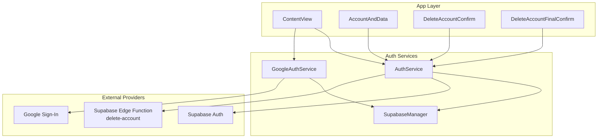
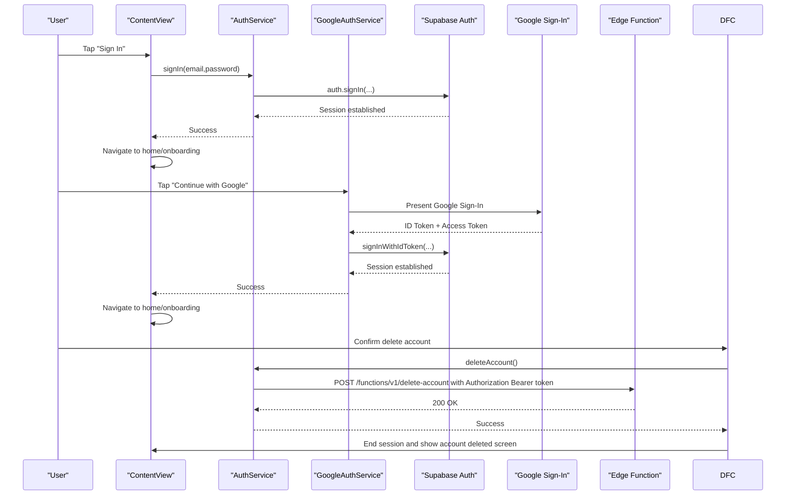
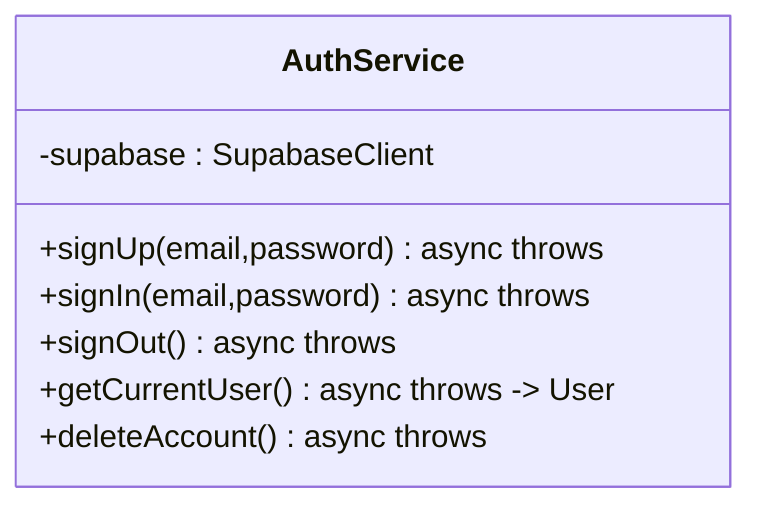
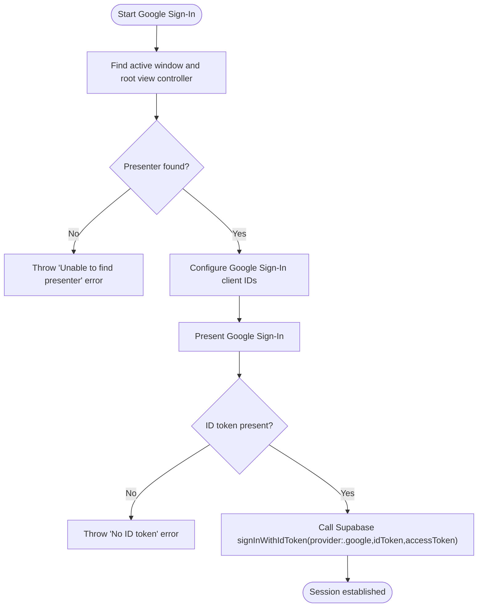
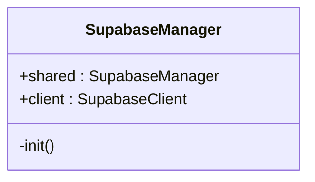
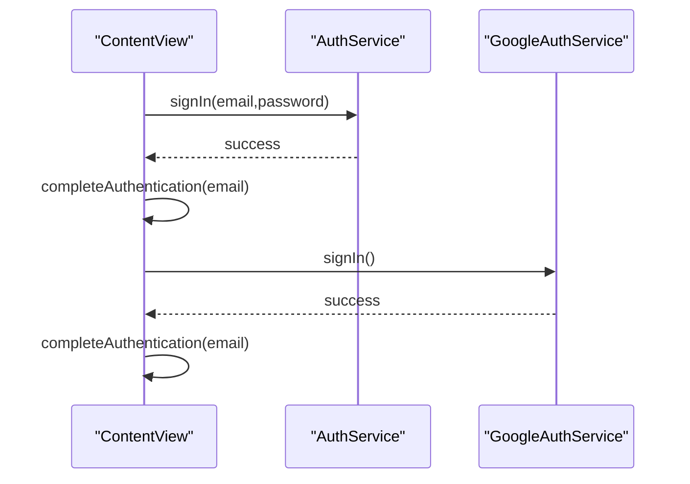
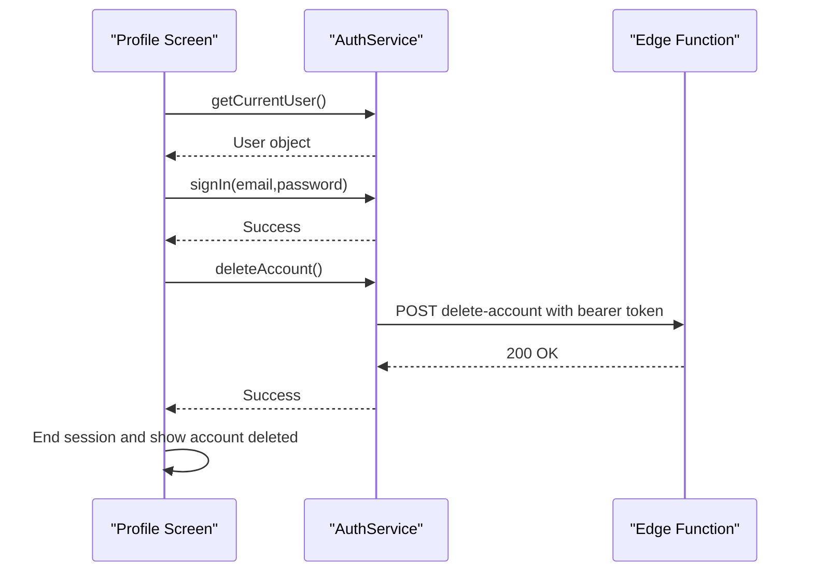
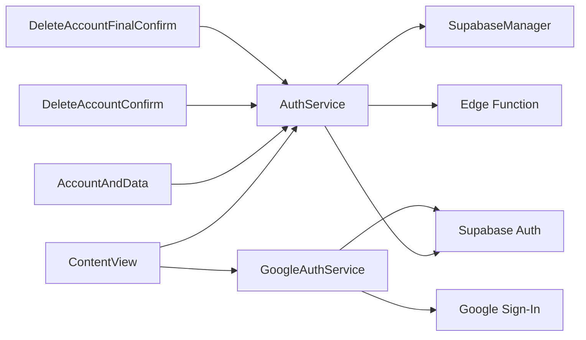

# Authentication Service

<cite>
**Referenced Files in This Document**
- [AuthService.swift](file://Moko/Moko/AuthService.swift)
- [GoogleAuthService.swift](file://Moko/Moko/GoogleAuthService.swift)
- [SupabaseManager.swift](file://Moko/Moko/SupabaseManager.swift)
- [ContentView.swift](file://Moko/Moko/ContentView.swift)
- [AccountAndData.swift](file://Moko/Moko/UIScreens/homeScreens/ProfileOverView/AccountAndData.swift)
- [DeleteAccountConfirm.swift](file://Moko/Moko/UIScreens/homeScreens/ProfileOverView/DeleteAccountConfirm.swift)
- [DeleteAccountFinalConfirm.swift](file://Moko/Moko/UIScreens/homeScreens/ProfileOverView/DeleteAccountFinalConfirm.swift)
- [delete-account/index.ts](file://Moko/Moko/supabase/functions/delete-account/index.ts)
</cite>

## Table of Contents
1. [Introduction](#introduction)
2. [Project Structure](#project-structure)
3. [Core Components](#core-components)
4. [Architecture Overview](#architecture-overview)
5. [Detailed Component Analysis](#detailed-component-analysis)
6. [Dependency Analysis](#dependency-analysis)
7. [Performance Considerations](#performance-considerations)
8. [Troubleshooting Guide](#troubleshooting-guide)
9. [Conclusion](#conclusion)

## Introduction
This document explains the authentication service layer for the iOS application. It covers how user registration, login, logout, and account management are implemented using Supabase Authentication, and how third-party sign-in is integrated through Google Sign-In. It also documents the authentication flow, session handling, token usage, error handling strategies, async patterns, user state transitions, and security considerations. Common scenarios such as password reset and email verification are addressed conceptually, since they are not directly implemented in the current codebase.

## Project Structure
The authentication-related code is organized into a small set of focused modules:
- AuthService: Core Supabase authentication operations (sign up, sign in, sign out, get current user, delete account).
- GoogleAuthService: Third-party Google Sign-In integration that exchanges Google tokens for a Supabase session.
- SupabaseManager: Singleton that configures and exposes the Supabase client.
- ContentView: App-level navigation and state transitions after successful authentication.
- Profile screens: UI components that trigger sign-out and account deletion flows.
- Supabase Edge Function: Server-side account deletion endpoint invoked by the app.

**Diagram sources**
- [AuthService.swift:15-58](file://Moko/Moko/AuthService.swift#L15-L58)
- [GoogleAuthService.swift:8-60](file://Moko/Moko/GoogleAuthService.swift#L8-L60)
- [SupabaseManager.swift:6-18](file://Moko/Moko/SupabaseManager.swift#L6-L18)
- [ContentView.swift:100-133](file://Moko/Moko/ContentView.swift#L100-L133)
- [AccountAndData.swift:94-107](file://Moko/Moko/UIScreens/homeScreens/ProfileOverView/AccountAndData.swift#L94-L107)
- [DeleteAccountConfirm.swift:88-97](file://Moko/Moko/UIScreens/homeScreens/ProfileOverView/DeleteAccountConfirm.swift#L88-L97)
- [DeleteAccountFinalConfirm.swift:56-73](file://Moko/Moko/UIScreens/homeScreens/ProfileOverView/DeleteAccountFinalConfirm.swift#L56-L73)
- [delete-account/index.ts:3-24](file://Moko/Moko/supabase/functions/delete-account/index.ts#L3-L24)

**Section sources**
- [AuthService.swift:15-58](file://Moko/Moko/AuthService.swift#L15-L58)
- [GoogleAuthService.swift:8-60](file://Moko/Moko/GoogleAuthService.swift#L8-L60)
- [SupabaseManager.swift:6-18](file://Moko/Moko/SupabaseManager.swift#L6-L18)
- [ContentView.swift:100-133](file://Moko/Moko/ContentView.swift#L100-L133)
- [AccountAndData.swift:94-107](file://Moko/Moko/UIScreens/homeScreens/ProfileOverView/AccountAndData.swift#L94-L107)
- [DeleteAccountConfirm.swift:88-97](file://Moko/Moko/UIScreens/homeScreens/ProfileOverView/DeleteAccountConfirm.swift#L88-L97)
- [DeleteAccountFinalConfirm.swift:56-73](file://Moko/Moko/UIScreens/homeScreens/ProfileOverView/DeleteAccountFinalConfirm.swift#L56-L73)
- [delete-account/index.ts:3-24](file://Moko/Moko/supabase/functions/delete-account/index.ts#L3-L24)

## Core Components
- AuthService: Provides asynchronous methods to register users, authenticate with email/password, sign out, retrieve the current user, and call an authenticated Edge Function to delete the account.
- GoogleAuthService: Handles Google Sign-In UI, extracts ID and access tokens, and signs the user into Supabase via OpenID Connect.
- SupabaseManager: Initializes and exposes a single Supabase client instance used by auth services.
- ContentView: Orchestrates app navigation based on authentication state and completes the post-authentication flow.
- Profile screens: Trigger sign-out and account deletion; DeleteAccountConfirm performs reauthentication before deletion.
- Supabase Edge Function: Validates the request, verifies the user’s token, and deletes the user using the service role key.

Key responsibilities:
- Encapsulate all Supabase Auth calls behind a simple API.
- Provide a dedicated provider-specific service for Google Sign-In.
- Centralize Supabase client configuration.
- Manage app-level navigation and state transitions around authentication.
- Enforce secure account deletion via a server-side edge function.

**Section sources**
- [AuthService.swift:15-58](file://Moko/Moko/AuthService.swift#L15-L58)
- [GoogleAuthService.swift:8-60](file://Moko/Moko/GoogleAuthService.swift#L8-L60)
- [SupabaseManager.swift:6-18](file://Moko/Moko/SupabaseManager.swift#L6-L18)
- [ContentView.swift:100-133](file://Moko/Moko/ContentView.swift#L100-L133)
- [AccountAndData.swift:94-107](file://Moko/Moko/UIScreens/homeScreens/ProfileOverView/AccountAndData.swift#L94-L107)
- [DeleteAccountConfirm.swift:88-97](file://Moko/Moko/UIScreens/homeScreens/ProfileOverView/DeleteAccountConfirm.swift#L88-L97)
- [DeleteAccountFinalConfirm.swift:56-73](file://Moko/Moko/UIScreens/homeScreens/ProfileOverView/DeleteAccountFinalConfirm.swift#L56-L73)
- [delete-account/index.ts:3-24](file://Moko/Moko/supabase/functions/delete-account/index.ts#L3-L24)

## Architecture Overview
The authentication architecture combines local UI orchestration with cloud-based identity management:
- The app uses Supabase Auth for email/password and OpenID Connect providers.
- Google Sign-In is handled locally, then exchanged for a Supabase session.
- Account deletion is delegated to a server-side Edge Function to ensure privileged operations are performed securely.
- The app maintains its own navigation state and clears or updates local data upon session changes.

**Diagram sources**
- [AuthService.swift:27-37](file://Moko/Moko/AuthService.swift#L27-L37)
- [GoogleAuthService.swift:37-59](file://Moko/Moko/GoogleAuthService.swift#L37-L59)
- [ContentView.swift:108-128](file://Moko/Moko/ContentView.swift#L108-L128)
- [DeleteAccountFinalConfirm.swift:56-73](file://Moko/Moko/UIScreens/homeScreens/ProfileOverView/DeleteAccountFinalConfirm.swift#L56-L73)
- [delete-account/index.ts:3-24](file://Moko/Moko/supabase/functions/delete-account/index.ts#L3-L24)

## Detailed Component Analysis

### AuthService
Responsibilities:
- Register new users with email and password.
- Authenticate existing users with email and password.
- Sign out the current user.
- Retrieve the current user from the active session.
- Call the authenticated Edge Function to delete the account.

Implementation highlights:
- All methods are asynchronous and throw errors, allowing callers to handle failures explicitly.
- getCurrentUser reads the current session’s user object.
- deleteAccount constructs an HTTP request to the Edge Function, attaches the bearer token and API key, and validates the HTTP response status.

Error handling:
- Network and server errors propagate as thrown exceptions.
- deleteAccount throws a network error when the HTTP response is not successful.

Security considerations:
- The Edge Function requires a valid bearer token and uses a service role key on the server side to perform privileged deletion.

Async patterns:
- Uses Swift async/await throughout, enabling straightforward composition in SwiftUI tasks.

**Diagram sources**
- [AuthService.swift:15-58](file://Moko/Moko/AuthService.swift#L15-L58)

**Section sources**
- [AuthService.swift:15-58](file://Moko/Moko/AuthService.swift#L15-L58)

### GoogleAuthService
Responsibilities:
- Present Google Sign-In UI safely on the main thread.
- Extract ID and access tokens from the Google result.
- Exchange tokens with Supabase via OpenID Connect to establish a session.

Implementation highlights:
- Ensures a valid root view controller exists before presenting Google Sign-In.
- Configures Google Sign-In with client IDs.
- Throws descriptive errors if no presenter is available or if no ID token is returned.
- Calls Supabase’s OpenID Connect sign-in method with provider, ID token, and access token.

Main-thread requirement:
- Marked as @MainActor to ensure UI interactions occur on the main thread.

**Diagram sources**
- [GoogleAuthService.swift:11-59](file://Moko/Moko/GoogleAuthService.swift#L11-L59)

**Section sources**
- [GoogleAuthService.swift:8-60](file://Moko/Moko/GoogleAuthService.swift#L8-L60)

### SupabaseManager
Responsibilities:
- Provide a singleton Supabase client configured with the project URL and public key.

Usage:
- Both AuthService and GoogleAuthService obtain the client from SupabaseManager.shared.client.

**Diagram sources**
- [SupabaseManager.swift:6-18](file://Moko/Moko/SupabaseManager.swift#L6-L18)

**Section sources**
- [SupabaseManager.swift:6-18](file://Moko/Moko/SupabaseManager.swift#L6-L18)

### ContentView Navigation and State Transitions
Responsibilities:
- Drive the app’s navigation flow around authentication.
- Complete authentication by setting signed-in state and navigating to home or onboarding.
- Handle session termination and route to appropriate screens.

Authentication completion:
- After successful sign-in or Google sign-in, it sets the signed-in email and navigates based on whether the user has completed onboarding.

Session termination:
- Clears local state and navigates to intro or account-deleted screens depending on the reason.

**Diagram sources**
- [ContentView.swift:108-128](file://Moko/Moko/ContentView.swift#L108-L128)
- [ContentView.swift:227-247](file://Moko/Moko/ContentView.swift#L227-L247)

**Section sources**
- [ContentView.swift:100-133](file://Moko/Moko/ContentView.swift#L100-L133)
- [ContentView.swift:227-247](file://Moko/Moko/ContentView.swift#L227-L247)

### Profile Screens: Sign-Out and Account Deletion
Sign-Out:
- The profile screen retrieves the current user and triggers sign-out, then ends the session to navigate back to the intro flow.

Account Deletion:
- DeleteAccountConfirm prompts for reauthentication using email and password before proceeding.
- DeleteAccountFinalConfirm calls AuthService.deleteAccount(), which invokes the Edge Function to delete the user.

**Diagram sources**
- [AccountAndData.swift:94-107](file://Moko/Moko/UIScreens/homeScreens/ProfileOverView/AccountAndData.swift#L94-L107)
- [DeleteAccountConfirm.swift:88-97](file://Moko/Moko/UIScreens/homeScreens/ProfileOverView/DeleteAccountConfirm.swift#L88-L97)
- [DeleteAccountFinalConfirm.swift:56-73](file://Moko/Moko/UIScreens/homeScreens/ProfileOverView/DeleteAccountFinalConfirm.swift#L56-L73)
- [delete-account/index.ts:3-24](file://Moko/Moko/supabase/functions/delete-account/index.ts#L3-L24)

**Section sources**
- [AccountAndData.swift:94-107](file://Moko/Moko/UIScreens/homeScreens/ProfileOverView/AccountAndData.swift#L94-L107)
- [DeleteAccountConfirm.swift:88-97](file://Moko/Moko/UIScreens/homeScreens/ProfileOverView/DeleteAccountConfirm.swift#L88-L97)
- [DeleteAccountFinalConfirm.swift:56-73](file://Moko/Moko/UIScreens/homeScreens/ProfileOverView/DeleteAccountFinalConfirm.swift#L56-L73)
- [delete-account/index.ts:3-24](file://Moko/Moko/supabase/functions/delete-account/index.ts#L3-L24)

## Dependency Analysis
- AuthService depends on SupabaseManager for the Supabase client and on the Supabase Auth SDK for authentication operations.
- GoogleAuthService depends on Google Sign-In SDK and Supabase Auth SDK for OpenID Connect sign-in.
- ContentView orchestrates navigation and relies on both AuthService and GoogleAuthService for authentication outcomes.
- Profile screens depend on AuthService for sign-out and account deletion.
- The Edge Function depends on environment variables for Supabase URL, anon key, and service role key.

**Diagram sources**
- [AuthService.swift:15-58](file://Moko/Moko/AuthService.swift#L15-L58)
- [GoogleAuthService.swift:8-60](file://Moko/Moko/GoogleAuthService.swift#L8-L60)
- [SupabaseManager.swift:6-18](file://Moko/Moko/SupabaseManager.swift#L6-L18)
- [ContentView.swift:100-133](file://Moko/Moko/ContentView.swift#L100-L133)
- [AccountAndData.swift:94-107](file://Moko/Moko/UIScreens/homeScreens/ProfileOverView/AccountAndData.swift#L94-L107)
- [DeleteAccountConfirm.swift:88-97](file://Moko/Moko/UIScreens/homeScreens/ProfileOverView/DeleteAccountConfirm.swift#L88-L97)
- [DeleteAccountFinalConfirm.swift:56-73](file://Moko/Moko/UIScreens/homeScreens/ProfileOverView/DeleteAccountFinalConfirm.swift#L56-L73)
- [delete-account/index.ts:3-24](file://Moko/Moko/supabase/functions/delete-account/index.ts#L3-L24)

**Section sources**
- [AuthService.swift:15-58](file://Moko/Moko/AuthService.swift#L15-L58)
- [GoogleAuthService.swift:8-60](file://Moko/Moko/GoogleAuthService.swift#L8-L60)
- [SupabaseManager.swift:6-18](file://Moko/Moko/SupabaseManager.swift#L6-L18)
- [ContentView.swift:100-133](file://Moko/Moko/ContentView.swift#L100-L133)
- [AccountAndData.swift:94-107](file://Moko/Moko/UIScreens/homeScreens/ProfileOverView/AccountAndData.swift#L94-L107)
- [DeleteAccountConfirm.swift:88-97](file://Moko/Moko/UIScreens/homeScreens/ProfileOverView/DeleteAccountConfirm.swift#L88-L97)
- [DeleteAccountFinalConfirm.swift:56-73](file://Moko/Moko/UIScreens/homeScreens/ProfileOverView/DeleteAccountFinalConfirm.swift#L56-L73)
- [delete-account/index.ts:3-24](file://Moko/Moko/supabase/functions/delete-account/index.ts#L3-L24)

## Performance Considerations
- Use async/await to avoid blocking the UI thread during network operations.
- Ensure Google Sign-In presentation occurs on the main thread (@MainActor).
- Minimize redundant network calls by caching user state at the app level where appropriate.
- Validate HTTP responses promptly to fail fast on server errors.
- Avoid exposing sensitive keys in client code; prefer environment variables and server-side validation.

[No sources needed since this section provides general guidance]

## Troubleshooting Guide
Common issues and resolutions:
- No presenter for Google Sign-In:
  - Cause: Unable to find an active window or root view controller.
  - Resolution: Ensure the app is running and a valid scene/window exists before invoking Google Sign-In.
- Missing ID token from Google:
  - Cause: Google did not return an ID token.
  - Resolution: Verify Google Sign-In configuration and that the provider is correctly set up in Supabase.
- Sign-in/sign-up failures:
  - Cause: Network errors or invalid credentials.
  - Resolution: Inspect thrown errors and validate input fields; check Supabase project settings.
- Sign-out not updating UI:
  - Cause: Local state not cleared.
  - Resolution: Ensure finishSession clears local state and navigates appropriately.
- Account deletion fails:
  - Cause: Invalid bearer token or Edge Function misconfiguration.
  - Resolution: Confirm the Edge Function is deployed with required environment variables and that the Authorization header includes a valid token.

**Section sources**
- [GoogleAuthService.swift:11-49](file://Moko/Moko/GoogleAuthService.swift#L11-L49)
- [AuthService.swift:46-58](file://Moko/Moko/AuthService.swift#L46-L58)
- [ContentView.swift:238-247](file://Moko/Moko/ContentView.swift#L238-L247)
- [delete-account/index.ts:3-24](file://Moko/Moko/supabase/functions/delete-account/index.ts#L3-L24)

## Conclusion
The authentication service layer provides a clear separation between UI orchestration and cloud-based identity management. AuthService encapsulates core Supabase Auth operations, while GoogleAuthService integrates third-party sign-in via OpenID Connect. SupabaseManager centralizes client configuration, and ContentView manages navigation and state transitions. Account deletion is securely delegated to a server-side Edge Function. The implementation uses modern async/await patterns, enforces main-thread safety for UI interactions, and applies robust error handling. For features like password reset and email verification, extend AuthService with corresponding Supabase Auth methods and update the UI accordingly.

[No sources needed since this section summarizes without analyzing specific files]