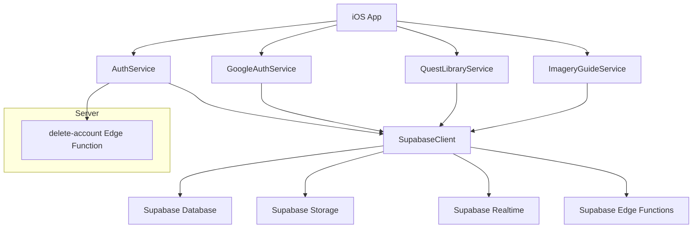
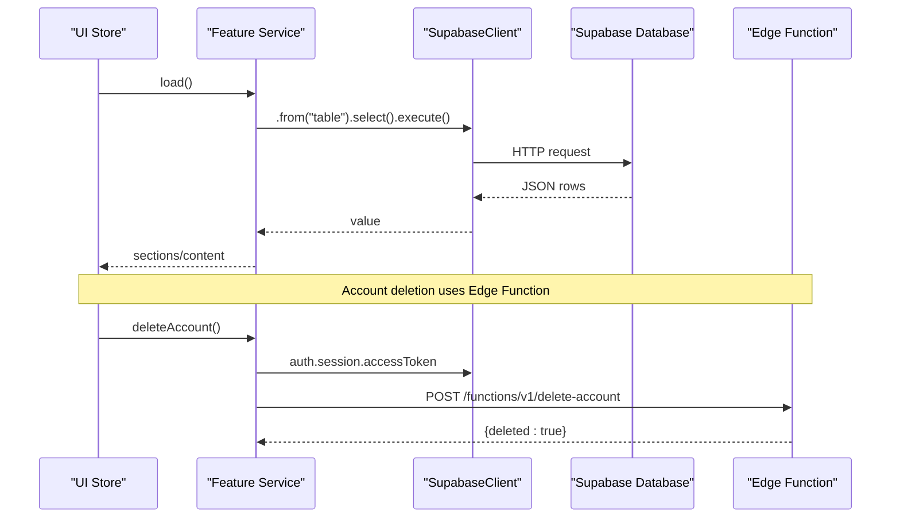
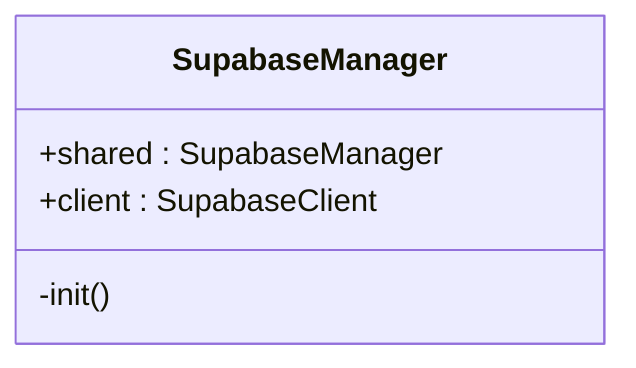
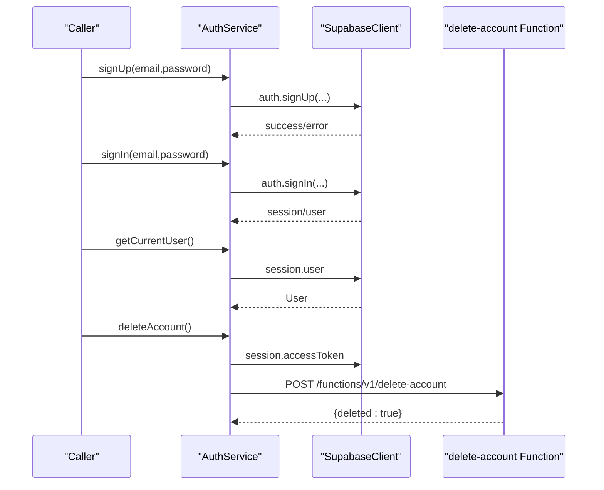
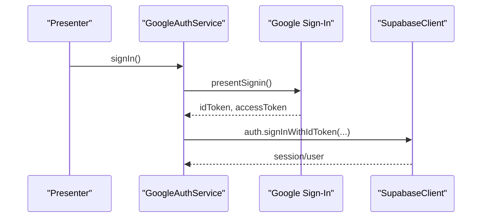
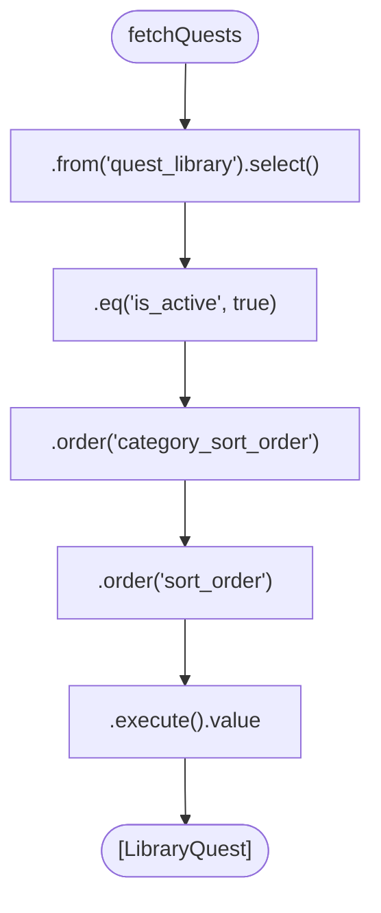
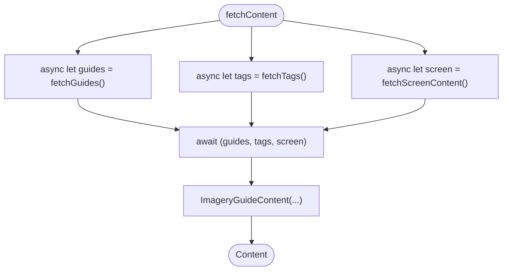
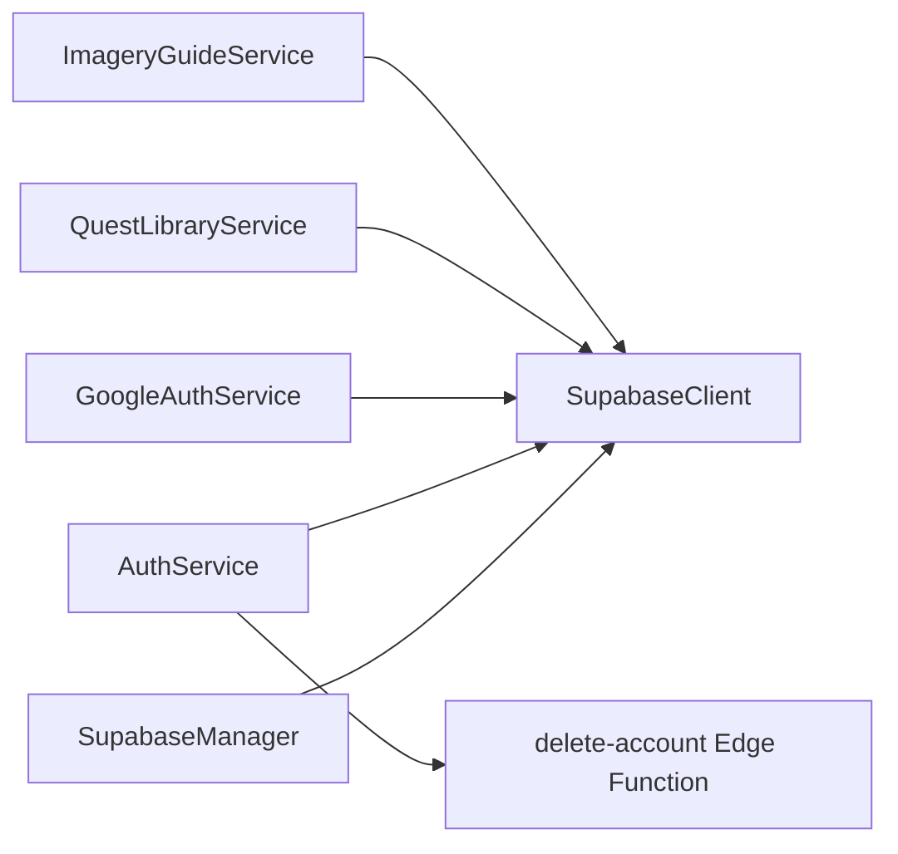

# Database Service

<cite>
**Referenced Files in This Document**
- [SupabaseManager.swift](file://Moko/Moko/SupabaseManager.swift)
- [AuthService.swift](file://Moko/Moko/AuthService.swift)
- [GoogleAuthService.swift](file://Moko/Moko/GoogleAuthService.swift)
- [QuestLibraryService.swift](file://Moko/Moko/Features/QuestLibrary/QuestLibraryService.swift)
- [ImageryGuideStore.swift](file://Moko/Moko/UIScreens/relaxScreens/ImageryGuide/ImageryGuideStore.swift)
- [delete-account/index.ts](file://Moko/Moko/supabase/functions/delete-account/index.ts)
- [README.md](file://supabase/README.md)
</cite>

## Table of Contents
1. [Introduction](#introduction)
2. [Project Structure](#project-structure)
3. [Core Components](#core-components)
4. [Architecture Overview](#architecture-overview)
5. [Detailed Component Analysis](#detailed-component-analysis)
6. [Dependency Analysis](#dependency-analysis)
7. [Performance Considerations](#performance-considerations)
8. [Troubleshooting Guide](#troubleshooting-guide)
9. [Conclusion](#conclusion)

## Introduction
This document explains the database service layer that wraps Supabase for the iOS application. It focuses on the singleton manager responsible for client configuration, how services abstract SDK complexity, and the current data access patterns used across features. It also outlines where real-time subscriptions, storage operations, retry mechanisms, caching, and offline-first synchronization can be added to evolve the service layer into a robust, production-grade system.

## Project Structure
The database-related code is organized around a single shared Supabase client and feature-specific services:

- A singleton manager exposes a configured `SupabaseClient`.
- Authentication services use the shared client for auth flows.
- Feature services encapsulate table queries and compose UI stores.
- Supabase Edge Functions handle privileged server-side operations.
- The Supabase project documentation describes tables and storage usage.

**Diagram sources**
- [SupabaseManager.swift:6-18](file://Moko/Moko/SupabaseManager.swift#L6-L18)
- [AuthService.swift:15-58](file://Moko/Moko/AuthService.swift#L15-L58)
- [GoogleAuthService.swift:8-59](file://Moko/Moko/GoogleAuthService.swift#L8-L59)
- [QuestLibraryService.swift:13-31](file://Moko/Moko/Features/QuestLibrary/QuestLibraryService.swift#L13-L31)
- [ImageryGuideStore.swift:14-59](file://Moko/Moko/UIScreens/relaxScreens/ImageryGuide/ImageryGuideStore.swift#L14-L59)
- [delete-account/index.ts:3-24](file://Moko/Moko/supabase/functions/delete-account/index.ts#L3-L24)

**Section sources**
- [SupabaseManager.swift:6-18](file://Moko/Moko/SupabaseManager.swift#L6-L18)
- [AuthService.swift:15-58](file://Moko/Moko/AuthService.swift#L15-L58)
- [GoogleAuthService.swift:8-59](file://Moko/Moko/GoogleAuthService.swift#L8-L59)
- [QuestLibraryService.swift:13-31](file://Moko/Moko/Features/QuestLibrary/QuestLibraryService.swift#L13-L31)
- [ImageryGuideStore.swift:14-59](file://Moko/Moko/UIScreens/relaxScreens/ImageryGuide/ImageryGuideStore.swift#L14-L59)
- [delete-account/index.ts:3-24](file://Moko/Moko/supabase/functions/delete-account/index.ts#L3-L24)
- [README.md:50-97](file://supabase/README.md#L50-L97)

## Core Components
- SupabaseManager: Singleton that creates and holds a single `SupabaseClient` instance with project URL and publishable key.
- AuthService: Wraps authentication operations using the shared client and calls an Edge Function for account deletion.
- GoogleAuthService: Handles Google Sign-In and exchanges tokens with Supabase auth.
- QuestLibraryService: Reads active quests from the database and groups them for UI consumption.
- ImageryGuideService: Loads guides, tags, and screen content concurrently from multiple tables.

Key responsibilities:
- Centralized client configuration and lifecycle.
- Clean interfaces for auth and data operations.
- Separation of concerns between network/data logic (services) and UI state (stores).

**Section sources**
- [SupabaseManager.swift:6-18](file://Moko/Moko/SupabaseManager.swift#L6-L18)
- [AuthService.swift:15-58](file://Moko/Moko/AuthService.swift#L15-L58)
- [GoogleAuthService.swift:8-59](file://Moko/Moko/GoogleAuthService.swift#L8-L59)
- [QuestLibraryService.swift:13-31](file://Moko/Moko/Features/QuestLibrary/QuestLibraryService.swift#L13-L31)
- [ImageryGuideStore.swift:14-59](file://Moko/Moko/UIScreens/relaxScreens/ImageryGuide/ImageryGuideStore.swift#L14-L59)

## Architecture Overview
At runtime, the app uses one shared Supabase client. Services call the client’s typed API to query tables, while UI components observe store state. Authentication flows integrate with Google Sign-In and Supabase auth. Privileged operations are delegated to Edge Functions.

**Diagram sources**
- [QuestLibraryService.swift:22-31](file://Moko/Moko/Features/QuestLibrary/QuestLibraryService.swift#L22-L31)
- [ImageryGuideStore.swift:22-29](file://Moko/Moko/UIScreens/relaxScreens/ImageryGuide/ImageryGuideStore.swift#L22-L29)
- [AuthService.swift:46-58](file://Moko/Moko/AuthService.swift#L46-L58)
- [delete-account/index.ts:3-24](file://Moko/Moko/supabase/functions/delete-account/index.ts#L3-L24)

## Detailed Component Analysis

### SupabaseManager
Responsibilities:
- Provides a singleton entry point to a configured `SupabaseClient`.
- Holds the project URL and publishable key.

Current behavior:
- Initializes the client with hardcoded values.
- Exposes the client via a public property.

Recommendations:
- Move secrets to environment variables or secure configuration.
- Add connection options (e.g., timeouts, retries) at initialization.
- Provide optional methods for switching environments (dev/prod).

**Diagram sources**
- [SupabaseManager.swift:6-18](file://Moko/Moko/SupabaseManager.swift#L6-L18)

**Section sources**
- [SupabaseManager.swift:6-18](file://Moko/Moko/SupabaseManager.swift#L6-L18)

### AuthService
Responsibilities:
- Wraps sign-up, sign-in, sign-out, and current user retrieval.
- Calls the Edge Function to delete the authenticated user account.

Data flow:
- Uses the shared client for auth operations.
- Builds a direct HTTP request to the Edge Function with bearer token and apikey headers.

Error handling:
- Throws errors from async auth calls.
- Validates HTTP status codes when calling the Edge Function.

**Diagram sources**
- [AuthService.swift:19-58](file://Moko/Moko/AuthService.swift#L19-L58)
- [delete-account/index.ts:3-24](file://Moko/Moko/supabase/functions/delete-account/index.ts#L3-L24)

**Section sources**
- [AuthService.swift:15-58](file://Moko/Moko/AuthService.swift#L15-L58)

### GoogleAuthService
Responsibilities:
- Presents Google Sign-In UI.
- Extracts ID and access tokens.
- Signs the user in with Supabase using OpenID Connect credentials.

Error handling:
- Throws domain-specific errors if no presenter is available or if tokens are missing.

**Diagram sources**
- [GoogleAuthService.swift:11-59](file://Moko/Moko/GoogleAuthService.swift#L11-L59)

**Section sources**
- [GoogleAuthService.swift:8-59](file://Moko/Moko/GoogleAuthService.swift#L8-L59)

### QuestLibraryService
Responsibilities:
- Fetches active quests from the `quest_library` table.
- Orders results by category and position.

Query pattern:
- Uses `.from(...).select().eq(...).order(...).order(...).execute().value`.

UI integration:
- The associated store groups results into sections and manages loading states.

**Diagram sources**
- [QuestLibraryService.swift:22-31](file://Moko/Moko/Features/QuestLibrary/QuestLibraryService.swift#L22-L31)

**Section sources**
- [QuestLibraryService.swift:13-31](file://Moko/Moko/Features/QuestLibrary/QuestLibraryService.swift#L13-L31)
- [QuestLibraryService.swift:37-90](file://Moko/Moko/Features/QuestLibrary/QuestLibraryService.swift#L37-L90)

### ImageryGuideService
Responsibilities:
- Loads imagery guides, tags, and screen content in parallel.
- Composes a unified content model for the UI store.

Concurrency pattern:
- Uses `async let` to fetch three datasets concurrently and awaits their combined result.

**Diagram sources**
- [ImageryGuideStore.swift:22-29](file://Moko/Moko/UIScreens/relaxScreens/ImageryGuide/ImageryGuideStore.swift#L22-L29)
- [ImageryGuideStore.swift:31-59](file://Moko/Moko/UIScreens/relaxScreens/ImageryGuide/ImageryGuideStore.swift#L31-L59)

**Section sources**
- [ImageryGuideStore.swift:14-59](file://Moko/Moko/UIScreens/relaxScreens/ImageryGuide/ImageryGuideStore.swift#L14-L59)
- [ImageryGuideStore.swift:64-103](file://Moko/Moko/UIScreens/relaxScreens/ImageryGuide/ImageryGuideStore.swift#L64-L103)

### Data Models and Tables
The Supabase documentation describes the quest library schema and storage usage.

- `quest_library`: Contains category, sort orders, title, image metadata, tint color, activity flag, and image URL.
- Storage: Images are served from a public bucket; URLs are stored in the table.

**Section sources**
- [README.md:50-97](file://supabase/README.md#L50-L97)

## Dependency Analysis
The following diagram shows how components depend on the shared client and external services.

**Diagram sources**
- [SupabaseManager.swift:6-18](file://Moko/Moko/SupabaseManager.swift#L6-L18)
- [AuthService.swift:15-58](file://Moko/Moko/AuthService.swift#L15-L58)
- [GoogleAuthService.swift:8-59](file://Moko/Moko/GoogleAuthService.swift#L8-L59)
- [QuestLibraryService.swift:13-31](file://Moko/Moko/Features/QuestLibrary/QuestLibraryService.swift#L13-L31)
- [ImageryGuideStore.swift:14-59](file://Moko/Moko/UIScreens/relaxScreens/ImageryGuide/ImageryGuideStore.swift#L14-L59)
- [delete-account/index.ts:3-24](file://Moko/Moko/supabase/functions/delete-account/index.ts#L3-L24)

**Section sources**
- [SupabaseManager.swift:6-18](file://Moko/Moko/SupabaseManager.swift#L6-L18)
- [AuthService.swift:15-58](file://Moko/Moko/AuthService.swift#L15-L58)
- [GoogleAuthService.swift:8-59](file://Moko/Moko/GoogleAuthService.swift#L8-L59)
- [QuestLibraryService.swift:13-31](file://Moko/Moko/Features/QuestLibrary/QuestLibraryService.swift#L13-L31)
- [ImageryGuideStore.swift:14-59](file://Moko/Moko/UIScreens/relaxScreens/ImageryGuide/ImageryGuideStore.swift#L14-L59)
- [delete-account/index.ts:3-24](file://Moko/Moko/supabase/functions/delete-account/index.ts#L3-L24)

## Performance Considerations
Current implementation characteristics:
- Single shared client reduces overhead and simplifies lifecycle management.
- Concurrent fetching improves time-to-content for multi-table loads.
- Stores guard against duplicate loads and manage minimal loading durations for UX stability.

Recommended optimizations:
- Connection pooling and timeouts: Configure client-level timeouts and connection reuse policies.
- Request deduplication: Cache in-flight requests to avoid redundant network calls.
- Pagination and cursor-based loading: For large datasets, paginate rather than selecting all rows.
- Selective columns: Use column projection to reduce payload size.
- ETag/conditional requests: Leverage storage CDN caching headers where applicable.
- Background sync: Schedule background refreshes for critical data.
- Local cache: Introduce a local persistence layer (e.g., SQLite or SwiftData) with conflict resolution.
- Retry/backoff: Implement exponential backoff with jitter for transient failures.
- Circuit breaker: Temporarily halt failing endpoints to prevent cascading errors.
- Metrics and observability: Track latency, error rates, and cache hit ratios.

[No sources needed since this section provides general guidance]

## Troubleshooting Guide
Common issues and resolutions:
- Missing presenter for Google Sign-In: Ensure a valid window scene and root view controller exist before invoking sign-in.
- Missing tokens: Validate that Google Sign-In returns both ID and access tokens before calling Supabase auth.
- Network errors: Inspect URLSession responses and HTTP status codes when calling Edge Functions.
- Loading UX: Stores already protect against rapid re-entry and enforce minimum loader visibility; adjust thresholds based on analytics.

Operational tips:
- Log structured errors with context (operation, table, parameters).
- Surface user-friendly messages through store properties.
- Verify Edge Function deployment and environment variables.

**Section sources**
- [GoogleAuthService.swift:11-49](file://Moko/Moko/GoogleAuthService.swift#L11-L49)
- [AuthService.swift:46-58](file://Moko/Moko/AuthService.swift#L46-L58)
- [QuestLibraryService.swift:56-89](file://Moko/Moko/Features/QuestLibrary/QuestLibraryService.swift#L56-L89)
- [ImageryGuideStore.swift:88-103](file://Moko/Moko/UIScreens/relaxScreens/ImageryGuide/ImageryGuideStore.swift#L88-L103)

## Conclusion
The current database service layer centers on a singleton-managed Supabase client and feature-specific services that encapsulate data access. Authentication is handled cleanly through dedicated services, and data fetching follows consistent query patterns with concurrent composition where appropriate. To reach production readiness, introduce secure configuration, robust error handling, retry/backoff, caching, pagination, real-time subscriptions, and storage abstractions. These enhancements will improve reliability, performance, and maintainability while keeping the interface clean for UI consumers.

[No sources needed since this section summarizes without analyzing specific files]