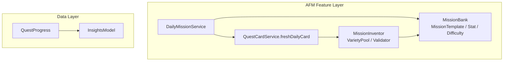
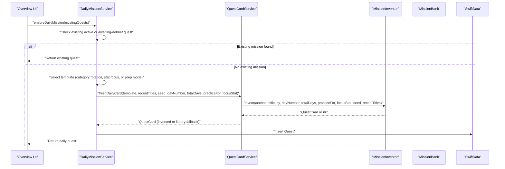
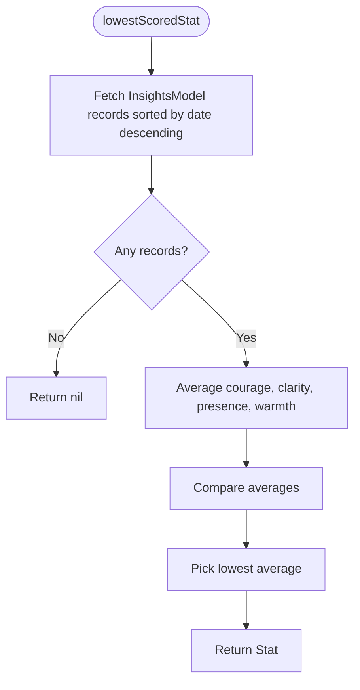
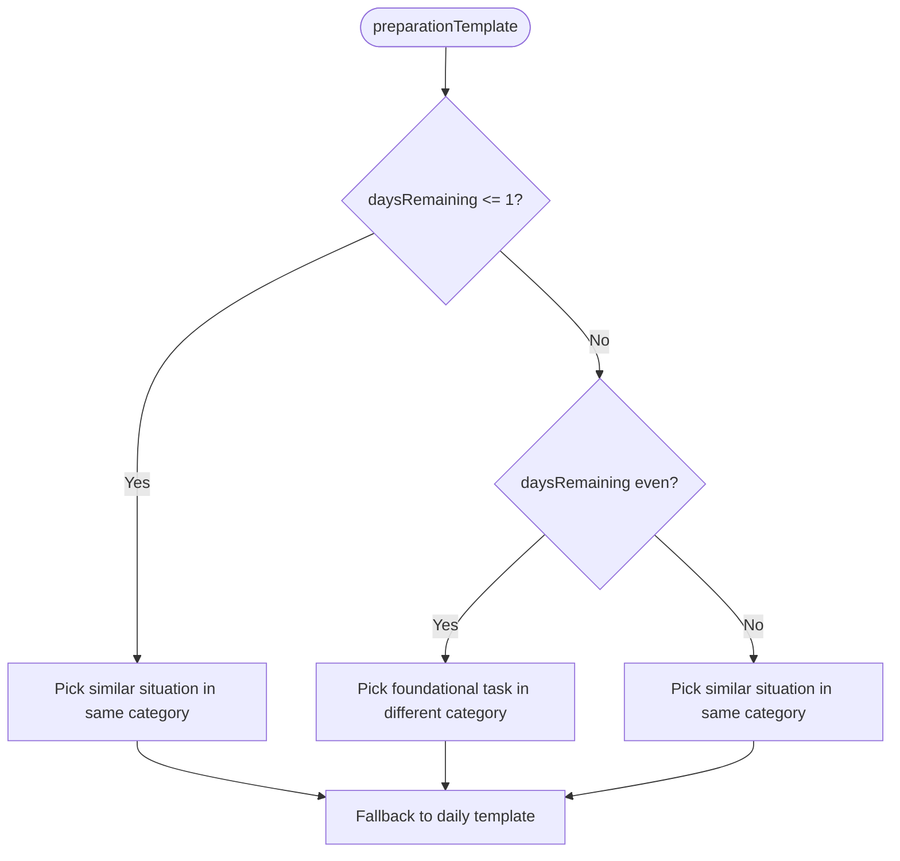
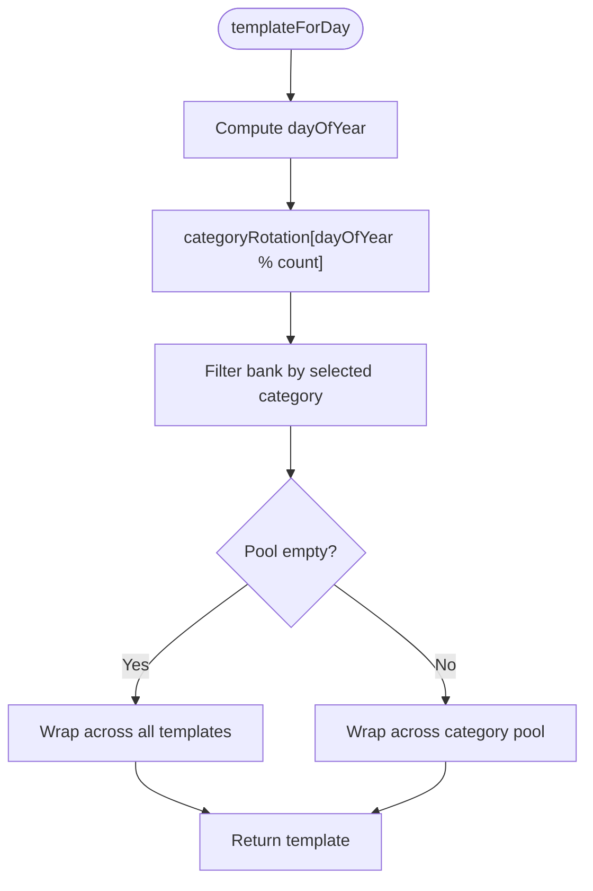
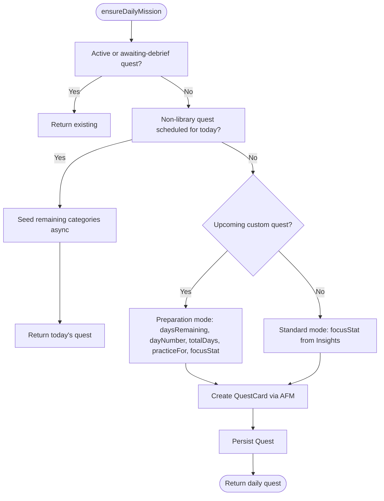
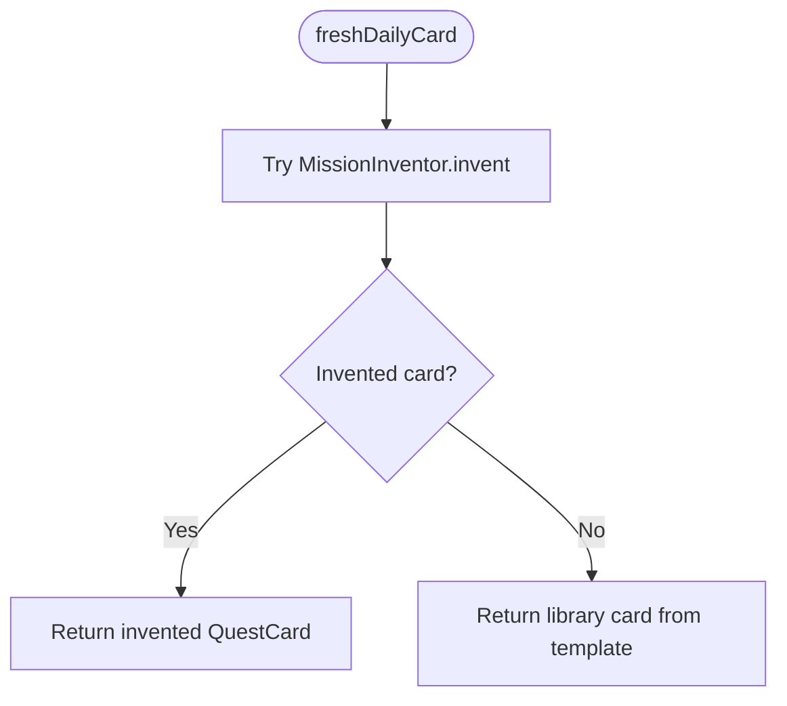
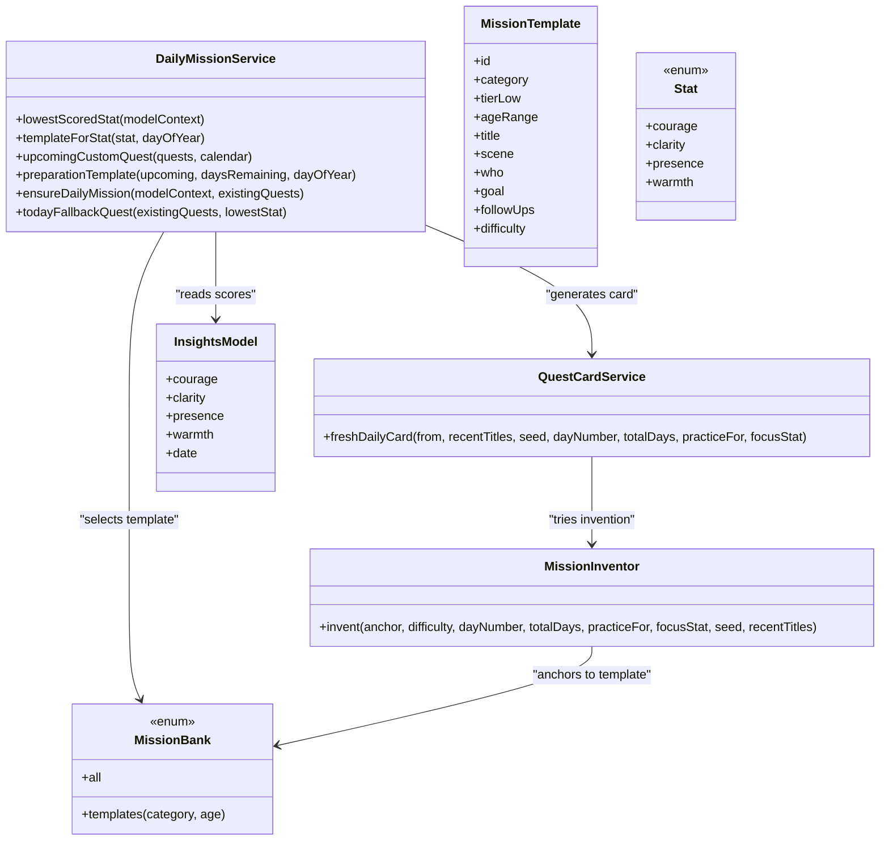

# Daily Mission Service

<cite>
**Referenced Files in This Document**   
- [DailyMissionService.swift](file://Moko/Moko/Features/AFM/DailyMissionService.swift)
- [MokoMissionBank.swift](file://Moko/Moko/Features/AFM/MokoMissionBank.swift)
- [MokoMissionInvention.swift](file://Moko/Moko/Features/AFM/MokoMissionInvention.swift)
- [InsightsModel.swift](file://Moko/Moko/Models/InsightsModel.swift)
- [QuestProgress.swift](file://Moko/Moko/Models/QuestProgress.swift)
</cite>

## Table of Contents
1. [Introduction](#introduction)
2. [Project Structure](#project-structure)
3. [Core Components](#core-components)
4. [Architecture Overview](#architecture-overview)
5. [Detailed Component Analysis](#detailed-component-analysis)
6. [Dependency Analysis](#dependency-analysis)
7. [Performance Considerations](#performance-considerations)
8. [Troubleshooting Guide](#troubleshooting-guide)
9. [Conclusion](#conclusion)

## Introduction
The Daily Mission Service is the adaptive engine that ensures the user always has a fresh, personalized daily mission on the Overview screen. It does not invent missions from scratch; instead, it selects or adapts vetted mission templates and optionally generates new card text through Apple Foundation Models while keeping deterministic scheduling, personalization, and fallback logic in Swift.

Its main responsibilities are:
- Guaranteeing an active mission exists for today.
- Targeting the user’s lowest-scored growth parameter across Work, Dating, Friends, and Family.
- Preparing stepping-stone missions before upcoming custom quests.
- Seeding variety across life categories so the Quests list is not dominated by one area.
- Falling back to safe, synchronous content when asynchronous generation is unavailable.

## Project Structure
The service lives under the AFM feature layer alongside shared mission types, AI-powered invention, and persistence models:

**Diagram sources**
- [DailyMissionService.swift:19-303](file://Moko/Moko/Features/AFM/DailyMissionService.swift#L19-L303)
- [MokoMissionBank.swift:10-91](file://Moko/Moko/Features/AFM/MokoMissionBank.swift#L10-L91)
- [MokoMissionInvention.swift:222-304](file://Moko/Moko/Features/AFM/MokoMissionInvention.swift#L222-L304)
- [QuestProgress.swift:85-119](file://Moko/Moko/Models/QuestProgress.swift#L85-L119)
- [InsightsModel.swift:11-26](file://Moko/Moko/Models/InsightsModel.swift#L11-L26)

**Section sources**
- [DailyMissionService.swift:1-15](file://Moko/Moko/Features/AFM/DailyMissionService.swift#L1-L15)
- [MokoMissionBank.swift:1-10](file://Moko/Moko/Features/AFM/MokoMissionBank.swift#L1-L10)
- [MokoMissionInvention.swift:1-14](file://Moko/Moko/Features/AFM/MokoMissionInvention.swift#L1-L14)

## Core Components
- **DailyMissionService**: Orchestrates template selection, preparation mode, category seeding, and quest persistence.
- **MissionBank**: Defines core domain types and the curated mission bank used as anchors for both standard and invented missions.
- **MissionInventor**: Generates fresh mission cards anchored to bank situations, validated by Swift rules and a second AI review pass.
- **QuestCardService.freshDailyCard**: The integration point that tries invention first and falls back to library text.
- **InsightsModel and QuestProgress**: Provide historical scoring data and ensure meaningful scores feed into adaptive behavior.

**Section sources**
- [DailyMissionService.swift:19-303](file://Moko/Moko/Features/AFM/DailyMissionService.swift#L19-L303)
- [MokoMissionBank.swift:10-91](file://Moko/Moko/Features/AFM/MokoMissionBank.swift#L10-L91)
- [MokoMissionInvention.swift:222-304](file://Moko/Moko/Features/AFM/MokoMissionInvention.swift#L222-L304)
- [QuestProgress.swift:85-119](file://Moko/Moko/Models/QuestProgress.swift#L85-L119)

## Architecture Overview
The service separates deterministic planning from optional language generation:

**Diagram sources**
- [DailyMissionService.swift:127-225](file://Moko/Moko/Features/AFM/DailyMissionService.swift#L127-L225)
- [MokoMissionInvention.swift:222-304](file://Moko/Moko/Features/AFM/MokoMissionInvention.swift#L222-L304)
- [MokoMissionBank.swift:72-91](file://Moko/Moko/Features/AFM/MokoMissionBank.swift#L72-L91)

## Detailed Component Analysis

### Adaptive Behavior Algorithms

#### Lowest-Scored Parameter Focus
When no custom quest is upcoming, the service computes the average score for Courage, Clarity, Presence, and Warmth across all Insights records and picks the lowest. That parameter then drives template selection across diverse life categories.

Key behaviors:
- Uses the most recent Insights records ordered by date.
- Averages each parameter over all available records.
- Returns the parameter with the smallest average.
- Falls back to a stable daily template if no insights exist.

**Diagram sources**
- [DailyMissionService.swift:39-58](file://Moko/Moko/Features/AFM/DailyMissionService.swift#L39-L58)
- [InsightsModel.swift:11-26](file://Moko/Moko/Models/InsightsModel.swift#L11-L26)

**Section sources**
- [DailyMissionService.swift:39-58](file://Moko/Moko/Features/AFM/DailyMissionService.swift#L39-L58)
- [QuestProgress.swift:85-119](file://Moko/Moko/Models/QuestProgress.swift#L85-L119)

#### Custom Quest Preparation Mode
When an upcoming incomplete custom quest exists, daily missions become stepping stones. The algorithm alternates between:
- Foundational tasks in a different life category to build general social comfort.
- Similar-situation tasks in the same category to rehearse the upcoming event.
- On the final day before the event, it prefers a similar situation in the same category.

**Diagram sources**
- [DailyMissionService.swift:87-123](file://Moko/Moko/Features/AFM/DailyMissionService.swift#L87-L123)

**Section sources**
- [DailyMissionService.swift:87-123](file://Moko/Moko/Features/AFM/DailyMissionService.swift#L87-L123)

#### Category Rotation Patterns
The service cycles through Work, Friends, Dating, and Family using the day-of-year index. This pattern ensures the featured mission rotates across life areas rather than staying fixed.

**Diagram sources**
- [DailyMissionService.swift:22-35](file://Moko/Moko/Features/AFM/DailyMissionService.swift#L22-L35)
- [MokoMissionBank.swift:95-103](file://Moko/Moko/Features/AFM/MokoMissionBank.swift#L95-L103)

**Section sources**
- [DailyMissionService.swift:22-35](file://Moko/Moko/Features/AFM/DailyMissionService.swift#L22-L35)

### Template Selection Logic

#### Standard Mode vs Preparation Mode
Standard mode targets the lowest-scored parameter across diverse categories. Preparation mode calculates days remaining, day number, total days, and whether the mission is practicing toward an upcoming custom quest.

**Diagram sources**
- [DailyMissionService.swift:127-225](file://Moko/Moko/Features/AFM/DailyMissionService.swift#L127-L225)

**Section sources**
- [DailyMissionService.swift:127-225](file://Moko/Moko/Features/AFM/DailyMissionService.swift#L127-L225)

#### Stat-Based Template Matching
Each growth parameter maps to a curated subset of mission templates:
- Courage: initiating conversations, speaking up, introducing yourself.
- Clarity: declining extra work, ending things clearly, setting boundaries.
- Presence: correcting a boss, admitting uncertainty, asking exclusivity questions.
- Warmth: naming feelings, bringing up distance, giving feedback after mistakes.

If no matching templates exist for a parameter, the service falls back to the daily rotation template.

**Section sources**
- [DailyMissionService.swift:60-83](file://Moko/Moko/Features/AFM/DailyMissionService.swift#L60-L83)
- [MokoMissionBank.swift:105-290](file://Moko/Moko/Features/AFM/MokoMissionBank.swift#L105-L290)

### Integration with Insights Data for Personalization
Insights records are created when debriefs are saved. Each record stores Courage, Clarity, Presence, and Warmth scores along with a timestamp. The service averages these scores to determine which parameter needs the most attention.

Important details:
- Debrief saving guarantees minimum meaningful scores so early users still have usable data.
- The lowest-scored parameter is recomputed from all available records.
- If no insights exist, the service uses category rotation or preparation mode instead of failing.

**Section sources**
- [QuestProgress.swift:85-119](file://Moko/Moko/Models/QuestProgress.swift#L85-L119)
- [InsightsModel.swift:11-26](file://Moko/Moko/Models/InsightsModel.swift#L11-L26)
- [DailyMissionService.swift:39-58](file://Moko/Moko/Features/AFM/DailyMissionService.swift#L39-L58)

### Seeding Mechanism for Variety Across Life Categories
After creating the featured daily mission, the service seeds one additional quest per remaining life category. This prevents the Quests list from showing only the featured category.

Seeding logic:
- Skips categories already represented in today’s non-library quests.
- Uses a deterministic offset per category so each category gets a distinct bank template.
- Calls `QuestCardService.freshDailyCard` with a variety-specific seed.
- Persists each seeded quest into SwiftData.

**Section sources**
- [DailyMissionService.swift:227-273](file://Moko/Moko/Features/AFM/DailyMissionService.swift#L227-L273)

### Async Operations, Error Handling, and Fallbacks

#### Asynchronous Generation
The main flow is asynchronous because it may generate AI-backed card text. However, the service avoids blocking the UI by:
- Returning immediately if an existing active or awaiting-debrief quest exists.
- Running category seeding in background tasks.
- Using `async` card creation only after template selection.

#### Invention Pipeline and Fail-Closed Design
The invention pipeline tries to generate a fresh mission anchored to a bank template. If invention fails, it falls back to the original bank text.

**Diagram sources**
- [MokoMissionInvention.swift:283-304](file://Moko/Moko/Features/AFM/MokoMissionInvention.swift#L283-L304)

#### Synchronous Fallback
The service provides `todayFallbackQuest`, which can be called synchronously to guarantee the Overview UI never shows an empty placeholder. It follows the same template selection logic but returns a Quest directly from the bank without waiting for AFM.

**Section sources**
- [DailyMissionService.swift:275-303](file://Moko/Moko/Features/AFM/DailyMissionService.swift#L275-L303)
- [MokoMissionInvention.swift:222-304](file://Moko/Moko/Features/AFM/MokoMissionInvention.swift#L222-L304)

### Examples of Template Determination

#### Example 1: Standard Mode with Lowest Scored Parameter
Scenario:
- User has completed several debriefs.
- Average scores show Warmth is lower than Courage, Clarity, and Presence.
- No upcoming custom quest exists.

Behavior:
- The service selects a Warmth-focused template from the bank.
- The generated card emphasizes genuine engagement and openness.
- The category rotates based on the day of year.

Relevant implementation paths:
- [DailyMissionService.swift:177-189](file://Moko/Moko/Features/AFM/DailyMissionService.swift#L177-L189)
- [DailyMissionService.swift:60-83](file://Moko/Moko/Features/AFM/DailyMissionService.swift#L60-L83)

#### Example 2: Preparation Mode Before a Custom Event
Scenario:
- User scheduled a custom dating-related quest three days away.
- Today is two days before the event.

Behavior:
- The service treats this as preparation mode.
- Because there are multiple days remaining, it alternates between foundational skills in other categories and similar-situation rehearsals.
- The last day before the event focuses on a similar situation in the same category.

Relevant implementation paths:
- [DailyMissionService.swift:157-176](file://Moko/Moko/Features/AFM/DailyMissionService.swift#L157-L176)
- [DailyMissionService.swift:95-123](file://Moko/Moko/Features/AFM/DailyMissionService.swift#L95-L123)

#### Example 3: No Insights Yet
Scenario:
- New user has not completed any debriefs.
- No insights records exist.

Behavior:
- The service cannot compute a lowest-scored parameter.
- It falls back to the daily rotation template or preparation mode if an upcoming custom quest exists.

Relevant implementation paths:
- [DailyMissionService.swift:185-189](file://Moko/Moko/Features/AFM/DailyMissionService.swift#L185-L189)
- [DailyMissionService.swift:279-303](file://Moko/Moko/Features/AFM/DailyMissionService.swift#L279-L303)

## Dependency Analysis

**Diagram sources**
- [DailyMissionService.swift:19-303](file://Moko/Moko/Features/AFM/DailyMissionService.swift#L19-L303)
- [MokoMissionBank.swift:10-91](file://Moko/Moko/Features/AFM/MokoMissionBank.swift#L10-L91)
- [MokoMissionInvention.swift:222-304](file://Moko/Moko/Features/AFM/MokoMissionInvention.swift#L222-L304)
- [InsightsModel.swift:11-26](file://Moko/Moko/Models/InsightsModel.swift#L11-L26)

**Section sources**
- [DailyMissionService.swift:19-303](file://Moko/Moko/Features/AFM/DailyMissionService.swift#L19-L303)
- [MokoMissionBank.swift:10-91](file://Moko/Moko/Features/AFM/MokoMissionBank.swift#L10-L91)
- [MokoMissionInvention.swift:222-304](file://Moko/Moko/Features/AFM/MokoMissionInvention.swift#L222-L304)
- [InsightsModel.swift:11-26](file://Moko/Moko/Models/InsightsModel.swift#L11-L26)

## Performance Considerations
- Template selection is deterministic and lightweight, relying on array filtering and modulo-based rotation.
- Insights averaging iterates once over stored records; complexity grows linearly with the number of debriefs.
- Category seeding runs asynchronously to avoid blocking the UI.
- AI generation is attempted first but degrades gracefully to static bank content.
- Recent title deduplication helps reduce repetitive mission titles without requiring expensive database queries.

[No sources needed since this section provides general guidance]

## Troubleshooting Guide

### Overview Shows No Active Quest
Likely causes:
- No existing active or awaiting-debrief quest was found.
- No non-library quest was scheduled for today.
- Template selection failed due to missing data.

Resolution:
- Call `todayFallbackQuest` synchronously to guarantee UI content.
- Verify that `ensureDailyMission` is invoked during app launch or tab appearance.
- Check that Insights records exist if expecting stat-based personalization.

**Section sources**
- [DailyMissionService.swift:127-152](file://Moko/Moko/Features/AFM/DailyMissionService.swift#L127-L152)
- [DailyMissionService.swift:275-303](file://Moko/Moko/Features/AFM/DailyMissionService.swift#L275-L303)

### Missions Always Come From One Life Category
Likely causes:
- Category seeding did not run.
- All existing quests belong to the same category.
- The featured category dominates the visible list.

Resolution:
- Ensure the background seeding task runs after creating the featured mission.
- Verify that `seedRemainingCategories` is called with the correct featured category.
- Check that today’s non-library quests are filtered correctly.

**Section sources**
- [DailyMissionService.swift:227-273](file://Moko/Moko/Features/AFM/DailyMissionService.swift#L227-L273)

### Personalization Does Not Match Expected Growth Area
Likely causes:
- No Insights records exist yet.
- Scores are too uniform to produce a clear lowest parameter.
- The selected template set for the parameter is empty.

Resolution:
- Complete debriefs so `QuestProgress.saveDebrief` creates Insights records.
- Review minimum score handling to ensure meaningful data.
- Confirm the parameter-to-template mapping includes valid bank entries.

**Section sources**
- [QuestProgress.swift:85-119](file://Moko/Moko/Models/QuestProgress.swift#L85-L119)
- [DailyMissionService.swift:39-83](file://Moko/Moko/Features/AFM/DailyMissionService.swift#L39-L83)

### AI-Generated Missions Are Missing or Repeated
Likely causes:
- AFM generation failed validation or review.
- Recent titles caused rejection.
- Invention retries exhausted.

Resolution:
- Check that `MissionValidator` rules are satisfied.
- Review recent title deduplication logic.
- Allow fallback to library templates when invention fails.

**Section sources**
- [MokoMissionInvention.swift:77-131](file://Moko/Moko/Features/AFM/MokoMissionInvention.swift#L77-L131)
- [MokoMissionInvention.swift:222-304](file://Moko/Moko/Features/AFM/MokoMissionInvention.swift#L222-L304)

## Conclusion
The Daily Mission Service is the central adaptive planner for Moko’s daily experience. It combines deterministic scheduling, statistical personalization, preparation-mode sequencing, and category rotation with optional AI-generated card text. Its design prioritizes reliability: existing missions are reused when possible, asynchronous operations do not block the UI, and every AI path has a safe fallback. This ensures users always see meaningful, personalized missions rather than empty placeholders.

[No sources needed since this section summarizes without analyzing specific files]