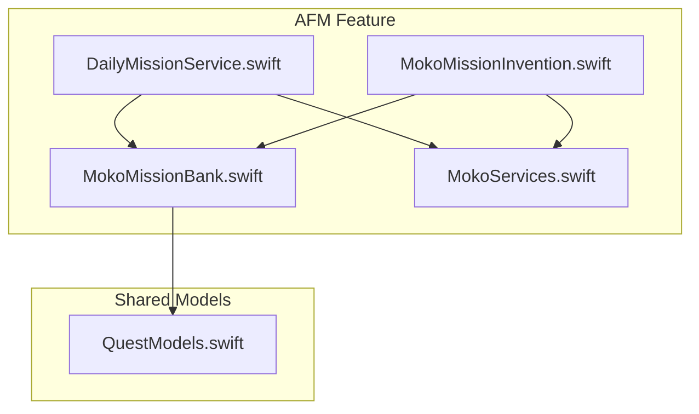
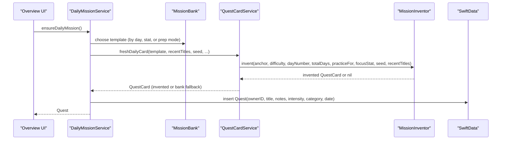
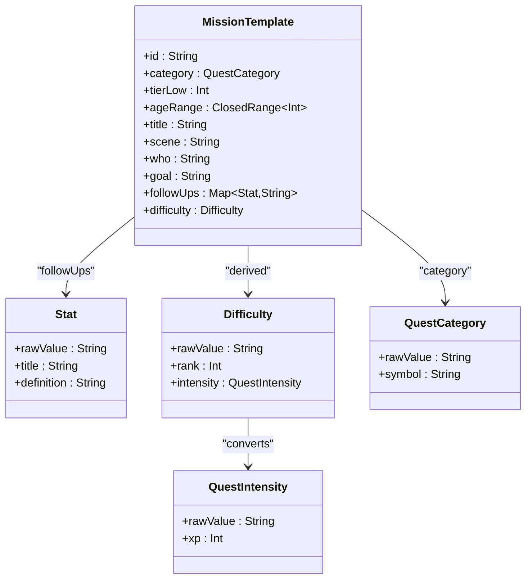
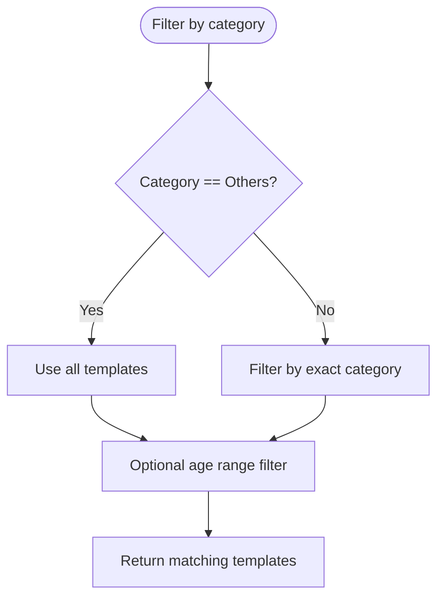
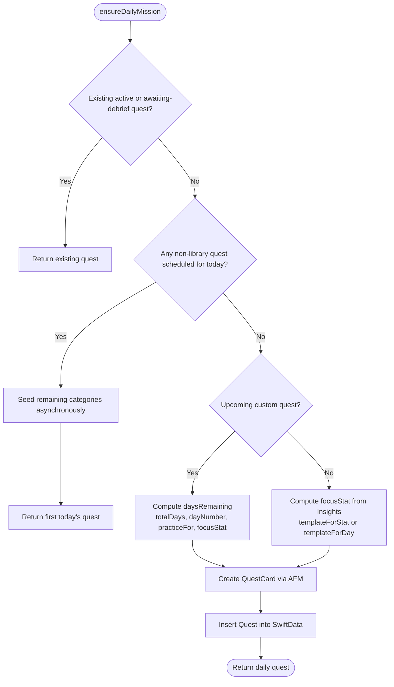
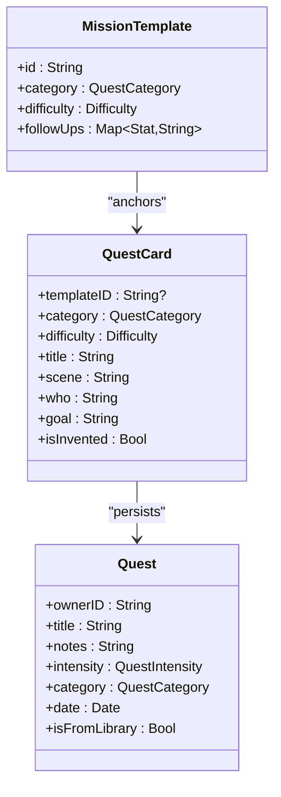
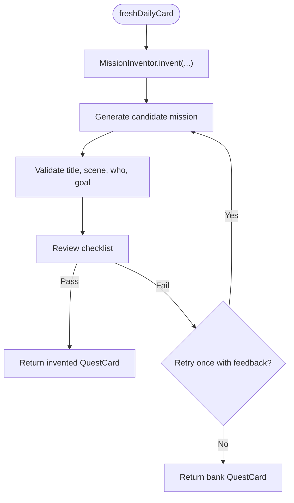
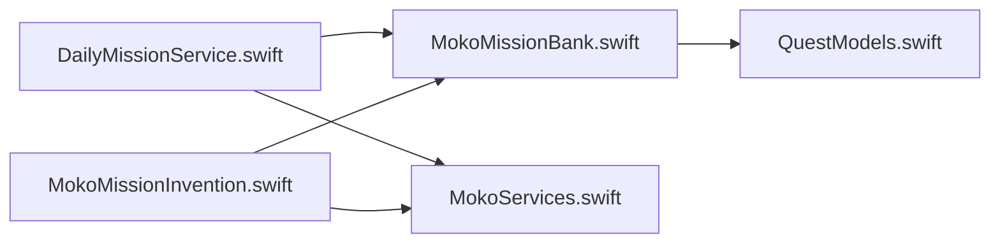

# Mission Bank Management

<cite>
**Referenced Files in This Document**
- [MokoMissionBank.swift](file://Moko/Moko/Features/AFM/MokoMissionBank.swift)
- [QuestModels.swift](file://Moko/Moko/Models/QuestModels.swift)
- [DailyMissionService.swift](file://Moko/Moko/Features/AFM/DailyMissionService.swift)
- [MokoMissionInvention.swift](file://Moko/Moko/Features/AFM/MokoMissionInvention.swift)
- [MokoServices.swift](file://Moko/Moko/Features/AFM/MokoServices.swift)
</cite>

## Table of Contents
1. [Introduction](#introduction)
2. [Project Structure](#project-structure)
3. [Core Components](#core-components)
4. [Architecture Overview](#architecture-overview)
5. [Detailed Component Analysis](#detailed-component-analysis)
6. [Dependency Analysis](#dependency-analysis)
7. [Performance Considerations](#performance-considerations)
8. [Troubleshooting Guide](#troubleshooting-guide)
9. [Conclusion](#conclusion)
10. [Appendices](#appendices)

## Introduction
This document explains the Moko mission template system centered on `MokoMissionBank`. It covers how mission templates are structured, how they are categorized across work, dating, friends, and family domains, and how metadata such as difficulty, target parameters, and life categories drive selection and rotation. It also documents how templates become actual quest instances, how new templates can be added, and how the library is maintained.

The mission bank is a curated repository of pre-vetted social situations. Each situation includes a scene, participants, goal, age range, and four debrief questions tied to growth parameters: courage, clarity, presence, and warmth. The app uses these templates to generate daily missions, either by rewording them or inventing fresh but behaviorally aligned scenarios through an AI-assisted pipeline that always preserves the original template identity for debrief continuity.

## Project Structure
The mission bank lives under the AFM feature area and integrates with shared models and services:

**Diagram sources**
- [MokoMissionBank.swift:10-91](file://Moko/Moko/Features/AFM/MokoMissionBank.swift#L10-L91)
- [QuestModels.swift:13-48](file://Moko/Moko/Models/QuestModels.swift#L13-L48)
- [DailyMissionService.swift:20-35](file://Moko/Moko/Features/AFM/DailyMissionService.swift#L20-L35)
- [MokoMissionInvention.swift:222-304](file://Moko/Moko/Features/AFM/MokoMissionInvention.swift#L222-L304)
- [MokoServices.swift:290-290](file://Moko/Moko/Features/AFM/MokoServices.swift#L290-L290)

**Section sources**
- [MokoMissionBank.swift:1-10](file://Moko/Moko/Features/AFM/MokoMissionBank.swift#L1-L10)
- [QuestModels.swift:1-12](file://Moko/Moko/Models/QuestModels.swift#L1-L12)

## Core Components
- **Stat**: Defines the four growth parameters used throughout personalization and debrief.
- **Difficulty**: A domain-level difficulty enum with rank and conversion to/from `QuestIntensity`.
- **MissionTemplate**: Represents one vetted mission situation with metadata and per-stat follow-up questions.
- **MissionBank**: Provides accessors and the full list of curated templates.
- **QuestCategory**: Life-domain classification for templates and quests.
- **DailyMissionService**: Selects today’s featured mission using category rotation, lowest-scored parameter targeting, and preparation mode for upcoming custom quests.
- **MokoMissionInvention**: Generates fresh mission variants anchored to bank templates, validated by Swift rules and a review pass, then falls back to the bank text when needed.
- **QuestCardService**: Bridges templates to runtime quest cards; its extension in the invention file provides the “fresh daily card” entry point.

**Section sources**
- [MokoMissionBank.swift:10-91](file://Moko/Moko/Features/AFM/MokoMissionBank.swift#L10-L91)
- [QuestModels.swift:13-48](file://Moko/Moko/Models/QuestModels.swift#L13-L48)
- [DailyMissionService.swift:20-35](file://Moko/Moko/Features/AFM/DailyMissionService.swift#L20-L35)
- [MokoMissionInvention.swift:222-304](file://Moko/Moko/Features/AFM/MokoMissionInvention.swift#L222-L304)
- [MokoServices.swift:290-290](file://Moko/Moko/Features/AFM/MokoServices.swift#L290-L290)

## Architecture Overview
At runtime, the overview screen asks for a daily mission. `DailyMissionService` chooses a `MissionTemplate` from `MissionBank`, optionally guided by the user’s lowest-scored stat or an upcoming custom quest. The chosen template is turned into a `QuestCard` via `QuestCardService.freshDailyCard`, which attempts to invent a fresh variant anchored to the same core behavior; if invention fails, it returns the original bank scenario. Finally, a `Quest` instance is persisted for the user.

**Diagram sources**
- [DailyMissionService.swift:127-225](file://Moko/Moko/Features/AFM/DailyMissionService.swift#L127-L225)
- [MokoMissionInvention.swift:222-304](file://Moko/Moko/Features/AFM/MokoMissionInvention.swift#L222-L304)
- [MokoServices.swift:290-290](file://Moko/Moko/Features/AFM/MokoServices.swift#L290-L290)

## Detailed Component Analysis

### Mission Template Model and Metadata
A `MissionTemplate` captures a single vetted social situation. Its key fields include:
- `id`: Stable identifier used to link generated cards back to the bank.
- `category`: One of Work, Dating, Friends, Family, or Others.
- `tierLow`: Lower bound of the bank’s internal tier, mapping to easy/medium/hard.
- `ageRange`: Allowed age range for the template.
- `title`, `scene`, `who`, `goal`: Human-readable context and objective.
- `followUps`: Four debrief questions keyed by Stat.

Difficulty is derived from `tierLow`:
- Tier low 1–3 → Easy
- Tier low 4–7 → Medium
- Tier low 8+ → Hard

**Diagram sources**
- [MokoMissionBank.swift:10-91](file://Moko/Moko/Features/AFM/MokoMissionBank.swift#L10-L91)
- [QuestModels.swift:13-48](file://Moko/Moko/Models/QuestModels.swift#L13-L48)

**Section sources**
- [MokoMissionBank.swift:10-91](file://Moko/Moko/Features/AFM/MokoMissionBank.swift#L10-L91)

### Categorization Scheme
Templates are grouped by life domain:
- Work
- Dating
- Friends
- Family
- Others (used as a catch-all filter path)

Each template carries a `QuestCategory` and an `ageRange`. The bank exposes:
- `template(id:)` to retrieve a specific template.
- `templates(in:age:)` to filter by category and optional age.

**Diagram sources**
- [MokoMissionBank.swift:95-103](file://Moko/Moko/Features/AFM/MokoMissionBank.swift#L95-L103)

**Section sources**
- [MokoMissionBank.swift:95-103](file://Moko/Moko/Features/AFM/MokoMissionBank.swift#L95-L103)
- [QuestModels.swift:30-48](file://Moko/Moko/Models/QuestModels.swift#L30-L48)

### Target Parameters and Debrief Questions
Every template defines four follow-up questions, one per Stat:
- Courage: Approach versus avoidance.
- Clarity: Direct, concise communication.
- Presence: Being in the moment.
- Warmth: Genuine engagement and openness.

These questions remain attached to any invented or reworded mission because generated cards retain the original `templateID`. This ensures debrief stays grounded in vetted prompts.

**Section sources**
- [MokoMissionBank.swift:10-24](file://Moko/Moko/Features/AFM/MokoMissionBank.swift#L10-L24)
- [MokoMissionInvention.swift:201-217](file://Moko/Moko/Features/AFM/MokoMissionInvention.swift#L201-L217)

### Template Selection Algorithms and Rotation Strategies
`DailyMissionService` implements three selection strategies:

1. **Day-of-year rotation by category**
   - Cycles through Work, Friends, Dating, Family deterministically.
   - Picks a template index based on the day number within the category pool.

2. **Lowest-scored parameter focus**
   - Computes average scores for each Stat from Insights records.
   - Maps each Stat to a curated subset of templates known to exercise that parameter.
   - Falls back to day-based rotation if no matching set exists.

3. **Preparation mode for upcoming custom quests**
   - If there is a future custom quest, daily missions act as stepping stones.
   - Alternates between foundational skills in different categories and similar-situation rehearsals closer to the event.
   - On the day before the event, selects a similar situation in the same category.

**Diagram sources**
- [DailyMissionService.swift:127-225](file://Moko/Moko/Features/AFM/DailyMissionService.swift#L127-L225)

**Section sources**
- [DailyMissionService.swift:28-35](file://Moko/Moko/Features/AFM/DailyMissionService.swift#L28-L35)
- [DailyMissionService.swift:39-83](file://Moko/Moko/Features/AFM/DailyMissionService.swift#L39-L83)
- [DailyMissionService.swift:87-123](file://Moko/Moko/Features/AFM/DailyMissionService.swift#L87-L123)
- [DailyMissionService.swift:127-225](file://Moko/Moko/Features/AFM/DailyMissionService.swift#L127-L225)

### Template-to-Instance Relationship
A `MissionTemplate` is a blueprint. At runtime, it becomes:
- A `QuestCard`, which may be invented or directly taken from the bank.
- A `Quest`, which is persisted in SwiftData for the current user.

Key relationships:
- `QuestCardService.freshDailyCard` tries to invent a fresh card anchored to the template; otherwise it returns the bank version.
- `Quest` stores user-facing fields like title, notes, intensity, category, and scheduling metadata.
- Library-derived quests carry a specific XP value; custom quests use the default intensity XP.

**Diagram sources**
- [MokoMissionBank.swift:72-91](file://Moko/Moko/Features/AFM/MokoMissionBank.swift#L72-L91)
- [MokoMissionInvention.swift:222-304](file://Moko/Moko/Features/AFM/MokoMissionInvention.swift#L222-L304)
- [QuestModels.swift:50-100](file://Moko/Moko/Models/QuestModels.swift#L50-L100)

**Section sources**
- [MokoMissionInvention.swift:283-304](file://Moko/Moko/Features/AFM/MokoMissionInvention.swift#L283-L304)
- [QuestModels.swift:50-100](file://Moko/Moko/Models/QuestModels.swift#L50-L100)

### Invention Pipeline and Validation
When generating a daily mission, the system attempts to create a fresh variant while preserving the anchor template’s core behavior:

1. **Variety seeds**: Deterministic selection of formats and tone based on day and seed.
2. **Model generation**: Produces a candidate mission with title, scene, who, and goal.
3. **Plain-Swift validation**: Enforces length, verb-first goals, blocked topics, and uniqueness against recent titles.
4. **Review pass**: A strict reviewer checks doability, single behavior, debrief fit, believability, and safety.
5. **Fail closed**: Any failure retries once with feedback; otherwise, the caller receives the original bank scenario.

**Diagram sources**
- [MokoMissionInvention.swift:222-304](file://Moko/Moko/Features/AFM/MokoMissionInvention.swift#L222-L304)

**Section sources**
- [MokoMissionInvention.swift:49-75](file://Moko/Moko/Features/AFM/MokoMissionInvention.swift#L49-L75)
- [MokoMissionInvention.swift:77-131](file://Moko/Moko/Features/AFM/MokoMissionInvention.swift#L77-L131)
- [MokoMissionInvention.swift:134-217](file://Moko/Moko/Features/AFM/MokoMissionInvention.swift#L134-L217)
- [MokoMissionInvention.swift:222-304](file://Moko/Moko/Features/AFM/MokoMissionInvention.swift#L222-L304)

### Adding New Templates
To add a new template:
1. Define a unique `id` and assign a `QuestCategory`.
2. Choose a `tierLow` consistent with the intended difficulty mapping.
3. Set an appropriate `ageRange`.
4. Provide clear `title`, `scene`, `who`, and `goal`.
5. Write four follow-up questions, one per Stat, ensuring they reflect concrete, non-rumination reflections.
6. Add the template to the `MissionBank.all` array using the provided builder helper.

Guidelines:
- Keep goals as single, concrete behaviors achievable in one short interaction.
- Ensure scenes are ordinary and believable.
- Align follow-ups with the four Stat definitions so debrief remains meaningful.
- Avoid sensitive or unsafe content; keep language respectful and age-appropriate.

**Section sources**
- [MokoMissionBank.swift:72-91](file://Moko/Moko/Features/AFM/MokoMissionBank.swift#L72-L91)
- [MokoMissionBank.swift:293-300](file://Moko/Moko/Features/AFM/MokoMissionBank.swift#L293-L300)

### Maintenance and Update Processes
- **Curated curation**: The bank contains a fixed set of vetted situations; changes should be deliberate and reviewed.
- **Consistency checks**: When adding templates, verify that difficulty mapping aligns with `tierLow`, and that follow-ups match the Stat definitions.
- **Rotation stability**: Category rotation and day-based indexing rely on stable arrays; avoid reordering without considering impact on deterministic selection.
- **Invention safeguards**: The invention pipeline enforces safety and quality; maintainers should not bypass validators.
- **Backward compatibility**: Generated cards retain `templateID`; debrief logic depends on this linkage.

**Section sources**
- [MokoMissionBank.swift:1-10](file://Moko/Moko/Features/AFM/MokoMissionBank.swift#L1-L10)
- [MokoMissionInvention.swift:1-15](file://Moko/Moko/Features/AFM/MokoMissionInvention.swift#L1-L15)
- [MokoMissionInvention.swift:77-131](file://Moko/Moko/Features/AFM/MokoMissionInvention.swift#L77-L131)

## Dependency Analysis
The mission system has clear layering:
- Domain types (`Stat`, `Difficulty`, `MissionTemplate`) live in the bank file.
- Shared enums (`QuestCategory`, `QuestIntensity`) live in shared models.
- Selection logic lives in `DailyMissionService`.
- Generation and validation live in `MokoMissionInvention`.
- Runtime bridging to cards and persistence happens via `QuestCardService` and SwiftData.

**Diagram sources**
- [MokoMissionBank.swift:10-91](file://Moko/Moko/Features/AFM/MokoMissionBank.swift#L10-L91)
- [QuestModels.swift:13-48](file://Moko/Moko/Models/QuestModels.swift#L13-L48)
- [DailyMissionService.swift:20-35](file://Moko/Moko/Features/AFM/DailyMissionService.swift#L20-L35)
- [MokoMissionInvention.swift:222-304](file://Moko/Moko/Features/AFM/MokoMissionInvention.swift#L222-L304)
- [MokoServices.swift:290-290](file://Moko/Moko/Features/AFM/MokoServices.swift#L290-L290)

**Section sources**
- [DailyMissionService.swift:127-225](file://Moko/Moko/Features/AFM/DailyMissionService.swift#L127-L225)
- [MokoMissionInvention.swift:283-304](file://Moko/Moko/Features/AFM/MokoMissionInvention.swift#L283-L304)

## Performance Considerations
- Filtering the entire bank by category and age is lightweight given the small fixed size.
- Day-based indexing avoids randomization overhead and ensures deterministic results.
- Invention involves model calls; the system retries once and falls back to bank content to keep UI responsive.
- Asynchronous seeding of variety quests prevents blocking the main flow.

[No sources needed since this section provides general guidance]

## Troubleshooting Guide
Common issues and resolutions:
- **Empty daily mission**: Ensure `ensureDailyMission` runs and that at least one template exists for the selected category.
- **Repeated titles**: The validator blocks repeated titles against recent missions; adjust wording or change the anchor template.
- **Unsafe or inappropriate content**: The validator and review pass block risky topics; revise the template or invention prompt constraints.
- **Debrief mismatch**: Verify that follow-up questions still make sense for the invented mission; the review pass checks this alignment.
- **Stale rotation**: If templates were reordered, check that category pools and indices remain consistent with expected rotation.

**Section sources**
- [MokoMissionInvention.swift:77-131](file://Moko/Moko/Features/AFM/MokoMissionInvention.swift#L77-L131)
- [DailyMissionService.swift:127-225](file://Moko/Moko/Features/AFM/DailyMissionService.swift#L127-L225)

## Conclusion
The Moko mission bank provides a robust, curated foundation for daily social-confidence practice. Templates encode clear goals and debrief questions across four growth parameters and life domains. Selection algorithms balance familiarity and novelty through category rotation, targeted parameter focus, and preparation modes. The invention pipeline adds variety while enforcing safety and behavioral alignment, always preserving the original template identity for debrief continuity. Maintaining the bank requires careful attention to difficulty mapping, age ranges, and follow-up quality.

[No sources needed since this section summarizes without analyzing specific files]

## Appendices

### Example Template Structure
Below is a conceptual example of what a template entry represents:
- id: Unique identifier
- category: Work, Dating, Friends, Family, or Others
- tierLow: Integer lower bound for difficulty mapping
- ageRange: Closed range of allowed ages
- title: Short descriptive title
- scene: Brief present-tense setting
- who: Participants involved
- goal: Single concrete behavior
- followUps: Four questions mapped to Courage, Clarity, Presence, Warmth

**Section sources**
- [MokoMissionBank.swift:72-91](file://Moko/Moko/Features/AFM/MokoMissionBank.swift#L72-L91)