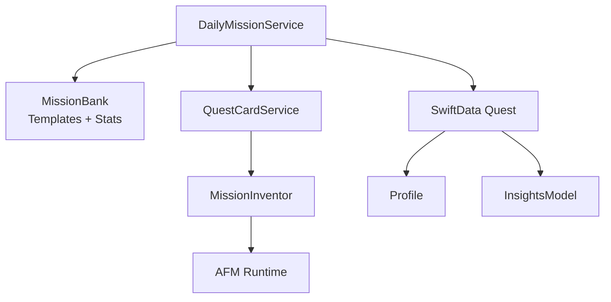
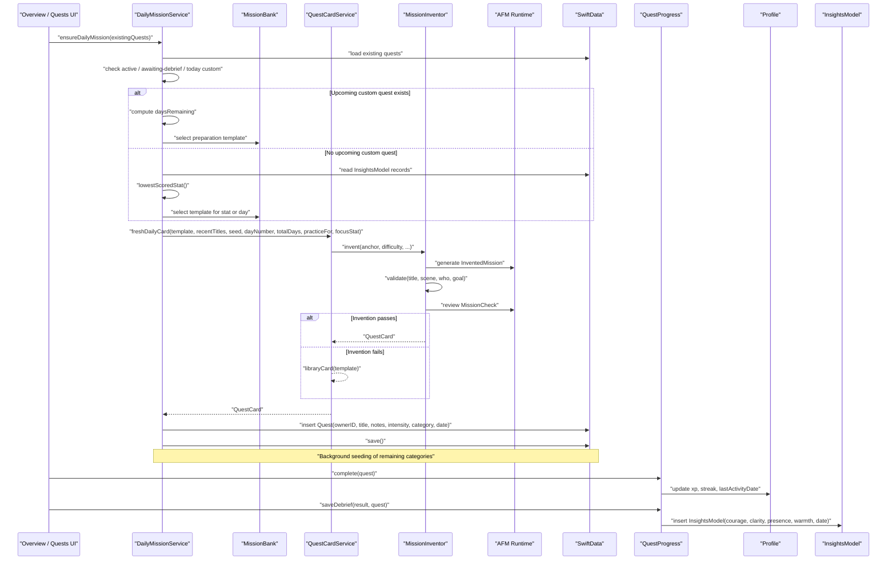
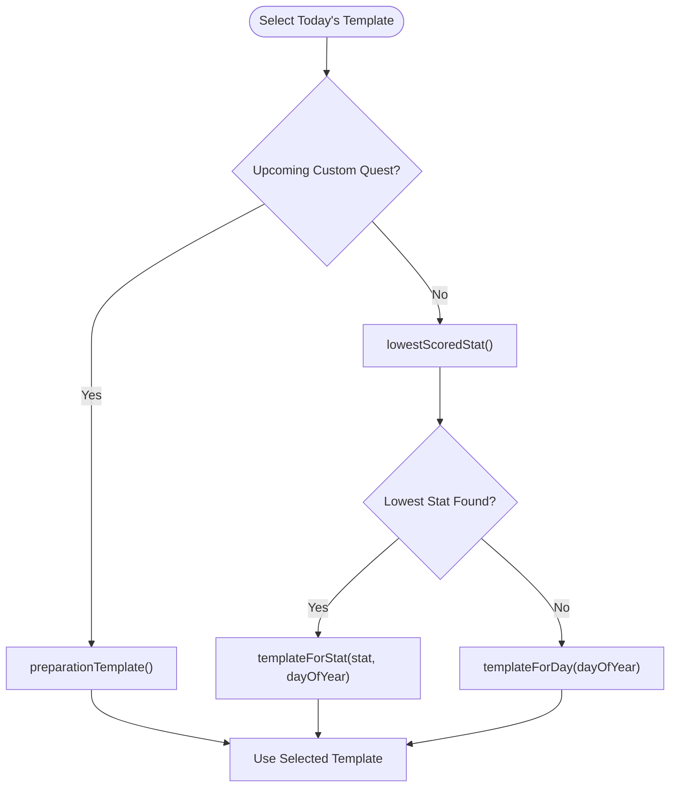
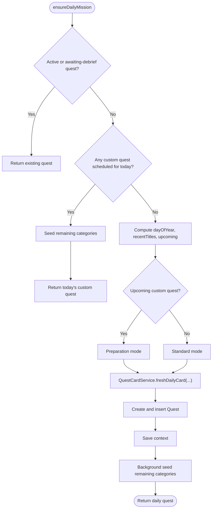
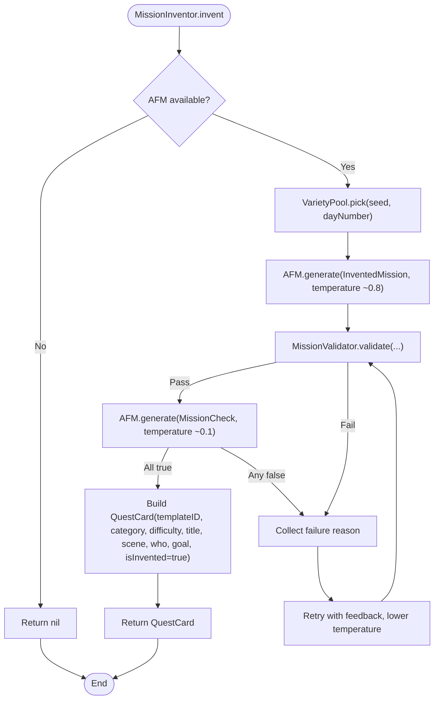
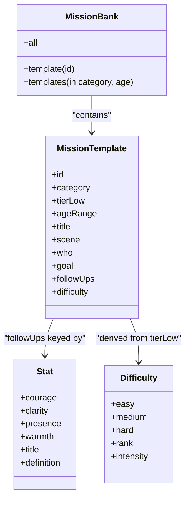
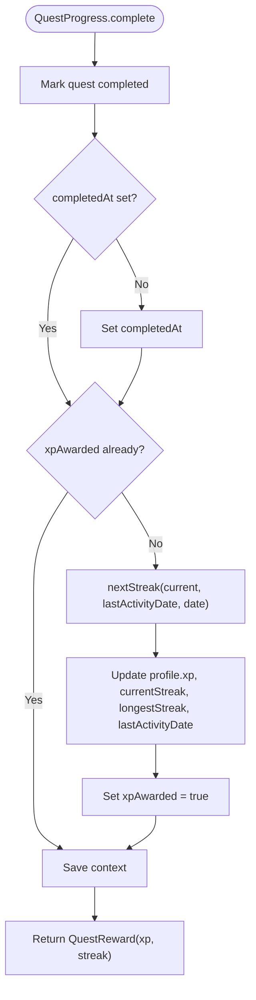
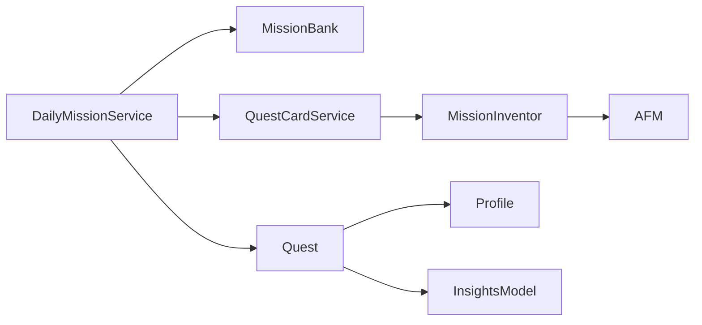

# Mission Generation Service

<cite>
**Referenced Files in This Document**   
- [DailyMissionService.swift](file://Moko/Moko/Features/AFM/DailyMissionService.swift)
- [MokoMissionInvention.swift](file://Moko/Moko/Features/AFM/MokoMissionInvention.swift)
- [MokoMissionBank.swift](file://Moko/Moko/Features/AFM/MokoMissionBank.swift)
- [MokoServices.swift](file://Moko/Moko/Features/AFM/MokoServices.swift)
- [MokoAFM.swift](file://Moko/Moko/Features/AFM/MokoAFM.swift)
- [QuestModels.swift](file://Moko/Moko/Models/QuestModels.swift)
- [Profile.swift](file://Moko/Moko/Models/Profile.swift)
- [QuestProgress.swift](file://Moko/Moko/Models/QuestProgress.swift)
- [InsightsModel.swift](file://Moko/Moko/Models/InsightsModel.swift)
</cite>

## Table of Contents
1. [Introduction](#introduction)
2. [Project Structure](#project-structure)
3. [Core Components](#core-components)
4. [Architecture Overview](#architecture-overview)
5. [Detailed Component Analysis](#detailed-component-analysis)
6. [Dependency Analysis](#dependency-analysis)
7. [Performance Considerations](#performance-considerations)
8. [Troubleshooting Guide](#troubleshooting-guide)
9. [Conclusion](#conclusion)

## Introduction
This document explains the mission generation service layer that powers Moko’s Adaptive Mission System (AFM). It focuses on how personalized daily quests are selected, invented, categorized, and persisted, and how they connect to user progress, streaks, insights, and upcoming custom missions.

The system has three main responsibilities:
- Select a suitable mission template for today based on category rotation, growth focus, and upcoming custom quests.
- Generate or adapt a concrete quest card using AFM with strict safety and quality checks.
- Persist the resulting quest and integrate completion, XP, streaks, and debrief insights into the user profile.

## Project Structure
The mission generation logic lives under `Features/AFM` and uses shared models under `Models`. The key files are:

| Area | File | Responsibility |
|---|---|---|
| Daily planning | `DailyMissionService.swift` | Chooses today’s featured mission, prepares stepping-stone missions before custom quests, and seeds variety across categories. |
| Card invention | `MokoMissionInvention.swift` | Generates fresh, checked mission cards from vetted bank templates; falls back to library text when needed. |
| Mission bank | `MokoMissionBank.swift` | Defines core domain types (`Stat`, `Difficulty`, `MissionTemplate`) and the 20-situation mission bank. |
| Card orchestration | `MokoServices.swift` | Provides `QuestCardService`, which coordinates matching, invention, and card creation. |
| Foundation Models runtime | `MokoAFM.swift` | Wraps Apple Intelligence availability, generation, prompts, and error handling. |
| Quest persistence | `QuestModels.swift` | Defines `Quest`, `QuestIntensity`, `QuestCategory`, current user identity, and database container. |
| User profile | `Profile.swift` | Stores XP, streaks, activity date, and other profile data. |
| Progress integration | `QuestProgress.swift` | Awards XP, updates streaks, and records debrief insights. |
| Insights storage | `InsightsModel.swift` | Persists per-day scores for courage, clarity, presence, and warmth. |

**Diagram sources**
- [DailyMissionService.swift:125-225](file://Moko/Moko/Features/AFM/DailyMissionService.swift#L125-L225)
- [MokoMissionBank.swift:72-91](file://Moko/Moko/Features/AFM/MokoMissionBank.swift#L72-L91)
- [MokoMissionInvention.swift:220-305](file://Moko/Moko/Features/AFM/MokoMissionInvention.swift#L220-L305)
- [MokoServices.swift:289-320](file://Moko/Moko/Features/AFM/MokoServices.swift#L289-L320)
- [MokoAFM.swift:72-137](file://Moko/Moko/Features/AFM/MokoAFM.swift#L72-L137)
- [QuestModels.swift:50-100](file://Moko/Moko/Models/QuestModels.swift#L50-L100)
- [Profile.swift:12-30](file://Moko/Moko/Models/Profile.swift#L12-L30)
- [InsightsModel.swift:11-24](file://Moko/Moko/Models/InsightsModel.swift#L11-L24)

**Section sources**
- [DailyMissionService.swift:1-307](file://Moko/Moko/Features/AFM/DailyMissionService.swift#L1-L307)
- [MokoMissionInvention.swift:1-307](file://Moko/Moko/Features/AFM/MokoMissionInvention.swift#L1-L307)
- [MokoMissionBank.swift:1-302](file://Moko/Moko/Features/AFM/MokoMissionBank.swift#L1-L302)
- [MokoServices.swift:203-320](file://Moko/Moko/Features/AFM/MokoServices.swift#L203-L320)
- [MokoAFM.swift:1-221](file://Moko/Moko/Features/AFM/MokoAFM.swift#L1-L221)
- [QuestModels.swift:12-166](file://Moko/Moko/Models/QuestModels.swift#L12-L166)
- [Profile.swift:12-60](file://Moko/Moko/Models/Profile.swift#L12-L60)
- [QuestProgress.swift:1-139](file://Moko/Moko/Models/QuestProgress.swift#L1-L139)
- [InsightsModel.swift:1-27](file://Moko/Moko/Models/InsightsModel.swift#L1-L27)

## Core Components
- **DailyMissionService**: Determines today’s featured mission, selects templates by category rotation and lowest-scored stat, prepares stepping-stone missions before custom quests, creates the daily quest in SwiftData, and seeds additional category quests for variety.
- **MissionInventor / QuestCardService.freshDailyCard**: Attempts to invent a new mission anchored to a bank template; validates it with plain-Swift rules and an AFM review pass; falls back to a reworded library card if invention fails.
- **MissionBank**: Holds the canonical mission templates, their categories, age ranges, difficulty tiers, goals, and debrief follow-up questions.
- **Quest and Progress models**: Persist quests, track completion state, award XP, maintain streaks, and record debrief insights.

Key behaviors:
- Personalization is driven by the user’s lowest-scored stat across Courage, Clarity, Presence, and Warmth.
- Upcoming custom quests trigger preparation missions that alternate between foundational skills and similar situations.
- Difficulty comes from the bank tier and maps to `QuestIntensity`.
- Completion integrates with `Profile` for XP and streaks, and saves `InsightsModel` entries for adaptive future selection.

**Section sources**
- [DailyMissionService.swift:20-35](file://Moko/Moko/Features/AFM/DailyMissionService.swift#L20-L35)
- [DailyMissionService.swift:37-83](file://Moko/Moko/Features/AFM/DailyMissionService.swift#L37-L83)
- [DailyMissionService.swift:85-123](file://Moko/Moko/Features/AFM/DailyMissionService.swift#L85-L123)
- [DailyMissionService.swift:125-225](file://Moko/Moko/Features/AFM/DailyMissionService.swift#L125-L225)
- [MokoMissionInvention.swift:19-47](file://Moko/Moko/Features/AFM/MokoMissionInvention.swift#L19-L47)
- [MokoMissionInvention.swift:77-132](file://Moko/Moko/Features/AFM/MokoMissionInvention.swift#L77-L132)
- [MokoMissionInvention.swift:220-305](file://Moko/Moko/Features/AFM/MokoMissionInvention.swift#L220-L305)
- [MokoMissionBank.swift:10-91](file://Moko/Moko/Features/AFM/MokoMissionBank.swift#L10-L91)
- [QuestModels.swift:12-100](file://Moko/Moko/Models/QuestModels.swift#L12-L100)
- [QuestProgress.swift:17-83](file://Moko/Moko/Models/QuestProgress.swift#L17-L83)

## Architecture Overview
The mission generation flow combines deterministic Swift logic with optional AFM language generation.

**Diagram sources**
- [DailyMissionService.swift:125-225](file://Moko/Moko/Features/AFM/DailyMissionService.swift#L125-L225)
- [DailyMissionService.swift:227-273](file://Moko/Moko/Features/AFM/DailyMissionService.swift#L227-L273)
- [MokoMissionInvention.swift:220-305](file://Moko/Moko/Features/AFM/MokoMissionInvention.swift#L220-L305)
- [MokoServices.swift:289-320](file://Moko/Moko/Features/AFM/MokoServices.swift#L289-L320)
- [QuestProgress.swift:49-119](file://Moko/Moko/Models/QuestProgress.swift#L49-L119)

## Detailed Component Analysis

### DailyMissionService: Adaptive Daily Planning
`DailyMissionService` is the entry point for ensuring there is always a meaningful daily mission. Its behavior follows three adaptive rules:
1. Target the user’s lowest-scored parameter from past `InsightsModel` records.
2. Prepare stepping-stone missions before an upcoming custom quest.
3. Keep evaluation equal across all parameters during debrief.

#### Template Selection
- **Category rotation**: The service cycles through Work, Friends, Dating, Family each day.
- **Lowest-stat targeting**: If a lowest stat is known, it selects templates associated with that stat.
- **Fallback**: If no matching templates exist for the stat, it falls back to the day-based rotation.

**Diagram sources**
- [DailyMissionService.swift:28-35](file://Moko/Moko/Features/AFM/DailyMissionService.swift#L28-L35)
- [DailyMissionService.swift:37-83](file://Moko/Moko/Features/AFM/DailyMissionService.swift#L37-L83)
- [DailyMissionService.swift:85-123](file://Moko/Moko/Features/AFM/DailyMissionService.swift#L85-L123)

#### Preparation Mode Before Custom Quests
When a future custom quest exists, the service computes `daysRemaining` and chooses:
- The day before the event: a similar situation in the same category.
- Even-numbered days remaining: a foundational skill from a different category.
- Odd-numbered days remaining: a similar situation in the same category.

This prevents boredom and avoids spoon-feeding while building toward the real event.

#### Ensuring the Daily Quest
`ensureDailyMission`:
1. Returns an existing active or awaiting-debrief quest if present.
2. Returns any non-library custom quest scheduled for today.
3. Otherwise, selects a template and calls `QuestCardService.freshDailyCard`.
4. Creates a `Quest` with owner ID, title, notes, intensity, category, and date.
5. Persists it and asynchronously seeds remaining categories for variety.

**Diagram sources**
- [DailyMissionService.swift:125-225](file://Moko/Moko/Features/AFM/DailyMissionService.swift#L125-L225)

**Section sources**
- [DailyMissionService.swift:20-35](file://Moko/Moko/Features/AFM/DailyMissionService.swift#L20-L35)
- [DailyMissionService.swift:37-83](file://Moko/Moko/Features/AFM/DailyMissionService.swift#L37-L83)
- [DailyMissionService.swift:85-123](file://Moko/Moko/Features/AFM/DailyMissionService.swift#L85-L123)
- [DailyMissionService.swift:125-225](file://Moko/Moko/Features/AFM/DailyMissionService.swift#L125-L225)
- [DailyMissionService.swift:227-273](file://Moko/Moko/Features/AFM/DailyMissionService.swift#L227-L273)
- [DailyMissionService.swift:275-303](file://Moko/Moko/Features/AFM/DailyMissionService.swift#L275-L303)

### MokoMissionInvention: Quest Creation Logic
`MokoMissionInvention` implements the “interesting but not random” rule:
- **Anchor**: Every invented mission is tied to a vetted `MissionTemplate`.
- **Seeds**: Swift deterministically picks formats and tone per day.
- **Validator**: Plain-Swift rules enforce length, verb-first goals, blocked topics, and uniqueness.
- **Review Pass**: A low-temperature AFM call answers five yes/no checks.
- **Fail Closed**: Failures retry once with feedback; otherwise the caller falls back to the bank text.

#### Invented Mission Model
The generated structure includes:
- `sameSkillReason`: Why this mission practices the same core behavior.
- `cardTitle`: Short, Title Case, naming the moment.
- `scene`: Ordinary everyday moment with one small detail.
- `who`: Role phrase without names.
- `goal`: One action-verb sentence describing a concrete behavior.

#### Validator Rules
The validator enforces:
- Title length and uniqueness against recent titles.
- Scene and who constraints.
- Goal length, single sentence, verb-first start.
- Blocked words and phrases related to unsafe or outcome-focused content.

#### Review Checks
The review model asks whether the mission is:
- Doable today in one short interaction.
- Asking exactly one behavior.
- Compatible with the four debrief questions.
- Believable and ordinary.
- Safe and appropriate.

**Diagram sources**
- [MokoMissionInvention.swift:220-281](file://Moko/Moko/Features/AFM/MokoMissionInvention.swift#L220-L281)
- [MokoMissionInvention.swift:77-132](file://Moko/Moko/Features/AFM/MokoMissionInvention.swift#L77-L132)

#### Fresh Daily Card Integration
`QuestCardService.freshDailyCard`:
- Tries `MissionInventor.invent`.
- If invention fails, returns `libraryCard(template)` as a safe fallback.

**Section sources**
- [MokoMissionInvention.swift:19-47](file://Moko/Moko/Features/AFM/MokoMissionInvention.swift#L19-L47)
- [MokoMissionInvention.swift:49-75](file://Moko/Moko/Features/AFM/MokoMissionInvention.swift#L49-L75)
- [MokoMissionInvention.swift:77-132](file://Moko/Moko/Features/AFM/MokoMissionInvention.swift#L77-L132)
- [MokoMissionInvention.swift:134-218](file://Moko/Moko/Features/AFM/MokoMissionInvention.swift#L134-L218)
- [MokoMissionInvention.swift:220-305](file://Moko/Moko/Features/AFM/MokoMissionInvention.swift#L220-L305)

### MokoMissionBank: Categorization and Templates
`MissionBank` defines:
- `Stat`: Courage, Clarity, Presence, Warmth, with definitions used in personalization and prompts.
- `Difficulty`: Easy, Medium, Hard, mapped to `QuestIntensity`.
- `MissionTemplate`: A vetted situation including category, age range, title, scene, who, goal, and per-stat debrief follow-ups.
- The 20-situation bank covering Work, Dating, Friends, and Family.

Difficulty mapping:
- Tier 1–3 → Easy
- Tier 4–7 → Medium
- Tier 8+ → Hard

**Diagram sources**
- [MokoMissionBank.swift:10-91](file://Moko/Moko/Features/AFM/MokoMissionBank.swift#L10-L91)
- [MokoMissionBank.swift:95-291](file://Moko/Moko/Features/AFM/MokoMissionBank.swift#L95-L291)

**Section sources**
- [MokoMissionBank.swift:10-91](file://Moko/Moko/Features/AFM/MokoMissionBank.swift#L10-L91)
- [MokoMissionBank.swift:95-291](file://Moko/Moko/Features/AFM/MokoMissionBank.swift#L95-L291)

### Mission Generation Algorithms and Personalization Factors
The algorithm combines several inputs:

| Input | Source | Effect |
|---|---|---|
| Category rotation | `DailyMissionService.categoryRotation` | Cycles Work → Friends → Dating → Family. |
| Lowest-scored stat | `InsightsModel` averages | Targets Courage, Clarity, Presence, or Warmth. |
| Upcoming custom quest | Existing `Quest` list | Triggers preparation mode with alternating categories. |
| Recent titles | Existing `Quest` titles | Avoids repetition in invented missions. |
| Seed string | Day number, stat, category | Makes variety deterministic per day. |
| Difficulty | Bank tier or user choice | Maps to `QuestIntensity` and displayed XP. |

Personalization factors:
- Growth focus: The prompt emphasizes practicing the lowest-scored stat.
- Practice target: When preparing for a custom quest, the mission acts as a stepping stone.
- Category diversity: The overview mission rotates categories; background seeding ensures all life areas appear in the Quests list.

**Section sources**
- [DailyMissionService.swift:20-35](file://Moko/Moko/Features/AFM/DailyMissionService.swift#L20-L35)
- [DailyMissionService.swift:37-83](file://Moko/Moko/Features/AFM/DailyMissionService.swift#L37-L83)
- [DailyMissionService.swift:85-123](file://Moko/Moko/Features/AFM/DailyMissionService.swift#L85-L123)
- [DailyMissionService.swift:154-225](file://Moko/Moko/Features/AFM/DailyMissionService.swift#L154-L225)
- [MokoMissionInvention.swift:49-75](file://Moko/Moko/Features/AFM/MokoMissionInvention.swift#L49-L75)
- [MokoMissionInvention.swift:164-195](file://Moko/Moko/Features/AFM/MokoMissionInvention.swift#L164-L195)

### Difficulty Scaling
Difficulty scaling is primarily derived from the bank template’s tier:
- Low-tier templates become easy missions.
- Mid-tier templates become medium missions.
- High-tier templates become hard missions.

The difficulty then maps to `QuestIntensity`, which determines displayed XP:
- Easy → 100 XP
- Medium → 150 XP
- Hard → 200 XP

For custom quests, difficulty can be chosen explicitly; for daily missions, it comes from the selected template.

**Section sources**
- [MokoMissionBank.swift:29-56](file://Moko/Moko/Features/AFM/MokoMissionBank.swift#L29-L56)
- [MokoMissionBank.swift:72-91](file://Moko/Moko/Features/AFM/MokoMissionBank.swift#L72-L91)
- [QuestModels.swift:12-28](file://Moko/Moko/Models/QuestModels.swift#L12-L28)

### Progress Tracking Integration
Completion and debrief flows update both the quest and the user profile:

- `QuestProgress.complete`:
  - Marks the quest completed.
  - Sets completion time if missing.
  - Calculates next streak based on last activity date.
  - Adds XP to the profile.
  - Updates current streak, longest streak, and last activity date.
  - Prevents duplicate XP awards via `xpAwarded`.

- `QuestProgress.saveDebrief`:
  - Completes the quest first.
  - Saves an `InsightsModel` entry with minimum score floors to avoid zero scores.
  - Marks the quest debrief recorded.

Streak rules:
- Same-day activity keeps or raises the streak.
- Next-day activity extends it.
- After seven active days, one rest day is allowed without breaking the streak.
- Longer gaps reset the streak.

**Diagram sources**
- [QuestProgress.swift:49-83](file://Moko/Moko/Models/QuestProgress.swift#L49-L83)

**Section sources**
- [QuestProgress.swift:11-15](file://Moko/Moko/Models/QuestProgress.swift#L11-L15)
- [QuestProgress.swift:17-47](file://Moko/Moko/Models/QuestProgress.swift#L17-L47)
- [QuestProgress.swift:49-83](file://Moko/Moko/Models/QuestProgress.swift#L49-L83)
- [QuestProgress.swift:85-119](file://Moko/Moko/Models/QuestProgress.swift#L85-L119)
- [InsightsModel.swift:11-24](file://Moko/Moko/Models/InsightsModel.swift#L11-L24)

### Relationship Between Missions and User Profile Data
- **User identity**: `CurrentUser.localID` assigns every created quest to the local device user.
- **Profile fields**: XP, current streak, longest streak, and last activity date are updated on completion.
- **Insights feedback loop**: Debrief results create `InsightsModel` records, which `DailyMissionService.lowestScoredStat` reads to select the next growth focus.
- **Streak maintenance**: The streak algorithm allows one rest day after a week-long streak, encouraging consistency without punishing occasional misses.

**Section sources**
- [QuestModels.swift:129-149](file://Moko/Moko/Models/QuestModels.swift#L129-L149)
- [Profile.swift:12-30](file://Moko/Moko/Models/Profile.swift#L12-L30)
- [QuestProgress.swift:49-83](file://Moko/Moko/Models/QuestProgress.swift#L49-L83)
- [DailyMissionService.swift:37-58](file://Moko/Moko/Features/AFM/DailyMissionService.swift#L37-L58)

### Achievement Unlocking Context
While achievement unlocking logic is not fully implemented in the analyzed files, the relevant hooks are:
- `Profile.longestStreak` tracks the best streak achieved.
- `Quest.awardedXP` contributes to `Profile.xp`.
- `Quest.isCompleted` and `debriefRecorded` mark lifecycle milestones.
- Future achievements can use these fields to unlock badges, costumes, or rewards.

**Section sources**
- [Profile.swift:12-30](file://Moko/Moko/Models/Profile.swift#L12-L30)
- [QuestModels.swift:50-100](file://Moko/Moko/Models/QuestModels.swift#L50-L100)

## Dependency Analysis
The mission generation layer has clear separation between planning, generation, and persistence:

Coupling and cohesion:
- `DailyMissionService` depends on `MissionBank` for templates and on `QuestCardService` for card creation.
- `MissionInventor` depends on `AFM` for language generation and on `MissionTemplate` for anchors.
- `QuestProgress` depends on `Quest`, `Profile`, and `InsightsModel`.
- External dependencies include SwiftData for persistence and FoundationModels for AFM.

Potential circular dependencies:
- None observed among the analyzed files.
- All AFM-related logic is isolated behind `AFM` and `MissionInventor`.

External integration points:
- SwiftData for `Quest`, `Profile`, and `InsightsModel`.
- Apple Intelligence runtime via `FoundationModels`.
- Calendar and date utilities for scheduling and streak calculation.

**Diagram sources**
- [DailyMissionService.swift:125-225](file://Moko/Moko/Features/AFM/DailyMissionService.swift#L125-L225)
- [MokoMissionInvention.swift:220-305](file://Moko/Moko/Features/AFM/MokoMissionInvention.swift#L220-L305)
- [QuestModels.swift:50-100](file://Moko/Moko/Models/QuestModels.swift#L50-L100)
- [Profile.swift:12-30](file://Moko/Moko/Models/Profile.swift#L12-L30)
- [InsightsModel.swift:11-24](file://Moko/Moko/Models/InsightsModel.swift#L11-L24)

**Section sources**
- [DailyMissionService.swift:125-273](file://Moko/Moko/Features/AFM/DailyMissionService.swift#L125-L273)
- [MokoMissionInvention.swift:220-305](file://Moko/Moko/Features/AFM/MokoMissionInvention.swift#L220-L305)
- [QuestModels.swift:50-166](file://Moko/Moko/Models/QuestModels.swift#L50-L166)
- [Profile.swift:12-60](file://Moko/Moko/Models/Profile.swift#L12-L60)
- [InsightsModel.swift:11-27](file://Moko/Moko/Models/InsightsModel.swift#L11-L27)

## Performance Considerations
- AFM calls are serialized through `AFMGenerationGate` to prevent concurrent requests that could trip framework assertions.
- Previews disable AFM to avoid unsupported runtime behavior.
- Transient errors may retry once; deterministic failures do not retry.
- Daily mission creation runs category seeding asynchronously so UI remains responsive.
- Deterministic Swift logic handles scoring, scheduling, and difficulty; AFM only writes language.

Recommendations:
- Keep AFM prompts compact to fit the on-device context window.
- Prefer static fallbacks when AFM is unavailable.
- Avoid repeated heavy computation in hot paths; cache recent titles and category pools where appropriate.
- Monitor AFM availability and surface user-friendly messages when Apple Intelligence is disabled or preparing.

[No sources needed since this section provides general guidance]

## Troubleshooting Guide
Common issues and resolutions:

| Symptom | Likely Cause | Resolution |
|---|---|---|
| No daily mission appears | AFM unavailable or invention failed | Use `todayFallbackQuest` or ensure `QuestCardService.libraryCard` fallback is reachable. |
| Repeated mission titles | Recent titles not passed or validation bypassed | Ensure `recentTitles` are provided and `MissionValidator` rejects duplicates. |
| Mission feels unsafe or unrealistic | Validator or review check failed | Check blocked words/phrases and `MissionCheck` reasons; adjust prompt or anchor. |
| Streak resets unexpectedly | Gap longer than one rest day after weekly streak | Verify calendar calculations and last activity date. |
| Insights not influencing future missions | No `InsightsModel` records or debrief not saved | Confirm `QuestProgress.saveDebrief` ran and records have valid dates. |
| AFM crashes or asserts | Concurrent requests or preview runtime | Ensure `AFMGenerationGate` serializes calls and previews take static fallbacks. |

**Section sources**
- [MokoAFM.swift:72-137](file://Moko/Moko/Features/AFM/MokoAFM.swift#L72-L137)
- [MokoMissionInvention.swift:77-132](file://Moko/Moko/Features/AFM/MokoMissionInvention.swift#L77-L132)
- [QuestProgress.swift:17-47](file://Moko/Moko/Models/QuestProgress.swift#L17-L47)
- [DailyMissionService.swift:275-303](file://Moko/Moko/Features/AFM/DailyMissionService.swift#L275-L303)

## Conclusion
The mission generation service layer combines deterministic planning with guarded AI generation to deliver personalized, safe, and varied daily missions. `DailyMissionService` adapts to user growth needs and upcoming events, `MissionInventor` ensures invented missions remain grounded and reviewable, and `MissionBank` provides the canonical scenarios and debrief structure. Completion flows integrate cleanly with XP, streaks, and insights, creating a feedback loop that improves future mission selection.