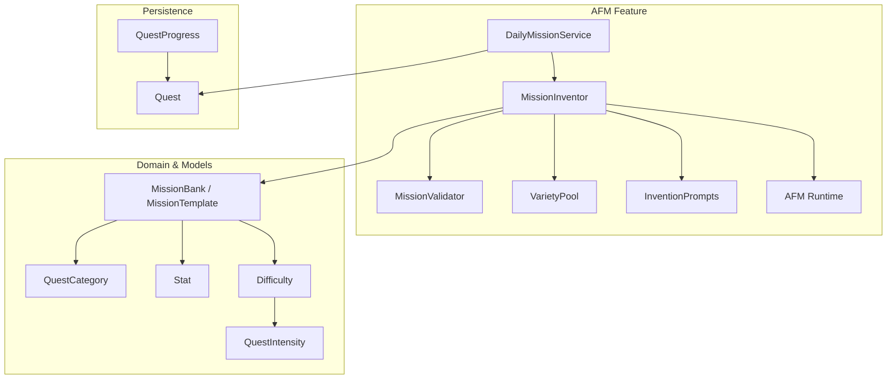
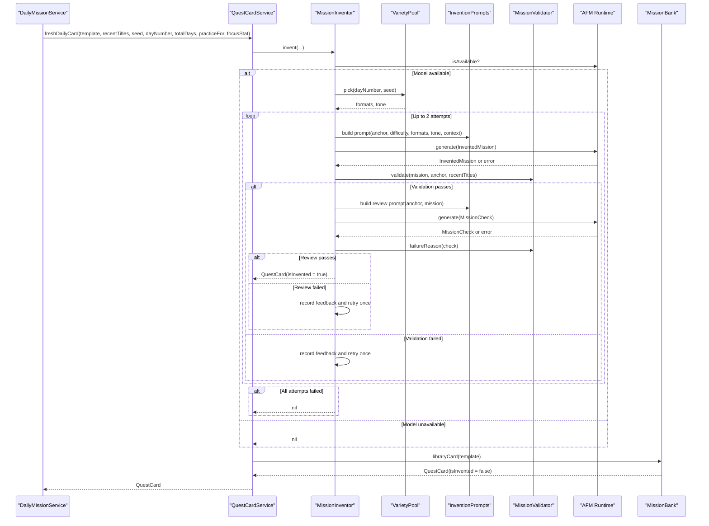
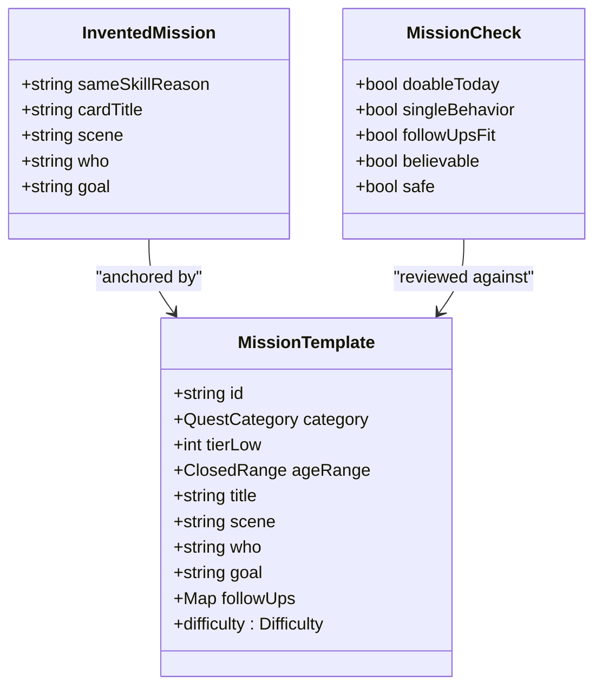
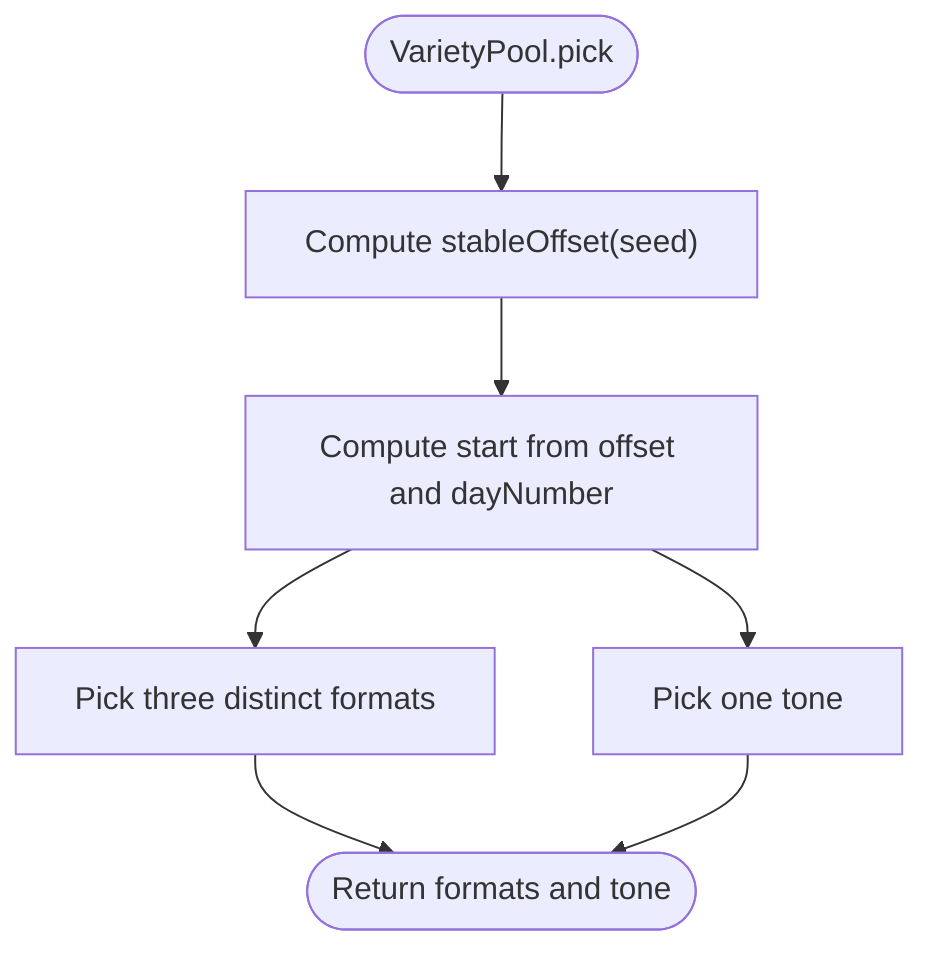
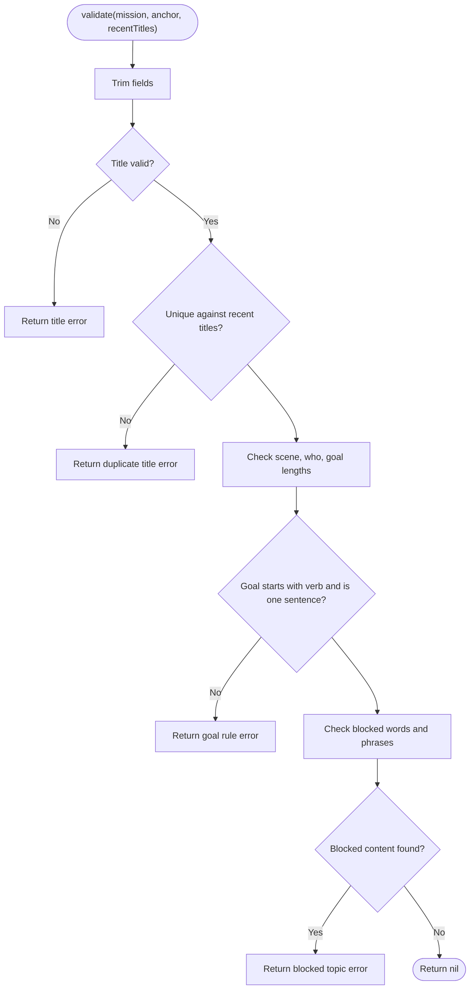
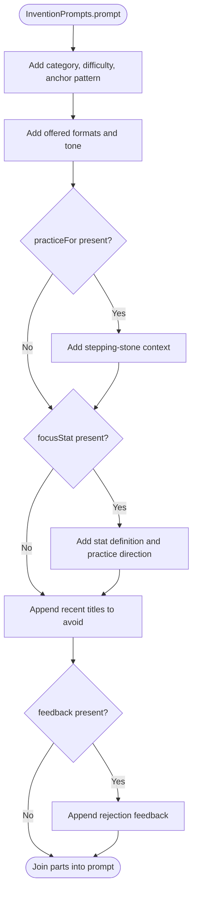
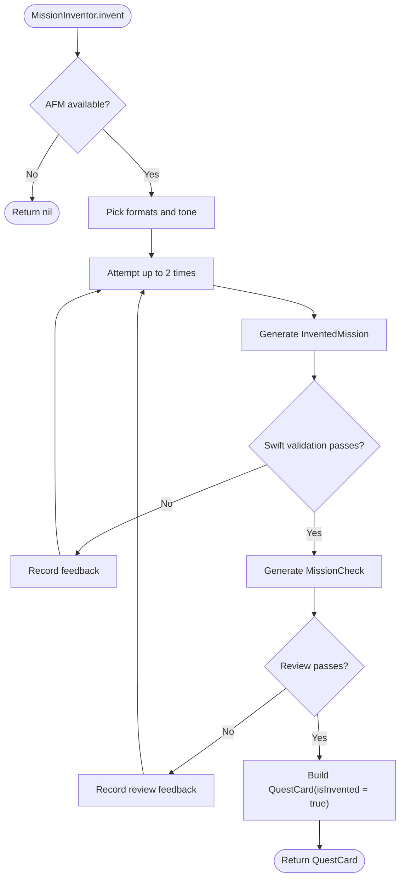
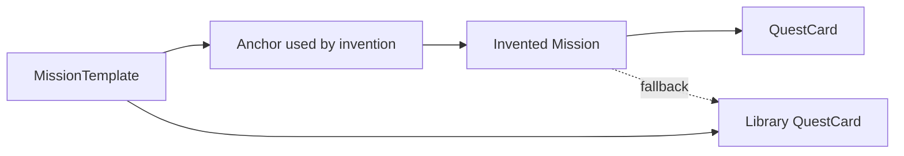
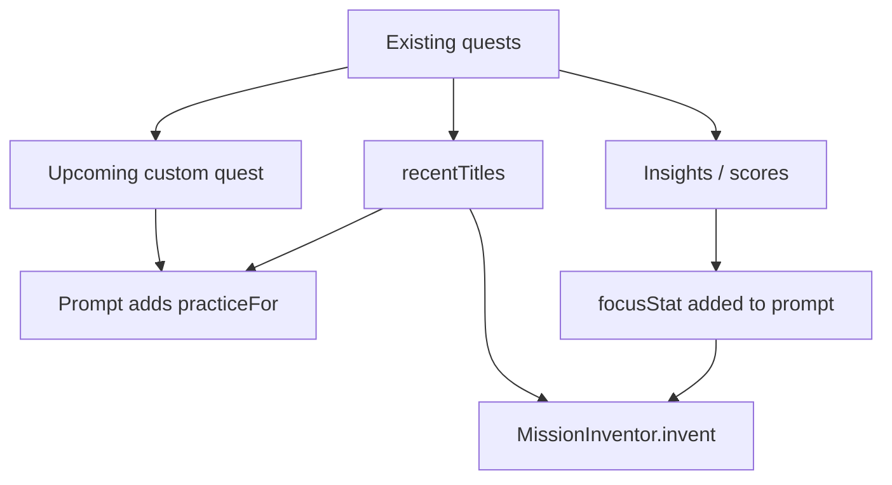
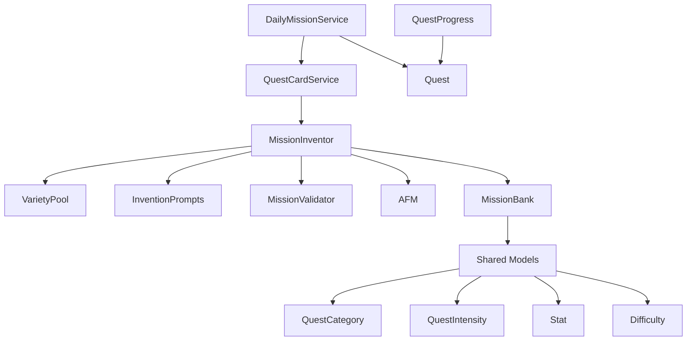

# Mission Invention Logic

<cite>
**Referenced Files in This Document**
- [MokoMissionInvention.swift](file://Moko/Moko/Features/AFM/MokoMissionInvention.swift)
- [MokoMissionBank.swift](file://Moko/Moko/Features/AFM/MokoMissionBank.swift)
- [QuestModels.swift](file://Moko/Moko/Models/QuestModels.swift)
- [QuestProgress.swift](file://Moko/Moko/Models/QuestProgress.swift)
- [DailyMissionService.swift](file://Moko/Moko/Features/AFM/DailyMissionService.swift)
- [MokoAFM.swift](file://Moko/Moko/Features/AFM/MokoAFM.swift)
</cite>

## Table of Contents
1. [Introduction](#introduction)
2. [Project Structure](#project-structure)
3. [Core Components](#core-components)
4. [Architecture Overview](#architecture-overview)
5. [Detailed Component Analysis](#detailed-component-analysis)
6. [Dependency Analysis](#dependency-analysis)
7. [Performance Considerations](#performance-considerations)
8. [Troubleshooting Guide](#troubleshooting-guide)
9. [Conclusion](#conclusion)

## Introduction
This document explains the MokoMissionInvention component and its role in transforming curated mission bank templates into personalized, daily missions. The invention system does not invent missions from nothing. Instead, it anchors every generated mission to a vetted template from the mission bank, then adapts the scenario, tone, format, and difficulty while preserving the core social behavior and debrief questions.

The system combines:
- Deterministic Swift logic for variety selection, validation, and fallback behavior.
- Apple Foundation Models (AFM) for creative text generation and a second review pass.
- A fixed mission bank that defines categories, situations, goals, and follow-up questions.
- Daily mission orchestration that considers user history, recent titles, upcoming quests, and weakest skills.

The result is fresh content that remains consistent with predefined categories, safe for everyday life, and aligned with the app’s four social skills: courage, clarity, presence, and warmth.

## Project Structure
The invention feature lives under the AFM feature layer and depends on shared models and the mission bank.

**Diagram sources**
- [DailyMissionService.swift:150-200](file://Moko/Moko/Features/AFM/DailyMissionService.swift#L150-L200)
- [MokoMissionInvention.swift:49-75](file://Moko/Moko/Features/AFM/MokoMissionInvention.swift#L49-L75)
- [MokoMissionInvention.swift:79-132](file://Moko/Moko/Features/AFM/MokoMissionInvention.swift#L79-L132)
- [MokoMissionInvention.swift:136-218](file://Moko/Moko/Features/AFM/MokoMissionInvention.swift#L136-L218)
- [MokoMissionInvention.swift:222-304](file://Moko/Moko/Features/AFM/MokoMissionInvention.swift#L222-L304)
- [MokoMissionBank.swift:10-91](file://Moko/Moko/Features/AFM/MokoMissionBank.swift#L10-L91)
- [QuestModels.swift:13-48](file://Moko/Moko/Models/QuestModels.swift#L13-L48)

**Section sources**
- [MokoMissionInvention.swift:1-15](file://Moko/Moko/Features/AFM/MokoMissionInvention.swift#L1-L15)
- [MokoMissionBank.swift:1-5](file://Moko/Moko/Features/AFM/MokoMissionBank.swift#L1-L5)
- [QuestModels.swift:12-48](file://Moko/Moko/Models/QuestModels.swift#L12-L48)

## Core Components
- **InventedMission**: The structured output requested from the model during invention. It contains a skill reason, card title, scene, who, and goal.
- **MissionCheck**: The structured output requested from the model during the review pass. It answers five yes/no checks about doability, single behavior, debrief fit, believability, and safety.
- **VarietyPool**: Determines which communication formats and tones are offered to the model, using a deterministic seed based on day number and a stable hash.
- **MissionValidator**: Plain-Swift rules that enforce length limits, verb-first goals, blocked topics/phrases, uniqueness against recent titles, and review-pass failure summaries.
- **InventionPrompts**: Instruction and prompt builders that inject the anchor template, difficulty, category, practice target, growth focus, recent titles, and feedback.
- **MissionInventor**: Orchestrates invention, retry logic, validation, review, and conversion to a `QuestCard`.
- **QuestCardService.freshDailyCard**: Public entry point that tries invention first and falls back to the library card when invention fails.

**Section sources**
- [MokoMissionInvention.swift:21-47](file://Moko/Moko/Features/AFM/MokoMissionInvention.swift#L21-L47)
- [MokoMissionInvention.swift:49-75](file://Moko/Moko/Features/AFM/MokoMissionInvention.swift#L49-L75)
- [MokoMissionInvention.swift:79-132](file://Moko/Moko/Features/AFM/MokoMissionInvention.swift#L79-L132)
- [MokoMissionInvention.swift:136-218](file://Moko/Moko/Features/AFM/MokoMissionInvention.swift#L136-L218)
- [MokoMissionInvention.swift:222-304](file://Moko/Moko/Features/AFM/MokoMissionInvention.swift#L222-L304)

## Architecture Overview
The invention pipeline follows a fail-closed design: if the model is unavailable or any check fails, the system returns no invented mission and uses the bank template as-is.

**Diagram sources**
- [MokoMissionInvention.swift:222-304](file://Moko/Moko/Features/AFM/MokoMissionInvention.swift#L222-L304)
- [MokoMissionInvention.swift:49-75](file://Moko/Moko/Features/AFM/MokoMissionInvention.swift#L49-L75)
- [MokoMissionInvention.swift:79-132](file://Moko/Moko/Features/AFM/MokoMissionInvention.swift#L79-L132)
- [MokoMissionInvention.swift:136-218](file://Moko/Moko/Features/AFM/MokoMissionInvention.swift#L136-L218)
- [MokoAFM.swift:85-137](file://Moko/Moko/Features/AFM/MokoAFM.swift#L85-L137)

## Detailed Component Analysis

### Invention Data Structures
`InventedMission` captures the fields the model must produce for a fresh mission. `MissionCheck` captures the five review checks. These types keep the model output structured and testable.

Key responsibilities:
- Enforce that the invented mission practices the same core behavior as the anchor template.
- Keep titles short, scenes ordinary, roles role-based rather than named, and goals as single action-oriented sentences.
- Ensure the review pass confirms the mission is doable today, single-behavior, debrief-compatible, believable, and safe.

**Diagram sources**
- [MokoMissionInvention.swift:21-47](file://Moko/Moko/Features/AFM/MokoMissionInvention.swift#L21-L47)
- [MokoMissionBank.swift:72-91](file://Moko/Moko/Features/AFM/MokoMissionBank.swift#L72-L91)

**Section sources**
- [MokoMissionInvention.swift:21-47](file://Moko/Moko/Features/AFM/MokoMissionInvention.swift#L21-L47)
- [MokoMissionBank.swift:72-91](file://Moko/Moko/Features/AFM/MokoMissionBank.swift#L72-L91)

### Variety Selection
Variety is chosen deterministically so that the same seed and day produce the same format/tone rotation, while different days rotate through different options. This prevents repetitive missions without making the process fully random.

- Formats include in-person, text/chat, calls, small groups, shared activities, voice notes, post-event moments, and low-pressure daily moments.
- Tones include light/playful, calm/direct, curious/open, and kind/straightforward.
- The offset is computed from a stable hash of the seed, and the starting position advances with the day number.

**Diagram sources**
- [MokoMissionInvention.swift:49-75](file://Moko/Moko/Features/AFM/MokoMissionInvention.swift#L49-L75)

**Section sources**
- [MokoMissionInvention.swift:49-75](file://Moko/Moko/Features/AFM/MokoMissionInvention.swift#L49-L75)

### Validation Rules
MissionValidator enforces plain-Swift constraints before the model is trusted with the final mission.

Important rules include:
- Title word count and character limits.
- Uniqueness against recent titles and the anchor template title.
- Scene and who length limits.
- Goal word count, single-sentence constraint, and verb-first requirement.
- Blocked words and phrases related to unsafe, risky, transactional, or manipulative scenarios.
- Review-pass failure reasons aggregated into a human-readable message.

**Diagram sources**
- [MokoMissionInvention.swift:79-132](file://Moko/Moko/Features/AFM/MokoMissionInvention.swift#L79-L132)

**Section sources**
- [MokoMissionInvention.swift:79-132](file://Moko/Moko/Features/AFM/MokoMissionInvention.swift#L79-L132)

### Prompt Construction and Context Injection
InventionPrompts builds prompts that tell the model to adapt a vetted pattern into a new everyday situation while keeping the core behavior intact.

Context injected includes:
- Category and difficulty from the anchor template.
- Situation, scene, who, and goal from the anchor.
- Offered formats and selected tone.
- Practice target when preparing for an upcoming quest.
- Growth focus when targeting a specific stat.
- Recent titles to avoid repetition.
- Feedback from previous validation or review failures.

**Diagram sources**
- [MokoMissionInvention.swift:136-195](file://Moko/Moko/Features/AFM/MokoMissionInvention.swift#L136-L195)

**Section sources**
- [MokoMissionInvention.swift:136-195](file://Moko/Moko/Features/AFM/MokoMissionInvention.swift#L136-L195)

### Invention Orchestration
MissionInventor coordinates the full flow:
1. Check AFM availability.
2. Pick variety formats and tone.
3. Generate an `InventedMission`.
4. Run Swift validation.
5. If validation passes, run a low-temperature review pass generating `MissionCheck`.
6. Convert to `QuestCard` only if both validation and review pass.
7. Retry once with feedback if either step fails.
8. Return `nil` otherwise, letting the caller fall back to the bank template.

**Diagram sources**
- [MokoMissionInvention.swift:222-280](file://Moko/Moko/Features/AFM/MokoMissionInvention.swift#L222-L280)

**Section sources**
- [MokoMissionInvention.swift:222-280](file://Moko/Moko/Features/AFM/MokoMissionInvention.swift#L222-L280)

### Relationship Between Invention Logic and the Mission Bank
The mission bank is the source of truth for:
- Categories: work, dating, friends, family, others.
- Situations: curated scenarios grounded in everyday social life.
- Goals: concrete behaviors tied to courage, clarity, presence, or warmth.
- Follow-up questions: one per stat, used during debrief.
- Age ranges and tiers: mapped to easy, medium, or hard difficulty.

Invention never replaces these anchors. It rewrites the surface details—title, scene, who, and goal—while keeping the same core behavior and debrief alignment. If invention fails, the system returns the library card built directly from the template.

**Diagram sources**
- [MokoMissionBank.swift:72-91](file://Moko/Moko/Features/AFM/MokoMissionBank.swift#L72-L91)
- [MokoMissionBank.swift:95-103](file://Moko/Moko/Features/AFM/MokoMissionBank.swift#L95-L103)
- [MokoMissionInvention.swift:270-304](file://Moko/Moko/Features/AFM/MokoMissionInvention.swift#L270-L304)

**Section sources**
- [MokoMissionBank.swift:72-103](file://Moko/Moko/Features/AFM/MokoMissionBank.swift#L72-L103)
- [MokoMissionInvention.swift:270-304](file://Moko/Moko/Features/AFM/MokoMissionInvention.swift#L270-L304)

### User History, Recent Activities, and Personal Preferences
The invention system adapts missions using several contextual inputs:

- **Recent titles**: Passed into both prompt construction and validation to avoid repeating earlier missions.
- **Practice target**: When there is an upcoming custom quest, invention frames the mission as a stepping stone toward that event.
- **Focus stat**: When a weakest stat is identified, invention emphasizes practicing that specific skill.
- **Day number and total days**: Used to vary variety seeds and to signal ramp-up progression.
- **Seed string**: Provides deterministic variation across days and contexts.

These inputs come primarily from the daily mission service, which queries existing quests, computes recent titles, identifies upcoming preparation targets, and selects a focus stat when appropriate.

**Diagram sources**
- [DailyMissionService.swift:150-200](file://Moko/Moko/Features/AFM/DailyMissionService.swift#L150-L200)
- [MokoMissionInvention.swift:164-195](file://Moko/Moko/Features/AFM/MokoMissionInvention.swift#L164-L195)

**Section sources**
- [DailyMissionService.swift:150-200](file://Moko/Moko/Features/AFM/DailyMissionService.swift#L150-L200)
- [MokoMissionInvention.swift:164-195](file://Moko/Moko/Features/AFM/MokoMissionInvention.swift#L164-L195)

### Examples of Adaptation
Although the implementation avoids copying exact mission text, the following examples describe how adaptation works conceptually:

- **Adapting descriptions**: A meeting-based template can become a chat-based mission where the user posts one idea in a thread, keeping the core behavior of speaking up but changing the setting and format.
- **Adjusting goals**: A goal may shift from saying something out loud in person to posting a concise message in a group chat, still requiring one concrete behavior and staying within the same category.
- **Tuning difficulty**: Easy missions use familiar people and low stakes; medium missions add mild exposure; hard missions raise stakes but remain single-step and doable today.
- **Aligning with progress patterns**: If the user’s lowest stat is clarity, invention emphasizes direct, concise wording. If the user has an upcoming date, invention frames the mission as a stepping stone without rehearsing the exact future interaction.

These adaptations are driven by the anchor template, difficulty, category, practice target, focus stat, and variety selection.

[No sources needed since this section provides conceptual examples derived from the documented behavior]

## Dependency Analysis
The invention system depends on several layers:

- **DailyMissionService**: Chooses the template, recent titles, seed, day numbers, practice target, and focus stat, then calls `QuestCardService.freshDailyCard`.
- **QuestCardService**: Wraps invention and falls back to the library card.
- **MissionInventor**: Implements the invention algorithm.
- **VarietyPool**: Supplies deterministic formats and tones.
- **MissionValidator**: Applies Swift-side quality and safety rules.
- **InventionPrompts**: Builds prompts with context.
- **AFM**: Provides on-device language model access, session gating, and generation helpers.
- **MissionBank**: Provides templates, categories, stats, and difficulty mapping.
- **QuestModels**: Defines categories, intensity, and persistence-related models.
- **QuestProgress**: Tracks completion, streaks, XP, and insights, indirectly influencing personalization over time.

**Diagram sources**
- [DailyMissionService.swift:150-200](file://Moko/Moko/Features/AFM/DailyMissionService.swift#L150-L200)
- [MokoMissionInvention.swift:222-304](file://Moko/Moko/Features/AFM/MokoMissionInvention.swift#L222-L304)
- [MokoMissionBank.swift:10-91](file://Moko/Moko/Features/AFM/MokoMissionBank.swift#L10-L91)
- [QuestModels.swift:13-48](file://Moko/Moko/Models/QuestModels.swift#L13-L48)
- [QuestProgress.swift:17-83](file://Moko/Moko/Models/QuestProgress.swift#L17-L83)

**Section sources**
- [DailyMissionService.swift:150-200](file://Moko/Moko/Features/AFM/DailyMissionService.swift#L150-L200)
- [MokoMissionInvention.swift:222-304](file://Moko/Moko/Features/AFM/MokoMissionInvention.swift#L222-L304)
- [MokoMissionBank.swift:10-91](file://Moko/Moko/Features/AFM/MokoMissionBank.swift#L10-L91)
- [QuestModels.swift:13-48](file://Moko/Moko/Models/QuestModels.swift#L13-L48)
- [QuestProgress.swift:17-83](file://Moko/Moko/Models/QuestProgress.swift#L17-L83)

## Performance Considerations
- **Model availability gate**: Invention returns `nil` immediately if AFM is unavailable, avoiding unnecessary work.
- **Single-request gating**: AFM serializes requests through a generation gate to prevent concurrent sessions from breaking the framework.
- **Limited retries**: Invention retries at most twice, and AFM retries only transient errors, not guardrail violations or refusals.
- **Static fallback**: Every invention path has a Swift fallback to the library card, ensuring the UI remains responsive even when the model fails.
- **Deterministic variety**: Variety selection is O(1) relative to the fixed pools and relies on hashing and modular arithmetic, not network calls.
- **Validation cost**: Swift validation is lightweight and runs before the expensive review pass.

[No sources needed since this section provides general guidance]

## Troubleshooting Guide
Common issues and their likely causes:

- **No invented mission returned**:
  - AFM is unavailable or disabled in previews.
  - Both invention attempts failed validation or review.
  - The model rejected the prompt due to guardrails or refusal.
  - Resolution: Check AFM availability, inspect recent titles and practice context, and rely on the library fallback.

- **Repeated titles**:
  - Recent titles already contain similar titles.
  - Resolution: Expand recent title history or adjust the seed/day context.

- **Unsafe or blocked content**:
  - Generated text contains blocked words or phrases.
  - Resolution: The validator rejects such missions; the system retries once with feedback, then falls back.

- **Review failures**:
  - Mission is not doable today, asks for multiple behaviors, debrief questions would not fit, scene is not believable, or safety is questionable.
  - Resolution: Adjust context such as practice target, focus stat, or difficulty; rely on the library card if invention continues to fail.

- **Model errors**:
  - Transient parsing or timeout errors may be retried internally by AFM.
  - Guardrail violations, rate limits, context size exceeded, or refusals are not retried.
  - Resolution: Treat model errors as normal outcomes and use the static fallback.

**Section sources**
- [MokoMissionInvention.swift:79-132](file://Moko/Moko/Features/AFM/MokoMissionInvention.swift#L79-L132)
- [MokoMissionInvention.swift:222-280](file://Moko/Moko/Features/AFM/MokoMissionInvention.swift#L222-L280)
- [MokoAFM.swift:85-137](file://Moko/Moko/Features/AFM/MokoAFM.swift#L85-L137)
- [MokoAFM.swift:168-206](file://Moko/Moko/Features/AFM/MokoAFM.swift#L168-L206)

## Conclusion
MokoMissionInvention is a controlled creativity engine. It keeps missions grounded by anchoring them to the mission bank, ensures quality through Swift validators, and adds personalization through recent titles, upcoming quests, and focus stats. The system favors safety, doability, and consistency with debrief questions over pure randomness. When invention cannot produce a suitable mission, the app reliably falls back to the library card, preserving a smooth user experience.

[No sources needed since this section summarizes without analyzing specific files]