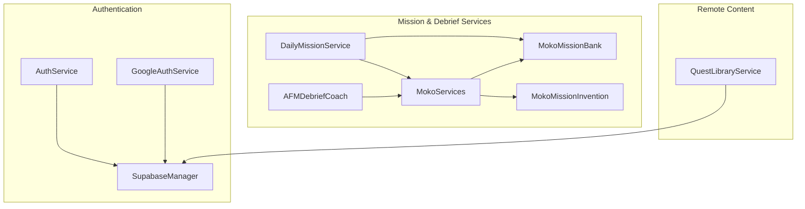
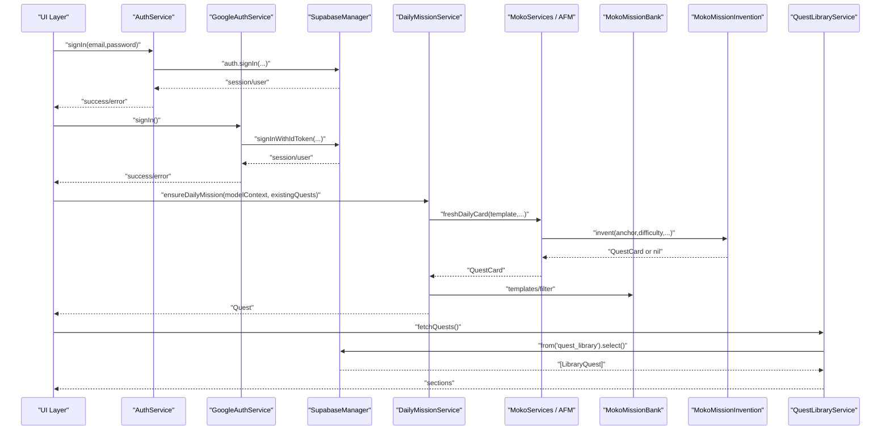
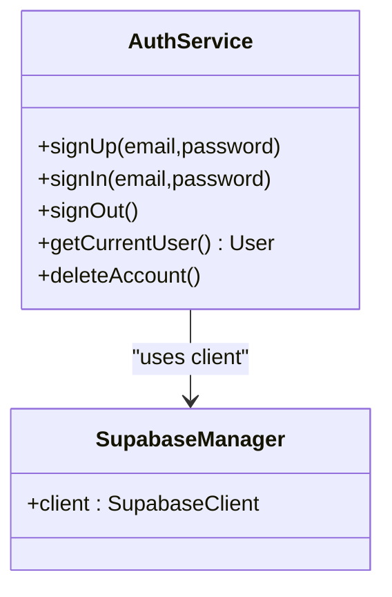
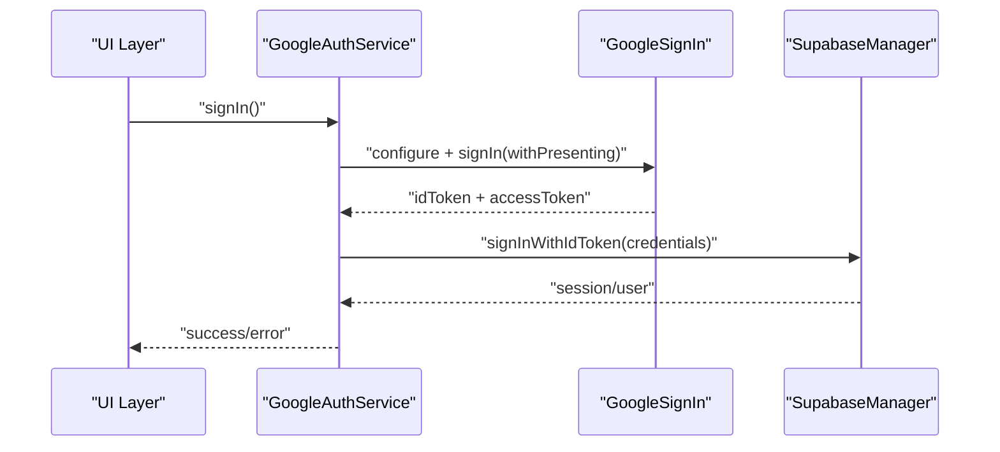
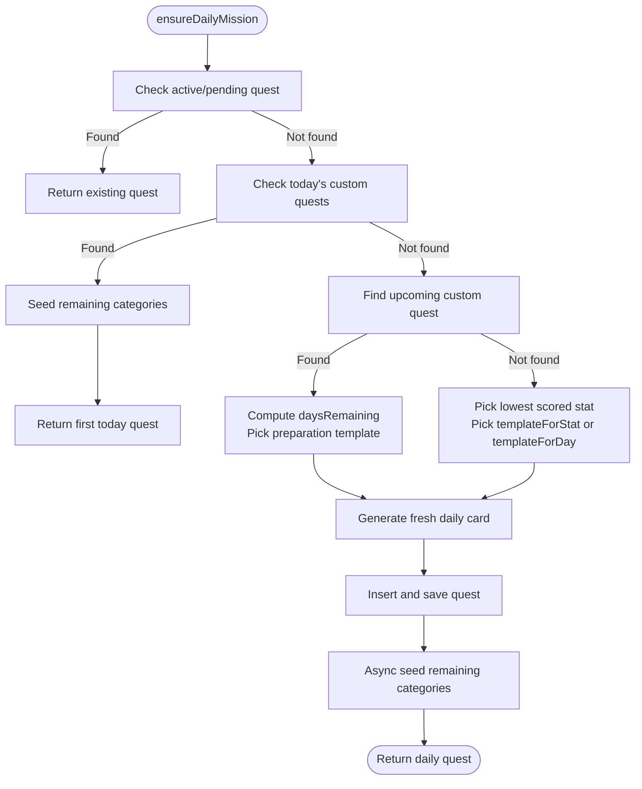
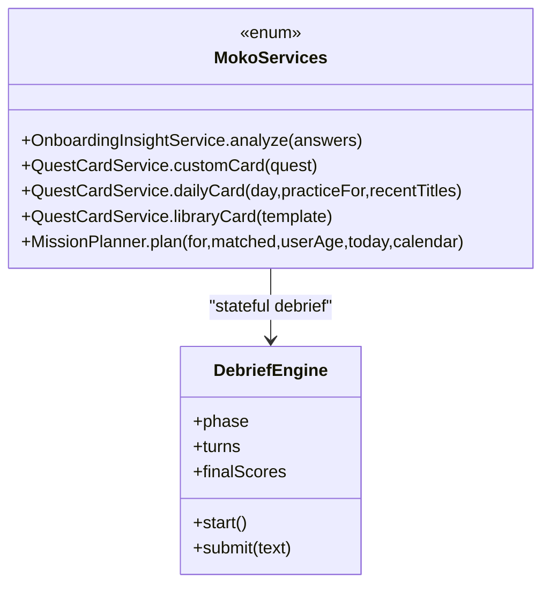
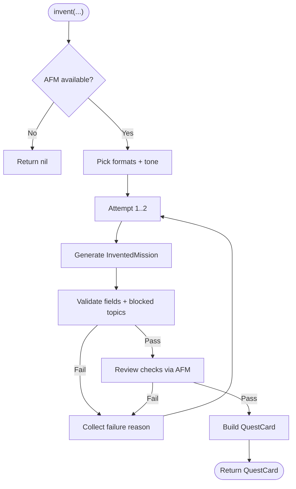
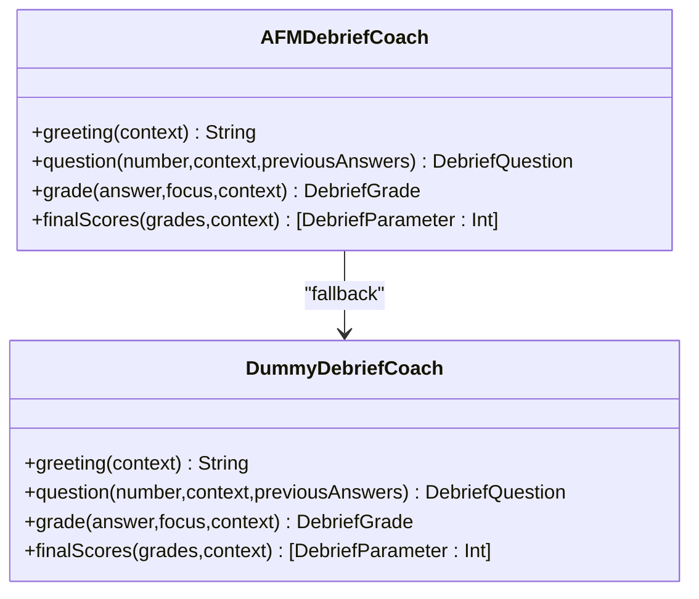
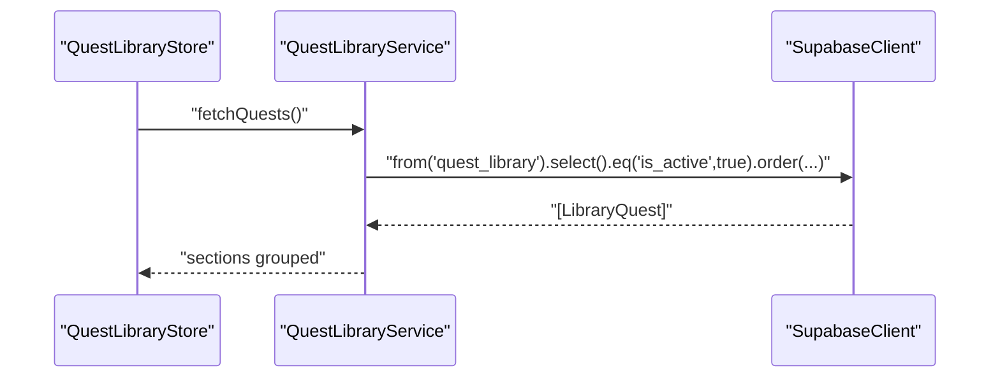
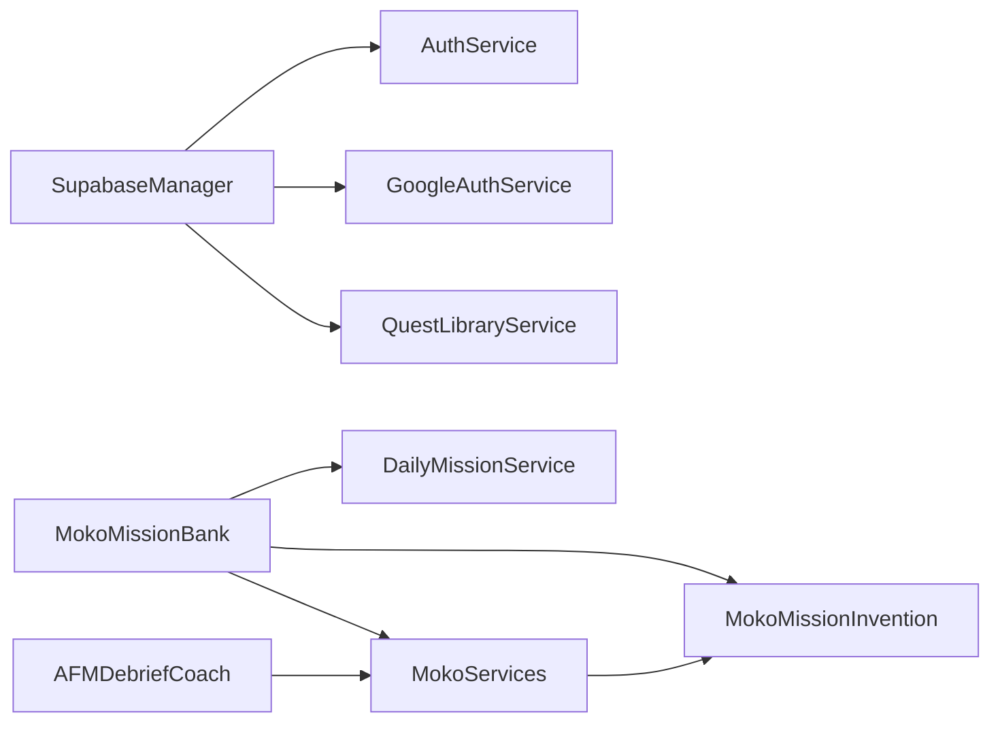

# Service Layer

<cite>
**Referenced Files in This Document**
- [AuthService.swift](file://Moko/Moko/AuthService.swift)
- [SupabaseManager.swift](file://Moko/Moko/SupabaseManager.swift)
- [GoogleAuthService.swift](file://Moko/Moko/GoogleAuthService.swift)
- [DailyMissionService.swift](file://Moko/Moko/Features/AFM/DailyMissionService.swift)
- [MokoServices.swift](file://Moko/Moko/Features/AFM/MokoServices.swift)
- [MokoMissionBank.swift](file://Moko/Moko/Features/AFM/MokoMissionBank.swift)
- [MokoMissionInvention.swift](file://Moko/Moko/Features/AFM/MokoMissionInvention.swift)
- [AFMDebriefCoach.swift](file://Moko/Moko/Features/AFM/AFMDebriefCoach.swift)
- [QuestLibraryService.swift](file://Moko/Moko/Features/QuestLibrary/QuestLibraryService.swift)
</cite>

## Table of Contents
1. [Introduction](#introduction)
2. [Project Structure](#project-structure)
3. [Core Components](#core-components)
4. [Architecture Overview](#architecture-overview)
5. [Detailed Component Analysis](#detailed-component-analysis)
6. [Dependency Analysis](#dependency-analysis)
7. [Performance Considerations](#performance-considerations)
8. [Troubleshooting Guide](#troubleshooting-guide)
9. [Conclusion](#conclusion)
10. [Appendices](#appendices)

## Introduction
This document explains the service layer architecture of the application with a focus on service-oriented design, dependency isolation, and clean APIs for authentication, backend integration, and business logic. The key services are:

- **AuthService**: Authentication management over Supabase Auth.
- **SupabaseManager**: Centralized Supabase client configuration and access.
- **GoogleAuthService**: Google Sign-In flow bridged into Supabase Auth.
- **DailyMissionService**: Daily mission planning and quest generation orchestration.
- **MokoServices**: AFM (AI-powered mission and debrief) orchestration, scoring, and stateful debrief engine.
- **QuestLibraryService**: Remote loading of curated quests from Supabase.

The goal is to show how these services abstract external dependencies, compose complex workflows, handle errors, and remain testable through interfaces and dependency injection.

## Project Structure
The service layer lives primarily under `Moko/Moko` and `Moko/Moko/Features`. It separates concerns across:

- Authentication and identity: `AuthService`, `GoogleAuthService`, `SupabaseManager`.
- AI-driven mission generation and debrief: `DailyMissionService`, `MokoServices`, `MokoMissionBank`, `MokoMissionInvention`, `AFMDebriefCoach`.
- Remote content loading: `QuestLibraryService`.

**Diagram sources**
- [AuthService.swift:15-58](file://Moko/Moko/AuthService.swift#L15-L58)
- [GoogleAuthService.swift:8-60](file://Moko/Moko/GoogleAuthService.swift#L8-L60)
- [SupabaseManager.swift:6-18](file://Moko/Moko/SupabaseManager.swift#L6-L18)
- [DailyMissionService.swift:19-303](file://Moko/Moko/Features/AFM/DailyMissionService.swift#L19-L303)
- [MokoServices.swift:152-695](file://Moko/Moko/Features/AFM/MokoServices.swift#L152-L695)
- [MokoMissionBank.swift:10-300](file://Moko/Moko/Features/AFM/MokoMissionBank.swift#L10-L300)
- [MokoMissionInvention.swift:220-304](file://Moko/Moko/Features/AFM/MokoMissionInvention.swift#L220-L304)
- [AFMDebriefCoach.swift:49-218](file://Moko/Moko/Features/AFM/AFMDebriefCoach.swift#L49-L218)
- [QuestLibraryService.swift:12-32](file://Moko/Moko/Features/QuestLibrary/QuestLibraryService.swift#L12-L32)

**Section sources**
- [AuthService.swift:15-58](file://Moko/Moko/AuthService.swift#L15-L58)
- [SupabaseManager.swift:6-18](file://Moko/Moko/SupabaseManager.swift#L6-L18)
- [DailyMissionService.swift:19-303](file://Moko/Moko/Features/AFM/DailyMissionService.swift#L19-L303)
- [MokoServices.swift:152-695](file://Moko/Moko/Features/AFM/MokoServices.swift#L152-L695)
- [QuestLibraryService.swift:12-32](file://Moko/Moko/Features/QuestLibrary/QuestLibraryService.swift#L12-L32)

## Core Components
This section summarizes each service’s responsibility, public API surface, and how it integrates with other layers.

### AuthService
- Purpose: Encapsulates user account operations using Supabase Auth.
- Responsibilities:
  - Sign up, sign in, sign out.
  - Retrieve current user.
  - Call an authenticated Edge Function to delete an account.
- External dependencies:
  - `SupabaseManager.shared.client` for Supabase Auth.
  - `URLSession` for direct HTTP calls to the Edge Function.
- Error handling:
  - Throws network/server errors when requests fail.
  - Returns structured server response codes via URL error types.

**Section sources**
- [AuthService.swift:15-58](file://Moko/Moko/AuthService.swift#L15-L58)

### SupabaseManager
- Purpose: Provides a single configured Supabase client instance.
- Responsibilities:
  - Initialize `SupabaseClient` with base URL and publishable key.
  - Expose the client via a singleton accessor.
- Design note:
  - Singleton pattern centralizes configuration but makes testing harder without refactoring to inject a client.

**Section sources**
- [SupabaseManager.swift:6-18](file://Moko/Moko/SupabaseManager.swift#L6-L18)

### GoogleAuthService
- Purpose: Handles Google Sign-In UI and exchanges tokens with Supabase Auth.
- Responsibilities:
  - Find the active window scene and root view controller.
  - Configure Google Sign-In.
  - Exchange Google ID token and access token for Supabase session.
- Error handling:
  - Throws domain-specific errors if no presenter or token is available.

**Section sources**
- [GoogleAuthService.swift:8-60](file://Moko/Moko/GoogleAuthService.swift#L8-L60)

### DailyMissionService
- Purpose: Ensures a fresh daily mission exists for the user and seeds variety across categories.
- Responsibilities:
  - Determine today’s featured mission based on:
    - Existing active or pending quests.
    - Upcoming custom quests.
    - Lowest-scored growth parameter.
  - Generate or seed missions via AFM-backed card generation.
  - Seed remaining categories asynchronously for UI variety.
  - Provide synchronous fallbacks for immediate UI needs.
- Key algorithms:
  - Category rotation by day of year.
  - Preparation templates for upcoming custom quests.
  - Stat-based template selection.

**Section sources**
- [DailyMissionService.swift:19-303](file://Moko/Moko/Features/AFM/DailyMissionService.swift#L19-L303)

### MokoServices
- Purpose: Orchestrates AFM-driven features including onboarding insights, quest card generation, mission planning, and debrief coaching.
- Responsibilities:
  - Onboarding scoring and insight generation.
  - Quest card creation and matching bank templates.
  - Mission planning for ramping toward custom quests.
  - Stateful debrief engine with turn-based questioning and scoring.
- External dependencies:
  - AFM generation interface used throughout.
  - Mission bank data structures.

**Section sources**
- [MokoServices.swift:152-695](file://Moko/Moko/Features/AFM/MokoServices.swift#L152-L695)

### MokoMissionBank
- Purpose: Defines core domain types and the vetted mission template bank.
- Responsibilities:
  - Define stats, difficulty, mission templates, and category filtering.
  - Provide static accessors for templates and banks.

**Section sources**
- [MokoMissionBank.swift:10-300](file://Moko/Moko/Features/AFM/MokoMissionBank.swift#L10-L300)

### MokoMissionInvention
- Purpose: Generates fresh daily missions anchored to bank templates while enforcing safety and quality.
- Responsibilities:
  - Deterministic variety seeding.
  - Model generation with retry and feedback loops.
  - Plain-Swift validation and review pass.
  - Fallback to library cards when invention fails.

**Section sources**
- [MokoMissionInvention.swift:220-304](file://Moko/Moko/Features/AFM/MokoMissionInvention.swift#L220-L304)

### AFMDebriefCoach
- Purpose: Bridges Foundation Models to the app’s debrief screen and provides fallback behavior.
- Responsibilities:
  - Generate greetings, follow-up questions, and grading.
  - Calibrate confidence and sanitize notes.
  - Compute final scores per stat.

**Section sources**
- [AFMDebriefCoach.swift:49-218](file://Moko/Moko/Features/AFM/AFMDebriefCoach.swift#L49-L218)

### QuestLibraryService
- Purpose: Loads active library quests from Supabase and exposes them to the UI store.
- Responsibilities:
  - Fetch active quests ordered by category and sort order.
  - Manage loading state and minimum loader duration.

**Section sources**
- [QuestLibraryService.swift:12-32](file://Moko/Moko/Features/QuestLibrary/QuestLibraryService.swift#L12-L32)

## Architecture Overview
The service layer follows a clear separation between infrastructure, business logic, and presentation:

- Infrastructure services (`SupabaseManager`, `QuestLibraryService`) encapsulate remote clients and network calls.
- Authentication services (`AuthService`, `GoogleAuthService`) isolate identity flows.
- Business services (`DailyMissionService`, `MokoServices`) implement domain rules and orchestrate AI and data.
- Domain models (`MokoMissionBank`) define shared types and constants.

**Diagram sources**
- [AuthService.swift:19-42](file://Moko/Moko/AuthService.swift#L19-L42)
- [GoogleAuthService.swift:12-60](file://Moko/Moko/GoogleAuthService.swift#L12-L60)
- [SupabaseManager.swift:6-18](file://Moko/Moko/SupabaseManager.swift#L6-L18)
- [DailyMissionService.swift:129-224](file://Moko/Moko/Features/AFM/DailyMissionService.swift#L129-L224)
- [MokoServices.swift:289-395](file://Moko/Moko/Features/AFM/MokoServices.swift#L289-L395)
- [MokoMissionInvention.swift:220-304](file://Moko/Moko/Features/AFM/MokoMissionInvention.swift#L220-L304)
- [QuestLibraryService.swift:20-32](file://Moko/Moko/Features/QuestLibrary/QuestLibraryService.swift#L20-L32)

## Detailed Component Analysis

### AuthService
AuthService wraps Supabase Auth operations and a direct Edge Function call for account deletion. It keeps authentication logic centralized and throws standard async errors for callers to handle.

Key behaviors:
- Sign up/sign-in/sign-out delegate to Supabase Auth.
- Current user retrieval returns the authenticated user object.
- Account deletion constructs a request with bearer token and API key, validating HTTP status.

**Diagram sources**
- [AuthService.swift:15-58](file://Moko/Moko/AuthService.swift#L15-L58)
- [SupabaseManager.swift:6-18](file://Moko/Moko/SupabaseManager.swift#L6-L18)

**Section sources**
- [AuthService.swift:15-58](file://Moko/Moko/AuthService.swift#L15-L58)

### GoogleAuthService
GoogleAuthService manages the Google Sign-In UI lifecycle and exchanges credentials with Supabase Auth. It requires a valid window scene and root view controller; otherwise, it throws a descriptive error.

**Diagram sources**
- [GoogleAuthService.swift:12-60](file://Moko/Moko/GoogleAuthService.swift#L12-L60)
- [SupabaseManager.swift:6-18](file://Moko/Moko/SupabaseManager.swift#L6-L18)

**Section sources**
- [GoogleAuthService.swift:8-60](file://Moko/Moko/GoogleAuthService.swift#L8-L60)

### DailyMissionService
DailyMissionService implements the daily mission algorithm:

- If an active or pending quest exists, reuse it.
- If a custom quest is scheduled today, return it and seed other categories.
- Otherwise, determine whether there is an upcoming custom quest:
  - If yes, compute preparation steps and pick alternating categories.
  - If no, target the lowest-scored stat and rotate categories.
- Generate a fresh daily card via AFM-backed service and persist it.
- Asynchronously seed remaining categories for UI variety.
- Provide a synchronous fallback for immediate UI rendering.

**Diagram sources**
- [DailyMissionService.swift:129-224](file://Moko/Moko/Features/AFM/DailyMissionService.swift#L129-L224)

**Section sources**
- [DailyMissionService.swift:19-303](file://Moko/Moko/Features/AFM/DailyMissionService.swift#L19-L303)

### MokoServices
MokoServices coordinates multiple AFM-driven workflows:

- Onboarding scoring and insight generation.
- Custom quest card creation and template matching.
- Mission planning for ramping toward custom events.
- Quest card generation with invention and fallback.
- Stateful debrief engine managing turns, analysis, and scoring.

**Diagram sources**
- [MokoServices.swift:152-695](file://Moko/Moko/Features/AFM/MokoServices.swift#L152-L695)

**Section sources**
- [MokoServices.swift:152-695](file://Moko/Moko/Features/AFM/MokoServices.swift#L152-L695)

### MokoMissionInvention
MokoMissionInvention enforces safe, doable, and believable mission invention:

- Deterministic variety pool selection.
- Two-generation attempt loop with feedback.
- Plain-Swift validator checks length, verb-first goals, blocked topics, and title uniqueness.
- Review pass validates doability, single behavior, debrief fit, believability, and safety.
- Fallback to library card when invention fails.

**Diagram sources**
- [MokoMissionInvention.swift:220-304](file://Moko/Moko/Features/AFM/MokoMissionInvention.swift#L220-L304)

**Section sources**
- [MokoMissionInvention.swift:220-304](file://Moko/Moko/Features/AFM/MokoMissionInvention.swift#L220-L304)

### AFMDebriefCoach
AFMDebriefCoach bridges Foundation Models to the debrief screen and provides fallback behavior when AFM is unavailable.

Responsibilities:
- Generate greeting and follow-up questions.
- Grade answers and calibrate confidence based on word count.
- Compute final scores per stat.

**Diagram sources**
- [AFMDebriefCoach.swift:49-218](file://Moko/Moko/Features/AFM/AFMDebriefCoach.swift#L49-L218)

**Section sources**
- [AFMDebriefCoach.swift:49-218](file://Moko/Moko/Features/AFM/AFMDebriefCoach.swift#L49-L218)

### QuestLibraryService
QuestLibraryService loads active library quests from Supabase and groups them into sections for UI consumption.

**Diagram sources**
- [QuestLibraryService.swift:20-32](file://Moko/Moko/Features/QuestLibrary/QuestLibraryService.swift#L20-L32)

**Section sources**
- [QuestLibraryService.swift:12-91](file://Moko/Moko/Features/QuestLibrary/QuestLibraryService.swift#L12-L91)

## Dependency Analysis
The service layer exhibits clear boundaries:

- Authentication services depend on `SupabaseManager` and platform SDKs.
- Mission services depend on domain models and AFM orchestration.
- Remote content services depend on Supabase client.

**Diagram sources**
- [AuthService.swift:15-58](file://Moko/Moko/AuthService.swift#L15-L58)
- [GoogleAuthService.swift:8-60](file://Moko/Moko/GoogleAuthService.swift#L8-L60)
- [QuestLibraryService.swift:12-32](file://Moko/Moko/Features/QuestLibrary/QuestLibraryService.swift#L12-L32)
- [DailyMissionService.swift:19-303](file://Moko/Moko/Features/AFM/DailyMissionService.swift#L19-L303)
- [MokoServices.swift:152-695](file://Moko/Moko/Features/AFM/MokoServices.swift#L152-L695)
- [MokoMissionBank.swift:10-300](file://Moko/Moko/Features/AFM/MokoMissionBank.swift#L10-L300)
- [MokoMissionInvention.swift:220-304](file://Moko/Moko/Features/AFM/MokoMissionInvention.swift#L220-L304)
- [AFMDebriefCoach.swift:49-218](file://Moko/Moko/Features/AFM/AFMDebriefCoach.swift#L49-L218)

**Section sources**
- [AuthService.swift:15-58](file://Moko/Moko/AuthService.swift#L15-L58)
- [GoogleAuthService.swift:8-60](file://Moko/Moko/GoogleAuthService.swift#L8-L60)
- [QuestLibraryService.swift:12-32](file://Moko/Moko/Features/QuestLibrary/QuestLibraryService.swift#L12-L32)
- [DailyMissionService.swift:19-303](file://Moko/Moko/Features/AFM/DailyMissionService.swift#L19-L303)
- [MokoServices.swift:152-695](file://Moko/Moko/Features/AFM/MokoServices.swift#L152-L695)
- [MokoMissionBank.swift:10-300](file://Moko/Moko/Features/AFM/MokoMissionBank.swift#L10-L300)
- [MokoMissionInvention.swift:220-304](file://Moko/Moko/Features/AFM/MokoMissionInvention.swift#L220-L304)
- [AFMDebriefCoach.swift:49-218](file://Moko/Moko/Features/AFM/AFMDebriefCoach.swift#L49-L218)

## Performance Considerations
- Background seeding: Daily mission seeding runs asynchronously to avoid blocking UI.
- Minimum loader duration: Quest library store ensures loaders remain visible for a minimum time to prevent flicker.
- Fallback paths: Invention failures fall back to library cards; debrief coach falls back to dummy coach when AFM is unavailable.
- Deterministic variety: Variety selection uses stable offsets to ensure consistent results across runs.

[No sources needed since this section provides general guidance]

## Troubleshooting Guide
Common issues and strategies:

- Authentication failures:
  - Verify Supabase client configuration and keys.
  - Ensure correct provider setup for Google Sign-In.
  - Handle thrown errors from `AuthService` and `GoogleAuthService`.

- Network errors:
  - Quest library loading catches cancellation and prints errors; display user-friendly messages.
  - Account deletion validates HTTP status and throws server errors on non-success responses.

- AFM unavailability:
  - Mission invention returns nil and falls back to library cards.
  - Debrief coach delegates to dummy coach for greetings, questions, and grading.

- Offline-first considerations:
  - Use local SwiftData for active quests and overview mission persistence.
  - Provide synchronous fallbacks for immediate UI rendering when remote generation is delayed.

**Section sources**
- [QuestLibraryService.swift:56-89](file://Moko/Moko/Features/QuestLibrary/QuestLibraryService.swift#L56-L89)
- [AuthService.swift:46-58](file://Moko/Moko/AuthService.swift#L46-L58)
- [MokoMissionInvention.swift:220-304](file://Moko/Moko/Features/AFM/MokoMissionInvention.swift#L220-L304)
- [AFMDebriefCoach.swift:55-74](file://Moko/Moko/Features/AFM/AFMDebriefCoach.swift#L55-L74)

## Conclusion
The service layer cleanly separates authentication, backend integration, and business logic. Services abstract external dependencies like Supabase and AFM, provide deterministic and safe algorithms for mission generation, and maintain robust error handling and fallback mechanisms. Composition patterns such as delegation, stateful engines, and background tasks enable scalable and testable code. To improve testability further, consider injecting dependencies instead of relying on singletons and introducing explicit interfaces for AFM and Supabase clients.

[No sources needed since this section summarizes without analyzing specific files]

## Appendices

### Service Interfaces and Dependency Injection Patterns
- `QuestLibraryService` accepts a `SupabaseClient` via initializer, enabling mock injection for tests.
- Other services currently use singletons or direct imports; refactoring to constructor injection would improve testability.

**Section sources**
- [QuestLibraryService.swift:12-18](file://Moko/Moko/Features/QuestLibrary/QuestLibraryService.swift#L12-L18)

### Retry Mechanisms
- Mission invention retries once with feedback when validation or review fails.
- AFM calls generally use try-catch and fallback paths rather than exponential backoff.

**Section sources**
- [MokoMissionInvention.swift:237-279](file://Moko/Moko/Features/AFM/MokoMissionInvention.swift#L237-L279)

### Testing Strategies
- Mock `SupabaseClient` for `QuestLibraryService` to verify fetch behavior and grouping.
- Stub AFM availability and generation outputs for `MokoMissionInvention` and `AFMDebriefCoach`.
- Inject fake `ModelContext` into `DailyMissionService` to assert quest persistence and seeding.

**Section sources**
- [QuestLibraryService.swift:12-32](file://Moko/Moko/Features/QuestLibrary/QuestLibraryService.swift#L12-L32)
- [MokoMissionInvention.swift:220-304](file://Moko/Moko/Features/AFM/MokoMissionInvention.swift#L220-L304)
- [AFMDebriefCoach.swift:49-218](file://Moko/Moko/Features/AFM/AFMDebriefCoach.swift#L49-L218)
- [DailyMissionService.swift:129-224](file://Moko/Moko/Features/AFM/DailyMissionService.swift#L129-L224)