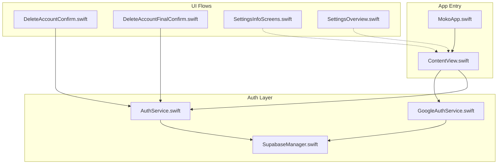
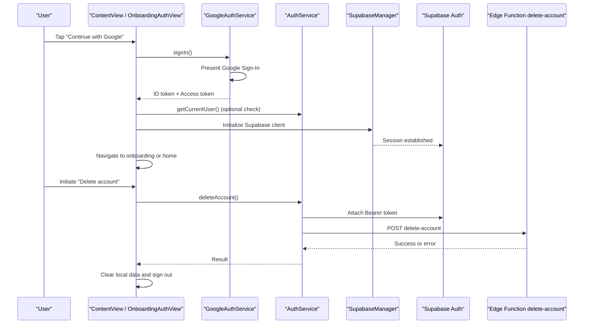
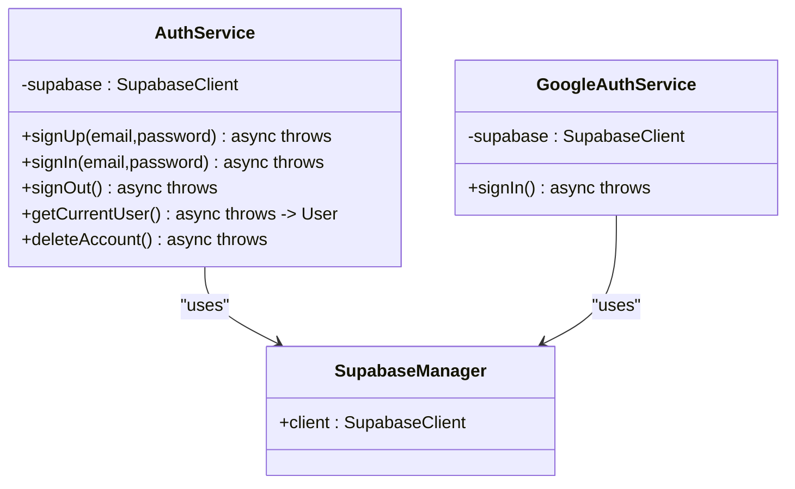
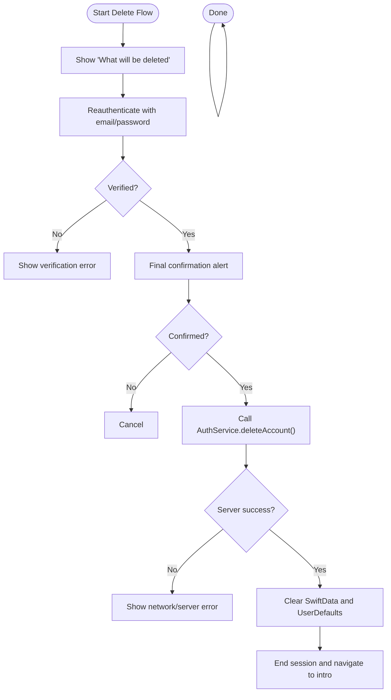
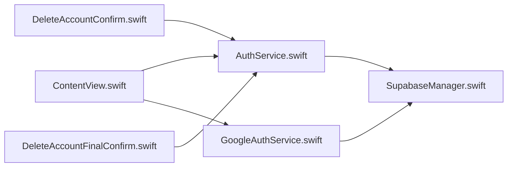

# Authentication & Security

<cite>
**Referenced Files in This Document**
- [AuthService.swift](file://Moko/Moko/AuthService.swift)
- [GoogleAuthService.swift](file://Moko/Moko/GoogleAuthService.swift)
- [SupabaseManager.swift](file://Moko/Moko/SupabaseManager.swift)
- [ContentView.swift](file://Moko/Moko/ContentView.swift)
- [MokoApp.swift](file://Moko/Moko/MokoApp.swift)
- [DeleteAccountConfirm.swift](file://Moko/Moko/UIScreens/homeScreens/ProfileOverView/DeleteAccountConfirm.swift)
- [DeleteAccountFinalConfirm.swift](file://Moko/Moko/UIScreens/homeScreens/ProfileOverView/DeleteAccountFinalConfirm.swift)
- [SettingsInfoScreens.swift](file://Moko/Moko/UIScreens/homeScreens/ProfileOverView/SettingsInfoScreens.swift)
- [SettingsOverview.swift](file://Moko/Moko/UIScreens/homeScreens/ProfileOverView/SettingsOverview.swift)
- [APP_STORE_CONNECT_PRIVACY_CHECKLIST.md](file://Moko/APP_STORE_CONNECT_PRIVACY_CHECKLIST.md)
- [Secrets.example.xcconfig](file://Secrets.example.xcconfig)
</cite>

## Table of Contents
1. [Introduction](#introduction)
2. [Project Structure](#project-structure)
3. [Core Components](#core-components)
4. [Architecture Overview](#architecture-overview)
5. [Detailed Component Analysis](#detailed-component-analysis)
6. [Dependency Analysis](#dependency-analysis)
7. [Performance Considerations](#performance-considerations)
8. [Troubleshooting Guide](#troubleshooting-guide)
9. [Conclusion](#conclusion)
10. [Appendices](#appendices)

## Introduction
This document explains Moko’s authentication and security systems with a focus on Supabase integration, session management, user account handling, privacy controls, and compliance considerations. It covers the AuthService and GoogleAuthService implementations, secure credential storage practices, API key management, network security, data protection, App Store guidelines, consent and permissions, data deletion procedures, vulnerability mitigation, audit logging guidance, and examples for extending authentication providers.

## Project Structure
The authentication and security logic is implemented across a small set of focused modules:
- Supabase client configuration and initialization
- Email/password and Google OAuth flows
- UI-driven sign-in, onboarding, and account deletion workflows
- Privacy policy and App Store checklist documentation
- Example secrets configuration template

**Diagram sources**
- [MokoApp.swift:11-44](file://Moko/Moko/MokoApp.swift#L11-L44)
- [ContentView.swift:11-210](file://Moko/Moko/ContentView.swift#L11-L210)
- [SupabaseManager.swift:6-18](file://Moko/Moko/SupabaseManager.swift#L6-L18)
- [AuthService.swift:15-58](file://Moko/Moko/AuthService.swift#L15-L58)
- [GoogleAuthService.swift:8-60](file://Moko/Moko/GoogleAuthService.swift#L8-L60)
- [DeleteAccountConfirm.swift:4-103](file://Moko/Moko/UIScreens/homeScreens/ProfileOverView/DeleteAccountConfirm.swift#L4-L103)
- [DeleteAccountFinalConfirm.swift:4-78](file://Moko/Moko/UIScreens/homeScreens/ProfileOverView/DeleteAccountFinalConfirm.swift#L4-L78)

**Section sources**
- [MokoApp.swift:11-44](file://Moko/Moko/MokoApp.swift#L11-L44)
- [ContentView.swift:11-210](file://Moko/Moko/ContentView.swift#L11-L210)

## Core Components
- SupabaseManager: Initializes the Supabase client with project URL and publishable key.
- AuthService: Wraps email/password sign-up/sign-in/sign-out, current user retrieval, and account deletion via an authenticated Edge Function call.
- GoogleAuthService: Handles Google Sign-In using GoogleSignIn SDK and exchanges tokens with Supabase OpenID Connect.
- ContentView: Orchestrates app screens, including authentication entry points and navigation to home or onboarding based on local registration state.
- Account deletion UI: Provides reauthentication and final confirmation before deleting server-side account and clearing local SwiftData.

Key responsibilities:
- Centralize Supabase client access.
- Provide simple auth operations for UI layers.
- Enforce reauthentication before destructive actions.
- Maintain clear separation between local data (SwiftData) and remote identity (Supabase).

**Section sources**
- [SupabaseManager.swift:6-18](file://Moko/Moko/SupabaseManager.swift#L6-L18)
- [AuthService.swift:15-58](file://Moko/Moko/AuthService.swift#L15-L58)
- [GoogleAuthService.swift:8-60](file://Moko/Moko/GoogleAuthService.swift#L8-L60)
- [ContentView.swift:21-210](file://Moko/Moko/ContentView.swift#L21-L210)
- [DeleteAccountConfirm.swift:4-103](file://Moko/Moko/UIScreens/homeScreens/ProfileOverView/DeleteAccountConfirm.swift#L4-L103)
- [DeleteAccountFinalConfirm.swift:4-78](file://Moko/Moko/UIScreens/homeScreens/ProfileOverView/DeleteAccountFinalConfirm.swift#L4-L78)

## Architecture Overview
The authentication architecture integrates three main layers:
- Presentation layer: SwiftUI views manage user interactions and screen transitions.
- Auth service layer: AuthService and GoogleAuthService encapsulate identity operations.
- Data layer: Supabase client manages sessions and calls Edge Functions; SwiftData stores local profile and onboarding data.

**Diagram sources**
- [GoogleAuthService.swift:11-60](file://Moko/Moko/GoogleAuthService.swift#L11-L60)
- [AuthService.swift:19-58](file://Moko/Moko/AuthService.swift#L19-L58)
- [SupabaseManager.swift:11-18](file://Moko/Moko/SupabaseManager.swift#L11-L18)
- [ContentView.swift:100-134](file://Moko/Moko/ContentView.swift#L100-L134)
- [DeleteAccountFinalConfirm.swift:56-77](file://Moko/Moko/UIScreens/homeScreens/ProfileOverView/DeleteAccountFinalConfirm.swift#L56-L77)

## Detailed Component Analysis

### Supabase Integration
- Client initialization: The Supabase client is created with a project URL and a publishable key. This client is used by both AuthService and GoogleAuthService.
- Session management: Supabase handles session persistence and provides the current user and access token for authenticated requests.
- Edge Function invocation: Account deletion calls a Supabase Edge Function with the current access token and required headers.

Security notes:
- The publishable key is embedded in code; it should be moved to a secrets configuration file and excluded from version control.
- The Edge Function must be deployed with a server-side secret (service role key) to perform privileged account deletion.

**Section sources**
- [SupabaseManager.swift:11-18](file://Moko/Moko/SupabaseManager.swift#L11-L18)
- [AuthService.swift:44-58](file://Moko/Moko/AuthService.swift#L44-L58)

### AuthService Implementation
Responsibilities:
- Email/password sign-up and sign-in.
- Sign-out.
- Current user retrieval.
- Account deletion via authenticated HTTP request to the Edge Function.

Behavioral details:
- Uses Supabase.auth methods for standard flows.
- Constructs a URLRequest with Authorization header containing the bearer token and includes the required apikey header for the Edge Function.
- Validates HTTP status codes and throws errors on failure.

Error handling:
- Throws errors when network responses are not successful.
- UI surfaces errors during account deletion and reauthentication.

**Section sources**
- [AuthService.swift:19-58](file://Moko/Moko/AuthService.swift#L19-L58)
- [DeleteAccountConfirm.swift:93-102](file://Moko/Moko/UIScreens/homeScreens/ProfileOverView/DeleteAccountConfirm.swift#L93-L102)

#### Class Diagram

**Diagram sources**
- [SupabaseManager.swift:6-18](file://Moko/Moko/SupabaseManager.swift#L6-L18)
- [AuthService.swift:15-58](file://Moko/Moko/AuthService.swift#L15-L58)
- [GoogleAuthService.swift:8-60](file://Moko/Moko/GoogleAuthService.swift#L8-L60)

### GoogleAuthService Implementation
Responsibilities:
- Presents Google Sign-In UI.
- Extracts ID token and access token.
- Signs into Supabase using OpenID Connect credentials.

Integration pattern:
- Requires a valid window scene and root view controller to present Google Sign-In.
- Configures GoogleSignIn with iOS and web client IDs.
- Exchanges tokens with Supabase to establish a session.

Error handling:
- Throws descriptive errors if no presenter is available or if Google does not return an ID token.

**Section sources**
- [GoogleAuthService.swift:11-60](file://Moko/Moko/GoogleAuthService.swift#L11-L60)

### App Flow and State Management
- ContentView drives the app screens and determines whether to show onboarding or home after authentication.
- Local registration state is checked to resume appropriate flows.
- Signed-in state is managed in memory and persisted flags to guide navigation.

Session lifecycle:
- After successful authentication, the app navigates to onboarding or home depending on local data completeness.
- Signing out clears in-memory state and returns to intro flow.

**Section sources**
- [ContentView.swift:21-210](file://Moko/Moko/ContentView.swift#L21-L210)
- [ContentView.swift:217-248](file://Moko/Moko/ContentView.swift#L217-L248)

### Account Deletion Flow
The deletion flow enforces strong user intent and reauthentication:
- Initial warning screen lists what will be deleted.
- Reauthentication screen requires email and password to verify identity.
- Final confirmation triggers server-side deletion and clears local SwiftData and UserDefaults.

**Diagram sources**
- [DeleteAccountConfirm.swift:4-103](file://Moko/Moko/UIScreens/homeScreens/ProfileOverView/DeleteAccountConfirm.swift#L4-L103)
- [DeleteAccountFinalConfirm.swift:56-77](file://Moko/Moko/UIScreens/homeScreens/ProfileOverView/DeleteAccountFinalConfirm.swift#L56-L77)
- [AuthService.swift:44-58](file://Moko/Moko/AuthService.swift#L44-L58)

**Section sources**
- [DeleteAccountConfirm.swift:4-103](file://Moko/Moko/UIScreens/homeScreens/ProfileOverView/DeleteAccountConfirm.swift#L4-L103)
- [DeleteAccountFinalConfirm.swift:4-78](file://Moko/Moko/UIScreens/homeScreens/ProfileOverView/DeleteAccountFinalConfirm.swift#L4-L78)

## Dependency Analysis
- AuthService depends on SupabaseManager for client access and uses URLSession for direct Edge Function calls.
- GoogleAuthService depends on GoogleSignIn SDK and SupabaseManager for session establishment.
- ContentView depends on AuthService and GoogleAuthService to trigger authentication flows and determine navigation.
- Account deletion UI depends on AuthService for server-side deletion and on SwiftData for local cleanup.

**Diagram sources**
- [ContentView.swift:100-134](file://Moko/Moko/ContentView.swift#L100-L134)
- [AuthService.swift:15-58](file://Moko/Moko/AuthService.swift#L15-L58)
- [GoogleAuthService.swift:8-60](file://Moko/Moko/GoogleAuthService.swift#L8-L60)
- [SupabaseManager.swift:6-18](file://Moko/Moko/SupabaseManager.swift#L6-L18)
- [DeleteAccountConfirm.swift:4-103](file://Moko/Moko/UIScreens/homeScreens/ProfileOverView/DeleteAccountConfirm.swift#L4-L103)
- [DeleteAccountFinalConfirm.swift:4-78](file://Moko/Moko/UIScreens/homeScreens/ProfileOverView/DeleteAccountFinalConfirm.swift#L4-L78)

**Section sources**
- [AuthService.swift:15-58](file://Moko/Moko/AuthService.swift#L15-L58)
- [GoogleAuthService.swift:8-60](file://Moko/Moko/GoogleAuthService.swift#L8-L60)
- [SupabaseManager.swift:6-18](file://Moko/Moko/SupabaseManager.swift#L6-L18)
- [ContentView.swift:100-134](file://Moko/Moko/ContentView.swift#L100-L134)

## Performance Considerations
- Minimize redundant network calls: Cache current user state where appropriate and avoid repeated getCurrentUser calls in tight loops.
- Prefer Supabase SDK methods over manual URLSession calls for most operations to leverage built-in retry and error handling.
- Avoid heavy work on the main thread; offload non-UI tasks to background contexts.
- Keep UI animations lightweight and avoid blocking the main thread during authentication flows.

[No sources needed since this section provides general guidance]

## Troubleshooting Guide
Common issues and resolutions:
- Google Sign-In fails to present: Ensure a valid UIWindowScene and root view controller exist before calling signIn.
- Missing ID token from Google: Validate Google configuration and ensure the ID token is returned before attempting Supabase sign-in.
- Account deletion network error: Check connectivity and verify that the Edge Function is deployed with the correct server-side secret.
- Local data remains after failed deletion: The app intentionally preserves local data when server deletion fails; users can retry or contact support.

Operational checks:
- Verify Supabase project URL and publishable key are correctly configured.
- Confirm Edge Function endpoint is reachable and authorized.
- Test reauthentication flow with known credentials.

**Section sources**
- [GoogleAuthService.swift:11-49](file://Moko/Moko/GoogleAuthService.swift#L11-L49)
- [AuthService.swift:44-58](file://Moko/Moko/AuthService.swift#L44-L58)
- [DeleteAccountFinalConfirm.swift:56-77](file://Moko/Moko/UIScreens/homeScreens/ProfileOverView/DeleteAccountFinalConfirm.swift#L56-L77)

## Conclusion
Moko’s authentication system centers on Supabase for identity and session management, with AuthService and GoogleAuthService providing clean abstractions for email/password and Google OAuth flows. The app emphasizes privacy and compliance through local-first data storage, explicit permissions, transparent disclosures, and a robust account deletion workflow. To strengthen security further, move secrets out of source code, centralize network configuration, and implement comprehensive audit logging.

[No sources needed since this section summarizes without analyzing specific files]

## Appendices

### Security Best Practices
- Secure credential storage:
  - Do not hardcode API keys or secrets in source code. Use environment variables or Xcode configuration files and exclude them from version control.
  - Use platform-native secure storage mechanisms for sensitive data where applicable.
- API key management:
  - Rotate keys regularly and restrict scopes to minimum necessary privileges.
  - Separate publishable keys from service role keys; never expose service role keys on the client.
- Network security:
  - Enforce HTTPS for all endpoints.
  - Validate server responses and handle errors gracefully.
  - Consider certificate pinning for high-security endpoints if required.

[No sources needed since this section provides general guidance]

### Privacy Controls and Compliance
- Privacy policy and nutrition labels:
  - Publish a stable public HTTPS privacy policy and link it in App Store Connect.
  - Align privacy labels with actual data collection and third-party SDK behavior.
- Data protection:
  - Keep personal content local unless explicitly required to sync.
  - Clearly disclose who can see data and how long it is retained.
- Regulatory compliance:
  - Follow Apple App Store Review Guidelines.
  - Plan for additional regulations such as India’s DPDP Act as indicated in project documentation.

**Section sources**
- [APP_STORE_CONNECT_PRIVACY_CHECKLIST.md:1-40](file://Moko/APP_STORE_CONNECT_PRIVACY_CHECKLIST.md#L1-L40)
- [SettingsInfoScreens.swift:237-266](file://Moko/Moko/UIScreens/homeScreens/ProfileOverView/SettingsInfoScreens.swift#L237-L266)

### Consent and Permissions
- Explicit permissions:
  - Request microphone access only when needed and explain its purpose.
  - Provide alternatives (e.g., text reflections) if users decline.
- In-app settings:
  - Offer a “Manage permissions” entry point to open system settings.
  - Allow users to review privacy policy, terms, and data collection statements within the app.

**Section sources**
- [SettingsOverview.swift:25-55](file://Moko/Moko/UIScreens/homeScreens/ProfileOverView/SettingsOverview.swift#L25-L55)

### Data Deletion Procedures
- Server-side deletion:
  - Require reauthentication before initiating deletion.
  - Call the authenticated Edge Function to remove the account.
- Local cleanup:
  - On successful server deletion, clear SwiftData models and relevant UserDefaults entries.
  - End the session and navigate back to the intro flow.

**Section sources**
- [DeleteAccountConfirm.swift:4-103](file://Moko/Moko/UIScreens/homeScreens/ProfileOverView/DeleteAccountConfirm.swift#L4-L103)
- [DeleteAccountFinalConfirm.swift:56-77](file://Moko/Moko/UIScreens/homeScreens/ProfileOverView/DeleteAccountFinalConfirm.swift#L56-L77)

### Extending Authentication Providers
To add a custom provider:
- Create a new service class similar to GoogleAuthService.
- Implement provider-specific sign-in UI and token exchange.
- Integrate with Supabase using OpenID Connect credentials or provider-specific methods.
- Update ContentView or a dedicated auth coordinator to route user actions to the new provider.

Example steps:
- Define provider configuration (client IDs, scopes).
- Present provider UI and capture tokens.
- Exchange tokens with Supabase to establish a session.
- Handle errors and surface user-friendly messages.

[No sources needed since this section provides general guidance]

### Handling Auth State Changes
- Observe current user changes at app startup to determine initial navigation.
- Persist minimal state (e.g., signed-out flag) to guide UI transitions.
- On sign-out, clear in-memory state and reset any temporary data.

**Section sources**
- [ContentView.swift:217-248](file://Moko/Moko/ContentView.swift#L217-L248)

### Securing Sensitive Data
- Avoid logging sensitive information such as tokens, passwords, or PII.
- Sanitize logs and error messages before reporting.
- Use secure fields for password input and disable autocorrection and suggestions.

**Section sources**
- [DeleteAccountConfirm.swift:45-59](file://Moko/Moko/UIScreens/homeScreens/ProfileOverView/DeleteAccountConfirm.swift#L45-L59)

### Secrets Configuration
Use the example configuration template to externalize secrets:
- SUPABASE_URL
- SUPABASE_PUBLISHABLE_KEY
- GOOGLE_IOS_CLIENT_ID
- GOOGLE_WEB_CLIENT_ID

Ensure the configuration file is added to .gitignore and populated per environment.

**Section sources**
- [Secrets.example.xcconfig:1-4](file://Secrets.example.xcconfig#L1-L4)