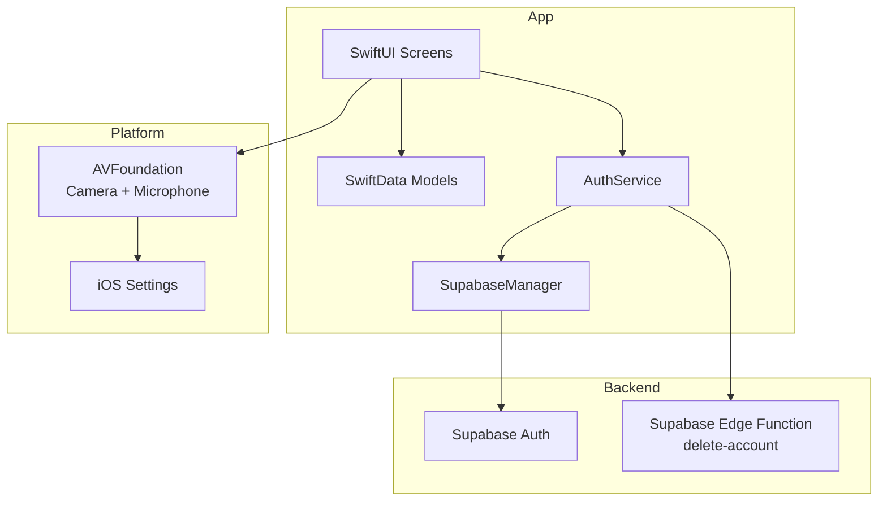
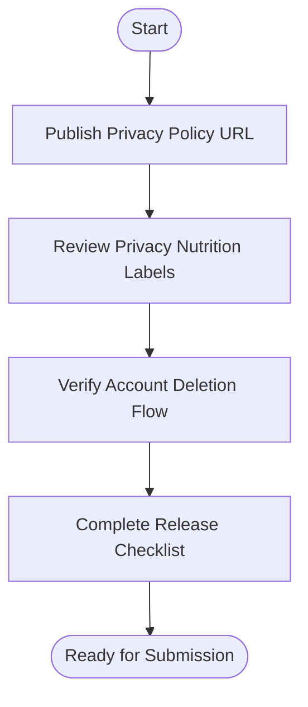
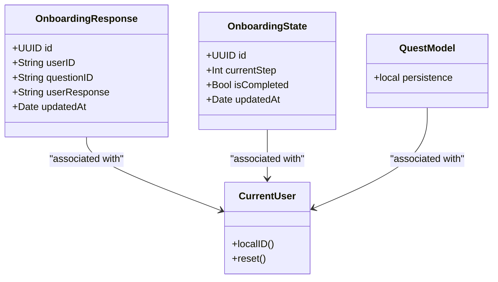
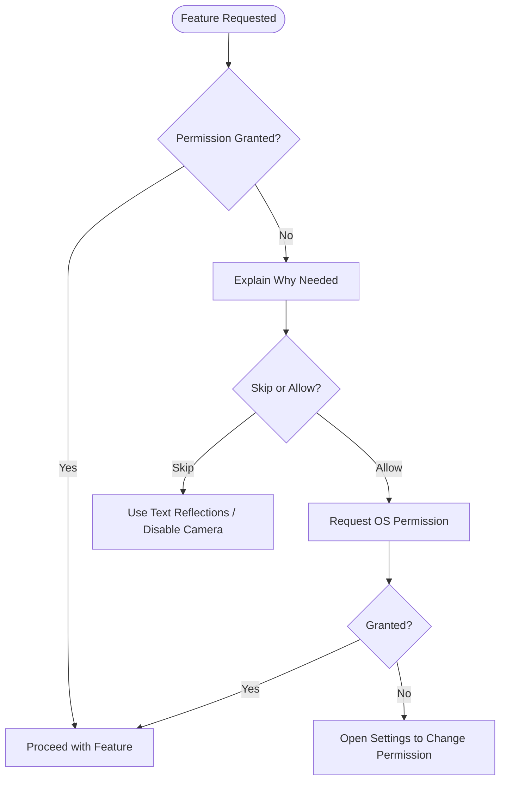
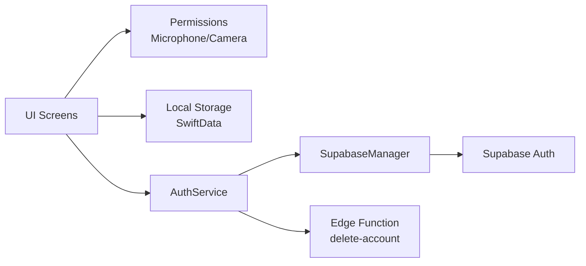

# Privacy & Security Compliance

<cite>
**Referenced Files in This Document**
- [README.md](file://README.md)
- [APP_STORE_CONNECT_PRIVACY_CHECKLIST.md](file://Moko/APP_STORE_CONNECT_PRIVACY_CHECKLIST.md)
- [Info.plist](file://Moko/Moko/Info.plist)
- [MicrophonePermissionView.swift](file://Moko/Moko/UIScreens/Onboarding_Questions/MicrophonePermissionView.swift)
- [Frontcamera.swift](file://Moko/Moko/UIScreens/relaxScreens/MirrorReflection/Frontcamera.swift)
- [AuthService.swift](file://Moko/Moko/AuthService.swift)
- [SupabaseManager.swift](file://Moko/Moko/SupabaseManager.swift)
- [DeleteAccountConfirm.swift](file://Moko/Moko/UIScreens/homeScreens/ProfileOverView/DeleteAccountConfirm.swift)
- [DeleteAccountFinalConfirm.swift](file://Moko/Moko/UIScreens/homeScreens/ProfileOverView/DeleteAccountFinalConfirm.swift)
- [QuestModels.swift](file://Moko/Moko/Models/QuestModels.swift)
- [Onboarding_Response.swift](file://Moko/Moko/Models/Onboarding_Response.swift)
- [Onboarding_state.swift](file://Moko/Moko/Models/Onboarding_state.swift)
- [SettingsInfoScreens.swift](file://Moko/Moko/UIScreens/homeScreens/ProfileOverView/SettingsInfoScreens.swift)
- [Secrets.example.xcconfig](file://Secrets.example.xcconfig)
</cite>

## Table of Contents
1. [Introduction](#introduction)
2. [Project Structure](#project-structure)
3. [Core Components](#core-components)
4. [Architecture Overview](#architecture-overview)
5. [Detailed Component Analysis](#detailed-component-analysis)
6. [Dependency Analysis](#dependency-analysis)
7. [Performance Considerations](#performance-considerations)
8. [Troubleshooting Guide](#troubleshooting-guide)
9. [Conclusion](#conclusion)

## Introduction
This document explains Moko’s privacy and security compliance posture, focusing on App Store Connect privacy disclosures, local data handling, user permissions, account deletion, and security best practices. It maps the app’s implementation to Apple’s privacy requirements and outlines how sensitive features such as microphone and camera access are handled.

## Project Structure
Moko is a SwiftUI iOS application with:
- Local data persistence using SwiftData for onboarding answers, reflections, quests, and profile information.
- Authentication via Supabase.
- Optional device feature usage (microphone, camera) gated by explicit user consent.
- An in-app privacy policy and settings screens that describe data collection and user rights.



**Diagram sources**
- [AuthService.swift:15-59](file://Moko/Moko/AuthService.swift#L15-L59)
- [SupabaseManager.swift:6-19](file://Moko/Moko/SupabaseManager.swift#L6-L19)
- [Frontcamera.swift:18-106](file://Moko/Moko/UIScreens/relaxScreens/MirrorReflection/Frontcamera.swift#L18-L106)
- [MicrophonePermissionView.swift:76-88](file://Moko/Moko/UIScreens/Onboarding_Questions/MicrophonePermissionView.swift#L76-L88)

**Section sources**
- [README.md:151-163](file://README.md#L151-L163)
- [README.md:300-308](file://README.md#L300-L308)

## Core Components
- Privacy policy and disclosures: In-app policy text describes what is collected, where it is stored, and user choices.
- App Store Connect privacy checklist: Pre-submission guidance for privacy labels, policy URL, and account deletion review notes.
- Local storage: SwiftData models store onboarding responses, state, quests, and related content locally.
- Permissions: Camera and microphone usage descriptions are declared; runtime permission flows are implemented.
- Account deletion: A multi-step flow reauthenticates the user, calls an authenticated Edge Function, then clears local data.

**Section sources**
- [SettingsInfoScreens.swift:220-266](file://Moko/Moko/UIScreens/homeScreens/ProfileOverView/SettingsInfoScreens.swift#L220-L266)
- [APP_STORE_CONNECT_PRIVACY_CHECKLIST.md:1-40](file://Moko/APP_STORE_CONNECT_PRIVACY_CHECKLIST.md#L1-L40)
- [Onboarding_Response.swift:1-35](file://Moko/Moko/Models/Onboarding_Response.swift#L1-L35)
- [Onboarding_state.swift:1-23](file://Moko/Moko/Models/Onboarding_state.swift#L1-L23)
- [Info.plist:5-8](file://Moko/Moko/Info.plist#L5-L8)
- [MicrophonePermissionView.swift:76-88](file://Moko/Moko/UIScreens/Onboarding_Questions/MicrophonePermissionView.swift#L76-L88)
- [Frontcamera.swift:62-106](file://Moko/Moko/UIScreens/relaxScreens/MirrorReflection/Frontcamera.swift#L62-L106)
- [DeleteAccountConfirm.swift:38-103](file://Moko/Moko/UIScreens/homeScreens/ProfileOverView/DeleteAccountConfirm.swift#L38-L103)
- [DeleteAccountFinalConfirm.swift:56-77](file://Moko/Moko/UIScreens/homeScreens/ProfileOverView/DeleteAccountFinalConfirm.swift#L56-L77)

## Architecture Overview
The privacy and security architecture centers on minimal data collection, local-first storage, explicit permissions, and server-side account deletion through an authenticated Edge Function.

```mermaid
sequenceDiagram
participant User as "User"
participant UI as "Delete Account UI"
participant Auth as "AuthService"
participant SB as "SupabaseClient"
participant EF as "Edge Function"
User->>UI : Tap "Delete permanently"
UI->>Auth : deleteAccount()
Auth->>SB : POST /functions/v1/delete-account<br/>with Bearer token
SB-->>Auth : HTTP response
Auth-->>UI : success or error
alt Success
UI->>UI : Clear SwiftData + UserDefaults
UI->>UI : End session
else Failure
UI->>UI : Show error; keep local data
end
```

**Diagram sources**
- [AuthService.swift:44-58](file://Moko/Moko/AuthService.swift#L44-L58)
- [DeleteAccountFinalConfirm.swift:56-77](file://Moko/Moko/UIScreens/homeScreens/ProfileOverView/DeleteAccountFinalConfirm.swift#L56-L77)

## Detailed Component Analysis

### App Store Connect Privacy Checklist Implementation
- Privacy policy: The app includes an in-app policy describing data collection, storage, retention, sharing, and user choices. Before release, publish a stable HTTPS privacy policy and add it to App Store Connect and App Information.
- Privacy nutrition labels: Confirm contact info, user content, sensitive data declarations, purpose, linkage, and tracking statements against the final build and Supabase configuration.
- Account deletion reviewer notes: The documented flow requires sign-in, navigation to Delete Account, reauthentication, and calling the authenticated Edge Function. On success, local SwiftData is cleared and the user is signed out. Network failures preserve local data and show an error.



**Diagram sources**
- [APP_STORE_CONNECT_PRIVACY_CHECKLIST.md:5-23](file://Moko/APP_STORE_CONNECT_PRIVACY_CHECKLIST.md#L5-L23)
- [APP_STORE_CONNECT_PRIVACY_CHECKLIST.md:25-40](file://Moko/APP_STORE_CONNECT_PRIVACY_CHECKLIST.md#L25-L40)

**Section sources**
- [APP_STORE_CONNECT_PRIVACY_CHECKLIST.md:1-40](file://Moko/APP_STORE_CONNECT_PRIVACY_CHECKLIST.md#L1-L40)
- [SettingsInfoScreens.swift:220-266](file://Moko/Moko/UIScreens/homeScreens/ProfileOverView/SettingsInfoScreens.swift#L220-L266)

### Data Collection Disclosures and Privacy Labels
- Contact information: Email used for sign-in is processed by Supabase.
- User content: Profile details, quest notes, self-rated scores, and reflection text are stored locally in this build.
- Sensitive information: Voice recordings are not implemented and are not collected in this build.
- Usage data: Do not declare unless analytics or event logging is enabled in the release build.
- Purpose: App functionality and account authentication.
- Linked to the user: Account details are linked to the account; local content is associated with the local profile on the device.
- Tracking: No tracking or advertising use is implemented in the inspected code.

**Section sources**
- [APP_STORE_CONNECT_PRIVACY_CHECKLIST.md:11-23](file://Moko/APP_STORE_CONNECT_PRIVACY_CHECKLIST.md#L11-L23)
- [SettingsInfoScreens.swift:227-252](file://Moko/Moko/UIScreens/homeScreens/ProfileOverView/SettingsInfoScreens.swift#L227-L252)

### Local Data Storage Strategies and Secure Handling
- Local-first design: Onboarding answers and reflections are stored on-device using SwiftData.
- Models:
  - OnboardingResponse stores per-question user responses.
  - OnboardingState tracks onboarding progress.
  - Quest-related models and CurrentUser ID are persisted locally.
- Database container: A shared ModelContainer is used for production previews and in-memory previews.
- Secure handling:
  - No passwords are stored in the app; credentials are managed by Supabase.
  - Local content remains on-device until the user deletes their account or removes the app.
  - Signing out does not erase local history.



**Diagram sources**
- [Onboarding_Response.swift:11-35](file://Moko/Moko/Models/Onboarding_Response.swift#L11-L35)
- [Onboarding_state.swift:4-23](file://Moko/Moko/Models/Onboarding_state.swift#L4-L23)
- [QuestModels.swift:129-149](file://Moko/Moko/Models/QuestModels.swift#L129-L149)

**Section sources**
- [README.md:300-308](file://README.md#L300-L308)
- [Onboarding_Response.swift:1-35](file://Moko/Moko/Models/Onboarding_Response.swift#L1-L35)
- [Onboarding_state.swift:1-23](file://Moko/Moko/Models/Onboarding_state.swift#L1-L23)
- [QuestModels.swift:129-166](file://Moko/Moko/Models/QuestModels.swift#L129-L166)
- [SettingsInfoScreens.swift:241-252](file://Moko/Moko/UIScreens/homeScreens/ProfileOverView/SettingsInfoScreens.swift#L241-L252)

### Encryption Methods and Secure Data Handling
- Passwords: Not stored in the app; handled by Supabase.
- API keys: Only the public anon key is included in the client; service role keys must never be embedded in the app.
- Secrets management: Use environment-based configuration and exclude secrets from version control.
- Local data: Stored in SwiftData without application-level encryption in this build. If additional protection is required, consider enabling device-level encryption via iOS Keychain for tokens and sensitive preferences, and evaluate platform-provided secure enclave usage for cryptographic material.

**Section sources**
- [README.md:228-239](file://README.md#L228-L239)
- [Secrets.example.xcconfig:1-4](file://Secrets.example.xcconfig#L1-L4)
- [SettingsInfoScreens.swift:227-238](file://Moko/Moko/UIScreens/homeScreens/ProfileOverView/SettingsInfoScreens.swift#L227-L238)

### User Permission Handling: Microphone and Camera
- Microphone:
  - Info.plist declares NSMicrophoneUsageDescription.
  - MicrophonePermissionView requests record permission and allows users to skip; if denied, the app continues with text reflections.
- Camera:
  - Info.plist declares NSCameraUsageDescription.
  - Frontcamera.swift checks authorization status, requests access when needed, starts/stops the capture session, and provides a path to open Settings if access was previously denied.



**Diagram sources**
- [Info.plist:5-8](file://Moko/Moko/Info.plist#L5-L8)
- [MicrophonePermissionView.swift:76-88](file://Moko/Moko/UIScreens/Onboarding_Questions/MicrophonePermissionView.swift#L76-L88)
- [Frontcamera.swift:76-93](file://Moko/Moko/UIScreens/relaxScreens/MirrorReflection/Frontcamera.swift#L76-L93)

**Section sources**
- [Info.plist:5-8](file://Moko/Moko/Info.plist#L5-L8)
- [MicrophonePermissionView.swift:1-89](file://Moko/Moko/UIScreens/Onboarding_Questions/MicrophonePermissionView.swift#L1-L89)
- [Frontcamera.swift:18-106](file://Moko/Moko/UIScreens/relaxScreens/MirrorReflection/Frontcamera.swift#L18-L106)

### Data Deletion Procedures and Account Termination
- Multi-step deletion:
  - Initial confirmation lists what will be deleted.
  - Reauthentication step verifies identity before proceeding.
  - Final confirmation triggers server-side deletion and local cleanup.
- Server-side deletion:
  - AuthService calls the authenticated Edge Function with a Bearer token.
  - On success, local SwiftData models and UserDefaults entries are cleared, and the session ends.
  - On failure, local data remains intact and an error is shown.

```mermaid
sequenceDiagram
participant User as "User"
participant Confirm as "DeleteAccountConfirm"
participant Verify as "Reauthentication"
participant Final as "DeleteFinalConfirmation"
participant Auth as "AuthService"
participant DB as "SwiftData"
User->>Confirm : Open Delete Account
Confirm->>Verify : Sign in again
Verify-->>Confirm : Verified
Confirm->>Final : Navigate to final confirmation
Final->>Auth : deleteAccount()
Auth-->>Final : Success or Error
alt Success
Final->>DB : Delete all models + clear UserDefaults
Final->>User : End session
else Error
Final->>User : Show error; keep local data
end
```

**Diagram sources**
- [DeleteAccountConfirm.swift:38-103](file://Moko/Moko/UIScreens/homeScreens/ProfileOverView/DeleteAccountConfirm.swift#L38-L103)
- [DeleteAccountFinalConfirm.swift:56-77](file://Moko/Moko/UIScreens/homeScreens/ProfileOverView/DeleteAccountFinalConfirm.swift#L56-L77)
- [AuthService.swift:44-58](file://Moko/Moko/AuthService.swift#L44-L58)

**Section sources**
- [DeleteAccountConfirm.swift:1-103](file://Moko/Moko/UIScreens/homeScreens/ProfileOverView/DeleteAccountConfirm.swift#L1-L103)
- [DeleteAccountFinalConfirm.swift:1-79](file://Moko/Moko/UIScreens/homeScreens/ProfileOverView/DeleteAccountFinalConfirm.swift#L1-L79)
- [AuthService.swift:44-58](file://Moko/Moko/AuthService.swift#L44-L58)

### GDPR and Regulatory Compliance Measures
- Transparency: In-app policy explains data collection, storage, retention, sharing, and user choices.
- Consent and control: Explicit permissions for camera/microphone; ability to skip microphone and continue with text reflections.
- Data minimization: Local-first storage; no voice recording in this build; only necessary account data sent to Supabase for authentication.
- Rights support: Account deletion flow supports erasure; export capability is mentioned in the policy UI.
- Jurisdictional planning: README indicates compliance planning covers Apple guidelines and India’s DPDP Act.

**Section sources**
- [SettingsInfoScreens.swift:220-266](file://Moko/Moko/UIScreens/homeScreens/ProfileOverView/SettingsInfoScreens.swift#L220-L266)
- [README.md:300-308](file://README.md#L300-L308)

### Security Best Practices
- API key management:
  - Only include the public anon key in the client.
  - Never embed service role keys in the app.
  - Use environment-based configuration and exclude secrets from version control.
- Network security:
  - Use HTTPS for all network calls.
  - Authenticate Edge Function calls with Bearer tokens.
- Vulnerability mitigation:
  - Avoid logging sensitive data.
  - Validate inputs and handle errors gracefully.
  - Keep dependencies updated and review third-party SDK behavior.

**Section sources**
- [README.md:228-239](file://README.md#L228-L239)
- [AuthService.swift:44-58](file://Moko/Moko/AuthService.swift#L44-L58)
- [Secrets.example.xcconfig:1-4](file://Secrets.example.xcconfig#L1-L4)

### Handling Sensitive User Data and Audit Logging
- Sensitive data handling:
  - Do not collect voice recordings in this build.
  - Keep local content on-device; do not upload unless explicitly intended.
  - Ensure any future telemetry excludes personal identifiers.
- Audit logging:
  - Implement minimal, privacy-preserving logs for critical events (e.g., successful account deletion).
  - Avoid logging PII, tokens, or raw user content.
  - Retain logs securely and limit access.

[No sources needed since this section provides general guidance]

### Privacy Policy Requirements and User Rights Management
- Policy requirements:
  - Provide a stable HTTPS privacy policy URL.
  - Align policy with the production build and enabled services.
  - Include sections on data collection, usage, storage, sharing, children, and terms.
- User rights:
  - Export local data or delete account from Account Info.
  - Manage microphone and notification access in iOS Settings.
  - Skip microphone access and use text reflections.

**Section sources**
- [APP_STORE_CONNECT_PRIVACY_CHECKLIST.md:5-23](file://Moko/APP_STORE_CONNECT_PRIVACY_CHECKLIST.md#L5-L23)
- [SettingsInfoScreens.swift:220-266](file://Moko/Moko/UIScreens/homeScreens/ProfileOverView/SettingsInfoScreens.swift#L220-L266)

## Dependency Analysis
The following diagram shows how privacy-sensitive components depend on each other and external services.



**Diagram sources**
- [MicrophonePermissionView.swift:76-88](file://Moko/Moko/UIScreens/Onboarding_Questions/MicrophonePermissionView.swift#L76-L88)
- [Frontcamera.swift:76-106](file://Moko/Moko/UIScreens/relaxScreens/MirrorReflection/Frontcamera.swift#L76-L106)
- [AuthService.swift:15-59](file://Moko/Moko/AuthService.swift#L15-L59)
- [SupabaseManager.swift:6-19](file://Moko/Moko/SupabaseManager.swift#L6-L19)

**Section sources**
- [AuthService.swift:15-59](file://Moko/Moko/AuthService.swift#L15-L59)
- [SupabaseManager.swift:6-19](file://Moko/Moko/SupabaseManager.swift#L6-L19)

## Performance Considerations
- Local-first storage reduces network overhead and improves responsiveness.
- Camera and microphone sessions should be started only when needed and stopped promptly to conserve resources.
- Avoid unnecessary logging or heavy operations on the main thread.

[No sources needed since this section provides general guidance]

## Troubleshooting Guide
- Missing privacy descriptions:
  - Ensure NSCameraUsageDescription and NSMicrophoneUsageDescription are present in Info.plist.
- Permission denied:
  - For camera, guide users to open Settings to change permissions.
  - For microphone, allow users to skip and continue with text reflections.
- Account deletion fails:
  - Check network connectivity and ensure the Edge Function is deployed with the correct server-side secret.
  - Local data remains intact on failure; retry after resolving connectivity issues.

**Section sources**
- [Info.plist:5-8](file://Moko/Moko/Info.plist#L5-L8)
- [Frontcamera.swift:131-134](file://Moko/Moko/UIScreens/relaxScreens/MirrorReflection/Frontcamera.swift#L131-L134)
- [MicrophonePermissionView.swift:76-88](file://Moko/Moko/UIScreens/Onboarding_Questions/MicrophonePermissionView.swift#L76-L88)
- [DeleteAccountFinalConfirm.swift:74-77](file://Moko/Moko/UIScreens/homeScreens/ProfileOverView/DeleteAccountFinalConfirm.swift#L74-L77)

## Conclusion
Moko implements a privacy-by-default approach with local-first storage, explicit user permissions, transparent disclosures, and a robust account deletion flow. To maintain compliance:
- Publish and align the privacy policy with the production build.
- Complete App Store Connect privacy labels accurately.
- Keep secrets out of the app and manage them securely.
- Review third-party SDK behaviors and update documentation as features evolve.

[No sources needed since this section summarizes without analyzing specific files]