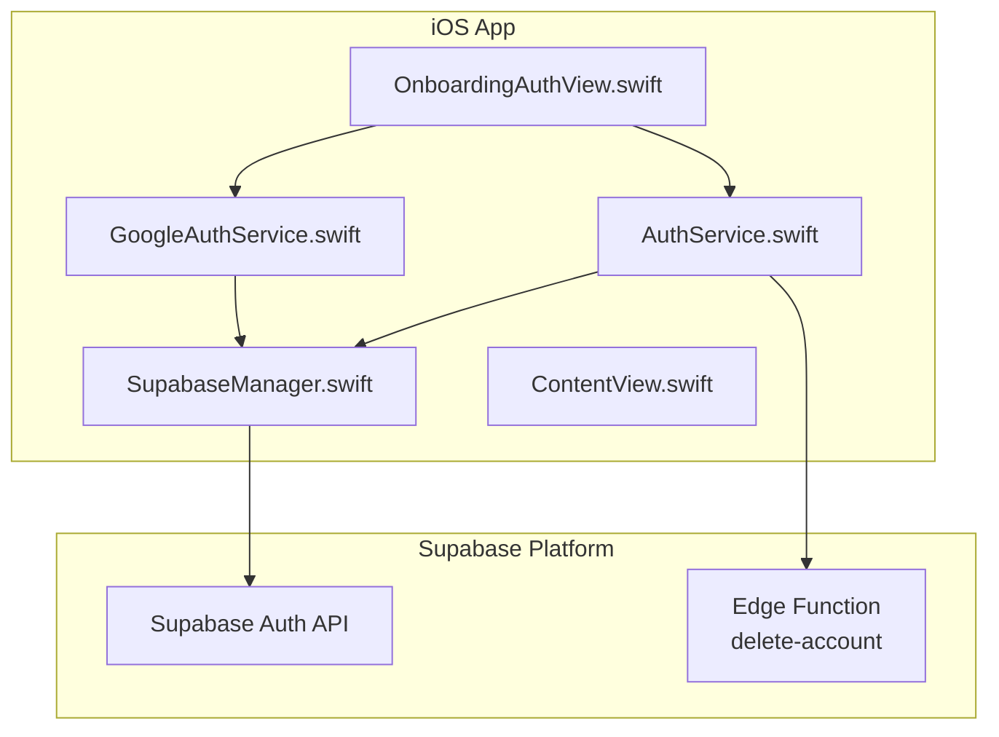
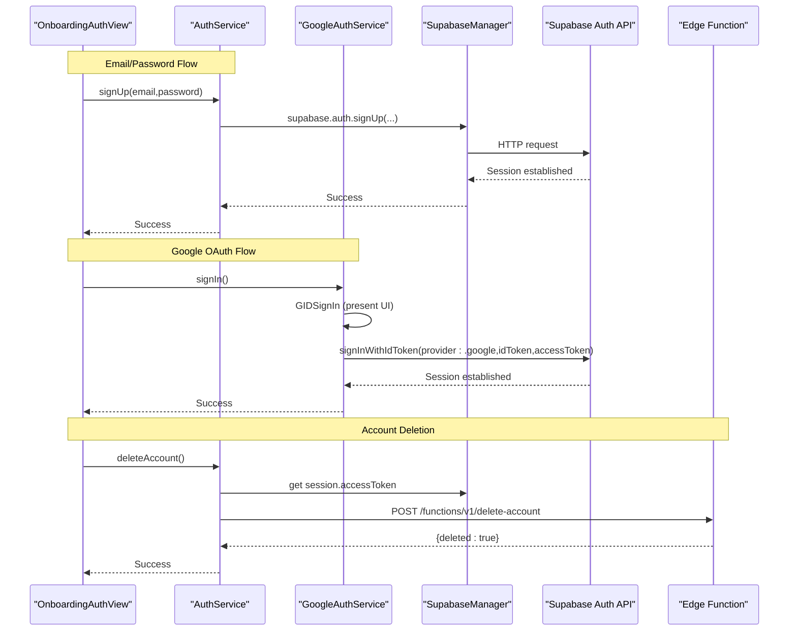
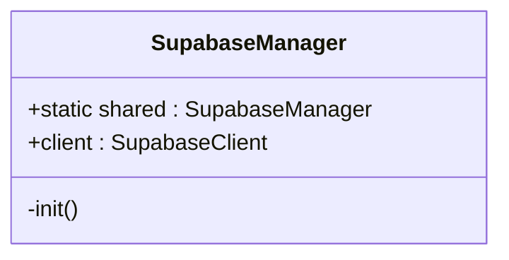
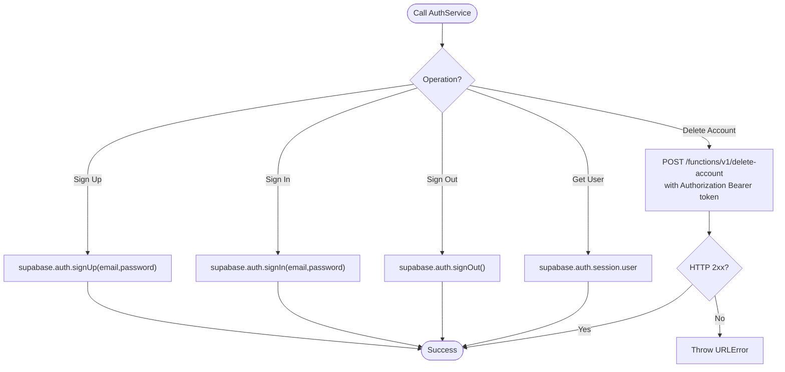
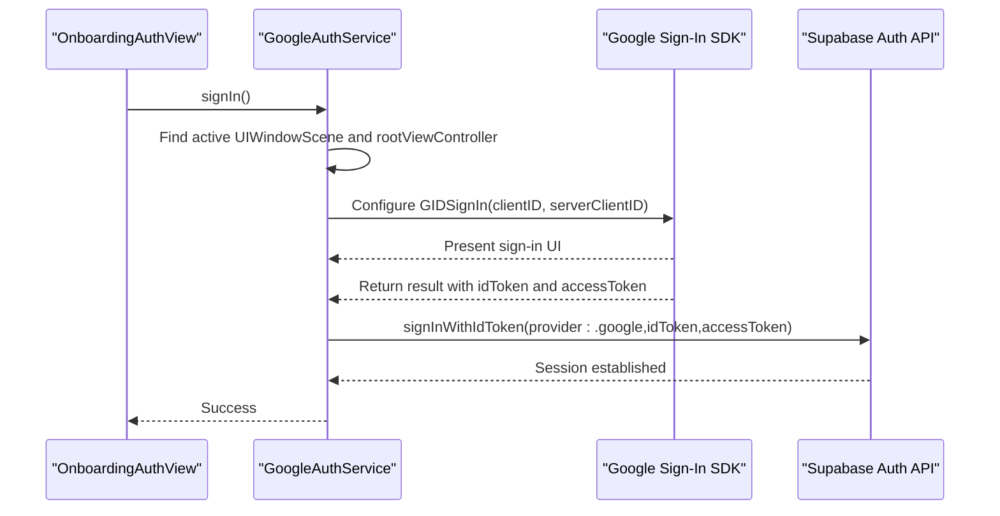
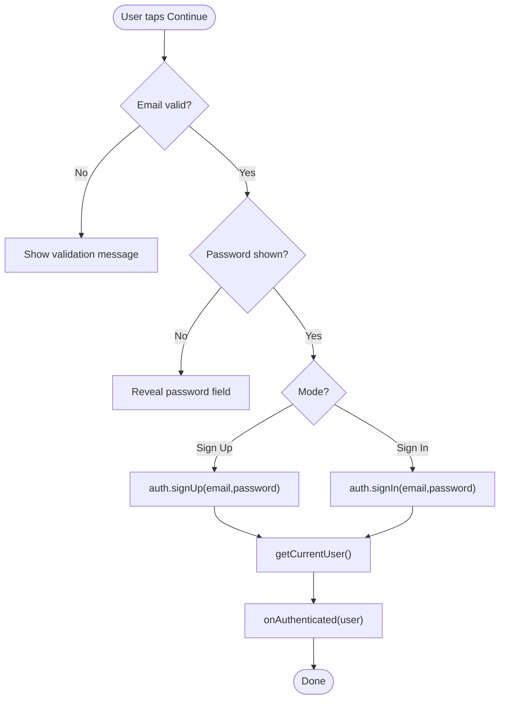
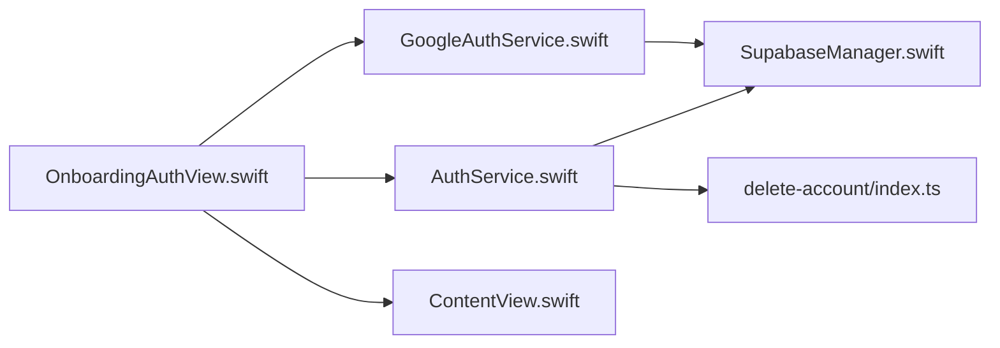

# Supabase Authentication

<cite>
**Referenced Files in This Document**
- [SupabaseManager.swift](file://Moko/Moko/SupabaseManager.swift)
- [AuthService.swift](file://Moko/Moko/AuthService.swift)
- [GoogleAuthService.swift](file://Moko/Moko/GoogleAuthService.swift)
- [OnboardingAuthView.swift](file://Moko/Moko/UIScreens/startScreens/OnboardingAuthView.swift)
- [ContentView.swift](file://Moko/Moko/ContentView.swift)
- [delete-account/index.ts](file://Moko/Moko/supabase/functions/delete-account/index.ts)
- [Secrets.example.xcconfig](file://Secrets.example.xcconfig)
</cite>

## Table of Contents
1. [Introduction](#introduction)
2. [Project Structure](#project-structure)
3. [Core Components](#core-components)
4. [Architecture Overview](#architecture-overview)
5. [Detailed Component Analysis](#detailed-component-analysis)
6. [Dependency Analysis](#dependency-analysis)
7. [Performance Considerations](#performance-considerations)
8. [Troubleshooting Guide](#troubleshooting-guide)
9. [Conclusion](#conclusion)

## Introduction
This document explains Moko’s Supabase authentication implementation. It focuses on:
- The central Supabase client coordination via SupabaseManager
- User registration, login, logout, and account operations through AuthService
- Google OAuth integration via GoogleAuthService
- UI flows that trigger authentication and handle state changes
- Security considerations, error handling, and operational guidance for production hardening

The goal is to help developers understand how authentication works end-to-end and how to extend or troubleshoot it safely.

## Project Structure
Authentication-related code lives under the iOS app module:
- Supabase client initialization and shared access: SupabaseManager.swift
- Email/password auth and account operations: AuthService.swift
- Google OAuth flow: GoogleAuthService.swift
- Auth UI and user interaction: OnboardingAuthView.swift
- App-level navigation and session state: ContentView.swift
- Server-side account deletion Edge Function: delete-account/index.ts
- Example configuration keys: Secrets.example.xcconfig

**Diagram sources**
- [OnboardingAuthView.swift:12-20](file://Moko/Moko/UIScreens/startScreens/OnboardingAuthView.swift#L12-L20)
- [AuthService.swift:15-58](file://Moko/Moko/AuthService.swift#L15-L58)
- [GoogleAuthService.swift:8-59](file://Moko/Moko/GoogleAuthService.swift#L8-L59)
- [SupabaseManager.swift:6-18](file://Moko/Moko/SupabaseManager.swift#L6-L18)
- [delete-account/index.ts:3-24](file://Moko/Moko/supabase/functions/delete-account/index.ts#L3-L24)

**Section sources**
- [SupabaseManager.swift:6-18](file://Moko/Moko/SupabaseManager.swift#L6-L18)
- [AuthService.swift:15-58](file://Moko/Moko/AuthService.swift#L15-L58)
- [GoogleAuthService.swift:8-59](file://Moko/Moko/GoogleAuthService.swift#L8-L59)
- [OnboardingAuthView.swift:12-20](file://Moko/Moko/UIScreens/startScreens/OnboardingAuthView.swift#L12-L20)
- [ContentView.swift:227-247](file://Moko/Moko/ContentView.swift#L227-L247)
- [delete-account/index.ts:3-24](file://Moko/Moko/supabase/functions/delete-account/index.ts#L3-L24)
- [Secrets.example.xcconfig:1-4](file://Secrets.example.xcconfig#L1-L4)

## Core Components
- SupabaseManager: Provides a singleton with a configured SupabaseClient instance used across the app.
- AuthService: Wraps Supabase Auth for email/password sign-up/sign-in, sign-out, current user retrieval, and account deletion via an Edge Function.
- GoogleAuthService: Handles Google Sign-In SDK flow and exchanges tokens with Supabase using OpenID Connect.
- OnboardingAuthView: Presents email/password and social sign-in options, orchestrates calls to AuthService and GoogleAuthService, and updates app state on success.
- ContentView: Manages app navigation and local session state after successful authentication.

Key responsibilities:
- Centralized client configuration (SupabaseManager)
- Clean separation between UI and auth logic (OnboardingAuthView -> AuthService/GoogleAuthService)
- Direct use of Supabase Auth APIs for sessions and tokens
- Optional server-side account deletion via Edge Function

**Section sources**
- [SupabaseManager.swift:6-18](file://Moko/Moko/SupabaseManager.swift#L6-L18)
- [AuthService.swift:15-58](file://Moko/Moko/AuthService.swift#L15-L58)
- [GoogleAuthService.swift:8-59](file://Moko/Moko/GoogleAuthService.swift#L8-L59)
- [OnboardingAuthView.swift:12-20](file://Moko/Moko/UIScreens/startScreens/OnboardingAuthView.swift#L12-L20)
- [ContentView.swift:227-247](file://Moko/Moko/ContentView.swift#L227-L247)

## Architecture Overview
The authentication architecture follows a layered approach:
- UI Layer: OnboardingAuthView handles user input and presents feedback.
- Service Layer: AuthService and GoogleAuthService encapsulate authentication workflows.
- Infrastructure Layer: SupabaseManager provides a shared SupabaseClient.
- Backend Integration: Supabase Auth API and a custom Edge Function for account deletion.

**Diagram sources**
- [OnboardingAuthView.swift:384-463](file://Moko/Moko/UIScreens/startScreens/OnboardingAuthView.swift#L384-L463)
- [AuthService.swift:19-58](file://Moko/Moko/AuthService.swift#L19-L58)
- [GoogleAuthService.swift:11-59](file://Moko/Moko/GoogleAuthService.swift#L11-L59)
- [SupabaseManager.swift:11-18](file://Moko/Moko/SupabaseManager.swift#L11-L18)
- [delete-account/index.ts:3-24](file://Moko/Moko/supabase/functions/delete-account/index.ts#L3-L24)

## Detailed Component Analysis

### SupabaseManager
Purpose:
- Singleton manager that initializes and exposes a single SupabaseClient instance.
- Centralizes project URL and publishable key configuration.

Key behaviors:
- Private initializer ensures only one instance exists.
- Exposes a public client property for other components to use.

Security note:
- The project URL and publishable key are currently hardcoded. For production, move these into secure configuration files and build-time secrets.

**Diagram sources**
- [SupabaseManager.swift:6-18](file://Moko/Moko/SupabaseManager.swift#L6-L18)

**Section sources**
- [SupabaseManager.swift:6-18](file://Moko/Moko/SupabaseManager.swift#L6-L18)

### AuthService
Purpose:
- Encapsulates Supabase Auth operations for email/password sign-up/sign-in, sign-out, current user retrieval, and account deletion via an Edge Function.

Key methods:
- signUp(email,password): Creates a new user via Supabase Auth.
- signIn(email,password): Authenticates an existing user.
- signOut(): Ends the current session.
- getCurrentUser(): Retrieves the current user from the active session.
- deleteAccount(): Calls a server-side Edge Function to delete the authenticated user.

Error handling:
- Methods throw errors from underlying network/auth calls.
- deleteAccount validates HTTP status codes and throws URLError on failure.

Session management:
- Uses Supabase’s session object to obtain the current user and access token.

**Diagram sources**
- [AuthService.swift:19-58](file://Moko/Moko/AuthService.swift#L19-L58)

**Section sources**
- [AuthService.swift:19-58](file://Moko/Moko/AuthService.swift#L19-L58)

### GoogleAuthService
Purpose:
- Integrates Google Sign-In SDK and exchanges Google tokens with Supabase using OpenID Connect.

Flow highlights:
- Finds the active window scene and root view controller to present Google Sign-In UI.
- Configures Google Sign-In with iOS and web client IDs.
- After successful sign-in, extracts idToken and accessToken.
- Calls Supabase Auth with OpenIDConnectCredentials(provider:.google,...).

Error handling:
- Throws domain-specific errors if no presenter is available or if ID token is missing.

**Diagram sources**
- [GoogleAuthService.swift:11-59](file://Moko/Moko/GoogleAuthService.swift#L11-L59)
- [OnboardingAuthView.swift:444-463](file://Moko/Moko/UIScreens/startScreens/OnboardingAuthView.swift#L444-L463)

**Section sources**
- [GoogleAuthService.swift:11-59](file://Moko/Moko/GoogleAuthService.swift#L11-L59)

### OnboardingAuthView
Purpose:
- Provides the user-facing authentication screen supporting email/password and Google sign-in.

Responsibilities:
- Validates email input and toggles password field visibility.
- Triggers sign-up or sign-in based on mode.
- Invokes Google sign-in flow and displays loading states.
- On success, retrieves current user and notifies parent via callbacks.

State transitions:
- Displays loading indicators during async operations.
- Shows user feedback messages and navigates based on success or failure.

**Diagram sources**
- [OnboardingAuthView.swift:384-463](file://Moko/Moko/UIScreens/startScreens/OnboardingAuthView.swift#L384-L463)

**Section sources**
- [OnboardingAuthView.swift:384-463](file://Moko/Moko/UIScreens/startScreens/OnboardingAuthView.swift#L384-L463)

### ContentView
Purpose:
- Manages app navigation and local session state after authentication.

Behavior:
- Updates internal state when authentication completes.
- Determines whether to show onboarding or home screens based on local data completion.
- Clears in-memory state on sign-out or account deletion.

**Section sources**
- [ContentView.swift:227-247](file://Moko/Moko/ContentView.swift#L227-L247)

### Edge Function: delete-account
Purpose:
- Server-side function to securely delete a user account using Supabase Admin API.

Validation and security:
- Requires POST method and Bearer token in Authorization header.
- Verifies user identity using the provided token.
- Uses service role key to perform admin deleteUser operation.

Response behavior:
- Returns appropriate error responses for unauthorized or misconfigured environments.
- Returns success payload when deletion succeeds.

**Section sources**
- [delete-account/index.ts:3-24](file://Moko/Moko/supabase/functions/delete-account/index.ts#L3-L24)

## Dependency Analysis
High-level dependencies:
- OnboardingAuthView depends on AuthService and GoogleAuthService.
- AuthService and GoogleAuthService depend on SupabaseManager.shared.client.
- AuthService optionally calls a server-side Edge Function for account deletion.
- ContentView reacts to authentication outcomes to update navigation state.

**Diagram sources**
- [OnboardingAuthView.swift:12-20](file://Moko/Moko/UIScreens/startScreens/OnboardingAuthView.swift#L12-L20)
- [AuthService.swift:15-58](file://Moko/Moko/AuthService.swift#L15-L58)
- [GoogleAuthService.swift:8-59](file://Moko/Moko/GoogleAuthService.swift#L8-L59)
- [SupabaseManager.swift:6-18](file://Moko/Moko/SupabaseManager.swift#L6-L18)
- [delete-account/index.ts:3-24](file://Moko/Moko/supabase/functions/delete-account/index.ts#L3-L24)
- [ContentView.swift:227-247](file://Moko/Moko/ContentView.swift#L227-L247)

**Section sources**
- [OnboardingAuthView.swift:12-20](file://Moko/Moko/UIScreens/startScreens/OnboardingAuthView.swift#L12-L20)
- [AuthService.swift:15-58](file://Moko/Moko/AuthService.swift#L15-L58)
- [GoogleAuthService.swift:8-59](file://Moko/Moko/GoogleAuthService.swift#L8-L59)
- [SupabaseManager.swift:6-18](file://Moko/Moko/SupabaseManager.swift#L6-L18)
- [delete-account/index.ts:3-24](file://Moko/Moko/supabase/functions/delete-account/index.ts#L3-L24)
- [ContentView.swift:227-247](file://Moko/Moko/ContentView.swift#L227-L247)

## Performance Considerations
- Network latency: All auth operations are asynchronous; ensure UI reflects loading states to avoid redundant requests.
- Token refresh: Rely on Supabase SDK to manage session persistence and token refresh; avoid manual token manipulation.
- UI responsiveness: Keep heavy work off the main thread; the Google sign-in presentation requires a MainActor context.

[No sources needed since this section provides general guidance]

## Troubleshooting Guide

Common issues and resolutions:
- Missing presenter for Google Sign-In:
  - Cause: Unable to find an active window scene or root view controller.
  - Resolution: Ensure the sign-in is triggered from a visible, active screen.
- No ID token returned by Google:
  - Cause: Google Sign-In did not return an ID token.
  - Resolution: Verify Google client IDs and server client ID configuration.
- Invalid email format:
  - Cause: Input validation failed before calling auth services.
  - Resolution: Prompt the user to enter a valid email address.
- Account deletion failures:
  - Cause: Non-2xx HTTP response from the Edge Function.
  - Resolution: Check server logs and environment variables (SUPABASE_URL, SUPABASE_ANON_KEY, SUPABASE_SERVICE_ROLE_KEY).

Debugging techniques:
- Inspect thrown errors from AuthService and GoogleAuthService.
- Validate HTTP status codes when calling the Edge Function.
- Confirm that the Supabase client is initialized with correct project URL and publishable key.

Security considerations:
- Avoid storing passwords locally; rely on Supabase Auth for credential storage.
- Use server-side functions for privileged operations like account deletion.
- Move secrets (URL, keys, client IDs) out of source code into secure configuration files.

Operational notes:
- Update Secrets.example.xcconfig with real values for development and CI.
- Ensure Google Sign-In is properly configured in both iOS and web contexts.

**Section sources**
- [GoogleAuthService.swift:11-49](file://Moko/Moko/GoogleAuthService.swift#L11-L49)
- [AuthService.swift:46-58](file://Moko/Moko/AuthService.swift#L46-L58)
- [OnboardingAuthView.swift:384-463](file://Moko/Moko/UIScreens/startScreens/OnboardingAuthView.swift#L384-L463)
- [Secrets.example.xcconfig:1-4](file://Secrets.example.xcconfig#L1-L4)

## Conclusion
Moko’s authentication system uses a clear separation of concerns:
- SupabaseManager centralizes client configuration.
- AuthService encapsulates core auth operations and integrates with a server-side Edge Function for account deletion.
- GoogleAuthService bridges Google Sign-In with Supabase via OpenID Connect.
- OnboardingAuthView provides a user-friendly interface and coordinates flows.
- ContentView manages app state transitions post-authentication.

For production readiness:
- Externalize secrets and keys.
- Implement robust error handling and retry strategies where appropriate.
- Monitor Edge Function logs and validate environment configuration.
- Follow Supabase best practices for session management and token refresh.

[No sources needed since this section summarizes without analyzing specific files]