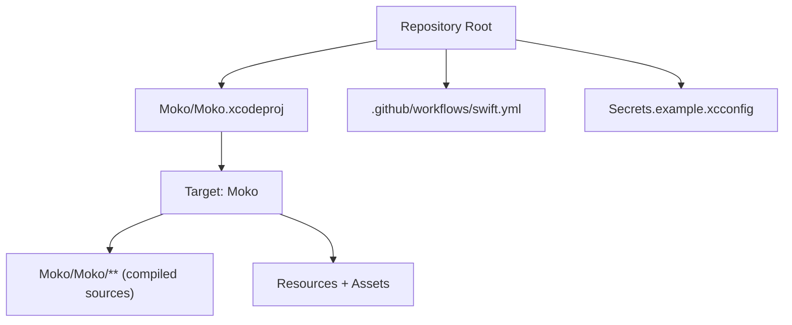
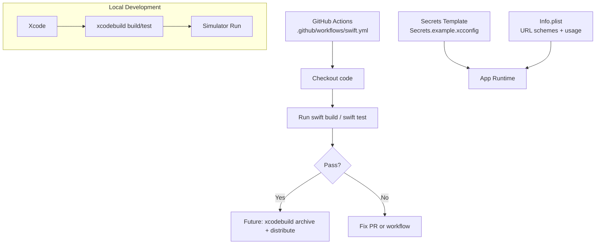
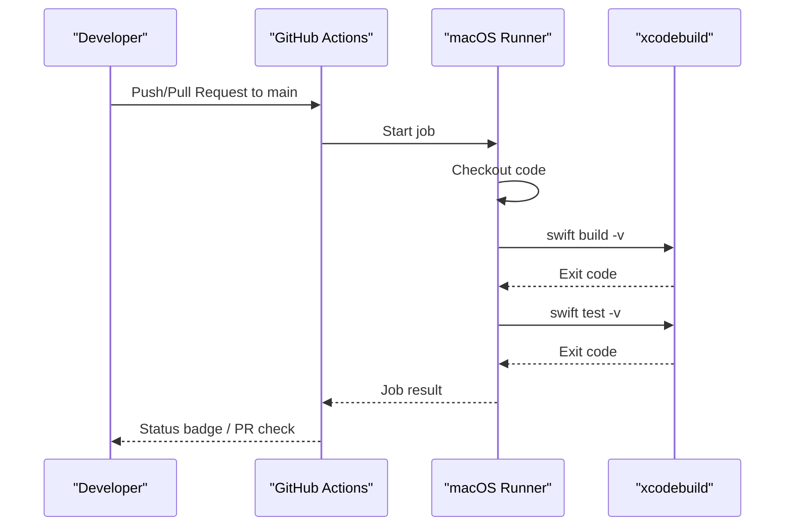
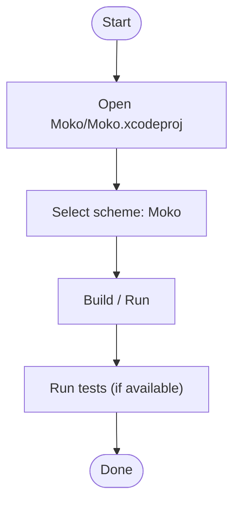
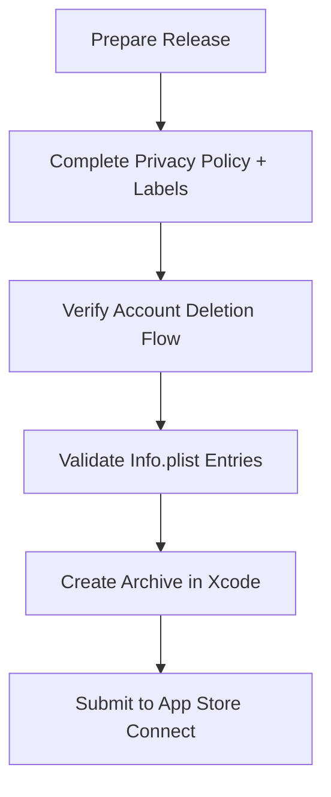
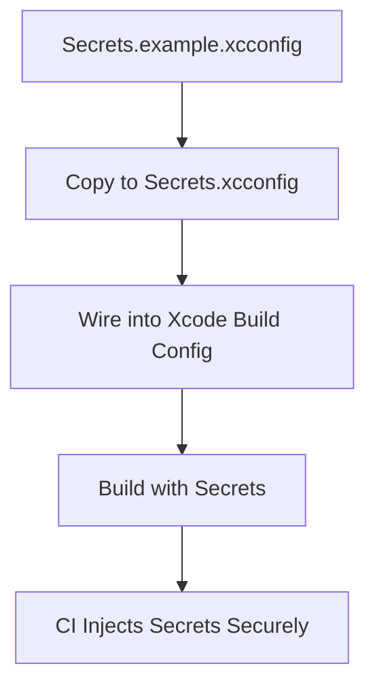
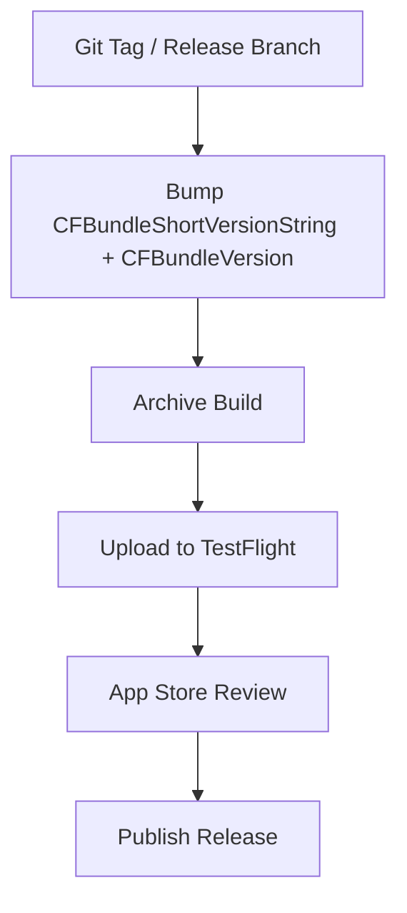
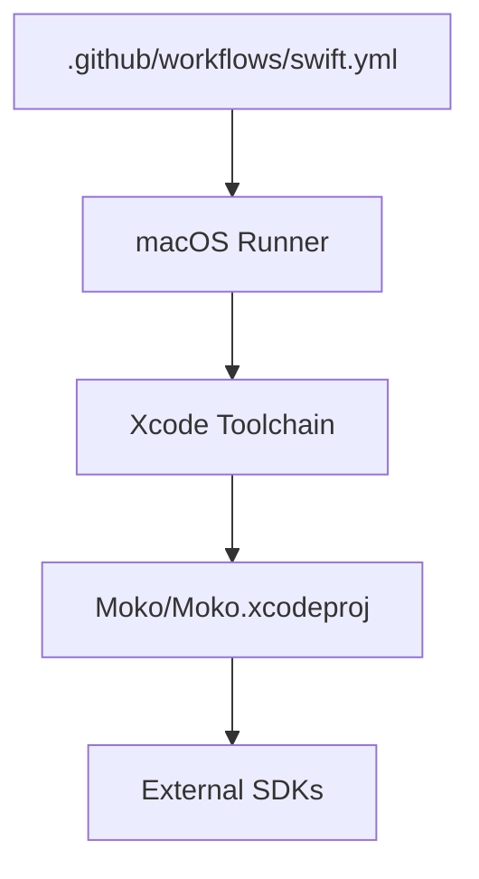

# Build & Deployment

<cite>
**Referenced Files in This Document**
- [swift.yml](file://.github/workflows/swift.yml)
- [README.md](file://README.md)
- [context.md](file://context.md)
- [Secrets.example.xcconfig](file://Secrets.example.xcconfig)
- [Info.plist](file://Moko/Moko/Info.plist)
- [SettingsInfoScreens.swift](file://Moko/Moko/UIScreens/homeScreens/ProfileOverView/SettingsInfoScreens.swift)
- [APP_STORE_CONNECT_PRIVACY_CHECKLIST.md](file://Moko/APP_STORE_CONNECT_PRIVACY_CHECKLIST.md)
</cite>

## Table of Contents
1. [Introduction](#introduction)
2. [Project Structure](#project-structure)
3. [Core Components](#core-components)
4. [Architecture Overview](#architecture-overview)
5. [Detailed Component Analysis](#detailed-component-analysis)
6. [Dependency Analysis](#dependency-analysis)
7. [Performance Considerations](#performance-considerations)
8. [Troubleshooting Guide](#troubleshooting-guide)
9. [Conclusion](#conclusion)
10. [Appendices](#appendices)

## Introduction
This document explains how Moko is built, tested, and prepared for distribution. It focuses on the current CI configuration, Xcode-based build commands, environment configuration, signing requirements, and the path to App Store submission. It also provides practical guidance for stabilizing the pipeline, managing secrets, and preparing release artifacts.

## Project Structure
The project is an Xcode app with a single target:
- Project file: `Moko/Moko.xcodeproj`
- Target name: `Moko`
- Deployment target: iOS 26.5 (per project context)
- Dependencies include Supabase, Google Sign-In, Lottie, and Rive

**Diagram sources**
- [context.md:24-44](file://context.md#L24-L44)
- [swift.yml:1-23](file://.github/workflows/swift.yml#L1-L23)
- [Secrets.example.xcconfig:1-4](file://Secrets.example.xcconfig#L1-L4)

**Section sources**
- [context.md:24-44](file://context.md#L24-L44)
- [README.md:211-241](file://README.md#L211-L241)

## Core Components
- GitHub Actions workflow that runs on push and pull requests to main.
- Xcode project with a single app target and no shared scheme.
- Environment configuration template for Supabase and Google client IDs.
- Info.plist containing usage descriptions and URL schemes.
- In-app version/build display logic used by settings screens.

Key responsibilities:
- CI: run Swift tooling and tests (current workflow uses SwiftPM commands).
- Local development: open Xcode project, select scheme, build/run.
- Secrets: provide a template; not wired into the build yet.
- Distribution: prepare for App Store Connect privacy and account deletion review.

**Section sources**
- [swift.yml:1-23](file://.github/workflows/swift.yml#L1-L23)
- [context.md:24-73](file://context.md#L24-L73)
- [Secrets.example.xcconfig:1-4](file://Secrets.example.xcconfig#L1-L4)
- [Info.plist:1-22](file://Moko/Moko/Info.plist#L1-L22)
- [SettingsInfoScreens.swift:471-472](file://Moko/Moko/UIScreens/homeScreens/ProfileOverView/SettingsInfoScreens.swift#L471-L472)

## Architecture Overview
The current build and deployment architecture consists of:
- A GitHub Actions workflow that checks out code and executes Swift tooling.
- An Xcode project that builds the app target.
- Environment configuration via xcconfig (template present, not wired).
- App Store Connect preparation via privacy checklist and Info.plist entries.

**Diagram sources**
- [swift.yml:1-23](file://.github/workflows/swift.yml#L1-L23)
- [Secrets.example.xcconfig:1-4](file://Secrets.example.xcconfig#L1-L4)
- [Info.plist:1-22](file://Moko/Moko/Info.plist#L1-L22)

## Detailed Component Analysis

### CI/CD Pipeline (GitHub Actions)
Current behavior:
- Triggers on push and pull request to main.
- Runs on macOS runner.
- Executes `swift build -v` and `swift test -v`.

Limitations:
- The repository does not have a Swift Package Manager manifest at the root; the workflow should use Xcode-based commands against the project.
- There is no shared scheme committed; `-scheme Moko` depends on local user data unless a shared scheme is added.
- No archive or distribution step is present.

Recommended stabilization steps:
- Replace SwiftPM commands with `xcodebuild` using the project and scheme.
- Pin the Xcode version on the runner.
- Add a separate job for building an archive when pushing to protected branches.
- Gate merges on successful build and test.

**Diagram sources**
- [swift.yml:1-23](file://.github/workflows/swift.yml#L1-L23)

**Section sources**
- [swift.yml:1-23](file://.github/workflows/swift.yml#L1-L23)
- [context.md:60-73](file://context.md#L60-L73)
- [README.md:265-295](file://README.md#L265-L295)

### Build Configuration and Commands
- Project: `Moko/Moko.xcodeproj`
- Target: `Moko`
- Deployment target: iOS 26.5
- Dependencies: Supabase, Google Sign-In, Lottie, Rive
- File membership: everything under `Moko/Moko/` is compiled automatically due to synchronized groups.

Local build and test:
- Open the Xcode project and press Build/Run.
- Use `xcodebuild` with the project and scheme.
- Tests are documented in README but there is currently no test target.

**Diagram sources**
- [context.md:24-73](file://context.md#L24-L73)
- [README.md:244-253](file://README.md#L244-L253)

**Section sources**
- [context.md:24-73](file://context.md#L24-L73)
- [README.md:244-253](file://README.md#L244-L253)

### Signing Requirements and Code Signing
- The current CI disables code signing during test execution (`CODE_SIGNING_ALLOWED=NO`).
- For local development and distribution, you need:
  - Apple Developer account
  - Valid provisioning profiles and signing identities
  - Correct Bundle Identifier and capabilities configured in Xcode
- For App Store distribution, create an Archive in Xcode and submit via Transporter/App Store Connect.

Best practices:
- Never commit private keys or provisioning profiles.
- Use consistent signing configurations across debug, beta, and release.
- Validate signing locally before pushing to CI.

**Section sources**
- [README.md:211-218](file://README.md#L211-L218)
- [README.md:286-293](file://README.md#L286-L293)

### Distribution Processes and App Store Submission
- App Store distribution is planned but not yet implemented in CI.
- Before submission:
  - Complete App Store Connect privacy labels and policy.
  - Verify account deletion flow and edge function deployment.
  - Ensure Info.plist contains required usage descriptions and URL schemes.

**Diagram sources**
- [APP_STORE_CONNECT_PRIVACY_CHECKLIST.md:1-40](file://Moko/APP_STORE_CONNECT_PRIVACY_CHECKLIST.md#L1-L40)
- [Info.plist:1-22](file://Moko/Moko/Info.plist#L1-L22)

**Section sources**
- [APP_STORE_CONNECT_PRIVACY_CHECKLIST.md:1-40](file://Moko/APP_STORE_CONNECT_PRIVACY_CHECKLIST.md#L1-L40)
- [README.md:265-295](file://README.md#L265-L295)

### Environment Configuration and Secret Management
- Template exists at `Secrets.example.xcconfig` with placeholders for Supabase and Google client IDs.
- The template is not wired into the Xcode project yet.
- Do not commit secrets; keep them out of version control.
- Client-side keys must be limited to public/anon keys only.

Recommendations:
- Wire `Secrets.xcconfig` into the target’s build configuration.
- Provide a secure mechanism for CI to inject secrets (e.g., GitHub Encrypted Secrets mapped to environment variables or generated xcconfig files).
- Validate presence of required keys before build.

**Diagram sources**
- [Secrets.example.xcconfig:1-4](file://Secrets.example.xcconfig#L1-L4)
- [context.md:186-189](file://context.md#L186-L189)

**Section sources**
- [Secrets.example.xcconfig:1-4](file://Secrets.example.xcconfig#L1-L4)
- [context.md:186-189](file://context.md#L186-L189)
- [README.md:228-239](file://README.md#L228-L239)

### Version Management and Update Distribution
- The app reads short version and build numbers from the bundle info dictionary.
- For automated releases:
  - Centralize version bumping (e.g., via Fastlane or a script).
  - Generate changelogs from commits or tags.
  - Distribute beta builds via TestFlight once CI supports archiving.

[No sources needed since this diagram shows conceptual workflow, not actual code structure]

**Section sources**
- [SettingsInfoScreens.swift:471-472](file://Moko/Moko/UIScreens/homeScreens/ProfileOverView/SettingsInfoScreens.swift#L471-L472)

## Dependency Analysis
The build depends on:
- GitHub Actions runner image with macOS and Xcode installed.
- Xcode project and scheme for building and testing.
- External SDKs resolved by Xcode (Supabase, Google Sign-In, Lottie, Rive).

**Diagram sources**
- [swift.yml:1-23](file://.github/workflows/swift.yml#L1-L23)
- [context.md:34-44](file://context.md#L34-L44)

**Section sources**
- [context.md:34-44](file://context.md#L34-L44)
- [swift.yml:1-23](file://.github/workflows/swift.yml#L1-L23)

## Performance Considerations
- Keep CI jobs focused: build and test separately if needed.
- Cache dependencies where possible (Xcode caches can help).
- Avoid unnecessary rebuilds by pinning Xcode versions and avoiding redundant steps.
- Prefer simulator builds for speed; device builds only when necessary.

[No sources needed since this section provides general guidance]

## Troubleshooting Guide
Common issues and resolutions:
- CI fails because `swift build` has no package manifest: switch to `xcodebuild` targeting the Xcode project and scheme.
- Scheme not found: add a shared scheme to the repository or ensure CI installs the expected Xcode version and scheme.
- No tests running: create a test target and update CI to run it.
- Secrets missing: wire `Secrets.xcconfig` into the build and configure CI to inject values securely.
- Signing failures: ensure valid provisioning profiles and identities are available; disable signing only for non-distribution builds.
- App Store submission blockers: complete privacy labels, policy URL, support email, and verify account deletion flow.

**Section sources**
- [context.md:60-73](file://context.md#L60-L73)
- [context.md:311-329](file://context.md#L311-L329)
- [README.md:265-295](file://README.md#L265-L295)
- [APP_STORE_CONNECT_PRIVACY_CHECKLIST.md:1-40](file://Moko/APP_STORE_CONNECT_PRIVACY_CHECKLIST.md#L1-L40)

## Conclusion
To make Moko’s build and deployment reliable:
- Stabilize CI by switching to `xcodebuild`, pinning Xcode, and adding a shared scheme.
- Wire environment configuration and manage secrets securely.
- Prepare App Store Connect privacy and account deletion flows.
- Automate archiving and distribution for beta and release tracks.
- Centralize version management and changelog generation.

[No sources needed since this section summarizes without analyzing specific files]

## Appendices

### Build and Test Commands Reference
- Open project: `open Moko/Moko.xcodeproj`
- Build locally: `xcodebuild -project Moko/Moko.xcodeproj -scheme Moko -destination 'platform=iOS Simulator,name=iPhone 16' build CODE_SIGNING_ALLOWED=NO`
- Run tests locally: `xcodebuild test -project Moko/Moko.xcodeproj -scheme Moko -destination 'platform=iOS Simulator,name=iPhone 15'`

**Section sources**
- [context.md:60-68](file://context.md#L60-L68)
- [README.md:244-253](file://README.md#L244-L253)

### App Store Connect Preparation Checklist
- Publish privacy policy and add URL to App Store Connect.
- Complete privacy nutrition labels aligned with production services.
- Verify account deletion flow and edge function deployment.
- Add support email and privacy policy URL.
- Complete App Privacy answers in App Store Connect.

**Section sources**
- [APP_STORE_CONNECT_PRIVACY_CHECKLIST.md:1-40](file://Moko/APP_STORE_CONNECT_PRIVACY_CHECKLIST.md#L1-L40)