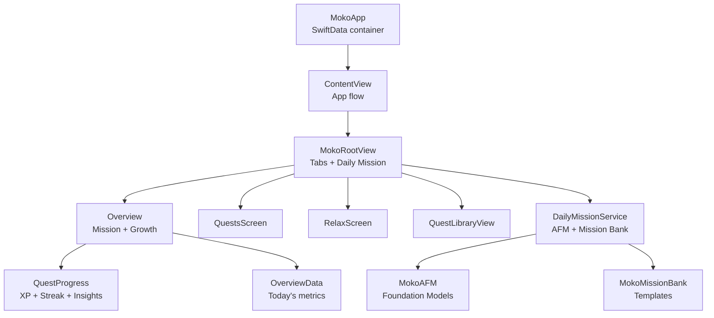
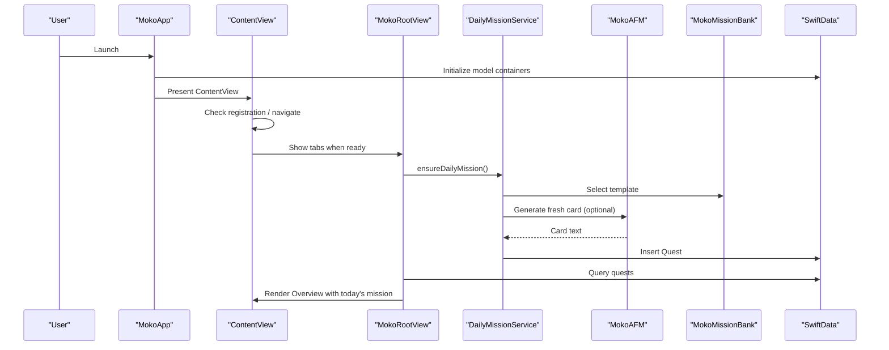
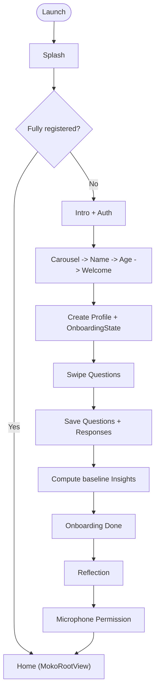
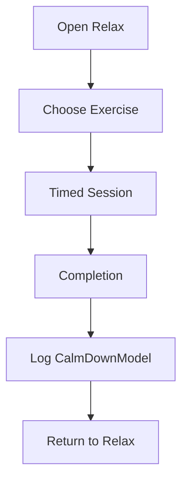
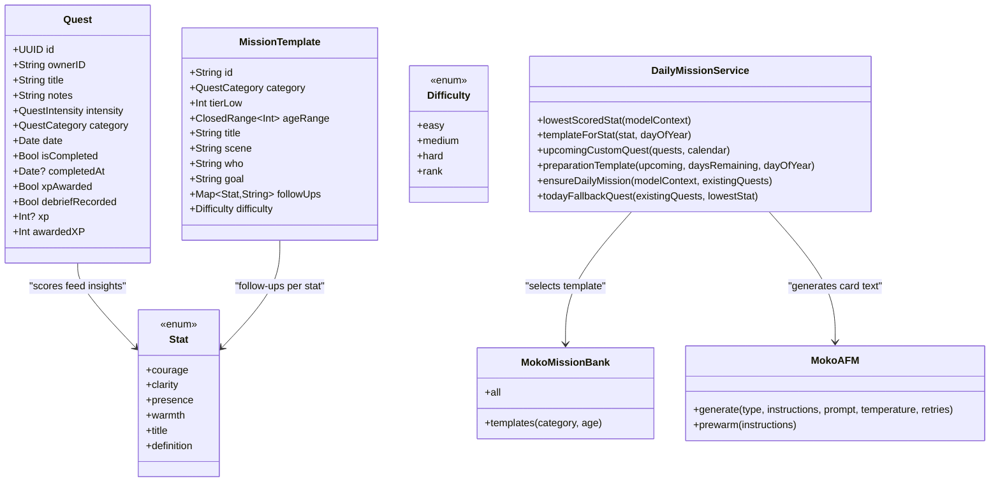
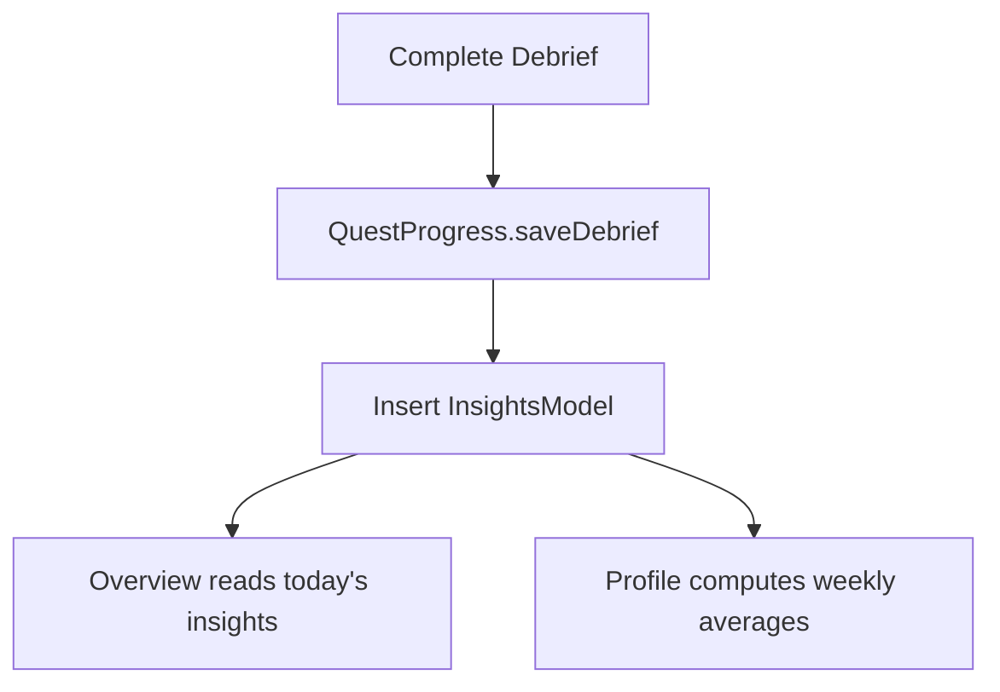
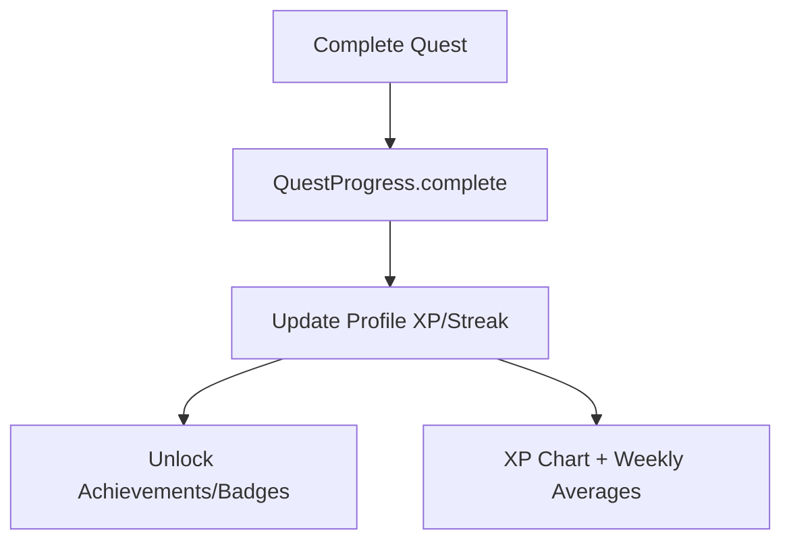
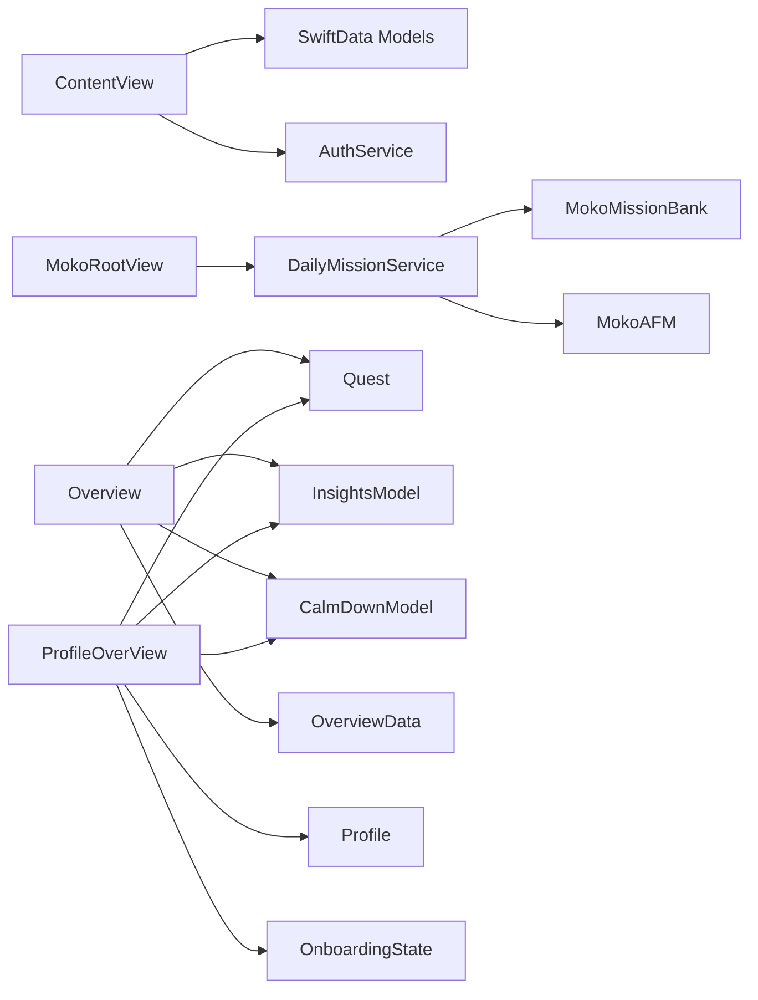

# Core Features

<cite>
**Referenced Files in This Document**
- [README.md](file://README.md)
- [MokoApp.swift](file://Moko/Moko/MokoApp.swift)
- [ContentView.swift](file://Moko/Moko/ContentView.swift)
- [MokoRootView.swift](file://Moko/Moko/MokoRootView.swift)
- [Profile.swift](file://Moko/Moko/Models/Profile.swift)
- [Onboarding_Question.swift](file://Moko/Moko/Models/Onboarding_Question.swift)
- [Onboarding_Response.swift](file://Moko/Moko/Models/Onboarding_Response.swift)
- [Onboarding_state.swift](file://Moko/Moko/Models/Onboarding_state.swift)
- [InsightsModel.swift](file://Moko/Moko/Models/InsightsModel.swift)
- [QuestModels.swift](file://Moko/Moko/Models/QuestModels.swift)
- [QuestProgress.swift](file://Moko/Moko/Models/QuestProgress.swift)
- [CalmDownModel.swift](file://Moko/Moko/Models/CalmDownModel.swift)
- [OverviewData.swift](file://Moko/Moko/Models/OverviewData.swift)
- [DailyMissionService.swift](file://Moko/Moko/Features/AFM/DailyMissionService.swift)
- [MokoAFM.swift](file://Moko/Moko/Features/AFM/MokoAFM.swift)
- [MokoMissionBank.swift](file://Moko/Moko/Features/AFM/MokoMissionBank.swift)
- [Overview.swift](file://Moko/Moko/UIScreens/homeScreens/Overview.swift)
- [ProfileOverView.swift](file://Moko/Moko/UIScreens/homeScreens/ProfileOverView.swift)
</cite>

## Table of Contents
1. [Introduction](#introduction)
2. [Project Structure](#project-structure)
3. [Core Components](#core-components)
4. [Architecture Overview](#architecture-overview)
5. [Detailed Component Analysis](#detailed-component-analysis)
6. [Dependency Analysis](#dependency-analysis)
7. [Performance Considerations](#performance-considerations)
8. [Troubleshooting Guide](#troubleshooting-guide)
9. [Conclusion](#conclusion)
10. [Appendices](#appendices)

## Introduction
This document explains Moko’s core wellness features and how they work together: Onboarding, Relaxation, Quest & Mission System with AFM, Insights & Analytics, and User Profile Management. It covers user workflows from first-time onboarding through daily usage, data sharing between components, current implementation status, planned enhancements, and developer integration patterns.

Moko is a native iOS SwiftUI app that uses SwiftData for local storage, Supabase for authentication, Lottie for mascot animations, and Apple Foundation Models for guided AI-assisted mission generation and debrief analysis. The app emphasizes privacy by default, emotional wellness, social confidence, and gentle gamification.

**Section sources**
- [README.md:41-75](file://README.md#L41-L75)
- [README.md:151-207](file://README.md#L151-L207)

## Project Structure
At a high level, the app entry point initializes SwiftData models and presents the main flow. The root view manages the tab-based navigation across Overview, Quests, Relax, and Explore. Feature modules are organized under `Features`, UI screens under `UIScreens`, and shared domain models under `Models`.

**Diagram sources**
- [MokoApp.swift:31-44](file://Moko/Moko/MokoApp.swift#L31-L44)
- [ContentView.swift:73-210](file://Moko/Moko/ContentView.swift#L73-L210)
- [MokoRootView.swift:14-99](file://Moko/Moko/MokoRootView.swift#L14-L99)
- [Overview.swift:11-124](file://Moko/Moko/UIScreens/homeScreens/Overview.swift#L11-L124)
- [DailyMissionService.swift:129-224](file://Moko/Moko/Features/AFM/DailyMissionService.swift#L129-L224)

**Section sources**
- [MokoApp.swift:11-44](file://Moko/Moko/MokoApp.swift#L11-L44)
- [README.md:180-207](file://README.md#L180-L207)

## Core Components
- Onboarding System: Welcome flow, familiar carousel, name and age entry, question cards, completion, reflection, microphone permission, and persistence to SwiftData.
- Relaxation Suite: Breathing exercises, grounding techniques, imagery guides, mirror reflection, timed sessions, and completion.
- Quest & Mission System: Custom quests, library scenarios, daily missions, AFM-powered card generation, debrief chat, scoring, and streak/XP rewards.
- Insights & Analytics: Radar chart for Courage, Clarity, Presence, Warmth; calm-down minutes; weekly averages; XP charts.
- User Profile Management: Avatar, level, XP, streak, badges, wardrobe, settings, account info, notifications, and sign-out/delete flows.

Current status (from project documentation):
- Navigation: Implemented.
- Relax breathing: Implemented; imagery, grounding, mirror, timed sessions: In progress.
- Mascot animations: Integrated; sizing/debugging ongoing.
- Insights radar dimensions: In progress; summaries planned.
- Profile: In progress.
- Onboarding: In progress.
- Auth: Architecture defined; verify before release.
- Storage: SwiftData for local data: In progress.

**Section sources**
- [README.md:55-75](file://README.md#L55-L75)
- [README.md:79-90](file://README.md#L79-L90)

## Architecture Overview
The app follows a layered SwiftUI architecture:
- UI layer: Screens and navigation driven by `MokoTab` and `RelaxStep`.
- Domain layer: Quests, insights, profile, calm-down records, onboarding state.
- Services: AFM for language generation, Mission Bank for templates, Daily Mission Service for scheduling and personalization.
- Persistence: SwiftData for all local models.

**Diagram sources**
- [MokoApp.swift:31-44](file://Moko/Moko/MokoApp.swift#L31-L44)
- [ContentView.swift:217-236](file://Moko/Moko/ContentView.swift#L217-L236)
- [MokoRootView.swift:87-99](file://Moko/Moko/MokoRootView.swift#L87-L99)
- [DailyMissionService.swift:129-224](file://Moko/Moko/Features/AFM/DailyMissionService.swift#L129-L224)
- [MokoAFM.swift:55-83](file://Moko/Moko/Features/AFM/MokoAFM.swift#L55-L83)
- [MokoMissionBank.swift:95-103](file://Moko/Moko/Features/AFM/MokoMissionBank.swift#L95-L103)

## Detailed Component Analysis

### Onboarding System
The onboarding system guides new users through:
- Splash and intro screens.
- Authentication (Supabase).
- Info screens: familiar carousel, name entry, age entry, welcome.
- Swipeable question cards mapped to SwiftData models.
- Completion screen and reflection.
- Microphone permission prompt before entering home.

Data persisted:
- `Profile`: username, age, avatar image, XP, streaks, timestamps.
- `OnboardingState`: step tracking and completion flag.
- `OnboardingQuestion` and `OnboardingResponse`: questions and answers.
- Initial `InsightsModel` baseline scores derived from responses.

Workflow highlights:
- After splash, the app checks if the user is fully registered; otherwise it routes to intro/onboarding.
- Onboarding info creates a `Profile` and an initial `OnboardingState`, then transitions to question flow.
- Question results map to `OnboardingQuestion` and `OnboardingResponse`, compute baseline insights, mark onboarding completed, and move to reflection/microphone/home.

**Diagram sources**
- [ContentView.swift:73-210](file://Moko/Moko/ContentView.swift#L73-L210)
- [ContentView.swift:250-308](file://Moko/Moko/ContentView.swift#L250-L308)

Implementation details:
- `ContentView` orchestrates app screens and delegates to `OnboardingFlowContainer` for info screens.
- `mapAndSaveQuestionsToSwiftData` persists questions/responses and computes baseline insights.
- `Profile`, `OnboardingState`, `OnboardingQuestion`, and `OnboardingResponse` are SwiftData models.

**Section sources**
- [ContentView.swift:19-70](file://Moko/Moko/ContentView.swift#L19-L70)
- [ContentView.swift:250-308](file://Moko/Moko/ContentView.swift#L250-L308)
- [Profile.swift:12-59](file://Moko/Moko/Models/Profile.swift#L12-L59)
- [Onboarding_state.swift:4-23](file://Moko/Moko/Models/Onboarding_state.swift#L4-L23)
- [Onboarding_Question.swift:11-36](file://Moko/Moko/Models/Onboarding_Question.swift#L11-L36)
- [Onboarding_Response.swift:11-35](file://Moko/Moko/Models/Onboarding_Response.swift#L11-L35)

Status: In progress. Planned enhancements include richer question types, voice input, and deeper personalization based on answers.

### Relaxation Suite
The Relax tab provides calming practices:
- Guided breathing with start, pause, resume, reset, and completion.
- Imagery guides, grounding exercises, and mirror reflection.
- Timed sessions with mascot animation behind controls.
- Completion celebration and return to Relax.

Key design points:
- Timer is independent of animation frames to keep timing accurate.
- Mascot animations are presentational only.

Integration:
- Completed relaxation sessions log time into `CalmDownModel`, which contributes to the Overview “Calm Down” metric.

**Diagram sources**
- [README.md:79-90](file://README.md#L79-L90)
- [CalmDownModel.swift:12-37](file://Moko/Moko/Models/CalmDownModel.swift#L12-L37)

Status: Breathing implemented; imagery, grounding, mirror, and timed sessions are in progress.

### Quest & Mission System with AFM
The Quest & Mission System blends deterministic logic with optional AI assistance:
- Mission Bank defines reusable situation templates across Work, Dating, Friends, Family, Others.
- Daily Mission Service selects or generates a daily mission tailored to the user’s lowest-scored stat or preparation for upcoming custom quests.
- AFM generates personalized card text and debrief prompts while keeping deterministic scoring and scheduling in Swift.
- Quests persist in SwiftData; completing a quest updates XP, streak, and optionally saves debrief insights.

Core data structures:
- `Quest`: owner, title, notes, intensity, category, date, completion flags, XP, debrief recording.
- `QuestIntensity` and `QuestCategory`: enums driving difficulty and life area.
- `MissionTemplate`: bank-defined situations with goals and follow-up questions per stat.
- `Stat`: courage, clarity, presence, warmth definitions and anchors.

Daily mission selection logic:
- If an active incomplete quest or awaiting-debrief quest exists, use it.
- Else if any non-library quest is scheduled for today, use it and seed other categories.
- Otherwise, choose a template via:
  - Upcoming custom quest preparation mode (alternating foundational vs similar-situation tasks).
  - Standard mode targeting the lowest-scored stat across diverse categories.
- Generate a fresh card via AFM using the selected template and seed it into SwiftData.

Debrief and scoring:
- AFM writes opening messages, follow-up questions, and analysis of user responses.
- `QuestProgress.saveDebrief` ensures minimum meaningful scores and inserts an `InsightsModel` record once per debrief.

**Diagram sources**
- [QuestModels.swift:50-127](file://Moko/Moko/Models/QuestModels.swift#L50-L127)
- [MokoMissionBank.swift:10-91](file://Moko/Moko/Features/AFM/MokoMissionBank.swift#L10-L91)
- [DailyMissionService.swift:28-123](file://Moko/Moko/Features/AFM/DailyMissionService.swift#L28-L123)
- [DailyMissionService.swift:129-224](file://Moko/Moko/Features/AFM/DailyMissionService.swift#L129-L224)
- [MokoAFM.swift:55-83](file://Moko/Moko/Features/AFM/MokoAFM.swift#L55-L83)

Usage examples and integration patterns:
- Ensure a daily mission on app launch or tab appearance: call `DailyMissionService.ensureDailyMission(in:modelContext, existingQuests:)`.
- Create a custom quest and schedule it; the system will generate stepping-stone missions leading up to it.
- Use AFM prompts via `MokoAFM.generate` for debrief opening, analysis, and follow-up questions, always wrapping user text safely.

Status: Implemented with AFM fallbacks; debrief UX and analytics continue to evolve.

**Section sources**
- [DailyMissionService.swift:1-15](file://Moko/Moko/Features/AFM/DailyMissionService.swift#L1-L15)
- [DailyMissionService.swift:28-123](file://Moko/Moko/Features/AFM/DailyMissionService.swift#L28-L123)
- [DailyMissionService.swift:129-224](file://Moko/Moko/Features/AFM/DailyMissionService.swift#L129-L224)
- [MokoAFM.swift:17-83](file://Moko/Moko/Features/AFM/MokoAFM.swift#L17-L83)
- [MokoMissionBank.swift:95-103](file://Moko/Moko/Features/AFM/MokoMissionBank.swift#L95-L103)
- [QuestModels.swift:50-127](file://Moko/Moko/Models/QuestModels.swift#L50-L127)

### Insights & Analytics
Insights track four dimensions: Courage, Clarity, Presence, Warmth.
- Baseline insights are created from onboarding responses.
- Debriefs save one `InsightsModel` per session with minimum meaningful scores.
- Overview shows today’s average warmth and a diamond/radar visualization.
- Profile shows weekly averages over eight weeks and XP charts.

Data flow:
- `QuestProgress.saveDebrief` inserts `InsightsModel` and marks the quest debrief recorded.
- `OverviewData` aggregates today’s insights and calm-down minutes for the Overview cards.
- `ProfileOverView` computes weekly averages and renders line charts.

**Diagram sources**
- [QuestProgress.swift:85-119](file://Moko/Moko/Models/QuestProgress.swift#L85-L119)
- [OverviewData.swift:11-42](file://Moko/Moko/Models/OverviewData.swift#L11-L42)
- [ProfileOverView.swift:49-60](file://Moko/Moko/UIScreens/homeScreens/ProfileOverView.swift#L49-L60)

Status: Radar dimensions implemented; day/week/month/year summaries are planned.

**Section sources**
- [InsightsModel.swift:11-26](file://Moko/Moko/Models/InsightsModel.swift#L11-L26)
- [QuestProgress.swift:85-119](file://Moko/Moko/Models/QuestProgress.swift#L85-L119)
- [Overview.swift:379-436](file://Moko/Moko/UIScreens/homeScreens/Overview.swift#L379-L436)
- [ProfileOverView.swift:333-382](file://Moko/Moko/UIScreens/homeScreens/ProfileOverView.swift#L333-L382)

### User Profile Management
Profile management includes:
- Identity header with avatar, level, XP progress.
- Streak tracking with rest-day allowance after seven practice days.
- Badges and achievements list with detail sheets.
- Growth section showing weekly average skill score trend.
- Wardrobe link unlocking costumes by level.
- Settings: account info, reminders/notifications, general settings, sign-out, delete account confirmation.

Data sources:
- `Profile` stores XP, streaks, last activity date, and avatar image.
- `QuestProgress.complete` updates profile fields and quest flags.
- `Achievement` computation uses profile, onboarding state, quests, calm-downs, and insights.

**Diagram sources**
- [QuestProgress.swift:49-83](file://Moko/Moko/Models/QuestProgress.swift#L49-L83)
- [ProfileOverView.swift:120-177](file://Moko/Moko/UIScreens/homeScreens/ProfileOverView.swift#L120-L177)
- [ProfileOverView.swift:333-442](file://Moko/Moko/UIScreens/homeScreens/ProfileOverView.swift#L333-L442)

Status: In progress; more settings and account flows are being refined.

**Section sources**
- [ProfileOverView.swift:62-118](file://Moko/Moko/UIScreens/homeScreens/ProfileOverView.swift#L62-L118)
- [ProfileOverView.swift:120-177](file://Moko/Moko/UIScreens/homeScreens/ProfileOverView.swift#L120-L177)
- [ProfileOverView.swift:333-442](file://Moko/Moko/UIScreens/homeScreens/ProfileOverView.swift#L333-L442)
- [Profile.swift:12-59](file://Moko/Moko/Models/Profile.swift#L12-L59)

## Dependency Analysis
Key dependencies:
- `ContentView` depends on SwiftData models and auth services to drive the app flow.
- `MokoRootView` depends on `DailyMissionService` to ensure a daily mission and on `Quest` queries.
- `DailyMissionService` depends on `MokoMissionBank` for templates and `MokoAFM` for language generation.
- `Overview` depends on `Quest`, `InsightsModel`, `CalmDownModel`, and `OverviewData`.
- `ProfileOverView` depends on `Profile`, `Quest`, `InsightsModel`, `CalmDownModel`, and `OnboardingState`.

**Diagram sources**
- [ContentView.swift:12-18](file://Moko/Moko/ContentView.swift#L12-L18)
- [MokoRootView.swift:7-12](file://Moko/Moko/MokoRootView.swift#L7-L12)
- [DailyMissionService.swift:129-224](file://Moko/Moko/Features/AFM/DailyMissionService.swift#L129-L224)
- [Overview.swift:29-44](file://Moko/Moko/UIScreens/homeScreens/Overview.swift#L29-L44)
- [ProfileOverView.swift:11-16](file://Moko/Moko/UIScreens/homeScreens/ProfileOverView.swift#L11-L16)

Potential circular dependencies:
- None observed among core modules; dependencies are unidirectional from UI to services/models.

External integrations:
- Supabase for authentication.
- Lottie for mascot animations.
- Apple Foundation Models for AI-assisted generation.

**Section sources**
- [README.md:151-163](file://README.md#L151-L163)
- [README.md:299-309](file://README.md#L299-L309)

## Performance Considerations
- Animation independence: Breathing timer runs independently of mascot animations to avoid frame drops affecting timing.
- AFM latency mitigation: Prewarm sessions and short prompts reduce first-token latency; deterministic logic remains in Swift.
- Local-first data: SwiftData avoids network calls for private data, improving responsiveness.
- Background seeding: Category variety quests are seeded asynchronously to avoid blocking the UI.

[No sources needed since this section provides general guidance]

## Troubleshooting Guide
Common issues and resolutions:
- No daily mission shown:
  - Verify `DailyMissionService.ensureDailyMission` is called on root view appear.
  - Confirm `Quest.overviewMission` returns a valid quest or fallback is used.
- AFM unavailable:
  - Check device eligibility and Apple Intelligence settings; handle `AFMError.unavailable`.
  - Ensure deterministic fallback paths are exercised.
- Insights not updating:
  - Confirm `QuestProgress.saveDebrief` is invoked after debrief completion.
  - Validate that `InsightsModel` records are inserted and not duplicated.
- Streak resets unexpectedly:
  - Review `QuestProgress.nextStreak` logic and calendar boundaries.
  - Ensure last activity dates are set correctly on completion.

**Section sources**
- [DailyMissionService.swift:129-224](file://Moko/Moko/Features/AFM/DailyMissionService.swift#L129-L224)
- [MokoAFM.swift:19-31](file://Moko/Moko/Features/AFM/MokoAFM.swift#L19-L31)
- [QuestProgress.swift:22-47](file://Moko/Moko/Models/QuestProgress.swift#L22-L47)
- [QuestProgress.swift:85-119](file://Moko/Moko/Models/QuestProgress.swift#L85-L119)

## Conclusion
Moko integrates onboarding, relaxation, quests with AFM, insights, and profile management into a cohesive wellness experience. The system balances deterministic logic with optional AI assistance, prioritizes privacy, and offers gentle gamification. Current implementation focuses on core flows with ongoing refinements to relaxation, insights summaries, and profile settings. Developers should rely on SwiftData for persistence, use `DailyMissionService` for mission orchestration, and integrate AFM carefully with safe prompts and fallbacks.

[No sources needed since this section summarizes without analyzing specific files]

## Appendices

### Developer Integration Patterns
- Onboarding:
  - Create `Profile` and `OnboardingState` during info flow.
  - Persist `OnboardingQuestion` and `OnboardingResponse` for each card.
  - Compute baseline insights and mark onboarding completed.
- Daily Missions:
  - Call `DailyMissionService.ensureDailyMission` on app launch or tab activation.
  - Seed additional categories for variety.
- Debriefs:
  - Use AFM prompts for opening, analysis, and follow-ups.
  - Save debrief via `QuestProgress.saveDebrief` to update insights and quest flags.
- Relaxation:
  - Log completed sessions with `ModelContext.logCalmDown`.
  - Display calm-down minutes in Overview.

**Section sources**
- [ContentView.swift:250-308](file://Moko/Moko/ContentView.swift#L250-L308)
- [DailyMissionService.swift:129-224](file://Moko/Moko/Features/AFM/DailyMissionService.swift#L129-L224)
- [MokoAFM.swift:55-83](file://Moko/Moko/Features/AFM/MokoAFM.swift#L55-L83)
- [QuestProgress.swift:85-119](file://Moko/Moko/Models/QuestProgress.swift#L85-L119)
- [CalmDownModel.swift:27-37](file://Moko/Moko/Models/CalmDownModel.swift#L27-L37)