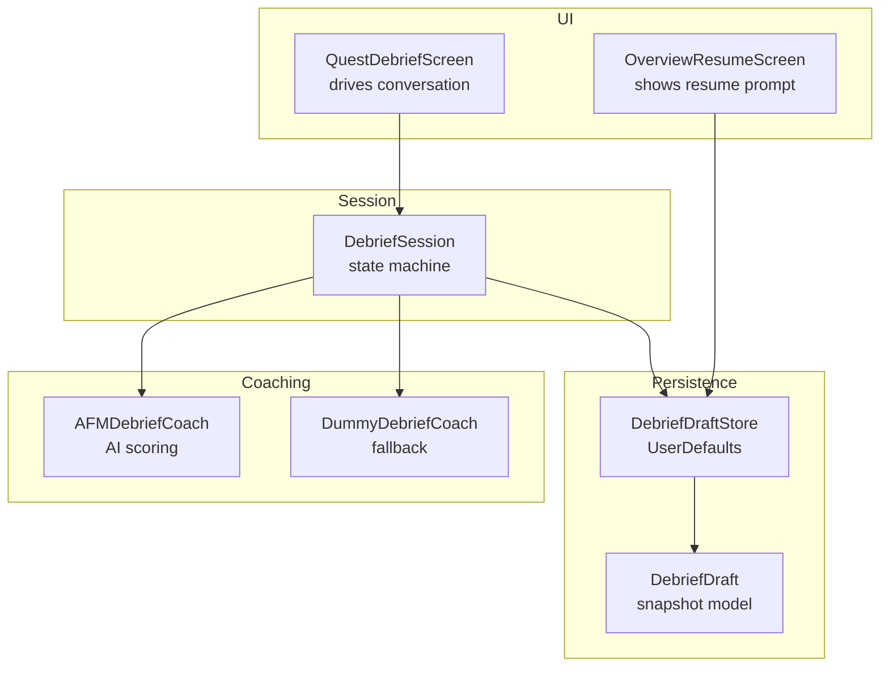
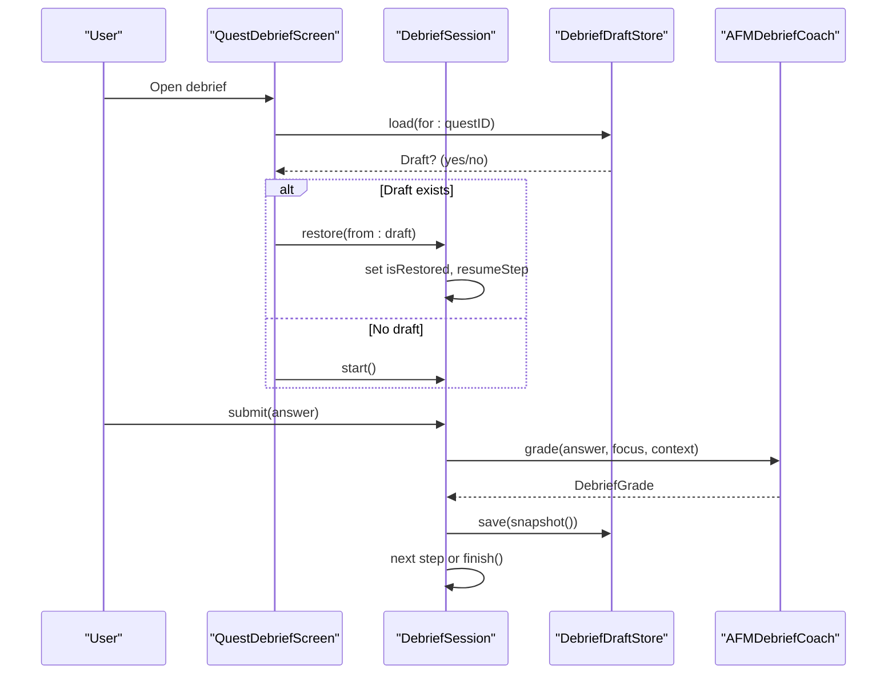
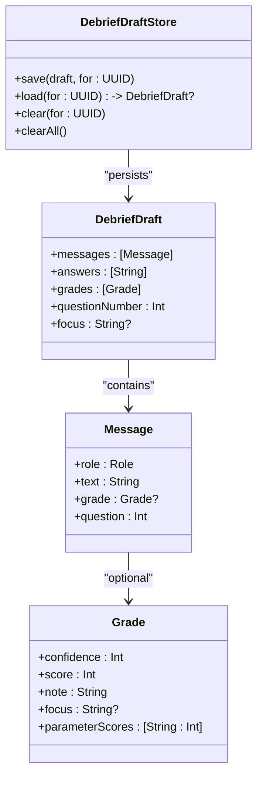
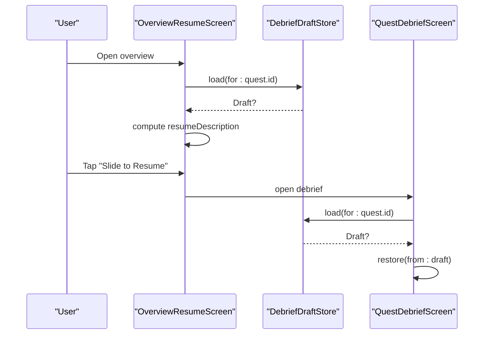
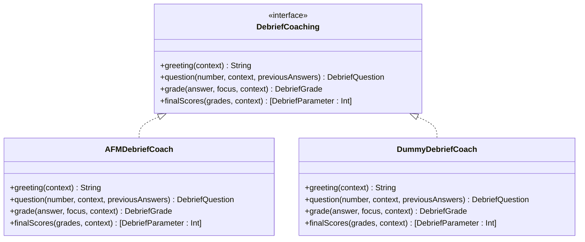
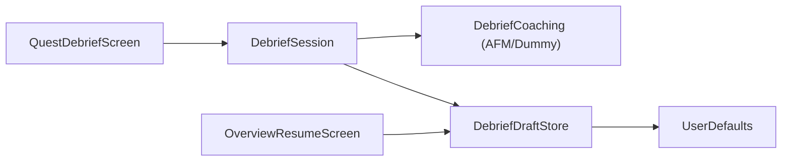

# Debrief Session Persistence

<cite>
**Referenced Files in This Document**
- [DebriefDraft.swift](file://Moko/Moko/Models/DebriefDraft.swift)
- [Questdebrief.swift](file://Moko/Moko/UIScreens/Quests/Questdebrief.swift)
- [OverviewResumeScreen.swift](file://Moko/Moko/UIScreens/homeScreens/OverviewResumeScreen.swift)
- [AFMDebriefCoach.swift](file://Moko/Moko/Features/AFM/AFMDebriefCoach.swift)
</cite>

## Table of Contents
1. [Introduction](#introduction)
2. [Project Structure](#project-structure)
3. [Core Components](#core-components)
4. [Architecture Overview](#architecture-overview)
5. [Detailed Component Analysis](#detailed-component-analysis)
6. [Dependency Analysis](#dependency-analysis)
7. [Performance Considerations](#performance-considerations)
8. [Troubleshooting Guide](#troubleshooting-guide)
9. [Conclusion](#conclusion)

## Introduction
This document explains how debrief sessions are persisted and resumed in the app. The system captures an unfinished debrief as a draft, stores it locally, and restores it later so users can continue exactly where they stopped. It also shows how drafts are cleared when a debrief is completed or abandoned, and how the overview screen surfaces resume prompts.

## Project Structure
The persistence feature spans three main areas:
- Data model and storage for drafts
- UI session that drives conversation flow and triggers persistence
- Resume entry point on the overview screen



**Diagram sources**
- [Questdebrief.swift:246-330](file://Moko/Moko/UIScreens/Quests/Questdebrief.swift#L246-L330)
- [Questdebrief.swift:520-587](file://Moko/Moko/UIScreens/Quests/Questdebrief.swift#L520-L587)
- [Questdebrief.swift:612-635](file://Moko/Moko/UIScreens/Quests/Questdebrief.swift#L612-L635)
- [OverviewResumeScreen.swift:33-45](file://Moko/Moko/UIScreens/homeScreens/OverviewResumeScreen.swift#L33-L45)
- [DebriefDraft.swift:12-51](file://Moko/Moko/Models/DebriefDraft.swift#L12-L51)
- [DebriefDraft.swift:82-110](file://Moko/Moko/Models/DebriefDraft.swift#L82-L110)
- [AFMDebriefCoach.swift:49-74](file://Moko/Moko/Features/AFM/AFMDebriefCoach.swift#L49-L74)

**Section sources**
- [Questdebrief.swift:246-330](file://Moko/Moko/UIScreens/Quests/Questdebrief.swift#L246-L330)
- [Questdebrief.swift:520-587](file://Moko/Moko/UIScreens/Quests/Questdebrief.swift#L520-L587)
- [Questdebrief.swift:612-635](file://Moko/Moko/UIScreens/Quests/Questdebrief.swift#L612-L635)
- [OverviewResumeScreen.swift:33-45](file://Moko/Moko/UIScreens/homeScreens/OverviewResumeScreen.swift#L33-L45)
- [DebriefDraft.swift:12-51](file://Moko/Moko/Models/DebriefDraft.swift#L12-L51)
- [DebriefDraft.swift:82-110](file://Moko/Moko/Models/DebriefDraft.swift#L82-L110)
- [AFMDebriefCoach.swift:49-74](file://Moko/Moko/Features/AFM/AFMDebriefCoach.swift#L49-L74)

## Core Components
- DebriefDraft: Codable snapshot of an unfinished debrief, including messages, answers, grades, current question index, and focus parameter.
- DebriefDraftStore: UserDefaults-backed store keyed by quest ID with save/load/clear/clearAll operations.
- DebriefSession: Main state machine driving greeting, follow-ups, grading, completion, and persistence hooks.
- QuestDebriefScreen: SwiftUI view wiring the session to UI, restoring drafts, and clearing them on completion or exit.
- OverviewResumeScreen: Reads existing drafts to show a resume prompt and description.
- AFMDebriefCoach: AI-powered coach implementation used during debrief; not directly responsible for persistence but affects grades stored in drafts.

**Section sources**
- [DebriefDraft.swift:12-51](file://Moko/Moko/Models/DebriefDraft.swift#L12-L51)
- [DebriefDraft.swift:82-110](file://Moko/Moko/Models/DebriefDraft.swift#L82-L110)
- [Questdebrief.swift:246-330](file://Moko/Moko/UIScreens/Quests/Questdebrief.swift#L246-L330)
- [Questdebrief.swift:520-587](file://Moko/Moko/UIScreens/Quests/Questdebrief.swift#L520-L587)
- [Questdebrief.swift:612-635](file://Moko/Moko/UIScreens/Quests/Questdebrief.swift#L612-L635)
- [OverviewResumeScreen.swift:33-45](file://Moko/Moko/UIScreens/homeScreens/OverviewResumeScreen.swift#L33-L45)
- [AFMDebriefCoach.swift:49-74](file://Moko/Moko/Features/AFM/AFMDebriefCoach.swift#L49-L74)

## Architecture Overview
The persistence architecture centers on a draft snapshot written to local storage whenever the debrief state changes. On launch, the debrief screen loads any saved draft and resumes mid-conversation. The overview screen reads the same draft to inform the user about progress.



**Diagram sources**
- [Questdebrief.swift:612-635](file://Moko/Moko/UIScreens/Quests/Questdebrief.swift#L612-L635)
- [Questdebrief.swift:520-587](file://Moko/Moko/UIScreens/Quests/Questdebrief.swift#L520-L587)
- [Questdebrief.swift:437-465](file://Moko/Moko/UIScreens/Quests/Questdebrief.swift#L437-L465)
- [AFMDebriefCoach.swift:114-176](file://Moko/Moko/Features/AFM/AFMDebriefCoach.swift#L114-L176)

## Detailed Component Analysis

### DebriefDraft and DebriefDraftStore
- DebriefDraft models the full conversation snapshot:
  - Messages with roles (coach/user/divider), text, optional grade, and question number
  - Answers array preserving order
  - Grades array aligned with user answers
  - Current questionNumber and focus parameter for the next answer
- DebriefDraftStore provides:
  - Per-quest keys using a prefix and UUID
  - Save/load via JSON encoding/decoding
  - Clear single draft and clear all drafts (used on account deletion)



**Diagram sources**
- [DebriefDraft.swift:12-51](file://Moko/Moko/Models/DebriefDraft.swift#L12-L51)
- [DebriefDraft.swift:82-110](file://Moko/Moko/Models/DebriefDraft.swift#L82-L110)

**Section sources**
- [DebriefDraft.swift:12-51](file://Moko/Moko/Models/DebriefDraft.swift#L12-L51)
- [DebriefDraft.swift:82-110](file://Moko/Moko/Models/DebriefDraft.swift#L82-L110)

### DebriefSession and QuestDebriefScreen Integration
- DebriefSession:
  - Tracks messages, answers, grades, questionNumber, focus, and resume state
  - Exposes start(), submit(), and internal askQuestion()
  - Provides persistNow() and restore(from:)
  - Builds a DebriefDraft snapshot from live state
- QuestDebriefScreen:
  - Initializes session with coach (AFM or dummy)
  - Sets questID and attempts to restore a draft
  - Persists on “Finish Later” and clears on completion or leave
  - Records final scores and clears draft after successful completion

```mermaid
flowchart TD
Start(["Open Debrief"]) --> CheckDraft{"Saved draft?"}
CheckDraft --> |Yes| Restore["restore(from: draft)<br/>set isRestored, resumeStep"]
CheckDraft --> |No| StartFlow["start()<br/>show opening, generate greeting"]
Restore --> ResumeFlow{"resumeStep?"}
ResumeFlow --> |ask(number, divider)| AskFollowUp["append divider if needed<br/>askQuestion(number)"]
ResumeFlow --> |none| Idle["ready to accept answer"]
StartFlow --> Idle
Idle --> Submit["submit(answer)"]
Submit --> Grade["coach.grade(...)"]
Grade --> Persist["persist() -> DebriefDraftStore.save()"]
Persist --> NextCheck{"More follow-ups?"}
NextCheck --> |Yes| AskFollowUp
NextCheck --> |No| Finish["finish() -> recordDebrief()"]
Finish --> ClearDraft["DebriefDraftStore.clear()"]
ClearDraft --> End(["Done"])
```

**Diagram sources**
- [Questdebrief.swift:309-345](file://Moko/Moko/UIScreens/Quests/Questdebrief.swift#L309-L345)
- [Questdebrief.swift:437-465](file://Moko/Moko/UIScreens/Quests/Questdebrief.swift#L437-L465)
- [Questdebrief.swift:520-587](file://Moko/Moko/UIScreens/Quests/Questdebrief.swift#L520-L587)
- [Questdebrief.swift:723-751](file://Moko/Moko/UIScreens/Quests/Questdebrief.swift#L723-L751)

**Section sources**
- [Questdebrief.swift:309-345](file://Moko/Moko/UIScreens/Quests/Questdebrief.swift#L309-L345)
- [Questdebrief.swift:437-465](file://Moko/Moko/UIScreens/Quests/Questdebrief.swift#L437-L465)
- [Questdebrief.swift:520-587](file://Moko/Moko/UIScreens/Quests/Questdebrief.swift#L520-L587)
- [Questdebrief.swift:723-751](file://Moko/Moko/UIScreens/Quests/Questdebrief.swift#L723-L751)

### Overview Resume Prompt
- Reads any existing draft for the active quest
- Computes a human-readable description indicating how many answers were saved out of the total expected
- Provides a “Slide to Resume” action that opens the debrief screen with the draft restored



**Diagram sources**
- [OverviewResumeScreen.swift:33-45](file://Moko/Moko/UIScreens/homeScreens/OverviewResumeScreen.swift#L33-L45)
- [Questdebrief.swift:612-635](file://Moko/Moko/UIScreens/Quests/Questdebrief.swift#L612-L635)

**Section sources**
- [OverviewResumeScreen.swift:33-45](file://Moko/Moko/UIScreens/homeScreens/OverviewResumeScreen.swift#L33-L45)
- [Questdebrief.swift:612-635](file://Moko/Moko/UIScreens/Quests/Questdebrief.swift#L612-L635)

### Coaching and Grading Impact on Persistence
- AFMDebriefCoach computes grades and notes based on AI analysis, which are included in the draft’s grades array
- DummyDebriefCoach provides fallback logic when AI is unavailable
- Final score computation aggregates per-parameter scores and confidence across the session



**Diagram sources**
- [AFMDebriefCoach.swift:49-74](file://Moko/Moko/Features/AFM/AFMDebriefCoach.swift#L49-L74)
- [AFMDebriefCoach.swift:114-176](file://Moko/Moko/Features/AFM/AFMDebriefCoach.swift#L114-L176)
- [AFMDebriefCoach.swift:199-217](file://Moko/Moko/Features/AFM/AFMDebriefCoach.swift#L199-L217)
- [Questdebrief.swift:102-125](file://Moko/Moko/UIScreens/Quests/Questdebrief.swift#L102-L125)

**Section sources**
- [AFMDebriefCoach.swift:49-74](file://Moko/Moko/Features/AFM/AFMDebriefCoach.swift#L49-L74)
- [AFMDebriefCoach.swift:114-176](file://Moko/Moko/Features/AFM/AFMDebriefCoach.swift#L114-L176)
- [AFMDebriefCoach.swift:199-217](file://Moko/Moko/Features/AFM/AFMDebriefCoach.swift#L199-L217)
- [Questdebrief.swift:102-125](file://Moko/Moko/UIScreens/Quests/Questdebrief.swift#L102-L125)

## Dependency Analysis
- QuestDebriefScreen depends on DebriefSession for state and persistence hooks
- DebriefSession depends on DebriefCoaching (AFM or dummy) for content generation and grading
- DebriefSession writes snapshots to DebriefDraftStore
- OverviewResumeScreen reads from DebriefDraftStore to surface resume prompts
- DebriefDraftStore uses UserDefaults for persistence



**Diagram sources**
- [Questdebrief.swift:612-635](file://Moko/Moko/UIScreens/Quests/Questdebrief.swift#L612-L635)
- [Questdebrief.swift:520-587](file://Moko/Moko/UIScreens/Quests/Questdebrief.swift#L520-L587)
- [OverviewResumeScreen.swift:33-45](file://Moko/Moko/UIScreens/homeScreens/OverviewResumeScreen.swift#L33-L45)
- [DebriefDraft.swift:82-110](file://Moko/Moko/Models/DebriefDraft.swift#L82-L110)

**Section sources**
- [Questdebrief.swift:612-635](file://Moko/Moko/UIScreens/Quests/Questdebrief.swift#L612-L635)
- [Questdebrief.swift:520-587](file://Moko/Moko/UIScreens/Quests/Questdebrief.swift#L520-L587)
- [OverviewResumeScreen.swift:33-45](file://Moko/Moko/UIScreens/homeScreens/OverviewResumeScreen.swift#L33-L45)
- [DebriefDraft.swift:82-110](file://Moko/Moko/Models/DebriefDraft.swift#L82-L110)

## Performance Considerations
- Local persistence uses UserDefaults with JSON encoding; keep drafts compact by avoiding unnecessary fields.
- Persist only on meaningful state changes (e.g., after submitting an answer or finishing).
- Avoid heavy work on the main thread; DebriefSession methods should remain lightweight while offloading coaching calls asynchronously.
- Clear drafts promptly upon completion or abandonment to prevent stale data accumulation.

## Troubleshooting Guide
- Draft not resuming:
  - Verify that questID is set before attempting to restore
  - Ensure DebriefDraftStore.load returns a valid draft for the quest
- Draft persists after completion:
  - Confirm recordDebrief clears the draft after saving final scores
- Resume prompt incorrect:
  - Check that OverviewResumeScreen computes the description using the correct total count and saved answers length
- Account deletion cleanup:
  - Ensure DebriefDraftStore.clearAll is invoked when the signed-in account is deleted

**Section sources**
- [Questdebrief.swift:723-751](file://Moko/Moko/UIScreens/Quests/Questdebrief.swift#L723-L751)
- [OverviewResumeScreen.swift:33-45](file://Moko/Moko/UIScreens/homeScreens/OverviewResumeScreen.swift#L33-L45)
- [DebriefDraft.swift:103-109](file://Moko/Moko/Models/DebriefDraft.swift#L103-L109)

## Conclusion
Debrief session persistence is implemented through a simple, robust pattern: capture a Codable snapshot of the conversation state, store it per quest in UserDefaults, and restore it on subsequent launches. The UI integrates seamlessly by offering resume prompts and ensuring drafts are cleared at appropriate lifecycle points. Coaching implementations influence the grades captured in drafts but do not alter the persistence mechanism itself.