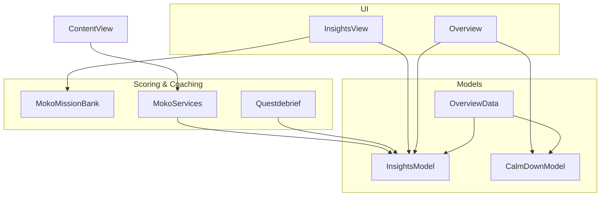
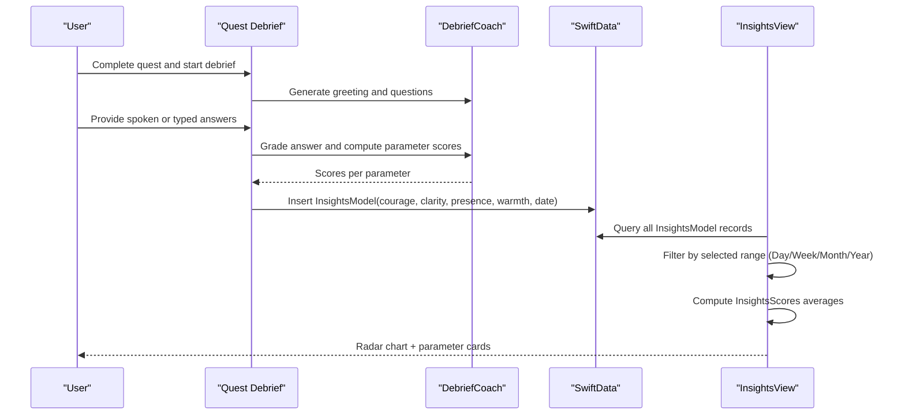
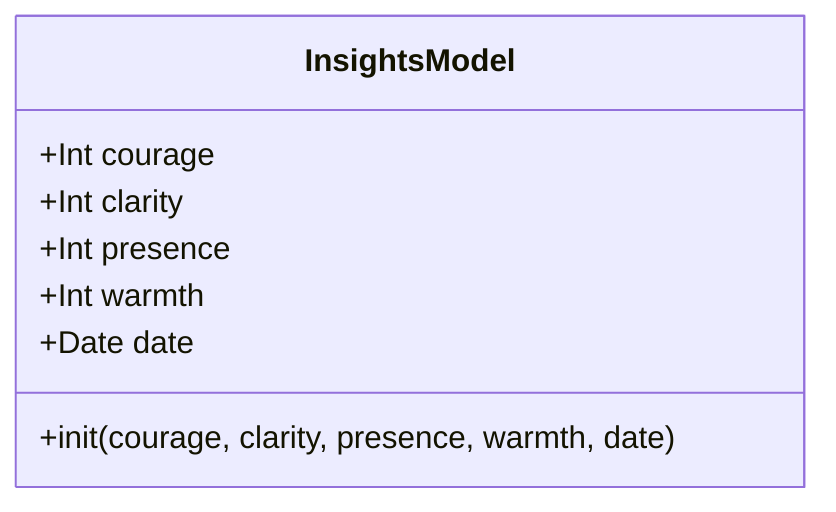
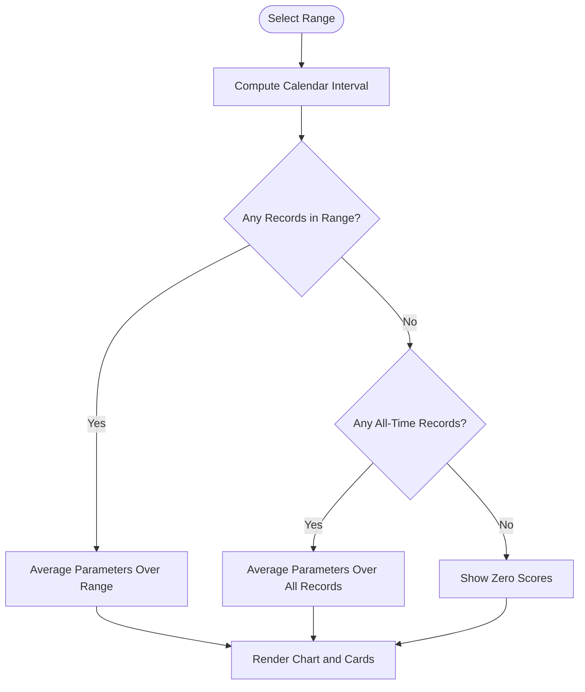
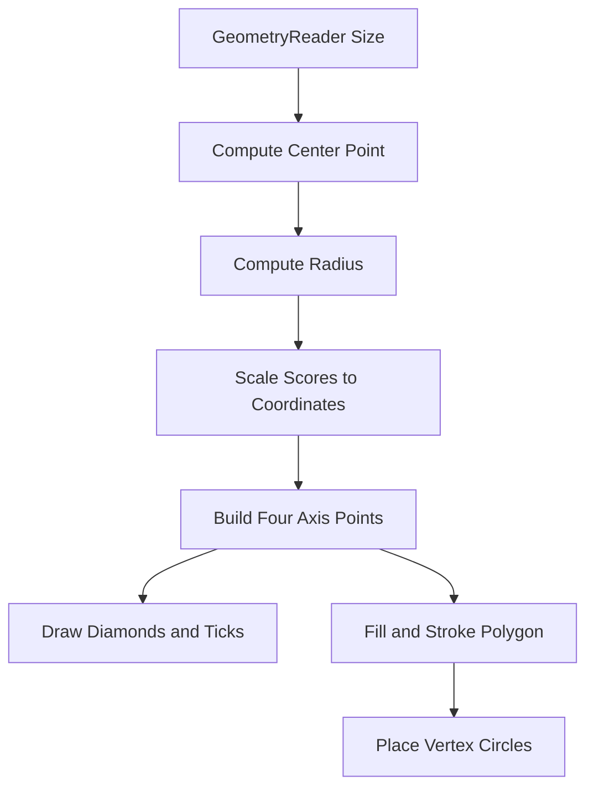
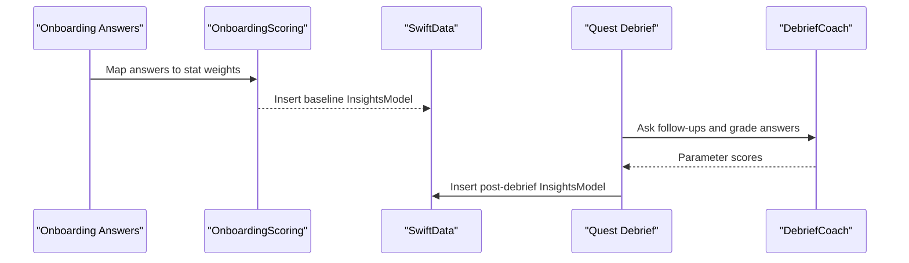
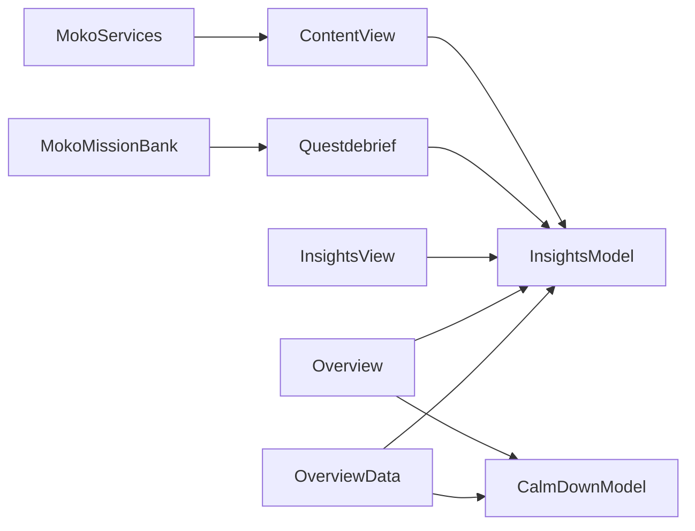

# Insights & Analytics

<cite>
**Referenced Files in This Document**
- [InsightsModel.swift](file://Moko/Moko/Models/InsightsModel.swift)
- [OverviewData.swift](file://Moko/Moko/Models/OverviewData.swift)
- [Insightsview.swift](file://Moko/Moko/UIScreens/homeScreens/Insights/Insightsview.swift)
- [Overview.swift](file://Moko/Moko/UIScreens/homeScreens/Overview.swift)
- [CalmDownModel.swift](file://Moko/Moko/Models/CalmDownModel.swift)
- [MokoMissionBank.swift](file://Moko/Moko/Features/AFM/MokoMissionBank.swift)
- [MokoServices.swift](file://Moko/Moko/Features/AFM/MokoServices.swift)
- [Questdebrief.swift](file://Moko/Moko/UIScreens/Quests/Questdebrief.swift)
- [ContentView.swift](file://Moko/Moko/ContentView.swift)
</cite>

## Table of Contents
1. [Introduction](#introduction)
2. [Project Structure](#project-structure)
3. [Core Components](#core-components)
4. [Architecture Overview](#architecture-overview)
5. [Detailed Component Analysis](#detailed-component-analysis)
6. [Dependency Analysis](#dependency-analysis)
7. [Performance Considerations](#performance-considerations)
8. [Troubleshooting Guide](#troubleshooting-guide)
9. [Conclusion](#conclusion)
10. [Appendices](#appendices)

## Introduction
This document explains Moko’s Insights & Analytics system. It covers how the app records, aggregates, and visualizes four wellness parameters: courage, clarity, presence, and warmth. It also documents the radar chart visualization, time-based aggregations for day/week/month/year, scoring algorithms that produce insight scores, the `InsightsModel` data structure, `OverviewData` calculations, and how user activities such as quests, debriefs, and calm-down exercises contribute to insight analytics. Finally, it includes guidance for extending metrics, customizing visualization styles, exporting analytics data, and handling privacy and local storage considerations.

## Project Structure
The insights feature is implemented across models, UI screens, and on-device coaching logic:

- **Models**: `InsightsModel` stores per-session insight scores; `CalmDownModel` stores exercise duration; `OverviewData` computes today’s insight average and calm-down summaries.
- **UI Screens**: `InsightsView` renders the main insights screen with a radar chart and parameter cards; `Overview` shows a compact radar chart and calm-down summary card.
- **Coaching & Scoring**: `MokoMissionBank` defines the four stats and mission templates; `MokoServices` contains onboarding scoring; `Questdebrief` runs the debrief conversation and produces per-session parameter scores.
- **App Entry**: `ContentView` initializes baseline insights from onboarding answers.

**Diagram sources**
- [InsightsModel.swift:11-26](file://Moko/Moko/Models/InsightsModel.swift#L11-L26)
- [CalmDownModel.swift:11-37](file://Moko/Moko/Models/CalmDownModel.swift#L11-L37)
- [OverviewData.swift:11-42](file://Moko/Moko/Models/OverviewData.swift#L11-L42)
- [Insightsview.swift:84-124](file://Moko/Moko/UIScreens/homeScreens/Insights/Insightsview.swift#L84-L124)
- [Overview.swift:42-44](file://Moko/Moko/UIScreens/homeScreens/Overview.swift#L42-L44)
- [MokoMissionBank.swift:10-24](file://Moko/Moko/Features/AFM/MokoMissionBank.swift#L10-L24)
- [MokoServices.swift:92-145](file://Moko/Moko/Features/AFM/MokoServices.swift#L92-L145)
- [Questdebrief.swift:484-618](file://Moko/Moko/UIScreens/Quests/Questdebrief.swift#L484-L618)
- [ContentView.swift:269-295](file://Moko/Moko/ContentView.swift#L269-L295)

**Section sources**
- [InsightsModel.swift:11-26](file://Moko/Moko/Models/InsightsModel.swift#L11-L26)
- [OverviewData.swift:11-42](file://Moko/Moko/Models/OverviewData.swift#L11-L42)
- [Insightsview.swift:84-124](file://Moko/Moko/UIScreens/homeScreens/Insights/Insightsview.swift#L84-L124)
- [Overview.swift:42-44](file://Moko/Moko/UIScreens/homeScreens/Overview.swift#L42-L44)
- [CalmDownModel.swift:11-37](file://Moko/Moko/Models/CalmDownModel.swift#L11-L37)
- [MokoMissionBank.swift:10-24](file://Moko/Moko/Features/AFM/MokoMissionBank.swift#L10-L24)
- [MokoServices.swift:92-145](file://Moko/Moko/Features/AFM/MokoServices.swift#L92-L145)
- [Questdebrief.swift:484-618](file://Moko/Moko/UIScreens/Quests/Questdebrief.swift#L484-L618)
- [ContentView.swift:269-295](file://Moko/Moko/ContentView.swift#L269-L295)

## Core Components
- **InsightsModel**: SwiftData model storing four integer scores (courage, clarity, presence, warmth) and a timestamp.
- **InsightsScores**: Aggregation struct computing averages per parameter and an overall average.
- **InsightsRange**: Enum defining Day/Week/Month/Year ranges used to filter records by calendar intervals.
- **InsightsParameter**: Presentation model for each parameter card, including band title, colors, detail text, analysis, and supported activity.
- **OverviewData**: Computes today’s insight average and calm-down minutes for today and the previous six days.
- **InsightsView**: Main insights screen with range picker, radar chart, overall score card, and parameter cards.
- **Overview**: Home overview showing today’s warmth score and a compact radar chart plus calm-down bar chart.
- **CalmDownModel**: Stores completed calm-down sessions with title, duration in seconds, and date.
- **Stat / MissionBank**: Defines the four stats and provides mission templates with per-stat follow-up questions.
- **OnboardingScoring**: Converts onboarding answers into initial insight scores.
- **DebriefSession / DummyDebriefCoach**: Runs the debrief conversation, grades answers, and produces per-session parameter scores.

**Section sources**
- [InsightsModel.swift:11-26](file://Moko/Moko/Models/InsightsModel.swift#L11-L26)
- [Insightsview.swift:34-80](file://Moko/Moko/UIScreens/homeScreens/Insights/Insightsview.swift#L34-L80)
- [OverviewData.swift:11-42](file://Moko/Moko/Models/OverviewData.swift#L11-L42)
- [CalmDownModel.swift:11-37](file://Moko/Moko/Models/CalmDownModel.swift#L11-L37)
- [MokoMissionBank.swift:10-24](file://Moko/Moko/Features/AFM/MokoMissionBank.swift#L10-L24)
- [MokoServices.swift:92-145](file://Moko/Moko/Features/AFM/MokoServices.swift#L92-L145)
- [Questdebrief.swift:484-618](file://Moko/Moko/UIScreens/Quests/Questdebrief.swift#L484-L618)

## Architecture Overview
The insights pipeline flows from user activities through on-device scoring into persistent models and finally into visualizations:

**Diagram sources**
- [Questdebrief.swift:484-618](file://Moko/Moko/UIScreens/Quests/Questdebrief.swift#L484-L618)
- [Insightsview.swift:84-124](file://Moko/Moko/UIScreens/homeScreens/Insights/Insightsview.swift#L84-L124)
- [InsightsModel.swift:11-26](file://Moko/Moko/Models/InsightsModel.swift#L11-L26)

## Detailed Component Analysis

### Data Model: InsightsModel
`InsightsModel` is a SwiftData entity representing one insight record. It stores four integer metrics and a timestamp. The constructor assigns values to properties and sets the recording date.

**Diagram sources**
- [InsightsModel.swift:11-26](file://Moko/Moko/Models/InsightsModel.swift#L11-L26)

**Section sources**
- [InsightsModel.swift:11-26](file://Moko/Moko/Models/InsightsModel.swift#L11-L26)

### Aggregation: InsightsScores
`InsightsScores` calculates the average per parameter over a set of `InsightsModel` records. If no records exist, it returns zero values. The overall score is the arithmetic mean of the four parameter averages.

Key behaviors:
- Zero fallback when no records are present.
- Per-parameter averages computed by summing and dividing by record count.
- Overall average derived from the four parameter averages.

Complexity:
- Time: O(n) where n is the number of records.
- Space: O(1) additional memory beyond input collection.

**Section sources**
- [Insightsview.swift:34-67](file://Moko/Moko/UIScreens/homeScreens/Insights/Insightsview.swift#L34-L67)

### Time-Based Aggregations: Day/Week/Month/Year
`InsightsRange` maps UI selections to calendar components. `InsightsView` uses `Calendar.current.dateInterval(of:for:)` to filter records into the selected range. If the selected range has no records, it falls back to all-time averages if any records exist; otherwise, it shows zeros.

Flow:
1. User selects Day, Week, Month, or Year.
2. Screen computes the calendar interval for “today,” “this week,” etc.
3. Records are filtered by whether their date falls within the interval.
4. Scores are averaged over filtered records.
5. Fallback behavior ensures meaningful display even when the selected range is empty.

**Diagram sources**
- [Insightsview.swift:15-32](file://Moko/Moko/UIScreens/homeScreens/Insights/Insightsview.swift#L15-L32)
- [Insightsview.swift:99-115](file://Moko/Moko/UIScreens/homeScreens/Insights/Insightsview.swift#L99-L115)

**Section sources**
- [Insightsview.swift:15-32](file://Moko/Moko/UIScreens/homeScreens/Insights/Insightsview.swift#L15-L32)
- [Insightsview.swift:99-115](file://Moko/Moko/UIScreens/homeScreens/Insights/Insightsview.swift#L99-L115)

### Radar Chart Visualization
The radar chart displays four axes:
- Top: Courage
- Right: Presence
- Bottom: Warmth
- Left: Clarity

Implementation highlights:
- Center point and radius are calculated from geometry.
- Points are computed by scaling each score (0–100) against the radius.
- Background diamonds represent grid lines at 25, 50, 75, and 100.
- Axes and tick marks are drawn using paths.
- The filled polygon connects the four points and is stroked with a green outline.
- Vertex circles mark each axis endpoint.

There are two radar implementations:
- `InsightsView.radar`: Full-screen chart with labels and ticks.
- `Overview.InsightsRadarChartView`: Compact chart used in the overview card.

**Diagram sources**
- [Insightsview.swift:258-367](file://Moko/Moko/UIScreens/homeScreens/Insights/Insightsview.swift#L258-L367)
- [Overview.swift:498-588](file://Moko/Moko/UIScreens/homeScreens/Overview.swift#L498-L588)

**Section sources**
- [Insightsview.swift:258-367](file://Moko/Moko/UIScreens/homeScreens/Insights/Insightsview.swift#L258-L367)
- [Overview.swift:498-588](file://Moko/Moko/UIScreens/homeScreens/Overview.swift#L498-L588)

### OverviewData Calculations
`OverviewData` computes:
- Today’s insight average warmth via `InsightsScores`.
- Today’s total calm-down minutes.
- Calm-down minutes for the last six days, oldest first.

Algorithm:
1. Filter `InsightsModel` records for today.
2. Compute `InsightsScores` from those records.
3. Filter `CalmDownModel` records for today and sum durations.
4. Convert seconds to minutes.
5. For each of the last six days, filter and sum durations, then convert to minutes.

Complexity:
- Time: O(n + m) where n is insight records and m is calm-down records.
- Space: O(1) extra beyond output arrays.

**Section sources**
- [OverviewData.swift:11-42](file://Moko/Moko/Models/OverviewData.swift#L11-L42)

### How User Activities Contribute to Insight Scores
Insight scores originate from two primary sources:

1. **Onboarding Baseline**: Initial insight scores are generated from onboarding answers using `OnboardingScoring`, which maps question tags to stats and weights, producing a baseline `InsightsModel`.
2. **Debrief Sessions**: After completing a quest, the debrief asks three follow-up questions focused on presence, clarity, and warmth. Each answer is graded, and final scores are aggregated per parameter. The resulting scores are persisted as an `InsightsModel` record.

**Diagram sources**
- [MokoServices.swift:92-145](file://Moko/Moko/Features/AFM/MokoServices.swift#L92-L145)
- [ContentView.swift:269-295](file://Moko/Moko/ContentView.swift#L269-L295)
- [Questdebrief.swift:484-618](file://Moko/Moko/UIScreens/Quests/Questdebrief.swift#L484-L618)

**Section sources**
- [MokoServices.swift:92-145](file://Moko/Moko/Features/AFM/MokoServices.swift#L92-L145)
- [ContentView.swift:269-295](file://Moko/Moko/ContentView.swift#L269-L295)
- [Questdebrief.swift:484-618](file://Moko/Moko/UIScreens/Quests/Questdebrief.swift#L484-L618)

### Scoring Algorithms
- **Onboarding Scoring**: Converts yes/no answers into weighted contributions per stat, clamping results to a defined range.
- **Debrief Scoring**: Uses linguistic heuristics (word count, action verbs, directness, observation words, warmth words) to compute confidence and parameter scores. Final scores aggregate maximums per parameter and apply minimum thresholds to avoid very low values.

These algorithms ensure that insight scores reflect both self-reported baselines and behavioral signals during debrief interactions.

**Section sources**
- [MokoServices.swift:92-145](file://Moko/Moko/Features/AFM/MokoServices.swift#L92-L145)
- [Questdebrief.swift:128-225](file://Moko/Moko/UIScreens/Quests/Questdebrief.swift#L128-L225)
- [Questdebrief.swift:102-125](file://Moko/Moko/UIScreens/Quests/Questdebrief.swift#L102-L125)

### Parameter Cards and Banding
Each parameter card shows:
- Name and rounded score.
- Band badge: Strength, Grounded & Steady, or Growth Focus.
- Progress bar.
- Definition of what the parameter means.
- Personalized analysis based on band and stat.
- Supported-by tag indicating relevant activities (e.g., Reflection & Debrief, Grounding Exercise, Box Breathing, Mirror Reflection).

Banding thresholds:
- Strength: score ≥ 70
- Steady: 50 ≤ score < 70
- Growth: score < 50

**Section sources**
- [Insightsview.swift:117-219](file://Moko/Moko/UIScreens/homeScreens/Insights/Insightsview.swift#L117-L219)
- [MokoServices.swift:80-90](file://Moko/Moko/Features/AFM/MokoServices.swift#L80-L90)

## Dependency Analysis
The following diagram shows key dependencies between models, UI, and scoring components:

**Diagram sources**
- [MokoMissionBank.swift:10-24](file://Moko/Moko/Features/AFM/MokoMissionBank.swift#L10-L24)
- [MokoServices.swift:92-145](file://Moko/Moko/Features/AFM/MokoServices.swift#L92-L145)
- [ContentView.swift:269-295](file://Moko/Moko/ContentView.swift#L269-L295)
- [InsightsModel.swift:11-26](file://Moko/Moko/Models/InsightsModel.swift#L11-L26)
- [CalmDownModel.swift:11-37](file://Moko/Moko/Models/CalmDownModel.swift#L11-L37)
- [OverviewData.swift:11-42](file://Moko/Moko/Models/OverviewData.swift#L11-L42)
- [Insightsview.swift:84-124](file://Moko/Moko/UIScreens/homeScreens/Insights/Insightsview.swift#L84-L124)
- [Overview.swift:42-44](file://Moko/Moko/UIScreens/homeScreens/Overview.swift#L42-L44)

**Section sources**
- [MokoMissionBank.swift:10-24](file://Moko/Moko/Features/AFM/MokoMissionBank.swift#L10-L24)
- [MokoServices.swift:92-145](file://Moko/Moko/Features/AFM/MokoServices.swift#L92-L145)
- [ContentView.swift:269-295](file://Moko/Moko/ContentView.swift#L269-L295)
- [InsightsModel.swift:11-26](file://Moko/Moko/Models/InsightsModel.swift#L11-L26)
- [CalmDownModel.swift:11-37](file://Moko/Moko/Models/CalmDownModel.swift#L11-L37)
- [OverviewData.swift:11-42](file://Moko/Moko/Models/OverviewData.swift#L11-L42)
- [Insightsview.swift:84-124](file://Moko/Moko/UIScreens/homeScreens/Insights/Insightsview.swift#L84-L124)
- [Overview.swift:42-44](file://Moko/Moko/UIScreens/homeScreens/Overview.swift#L42-L44)

## Performance Considerations
- **Filtering Strategy**: Both `InsightsView` and `OverviewData` filter records by date using `Calendar.isDate(_:inSameDayAs:)` and `dateInterval(of:for:)`. This is efficient for typical user datasets but can be optimized further by indexing dates or pre-aggregating daily summaries if datasets grow large.
- **Averaging Complexity**: `InsightsScores` performs linear scans over records. For very large histories, consider maintaining running sums and counts per day/week/month to reduce recomputation.
- **Rendering Optimization**: The radar chart draws multiple paths and markers. Reuse computed points and avoid unnecessary recalculations by caching geometry-derived values when possible.
- **Query Sorting**: `InsightsView` queries records sorted by date descending. This avoids manual sorting and improves list rendering performance.

Recommendations:
- Introduce a lightweight aggregation cache keyed by date ranges.
- Precompute daily totals for calm-down minutes to speed up multi-day charts.
- Use batched updates for bulk insertions of insight records after debrief completion.

[No sources needed since this section provides general guidance]

## Troubleshooting Guide
Common issues and resolutions:

- **Empty Radar Chart or Zero Scores**:
  - Cause: No insight records exist for the selected range.
  - Resolution: Complete a quest and debrief to generate insight records. The view falls back to all-time averages if available.

- **Incorrect Date Filtering**:
  - Cause: Timezone or calendar mismatches.
  - Resolution: Ensure `Calendar.current` is consistent across filtering and insertion. Verify that insight record dates align with local time.

- **Unexpected Low Scores**:
  - Cause: Short or vague debrief answers may produce lower confidence and parameter scores.
  - Resolution: Encourage richer responses. The debrief coach applies minimum thresholds to avoid extremely low scores.

- **Calm Down Minutes Not Updating**:
  - Cause: Exercise not logged or duration not saved.
  - Resolution: Confirm that `logCalmDown` is called with correct duration and that `CalmDownModel` records are persisted.

**Section sources**
- [Insightsview.swift:99-115](file://Moko/Moko/UIScreens/homeScreens/Insights/Insightsview.swift#L99-L115)
- [CalmDownModel.swift:27-37](file://Moko/Moko/Models/CalmDownModel.swift#L27-L37)
- [Questdebrief.swift:152-225](file://Moko/Moko/UIScreens/Quests/Questdebrief.swift#L152-L225)

## Conclusion
Moko’s Insights & Analytics system combines onboarding self-reports, debrief interactions, and calm-down exercises to produce actionable wellness metrics. The radar chart visualizes courage, clarity, presence, and warmth, while time-based aggregations allow users to review trends across day, week, month, and year. The architecture separates data models, UI rendering, and scoring logic, making it extensible for new metrics and visualization enhancements. Privacy-conscious design keeps sensitive analytics local, and user control over data sharing should be implemented alongside these features.

[No sources needed since this section summarizes without analyzing specific files]

## Appendices

### Adding New Metrics
To add a new metric (for example, “Resilience”):
1. Extend the stat enum to include the new case.
2. Update scoring mappings in `OnboardingScoring` to assign weights for the new stat.
3. Add the new field to `InsightsModel`.
4. Update `InsightsScores` to compute averages for the new metric.
5. Extend the radar chart to plot the new axis.
6. Add parameter card logic and analysis text for the new metric.
7. Update debrief coaching to ask follow-up questions and grade the new metric.

**Section sources**
- [MokoMissionBank.swift:10-24](file://Moko/Moko/Features/AFM/MokoMissionBank.swift#L10-L24)
- [MokoServices.swift:92-145](file://Moko/Moko/Features/AFM/MokoServices.swift#L92-L145)
- [InsightsModel.swift:11-26](file://Moko/Moko/Models/InsightsModel.swift#L11-L26)
- [Insightsview.swift:34-67](file://Moko/Moko/UIScreens/homeScreens/Insights/Insightsview.swift#L34-L67)
- [Insightsview.swift:258-367](file://Moko/Moko/UIScreens/homeScreens/Insights/Insightsview.swift#L258-L367)
- [Questdebrief.swift:128-225](file://Moko/Moko/UIScreens/Quests/Questdebrief.swift#L128-L225)

### Customizing Visualization Styles
- Colors and themes are defined locally in views (e.g., `green`, `mint`, `titleDark`, `gray`).
- To customize radar chart appearance:
  - Adjust stroke widths and fill opacities in `InsightsView.radar` and `Overview.InsightsRadarChartView`.
  - Modify tick marks and axis numbers in the path drawing code.
  - Update vertex circle sizes and colors.

**Section sources**
- [Insightsview.swift:90-98](file://Moko/Moko/UIScreens/homeScreens/Insights/Insightsview.swift#L90-L98)
- [Insightsview.swift:258-367](file://Moko/Moko/UIScreens/homeScreens/Insights/Insightsview.swift#L258-L367)
- [Overview.swift:498-588](file://Moko/Moko/UIScreens/homeScreens/Overview.swift#L498-L588)

### Exporting Analytics Data
Recommended approach:
- Serialize `InsightsModel` records to JSON or CSV for export.
- Include fields: courage, clarity, presence, warmth, date.
- Optionally include aggregated summaries (daily/weekly/monthly averages).
- Provide user-facing controls to export and share data securely.

Note: This repository does not include built-in export functionality. Implement export logic in a dedicated service layer and integrate it with the insights UI.

[No sources needed since this section provides general guidance]

### Data Privacy and Local Storage
- Insight and calm-down records are stored locally via SwiftData (`@Model`).
- Sensitive analytics remain on-device unless explicitly shared by the user.
- Implement user preferences to control data sharing, encryption at rest, and secure export options.
- Avoid uploading raw insight records without explicit consent.

**Section sources**
- [InsightsModel.swift:11-26](file://Moko/Moko/Models/InsightsModel.swift#L11-L26)
- [CalmDownModel.swift:11-37](file://Moko/Moko/Models/CalmDownModel.swift#L11-L37)