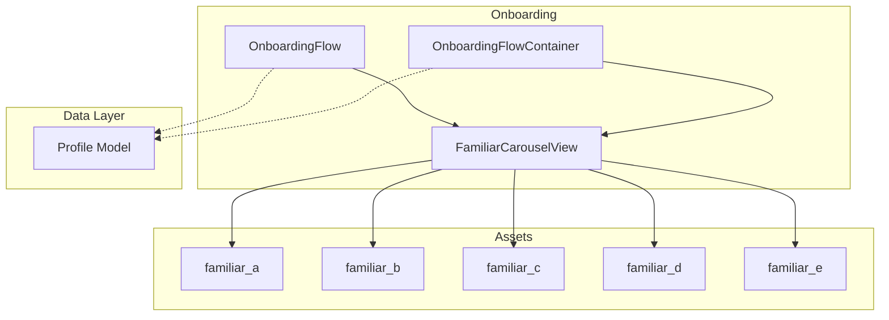
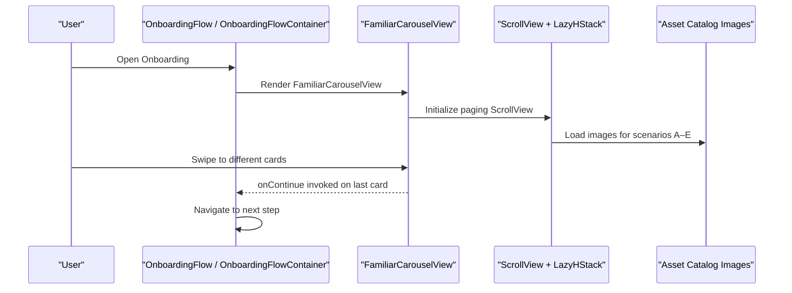
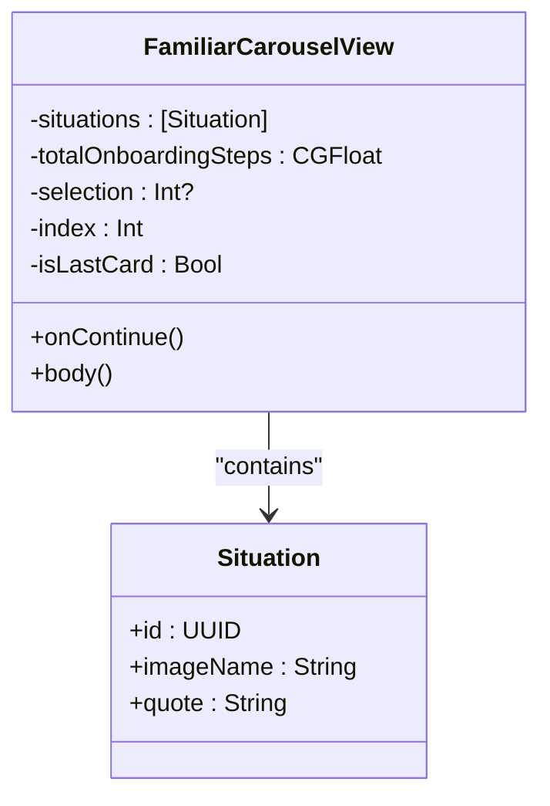
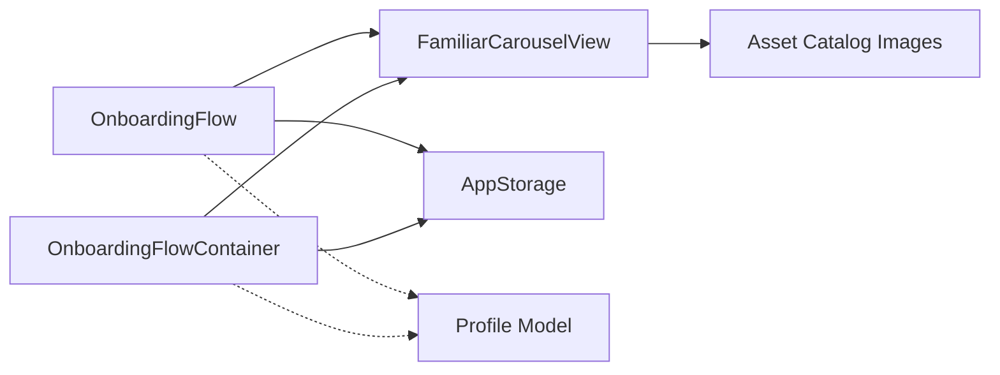

# Familiar Scenario Carousel

<cite>
**Referenced Files in This Document**
- [FamiliarCarouselView.swift](file://Moko/Moko/UIScreens/Onboarding/FamiliarCarouselView.swift)
- [onboardingFlow.swift](file://Moko/Moko/UIScreens/Onboarding/onboardingFlow.swift)
- [ContentView.swift](file://Moko/Moko/ContentView.swift)
- [Profile.swift](file://Moko/Moko/Models/Profile.swift)
- [familiar_a.imageset Contents.json](file://Moko/Moko/Assets.xcassets/familiar_a.imageset/Contents.json)
- [familiar_b.imageset Contents.json](file://Moko/Moko/Assets.xcassets/familiar_b.imageset/Contents.json)
- [familiar_c.imageset Contents.json](file://Moko/Moko/Assets.xcassets/familiar_c.imageset/Contents.json)
- [familiar_d.imageset Contents.json](file://Moko/Moko/Assets.xcassets/familiar_d.imageset/Contents.json)
- [familiar_e.imageset Contents.json](file://Moko/Moko/Assets.xcassets/familiar_e.imageset/Contents.json)
</cite>

## Table of Contents
1. Introduction
2. Project Structure
3. Core Components
4. Architecture Overview
5. Detailed Component Analysis
6. Dependency Analysis
7. Performance Considerations
8. Troubleshooting Guide
9. Conclusion

## Introduction
This document explains the Familiar Scenario Carousel component used during onboarding. It covers how users select familiar scenarios (A through E), the carousel UI implementation with swipe gestures, visual feedback for selected scenarios, and how selections are stored in the Profile model. It also documents image assets management, accessibility considerations, responsive design, extension points for adding new scenarios, customization options, interaction handling, and performance optimization strategies for images and memory.

## Project Structure
The Familiar Scenario Carousel is implemented as a SwiftUI view within the Onboarding feature. It is embedded into the onboarding navigation flow and integrates with the app’s data layer via the Profile model. Image assets for each scenario are managed in the asset catalog.

**Diagram sources**
- [FamiliarCarouselView.swift:9-132](file://Moko/Moko/UIScreens/Onboarding/FamiliarCarouselView.swift#L9-L132)
- [onboardingFlow.swift:15-51](file://Moko/Moko/UIScreens/Onboarding/onboardingFlow.swift#L15-L51)
- [ContentView.swift:310-357](file://Moko/Moko/ContentView.swift#L310-L357)
- [Profile.swift:12-58](file://Moko/Moko/Models/Profile.swift#L12-L58)
- [familiar_a.imageset Contents.json:1-22](file://Moko/Moko/Assets.xcassets/familiar_a.imageset/Contents.json#L1-L22)
- [familiar_b.imageset Contents.json:1-22](file://Moko/Moko/Assets.xcassets/familiar_b.imageset/Contents.json#L1-L22)
- [familiar_c.imageset Contents.json:1-22](file://Moko/Moko/Assets.xcassets/familiar_c.imageset/Contents.json#L1-L22)
- [familiar_d.imageset Contents.json:1-22](file://Moko/Moko/Assets.xcassets/familiar_d.imageset/Contents.json#L1-L22)
- [familiar_e.imageset Contents.json:1-22](file://Moko/Moko/Assets.xcassets/familiar_e.imageset/Contents.json#L1-L22)

**Section sources**
- [FamiliarCarouselView.swift:9-132](file://Moko/Moko/UIScreens/Onboarding/FamiliarCarouselView.swift#L9-L132)
- [onboardingFlow.swift:15-51](file://Moko/Moko/UIScreens/Onboarding/onboardingFlow.swift#L15-L51)
- [ContentView.swift:310-357](file://Moko/Moko/ContentView.swift#L310-L357)
- [Profile.swift:12-58](file://Moko/Moko/Models/Profile.swift#L12-L58)

## Core Components
- FamiliarScenario Carousel View: Renders a horizontally paging ScrollView with cards representing familiar scenarios A–E. It tracks the current page index and shows a progress bar and page dots. The Continue button appears only on the last card.
- Situation Data Model: Represents each scenario with an image name and quote.
- Onboarding Flow Integration: Embeds the carousel into the onboarding navigation stack and advances to the next step when the user taps Continue.
- Profile Model: SwiftData model that stores user profile information; currently does not include fields for familiar scenario selections.

Key responsibilities:
- Rendering and paging of scenario cards
- Visual feedback via progress bar and page dots
- Navigation integration to proceed after selection
- Asset loading for scenario images

**Section sources**
- [FamiliarCarouselView.swift:3-132](file://Moko/Moko/UIScreens/Onboarding/FamiliarCarouselView.swift#L3-L132)
- [onboardingFlow.swift:15-51](file://Moko/Moko/UIScreens/Onboarding/onboardingFlow.swift#L15-L51)
- [ContentView.swift:310-357](file://Moko/Moko/ContentView.swift#L310-L357)
- [Profile.swift:12-58](file://Moko/Moko/Models/Profile.swift#L12-L58)

## Architecture Overview
The carousel is a self-contained SwiftUI view that uses built-in scroll APIs for paging behavior. It is mounted by the onboarding flows and delegates continuation to its parent via a closure.

**Diagram sources**
- [FamiliarCarouselView.swift:84-100](file://Moko/Moko/UIScreens/Onboarding/FamiliarCarouselView.swift#L84-L100)
- [FamiliarCarouselView.swift:117-131](file://Moko/Moko/UIScreens/Onboarding/FamiliarCarouselView.swift#L117-L131)
- [onboardingFlow.swift:15-51](file://Moko/Moko/UIScreens/Onboarding/onboardingFlow.swift#L15-L51)
- [ContentView.swift:310-357](file://Moko/Moko/ContentView.swift#L310-L357)

## Detailed Component Analysis

### FamiliarCarouselView
- Data structure:
  - Situation: Identifiable item with imageName and quote.
  - situations: Array of five scenarios (A–E).
- State:
  - selection: Current page index (Int?).
  - index: Derived from selection.
  - isLastCard: Boolean indicating if the current page is the last one.
- UI sections:
  - Progress bar: Shows overall onboarding progress based on totalOnboardingSteps.
  - Cards: Horizontal paging ScrollView with LazyHStack; each card renders an image and quote.
  - Page dots: Visual indicator of current page; active dot is wider.
  - Continue button: Visible only on the last card; triggers onContinue.

Swipe and paging behavior:
- Uses ScrollView(.horizontal) with scrollTargetBehavior(.paging) and scrollPosition bound to selection.
- Bounce behavior is enabled for natural feel.

Visual feedback:
- Active page dot changes width and color.
- Progress bar animates as index changes.
- Card background and stroke provide consistent card styling.

Accessibility:
- No explicit accessibility labels or roles are set for images or text in this file.
- Screen readers will announce default content; consider adding accessibility labels for images and quotes to improve clarity.

Responsive design:
- Uses containerRelativeFrame(.horizontal) to size cards relative to container width.
- Fixed height for cards and frame constraints ensure consistent layout across devices.

Extensibility:
- Add new scenarios by appending to the situations array and ensuring corresponding image assets exist.

Customization:
- Adjust totalOnboardingSteps to align progress with your full onboarding sequence.
- Modify colors, fonts, spacing, and corner radii to match theme guidelines.

Interaction handling:
- onContinue closure is called when the user taps Continue on the last card.
- Selection state is driven by scroll position; no explicit tap-to-select logic exists.

Code snippet paths:
- Situation struct and situations array: [FamiliarCarouselView.swift:3-24](file://Moko/Moko/UIScreens/Onboarding/FamiliarCarouselView.swift#L3-L24)
- Paging ScrollView and scrollPosition binding: [FamiliarCarouselView.swift:84-100](file://Moko/Moko/UIScreens/Onboarding/FamiliarCarouselView.swift#L84-L100)
- Page dots and active state: [FamiliarCarouselView.swift:104-113](file://Moko/Moko/UIScreens/Onboarding/FamiliarCarouselView.swift#L104-L113)
- Continue button visibility and action: [FamiliarCarouselView.swift:117-131](file://Moko/Moko/UIScreens/Onboarding/FamiliarCarouselView.swift#L117-L131)
- Card rendering: [FamiliarCarouselView.swift:136-164](file://Moko/Moko/UIScreens/Onboarding/FamiliarCarouselView.swift#L136-L164)

**Diagram sources**
- [FamiliarCarouselView.swift:3-24](file://Moko/Moko/UIScreens/Onboarding/FamiliarCarouselView.swift#L3-L24)
- [FamiliarCarouselView.swift:9-31](file://Moko/Moko/UIScreens/Onboarding/FamiliarCarouselView.swift#L9-L31)

**Section sources**
- [FamiliarCarouselView.swift:3-164](file://Moko/Moko/UIScreens/Onboarding/FamiliarCarouselView.swift#L3-L164)

### Onboarding Flow Integration
- OnboardingFlow and OnboardingFlowContainer both embed FamiliarCarouselView and navigate to subsequent steps upon Continue.
- They manage AppStorage values for username and age and transition to WelcomeView at the end.

Integration points:
- FamiliarCarouselView.onContinue triggers navigation to NameEntryView.
- Subsequent steps update AppStorage and eventually call onComplete callback.

Code snippet paths:
- OnboardingFlow embedding carousel: [onboardingFlow.swift:15-51](file://Moko/Moko/UIScreens/Onboarding/onboardingFlow.swift#L15-L51)
- OnboardingFlowContainer embedding carousel: [ContentView.swift:310-357](file://Moko/Moko/ContentView.swift#L310-L357)

**Section sources**
- [onboardingFlow.swift:15-51](file://Moko/Moko/UIScreens/Onboarding/onboardingFlow.swift#L15-L51)
- [ContentView.swift:310-357](file://Moko/Moko/ContentView.swift#L310-L357)

### Profile Model and Storage
- Profile is a SwiftData @Model with fields such as username, handle, ageRange, age, xp, streaks, timestamps, and optional profileImageData.
- There are no fields for storing familiar scenario selections in the current Profile model.

Implications:
- If you need to persist familiar scenario selections, add appropriate fields to Profile and update persistence logic where profiles are created or saved.

Code snippet paths:
- Profile definition and initializer: [Profile.swift:12-58](file://Moko/Moko/Models/Profile.swift#L12-L58)

**Section sources**
- [Profile.swift:12-58](file://Moko/Moko/Models/Profile.swift#L12-L58)

### Image Assets Management
- Each scenario uses an asset named familiar_a through familiar_e.
- Asset catalogs define multiple scale variants (1x, 2x, 3x) for universal idiom.

Management notes:
- Ensure image files are added to the corresponding .imageset and referenced by exact names in the situations array.
- Keep filenames consistent with the Contents.json entries.

Code snippet paths:
- familiar_a: [familiar_a.imageset Contents.json:1-22](file://Moko/Moko/Assets.xcassets/familiar_a.imageset/Contents.json#L1-L22)
- familiar_b: [familiar_b.imageset Contents.json:1-22](file://Moko/Moko/Assets.xcassets/familiar_b.imageset/Contents.json#L1-L22)
- familiar_c: [familiar_c.imageset Contents.json:1-22](file://Moko/Moko/Assets.xcassets/familiar_c.imageset/Contents.json#L1-L22)
- familiar_d: [familiar_d.imageset Contents.json:1-22](file://Moko/Moko/Assets.xcassets/familiar_d.imageset/Contents.json#L1-L22)
- familiar_e: [familiar_e.imageset Contents.json:1-22](file://Moko/Moko/Assets.xcassets/familiar_e.imageset/Contents.json#L1-L22)

**Section sources**
- [familiar_a.imageset Contents.json:1-22](file://Moko/Moko/Assets.xcassets/familiar_a.imageset/Contents.json#L1-L22)
- [familiar_b.imageset Contents.json:1-22](file://Moko/Moko/Assets.xcassets/familiar_b.imageset/Contents.json#L1-L22)
- [familiar_c.imageset Contents.json:1-22](file://Moko/Moko/Assets.xcassets/familiar_c.imageset/Contents.json#L1-L22)
- [familiar_d.imageset Contents.json:1-22](file://Moko/Moko/Assets.xcassets/familiar_d.imageset/Contents.json#L1-L22)
- [familiar_e.imageset Contents.json:1-22](file://Moko/Moko/Assets.xcassets/familiar_e.imageset/Contents.json#L1-L22)

## Dependency Analysis
- FamiliarCarouselView depends on:
  - SwiftUI framework for views, ScrollView, LazyHStack, animations.
  - Asset catalog images for scenario visuals.
- OnboardingFlow and OnboardingFlowContainer depend on:
  - FamiliarCarouselView for initial onboarding step.
  - AppStorage for username and age.
  - NavigationStack for routing between steps.
- Profile model is independent but can be extended to store carousel selections.

**Diagram sources**
- [FamiliarCarouselView.swift:84-100](file://Moko/Moko/UIScreens/Onboarding/FamiliarCarouselView.swift#L84-L100)
- [onboardingFlow.swift:15-51](file://Moko/Moko/UIScreens/Onboarding/onboardingFlow.swift#L15-L51)
- [ContentView.swift:310-357](file://Moko/Moko/ContentView.swift#L310-L357)
- [Profile.swift:12-58](file://Moko/Moko/Models/Profile.swift#L12-L58)

**Section sources**
- [FamiliarCarouselView.swift:84-100](file://Moko/Moko/UIScreens/Onboarding/FamiliarCarouselView.swift#L84-L100)
- [onboardingFlow.swift:15-51](file://Moko/Moko/UIScreens/Onboarding/onboardingFlow.swift#L15-L51)
- [ContentView.swift:310-357](file://Moko/Moko/ContentView.swift#L310-L357)
- [Profile.swift:12-58](file://Moko/Moko/Models/Profile.swift#L12-L58)

## Performance Considerations
- Image loading:
  - Use appropriately sized images for target resolutions to reduce memory footprint.
  - Avoid excessively large PNGs; prefer optimized formats where possible.
  - Leverage Xcode’s asset catalog optimizations and avoid unnecessary 3x assets if not needed.
- Scroll performance:
  - LazyHStack defers off-screen items, improving memory usage.
  - Keep card content simple to minimize layout passes.
- Animations:
  - Prefer lightweight animations; avoid heavy transforms on large images.
- Memory management:
  - Reuse images where possible; avoid duplicating large assets.
  - Monitor memory usage during development using Instruments.

[No sources needed since this section provides general guidance]

## Troubleshooting Guide
- Images not displaying:
  - Verify asset names match exactly (familiar_a through familiar_e).
  - Confirm asset catalog entries include required scale variants.
- Continue button not appearing:
  - Ensure the carousel reaches the last card; check situations count and index calculation.
- Progress bar misalignment:
  - Validate totalOnboardingSteps matches your actual onboarding step count.
- Accessibility concerns:
  - Add accessibility labels to images and quotes for screen reader clarity.
  - Consider adding accessibility hints to explain the carousel purpose.

**Section sources**
- [FamiliarCarouselView.swift:117-131](file://Moko/Moko/UIScreens/Onboarding/FamiliarCarouselView.swift#L117-L131)
- [familiar_a.imageset Contents.json:1-22](file://Moko/Moko/Assets.xcassets/familiar_a.imageset/Contents.json#L1-L22)
- [familiar_b.imageset Contents.json:1-22](file://Moko/Moko/Assets.xcassets/familiar_b.imageset/Contents.json#L1-L22)
- [familiar_c.imageset Contents.json:1-22](file://Moko/Moko/Assets.xcassets/familiar_c.imageset/Contents.json#L1-L22)
- [familiar_d.imageset Contents.json:1-22](file://Moko/Moko/Assets.xcassets/familiar_d.imageset/Contents.json#L1-L22)
- [familiar_e.imageset Contents.json:1-22](file://Moko/Moko/Assets.xcassets/familiar_e.imageset/Contents.json#L1-L22)

## Conclusion
The Familiar Scenario Carousel provides a clean, swipeable onboarding experience with clear visual feedback and straightforward integration into the app’s navigation flow. While it currently does not persist scenario selections to the Profile model, extending the model and updating persistence logic enables full tracking of user preferences. With careful attention to image optimization, accessibility labeling, and responsive layout, the carousel can deliver a smooth and inclusive user experience.

[No sources needed since this section summarizes without analyzing specific files]