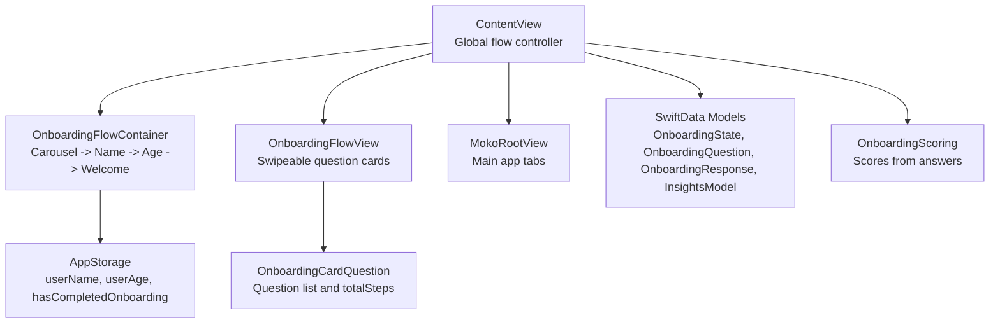
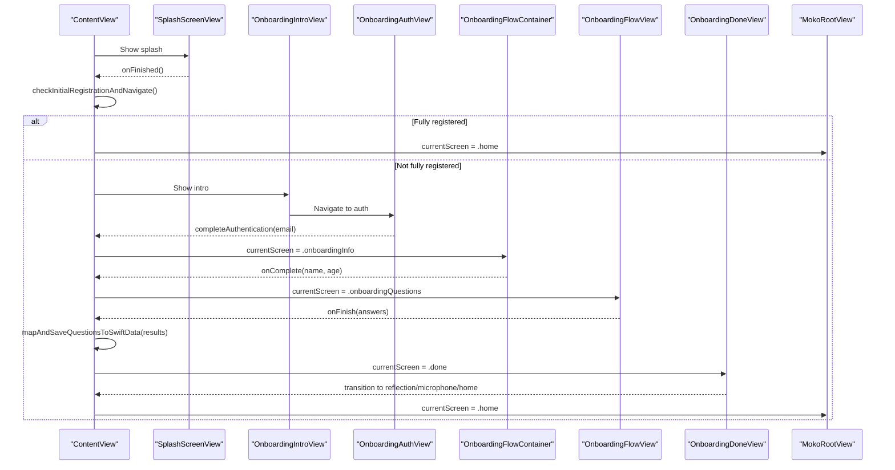
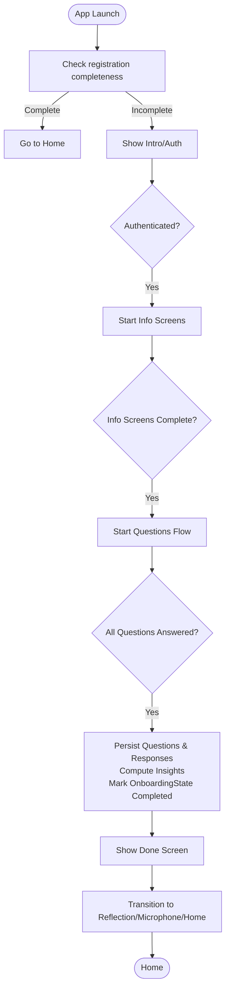
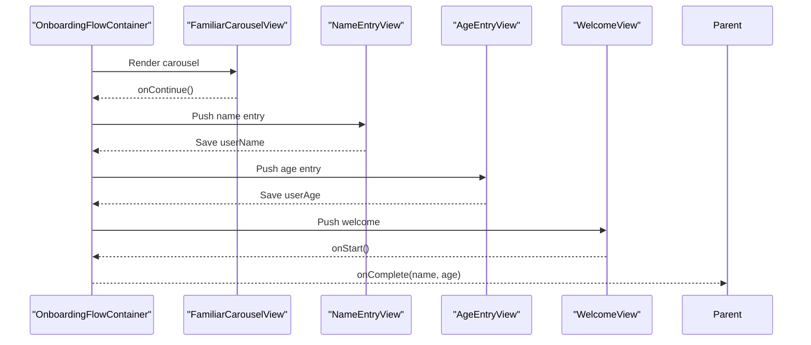
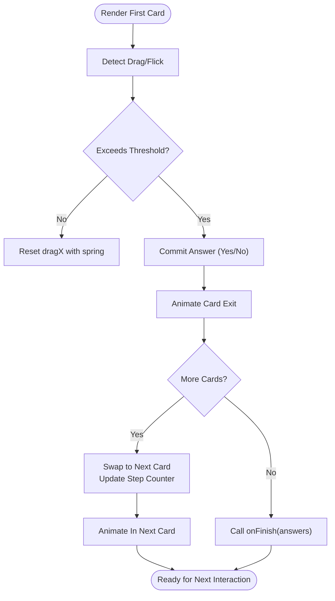
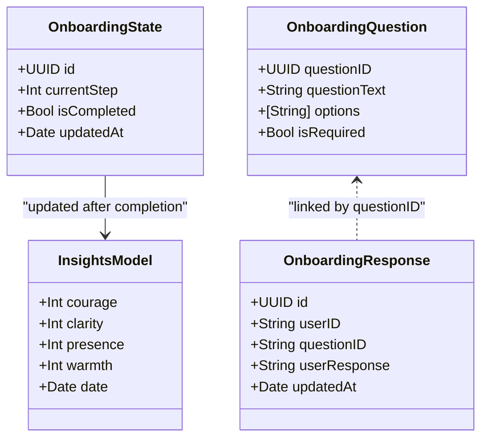
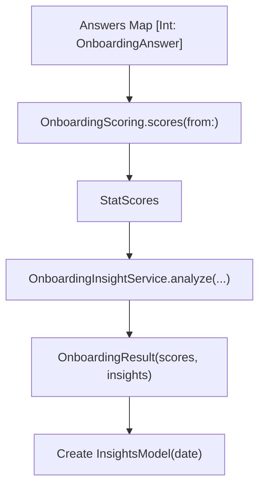
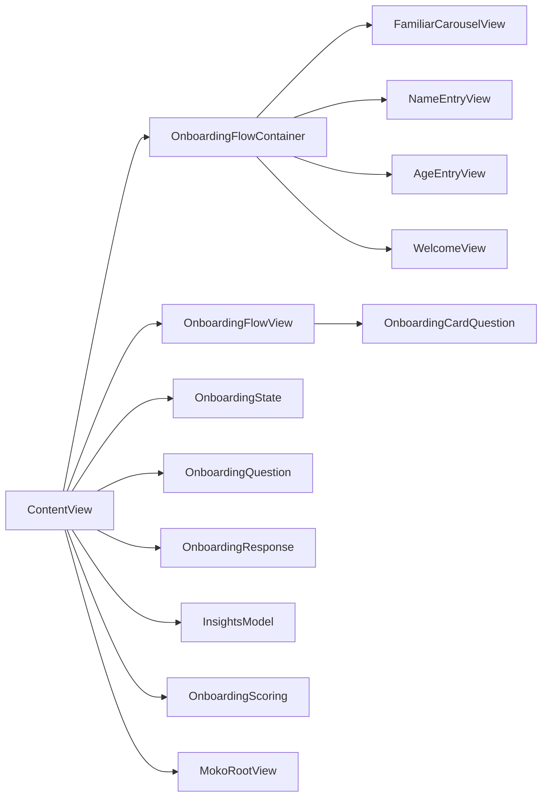

# Onboarding Flow Architecture

<cite>
**Referenced Files in This Document**
- [ContentView.swift](file://Moko/Moko/ContentView.swift)
- [OnboardingFlowView.swift](file://Moko/Moko/UIScreens/Onboarding_Questions/OnboardingFlowView.swift)
- [onboardingFlow.swift](file://Moko/Moko/UIScreens/Onboarding/onboardingFlow.swift)
- [OnboardingQuestions.swift](file://Moko/Moko/UIScreens/Onboarding_Questions/OnboardingQuestions.swift)
- [Onboarding_state.swift](file://Moko/Moko/Models/Onboarding_state.swift)
- [Onboarding_Question.swift](file://Moko/Moko/Models/Onboarding_Question.swift)
- [Onboarding_Response.swift](file://Moko/Moko/Models/Onboarding_Response.swift)
- [InsightsModel.swift](file://Moko/Moko/Models/InsightsModel.swift)
- [MokoServices.swift](file://Moko/Moko/Features/AFM/MokoServices.swift)
- [MokoRootView.swift](file://Moko/Moko/MokoRootView.swift)
</cite>

## Table of Contents
1. [Introduction](#introduction)
2. [Project Structure](#project-structure)
3. [Core Components](#core-components)
4. [Architecture Overview](#architecture-overview)
5. [Detailed Component Analysis](#detailed-component-analysis)
6. [Dependency Analysis](#dependency-analysis)
7. [Performance Considerations](#performance-considerations)
8. [Troubleshooting Guide](#troubleshooting-guide)
9. [Conclusion](#conclusion)
10. [Appendices](#appendices)

## Introduction
This document explains the Onboarding Flow Architecture used by the app to guide new users through initial setup and self-assessment questions, persist their progress, and transition into the main application. It covers:
- The overall flow control mechanism and when onboarding is shown or skipped
- State management using AppStorage and @State variables
- Navigation between different onboarding steps
- Completion status determination and persistence
- Data models for onboarding state, questions, and responses
- Integration with the main app navigation
- Guidance for extending the flow with new steps or modifying screen order

## Project Structure
The onboarding system spans several layers:
- Entry point and global flow controller: ContentView
- Two-phase onboarding:
  - Info screens (carousel, name entry, age entry, welcome): OnboardingFlowContainer and related views
  - Questionnaire screens (swipeable cards): OnboardingFlowView and OnboardingCardQuestion definitions
- Persistence models: OnboardingState, OnboardingQuestion, OnboardingResponse, InsightsModel
- Scoring and insights: OnboardingScoring and OnboardingInsightService
- Main app shell after completion: MokoRootView

**Diagram sources**
- [ContentView.swift:21-31](file://Moko/Moko/ContentView.swift#L21-L31)
- [ContentView.swift:143-168](file://Moko/Moko/ContentView.swift#L143-L168)
- [onboardingFlow.swift:3-7](file://Moko/Moko/UIScreens/Onboarding/onboardingFlow.swift#L3-L7)
- [OnboardingFlowView.swift:6-20](file://Moko/Moko/UIScreens/Onboarding_Questions/OnboardingFlowView.swift#L6-L20)
- [OnboardingQuestions.swift:8-15](file://Moko/Moko/UIScreens/Onboarding_Questions/OnboardingQuestions.swift#L8-L15)
- [Onboarding_state.swift:4-23](file://Moko/Moko/Models/Onboarding_state.swift#L4-L23)
- [Onboarding_Question.swift:11-36](file://Moko/Moko/Models/Onboarding_Question.swift#L11-L36)
- [Onboarding_Response.swift:11-35](file://Moko/Moko/Models/Onboarding_Response.swift#L11-L35)
- [InsightsModel.swift:11-24](file://Moko/Moko/Models/InsightsModel.swift#L11-L24)
- [MokoServices.swift:92-145](file://Moko/Moko/Features/AFM/MokoServices.swift#L92-L145)

**Section sources**
- [ContentView.swift:12-31](file://Moko/Moko/ContentView.swift#L12-L31)
- [MokoRootView.swift:14-100](file://Moko/Moko/MokoRootView.swift#L14-L100)

## Core Components
- Global flow controller (ContentView):
  - Manages current screen via an enum-based state machine
  - Decides whether to show onboarding or skip directly to home based on registration completeness
  - Persists profile, onboarding state, and question responses to SwiftData
  - Computes baseline insights from questionnaire answers
- Info screens (OnboardingFlowContainer + onboardingFlow.swift):
  - Uses a NavigationStack path to navigate Carousel -> NameEntry -> AgeEntry -> Welcome
  - Stores userName and userAge in AppStorage
  - Sets hasCompletedOnboarding flag upon finishing welcome
- Questionnaire screens (OnboardingFlowView + OnboardingQuestions.swift):
  - Renders swipeable cards for each question
  - Tracks current index, step counter, answers map, and animation states
  - Emits final answers map to parent on finish
- Persistence models:
  - OnboardingState: tracks currentStep, isCompleted, updatedAt
  - OnboardingQuestion: defines question text, options, required flag
  - OnboardingResponse: stores userID, questionID, userResponse
  - InsightsModel: stores computed scores per stat and date
- Scoring and insights (MokoServices.swift):
  - Maps answers to weighted stats and computes normalized scores
  - Generates insight text per stat (with fallbacks if needed)

**Section sources**
- [ContentView.swift:21-31](file://Moko/Moko/ContentView.swift#L21-L31)
- [ContentView.swift:217-236](file://Moko/Moko/ContentView.swift#L217-L236)
- [ContentView.swift:250-308](file://Moko/Moko/ContentView.swift#L250-L308)
- [onboardingFlow.swift:3-52](file://Moko/Moko/UIScreens/Onboarding/onboardingFlow.swift#L3-L52)
- [OnboardingFlowView.swift:6-36](file://Moko/Moko/UIScreens/Onboarding_Questions/OnboardingFlowView.swift#L6-L36)
- [OnboardingQuestions.swift:8-51](file://Moko/Moko/UIScreens/Onboarding_Questions/OnboardingQuestions.swift#L8-L51)
- [Onboarding_state.swift:4-23](file://Moko/Moko/Models/Onboarding_state.swift#L4-L23)
- [Onboarding_Question.swift:11-36](file://Moko/Moko/Models/Onboarding_Question.swift#L11-L36)
- [Onboarding_Response.swift:11-35](file://Moko/Moko/Models/Onboarding_Response.swift#L11-L35)
- [InsightsModel.swift:11-24](file://Moko/Moko/Models/InsightsModel.swift#L11-L24)
- [MokoServices.swift:92-145](file://Moko/Moko/Features/AFM/MokoServices.swift#L92-L145)

## Architecture Overview
The app uses a top-level screen state machine to orchestrate onboarding and main app navigation. After splash, it checks registration completeness; if incomplete, it routes through intro/auth, then info screens, then questionnaire screens, and finally to the main app.

**Diagram sources**
- [ContentView.swift:80-210](file://Moko/Moko/ContentView.swift#L80-L210)
- [ContentView.swift:217-236](file://Moko/Moko/ContentView.swift#L217-L236)
- [ContentView.swift:250-308](file://Moko/Moko/ContentView.swift#L250-L308)
- [OnboardingFlowView.swift:157-197](file://Moko/Moko/UIScreens/Onboarding_Questions/OnboardingFlowView.swift#L157-L197)

## Detailed Component Analysis

### Global Flow Controller (ContentView)
- Screen state machine:
  - Enum AppScreen enumerates all major screens including splash, intro, auth, onboardingInfo, onboardingQuestions, done, reflection, microphonePreprompt, accountDeleted, home
  - currentScreen drives which view is rendered
- Registration completeness:
  - isUserFullyRegistered returns true only when profiles are present, onboardingResponses are present, and OnboardingState.isCompleted is true
- Navigation decisions:
  - checkInitialRegistrationAndNavigate routes to home if fully registered; otherwise shows intro
  - completeAuthentication routes to home if already fully registered; otherwise starts onboardingInfo
- Onboarding data persistence:
  - finishOnboardingInfo creates Profile and OnboardingState records and transitions to onboardingQuestions
  - mapAndSaveQuestionsToSwiftData persists OnboardingQuestion and OnboardingResponse records, initializes InsightsModel, and updates OnboardingState to completed
- User progress persistence:
  - userName and userAge are stored via AppStorage during info screens
  - hasCompletedOnboarding is set to true at the end of welcome (in the standalone OnboardingFlow), while the integrated container delegates completion to parent

**Diagram sources**
- [ContentView.swift:21-31](file://Moko/Moko/ContentView.swift#L21-L31)
- [ContentView.swift:55-57](file://Moko/Moko/ContentView.swift#L55-L57)
- [ContentView.swift:217-236](file://Moko/Moko/ContentView.swift#L217-L236)
- [ContentView.swift:250-308](file://Moko/Moko/ContentView.swift#L250-L308)

**Section sources**
- [ContentView.swift:21-31](file://Moko/Moko/ContentView.swift#L21-L31)
- [ContentView.swift:55-57](file://Moko/Moko/ContentView.swift#L55-L57)
- [ContentView.swift:217-236](file://Moko/Moko/ContentView.swift#L217-L236)
- [ContentView.swift:250-308](file://Moko/Moko/ContentView.swift#L250-L308)

### Info Screens Flow (OnboardingFlowContainer and onboardingFlow.swift)
- Navigation stack:
  - FamiliarCarouselView triggers next step to name entry
  - NameEntryView saves userName and proceeds to age entry
  - AgeEntryView saves userAge and proceeds to welcome
  - WelcomeView sets hasCompletedOnboarding and signals completion back to parent container
- State storage:
  - userName and userAge are persisted via AppStorage
  - hasCompletedOnboarding is toggled upon completing welcome
- Parent integration:
  - OnboardingFlowContainer wraps this sequence and calls onComplete(name, age) to finalize info phase

**Diagram sources**
- [onboardingFlow.swift:9-52](file://Moko/Moko/UIScreens/Onboarding/onboardingFlow.swift#L9-L52)
- [ContentView.swift:313-358](file://Moko/Moko/ContentView.swift#L313-L358)

**Section sources**
- [onboardingFlow.swift:3-52](file://Moko/Moko/UIScreens/Onboarding/onboardingFlow.swift#L3-L52)
- [ContentView.swift:313-358](file://Moko/Moko/ContentView.swift#L313-L358)

### Questionnaire Flow (OnboardingFlowView and OnboardingQuestions.swift)
- Card rendering and interaction:
  - Swipe right = Yes, swipe left = No
  - Drag gesture calculates threshold and flick to determine answer
  - Commit function animates card exit, swaps to next card, updates step counter, and handles last-card completion
- Progress tracking:
  - header displays “x of totalSteps” and segmented progress bar
  - step drives UI progress and counter
- Completion callback:
  - onFinish emits answers map keyed by question id
- Question data:
  - OnboardingCardQuestion.all defines ordered questions and totalSteps

**Diagram sources**
- [OnboardingFlowView.swift:135-197](file://Moko/Moko/UIScreens/Onboarding_Questions/OnboardingFlowView.swift#L135-L197)
- [OnboardingQuestions.swift:17-51](file://Moko/Moko/UIScreens/Onboarding_Questions/OnboardingQuestions.swift#L17-L51)

**Section sources**
- [OnboardingFlowView.swift:6-36](file://Moko/Moko/UIScreens/Onboarding_Questions/OnboardingFlowView.swift#L6-L36)
- [OnboardingFlowView.swift:135-197](file://Moko/Moko/UIScreens/Onboarding_Questions/OnboardingFlowView.swift#L135-L197)
- [OnboardingQuestions.swift:8-51](file://Moko/Moko/UIScreens/Onboarding_Questions/OnboardingQuestions.swift#L8-L51)

### Data Models and Persistence
- OnboardingState:
  - Tracks currentStep, isCompleted, updatedAt
  - Updated to completed once questionnaire finishes
- OnboardingQuestion:
  - Defines questionText, options, isRequired
  - Persisted per question during questionnaire completion
- OnboardingResponse:
  - Links userID, questionID, userResponse
  - Persisted per answer during questionnaire completion
- InsightsModel:
  - Stores computed scores per stat and date
  - Initialized from baseline scoring after questionnaire completion

**Diagram sources**
- [Onboarding_state.swift:4-23](file://Moko/Moko/Models/Onboarding_state.swift#L4-L23)
- [Onboarding_Question.swift:11-36](file://Moko/Moko/Models/Onboarding_Question.swift#L11-L36)
- [Onboarding_Response.swift:11-35](file://Moko/Moko/Models/Onboarding_Response.swift#L11-L35)
- [InsightsModel.swift:11-24](file://Moko/Moko/Models/InsightsModel.swift#L11-L24)

**Section sources**
- [Onboarding_state.swift:4-23](file://Moko/Moko/Models/Onboarding_state.swift#L4-L23)
- [Onboarding_Question.swift:11-36](file://Moko/Moko/Models/Onboarding_Question.swift#L11-L36)
- [Onboarding_Response.swift:11-35](file://Moko/Moko/Models/Onboarding_Response.swift#L11-L35)
- [InsightsModel.swift:11-24](file://Moko/Moko/Models/InsightsModel.swift#L11-L24)

### Scoring and Insights
- OnboardingScoring maps answers to weighted stats and normalizes scores within a defined range
- OnboardingInsightService generates insight text per stat, falling back to predefined text if AI generation fails or is out of bounds
- Baseline insights are created and persisted immediately after questionnaire completion

**Diagram sources**
- [MokoServices.swift:92-145](file://Moko/Moko/Features/AFM/MokoServices.swift#L92-L145)
- [MokoServices.swift:152-185](file://Moko/Moko/Features/AFM/MokoServices.swift#L152-L185)
- [ContentView.swift:292-295](file://Moko/Moko/ContentView.swift#L292-L295)

**Section sources**
- [MokoServices.swift:92-145](file://Moko/Moko/Features/AFM/MokoServices.swift#L92-L145)
- [MokoServices.swift:152-185](file://Moko/Moko/Features/AFM/MokoServices.swift#L152-L185)
- [ContentView.swift:292-295](file://Moko/Moko/ContentView.swift#L292-L295)

## Dependency Analysis
- ContentView depends on:
  - OnboardingFlowContainer (info screens)
  - OnboardingFlowView (questionnaire screens)
  - SwiftData models (OnboardingState, OnboardingQuestion, OnboardingResponse, InsightsModel)
  - OnboardingScoring and OnboardingInsightService for scoring and insights
- OnboardingFlowView depends on:
  - OnboardingCardQuestion for question data and totalSteps
- OnboardingFlowContainer depends on:
  - FamiliarCarouselView, NameEntryView, AgeEntryView, WelcomeView
- MokoRootView is the main app shell after onboarding completion

**Diagram sources**
- [ContentView.swift:143-168](file://Moko/Moko/ContentView.swift#L143-L168)
- [ContentView.swift:250-308](file://Moko/Moko/ContentView.swift#L250-L308)
- [OnboardingFlowView.swift:6-20](file://Moko/Moko/UIScreens/Onboarding_Questions/OnboardingFlowView.swift#L6-L20)
- [OnboardingQuestions.swift:8-51](file://Moko/Moko/UIScreens/Onboarding_Questions/OnboardingQuestions.swift#L8-L51)
- [onboardingFlow.swift:9-52](file://Moko/Moko/UIScreens/Onboarding/onboardingFlow.swift#L9-L52)

**Section sources**
- [ContentView.swift:143-168](file://Moko/Moko/ContentView.swift#L143-L168)
- [ContentView.swift:250-308](file://Moko/Moko/ContentView.swift#L250-L308)
- [OnboardingFlowView.swift:6-20](file://Moko/Moko/UIScreens/Onboarding_Questions/OnboardingFlowView.swift#L6-L20)
- [OnboardingQuestions.swift:8-51](file://Moko/Moko/UIScreens/Onboarding_Questions/OnboardingQuestions.swift#L8-L51)
- [onboardingFlow.swift:9-52](file://Moko/Moko/UIScreens/Onboarding/onboardingFlow.swift#L9-L52)

## Performance Considerations
- Animation performance:
  - OnboardingFlowView uses lightweight animations and haptic feedback; ensure animations are not blocked by heavy computations
- Data persistence:
  - Batch insertions for questions and responses occur once per completion; avoid repeated saves during interactions
- Scoring and insights:
  - Scoring is synchronous and lightweight; insight generation may be asynchronous and should not block UI transitions

[No sources needed since this section provides general guidance]

## Troubleshooting Guide
- Onboarding not shown:
  - Verify isUserFullyRegistered logic; ensure profiles, onboardingResponses, and OnboardingState.isCompleted are correctly populated
- Progress not persisted:
  - Confirm modelContext.save() is called after inserting/updating OnboardingState, OnboardingQuestion, OnboardingResponse, and InsightsModel
- Answers not saved:
  - Ensure onFinish callback in OnboardingFlowView is invoked and mapAndSaveQuestionsToSwiftData processes all questions
- Completion status incorrect:
  - Check that OnboardingState.isCompleted is set to true and currentStep equals totalSteps after questionnaire completion

**Section sources**
- [ContentView.swift:55-57](file://Moko/Moko/ContentView.swift#L55-L57)
- [ContentView.swift:297-308](file://Moko/Moko/ContentView.swift#L297-L308)
- [OnboardingFlowView.swift:157-197](file://Moko/Moko/UIScreens/Onboarding_Questions/OnboardingFlowView.swift#L157-L197)

## Conclusion
The Onboarding Flow Architecture combines a clear screen state machine, robust state management via AppStorage and @State, and persistent data modeling with SwiftData. It guides users through two phases—informational screens and a swipeable questionnaire—then computes baseline insights and marks onboarding as complete. The design supports easy extension by adding new questions or adjusting the sequence of info screens, while maintaining consistent navigation and persistence behavior.

[No sources needed since this section summarizes without analyzing specific files]

## Appendices

### Extending the Flow with New Steps
- Add a new info screen:
  - Define a new case in OnboardingStep
  - Insert the new view in OnboardingFlowContainer’s navigationDestination switch
  - Update the sequence by appending the new step before or after existing steps
- Modify the questionnaire sequence:
  - Edit OnboardingCardQuestion.all to add, remove, or reorder questions
  - Adjust totalSteps accordingly if you change the number of questions

**Section sources**
- [onboardingFlow.swift:3-7](file://Moko/Moko/UIScreens/Onboarding/onboardingFlow.swift#L3-L7)
- [ContentView.swift:313-358](file://Moko/Moko/ContentView.swift#L313-L358)
- [OnboardingQuestions.swift:17-51](file://Moko/Moko/UIScreens/Onboarding_Questions/OnboardingQuestions.swift#L17-L51)