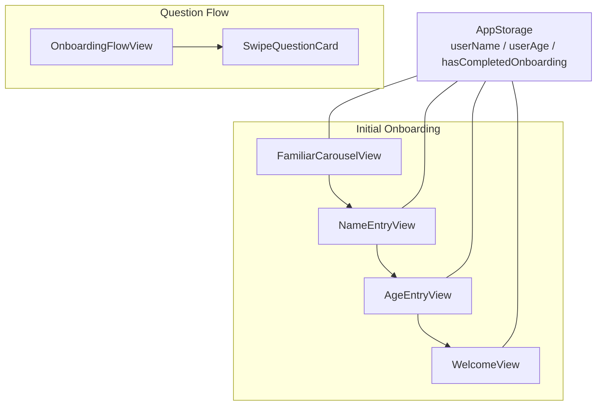
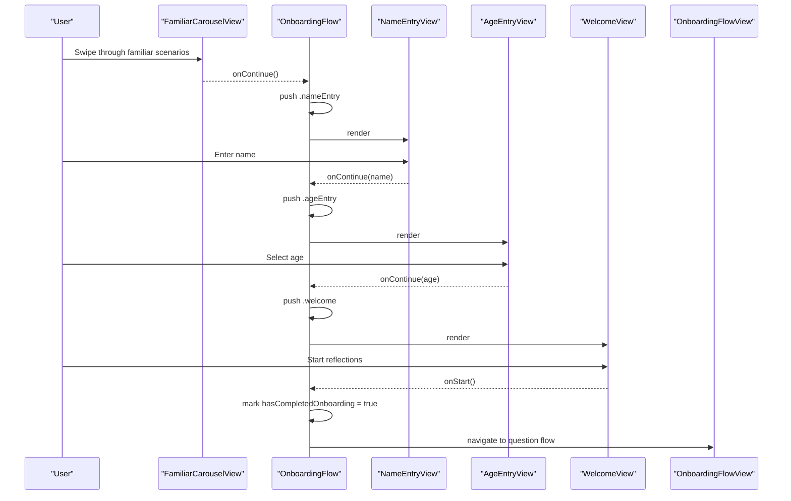
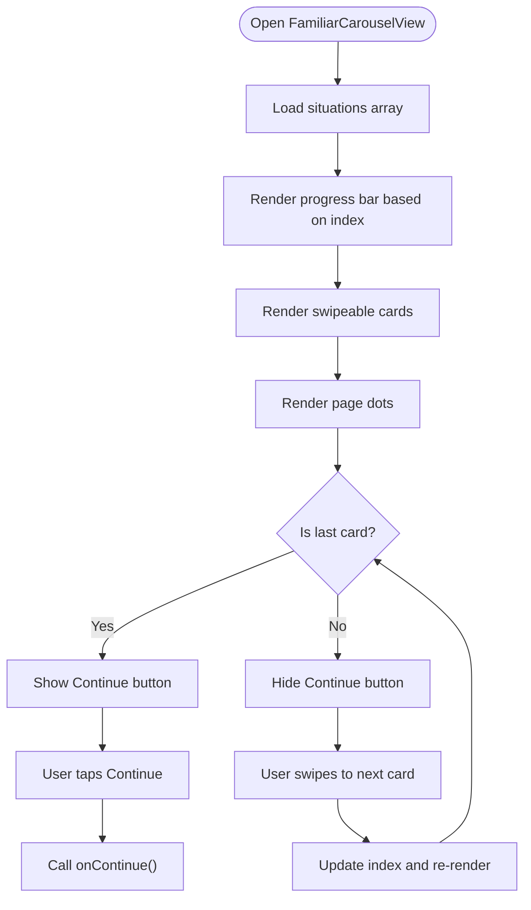
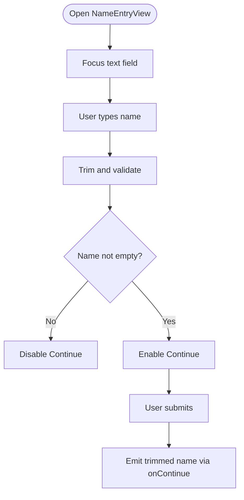
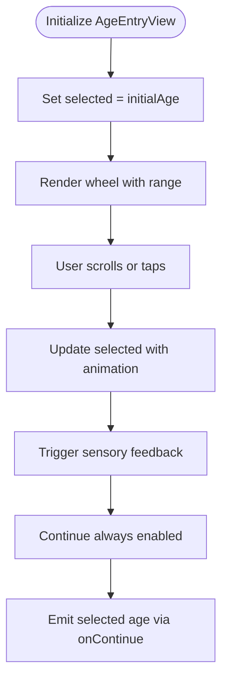
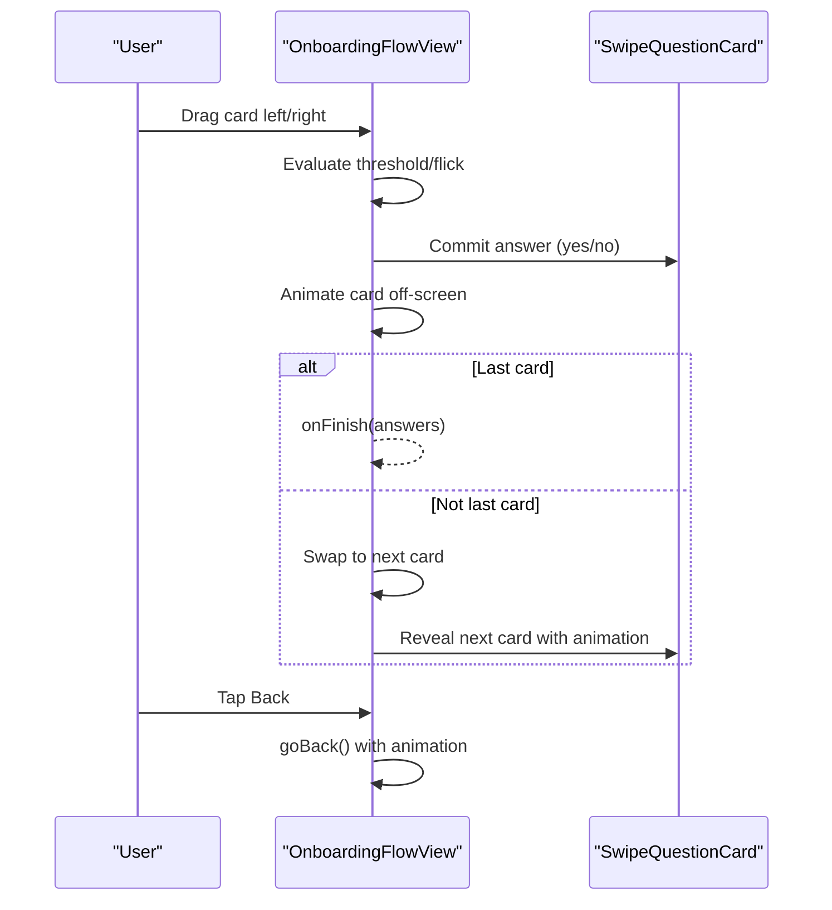
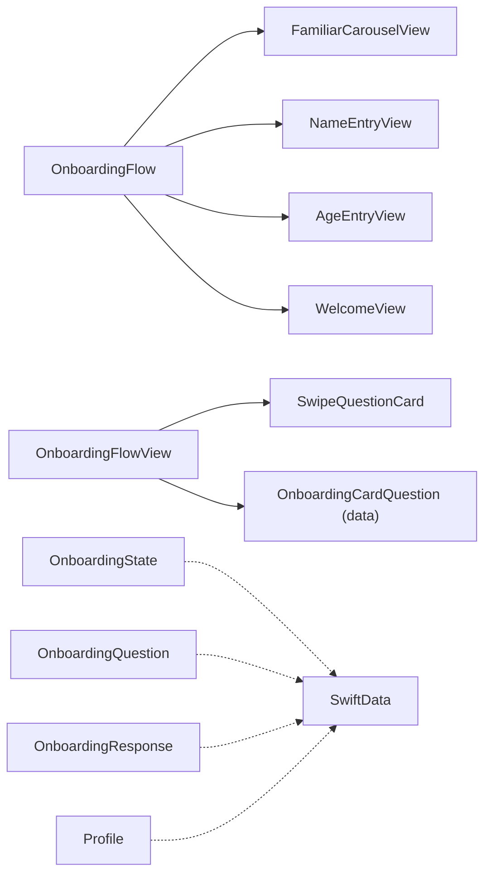

# Onboarding System

<cite>
**Referenced Files in This Document**
- [onboardingFlow.swift](file://Moko/Moko/UIScreens/Onboarding/onboardingFlow.swift)
- [FamiliarCarouselView.swift](file://Moko/Moko/UIScreens/Onboarding/FamiliarCarouselView.swift)
- [NameEntryView.swift](file://Moko/Moko/UIScreens/Onboarding/NameEntryView.swift)
- [AgeEntryView.swift](file://Moko/Moko/UIScreens/Onboarding/AgeEntryView.swift)
- [WelcomeView.swift](file://Moko/Moko/UIScreens/Onboarding/WelcomeView.swift)
- [OnboardingFlowView.swift](file://Moko/Moko/UIScreens/Onboarding_Questions/OnboardingFlowView.swift)
- [SwipeQuestionCard.swift](file://Moko/Moko/UIScreens/Onboarding_Questions/SwipeQuestionCard.swift)
- [Onboarding_state.swift](file://Moko/Moko/Models/Onboarding_state.swift)
- [Onboarding_Question.swift](file://Moko/Moko/Models/Onboarding_Question.swift)
- [Onboarding_Response.swift](file://Moko/Moko/Models/Onboarding_Response.swift)
- [Profile.swift](file://Moko/Moko/Models/Profile.swift)
- [MokoRootView.swift](file://Moko/Moko/MokoRootView.swift)
</cite>

## Table of Contents
1. [Introduction](#introduction)
2. [Project Structure](#project-structure)
3. [Core Components](#core-components)
4. [Architecture Overview](#architecture-overview)
5. [Detailed Component Analysis](#detailed-component-analysis)
6. [Dependency Analysis](#dependency-analysis)
7. [Performance Considerations](#performance-considerations)
8. [Troubleshooting Guide](#troubleshooting-guide)
9. [Conclusion](#conclusion)
10. [Appendices](#appendices)

## Introduction
This document explains Moko’s onboarding system: a guided, multi-step flow that introduces users through relatable scenarios, collects basic personal information, presents a swipeable question set, and finishes with a welcome screen before transitioning into the main app experience. It covers state persistence using AppStorage, navigation between steps, how the app decides whether to show onboarding versus the main interface, and implementation details for each screen. It also includes accessibility considerations, error handling strategies, and guidance for extending or customizing the flow.

## Project Structure
The onboarding system is split into two related flows:
- Initial onboarding screens: familiar scenario carousel, name entry, age entry, and welcome completion.
- Question flow: swipeable cards where users answer “Yes” or “No” style questions.

**Diagram sources**
- [onboardingFlow.swift:9-51](file://Moko/Moko/UIScreens/Onboarding/onboardingFlow.swift#L9-L51)
- [FamiliarCarouselView.swift:9-132](file://Moko/Moko/UIScreens/Onboarding/FamiliarCarouselView.swift#L9-L132)
- [NameEntryView.swift:3-107](file://Moko/Moko/UIScreens/Onboarding/NameEntryView.swift#L3-L107)
- [AgeEntryView.swift:3-138](file://Moko/Moko/UIScreens/Onboarding/AgeEntryView.swift#L3-L138)
- [WelcomeView.swift:3-72](file://Moko/Moko/UIScreens/Onboarding/WelcomeView.swift#L3-L72)
- [OnboardingFlowView.swift:6-79](file://Moko/Moko/UIScreens/Onboarding_Questions/OnboardingFlowView.swift#L6-L79)
- [SwipeQuestionCard.swift:5-111](file://Moko/Moko/UIScreens/Onboarding_Questions/SwipeQuestionCard.swift#L5-L111)

**Section sources**
- [onboardingFlow.swift:9-51](file://Moko/Moko/UIScreens/Onboarding/onboardingFlow.swift#L9-L51)
- [OnboardingFlowView.swift:6-79](file://Moko/Moko/UIScreens/Onboarding_Questions/OnboardingFlowView.swift#L6-L79)

## Core Components
- FamiliarCarouselView: Presents relatable situations as swipeable cards and tracks progress across the entire onboarding journey.
- NameEntryView: Collects the user’s name with validation and keyboard-friendly UX.
- AgeEntryView: Provides an accessible wheel picker for age selection with haptic feedback.
- WelcomeView: Personalized greeting and transition point to the question flow.
- OnboardingFlowView: Manages the swipeable question sequence, answers, and transitions.
- SwipeQuestionCard: Renders individual question cards with Yes/No controls and visual feedback.
- State models: OnboardingState, OnboardingQuestion, OnboardingResponse, and Profile define data structures used by the app.

Key responsibilities:
- Navigation orchestration and step progression are handled by OnboardingFlow.
- Data persistence uses AppStorage for lightweight user preferences.
- The question flow is decoupled from initial onboarding but can be reached after the welcome screen.

**Section sources**
- [FamiliarCarouselView.swift:9-132](file://Moko/Moko/UIScreens/Onboarding/FamiliarCarouselView.swift#L9-L132)
- [NameEntryView.swift:3-107](file://Moko/Moko/UIScreens/Onboarding/NameEntryView.swift#L3-L107)
- [AgeEntryView.swift:3-138](file://Moko/Moko/UIScreens/Onboarding/AgeEntryView.swift#L3-L138)
- [WelcomeView.swift:3-72](file://Moko/Moko/UIScreens/Onboarding/WelcomeView.swift#L3-L72)
- [OnboardingFlowView.swift:6-79](file://Moko/Moko/UIScreens/Onboarding_Questions/OnboardingFlowView.swift#L6-L79)
- [SwipeQuestionCard.swift:5-111](file://Moko/Moko/UIScreens/Onboarding_Questions/SwipeQuestionCard.swift#L5-L111)
- [Onboarding_state.swift:4-23](file://Moko/Moko/Models/Onboarding_state.swift#L4-L23)
- [Onboarding_Question.swift:11-36](file://Moko/Moko/Models/Onboarding_Question.swift#L11-L36)
- [Onboarding_Response.swift:11-35](file://Moko/Moko/Models/Onboarding_Response.swift#L11-L35)
- [Profile.swift:12-59](file://Moko/Moko/Models/Profile.swift#L12-L59)

## Architecture Overview
The onboarding architecture separates concerns into UI components and state management:
- UI layer: Each step is a SwiftUI View with clear input/output contracts via callbacks.
- Navigation layer: NavigationStack drives step transitions based on an enum of steps.
- Persistence layer: AppStorage stores user preferences (name, age, completion flag).
- Question layer: A separate flow manages swipeable question cards and answers.

**Diagram sources**
- [onboardingFlow.swift:15-51](file://Moko/Moko/UIScreens/Onboarding/onboardingFlow.swift#L15-L51)
- [FamiliarCarouselView.swift:117-131](file://Moko/Moko/UIScreens/Onboarding/FamiliarCarouselView.swift#L117-L131)
- [NameEntryView.swift:87-106](file://Moko/Moko/UIScreens/Onboarding/NameEntryView.swift#L87-L106)
- [AgeEntryView.swift:126-137](file://Moko/Moko/UIScreens/Onboarding/AgeEntryView.swift#L126-L137)
- [WelcomeView.swift:60-71](file://Moko/Moko/UIScreens/Onboarding/WelcomeView.swift#L60-L71)
- [OnboardingFlowView.swift:6-79](file://Moko/Moko/UIScreens/Onboarding_Questions/OnboardingFlowView.swift#L6-L79)

## Detailed Component Analysis

### FamiliarCarouselView
Purpose:
- Show relatable situations as swipeable cards.
- Track overall onboarding progress via a top progress bar.
- Enable continuation only on the last card.

Key behaviors:
- Uses a horizontal paging ScrollView with scrollPosition binding to track the active card index.
- Progress bar width scales with the current card index relative to total onboarding steps.
- Continue button appears only on the final card and triggers onContinue.

Accessibility and UX:
- Clear visual hierarchy with large headings and readable quotes.
- Smooth animations for progress and page dots.
- Keyboard and VoiceOver friendly due to standard SwiftUI primitives.

**Diagram sources**
- [FamiliarCarouselView.swift:34-132](file://Moko/Moko/UIScreens/Onboarding/FamiliarCarouselView.swift#L34-L132)

**Section sources**
- [FamiliarCarouselView.swift:9-132](file://Moko/Moko/UIScreens/Onboarding/FamiliarCarouselView.swift#L9-L132)

### NameEntryView
Purpose:
- Capture the user’s name with validation and smooth keyboard interaction.

Key behaviors:
- Auto-focuses the text field on appear.
- Disables Continue until a non-empty trimmed name is entered.
- Emits the trimmed name via onContinue.

Accessibility and UX:
- Large, readable input field with appropriate placeholder styling.
- Submit label configured for keyboard Continue action.
- Visual feedback when the button is disabled vs enabled.

**Diagram sources**
- [NameEntryView.swift:17-106](file://Moko/Moko/UIScreens/Onboarding/NameEntryView.swift#L17-L106)

**Section sources**
- [NameEntryView.swift:3-107](file://Moko/Moko/UIScreens/Onboarding/NameEntryView.swift#L3-L107)

### AgeEntryView
Purpose:
- Provide an accessible, tactile age selection wheel with haptic feedback.

Key behaviors:
- Initializes selected age from initialAge.
- Uses a vertical scrolling list with view-aligned behavior and center anchor to snap to the selected row.
- Exposes accessibility actions for increment/decrement.
- Triggers sensory feedback on selection changes.

Accessibility and UX:
- Explicit accessibilityLabel and value for the wheel.
- Adjustable actions for assistive technology.
- Haptic feedback enhances confirmation of selection.

**Diagram sources**
- [AgeEntryView.swift:29-137](file://Moko/Moko/UIScreens/Onboarding/AgeEntryView.swift#L29-L137)

**Section sources**
- [AgeEntryView.swift:3-138](file://Moko/Moko/UIScreens/Onboarding/AgeEntryView.swift#L3-L138)

### WelcomeView
Purpose:
- Present a personalized greeting and transition to the question flow.

Key behaviors:
- Builds a greeting message using the provided name.
- Displays a call-to-action button to start reflections.
- Marks onboarding as complete when the user starts.

UX considerations:
- Friendly tone and concise instructions.
- Visual emphasis on the primary action.

**Section sources**
- [WelcomeView.swift:3-72](file://Moko/Moko/UIScreens/Onboarding/WelcomeView.swift#L3-L72)

### OnboardingFlowView (Question System)
Purpose:
- Manage a sequence of swipeable question cards with Yes/No responses.

Key behaviors:
- Tracks current card index, step counter, and answers dictionary keyed by question id.
- Implements drag gestures with thresholds and flick detection.
- Animates card exit/entry and updates progress indicators.
- Provides back navigation with animated transitions.

Accessibility and UX:
- Custom back button with accessibility label.
- Accessibility actions for answering Yes/No without swiping.
- Haptic feedback on interactions.

**Diagram sources**
- [OnboardingFlowView.swift:119-197](file://Moko/Moko/UIScreens/Onboarding_Questions/OnboardingFlowView.swift#L119-L197)
- [SwipeQuestionCard.swift:69-98](file://Moko/Moko/UIScreens/Onboarding_Questions/SwipeQuestionCard.swift#L69-L98)

**Section sources**
- [OnboardingFlowView.swift:6-235](file://Moko/Moko/UIScreens/Onboarding_Questions/OnboardingFlowView.swift#L6-L235)
- [SwipeQuestionCard.swift:5-111](file://Moko/Moko/UIScreens/Onboarding_Questions/SwipeQuestionCard.swift#L5-L111)

### State Management and Persistence
- AppStorage keys:
  - userName: Stores the user’s name.
  - userAge: Stores the user’s age.
  - hasCompletedOnboarding: Boolean flag indicating if onboarding was completed.
- OnboardingState model: Represents onboarding progress with currentStep, isCompleted, and updatedAt timestamp.
- OnboardingQuestion model: Defines question text, options, and required flag.
- OnboardingResponse model: Records user responses linked to userID and questionID.
- Profile model: Contains broader profile fields including username, age, and other attributes.

Notes:
- The initial onboarding flow persists user data via AppStorage.
- The question flow maintains answers in-memory during the session and exposes them via onFinish.
- SwiftData models exist for structured persistence but are not directly wired into the initial onboarding flow shown here.

**Section sources**
- [onboardingFlow.swift:11-13](file://Moko/Moko/UIScreens/Onboarding/onboardingFlow.swift#L11-L13)
- [Onboarding_state.swift:4-23](file://Moko/Moko/Models/Onboarding_state.swift#L4-L23)
- [Onboarding_Question.swift:11-36](file://Moko/Moko/Models/Onboarding_Question.swift#L11-L36)
- [Onboarding_Response.swift:11-35](file://Moko/Moko/Models/Onboarding_Response.swift#L11-L35)
- [Profile.swift:12-59](file://Moko/Moko/Models/Profile.swift#L12-L59)

### Determining When to Show Onboarding vs Main App
Current implementation:
- OnboardingFlow sets hasCompletedOnboarding to true upon completing the welcome step.
- The main root view (MokoRootView) does not explicitly check this flag in the analyzed code; it renders the tabbed main interface.

Recommendation:
- Introduce a decision layer at the app entry point that checks hasCompletedOnboarding:
  - If false, present OnboardingFlow.
  - If true, present MokoRootView.

This ensures first-time users see onboarding while returning users skip directly to the main app.

**Section sources**
- [onboardingFlow.swift:41-46](file://Moko/Moko/UIScreens/Onboarding/onboardingFlow.swift#L41-L46)
- [MokoRootView.swift:14-100](file://Moko/Moko/MokoRootView.swift#L14-L100)

## Dependency Analysis
High-level dependencies:
- OnboardingFlow depends on FamiliarCarouselView, NameEntryView, AgeEntryView, and WelcomeView.
- OnboardingFlowView depends on SwipeQuestionCard and OnboardingCardQuestion (data source).
- Models depend on SwiftData annotations for persistence.

**Diagram sources**
- [onboardingFlow.swift:9-51](file://Moko/Moko/UIScreens/Onboarding/onboardingFlow.swift#L9-L51)
- [OnboardingFlowView.swift:6-20](file://Moko/Moko/UIScreens/Onboarding_Questions/OnboardingFlowView.swift#L6-L20)
- [Onboarding_state.swift:1-23](file://Moko/Moko/Models/Onboarding_state.swift#L1-L23)
- [Onboarding_Question.swift:1-36](file://Moko/Moko/Models/Onboarding_Question.swift#L1-L36)
- [Onboarding_Response.swift:1-35](file://Moko/Moko/Models/Onboarding_Response.swift#L1-L35)
- [Profile.swift:1-59](file://Moko/Moko/Models/Profile.swift#L1-L59)

**Section sources**
- [onboardingFlow.swift:9-51](file://Moko/Moko/UIScreens/Onboarding/onboardingFlow.swift#L9-L51)
- [OnboardingFlowView.swift:6-20](file://Moko/Moko/UIScreens/Onboarding_Questions/OnboardingFlowView.swift#L6-L20)

## Performance Considerations
- FamiliarCarouselView:
  - Uses LazyHStack and scrollTargetLayout for efficient rendering of cards.
  - Animations are constrained to progress and page dots to minimize layout thrash.
- NameEntryView:
  - Simple TextField with minimal overhead; validation is lightweight.
- AgeEntryView:
  - Vertical ScrollView with viewAligned behavior; consider limiting ageRange to reduce rows if needed.
- OnboardingFlowView:
  - Uses DispatchQueue.main.asyncAfter for staged animations; ensure animations are short to avoid jank.
  - Avoid heavy work inside gesture handlers; keep commit logic minimal.

Best practices:
- Keep animations short and use spring/easeInOut for smoothness.
- Defer heavy computations off the main thread if added later.
- Use lazy loading for images and assets where possible.

[No sources needed since this section provides general guidance]

## Troubleshooting Guide
Common issues and resolutions:
- Continue button not enabling in NameEntryView:
  - Ensure the name is not just whitespace; trimming is applied before validation.
- Age wheel not snapping to selected row:
  - Verify scrollTargetBehavior(.viewAligned) and scrollPosition(id: $selected, anchor: .center) are configured.
- Question card not advancing:
  - Check that commit is called and isBusy is reset after animations.
- Onboarding not skipping on return:
  - Implement a check for hasCompletedOnboarding at the app entry point to decide which root view to show.

Error handling patterns:
- Input validation guards prevent invalid submissions.
- Gesture handlers guard against concurrent transitions using isBusy flags.
- Accessibility actions provide alternative inputs when gestures fail.

**Section sources**
- [NameEntryView.swift:12-15](file://Moko/Moko/UIScreens/Onboarding/NameEntryView.swift#L12-L15)
- [AgeEntryView.swift:99-104](file://Moko/Moko/UIScreens/Onboarding/AgeEntryView.swift#L99-L104)
- [OnboardingFlowView.swift:157-197](file://Moko/Moko/UIScreens/Onboarding_Questions/OnboardingFlowView.swift#L157-L197)
- [onboardingFlow.swift:41-46](file://Moko/Moko/UIScreens/Onboarding/onboardingFlow.swift#L41-L46)

## Conclusion
Moko’s onboarding system combines a friendly scenario carousel, straightforward personal data collection, and a polished question flow to personalize the user experience. The design emphasizes clarity, accessibility, and smooth animations. While AppStorage handles lightweight persistence for initial onboarding, integrating a decision layer at the app entry point will ensure returning users bypass onboarding seamlessly. Extending the flow is straightforward by adding new steps or customizing the question data source.

[No sources needed since this section summarizes without analyzing specific files]

## Appendices

### Extending the Onboarding Flow
To add a new step:
- Define a new case in the OnboardingStep enum.
- Add a corresponding View and navigationDestination mapping in OnboardingFlow.
- Persist any necessary data via AppStorage or update OnboardingState as needed.
- Trigger the new step from the previous step’s onContinue callback.

Example pattern:
- Add case in enum.
- Add switch branch in navigationDestination.
- Wire up onContinue from previous step.

**Section sources**
- [onboardingFlow.swift:3-7](file://Moko/Moko/UIScreens/Onboarding/onboardingFlow.swift#L3-L7)
- [onboardingFlow.swift:22-48](file://Moko/Moko/UIScreens/Onboarding/onboardingFlow.swift#L22-L48)

### Customizing the Question System
To customize questions:
- Modify the OnboardingCardQuestion data source to include new questions and images.
- Adjust totalSteps accordingly.
- Optionally persist answers using OnboardingResponse and link them to OnboardingQuestion.

Considerations:
- Ensure accessibility labels and values are updated for new content.
- Keep animations consistent with existing transitions.

**Section sources**
- [OnboardingFlowView.swift:12-20](file://Moko/Moko/UIScreens/Onboarding_Questions/OnboardingFlowView.swift#L12-L20)
- [Onboarding_Question.swift:11-36](file://Moko/Moko/Models/Onboarding_Question.swift#L11-L36)
- [Onboarding_Response.swift:11-35](file://Moko/Moko/Models/Onboarding_Response.swift#L11-L35)