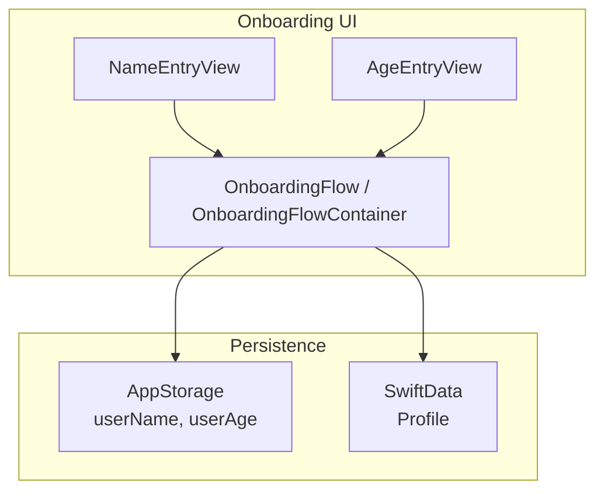
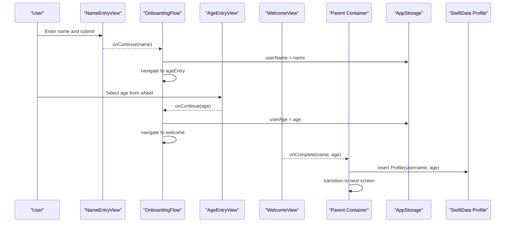
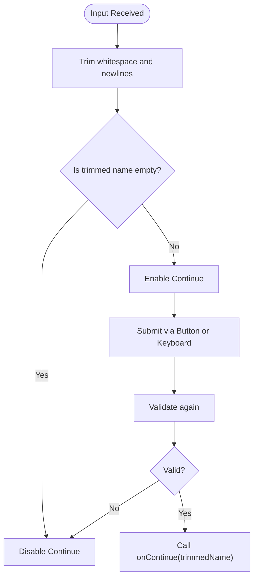
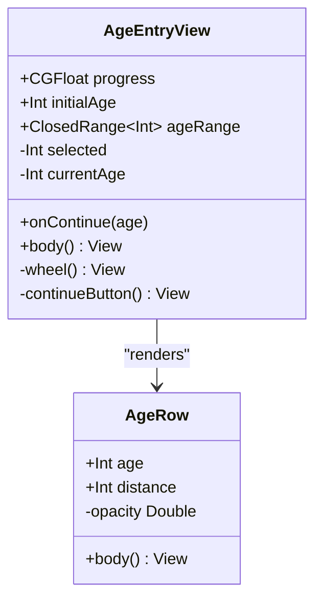
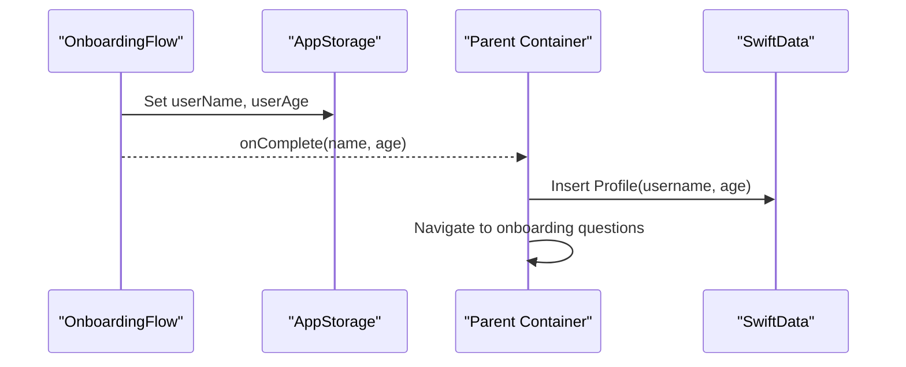
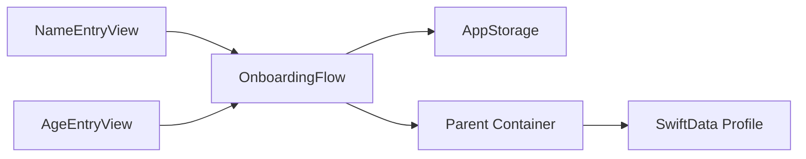

# Personal Information Collection

<cite>
**Referenced Files in This Document**
- [NameEntryView.swift](file://Moko/Moko/UIScreens/Onboarding/NameEntryView.swift)
- [AgeEntryView.swift](file://Moko/Moko/UIScreens/Onboarding/AgeEntryView.swift)
- [onboardingFlow.swift](file://Moko/Moko/UIScreens/Onboarding/onboardingFlow.swift)
- [Profile.swift](file://Moko/Moko/Models/Profile.swift)
- [ContentView.swift](file://Moko/Moko/ContentView.swift)
</cite>

## Table of Contents
1. [Introduction](#introduction)
2. [Project Structure](#project-structure)
3. [Core Components](#core-components)
4. [Architecture Overview](#architecture-overview)
5. [Detailed Component Analysis](#detailed-component-analysis)
6. [Dependency Analysis](#dependency-analysis)
7. [Performance Considerations](#performance-considerations)
8. [Troubleshooting Guide](#troubleshooting-guide)
9. [Conclusion](#conclusion)
10. [Appendices](#appendices)

## Introduction
This document explains the Personal Information Collection system used during onboarding, focusing on the NameEntryView and AgeEntryView components. It covers input validation logic, data binding to the Profile model, keyboard handling, error states for invalid inputs, age validation rules, name formatting requirements, and how collected data persists through the onboarding flow. It also includes guidance for customizing validators, adding new fields, implementing real-time feedback, accessibility considerations, and internationalization support.

## Project Structure
The personal information collection is implemented as two SwiftUI views that are orchestrated by an onboarding flow container. The collected values are persisted via AppStorage during navigation and later saved into SwiftData as a Profile record when onboarding completes.

**Diagram sources**
- [NameEntryView.swift:1-112](file://Moko/Moko/UIScreens/Onboarding/NameEntryView.swift#L1-L112)
- [AgeEntryView.swift:1-167](file://Moko/Moko/UIScreens/Onboarding/AgeEntryView.swift#L1-L167)
- [onboardingFlow.swift:1-68](file://Moko/Moko/UIScreens/Onboarding/onboardingFlow.swift#L1-L68)
- [ContentView.swift:250-267](file://Moko/Moko/ContentView.swift#L250-L267)
- [ContentView.swift:313-357](file://Moko/Moko/ContentView.swift#L313-L357)

**Section sources**
- [NameEntryView.swift:1-112](file://Moko/Moko/UIScreens/Onboarding/NameEntryView.swift#L1-L112)
- [AgeEntryView.swift:1-167](file://Moko/Moko/UIScreens/Onboarding/AgeEntryView.swift#L1-L167)
- [onboardingFlow.swift:1-68](file://Moko/Moko/UIScreens/Onboarding/onboardingFlow.swift#L1-L68)
- [ContentView.swift:250-267](file://Moko/Moko/ContentView.swift#L250-L267)
- [ContentView.swift:313-357](file://Moko/Moko/ContentView.swift#L313-L357)

## Core Components
- NameEntryView: Captures the user’s name with basic validation (non-empty after trimming). Provides keyboard submission and a disabled continue button until valid.
- AgeEntryView: Presents a scrollable wheel of ages within a configurable range, with default bounds 13–100. Uses accessibility actions to adjust the selected age.
- OnboardingFlow / OnboardingFlowContainer: Orchestrates navigation between steps and persists intermediate values using AppStorage.
- Profile (SwiftData): Represents the final persisted profile with username and age among other fields.

Key responsibilities:
- Input validation and UX state (enabled/disabled controls)
- Data binding to local state and persistence layers
- Keyboard interaction and accessibility
- Navigation and handoff of collected data to the next step

**Section sources**
- [NameEntryView.swift:1-112](file://Moko/Moko/UIScreens/Onboarding/NameEntryView.swift#L1-L112)
- [AgeEntryView.swift:1-167](file://Moko/Moko/UIScreens/Onboarding/AgeEntryView.swift#L1-L167)
- [onboardingFlow.swift:1-68](file://Moko/Moko/UIScreens/Onboarding/onboardingFlow.swift#L1-L68)
- [Profile.swift:1-60](file://Moko/Moko/Models/Profile.swift#L1-L60)

## Architecture Overview
The onboarding flow uses a simple state machine driven by a NavigationStack. Each step view emits its result via a callback, which updates AppStorage and navigates to the next step. When the welcome step finishes, the parent container calls back to save the collected data into SwiftData as a Profile.

**Diagram sources**
- [onboardingFlow.swift:22-48](file://Moko/Moko/UIScreens/Onboarding/onboardingFlow.swift#L22-L48)
- [ContentView.swift:313-357](file://Moko/Moko/ContentView.swift#L313-L357)
- [ContentView.swift:250-267](file://Moko/Moko/ContentView.swift#L250-L267)

## Detailed Component Analysis

### NameEntryView
Responsibilities:
- Binds user input to a local @State variable.
- Trims whitespace before validation.
- Enables or disables the Continue button based on whether the trimmed name is non-empty.
- Handles keyboard submission via .onSubmit to trigger the same action as tapping Continue.
- Focus management ensures the text field is focused when the view appears.

Validation and formatting:
- Validation rule: name must not be empty after trimming whitespace and newlines.
- Formatting: no automatic normalization beyond trimming; autocapitalization is set to words; autocorrection is disabled.

Keyboard handling:
- Submit label is set to Continue.
- .onSubmit triggers the submit function, which validates and calls onContinue.

Error states:
- If the name is empty, the Continue button is disabled and visually dimmed.
- There is no inline error message; validation is enforced by disabling the control.

Accessibility:
- The text field is focusable and responds to standard iOS accessibility features.
- No explicit accessibilityLabel is set on the TextField; consider adding one for clarity.

Customization points:
- To add stricter validation (e.g., minimum length), compute canContinue using additional checks and surface errors.
- To normalize names (e.g., title case), transform the value before calling onContinue.

**Diagram sources**
- [NameEntryView.swift:12-15](file://Moko/Moko/UIScreens/Onboarding/NameEntryView.swift#L12-L15)
- [NameEntryView.swift:66-79](file://Moko/Moko/UIScreens/Onboarding/NameEntryView.swift#L66-L79)
- [NameEntryView.swift:87-106](file://Moko/Moko/UIScreens/Onboarding/NameEntryView.swift#L87-L106)

**Section sources**
- [NameEntryView.swift:1-112](file://Moko/Moko/UIScreens/Onboarding/NameEntryView.swift#L1-L112)

### AgeEntryView
Responsibilities:
- Displays a vertical scrolling wheel of integers within a configurable ClosedRange<Int>.
- Defaults to a range of 13–100 and an initial age of 20.
- Updates a local selected integer and exposes it via currentAge.
- Provides sensory feedback on selection changes.
- Supports accessibility adjustments (increment/decrement) constrained by the configured range.

Validation and formatting:
- Validation rule: selected age must be within ageRange.lowerBound and ageRange.upperBound.
- The wheel enforces bounds via accessibilityAdjustableAction and scrollPosition constraints.

Keyboard handling:
- Not a keyboard-driven input; selection is done via touch gestures and accessibility actions.

Error states:
- No explicit error state; invalid selections are prevented by the range constraint.

Accessibility:
- The wheel is marked as an accessibility element with label “Age” and dynamic value.
- Implements increment/decrement actions to respect boundary conditions.

Customization points:
- Adjust ageRange to enforce different policies (e.g., 18+ only).
- Add visual feedback for out-of-range attempts if you allow programmatic updates outside the wheel.

**Diagram sources**
- [AgeEntryView.swift:3-27](file://Moko/Moko/UIScreens/Onboarding/AgeEntryView.swift#L3-L27)
- [AgeEntryView.swift:71-122](file://Moko/Moko/UIScreens/Onboarding/AgeEntryView.swift#L71-L122)
- [AgeEntryView.swift:142-162](file://Moko/Moko/UIScreens/Onboarding/AgeEntryView.swift#L142-L162)

**Section sources**
- [AgeEntryView.swift:1-167](file://Moko/Moko/UIScreens/Onboarding/AgeEntryView.swift#L1-L167)

### OnboardingFlow and Persistence
Navigation and state:
- OnboardingStep enum drives NavigationStack destinations.
- AppStorage variables userName and userAge persist across steps and app launches.
- The flow sets these values when users proceed from name to age to welcome.

Final persistence:
- When the welcome step completes, the parent container invokes onComplete with the collected name and age.
- The parent creates a Profile record in SwiftData and transitions to the next phase of onboarding.

**Diagram sources**
- [onboardingFlow.swift:9-48](file://Moko/Moko/UIScreens/Onboarding/onboardingFlow.swift#L9-L48)
- [ContentView.swift:250-267](file://Moko/Moko/ContentView.swift#L250-L267)
- [ContentView.swift:313-357](file://Moko/Moko/ContentView.swift#L313-L357)

**Section sources**
- [onboardingFlow.swift:1-68](file://Moko/Moko/UIScreens/Onboarding/onboardingFlow.swift#L1-L68)
- [ContentView.swift:250-267](file://Moko/Moko/ContentView.swift#L250-L267)
- [ContentView.swift:313-357](file://Moko/Moko/ContentView.swift#L313-L357)

### Profile Model
The Profile model stores the user’s personal information, including username and age, alongside other attributes such as handle, ageRange, and timestamps. During onboarding completion, a new Profile instance is created and inserted into SwiftData.

Key fields relevant to this feature:
- username: String
- age: Int
- createdAt / updatedAt: Date

**Section sources**
- [Profile.swift:12-58](file://Moko/Moko/Models/Profile.swift#L12-L58)
- [ContentView.swift:250-267](file://Moko/Moko/ContentView.swift#L250-L267)

## Dependency Analysis
- NameEntryView depends on:
  - Local @State for input
  - Callback onContinue to propagate validated data
  - System keyboard behaviors (submitLabel, onSubmit)
- AgeEntryView depends on:
  - Configurable ageRange and initialAge
  - Accessibility APIs for adjustable actions
  - Sensory feedback API for selection haptics
- OnboardingFlow depends on:
  - NavigationStack and NavigationDestination
  - AppStorage for persistent intermediate values
- Parent container depends on:
  - SwiftData context to persist Profile
  - Completion callback to finalize onboarding

**Diagram sources**
- [NameEntryView.swift:1-112](file://Moko/Moko/UIScreens/Onboarding/NameEntryView.swift#L1-L112)
- [AgeEntryView.swift:1-167](file://Moko/Moko/UIScreens/Onboarding/AgeEntryView.swift#L1-L167)
- [onboardingFlow.swift:1-68](file://Moko/Moko/UIScreens/Onboarding/onboardingFlow.swift#L1-L68)
- [ContentView.swift:250-267](file://Moko/Moko/ContentView.swift#L250-L267)

**Section sources**
- [NameEntryView.swift:1-112](file://Moko/Moko/UIScreens/Onboarding/NameEntryView.swift#L1-L112)
- [AgeEntryView.swift:1-167](file://Moko/Moko/UIScreens/Onboarding/AgeEntryView.swift#L1-L167)
- [onboardingFlow.swift:1-68](file://Moko/Moko/UIScreens/Onboarding/onboardingFlow.swift#L1-L68)
- [ContentView.swift:250-267](file://Moko/Moko/ContentView.swift#L250-L267)

## Performance Considerations
- NameEntryView performs minimal computation: trimming and boolean check. Complexity is O(n) where n is the length of the input string.
- AgeEntryView renders a list of integers equal to the size of ageRange. For default 13–100, this is small and efficient. Using scrollTargetBehavior and scrollPosition avoids unnecessary layout passes.
- Avoid heavy transformations inside the view body; precompute derived values like trimmedName and canContinue as computed properties.

[No sources needed since this section provides general guidance]

## Troubleshooting Guide
Common issues and resolutions:
- Continue button never enables in NameEntryView:
  - Ensure the input is not just whitespace; trimming removes spaces and newlines.
  - Verify that onContinue is wired correctly in the parent flow.
- Age wheel does not respond to accessibility increments:
  - Confirm ageRange boundaries are correct and that accessibilityAdjustableAction clamps values within bounds.
- Data not persisted after onboarding:
  - Ensure the parent container receives onComplete and inserts a Profile into SwiftData.
  - Verify modelContext.save is called after inserting records.

**Section sources**
- [NameEntryView.swift:87-106](file://Moko/Moko/UIScreens/Onboarding/NameEntryView.swift#L87-L106)
- [AgeEntryView.swift:112-122](file://Moko/Moko/UIScreens/Onboarding/AgeEntryView.swift#L112-L122)
- [ContentView.swift:250-267](file://Moko/Moko/ContentView.swift#L250-L267)

## Conclusion
NameEntryView and AgeEntryView provide a simple, accessible, and extensible foundation for collecting personal information during onboarding. Validation is straightforward and integrated into UI state, while persistence leverages both AppStorage for intermediate state and SwiftData for final storage. The design supports customization for stricter validation, additional fields, and richer feedback without major architectural changes.

[No sources needed since this section summarizes without analyzing specific files]

## Appendices

### Customizing Input Validators
- NameEntryView:
  - Extend canContinue to enforce minimum length, character sets, or normalization rules.
  - Surface inline errors by introducing a validation error state bound to the TextField’s helper messages.
- AgeEntryView:
  - Change ageRange to reflect policy (e.g., 18+).
  - Add programmatic validation around selected to prevent invalid updates from external sources.

**Section sources**
- [NameEntryView.swift:12-15](file://Moko/Moko/UIScreens/Onboarding/NameEntryView.swift#L12-L15)
- [AgeEntryView.swift:5-7](file://Moko/Moko/UIScreens/Onboarding/AgeEntryView.swift#L5-L7)

### Adding New Personal Information Fields
- Create a new entry view following the pattern of NameEntryView or AgeEntryView.
- Wire it into OnboardingFlow or OnboardingFlowContainer with a new OnboardingStep.
- Persist the new field via AppStorage during navigation and include it in the Profile creation in the parent container.

**Section sources**
- [onboardingFlow.swift:3-7](file://Moko/Moko/UIScreens/Onboarding/onboardingFlow.swift#L3-L7)
- [ContentView.swift:313-357](file://Moko/Moko/ContentView.swift#L313-L357)
- [Profile.swift:12-58](file://Moko/Moko/Models/Profile.swift#L12-L58)

### Implementing Real-Time Validation Feedback
- Introduce a validation error state in NameEntryView that updates as the user types.
- Display localized error messages below the TextField.
- For AgeEntryView, show a warning if a user tries to select an out-of-range value programmatically.

[No sources needed since this section provides general guidance]

### Accessibility Considerations
- NameEntryView:
  - Add accessibilityLabel to the TextField for clarity.
  - Provide accessibilityHint describing expected input.
- AgeEntryView:
  - Already implements accessibilityElement, label, value, and adjustable actions.
  - Consider adding hints for swipe or tap interactions.

**Section sources**
- [AgeEntryView.swift:112-122](file://Moko/Moko/UIScreens/Onboarding/AgeEntryView.swift#L112-L122)

### Internationalization Support
- Externalize strings such as prompts, labels, and instructions to localization files.
- Use locale-aware number formatting for age display if needed.
- Ensure placeholder text and error messages adapt to the user’s language.

[No sources needed since this section provides general guidance]