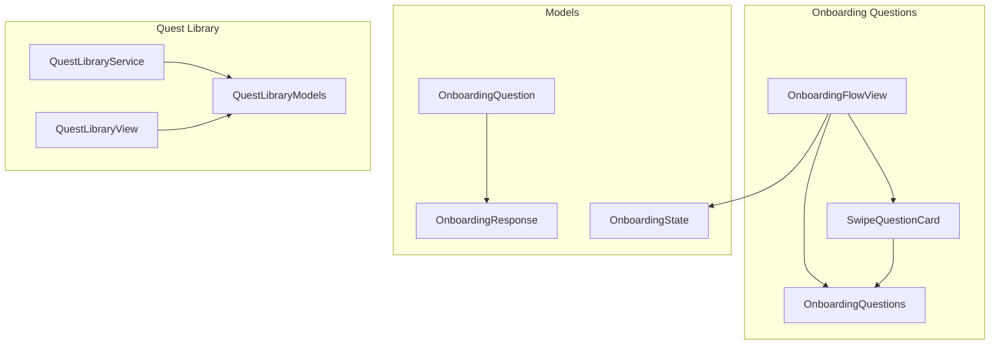
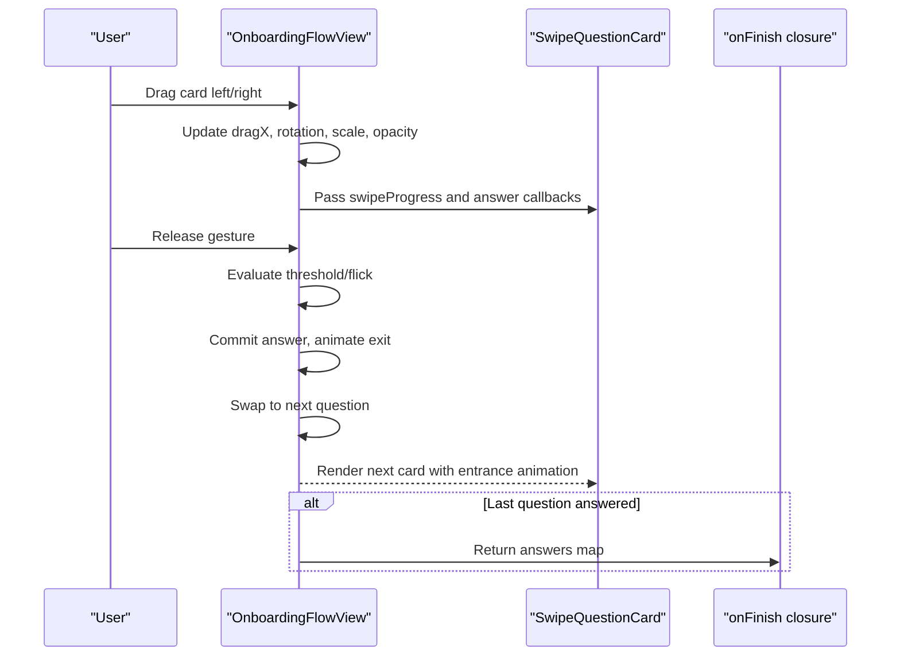
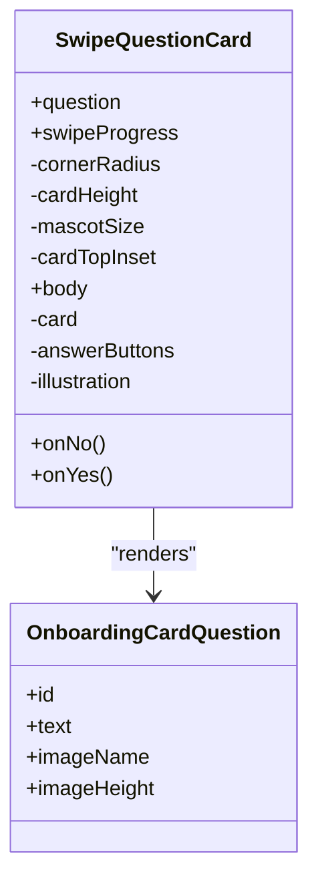
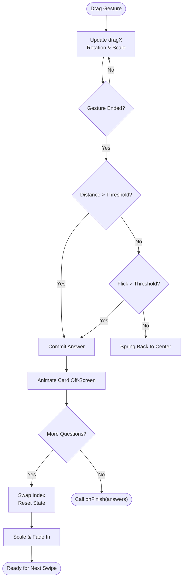
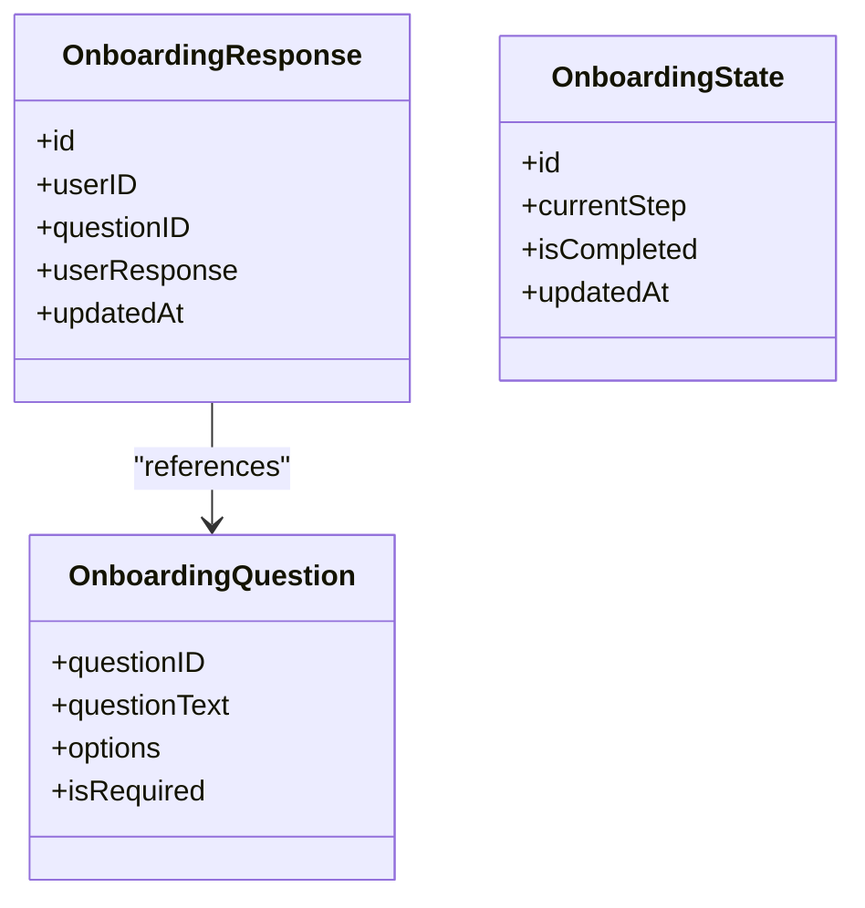
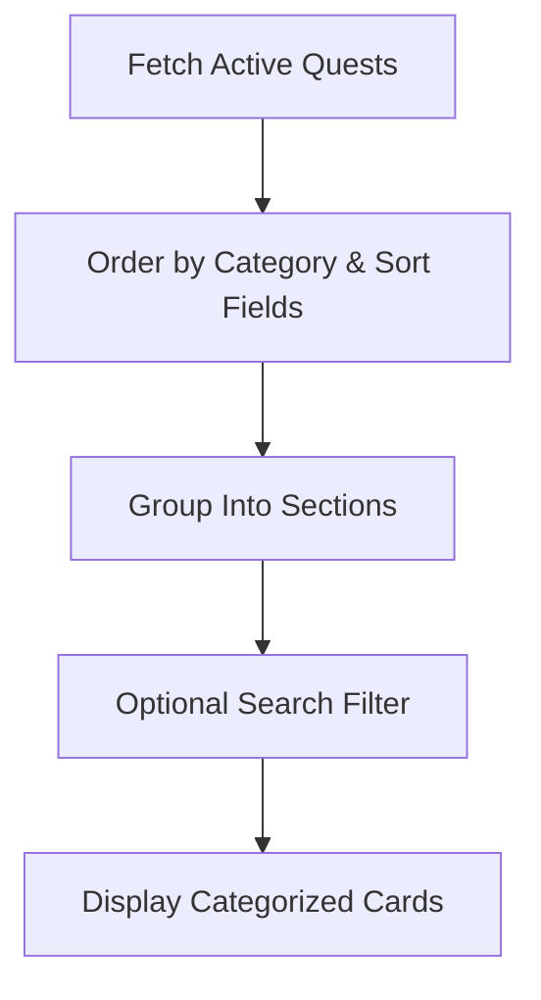
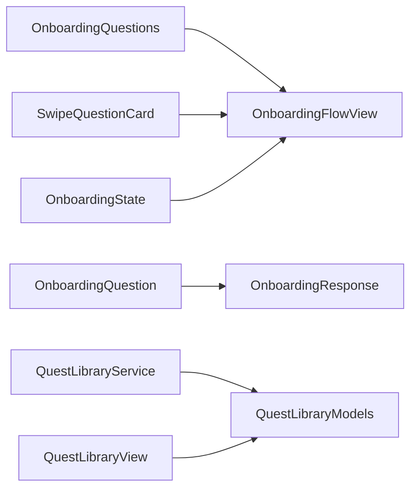

# Question System

<cite>
**Referenced Files in This Document**
- [SwipeQuestionCard.swift](file://Moko/Moko/UIScreens/Onboarding_Questions/SwipeQuestionCard.swift)
- [OnboardingFlowView.swift](file://Moko/Moko/UIScreens/Onboarding_Questions/OnboardingFlowView.swift)
- [OnboardingQuestions.swift](file://Moko/Moko/UIScreens/Onboarding_Questions/OnboardingQuestions.swift)
- [Onboarding_Question.swift](file://Moko/Moko/Models/Onboarding_Question.swift)
- [Onboarding_Response.swift](file://Moko/Moko/Models/Onboarding_Response.swift)
- [Onboarding_state.swift](file://Moko/Moko/Models/Onboarding_state.swift)
- [QuestLibraryModels.swift](file://Moko/Moko/Models/QuestLibraryModels.swift)
- [QuestLibraryService.swift](file://Moko/Moko/Features/QuestLibrary/QuestLibraryService.swift)
- [QuestLibraryView.swift](file://Moko/Moko/Features/QuestLibrary/QuestLibraryView.swift)
</cite>

## Table of Contents
1. [Introduction](#introduction)
2. [Project Structure](#project-structure)
3. [Core Components](#core-components)
4. [Architecture Overview](#architecture-overview)
5. [Detailed Component Analysis](#detailed-component-analysis)
6. [Dependency Analysis](#dependency-analysis)
7. [Performance Considerations](#performance-considerations)
8. [Troubleshooting Guide](#troubleshooting-guide)
9. [Conclusion](#conclusion)
10. [Appendices](#appendices)

## Introduction
This document explains the Question System used by the onboarding flow and related quest features. It covers:
- The question data model for onboarding cards.
- How responses are captured, stored, and validated.
- Swipe gesture handling and card animation behavior.
- Progression through multiple questions.
- Question categorization and randomization patterns.
- Extending the system with new question types, custom animations, and external question sources.
- Performance guidance for large question sets and smooth scrolling.

The goal is to make the architecture understandable for both developers and contributors who may not be deeply familiar with SwiftUI or SwiftData.

## Project Structure
The Question System spans UI components, models, and a library feature that demonstrates categorization and external data loading.

**Diagram sources**
- [OnboardingFlowView.swift:1-241](file://Moko/Moko/UIScreens/Onboarding_Questions/OnboardingFlowView.swift#L1-L241)
- [SwipeQuestionCard.swift:1-117](file://Moko/Moko/UIScreens/Onboarding_Questions/SwipeQuestionCard.swift#L1-L117)
- [OnboardingQuestions.swift:1-52](file://Moko/Moko/UIScreens/Onboarding_Questions/OnboardingQuestions.swift#L1-L52)
- [Onboarding_Question.swift:1-37](file://Moko/Moko/Models/Onboarding_Question.swift#L1-L37)
- [Onboarding_Response.swift:1-36](file://Moko/Moko/Models/Onboarding_Response.swift#L1-L36)
- [Onboarding_state.swift:1-24](file://Moko/Moko/Models/Onboarding_state.swift#L1-L24)
- [QuestLibraryModels.swift:1-107](file://Moko/Moko/Models/QuestLibraryModels.swift#L1-L107)
- [QuestLibraryService.swift:1-91](file://Moko/Moko/Features/QuestLibrary/QuestLibraryService.swift#L1-L91)
- [QuestLibraryView.swift:1-378](file://Moko/Moko/Features/QuestLibrary/QuestLibraryView.swift#L1-L378)

**Section sources**
- [OnboardingFlowView.swift:1-241](file://Moko/Moko/UIScreens/Onboarding_Questions/OnboardingFlowView.swift#L1-L241)
- [SwipeQuestionCard.swift:1-117](file://Moko/Moko/UIScreens/Onboarding_Questions/SwipeQuestionCard.swift#L1-L117)
- [OnboardingQuestions.swift:1-52](file://Moko/Moko/UIScreens/Onboarding_Questions/OnboardingQuestions.swift#L1-L52)
- [Onboarding_Question.swift:1-37](file://Moko/Moko/Models/Onboarding_Question.swift#L1-L37)
- [Onboarding_Response.swift:1-36](file://Moko/Moko/Models/Onboarding_Response.swift#L1-L36)
- [Onboarding_state.swift:1-24](file://Moko/Moko/Models/Onboarding_state.swift#L1-L24)
- [QuestLibraryModels.swift:1-107](file://Moko/Moko/Models/QuestLibraryModels.swift#L1-L107)
- [QuestLibraryService.swift:1-91](file://Moko/Moko/Features/QuestLibrary/QuestLibraryService.swift#L1-L91)
- [QuestLibraryView.swift:1-378](file://Moko/Moko/Features/QuestLibrary/QuestLibraryView.swift#L1-L378)

## Core Components
- Onboarding card question definition: A lightweight value type describing each onboarding question, including text, asset name, and illustration height.
- Swipeable card view: Renders the mascot peek, illustration, question text, and YES/NO buttons with visual feedback based on swipe progress.
- Flow controller: Manages current index, step counter, answers map, drag state, and transitions between questions.
- Persistence models: SwiftData-backed models for questions, responses, and onboarding state.
- Quest library models and service: Demonstrate categorized content, grouping, and remote fetching from Supabase.

Key responsibilities:
- Data modeling: Define question structure and response storage.
- Interaction: Handle swipe gestures, thresholds, haptics, and accessibility actions.
- Animation: Provide exit, entrance, scale, opacity, rotation, and color wash effects.
- Navigation: Move forward/backward through questions and call completion callbacks.
- Categorization: Group quests by category and support search filtering.

**Section sources**
- [OnboardingQuestions.swift:1-52](file://Moko/Moko/UIScreens/Onboarding_Questions/OnboardingQuestions.swift#L1-L52)
- [SwipeQuestionCard.swift:1-117](file://Moko/Moko/UIScreens/Onboarding_Questions/SwipeQuestionCard.swift#L1-L117)
- [OnboardingFlowView.swift:1-241](file://Moko/Moko/UIScreens/Onboarding_Questions/OnboardingFlowView.swift#L1-L241)
- [Onboarding_Question.swift:1-37](file://Moko/Moko/Models/Onboarding_Question.swift#L1-L37)
- [Onboarding_Response.swift:1-36](file://Moko/Moko/Models/Onboarding_Response.swift#L1-L36)
- [Onboarding_state.swift:1-24](file://Moko/Moko/Models/Onboarding_state.swift#L1-L24)
- [QuestLibraryModels.swift:1-107](file://Moko/Moko/Models/QuestLibraryModels.swift#L1-L107)
- [QuestLibraryService.swift:1-91](file://Moko/Moko/Features/QuestLibrary/QuestLibraryService.swift#L1-L91)
- [QuestLibraryView.swift:1-378](file://Moko/Moko/Features/QuestLibrary/QuestLibraryView.swift#L1-L378)

## Architecture Overview
The onboarding question flow is composed of a presentation layer (views), a stateful controller (flow view), and data models. The quest library shows how categories and external data can be integrated.

**Diagram sources**
- [OnboardingFlowView.swift:119-197](file://Moko/Moko/UIScreens/Onboarding_Questions/OnboardingFlowView.swift#L119-L197)
- [SwipeQuestionCard.swift:1-117](file://Moko/Moko/UIScreens/Onboarding_Questions/SwipeQuestionCard.swift#L1-L117)

## Detailed Component Analysis

### SwipeQuestionCard Component
Responsibilities:
- Display the current question’s illustration and text.
- Show YES/NO buttons with dynamic scaling based on swipe direction.
- Apply a soft color wash overlay proportional to swipe progress.
- Provide accessibility labels for YES/NO.

Animation and visual feedback:
- Rotation and offset are handled by the parent flow; the card receives normalized swipe progress.
- Color wash uses YES/NO colors with opacity derived from absolute swipe progress.
- Buttons scale relative to swipe direction to reinforce user intent.

Touch handling:
- YES/NO buttons act as tap targets and also trigger commit logic via callbacks.
- The card itself does not implement drag; it consumes swipeProgress for visuals.

**Diagram sources**
- [SwipeQuestionCard.swift:1-117](file://Moko/Moko/UIScreens/Onboarding_Questions/SwipeQuestionCard.swift#L1-L117)
- [OnboardingQuestions.swift:8-15](file://Moko/Moko/UIScreens/Onboarding_Questions/OnboardingQuestions.swift#L8-L15)

**Section sources**
- [SwipeQuestionCard.swift:1-117](file://Moko/Moko/UIScreens/Onboarding_Questions/SwipeQuestionCard.swift#L1-L117)
- [OnboardingQuestions.swift:8-15](file://Moko/Moko/UIScreens/Onboarding_Questions/OnboardingQuestions.swift#L8-L15)

### OnboardingFlowView Controller
Responsibilities:
- Manage current question index and step counter.
- Track answers as a dictionary mapping question IDs to YES/NO.
- Implement drag gesture detection, thresholds, flick detection, and spring back behavior.
- Animate card exit, swap to next card, and entrance animations.
- Provide back navigation with reverse animation.
- Emit haptic feedback and expose accessibility actions.

Gesture and progression logic:
- Drag translation updates the card’s position and rotation.
- Thresholds determine whether an answer is committed or the card springs back.
- Flick velocity influences decision when drag distance is below threshold.
- After committing, the card exits off-screen, then the next card scales and fades in.

**Diagram sources**
- [OnboardingFlowView.swift:135-197](file://Moko/Moko/UIScreens/Onboarding_Questions/OnboardingFlowView.swift#L135-L197)

**Section sources**
- [OnboardingFlowView.swift:1-241](file://Moko/Moko/UIScreens/Onboarding_Questions/OnboardingFlowView.swift#L1-L241)

### Question Data Model and Response Handling
Onboarding question model:
- Defines a persistent question entity with ID, text, options array, and required flag.
- Intended for structured question storage and potential validation.

Response model:
- Stores user responses keyed by unique ID, linked to a user and question.
- Includes timestamp for auditability.

Onboarding state:
- Tracks current step, completion status, and update time.

Validation considerations:
- Required flags indicate mandatory questions.
- Responses should be validated before persistence to ensure completeness and correctness.

**Diagram sources**
- [Onboarding_Question.swift:11-36](file://Moko/Moko/Models/Onboarding_Question.swift#L11-L36)
- [Onboarding_Response.swift:11-35](file://Moko/Moko/Models/Onboarding_Response.swift#L11-L35)
- [Onboarding_state.swift:4-23](file://Moko/Moko/Models/Onboarding_state.swift#L4-L23)

**Section sources**
- [Onboarding_Question.swift:1-37](file://Moko/Moko/Models/Onboarding_Question.swift#L1-L37)
- [Onboarding_Response.swift:1-36](file://Moko/Moko/Models/Onboarding_Response.swift#L1-L36)
- [Onboarding_state.swift:1-24](file://Moko/Moko/Models/Onboarding_state.swift#L1-L24)

### Question Categorization and Randomization
Categorization:
- Quest library items include a category field and are grouped into sections while preserving order.
- Categories are mapped to enum values with fallback to “others” for unknown categories.

Randomization:
- The onboarding flow currently presents questions in a fixed order defined by the static list.
- Randomization can be introduced by shuffling the question set before rendering or selecting subsets based on criteria such as difficulty or age range.

External integration:
- The quest library fetches active quests from Supabase, ordered by category and sort fields.
- This pattern can be adapted for external question databases by replacing the local static list with fetched data.

**Diagram sources**
- [QuestLibraryService.swift:20-31](file://Moko/Moko/Features/QuestLibrary/QuestLibraryService.swift#L20-L31)
- [QuestLibraryModels.swift:52-83](file://Moko/Moko/Models/QuestLibraryModels.swift#L52-L83)
- [QuestLibraryView.swift:25-40](file://Moko/Moko/Features/QuestLibrary/QuestLibraryView.swift#L25-L40)

**Section sources**
- [QuestLibraryModels.swift:1-107](file://Moko/Moko/Models/QuestLibraryModels.swift#L1-L107)
- [QuestLibraryService.swift:1-91](file://Moko/Moko/Features/QuestLibrary/QuestLibraryService.swift#L1-L91)
- [QuestLibraryView.swift:1-378](file://Moko/Moko/Features/QuestLibrary/QuestLibraryView.swift#L1-L378)

### Adding New Question Types
To add a new question type:
- Extend the onboarding card question definition with additional properties if needed (e.g., input type, validation rules).
- Update the static list or external data source to include the new question.
- Modify SwipeQuestionCard to render the new input type (e.g., slider, multi-select).
- Adjust OnboardingFlowView to handle specific validation and persistence for the new type.

Example extension points:
- Add a new property to the card question struct.
- Introduce a new branch in the card’s rendering logic.
- Capture and validate the new response in the flow controller.

**Section sources**
- [OnboardingQuestions.swift:8-15](file://Moko/Moko/UIScreens/Onboarding_Questions/OnboardingQuestions.swift#L8-L15)
- [SwipeQuestionCard.swift:1-117](file://Moko/Moko/UIScreens/Onboarding_Questions/SwipeQuestionCard.swift#L1-L117)
- [OnboardingFlowView.swift:157-197](file://Moko/Moko/UIScreens/Onboarding_Questions/OnboardingFlowView.swift#L157-L197)

### Customizing Card Animations
Customization areas:
- Exit duration and spring parameters in the commit flow.
- Rotation anchor and scale ranges.
- Color wash intensity and button scaling factors.
- Entrance animations for the next card.

Recommended approach:
- Centralize animation constants in a configuration object.
- Expose modifiers to adjust easing, duration, and damping.
- Respect accessibility reduce-motion settings where applicable.

**Section sources**
- [OnboardingFlowView.swift:135-197](file://Moko/Moko/UIScreens/Onboarding_Questions/OnboardingFlowView.swift#L135-L197)
- [SwipeQuestionCard.swift:55-66](file://Moko/Moko/UIScreens/Onboarding_Questions/SwipeQuestionCard.swift#L55-L66)

### Integrating With External Question Databases
Integration steps:
- Replace the static question list with a service that fetches questions from a backend.
- Map backend fields to the app’s question model.
- Implement caching and error handling similar to the quest library service.
- Use grouping and ordering strategies already present in the quest library.

Reference implementation:
- The quest library service fetches active quests, orders them, and exposes them to the view.
- The view groups and filters sections, demonstrating robust data handling.

**Section sources**
- [QuestLibraryService.swift:1-91](file://Moko/Moko/Features/QuestLibrary/QuestLibraryService.swift#L1-L91)
- [QuestLibraryView.swift:1-378](file://Moko/Moko/Features/QuestLibrary/QuestLibraryView.swift#L1-L378)

## Dependency Analysis
The onboarding flow depends on:
- Onboarding card question definitions for content.
- SwipeQuestionCard for rendering and visual feedback.
- SwiftData models for persistence.
- Optional external services for fetching questions.

**Diagram sources**
- [OnboardingFlowView.swift:1-241](file://Moko/Moko/UIScreens/Onboarding_Questions/OnboardingFlowView.swift#L1-L241)
- [SwipeQuestionCard.swift:1-117](file://Moko/Moko/UIScreens/Onboarding_Questions/SwipeQuestionCard.swift#L1-L117)
- [OnboardingQuestions.swift:1-52](file://Moko/Moko/UIScreens/Onboarding_Questions/OnboardingQuestions.swift#L1-L52)
- [Onboarding_Question.swift:1-37](file://Moko/Moko/Models/Onboarding_Question.swift#L1-L37)
- [Onboarding_Response.swift:1-36](file://Moko/Moko/Models/Onboarding_Response.swift#L1-L36)
- [Onboarding_state.swift:1-24](file://Moko/Moko/Models/Onboarding_state.swift#L1-L24)
- [QuestLibraryService.swift:1-91](file://Moko/Moko/Features/QuestLibrary/QuestLibraryService.swift#L1-L91)
- [QuestLibraryModels.swift:1-107](file://Moko/Moko/Models/QuestLibraryModels.swift#L1-L107)
- [QuestLibraryView.swift:1-378](file://Moko/Moko/Features/QuestLibrary/QuestLibraryView.swift#L1-L378)

**Section sources**
- [OnboardingFlowView.swift:1-241](file://Moko/Moko/UIScreens/Onboarding_Questions/OnboardingFlowView.swift#L1-L241)
- [SwipeQuestionCard.swift:1-117](file://Moko/Moko/UIScreens/Onboarding_Questions/SwipeQuestionCard.swift#L1-L117)
- [OnboardingQuestions.swift:1-52](file://Moko/Moko/UIScreens/Onboarding_Questions/OnboardingQuestions.swift#L1-L52)
- [Onboarding_Question.swift:1-37](file://Moko/Moko/Models/Onboarding_Question.swift#L1-L37)
- [Onboarding_Response.swift:1-36](file://Moko/Moko/Models/Onboarding_Response.swift#L1-L36)
- [Onboarding_state.swift:1-24](file://Moko/Moko/Models/Onboarding_state.swift#L1-L24)
- [QuestLibraryService.swift:1-91](file://Moko/Moko/Features/QuestLibrary/QuestLibraryService.swift#L1-L91)
- [QuestLibraryModels.swift:1-107](file://Moko/Moko/Models/QuestLibraryModels.swift#L1-L107)
- [QuestLibraryView.swift:1-378](file://Moko/Moko/Features/QuestLibrary/QuestLibraryView.swift#L1-L378)

## Performance Considerations
- Minimize recomputation: Keep question lists immutable during rendering; use stable identifiers.
- Avoid heavy work on the main thread: Perform network requests and parsing off the main thread, then update UI state on the main actor.
- Optimize animations: Use simple transforms (offset, scale, opacity) and avoid expensive layout recalculations during drag.
- Reduce motion: Respect accessibility reduce-motion settings to improve performance and user experience.
- Lazy rendering: For large question sets, consider lazy loading sections and virtualized lists.
- Haptics: Limit haptic triggers to key interactions to prevent unnecessary overhead.

[No sources needed since this section provides general guidance]

## Troubleshooting Guide
Common issues and resolutions:
- Card does not respond to swipe: Ensure the drag gesture is attached to the card view and that the flow controller is not marked busy.
- Answers not persisted: Validate required fields and confirm response creation before saving to SwiftData.
- Incorrect categorization: Verify category mapping and fallback to “others” when unknown.
- Network errors: Surface error messages and provide retry mechanisms similar to the quest library view.

**Section sources**
- [OnboardingFlowView.swift:157-197](file://Moko/Moko/UIScreens/Onboarding_Questions/OnboardingFlowView.swift#L157-L197)
- [QuestLibraryView.swift:152-176](file://Moko/Moko/Features/QuestLibrary/QuestLibraryView.swift#L152-L176)

## Conclusion
The Question System combines clear data models, interactive swipe gestures, and robust animation flows to deliver an engaging onboarding experience. The quest library demonstrates effective categorization, external data integration, and search filtering. By extending the existing structures and following the recommended practices, you can add new question types, customize animations, and integrate with external databases while maintaining performance and accessibility.

[No sources needed since this section summarizes without analyzing specific files]

## Appendices

### Example: Adding a New Question Type
Steps:
- Extend the card question struct with a new property (e.g., inputType).
- Update the static list or external data source to include the new question.
- Modify SwipeQuestionCard to render the new input control.
- Update OnboardingFlowView to capture and validate the new response.

**Section sources**
- [OnboardingQuestions.swift:8-15](file://Moko/Moko/UIScreens/Onboarding_Questions/OnboardingQuestions.swift#L8-L15)
- [SwipeQuestionCard.swift:1-117](file://Moko/Moko/UIScreens/Onboarding_Questions/SwipeQuestionCard.swift#L1-L117)
- [OnboardingFlowView.swift:157-197](file://Moko/Moko/UIScreens/Onboarding_Questions/OnboardingFlowView.swift#L157-L197)

### Example: Customizing Card Animations
Areas to adjust:
- Exit duration and spring parameters.
- Rotation anchor and scale ranges.
- Color wash intensity and button scaling factors.
- Entrance animations for the next card.

**Section sources**
- [OnboardingFlowView.swift:135-197](file://Moko/Moko/UIScreens/Onboarding_Questions/OnboardingFlowView.swift#L135-L197)
- [SwipeQuestionCard.swift:55-66](file://Moko/Moko/UIScreens/Onboarding_Questions/SwipeQuestionCard.swift#L55-L66)

### Example: Integrating With External Question Databases
Approach:
- Create a service to fetch questions from a backend.
- Map backend fields to the app’s question model.
- Implement caching and error handling.
- Use grouping and ordering strategies from the quest library.

**Section sources**
- [QuestLibraryService.swift:1-91](file://Moko/Moko/Features/QuestLibrary/QuestLibraryService.swift#L1-L91)
- [QuestLibraryView.swift:1-378](file://Moko/Moko/Features/QuestLibrary/QuestLibraryView.swift#L1-L378)