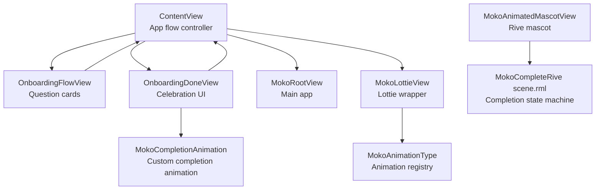
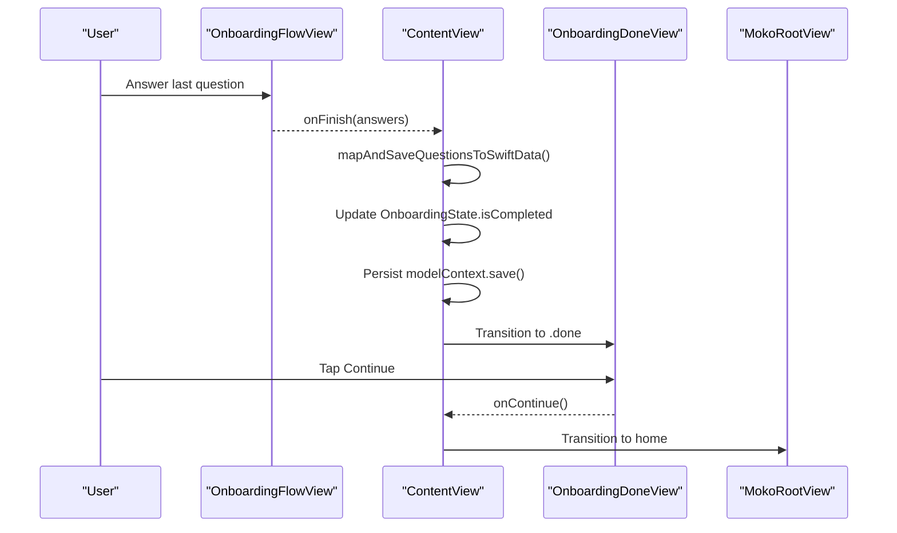
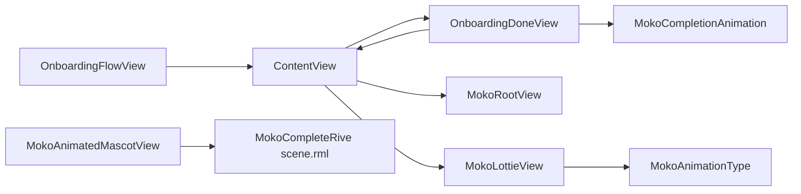

# Welcome Completion Screen

<cite>
**Referenced Files in This Document**
- [ContentView.swift](file://Moko/Moko/ContentView.swift)
- [OnboardingDoneView.swift](file://Moko/Moko/UIScreens/Onboarding_Questions/OnboardingDoneView.swift)
- [OnboardingFlowView.swift](file://Moko/Moko/UIScreens/Onboarding_Questions/OnboardingFlowView.swift)
- [MokoLottieView.swift](file://Moko/Moko/Features/Animation/MokoLottieView.swift)
- [MokoAnimationTypes.swift](file://Moko/Moko/Features/Animation/MokoAnimationTypes.swift)
- [MokoCompletionAnimation.swift](file://Moko/Moko/Features/Animation/MokoCompletionAnimation.swift)
- [MokoAnimatedMascotView.swift](file://Moko/Moko/UIScreens/startScreens/MokoAnimatedMascotView.swift)
- [scene.rml](file://Moko/RiveProjects/MokoCompleteRive/scene.rml)
</cite>

## Table of Contents
1. [Introduction](#introduction)
2. [Project Structure](#project-structure)
3. [Core Components](#core-components)
4. [Architecture Overview](#architecture-overview)
5. [Detailed Component Analysis](#detailed-component-analysis)
6. [Dependency Analysis](#dependency-analysis)
7. [Performance Considerations](#performance-considerations)
8. [Troubleshooting Guide](#troubleshooting-guide)
9. [Conclusion](#conclusion)

## Introduction
This document explains the Welcome Completion Screen that marks the end of the onboarding process. It covers:
- How the app transitions to the completion screen after all onboarding questions are answered.
- The celebratory visuals, including static celebration imagery and reusable completion animations.
- Lottie integration for mascot animations and how it can be used during or after onboarding.
- Final data persistence operations that mark onboarding as complete and initialize baseline insights.
- Animation triggers, timing controls, and coordination with overall app initialization.
- Customization examples, edge-case handling, performance considerations, and memory cleanup guidance.

## Project Structure
The welcome completion experience spans several modules:
- App flow controller manages navigation between onboarding screens and the final completion screen.
- Onboarding question flow collects answers and triggers completion.
- Completion view displays a celebratory image and status summary.
- Reusable completion animation provides a custom animated badge with falling lemons and pulsing rings.
- Lottie wrapper loads and plays JSON-based mascot animations.
- Rive project defines a completion state machine asset for future mascot celebrations.

**Diagram sources**
- [ContentView.swift:153-178](file://Moko/Moko/ContentView.swift#L153-L178)
- [OnboardingFlowView.swift:157-196](file://Moko/Moko/UIScreens/Onboarding_Questions/OnboardingFlowView.swift#L157-L196)
- [OnboardingDoneView.swift:9-63](file://Moko/Moko/UIScreens/Onboarding_Questions/OnboardingDoneView.swift#L9-L63)
- [MokoCompletionAnimation.swift:5-59](file://Moko/Moko/Features/Animation/MokoCompletionAnimation.swift#L5-L59)
- [MokoLottieView.swift:5-23](file://Moko/Moko/Features/Animation/MokoLottieView.swift#L5-L23)
- [MokoAnimationTypes.swift:6-36](file://Moko/Moko/Features/Animation/MokoAnimationTypes.swift#L6-L36)
- [MokoAnimatedMascotView.swift:5-19](file://Moko/Moko/UIScreens/startScreens/MokoAnimatedMascotView.swift#L5-L19)
- [scene.rml:1-14](file://Moko/RiveProjects/MokoCompleteRive/scene.rml#L1-L14)

**Section sources**
- [ContentView.swift:153-178](file://Moko/Moko/ContentView.swift#L153-L178)
- [OnboardingFlowView.swift:157-196](file://Moko/Moko/UIScreens/Onboarding_Questions/OnboardingFlowView.swift#L157-L196)
- [OnboardingDoneView.swift:9-63](file://Moko/Moko/UIScreens/Onboarding_Questions/OnboardingDoneView.swift#L9-L63)
- [MokoCompletionAnimation.swift:5-59](file://Moko/Moko/Features/Animation/MokoCompletionAnimation.swift#L5-L59)
- [MokoLottieView.swift:5-23](file://Moko/Moko/Features/Animation/MokoLottieView.swift#L5-L23)
- [MokoAnimationTypes.swift:6-36](file://Moko/Moko/Features/Animation/MokoAnimationTypes.swift#L6-L36)
- [MokoAnimatedMascotView.swift:5-19](file://Moko/Moko/UIScreens/startScreens/MokoAnimatedMascotView.swift#L5-L19)
- [scene.rml:1-14](file://Moko/RiveProjects/MokoCompleteRive/scene.rml#L1-L14)

## Core Components
- App flow controller (ContentView): Orchestrates navigation from onboarding questions to the completion screen and then to the main app. It also persists onboarding answers and updates onboarding state.
- Onboarding question flow (OnboardingFlowView): Collects user responses, animates card transitions, and calls onFinish when the last question is answered.
- Completion screen (OnboardingDoneView): Displays a celebratory image, progress summary, and a continue button.
- Custom completion animation (MokoCompletionAnimation): A reusable SwiftUI Canvas animation showing a checkmark badge, pulsing rings, and falling lemons.
- Lottie wrapper (MokoLottieView): Loads and plays JSON-based mascot animations using Lottie, with configurable loop modes per animation type.
- Rive mascot (MokoAnimatedMascotView and scene.rml): Provides a Rive-powered mascot animation; the completion state machine is defined in the Rive project.

**Section sources**
- [ContentView.swift:153-308](file://Moko/Moko/ContentView.swift#L153-L308)
- [OnboardingFlowView.swift:157-196](file://Moko/Moko/UIScreens/Onboarding_Questions/OnboardingFlowView.swift#L157-L196)
- [OnboardingDoneView.swift:9-63](file://Moko/Moko/UIScreens/Onboarding_Questions/OnboardingDoneView.swift#L9-L63)
- [MokoCompletionAnimation.swift:5-59](file://Moko/Moko/Features/Animation/MokoCompletionAnimation.swift#L5-L59)
- [MokoLottieView.swift:5-23](file://Moko/Moko/Features/Animation/MokoLottieView.swift#L5-L23)
- [MokoAnimationTypes.swift:6-36](file://Moko/Moko/Features/Animation/MokoAnimationTypes.swift#L6-L36)
- [MokoAnimatedMascotView.swift:5-19](file://Moko/Moko/UIScreens/startScreens/MokoAnimatedMascotView.swift#L5-L19)
- [scene.rml:1-14](file://Moko/RiveProjects/MokoCompleteRive/scene.rml#L1-L14)

## Architecture Overview
The completion flow follows this sequence:
1. User finishes the last onboarding question.
2. OnboardingFlowView calls onFinish with collected answers.
3. ContentView maps answers to SwiftData models, initializes baseline insights, and marks onboarding as completed.
4. ContentView transitions to OnboardingDoneView with a smooth animation.
5. User taps Continue to move to the reflection screen and eventually to the main app.

**Diagram sources**
- [OnboardingFlowView.swift:157-196](file://Moko/Moko/UIScreens/Onboarding_Questions/OnboardingFlowView.swift#L157-L196)
- [ContentView.swift:153-178](file://Moko/Moko/ContentView.swift#L153-L178)
- [ContentView.swift:269-308](file://Moko/Moko/ContentView.swift#L269-L308)

## Detailed Component Analysis

### Onboarding Question Flow and Completion Trigger
- OnboardingFlowView tracks current card index, step counter, and answers.
- When the last card is answered, it invokes onFinish with the full answers dictionary.
- The transition out of the flow is handled by ContentView, which sets the current screen to .done.

Key behaviors:
- Card exit animation duration and drag threshold control responsiveness.
- Haptic feedback is triggered on answer commits.
- The finish callback ensures no further input while transitioning.

**Section sources**
- [OnboardingFlowView.swift:157-196](file://Moko/Moko/UIScreens/Onboarding_Questions/OnboardingFlowView.swift#L157-L196)
- [ContentView.swift:153-168](file://Moko/Moko/ContentView.swift#L153-L168)

### Completion Screen UI
- OnboardingDoneView shows a celebratory image and two status rows indicating completion percentage and baseline readiness.
- The Continue button triggers onContinue, which navigates to the next phase.

Accessibility and layout:
- Image is accessibility-hidden to avoid redundant announcements.
- Status rows use consistent icon backgrounds and typography.

**Section sources**
- [OnboardingDoneView.swift:9-63](file://Moko/Moko/UIScreens/Onboarding_Questions/OnboardingDoneView.swift#L9-L63)

### Custom Completion Animation
- MokoCompletionAnimation renders a checkmark badge with entrance easing, overshoot, and breathing scale.
- Falling lemons animate with staggered delays, positions, sizes, and rotation.
- Pulsing rings expand and fade around the badge.
- TimelineView drives frame-by-frame updates at 30fps minimum interval.

Timing controls:
- Total animation duration and per-lemon delays define the rhythm.
- Checkmark draw cycle uses a short sub-cycle for progressive reveal.
- Badge scaling combines entrance ease, exponential overshoot, and sinusoidal breathing.

Usage:
- The animation is reused across relaxation flows and can be embedded into the completion screen if desired.

**Section sources**
- [MokoCompletionAnimation.swift:5-59](file://Moko/Moko/Features/Animation/MokoCompletionAnimation.swift#L5-L59)
- [MokoCompletionAnimation.swift:61-137](file://Moko/Moko/Features/Animation/MokoCompletionAnimation.swift#L61-L137)

### Lottie Integration
- MokoLottieView wraps LottieAnimationView inside a SwiftUI UIViewRepresentable.
- It searches multiple bundle subdirectories for the requested animation name.
- Loop mode is determined by MokoAnimationType:
  - hello plays once
  - complete, meditation, listening, idle loop continuously

Loading behavior:
- If an animation cannot be found, it logs an error and returns an empty container.
- Successful loading prints success and path information.

Customization:
- Change animationType to select different mascot animations.
- Adjust size parameter to fit different layouts.
- Extend MokoAnimationType to add new animations and their loop modes.

**Section sources**
- [MokoLottieView.swift:5-23](file://Moko/Moko/Features/Animation/MokoLottieView.swift#L5-L23)
- [MokoLottieView.swift:25-82](file://Moko/Moko/Features/Animation/MokoLottieView.swift#L25-L82)
- [MokoAnimationTypes.swift:6-36](file://Moko/Moko/Features/Animation/MokoAnimationTypes.swift#L6-L36)

### Rive Mascot and Completion State Machine
- MokoAnimatedMascotView loads a Rive file named MokoWelcomeRive and renders it asynchronously.
- The Rive project includes a completion state machine artifact (Moko Complete) that can be used for mascot celebration effects.

Integration points:
- Use MokoAnimatedMascotView where mascot presence is needed.
- Drive Rive state machines via ViewModel properties and triggers defined in the RML scene.

**Section sources**
- [MokoAnimatedMascotView.swift:5-19](file://Moko/Moko/UIScreens/startScreens/MokoAnimatedMascotView.swift#L5-L19)
- [scene.rml:1-14](file://Moko/RiveProjects/MokoCompleteRive/scene.rml#L1-L14)

### Data Persistence and App Initialization Coordination
- After finishing onboarding questions, ContentView maps answers to SwiftData entities:
  - OnboardingQuestion records are inserted.
  - OnboardingResponse records are inserted per question.
  - Baseline insights are computed and inserted.
  - OnboardingState is updated to mark completion and set currentStep to total steps.
- The model context is saved to persist changes.
- Navigation proceeds to the completion screen and then to the main app upon user action.

Initialization checks:
- On app start, ContentView determines whether to go directly to home or begin onboarding based on registration state.

**Section sources**
- [ContentView.swift:269-308](file://Moko/Moko/ContentView.swift#L269-L308)
- [ContentView.swift:217-225](file://Moko/Moko/ContentView.swift#L217-L225)

## Dependency Analysis
The completion flow depends on:
- OnboardingFlowView for collecting answers and triggering completion.
- ContentView for orchestrating navigation and persistence.
- OnboardingDoneView for presenting the completion UI.
- MokoCompletionAnimation for reusable celebratory visuals.
- MokoLottieView and MokoAnimationType for mascot animations.
- Rive assets for mascot state-driven animations.

**Diagram sources**
- [OnboardingFlowView.swift:157-196](file://Moko/Moko/UIScreens/Onboarding_Questions/OnboardingFlowView.swift#L157-L196)
- [ContentView.swift:153-178](file://Moko/Moko/ContentView.swift#L153-L178)
- [OnboardingDoneView.swift:9-63](file://Moko/Moko/UIScreens/Onboarding_Questions/OnboardingDoneView.swift#L9-L63)
- [MokoCompletionAnimation.swift:5-59](file://Moko/Moko/Features/Animation/MokoCompletionAnimation.swift#L5-L59)
- [MokoLottieView.swift:5-23](file://Moko/Moko/Features/Animation/MokoLottieView.swift#L5-L23)
- [MokoAnimationTypes.swift:6-36](file://Moko/Moko/Features/Animation/MokoAnimationTypes.swift#L6-L36)
- [MokoAnimatedMascotView.swift:5-19](file://Moko/Moko/UIScreens/startScreens/MokoAnimatedMascotView.swift#L5-L19)
- [scene.rml:1-14](file://Moko/RiveProjects/MokoCompleteRive/scene.rml#L1-L14)

**Section sources**
- [OnboardingFlowView.swift:157-196](file://Moko/Moko/UIScreens/Onboarding_Questions/OnboardingFlowView.swift#L157-L196)
- [ContentView.swift:153-178](file://Moko/Moko/ContentView.swift#L153-L178)
- [OnboardingDoneView.swift:9-63](file://Moko/Moko/UIScreens/Onboarding_Questions/OnboardingDoneView.swift#L9-L63)
- [MokoCompletionAnimation.swift:5-59](file://Moko/Moko/Features/Animation/MokoCompletionAnimation.swift#L5-L59)
- [MokoLottieView.swift:5-23](file://Moko/Moko/Features/Animation/MokoLottieView.swift#L5-L23)
- [MokoAnimationTypes.swift:6-36](file://Moko/Moko/Features/Animation/MokoAnimationTypes.swift#L6-L36)
- [MokoAnimatedMascotView.swift:5-19](file://Moko/Moko/UIScreens/startScreens/MokoAnimatedMascotView.swift#L5-L19)
- [scene.rml:1-14](file://Moko/RiveProjects/MokoCompleteRive/scene.rml#L1-L14)

## Performance Considerations
- Animation loading:
  - Lottie animations are loaded from multiple bundle paths; ensure the correct resource path exists to avoid fallback failures.
  - Prefer preloading animations only when needed to reduce startup cost.
- Rendering performance:
  - MokoCompletionAnimation uses TimelineView with a minimum interval of 1/30 seconds; keep canvas drawing efficient and avoid heavy computations per frame.
  - Lemon falling and ripple effects are mathematically driven; consider reducing the number of lemons or simplifying shapes on lower-end devices.
- Memory management:
  - Stop or dispose of Lottie views when leaving the completion screen to free resources.
  - Avoid retaining large animation objects beyond their lifecycle.
  - For Rive animations, ensure Worker and File instances are properly managed within the view lifecycle.

[No sources needed since this section provides general guidance]

## Troubleshooting Guide
Common issues and resolutions:
- Lottie animation not found:
  - Verify the animation name matches MokoAnimationType and that the JSON file exists under one of the searched bundle subdirectories.
  - Check console logs for “Could not find animation” messages and adjust the path or filename accordingly.
- Completion animation stutter:
  - Reduce the complexity of Canvas drawing or decrease the number of animated elements.
  - Ensure TimelineView is not being throttled by background tasks.
- Persistence errors:
  - Confirm modelContext.save() succeeds after inserting questions, responses, insights, and updating OnboardingState.
  - Validate that OnboardingState exists before updating; insert a new state if missing.
- Navigation stuck:
  - Ensure onFinish is called exactly once when the last question is answered.
  - Verify that onContinue in OnboardingDoneView triggers the intended screen transition.

**Section sources**
- [MokoLottieView.swift:40-76](file://Moko/Moko/Features/Animation/MokoLottieView.swift#L40-L76)
- [ContentView.swift:269-308](file://Moko/Moko/ContentView.swift#L269-L308)
- [OnboardingFlowView.swift:157-196](file://Moko/Moko/UIScreens/Onboarding_Questions/OnboardingFlowView.swift#L157-L196)

## Conclusion
The Welcome Completion Screen ties together onboarding data collection, celebratory visuals, and final persistence. It leverages:
- A clean navigation flow controlled by ContentView.
- A simple completion UI in OnboardingDoneView.
- A reusable custom completion animation for rich visual feedback.
- Lottie and Rive assets for mascot animations.
By following the customization and performance guidelines, you can extend the completion experience with additional effects, fine-tune timing, and ensure smooth transitions into the main app.

[No sources needed since this section summarizes without analyzing specific files]