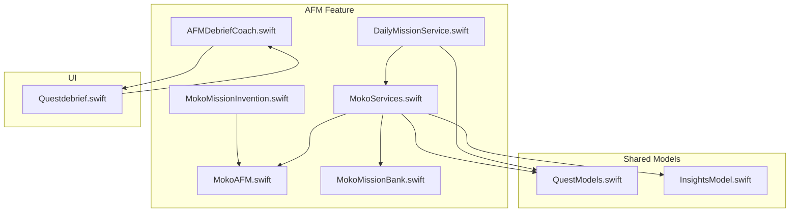
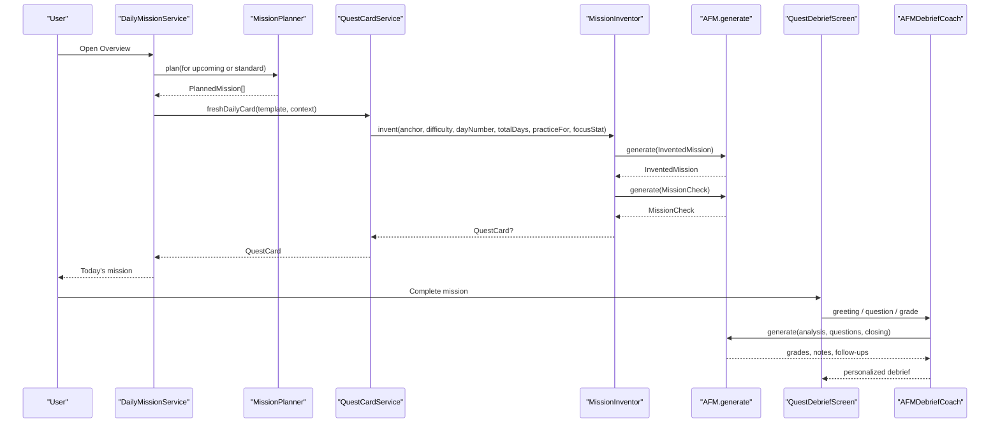
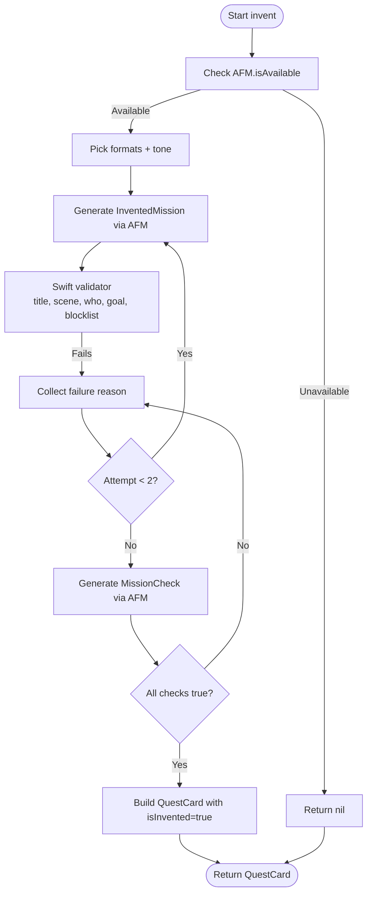
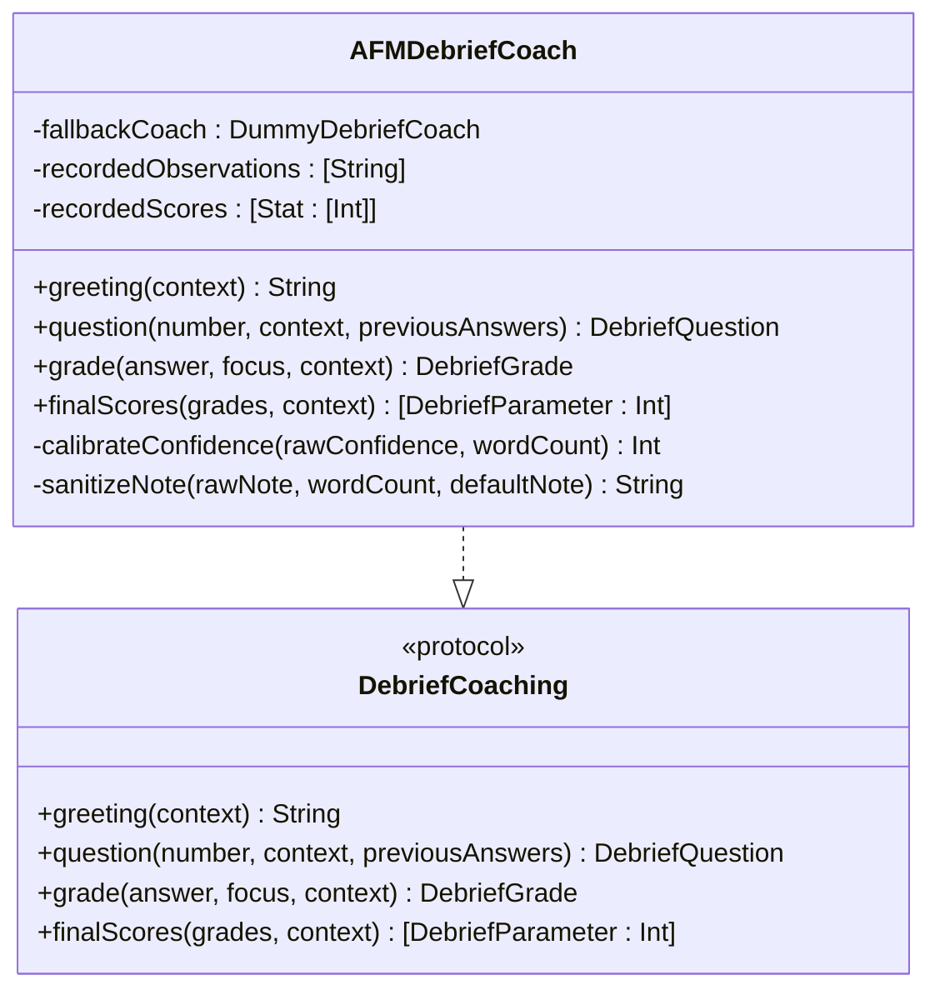
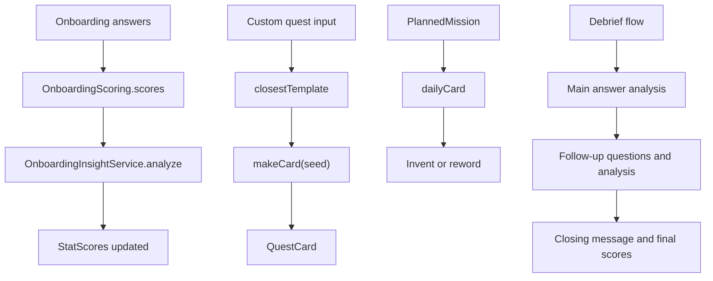
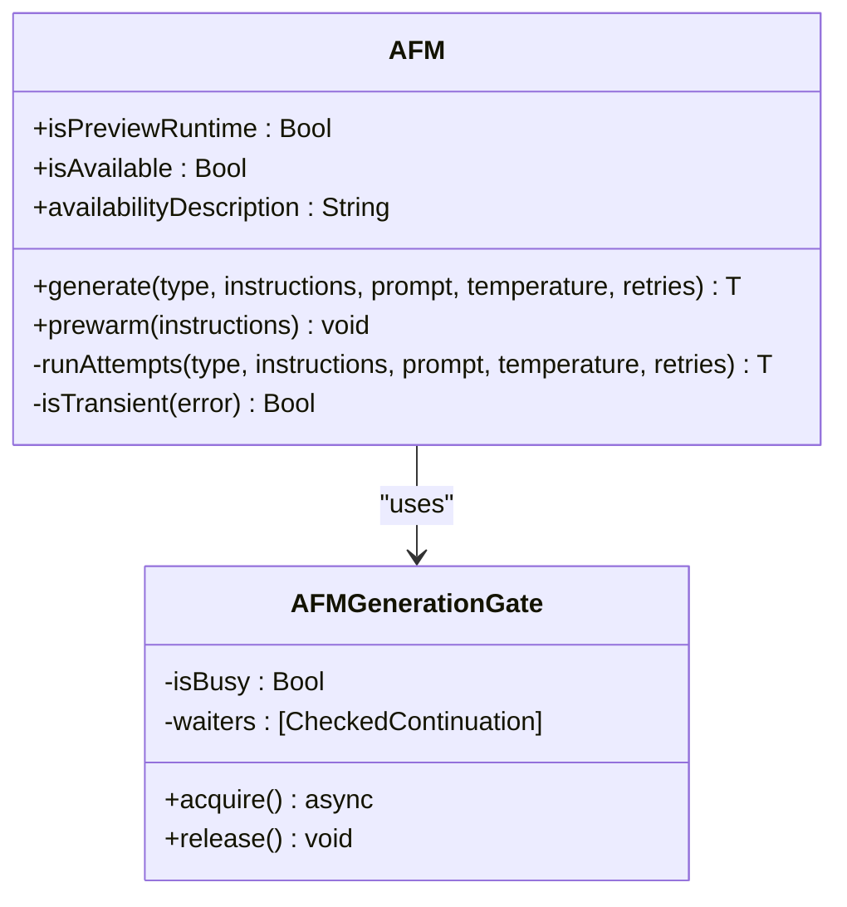
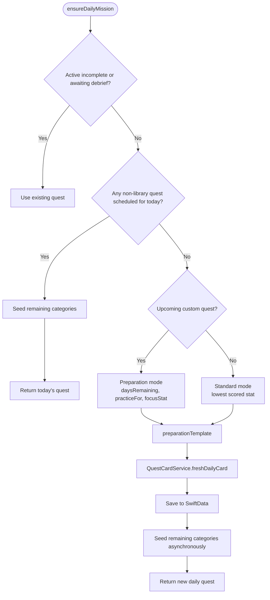
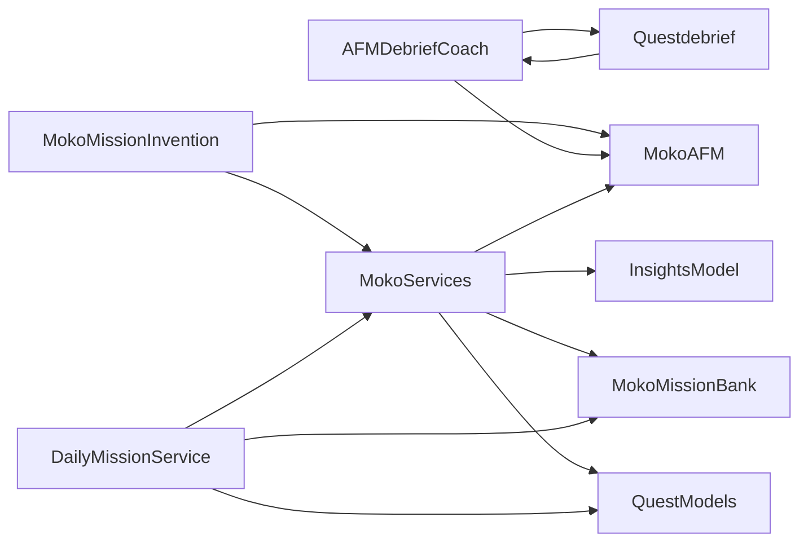

# Adaptive Mission System (AFM)

<cite>
**Referenced Files in This Document**   
- [MokoMissionInvention.swift](file://Moko/Moko/Features/AFM/MokoMissionInvention.swift)
- [AFMDebriefCoach.swift](file://Moko/Moko/Features/AFM/AFMDebriefCoach.swift)
- [MokoServices.swift](file://Moko/Moko/Features/AFM/MokoServices.swift)
- [MokoAFM.swift](file://Moko/Moko/Features/AFM/MokoAFM.swift)
- [DailyMissionService.swift](file://Moko/Moko/Features/AFM/DailyMissionService.swift)
- [MokoMissionBank.swift](file://Moko/Moko/Features/AFM/MokoMissionBank.swift)
- [QuestModels.swift](file://Moko/Moko/Models/QuestModels.swift)
- [InsightsModel.swift](file://Moko/Moko/Models/InsightsModel.swift)
- [Questdebrief.swift](file://Moko/Moko/UIScreens/Quests/Questdebrief.swift)
- [MOKO_AFM_README.md](file://MOKO_AFM_README.md)
</cite>

## Table of Contents
1. [Introduction](#introduction)
2. [Project Structure](#project-structure)
3. [Core Components](#core-components)
4. [Architecture Overview](#architecture-overview)
5. [Detailed Component Analysis](#detailed-component-analysis)
6. [Dependency Analysis](#dependency-analysis)
7. [Performance Considerations](#performance-considerations)
8. [Troubleshooting Guide](#troubleshooting-guide)
9. [Conclusion](#conclusion)

## Introduction
The Adaptive Mission System (AFM) is the intelligence layer behind Moko’s quest generation, personalization, and debrief coaching. It combines a curated Mission Bank with Apple Foundation Models to:

- Generate contextual daily missions that practice real social behaviors.
- Prepare stepping-stone missions leading up to a user-defined event.
- Provide personalized debrief feedback based on what the user says they did.
- Learn from completed sessions by blending scores into running profile insights.
- Keep behavior safe, doable, and grounded through deterministic Swift rules and model-generated language.

The system follows a clear design rule: Swift owns logic, scheduling, scoring, and safety; AFM owns language generation, analysis, and evidence extraction. Every AFM call has a static fallback so the app never blocks when Apple Intelligence is unavailable.

## Project Structure
The AFM feature lives under `Moko/Moko/Features/AFM/` and integrates with shared models and UI screens:

**Diagram sources**
- [MokoMissionInvention.swift:1-307](file://Moko/Moko/Features/AFM/MokoMissionInvention.swift#L1-L307)
- [AFMDebriefCoach.swift:1-219](file://Moko/Moko/Features/AFM/AFMDebriefCoach.swift#L1-L219)
- [MokoServices.swift:1-695](file://Moko/Moko/Features/AFM/MokoServices.swift#L1-L695)
- [MokoAFM.swift:1-617](file://Moko/Moko/Features/AFM/MokoAFM.swift#L1-L617)
- [DailyMissionService.swift:1-307](file://Moko/Moko/Features/AFM/DailyMissionService.swift#L1-L307)
- [MokoMissionBank.swift:1-302](file://Moko/Moko/Features/AFM/MokoMissionBank.swift#L1-L302)
- [QuestModels.swift:1-235](file://Moko/Moko/Models/QuestModels.swift#L1-L235)
- [InsightsModel.swift:1-27](file://Moko/Moko/Models/InsightsModel.swift#L1-L27)
- [Questdebrief.swift:1-800](file://Moko/Moko/UIScreens/Quests/Questdebrief.swift#L1-L800)

**Section sources**
- [MOKO_AFM_README.md:1-63](file://MOKO_AFM_README.md#L1-L63)

## Core Components
- **MokoMissionInvention**: AI-powered mission invention pipeline that creates fresh, safe, and relevant quests anchored to vetted bank templates.
- **AFMDebriefCoach**: Personalized debrief coach bridging Apple Foundation Models to the existing debrief UI.
- **MokoServices**: Integration layer coordinating onboarding insights, quest card creation, daily mission planning, and debrief state management.
- **MokoAFM**: Runtime helper for Apple Foundation Models, including availability checks, generation gating, prompt construction, and structured output types.
- **DailyMissionService**: Adaptive planner that selects today’s featured mission, targets growth areas, and prepares stepping stones before custom events.
- **MokoMissionBank**: Shared domain types and the curated 20-situation Mission Bank used as anchors for all generated content.

**Section sources**
- [MokoMissionInvention.swift:1-307](file://Moko/Moko/Features/AFM/MokoMissionInvention.swift#L1-L307)
- [AFMDebriefCoach.swift:1-219](file://Moko/Moko/Features/AFM/AFMDebriefCoach.swift#L1-L219)
- [MokoServices.swift:1-695](file://Moko/Moko/Features/AFM/MokoServices.swift#L1-L695)
- [MokoAFM.swift:1-617](file://Moko/Moko/Features/AFM/MokoAFM.swift#L1-L617)
- [DailyMissionService.swift:1-307](file://Moko/Moko/Features/AFM/DailyMissionService.swift#L1-L307)
- [MokoMissionBank.swift:1-302](file://Moko/Moko/Features/AFM/MokoMissionBank.swift#L1-L302)

## Architecture Overview
The AFM architecture separates concerns across four layers:

1. **Domain and Data Layer**: Mission Bank, Quest models, Insights records.
2. **Adaptive Planning Layer**: DailyMissionService and MissionPlanner select templates and schedule preparation ramps.
3. **Generation Layer**: MokoMissionInvention and QuestCardService use AFM to write titles, scenes, goals, and questions.
4. **Coaching Layer**: DebriefEngine and AFMDebriefCoach analyze user responses and produce personalized feedback.

**Diagram sources**
- [DailyMissionService.swift:125-225](file://Moko/Moko/Features/AFM/DailyMissionService.swift#L125-L225)
- [MokoServices.swift:252-396](file://Moko/Moko/Features/AFM/MokoServices.swift#L252-L396)
- [MokoMissionInvention.swift:222-304](file://Moko/Moko/Features/AFM/MokoMissionInvention.swift#L222-L304)
- [MokoAFM.swift:113-210](file://Moko/Moko/Features/AFM/MokoAFM.swift#L113-L210)
- [Questdebrief.swift:484-800](file://Moko/Moko/UIScreens/Quests/Questdebrief.swift#L484-L800)
- [AFMDebriefCoach.swift:49-218](file://Moko/Moko/Features/AFM/AFMDebriefCoach.swift#L49-L218)

## Detailed Component Analysis

### MokoMissionInvention: AI-Powered Mission Creation
MokoMissionInvention is responsible for generating fresh daily missions that are interesting but not random. It enforces safety and relevance through a multi-stage pipeline:

- **Anchor**: Every invented mission is tied to a vetted MissionTemplate. The core behavior must match the template goal so debrief follow-up questions remain valid.
- **Seeds**: Swift chooses variety deterministically per day using formats and tones. The model adapts these seeds rather than roaming freely.
- **Validator**: Plain-Swift rules enforce title length, single-sentence verb-first goals, blocked topics, and no repeated titles.
- **Review Pass**: A low-temperature AFM call answers five yes/no checks: doable today, single behavior, debrief questions still fit, believable everyday moment, and safe/appropriate.
- **Fail Closed**: If validation fails, it retries once with feedback; otherwise it falls back to a reworded bank situation.

**Diagram sources**
- [MokoMissionInvention.swift:222-280](file://Moko/Moko/Features/AFM/MokoMissionInvention.swift#L222-L280)
- [MokoMissionInvention.swift:77-132](file://Moko/Moko/Features/AFM/MokoMissionInvention.swift#L77-L132)
- [MokoMissionInvention.swift:49-75](file://Moko/Moko/Features/AFM/MokoMissionInvention.swift#L49-L75)

Key responsibilities:
- Generates `InventedMission` structures with same-skill reasoning, scene, role, and goal.
- Uses `MissionValidator` to reject unsafe, unrealistic, or repetitive missions.
- Integrates with `AFM.generate` for both invention and review passes.
- Exposes `QuestCardService.freshDailyCard` to return an invented card or fall back to library text.

**Section sources**
- [MokoMissionInvention.swift:19-47](file://Moko/Moko/Features/AFM/MokoMissionInvention.swift#L19-L47)
- [MokoMissionInvention.swift:77-132](file://Moko/Moko/Features/AFM/MokoMissionInvention.swift#L77-L132)
- [MokoMissionInvention.swift:134-218](file://Moko/Moko/Features/AFM/MokoMissionInvention.swift#L134-L218)
- [MokoMissionInvention.swift:222-304](file://Moko/Moko/Features/AFM/MokoMissionInvention.swift#L222-L304)

### AFMDebriefCoach: Personalized Feedback and Coaching
AFMDebriefCoach bridges Apple Foundation Models to the existing `QuestDebriefScreen`. It provides:

- Personalized greetings using the user’s name and mission context.
- Follow-up questions tailored to Presence, Clarity, Warmth, or Courage.
- Grading of user answers with confidence, score, and warm notes.
- Final score computation that blends per-answer grades and session confidence.

**Diagram sources**
- [AFMDebriefCoach.swift:49-218](file://Moko/Moko/Features/AFM/AFMDebriefCoach.swift#L49-L218)
- [Questdebrief.swift:93-126](file://Moko/Moko/UIScreens/Quests/Questdebrief.swift#L93-L126)

Behavioral highlights:
- Falls back to `DummyDebriefCoach` when AFM is unavailable.
- Records observations and parameter scores during the session.
- Calibrates confidence based on answer length and detail.
- Produces bounded scores and avoids zero values for parameters without evidence.

**Section sources**
- [AFMDebriefCoach.swift:1-47](file://Moko/Moko/Features/AFM/AFMDebriefCoach.swift#L1-L47)
- [AFMDebriefCoach.swift:49-218](file://Moko/Moko/Features/AFM/AFMDebriefCoach.swift#L49-L218)
- [Questdebrief.swift:128-225](file://Moko/Moko/UIScreens/Quests/Questdebrief.swift#L128-L225)

### MokoServices: Coordination Layer and State Management
MokoServices coordinates between AFM components, handles state, and ensures consistent behavior:

- **Onboarding Scoring**: Converts yes/no answers into StatScores using weighted tags, then generates insight text per stat.
- **Quest Card Service**: Matches user ideas to bank templates, writes card text, and supports daily mission invention.
- **Mission Planner**: Schedules one mission per day until a custom quest date, ramping difficulty and rehearsing the matched situation.
- **Debrief Engine**: Runs a fixed sequence of greeting, main answer, three follow-ups, and closing message; computes final scores.

**Diagram sources**
- [MokoServices.swift:92-185](file://Moko/Moko/Features/AFM/MokoServices.swift#L92-L185)
- [MokoServices.swift:252-396](file://Moko/Moko/Features/AFM/MokoServices.swift#L252-L396)
- [MokoServices.swift:467-693](file://Moko/Moko/Features/AFM/MokoServices.swift#L467-L693)

State management details:
- `DebriefEngine` tracks phase, turns, thinking state, and final scores.
- Evidence weighting determines which stat gets the third follow-up.
- Final scores avoid zero values by providing calibrated baselines when evidence is missing.

**Section sources**
- [MokoServices.swift:11-78](file://Moko/Moko/Features/AFM/MokoServices.swift#L11-L78)
- [MokoServices.swift:92-185](file://Moko/Moko/Features/AFM/MokoServices.swift#L92-L185)
- [MokoServices.swift:252-396](file://Moko/Moko/Features/AFM/MokoServices.swift#L252-L396)
- [MokoServices.swift:467-693](file://Moko/Moko/Features/AFM/MokoServices.swift#L467-L693)

### MokoAFM: Apple Foundation Models Integration
MokoAFM provides the runtime helper for Apple Foundation Models:

- Availability detection and preview/runtime guards.
- Process-wide generation gate to serialize requests.
- Fresh session per call with compact prompts.
- Transient error retry logic and fallback handling.
- Structured output types for onboarding insights, quest cards, and debrief analysis.

**Diagram sources**
- [MokoAFM.swift:37-210](file://Moko/Moko/Features/AFM/MokoAFM.swift#L37-L210)

Design principles:
- Deterministic logic stays in Swift; AFM writes language and reads language.
- Every call uses a fresh session and static fallback.
- User text is wrapped in tags and declared as data.
- Previews disable AFM to avoid framework assertions.

**Section sources**
- [MokoAFM.swift:1-17](file://Moko/Moko/Features/AFM/MokoAFM.swift#L1-L17)
- [MokoAFM.swift:23-35](file://Moko/Moko/Features/AFM/MokoAFM.swift#L23-L35)
- [MokoAFM.swift:37-210](file://Moko/Moko/Features/AFM/MokoAFM.swift#L37-L210)
- [MokoAFM.swift:221-356](file://Moko/Moko/Features/AFM/MokoAFM.swift#L221-L356)
- [MokoAFM.swift:358-617](file://Moko/Moko/Features/AFM/MokoAFM.swift#L358-L617)

### DailyMissionService: Adaptive Mission Selection
DailyMissionService ensures a fresh, tailored daily mission is always available:

- Targets the lowest-scored parameter from Insights when no custom quest is upcoming.
- Alternates categories to prevent boredom while preparing directly for upcoming events.
- Seeds remaining categories asynchronously so the Quests list shows variety.
- Provides synchronous fallback quests to guarantee the Overview UI never shows an empty placeholder.

**Diagram sources**
- [DailyMissionService.swift:125-225](file://Moko/Moko/Features/AFM/DailyMissionService.swift#L125-L225)
- [DailyMissionService.swift:227-303](file://Moko/Moko/Features/AFM/DailyMissionService.swift#L227-L303)

Adaptive algorithms:
- Lowest-scored stat selection averages historical Insights records.
- Preparation template alternates between different categories and similar situations.
- Category rotation cycles work → friends → dating → family.

**Section sources**
- [DailyMissionService.swift:19-35](file://Moko/Moko/Features/AFM/DailyMissionService.swift#L19-L35)
- [DailyMissionService.swift:37-83](file://Moko/Moko/Features/AFM/DailyMissionService.swift#L37-L83)
- [DailyMissionService.swift:85-123](file://Moko/Moko/Features/AFM/DailyMissionService.swift#L85-L123)
- [DailyMissionService.swift:125-225](file://Moko/Moko/Features/AFM/DailyMissionService.swift#L125-L225)
- [DailyMissionService.swift:227-303](file://Moko/Moko/Features/AFM/DailyMissionService.swift#L227-L303)

### MokoMissionBank: Curated Mission Templates
MokoMissionBank defines shared domain types and the 20-situation Mission Bank:

- Stats: Courage, Clarity, Presence, Warmth.
- Difficulty: Easy, Medium, Hard mapped from bank tiers.
- MissionTemplate: Includes id, category, tierLow, ageRange, scene, who, goal, and per-stat follow-up questions.
- Bank retrieval methods filter by category and age range.

This bank is the anchor for all generated content, ensuring debrief questions remain grounded and vetted.

**Section sources**
- [MokoMissionBank.swift:8-91](file://Moko/Moko/Features/AFM/MokoMissionBank.swift#L8-L91)
- [MokoMissionBank.swift:93-302](file://Moko/Moko/Features/AFM/MokoMissionBank.swift#L93-L302)

### Quest Models and Insights
Quest models define the persistent quest entity, intensity, category, and overview mission selection. InsightsModel stores per-session scores over time, enabling adaptive targeting of growth areas.

**Section sources**
- [QuestModels.swift:12-127](file://Moko/Moko/Models/QuestModels.swift#L12-L127)
- [QuestModels.swift:129-166](file://Moko/Moko/Models/QuestModels.swift#L129-L166)
- [InsightsModel.swift:11-26](file://Moko/Moko/Models/InsightsModel.swift#L11-L26)

## Dependency Analysis
The AFM components have clear dependencies:

- `MokoMissionInvention` depends on `AFM.generate`, `MissionTemplate`, and `QuestCardService`.
- `AFMDebriefCoach` depends on `AFM.generate`, `DebriefContext`, and `MissionBank`.
- `MokoServices` depends on `AFM.generate`, `MissionBank`, `QuestModels`, and `InsightsModel`.
- `DailyMissionService` depends on `QuestModels`, `MissionBank`, and `QuestCardService`.
- `Questdebrief` depends on `DebriefCoaching`, `AFMDebriefCoach`, and `DummyDebriefCoach`.

**Diagram sources**
- [MokoMissionInvention.swift:222-304](file://Moko/Moko/Features/AFM/MokoMissionInvention.swift#L222-L304)
- [AFMDebriefCoach.swift:49-218](file://Moko/Moko/Features/AFM/AFMDebriefCoach.swift#L49-L218)
- [MokoServices.swift:252-693](file://Moko/Moko/Features/AFM/MokoServices.swift#L252-L693)
- [DailyMissionService.swift:125-303](file://Moko/Moko/Features/AFM/DailyMissionService.swift#L125-L303)
- [Questdebrief.swift:484-800](file://Moko/Moko/UIScreens/Quests/Questdebrief.swift#L484-L800)

Coupling and cohesion:
- High cohesion within each component (invention, coaching, services, AFM runtime).
- Low coupling through well-defined interfaces (`DebriefCoaching`, `QuestCardService`, `MissionTemplate`).
- No circular dependencies observed; AFM is a leaf dependency.

External integration points:
- Apple Foundation Models via `LanguageModelSession`.
- SwiftData persistence for quests and insights.
- SwiftUI UI lifecycle and observation.

**Section sources**
- [MokoAFM.swift:113-210](file://Moko/Moko/Features/AFM/MokoAFM.swift#L113-L210)
- [QuestModels.swift:151-166](file://Moko/Moko/Models/QuestModels.swift#L151-L166)

## Performance Considerations
- **Fresh sessions per call**: Prevents context window overflow and keeps prompts compact.
- **Generation gate**: Serializes AFM calls to avoid concurrent request errors.
- **Fallback strategy**: Static Swift fallbacks ensure UI responsiveness when AFM is unavailable.
- **Lazy generation**: Daily cards are generated when opened, not eagerly for all days.
- **Asynchronous seeding**: Remaining categories are seeded in background tasks to avoid blocking the main thread.
- **Confidence calibration**: Short answers receive lower confidence caps to avoid misleading scores.

[No sources needed since this section provides general guidance]

## Troubleshooting Guide
Common issues and resolutions:

- **Apple Intelligence unavailable**:
  - Check device eligibility and settings.
  - Previews disable AFM intentionally; use a simulator or device build.
  - Fallback coaches and static text are used automatically.

- **AFM generation failures**:
  - Transient errors (decoding, timeouts) are retried.
  - Guardrail violations, rate limits, and refusals are not retried.
  - Inspect prompt structure and user input sanitization.

- **Empty or invalid debrief questions**:
  - Validate question length, punctuation, and emotional phrasing.
  - Ensure base follow-up questions exist in the Mission Bank.

- **No daily mission shown**:
  - Verify `ensureDailyMission` runs and saves to SwiftData.
  - Check `upcomingCustomQuest` and `templateForStat` logic.
  - Use `todayFallbackQuest` for immediate UI guarantees.

**Section sources**
- [MokoAFM.swift:72-105](file://Moko/Moko/Features/AFM/MokoAFM.swift#L72-L105)
- [MokoAFM.swift:164-204](file://Moko/Moko/Features/AFM/MokoAFM.swift#L164-L204)
- [DailyMissionService.swift:275-303](file://Moko/Moko/Features/AFM/DailyMissionService.swift#L275-L303)
- [Questdebrief.swift:128-225](file://Moko/Moko/UIScreens/Quests/Questdebrief.swift#L128-L225)

## Conclusion
The Adaptive Mission System (AFM) delivers intelligent, personalized quest generation and debrief coaching by combining a curated Mission Bank with Apple Foundation Models. Its architecture ensures safety, relevance, and adaptability:

- **MokoMissionInvention** creates fresh, validated missions anchored to vetted templates.
- **AFMDebriefCoach** provides personalized feedback based on user performance patterns.
- **MokoServices** coordinates state, planning, and generation across components.
- **MokoAFM** manages runtime integration with Apple Foundation Models.
- **DailyMissionService** adapts mission selection based on user history, preferences, and upcoming events.

Over time, the system learns from user interactions by blending debrief scores into Insights records, adjusting future missions to target growth areas, and maintaining a balance between challenge and achievability. This makes AFM a robust foundation for evolving social-confidence training in Moko.

[No sources needed since this section summarizes without analyzing specific files]