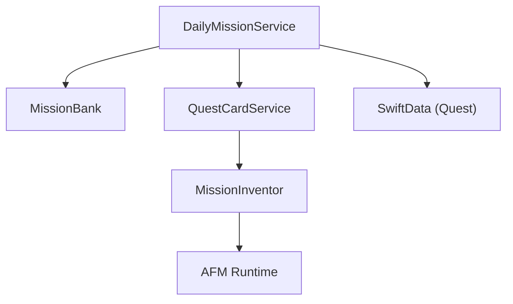
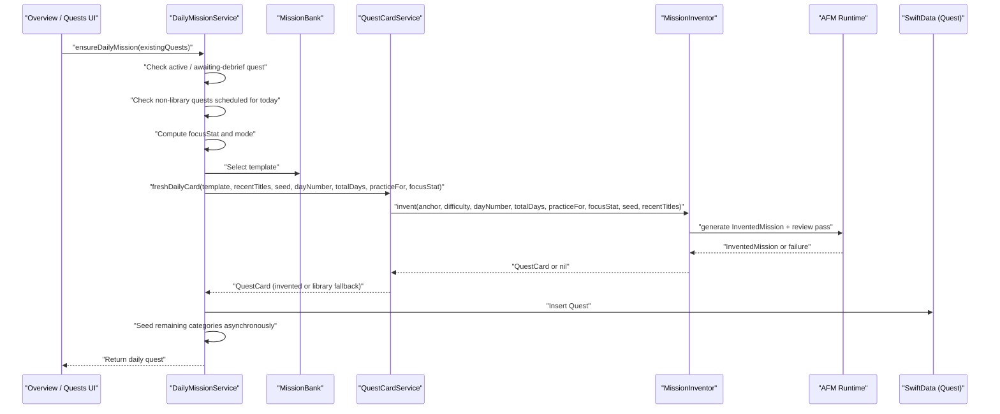
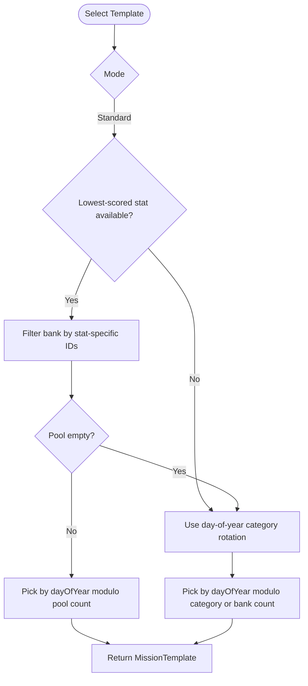
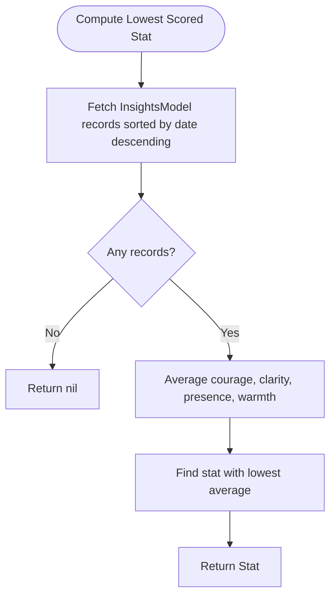
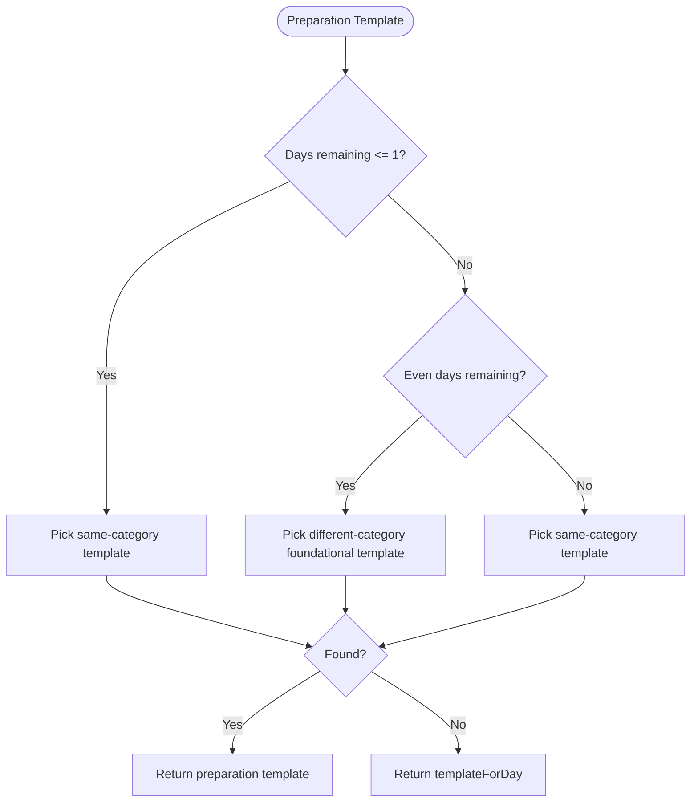
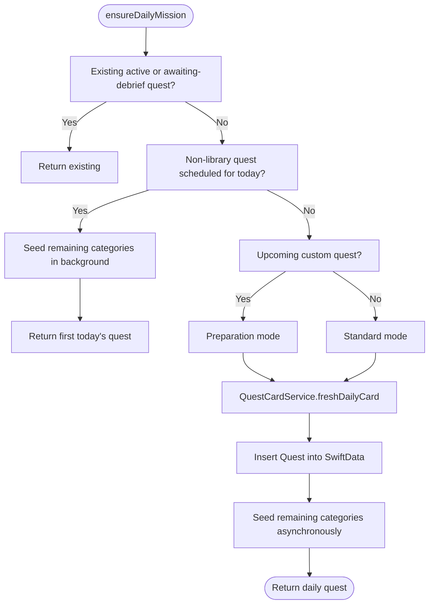
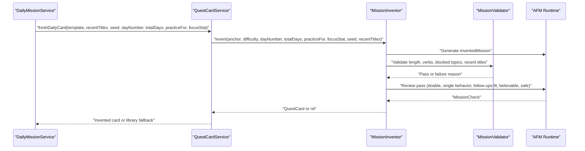
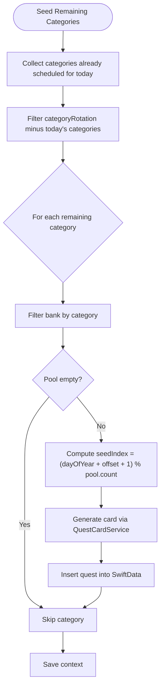
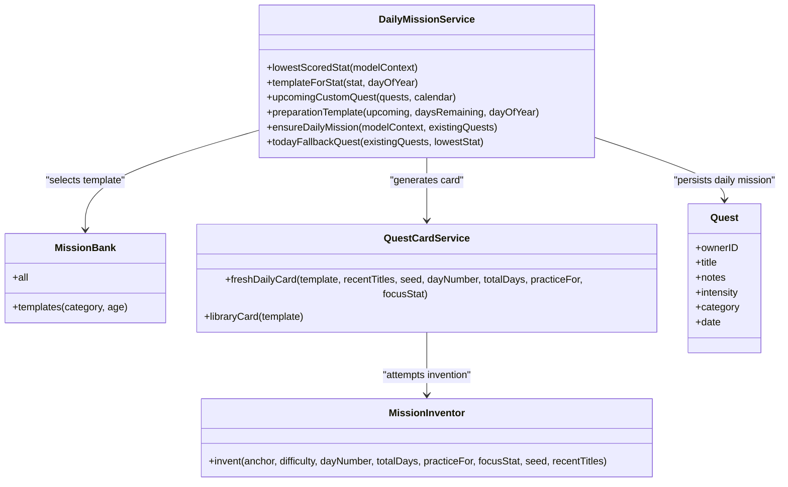

# Daily Mission Service

<cite>
**Referenced Files in This Document**   
- [DailyMissionService.swift](file://Moko/Moko/Features/AFM/DailyMissionService.swift)
- [MokoMissionBank.swift](file://Moko/Moko/Features/AFM/MokoMissionBank.swift)
- [MokoServices.swift](file://Moko/Moko/Features/AFM/MokoServices.swift)
- [MokoMissionInvention.swift](file://Moko/Moko/Features/AFM/MokoMissionInvention.swift)
</cite>

## Table of Contents
1. [Introduction](#introduction)
2. [Project Structure](#project-structure)
3. [Core Components](#core-components)
4. [Architecture Overview](#architecture-overview)
5. [Detailed Component Analysis](#detailed-component-analysis)
6. [Dependency Analysis](#dependency-analysis)
7. [Performance Considerations](#performance-considerations)
8. [Troubleshooting Guide](#troubleshooting-guide)
9. [Conclusion](#conclusion)

## Introduction
DailyMissionService is the automated mission planner for Moko’s daily quest system. Its job is to ensure that the user always has a fresh, personalized, and engaging daily mission on the Overview screen, while also preparing the Quests list with variety across life categories.

The service combines deterministic scheduling with adaptive personalization:
- It avoids empty or stale missions by checking existing quests first.
- It targets the user’s lowest-scored growth parameter when no custom event is upcoming.
- It creates stepping-stone missions when an upcoming custom quest exists.
- It uses AFM-backed content generation through QuestCardService, falling back to curated bank templates when AI generation is unavailable or fails validation.

This document explains how template selection, category rotation, preparation mode, seed-based variety, fallback logic, and async seeding work together to keep users engaged without spoon-feeding them repetitive tasks.

## Project Structure
DailyMissionService lives inside the AFM feature layer alongside shared mission types, card generation, and mission invention logic. The most relevant files are:

| File | Responsibility |
|---|---|
| `DailyMissionService.swift` | Orchestrates daily mission selection, preparation mode, persistence, and category seeding. |
| `MokoMissionBank.swift` | Defines core domain types (`Stat`, `Difficulty`, `MissionTemplate`) and contains the curated mission bank. |
| `MokoServices.swift` | Provides `QuestCardService`, planned-mission ramping, and AFM-backed card creation helpers. |
| `MokoMissionInvention.swift` | Implements AI-powered mission invention with Swift validators and review passes. |

**Diagram sources**
- [DailyMissionService.swift:19-303](file://Moko/Moko/Features/AFM/DailyMissionService.swift#L19-L303)
- [MokoMissionBank.swift:72-105](file://Moko/Moko/Features/AFM/MokoMissionBank.swift#L72-L105)
- [MokoServices.swift:289-395](file://Moko/Moko/Features/AFM/MokoServices.swift#L289-L395)
- [MokoMissionInvention.swift:222-304](file://Moko/Moko/Features/AFM/MokoMissionInvention.swift#L222-L304)

**Section sources**
- [DailyMissionService.swift:1-15](file://Moko/Moko/Features/AFM/DailyMissionService.swift#L1-L15)
- [MokoMissionBank.swift:1-105](file://Moko/Moko/Features/AFM/MokoMissionBank.swift#L1-L105)
- [MokoServices.swift:289-395](file://Moko/Moko/Features/AFM/MokoServices.swift#L289-L395)
- [MokoMissionInvention.swift:1-307](file://Moko/Moko/Features/AFM/MokoMissionInvention.swift#L1-L307)

## Core Components
DailyMissionService is implemented as a `@MainActor` enum with static methods. Its responsibilities can be grouped into four areas:

| Area | Key Methods | Purpose |
|---|---|---|
| Template selection | `templateForDay(_:)`, `templateForStat(_:dayOfYear:)` | Choose a bank template based on day-of-year rotation or targeted growth parameter. |
| Adaptive behavior | `lowestScoredStat(in:)` | Compute the user’s lowest average stat from Insights records. |
| Custom quest preparation | `upcomingCustomQuest(from:calendar:)`, `preparationTemplate(for:daysRemaining:dayOfYear:)` | Build stepping-stone missions before a real event. |
| Mission orchestration | `ensureDailyMission(in:existingQuests:)`, `seedRemainingCategories(...)` | Create today’s featured mission, persist it, and seed other categories asynchronously. |
| Fallback UI safety | `todayFallbackQuest(existingQuests:lowestStat:)` | Provide an instant synchronous mission so the UI never shows an empty placeholder. |

**Section sources**
- [DailyMissionService.swift:19-35](file://Moko/Moko/Features/AFM/DailyMissionService.swift#L19-L35)
- [DailyMissionService.swift:37-83](file://Moko/Moko/Features/AFM/DailyMissionService.swift#L37-L83)
- [DailyMissionService.swift:85-123](file://Moko/Moko/Features/AFM/DailyMissionService.swift#L85-L123)
- [DailyMissionService.swift:125-225](file://Moko/Moko/Features/AFM/DailyMissionService.swift#L125-L225)
- [DailyMissionService.swift:227-303](file://Moko/Moko/Features/AFM/DailyMissionService.swift#L227-L303)

## Architecture Overview
The end-to-end flow starts when the app needs a daily mission. DailyMissionService decides whether to reuse an existing quest, prepare for an upcoming custom quest, or target the user’s weakest growth area. It then asks QuestCardService to generate a fresh card, which may invoke MissionInventor and AFM. Finally, the service persists the quest and seeds additional category quests in the background.

**Diagram sources**
- [DailyMissionService.swift:127-225](file://Moko/Moko/Features/AFM/DailyMissionService.swift#L127-L225)
- [MokoMissionInvention.swift:222-304](file://Moko/Moko/Features/AFM/MokoMissionInvention.swift#L222-L304)
- [MokoServices.swift:283-304](file://Moko/Moko/Features/AFM/MokoServices.swift#L283-L304)

## Detailed Component Analysis

### Template Selection Algorithms
DailyMissionService selects a `MissionTemplate` using two main strategies:

1. **Category rotation by day of year:**  
   `templateForDay(_:)` cycles through Work, Friends, Dating, Family using `dayOfYear % categoryRotation.count`. If the selected category has no templates, it falls back to the full bank.

2. **Lowest-scored parameter targeting:**  
   `templateForStat(_:dayOfYear:)` filters the bank to templates associated with a specific stat:
   - Courage: approach-oriented moments like speaking up, introducing yourself, sending a first message, suggesting a hangout, or sharing something small.
   - Clarity: direct boundary-setting moments like declining extra work, suggesting a place, ending things clearly, turning down plans, asking for help, or setting a visit boundary.
   - Presence: in-the-moment correction or honesty moments like correcting your boss, admitting you don’t know, correcting a family narrative, or asking about exclusivity.
   - Warmth: vulnerability and connection moments like naming what you felt, bringing up distance, addressing unspoken family topics, saying you’re hurt, or asking for feedback after a mistake.

If no matching templates exist for a stat, the method falls back to `templateForDay(dayOfYear)`.

**Diagram sources**
- [DailyMissionService.swift:28-35](file://Moko/Moko/Features/AFM/DailyMissionService.swift#L28-L35)
- [DailyMissionService.swift:60-83](file://Moko/Moko/Features/AFM/DailyMissionService.swift#L60-L83)

**Section sources**
- [DailyMissionService.swift:28-35](file://Moko/Moko/Features/AFM/DailyMissionService.swift#L28-L35)
- [DailyMissionService.swift:60-83](file://Moko/Moko/Features/AFM/DailyMissionService.swift#L60-L83)
- [MokoMissionBank.swift:72-105](file://Moko/Moko/Features/AFM/MokoMissionBank.swift#L72-L105)

### Category Rotation System
The category rotation order is explicitly defined as:

| Position | Category |
|---|---|
| 0 | Work |
| 1 | Friends |
| 2 | Dating |
| 3 | Family |

The rotation repeats every four days. This ensures the Overview mission does not stay stuck in one life area and exposes the user to different social contexts over time.

The same rotation concept is reused in `seedRemainingCategories`, where the service tries to create one quest per category excluding the already featured category, offsetting the bank index so each category gets a distinct template.

**Section sources**
- [DailyMissionService.swift:22-26](file://Moko/Moko/Features/AFM/DailyMissionService.swift#L22-L26)
- [DailyMissionService.swift:231-273](file://Moko/Moko/Features/AFM/DailyMissionService.swift#L231-L273)

### Lowest-Scored Parameter Targeting
`lowestScoredStat(in:)` computes the average score across all stored `InsightsModel` records for Courage, Clarity, Presence, and Warmth. It returns the stat with the lowest average.

This is used in standard daily mode to personalize missions toward the user’s current growth focus. The comment in the file clarifies that debrief evaluation remains equal across parameters; personalization affects mission selection, not scoring weight.

**Diagram sources**
- [DailyMissionService.swift:39-58](file://Moko/Moko/Features/AFM/DailyMissionService.swift#L39-L58)

**Section sources**
- [DailyMissionService.swift:37-58](file://Moko/Moko/Features/AFM/DailyMissionService.swift#L37-L58)

### Preparation Mode Logic for Upcoming Events
When an upcoming custom quest exists, DailyMissionService switches to preparation mode. It calculates:

- `daysRemaining`: number of days between today and the upcoming quest.
- `totalDays`: at least three days, representing the preparation window.
- `dayNumber`: which step of the preparation sequence today represents.
- `practiceFor`: the title of the upcoming quest.
- `focusStat`: the user’s lowest-scored stat, so stepping stones still reinforce growth.

`preparationTemplate(for:daysRemaining:dayOfYear:)` alternates between:

| Condition | Behavior |
|---|---|
| One day remaining | Pick a similar-situation template in the same category as rehearsal. |
| Even days remaining | Pick a foundational stepping stone from a different category to build general social comfort. |
| Odd days remaining | Pick a similar-situation template in the same category to rehearse the upcoming interaction. |
| No suitable pool found | Fall back to `templateForDay(dayOfYear)`. |

This prevents spoon-feeding the exact same situation while still building relevance to the real event.

**Diagram sources**
- [DailyMissionService.swift:95-123](file://Moko/Moko/Features/AFM/DailyMissionService.swift#L95-L123)

**Section sources**
- [DailyMissionService.swift:85-123](file://Moko/Moko/Features/AFM/DailyMissionService.swift#L85-L123)

### ensureDailyMission Orchestration
`ensureDailyMission(in:existingQuests:)` is the central orchestrator. Its decision tree is:

1. If there is an active incomplete quest or a completed quest awaiting debrief, return it immediately.
2. If any non-library quest is scheduled for today, return the first one and seed remaining categories asynchronously.
3. Otherwise, compute the day-of-year, recent titles, and check for an upcoming custom quest.
4. Select the template using preparation mode or standard mode.
5. Call `QuestCardService.freshDailyCard` with:
   - The selected template.
   - Recent titles to avoid repetition.
   - A deterministic seed including the day and focus stat.
   - `dayNumber` and `totalDays` for preparation sequences.
   - `practiceFor` when preparing for an upcoming quest.
   - `focusStat` to guide AFM invention.
6. Create a `Quest` from the generated card and insert it into SwiftData.
7. Seed remaining categories asynchronously so the Quests list shows variety.

**Diagram sources**
- [DailyMissionService.swift:127-225](file://Moko/Moko/Features/AFM/DailyMissionService.swift#L127-L225)

**Section sources**
- [DailyMissionService.swift:125-225](file://Moko/Moko/Features/AFM/DailyMissionService.swift#L125-L225)

### Integration with QuestCardService and AI-Powered Content Generation
DailyMissionService delegates content generation to `QuestCardService.freshDailyCard`. That method attempts to invent a fresh mission via `MissionInventor.invent`. If invention succeeds, it returns an invented card; otherwise, it falls back to `libraryCard`, which uses the vetted bank text directly.

Mission invention includes:
- Deterministic variety seeds chosen by Swift.
- AFM-generated mission structure.
- Plain-Swift validation rules.
- A second AFM review pass.
- One retry with feedback if validation fails.
- Fail-closed behavior: if invention fails, the caller receives a library fallback.

**Diagram sources**
- [MokoMissionInvention.swift:222-304](file://Moko/Moko/Features/AFM/MokoMissionInvention.swift#L222-L304)
- [MokoServices.swift:283-304](file://Moko/Moko/Features/AFM/MokoServices.swift#L283-L304)

**Section sources**
- [DailyMissionService.swift:192-200](file://Moko/Moko/Features/AFM/DailyMissionService.swift#L192-L200)
- [MokoMissionInvention.swift:222-304](file://Moko/Moko/Features/AFM/MokoMissionInvention.swift#L222-L304)
- [MokoServices.swift:283-304](file://Moko/Moko/Features/AFM/MokoServices.swift#L283-L304)

### seedRemainingCategories for Quest Variety
`seedRemainingCategories` ensures the Quests tab is not dominated by only today’s featured category. It:

1. Collects categories already scheduled for today.
2. Filters out the featured category.
3. Iterates remaining categories with an offset.
4. Picks a template from the matching category using `(dayOfYear + offset + 1) % pool.count`.
5. Generates a card via `QuestCardService.freshDailyCard`.
6. Inserts each quest into SwiftData.
7. Saves once after all inserts.

This keeps the user exposed to Work, Friends, Dating, and Family missions even when the Overview highlights only one category.

**Diagram sources**
- [DailyMissionService.swift:231-273](file://Moko/Moko/Features/AFM/DailyMissionService.swift#L231-L273)

**Section sources**
- [DailyMissionService.swift:227-273](file://Moko/Moko/Features/AFM/DailyMissionService.swift#L227-L273)

### Fallback Mechanisms and Async Seeding Strategies
DailyMissionService implements multiple layers of resilience:

| Failure Scenario | Fallback Strategy |
|---|---|
| No AFM availability | `MissionInventor.invent` returns `nil`; `QuestCardService.freshDailyCard` returns `libraryCard`. |
| Invalid invented mission | Validation rejects it; invention retries once with feedback; otherwise returns `nil`. |
| Review pass fails | Mission invention fails closed and returns `nil`. |
| No existing active quest | Service creates a new daily quest. |
| No non-library quest scheduled for today | Service generates one. |
| UI needs an instant mission | `todayFallbackQuest` provides a synchronous fallback without waiting for AFM. |
| Background seeding fails partially | Each category iteration guards against empty pools and continues; saves occur after inserts. |

The async seeding strategy uses Swift `Task` blocks to avoid blocking the main thread while populating the Quests list with diverse categories.

**Section sources**
- [DailyMissionService.swift:139-152](file://Moko/Moko/Features/AFM/DailyMissionService.swift#L139-L152)
- [DailyMissionService.swift:214-222](file://Moko/Moko/Features/AFM/DailyMissionService.swift#L214-L222)
- [DailyMissionService.swift:275-303](file://Moko/Moko/Features/AFM/DailyMissionService.swift#L275-L303)
- [MokoMissionInvention.swift:232-279](file://Moko/Moko/Features/AFM/MokoMissionInvention.swift#L232-L279)

### User Engagement Through Personalized Content
DailyMissionService maintains engagement by balancing novelty, personalization, and predictability:

- **Novelty:** AFM invention and deterministic variety seeds produce different scenarios instead of repeating the same bank text.
- **Personalization:** Lowest-scored stats and preparation mode tie missions to the user’s growth trajectory and upcoming events.
- **Predictability:** Day-of-year indexing and stable seeds make repeated quests feel consistent rather than random.
- **Variety:** Category rotation and `seedRemainingCategories` prevent the Quests list from becoming homogeneous.
- **Safety:** Validation and review passes ensure missions remain doable, respectful, and appropriate.

**Section sources**
- [DailyMissionService.swift:6-14](file://Moko/Moko/Features/AFM/DailyMissionService.swift#L6-L14)
- [DailyMissionService.swift:22-26](file://Moko/Moko/Features/AFM/DailyMissionService.swift#L22-L26)
- [DailyMissionService.swift:39-83](file://Moko/Moko/Features/AFM/DailyMissionService.swift#L39-L83)
- [MokoMissionInvention.swift:49-75](file://Moko/Moko/Features/AFM/MokoMissionInvention.swift#L49-L75)

## Dependency Analysis
DailyMissionService depends on several components:

**Diagram sources**
- [DailyMissionService.swift:19-303](file://Moko/Moko/Features/AFM/DailyMissionService.swift#L19-L303)
- [MokoMissionBank.swift:95-105](file://Moko/Moko/Features/AFM/MokoMissionBank.swift#L95-L105)
- [MokoServices.swift:289-395](file://Moko/Moko/Features/AFM/MokoServices.swift#L289-L395)
- [MokoMissionInvention.swift:222-304](file://Moko/Moko/Features/AFM/MokoMissionInvention.swift#L222-L304)

**Section sources**
- [DailyMissionService.swift:19-303](file://Moko/Moko/Features/AFM/DailyMissionService.swift#L19-L303)
- [MokoMissionBank.swift:95-105](file://Moko/Moko/Features/AFM/MokoMissionBank.swift#L95-L105)
- [MokoServices.swift:289-395](file://Moko/Moko/Features/AFM/MokoServices.swift#L289-L395)
- [MokoMissionInvention.swift:222-304](file://Moko/Moko/Features/AFM/MokoMissionInvention.swift#L222-L304)

## Performance Considerations
- `ensureDailyMission` performs lightweight filtering and averaging over Insights records. Complexity is proportional to the number of stored insights.
- Template selection uses array filtering and modulo indexing, which is fast for the curated 20-template bank.
- AFM calls are asynchronous and optional; invention failures fall back to library cards without blocking the UI.
- Category seeding runs in background tasks to avoid delaying the primary mission display.
- Repeated calls to `MissionBank.all` are acceptable because the bank is small and static, but caching could be considered if the bank grows significantly.

[No sources needed since this section provides general guidance]

## Troubleshooting Guide
Common issues and their likely causes:

| Symptom | Likely Cause | Resolution |
|---|---|---|
| Overview shows no active quest | No existing active or awaiting-debrief quest and no non-library quest scheduled for today. | Ensure `ensureDailyMission` is called during app launch or tab appearance. |
| Daily mission feels repetitive | AFM invention failed or was skipped, returning library cards. | Check AFM availability and invention validation; verify recent titles are being passed. |
| Quests list lacks variety | `seedRemainingCategories` did not run or category pools were empty. | Verify async seeding tasks execute and that each category has templates. |
| Preparation missions feel too similar | Preparation mode selected same-category templates too often. | Confirm `daysRemaining` calculation and alternating logic in `preparationTemplate`. |
| UI freezes during mission generation | Synchronous path waited for AFM or database save. | Use `todayFallbackQuest` for instant UI rendering and rely on async paths for generation. |
| Lowest-scored stat seems incorrect | Few or no InsightsModel records exist. | Ensure debrief results are persisted; the method returns `nil` when no records are available. |

**Section sources**
- [DailyMissionService.swift:127-225](file://Moko/Moko/Features/AFM/DailyMissionService.swift#L127-L225)
- [DailyMissionService.swift:231-273](file://Moko/Moko/Features/AFM/DailyMissionService.swift#L231-L273)
- [DailyMissionService.swift:275-303](file://Moko/Moko/Features/AFM/DailyMissionService.swift#L275-L303)
- [MokoMissionInvention.swift:91-131](file://Moko/Moko/Features/AFM/MokoMissionInvention.swift#L91-L131)

## Conclusion
DailyMissionService is the coordination layer that turns user insights, calendar context, and curated mission templates into a reliable daily experience. It prioritizes freshness, personalization, and variety while keeping the UI responsive and robust through layered fallbacks.

Its design separates deterministic planning from AI content generation:
- Deterministic logic handles scheduling, category rotation, stat averaging, preparation sequencing, and persistence.
- AFM powers personalized mission invention and card text, with Swift validators and library fallbacks ensuring reliability.

For maintainers, the most important boundaries are:
- Keep template selection and stat targeting deterministic.
- Treat AFM as optional enhancement, not required functionality.
- Preserve category diversity so the user sees more than just the featured mission.
- Keep preparation mode balanced between foundational skills and relevant rehearsals.
- Ensure fallback paths guarantee that the Overview never shows an empty state.

[No sources needed since this section summarizes without analyzing specific files]