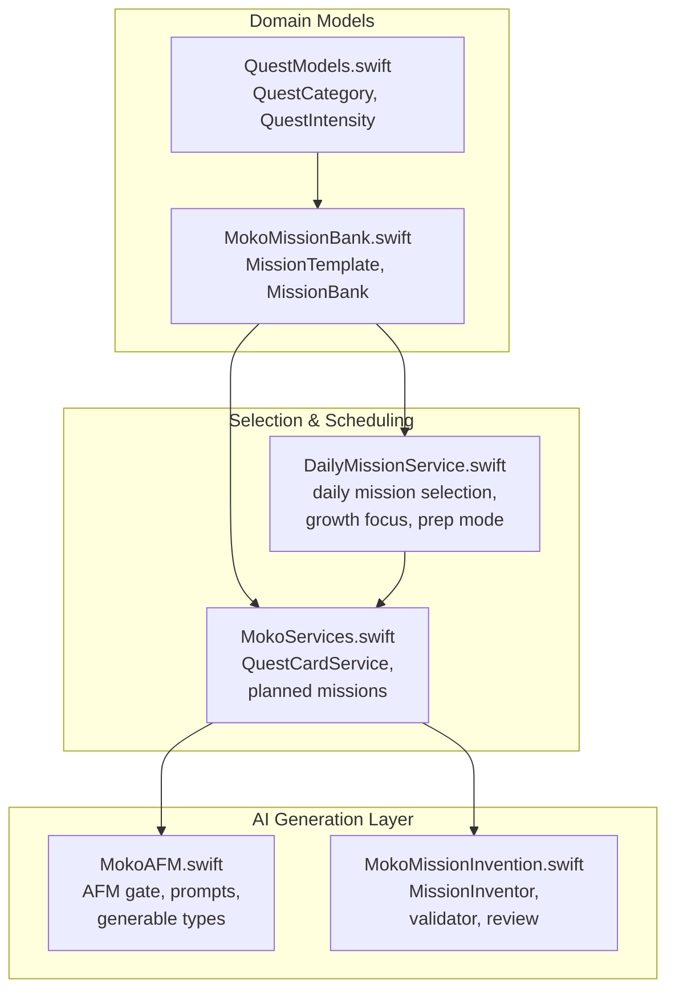
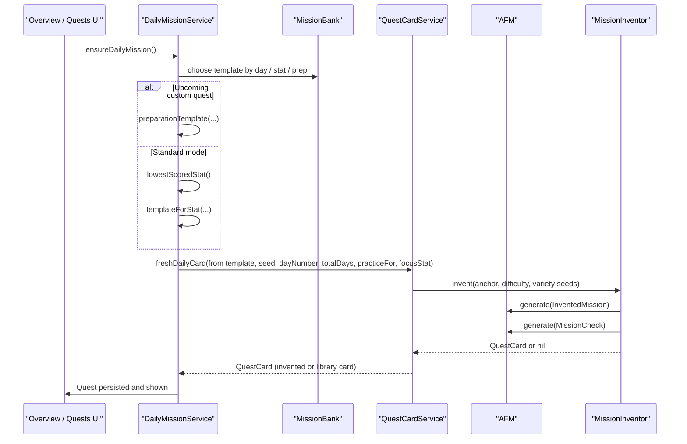
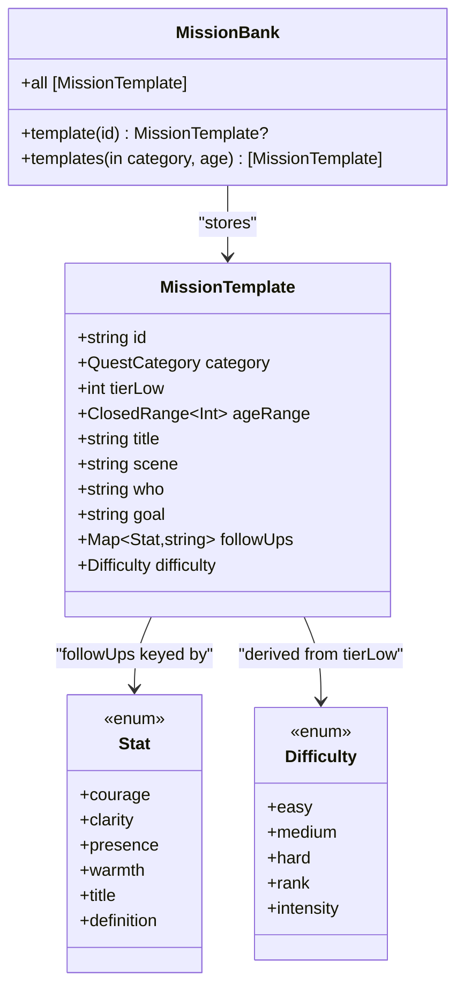
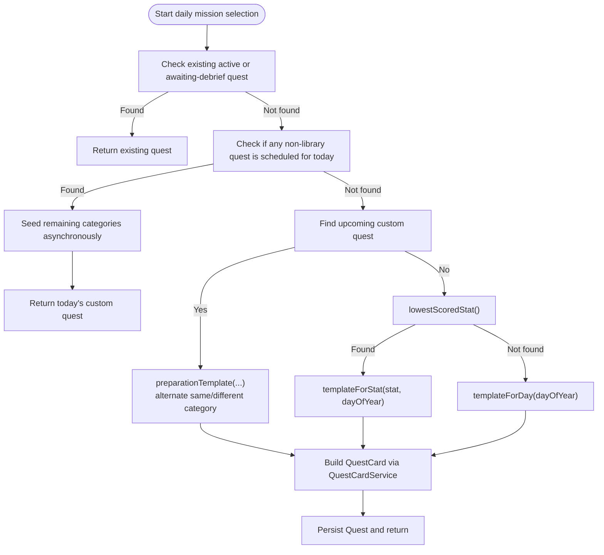
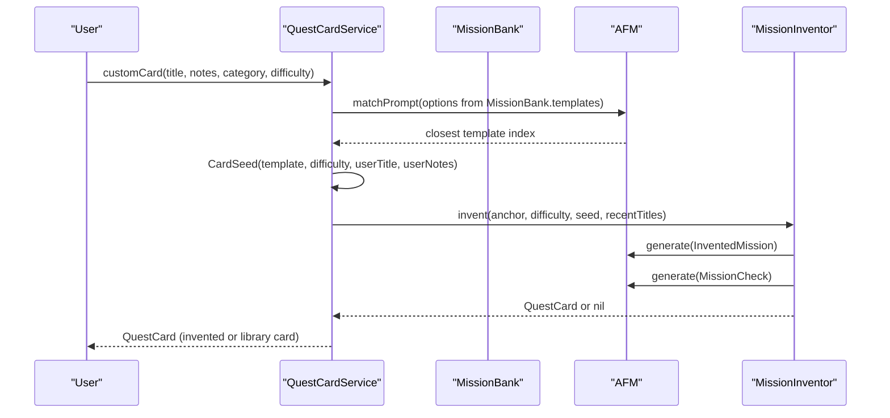
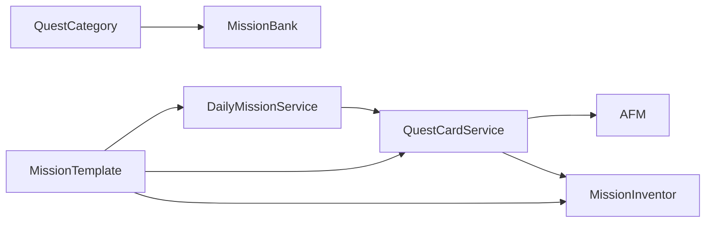

# Mission Bank & Templates

<cite>
**Referenced Files in This Document**
- [MokoMissionBank.swift](file://Moko/Moko/Features/AFM/MokoMissionBank.swift)
- [QuestModels.swift](file://Moko/Moko/Models/QuestModels.swift)
- [DailyMissionService.swift](file://Moko/Moko/Features/AFM/DailyMissionService.swift)
- [MokoAFM.swift](file://Moko/Moko/Features/AFM/MokoAFM.swift)
- [MokoMissionInvention.swift](file://Moko/Moko/Features/AFM/MokoMissionInvention.swift)
- [MokoServices.swift](file://Moko/Moko/Features/AFM/MokoServices.swift)
</cite>

## Table of Contents
1. [Introduction](#introduction)
2. [Project Structure](#project-structure)
3. [Core Components](#core-components)
4. [Architecture Overview](#architecture-overview)
5. [Detailed Component Analysis](#detailed-component-analysis)
6. [Dependency Analysis](#dependency-analysis)
7. [Performance Considerations](#performance-considerations)
8. [Troubleshooting Guide](#troubleshooting-guide)
9. [Conclusion](#conclusion)

## Introduction
This document explains the Mission Bank system that stores predefined social-confidence mission templates and categories for the Moko app. It covers:
- The structure of `MissionTemplate` objects, including title, scene, who is involved, goal, difficulty, category, age range, and debrief follow-up questions.
- The categorization system across work, friends, dating, family, and others.
- Template selection algorithms, filtering by category and age, growth-area targeting, and preparation for upcoming custom quests.
- How the AFM (Apple Foundation Models) layer uses templates as foundations for AI-generated quest cards and debrief content.
- Examples of well-crafted mission templates and how they support different aspects of social confidence building.

The Mission Bank is intentionally a fixed repository of vetted situations. AFM personalizes wording and generates fresh daily missions anchored to these templates rather than inventing scenarios from nothing.

## Project Structure
The Mission Bank lives under the AFM feature area and integrates with shared models and services:

**Diagram sources**
- [MokoMissionBank.swift:72-90](file://Moko/Moko/Features/AFM/MokoMissionBank.swift#L72-L90)
- [QuestModels.swift:13-48](file://Moko/Moko/Models/QuestModels.swift#L13-L48)
- [DailyMissionService.swift:20-35](file://Moko/Moko/Features/AFM/DailyMissionService.swift#L20-L35)
- [MokoServices.swift:290-326](file://Moko/Moko/Features/AFM/MokoServices.swift#L290-L326)
- [MokoAFM.swift:72-137](file://Moko/Moko/Features/AFM/MokoAFM.swift#L72-L137)
- [MokoMissionInvention.swift:223-280](file://Moko/Moko/Features/AFM/MokoMissionInvention.swift#L223-L280)

**Section sources**
- [MokoMissionBank.swift:1-10](file://Moko/Moko/Features/AFM/MokoMissionBank.swift#L1-L10)
- [QuestModels.swift:13-48](file://Moko/Moko/Models/QuestModels.swift#L13-L48)
- [DailyMissionService.swift:1-15](file://Moko/Moko/Features/AFM/DailyMissionService.swift#L1-L15)

## Core Components
- **MissionTemplate**: A structured template describing a real-life social situation, its context, goal, and debrief questions.
- **MissionBank**: A static collection of curated templates grouped by life domain.
- **QuestCategory**: Shared enum defining work, dating, friends, family, and others.
- **Difficulty / QuestIntensity**: Mapping between bank tiers and UI-facing intensity levels.
- **Stat**: Courage, clarity, presence, warmth — the four social skills measured during debrief.
- **DailyMissionService**: Selects today’s featured mission, targets growth areas, and prepares for upcoming custom quests.
- **QuestCardService**: Converts templates into user-facing quest cards, optionally generating fresh versions through AFM.
- **MissionInventor + AFM**: Generate new but grounded missions anchored to bank templates, validated by Swift rules and a second AI review pass.

**Section sources**
- [MokoMissionBank.swift:72-90](file://Moko/Moko/Features/AFM/MokoMissionBank.swift#L72-L90)
- [MokoMissionBank.swift:95-103](file://Moko/Moko/Features/AFM/MokoMissionBank.swift#L95-L103)
- [QuestModels.swift:13-48](file://Moko/Moko/Models/QuestModels.swift#L13-L48)
- [DailyMissionService.swift:20-35](file://Moko/Moko/Features/AFM/DailyMissionService.swift#L20-L35)
- [MokoServices.swift:290-326](file://Moko/Moko/Features/AFM/MokoServices.swift#L290-L326)
- [MokoMissionInvention.swift:223-280](file://Moko/Moko/Features/AFM/MokoMissionInvention.swift#L223-L280)

## Architecture Overview
The Mission Bank is the source of truth for scenario patterns. Selection logic chooses a template based on:
- Category rotation (work → friends → dating → family).
- Age range filtering.
- Growth-area targeting using the lowest-scored stat.
- Preparation mode when an upcoming custom quest exists.

Templates are then turned into quest cards either directly or via AI generation anchored to the template.

**Diagram sources**
- [DailyMissionService.swift:125-224](file://Moko/Moko/Features/AFM/DailyMissionService.swift#L125-L224)
- [MokoServices.swift:283-326](file://Moko/Moko/Features/AFM/MokoServices.swift#L283-L326)
- [MokoMissionInvention.swift:223-304](file://Moko/Moko/Features/AFM/MokoMissionInvention.swift#L223-L304)
- [MokoAFM.swift:115-137](file://Moko/Moko/Features/AFM/MokoAFM.swift#L115-L137)

## Detailed Component Analysis

### MissionTemplate and MissionBank
`MissionTemplate` captures:
- `id`: Stable identifier used for matching and planning.
- `category`: Work, dating, friends, family, or others.
- `tierLow`: Bank tier indicating difficulty progression.
- `ageRange`: Applicable age range for safety and relevance.
- `title`, `scene`, `who`, `goal`: The core scenario description.
- `followUps`: One closed-ended debrief question per stat (courage, clarity, presence, warmth).
- `difficulty`: Derived from `tierLow`.

`MissionBank` provides:
- Lookup by ID.
- Filtering by category and optional age.
- The full static list of curated templates.

**Diagram sources**
- [MokoMissionBank.swift:72-90](file://Moko/Moko/Features/AFM/MokoMissionBank.swift#L72-L90)
- [MokoMissionBank.swift:95-103](file://Moko/Moko/Features/AFM/MokoMissionBank.swift#L95-L103)
- [MokoMissionBank.swift:10-24](file://Moko/Moko/Features/AFM/MokoMissionBank.swift#L10-L24)
- [MokoMissionBank.swift:29-70](file://Moko/Moko/Features/AFM/MokoMissionBank.swift#L29-L70)

**Section sources**
- [MokoMissionBank.swift:72-90](file://Moko/Moko/Features/AFM/MokoMissionBank.swift#L72-L90)
- [MokoMissionBank.swift:95-103](file://Moko/Moko/Features/AFM/MokoMissionBank.swift#L95-L103)

### Categorization System: Work, Friends, Dating, Family, Others
Categories are defined centrally and reused by both the Mission Bank and UI components. Each category has a symbol and display label.

- **Work**: Professional interactions such as speaking up, setting boundaries, introducing yourself, correcting information, and asking for feedback.
- **Dating**: Early-stage and relationship conversations such as sending the first message, suggesting a place, naming feelings, discussing exclusivity, and ending things clearly.
- **Friends**: Peer relationships such as initiating hangouts, admitting uncertainty, expressing hurt, declining plans, and addressing distance.
- **Family**: Family dynamics such as sharing small updates, asking for help, correcting narratives, setting visit boundaries, and bringing up unspoken topics.
- **Others**: Fallback category; filtering treats it as “include all” unless explicitly constrained.

Use cases:
- Work templates build professional courage, clarity, presence, and warmth in hierarchical or team settings.
- Dating templates reduce ambiguity and encourage direct, respectful communication.
- Friends templates strengthen peer connection and conflict navigation.
- Family templates practice boundary-setting and emotional honesty in close relationships.

**Section sources**
- [QuestModels.swift:30-48](file://Moko/Moko/Models/QuestModels.swift#L30-L48)
- [MokoMissionBank.swift:107-290](file://Moko/Moko/Features/AFM/MokoMissionBank.swift#L107-L290)

### Template Selection Algorithms and Filtering
The selection pipeline ensures users see relevant, varied, and growth-oriented missions.

Key behaviors:
- **Category rotation**: Work → friends → dating → family, cycling daily.
- **Age filtering**: Templates include an age range; only applicable templates are considered.
- **Growth-area targeting**: If Insights data exists, the lowest-scored stat determines a focused pool of templates.
- **Preparation mode**: When a custom quest is scheduled, daily missions alternate between foundational skills (different category) and similar-situation rehearsal (same category), culminating in a same-category rehearsal right before the event.

**Diagram sources**
- [DailyMissionService.swift:125-224](file://Moko/Moko/Features/AFM/DailyMissionService.swift#L125-L224)
- [DailyMissionService.swift:28-35](file://Moko/Moko/Features/AFM/DailyMissionService.swift#L28-L35)
- [DailyMissionService.swift:40-83](file://Moko/Moko/Features/AFM/DailyMissionService.swift#L40-L83)
- [DailyMissionService.swift:95-123](file://Moko/Moko/Features/AFM/DailyMissionService.swift#L95-L123)

**Section sources**
- [DailyMissionService.swift:20-35](file://Moko/Moko/Features/AFM/DailyMissionService.swift#L20-L35)
- [DailyMissionService.swift:37-83](file://Moko/Moko/Features/AFM/DailyMissionService.swift#L37-L83)
- [DailyMissionService.swift:85-123](file://Moko/Moko/Features/AFM/DailyMissionService.swift#L85-L123)
- [DailyMissionService.swift:125-224](file://Moko/Moko/Features/AFM/DailyMissionService.swift#L125-L224)

### Relationship Between Mission Templates and the AFM System
AFM does not replace the Mission Bank; it personalizes and extends it:
- **Matching**: For custom quests, AFM matches the user’s idea to the closest bank template using a prompt that lists candidate titles, scenes, and goals.
- **Card generation**: AFM writes a fresh quest card anchored to the template’s pattern while preserving the core behavior so debrief questions remain valid.
- **Debrief generation**: AFM produces opening messages, analysis, follow-up questions, and closing notes based on the mission goal and user responses.
- **Fallback**: If AFM is unavailable or fails validation, the system falls back to the library card text from the Mission Bank.

**Diagram sources**
- [MokoServices.swift:290-345](file://Moko/Moko/Features/AFM/MokoServices.swift#L290-L345)
- [MokoAFM.swift:397-463](file://Moko/Moko/Features/AFM/MokoAFM.swift#L397-L463)
- [MokoMissionInvention.swift:223-304](file://Moko/Moko/Features/AFM/MokoMissionInvention.swift#L223-L304)

**Section sources**
- [MokoAFM.swift:1-17](file://Moko/Moko/Features/AFM/MokoAFM.swift#L1-L17)
- [MokoAFM.swift:397-463](file://Moko/Moko/Features/AFM/MokoAFM.swift#L397-L463)
- [MokoMissionInvention.swift:1-14](file://Moko/Moko/Features/AFM/MokoMissionInvention.swift#L1-L14)
- [MokoMissionInvention.swift:223-304](file://Moko/Moko/Features/AFM/MokoMissionInvention.swift#L223-L304)

### Example Mission Templates and Intended Outcomes
Below are representative examples drawn from the Mission Bank. These illustrate how each template defines a concrete behavior and ties to debrief questions for courage, clarity, presence, and warmth.

- **Speak Up in a Meeting** (Work): Encourages initiating contribution in a team setting. Outcome: practicing approach behavior and concise expression.
- **Decline Extra Work** (Work): Practices direct refusal without over-explaining. Outcome: clarity and boundary-setting.
- **Send the First Message** (Dating): Encourages timely initiation in dating apps. Outcome: courage and low-pressure engagement.
- **Suggest the Place** (Dating): Practices proposing a specific plan. Outcome: clarity and mutual consideration.
- **Suggest the Hangout** (Friends): Encourages initiating peer connection. Outcome: courage and warmth.
- **Admit You Don't Know** (Friends): Practices curiosity and humility. Outcome: presence and openness.
- **Share Something Small** (Family): Encourages volunteering real details in casual family moments. Outcome: warmth and approach behavior.
- **Ask for Help** (Family): Practices direct requests. Outcome: clarity and reduced avoidance.

These templates contribute to social confidence by:
- Breaking down intimidating interactions into single, describable behaviors.
- Providing debrief anchors that measure progress across four dimensions.
- Allowing AFM to personalize wording while keeping the core skill intact.

**Section sources**
- [MokoMissionBank.swift:107-290](file://Moko/Moko/Features/AFM/MokoMissionBank.swift#L107-L290)

### Debrief Follow-ups and Growth Areas
Each template includes one follow-up question per stat. During debrief, AFM evaluates the user’s answers against anchors for courage, clarity, presence, and warmth. Daily mission selection can target the lowest-scored stat, ensuring repeated practice in the area that needs growth.

- **Courage**: Approach versus avoidance.
- **Clarity**: Direct, concise communication.
- **Presence**: Being in the moment.
- **Warmth**: Genuine engagement and openness.

**Section sources**
- [MokoMissionBank.swift:10-24](file://Moko/Moko/Features/AFM/MokoMissionBank.swift#L10-L24)
- [MokoAFM.swift:242-255](file://Moko/Moko/Features/AFM/MokoAFM.swift#L242-L255)
- [DailyMissionService.swift:37-83](file://Moko/Moko/Features/AFM/DailyMissionService.swift#L37-L83)

## Dependency Analysis
The Mission Bank depends on shared enums and is consumed by selection and generation layers:

**Diagram sources**
- [QuestModels.swift:30-48](file://Moko/Moko/Models/QuestModels.swift#L30-L48)
- [MokoMissionBank.swift:72-103](file://Moko/Moko/Features/AFM/MokoMissionBank.swift#L72-L103)
- [DailyMissionService.swift:20-35](file://Moko/Moko/Features/AFM/DailyMissionService.swift#L20-L35)
- [MokoServices.swift:290-326](file://Moko/Moko/Features/AFM/MokoServices.swift#L290-L326)
- [MokoMissionInvention.swift:223-304](file://Moko/Moko/Features/AFM/MokoMissionInvention.swift#L223-L304)

**Section sources**
- [QuestModels.swift:30-48](file://Moko/Moko/Models/QuestModels.swift#L30-L48)
- [MokoMissionBank.swift:72-103](file://Moko/Moko/Features/AFM/MokoMissionBank.swift#L72-L103)
- [DailyMissionService.swift:20-35](file://Moko/Moko/Features/AFM/DailyMissionService.swift#L20-L35)
- [MokoServices.swift:290-326](file://Moko/Moko/Features/AFM/MokoServices.swift#L290-L326)
- [MokoMissionInvention.swift:223-304](file://Moko/Moko/Features/AFM/MokoMissionInvention.swift#L223-L304)

## Performance Considerations
- **Deterministic vs. AI paths**: Difficulty mapping, category rotation, age filtering, and fallback logic are plain Swift. Only language generation touches AFM.
- **Generation gating**: AFM serializes requests through a process-wide gate to avoid concurrent session issues.
- **Transient retries**: Only transient errors trigger retries; guardrail violations, refusals, and rate limits do not loop indefinitely.
- **Preview safety**: AFM is disabled in SwiftUI previews to prevent assertion failures.
- **Fallback guarantees**: If invention or AFM fails, the system returns a library card from the Mission Bank, ensuring the UI never shows an empty placeholder.

[No sources needed since this section provides general guidance]

## Troubleshooting Guide
Common issues and resolutions:
- **AFM unavailable**: The system throws an availability error and falls back to static or library content. Check device eligibility and Apple Intelligence settings.
- **Generation failed**: Errors are surfaced as localized descriptions; callers should handle them gracefully and use fallbacks.
- **Empty daily mission**: `todayFallbackQuest` ensures a synchronous fallback quest is always available when async seeding has not completed.
- **Mismatched debrief questions**: Invented missions must pass validator checks and review passes; otherwise, the system reverts to the bank template’s wording.

**Section sources**
- [MokoAFM.swift:23-35](file://Moko/Moko/Features/AFM/MokoAFM.swift#L23-L35)
- [MokoAFM.swift:72-137](file://Moko/Moko/Features/AFM/MokoAFM.swift#L72-L137)
- [DailyMissionService.swift:275-303](file://Moko/Moko/Features/AFM/DailyMissionService.swift#L275-L303)
- [MokoMissionInvention.swift:77-131](file://Moko/Moko/Features/AFM/MokoMissionInvention.swift#L77-L131)

## Conclusion
The Mission Bank provides a safe, curated foundation for social-confidence missions. Its templates define clear scenarios, goals, and debrief anchors across work, friends, dating, and family domains. Selection algorithms tailor missions to the user’s growth areas and upcoming events, while AFM personalizes wording and generates fresh daily missions anchored to the bank. This combination ensures consistent, meaningful practice experiences that build courage, clarity, presence, and warmth over time.

[No sources needed since this section summarizes without analyzing specific files]