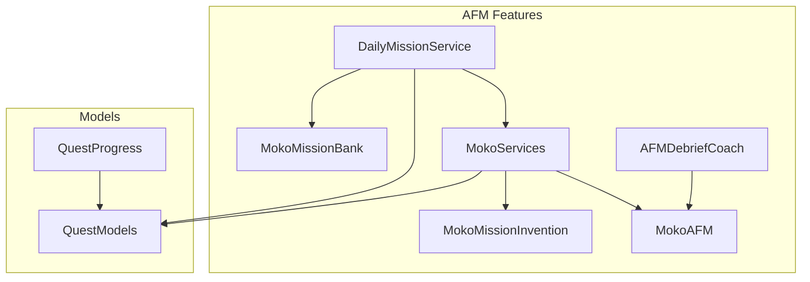
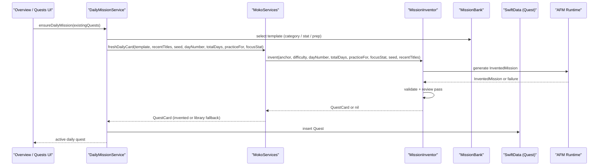
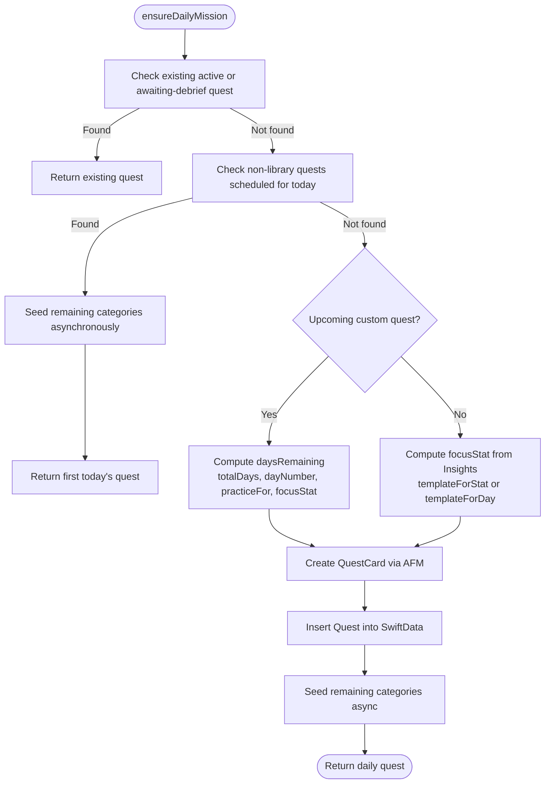
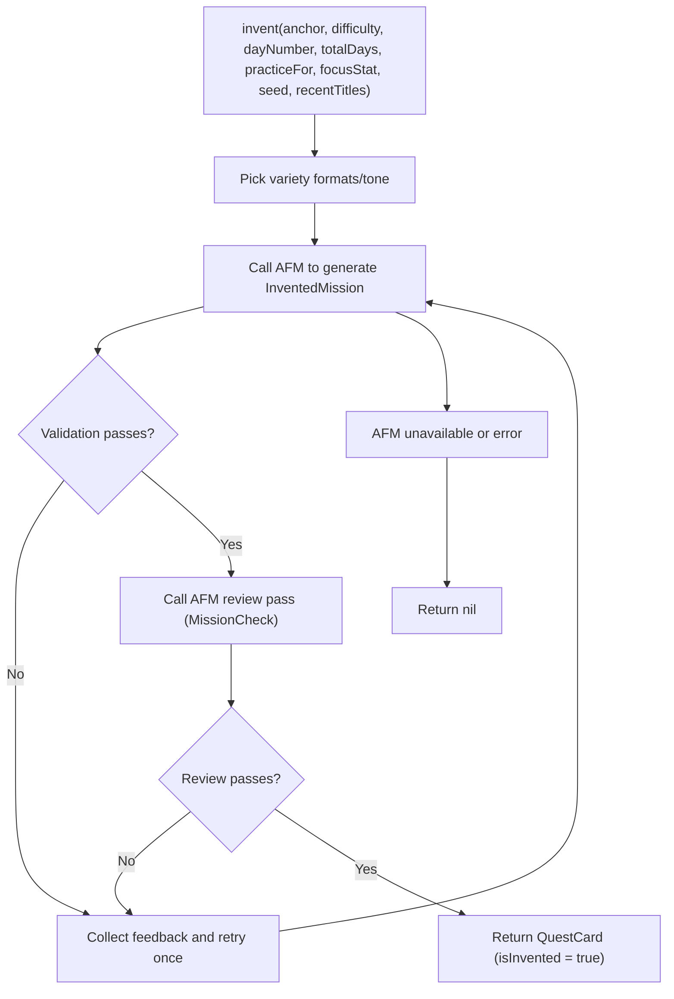
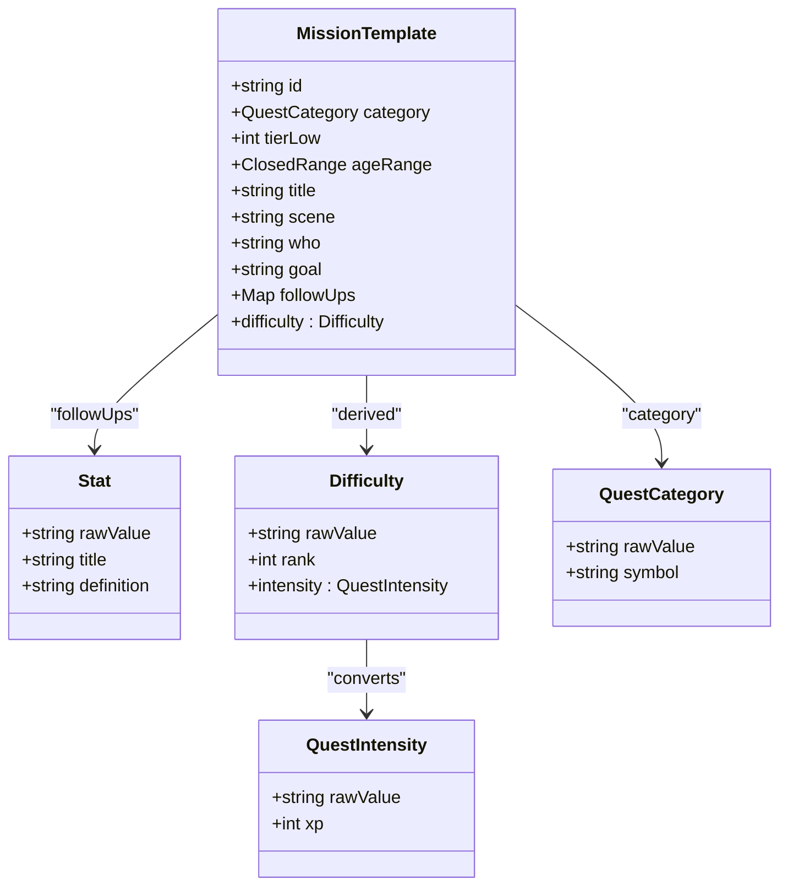
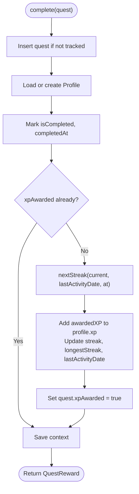
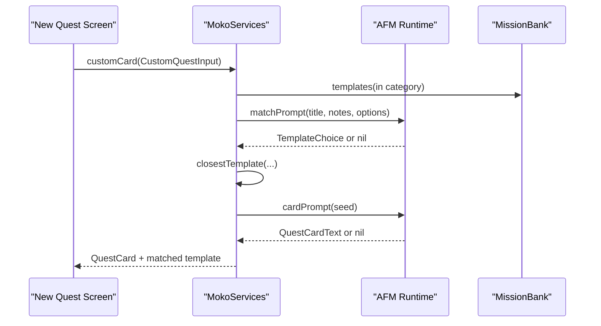
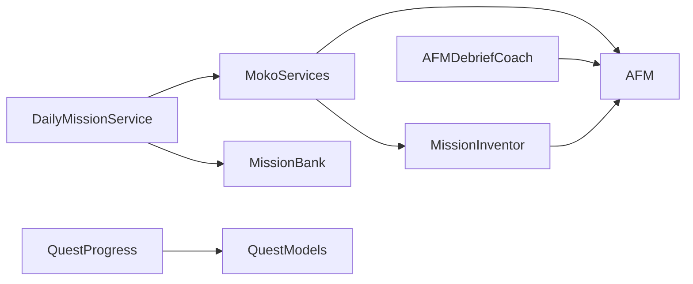

# Quest & Mission System

<cite>
**Referenced Files in This Document**   
- [DailyMissionService.swift](file://Moko/Moko/Features/AFM/DailyMissionService.swift)
- [MokoMissionInvention.swift](file://Moko/Moko/Features/AFM/MokoMissionInvention.swift)
- [MokoMissionBank.swift](file://Moko/Moko/Features/AFM/MokoMissionBank.swift)
- [QuestModels.swift](file://Moko/Moko/Models/QuestModels.swift)
- [QuestProgress.swift](file://Moko/Moko/Models/QuestProgress.swift)
- [MokoAFM.swift](file://Moko/Moko/Features/AFM/MokoAFM.swift)
- [AFMDebriefCoach.swift](file://Moko/Moko/Features/AFM/AFMDebriefCoach.swift)
- [MokoServices.swift](file://Moko/Moko/Features/AFM/MokoServices.swift)
</cite>

## Table of Contents
1. [Introduction](#introduction)
2. [Project Structure](#project-structure)
3. [Core Components](#core-components)
4. [Architecture Overview](#architecture-overview)
5. [Detailed Component Analysis](#detailed-component-analysis)
6. [Dependency Analysis](#dependency-analysis)
7. [Performance Considerations](#performance-considerations)
8. [Troubleshooting Guide](#troubleshooting-guide)
9. [Conclusion](#conclusion)

## Introduction
This document explains Moko’s Quest & Mission System and its Adaptive Mission System (AFM). It covers how daily missions are automatically assigned, how AI-powered mission invention works alongside a curated mission bank, how quests are categorized and scheduled, and how completion, XP, streaks, insights, and debrief scoring fit together. The goal is to make the system understandable for both developers and non-technical readers while preserving implementation details such as difficulty scaling, personalization, retry logic, and integration with the insights system.

## Project Structure
The quest and mission features live primarily under:
- `Moko/Moko/Features/AFM/` — AFM orchestration, daily mission planning, mission invention, mission bank, debrief coaching, and shared services.
- `Moko/Moko/Models/` — Quest data model, intensity/category enums, current user identity, database container, formatting helpers, and progress tracking.

**Diagram sources**
- [DailyMissionService.swift:19-303](file://Moko/Moko/Features/AFM/DailyMissionService.swift#L19-L303)
- [MokoMissionInvention.swift:222-304](file://Moko/Moko/Features/AFM/MokoMissionInvention.swift#L222-L304)
- [MokoMissionBank.swift:10-91](file://Moko/Moko/Features/AFM/MokoMissionBank.swift#L10-L91)
- [MokoServices.swift:231-395](file://Moko/Moko/Features/AFM/MokoServices.swift#L231-L395)
- [MokoAFM.swift:33-84](file://Moko/Moko/Features/AFM/MokoAFM.swift#L33-L84)
- [AFMDebriefCoach.swift:49-218](file://Moko/Moko/Features/AFM/AFMDebriefCoach.swift#L49-L218)
- [QuestModels.swift:13-100](file://Moko/Moko/Models/QuestModels.swift#L13-L100)
- [QuestProgress.swift:17-139](file://Moko/Moko/Models/QuestProgress.swift#L17-L139)

**Section sources**
- [DailyMissionService.swift:1-303](file://Moko/Moko/Features/AFM/DailyMissionService.swift#L1-L303)
- [MokoMissionInvention.swift:1-307](file://Moko/Moko/Features/AFM/MokoMissionInvention.swift#L1-L307)
- [MokoMissionBank.swift:1-302](file://Moko/Moko/Features/AFM/MokoMissionBank.swift#L1-L302)
- [QuestModels.swift:1-235](file://Moko/Moko/Models/QuestModels.swift#L1-L235)
- [QuestProgress.swift:1-139](file://Moko/Moko/Models/QuestProgress.swift#L1-L139)
- [MokoAFM.swift:1-490](file://Moko/Moko/Features/AFM/MokoAFM.swift#L1-L490)
- [AFMDebriefCoach.swift:1-219](file://Moko/Moko/Features/AFM/AFMDebriefCoach.swift#L1-L219)
- [MokoServices.swift:1-695](file://Moko/Moko/Features/AFM/MokoServices.swift#L1-L695)

## Core Components
- DailyMissionService: Ensures a fresh, tailored daily mission exists on the Overview screen. It selects templates by category rotation, lowest-scored growth parameter, or preparation for an upcoming custom quest.
- MokoMissionInvention: Generates new mission cards anchored to vetted mission bank situations, validated by Swift rules and a second AI review pass.
- MokoMissionBank: Defines core domain types (`Stat`, `Difficulty`, `MissionTemplate`) and contains the curated 20-situation mission bank used across the app.
- QuestModels: Defines `QuestIntensity`, `QuestCategory`, the persistent `Quest` model, current user identity, database container, and UI formatting helpers.
- QuestProgress: Handles completion rewards, streak calculation, XP awarding, and saving debrief results into Insights.
- MokoServices: Bridges AFM to the app for onboarding insights, quest card generation, planned mission ramp-up, and debrief state machine.
- MokoAFM: Provides Apple Foundation Models runtime, error handling, prompt builders, and structured generable output types.
- AFMDebriefCoach: Implements debrief coaching using AFM where available, falling back to deterministic behavior otherwise.

**Section sources**
- [DailyMissionService.swift:19-303](file://Moko/Moko/Features/AFM/DailyMissionService.swift#L19-L303)
- [MokoMissionInvention.swift:222-304](file://Moko/Moko/Features/AFM/MokoMissionInvention.swift#L222-L304)
- [MokoMissionBank.swift:10-91](file://Moko/Moko/Features/AFM/MokoMissionBank.swift#L10-L91)
- [QuestModels.swift:13-100](file://Moko/Moko/Models/QuestModels.swift#L13-L100)
- [QuestProgress.swift:17-139](file://Moko/Moko/Models/QuestProgress.swift#L17-L139)
- [MokoServices.swift:231-395](file://Moko/Moko/Features/AFM/MokoServices.swift#L231-L395)
- [MokoAFM.swift:33-84](file://Moko/Moko/Features/AFM/MokoAFM.swift#L33-L84)
- [AFMDebriefCoach.swift:49-218](file://Moko/Moko/Features/AFM/AFMDebriefCoach.swift#L49-L218)

## Architecture Overview
The system separates deterministic logic from language generation:
- Deterministic parts: scheduling, difficulty mapping, streak math, XP values, category rotation, template selection, validation rules.
- AFM parts: generating personalized text for cards, debrief questions, analysis notes, and onboarding insights.

**Diagram sources**
- [DailyMissionService.swift:127-225](file://Moko/Moko/Features/AFM/DailyMissionService.swift#L127-L225)
- [MokoMissionInvention.swift:222-304](file://Moko/Moko/Features/AFM/MokoMissionInvention.swift#L222-L304)
- [MokoServices.swift:283-304](file://Moko/Moko/Features/AFM/MokoServices.swift#L283-L304)
- [MokoMissionBank.swift:72-91](file://Moko/Moko/Features/AFM/MokoMissionBank.swift#L72-L91)
- [MokoAFM.swift:55-77](file://Moko/Moko/Features/AFM/MokoAFM.swift#L55-L77)

## Detailed Component Analysis

### DailyMissionService: Automated Quest Assignment
Responsibilities:
- Select today’s featured mission for the Overview screen.
- Prefer existing active/incomplete quests or completed-but-un-debriefed quests.
- If no mission exists, determine whether to prepare for an upcoming custom quest or target the user’s lowest-scored growth parameter.
- Generate a daily quest via AFM-backed card creation and persist it.
- Seed variety quests per life category so the Quests list shows diverse content.

Key behaviors:
- Category rotation cycles through Work, Friends, Dating, Family.
- Lowest-scored parameter is computed from Insights records averaged over time.
- Preparation mode alternates between foundational skills in different categories and similar-situation rehearsals closer to the event.
- Fallback synchronous method guarantees the UI never shows an empty placeholder.

**Diagram sources**
- [DailyMissionService.swift:127-225](file://Moko/Moko/Features/AFM/DailyMissionService.swift#L127-L225)

**Section sources**
- [DailyMissionService.swift:28-35](file://Moko/Moko/Features/AFM/DailyMissionService.swift#L28-L35)
- [DailyMissionService.swift:39-83](file://Moko/Moko/Features/AFM/DailyMissionService.swift#L39-L83)
- [DailyMissionService.swift:87-123](file://Moko/Moko/Features/AFM/DailyMissionService.swift#L87-L123)
- [DailyMissionService.swift:127-225](file://Moko/Moko/Features/AFM/DailyMissionService.swift#L127-L225)
- [DailyMissionService.swift:231-273](file://Moko/Moko/Features/AFM/DailyMissionService.swift#L231-L273)
- [DailyMissionService.swift:279-303](file://Moko/Moko/Features/AFM/DailyMissionService.swift#L279-L303)

### MokoMissionInvention: AI-Powered Mission Generation
Responsibilities:
- Generate fresh mission cards that practice the same core behavior as a vetted mission bank situation but in a new everyday context.
- Enforce safety, doability, and quality through Swift validators and a second AI review pass.
- Provide deterministic variety seeds based on day number and stable hashing.
- Fall back to library card text when invention fails.

Algorithm highlights:
- VarietyPool picks formats and tone deterministically per day and seed.
- MissionValidator checks title length, single-sentence goals, verb-first structure, blocked topics/phrases, and title uniqueness against recent titles.
- Review pass asks AFM to answer five yes/no checks: doable today, single behavior, follow-ups still fit, believable, safe.
- Fail-closed design retries once with feedback; otherwise returns nil and uses the bank fallback.

**Diagram sources**
- [MokoMissionInvention.swift:222-280](file://Moko/Moko/Features/AFM/MokoMissionInvention.swift#L222-L280)
- [MokoMissionInvention.swift:79-132](file://Moko/Moko/Features/AFM/MokoMissionInvention.swift#L79-L132)
- [MokoMissionInvention.swift:49-75](file://Moko/Moko/Features/AFM/MokoMissionInvention.swift#L49-L75)

**Section sources**
- [MokoMissionInvention.swift:22-47](file://Moko/Moko/Features/AFM/MokoMissionInvention.swift#L22-L47)
- [MokoMissionInvention.swift:49-75](file://Moko/Moko/Features/AFM/MokoMissionInvention.swift#L49-L75)
- [MokoMissionInvention.swift:79-132](file://Moko/Moko/Features/AFM/MokoMissionInvention.swift#L79-L132)
- [MokoMissionInvention.swift:136-218](file://Moko/Moko/Features/AFM/MokoMissionInvention.swift#L136-L218)
- [MokoMissionInvention.swift:222-304](file://Moko/Moko/Features/AFM/MokoMissionInvention.swift#L222-L304)

### MokoMissionBank: Mission Templates and Categorization
Responsibilities:
- Define core domain types: `Stat`, `Difficulty`, `MissionTemplate`.
- Map mission bank tiers to app difficulty levels.
- Provide filtered template retrieval by category and age range.
- Contain the curated set of 20 mission situations across Work, Dating, Friends, and Family.

Important relationships:
- `MissionTemplate.difficulty` maps tier ranges to `easy`, `medium`, `hard`.
- `Difficulty` and `QuestIntensity` convert between each other.
- `Stat` defines Courage, Clarity, Presence, Warmth with definitions used throughout personalization and debrief.

**Diagram sources**
- [MokoMissionBank.swift:10-91](file://Moko/Moko/Features/AFM/MokoMissionBank.swift#L10-L91)
- [QuestModels.swift:13-48](file://Moko/Moko/Models/QuestModels.swift#L13-L48)

**Section sources**
- [MokoMissionBank.swift:10-91](file://Moko/Moko/Features/AFM/MokoMissionBank.swift#L10-L91)
- [MokoMissionBank.swift:95-103](file://Moko/Moko/Features/AFM/MokoMissionBank.swift#L95-L103)
- [MokoMissionBank.swift:105-290](file://Moko/Moko/Features/AFM/MokoMissionBank.swift#L105-L290)

### QuestModels and QuestProgress: Data Structures, XP, and Completion Tracking
Quest data model:
- `Quest` stores owner ID, title, notes, intensity, category, date, timestamps, completion flags, XP fields, and debrief recording status.
- `Quest.overviewMission(from:)` determines which quest the Overview should show: earliest awaiting debrief, then soonest incomplete today or overdue.
- `QuestIntensity.xp` defines XP shown on cards: Easy=100, Medium=150, Hard=200.
- `Quest.isFromLibrary` indicates library scenarios with explicit XP.

Progress and gamification:
- `QuestProgress.complete(...)` marks a quest complete, awards XP once, updates streak, longest streak, last activity date, and profile.
- Streak logic allows one rest day after seven active days; otherwise gaps reset the streak.
- `QuestProgress.saveDebrief(...)` ensures debrief scores are saved as Insights entries with minimum meaningful scores, preventing zero values.

**Diagram sources**
- [QuestProgress.swift:49-83](file://Moko/Moko/Models/QuestProgress.swift#L49-L83)
- [QuestProgress.swift:17-47](file://Moko/Moko/Models/QuestProgress.swift#L17-L47)

**Section sources**
- [QuestModels.swift:13-28](file://Moko/Moko/Models/QuestModels.swift#L13-L28)
- [QuestModels.swift:50-100](file://Moko/Moko/Models/QuestModels.swift#L50-L100)
- [QuestModels.swift:102-127](file://Moko/Moko/Models/QuestModels.swift#L102-L127)
- [QuestModels.swift:129-166](file://Moko/Moko/Models/QuestModels.swift#L129-L166)
- [QuestProgress.swift:11-15](file://Moko/Moko/Models/QuestProgress.swift#L11-L15)
- [QuestProgress.swift:17-47](file://Moko/Moko/Models/QuestProgress.swift#L17-L47)
- [QuestProgress.swift:49-83](file://Moko/Moko/Models/QuestProgress.swift#L49-L83)
- [QuestProgress.swift:85-119](file://Moko/Moko/Models/QuestProgress.swift#L85-L119)

### Quest Creation Interface and Category-Based Organization
Creation flow:
- Custom quest input includes title, notes, category, difficulty, and date.
- Closest mission bank template is selected either by AFM matching or keyword relevance fallback.
- Card generation rewrites the pattern into a personalized card while keeping the underlying template for debrief follow-ups.
- Planned missions ramp up toward the custom quest date, with the final day rehearsing the matched template.

Category organization:
- Categories include Work, Dating, Friends, Family, Others.
- Daily mission service rotates categories to provide balanced exposure across life areas.
- Library cards use the bank’s original text and category metadata.

**Diagram sources**
- [MokoServices.swift:207-229](file://Moko/Moko/Features/AFM/MokoServices.swift#L207-L229)
- [MokoServices.swift:292-358](file://Moko/Moko/Features/AFM/MokoServices.swift#L292-L358)
- [MokoServices.swift:360-395](file://Moko/Moko/Features/AFM/MokoServices.swift#L360-L395)

**Section sources**
- [MokoServices.swift:207-229](file://Moko/Moko/Features/AFM/MokoServices.swift#L207-L229)
- [MokoServices.swift:252-287](file://Moko/Moko/Features/AFM/MokoServices.swift#L252-L287)
- [MokoServices.swift:292-395](file://Moko/Moko/Features/AFM/MokoServices.swift#L292-L395)

### Progression Systems and Gamification Elements
- XP system: Each quest intensity has a fixed XP value; library quests can override this with explicit XP.
- Streak system: Extends on consecutive days, allows one rest day after weekly milestones, resets on longer gaps.
- Achievement-like progression: Longest streak tracking and profile updates encourage consistent engagement.
- Personalization: Lowest-scored stats guide daily mission selection; debrief scores blend into running profiles.

**Section sources**
- [QuestModels.swift:13-28](file://Moko/Moko/Models/QuestModels.swift#L13-L28)
- [QuestProgress.swift:17-47](file://Moko/Moko/Models/QuestProgress.swift#L17-L47)
- [QuestProgress.swift:49-83](file://Moko/Moko/Models/QuestProgress.swift#L49-L83)
- [MokoServices.swift:44-59](file://Moko/Moko/Features/AFM/MokoServices.swift#L44-L59)

### AFM Algorithm, Mission Difficulty Scaling, and Personalization
AFM algorithm:
- Uses structured generable types for predictable outputs.
- Applies temperature control: higher for creative copy, lower for scoring/review.
- Wraps user input safely and validates generated text lengths and constraints.

Mission difficulty scaling:
- Mission bank tiers map to easy/medium/hard.
- Daily missions may target the user’s lowest-scored stat, shaping goals to emphasize specific growth areas.
- Planned missions ramp difficulty within the same category leading up to the custom quest.

Personalization:
- Onboarding scoring blends question responses into initial stat scores.
- Debrief scores update running profiles with weighted moving averages.
- AFM generates personalized greetings, questions, and closing messages based on mission context and user history.

**Section sources**
- [MokoAFM.swift:55-77](file://Moko/Moko/Features/AFM/MokoAFM.swift#L55-L77)
- [MokoMissionBank.swift:85-91](file://Moko/Moko/Features/AFM/MokoMissionBank.swift#L85-L91)
- [DailyMissionService.swift:39-83](file://Moko/Moko/Features/AFM/DailyMissionService.swift#L39-L83)
- [MokoServices.swift:44-59](file://Moko/Moko/Features/AFM/MokoServices.swift#L44-L59)
- [MokoServices.swift:123-145](file://Moko/Moko/Features/AFM/MokoServices.swift#L123-L145)

### Integration with the Insights System
- Debrief results are saved as `InsightsModel` entries with courage, clarity, presence, warmth, and date.
- Minimum score clamping prevents zero or unrealistic low scores.
- Daily mission planning uses average Insights scores to identify the lowest-scored stat for targeted growth.

**Section sources**
- [QuestProgress.swift:85-119](file://Moko/Moko/Models/QuestProgress.swift#L85-L119)
- [DailyMissionService.swift:39-58](file://Moko/Moko/Features/AFM/DailyMissionService.swift#L39-L58)

### Quest Scheduling, Retry Mechanisms, and User Engagement Strategies
Scheduling:
- Daily missions are created for today unless an active or awaiting-debrief quest exists.
- Planned missions schedule one mission per day leading up to a custom quest, with the final day rehearsing the matched template.

Retry mechanisms:
- Mission invention retries once with feedback if validation or review fails.
- AFM calls wrap failures and fall back to deterministic library content to keep the UI responsive.

User engagement strategies:
- Category rotation avoids monotony.
- Preparation mode balances foundational skills and similar-situation rehearsals.
- Gamified XP and streaks reinforce consistent participation.
- Personalized debrief messages and grounded scoring encourage reflection without overwhelming users.

**Section sources**
- [DailyMissionService.swift:87-123](file://Moko/Moko/Features/AFM/DailyMissionService.swift#L87-L123)
- [DailyMissionService.swift:127-225](file://Moko/Moko/Features/AFM/DailyMissionService.swift#L127-L225)
- [MokoMissionInvention.swift:222-280](file://Moko/Moko/Features/AFM/MokoMissionInvention.swift#L222-L280)
- [MokoServices.swift:252-287](file://Moko/Moko/Features/AFM/MokoServices.swift#L252-L287)

## Dependency Analysis

**Diagram sources**
- [DailyMissionService.swift:127-225](file://Moko/Moko/Features/AFM/DailyMissionService.swift#L127-L225)
- [MokoMissionInvention.swift:222-304](file://Moko/Moko/Features/AFM/MokoMissionInvention.swift#L222-L304)
- [MokoServices.swift:283-395](file://Moko/Moko/Features/AFM/MokoServices.swift#L283-L395)
- [AFMDebriefCoach.swift:49-218](file://Moko/Moko/Features/AFM/AFMDebriefCoach.swift#L49-L218)
- [QuestProgress.swift:49-119](file://Moko/Moko/Models/QuestProgress.swift#L49-L119)

**Section sources**
- [DailyMissionService.swift:127-225](file://Moko/Moko/Features/AFM/DailyMissionService.swift#L127-L225)
- [MokoMissionInvention.swift:222-304](file://Moko/Moko/Features/AFM/MokoMissionInvention.swift#L222-L304)
- [MokoServices.swift:283-395](file://Moko/Moko/Features/AFM/MokoServices.swift#L283-L395)
- [AFMDebriefCoach.swift:49-218](file://Moko/Moko/Features/AFM/AFMDebriefCoach.swift#L49-L218)
- [QuestProgress.swift:49-119](file://Moko/Moko/Models/QuestProgress.swift#L49-L119)

## Performance Considerations
- AFM calls are wrapped with availability checks and fallbacks to prevent blocking the UI.
- Prompt sizes are constrained and sanitized to fit small on-device context windows.
- Daily mission seeding runs asynchronously to avoid delaying the Overview screen.
- Validation and review passes reduce unnecessary AFM usage by filtering out invalid inventions early.

[No sources needed since this section provides general guidance]

## Troubleshooting Guide
Common issues and resolutions:
- AFM unavailable: The app falls back to deterministic library content and default debrief coaching.
- No daily mission shown: Use the synchronous fallback quest to guarantee UI content while background seeding completes.
- Invented mission rejected: Review validator feedback and retry once; if still failing, the system uses the bank template directly.
- Streak resets unexpectedly: Verify calendar day boundaries and rest-day allowance logic; ensure last activity dates are updated correctly.
- Zero debrief scores: Scores are clamped to minimum meaningful values; check debrief input length and evidence quality.

**Section sources**
- [MokoAFM.swift:19-31](file://Moko/Moko/Features/AFM/MokoAFM.swift#L19-L31)
- [DailyMissionService.swift:279-303](file://Moko/Moko/Features/AFM/DailyMissionService.swift#L279-L303)
- [MokoMissionInvention.swift:79-132](file://Moko/Moko/Features/AFM/MokoMissionInvention.swift#L79-L132)
- [QuestProgress.swift:17-47](file://Moko/Moko/Models/QuestProgress.swift#L17-L47)
- [QuestProgress.swift:85-119](file://Moko/Moko/Models/QuestProgress.swift#L85-L119)

## Conclusion
Moko’s Quest & Mission System combines deterministic scheduling and gamification with carefully constrained AI generation. Daily missions adapt to user behavior and upcoming events, while the mission bank ensures safety, quality, and consistency. Completion tracking, XP, streaks, and insights form a cohesive progression loop that encourages steady growth. The AFM layer enhances personalization without compromising reliability, thanks to robust validation, fallbacks, and clear separation between Swift logic and language generation.

[No sources needed since this section summarizes without analyzing specific files]