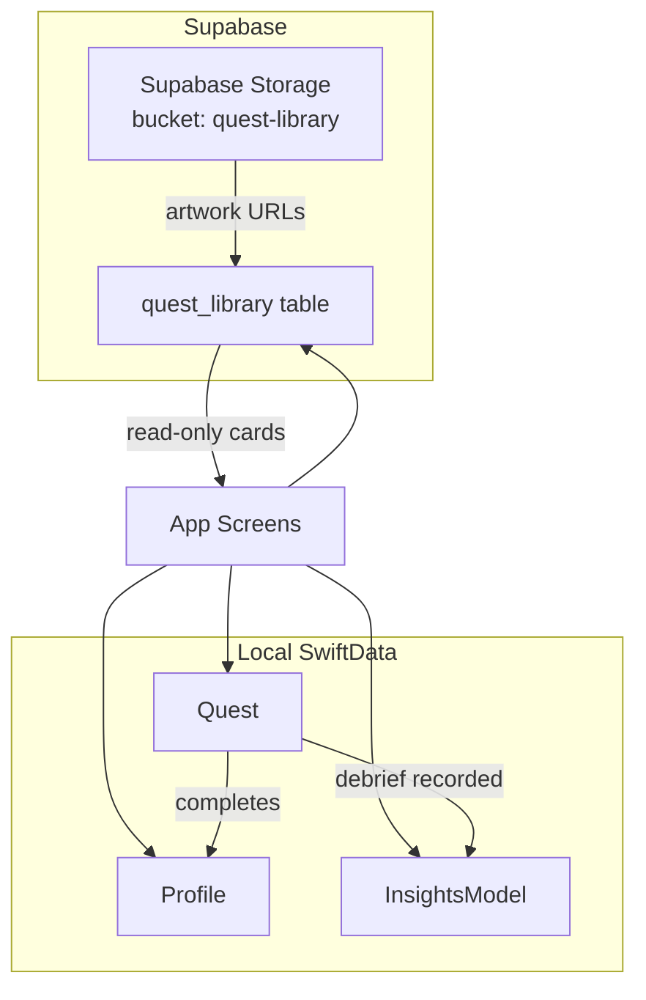
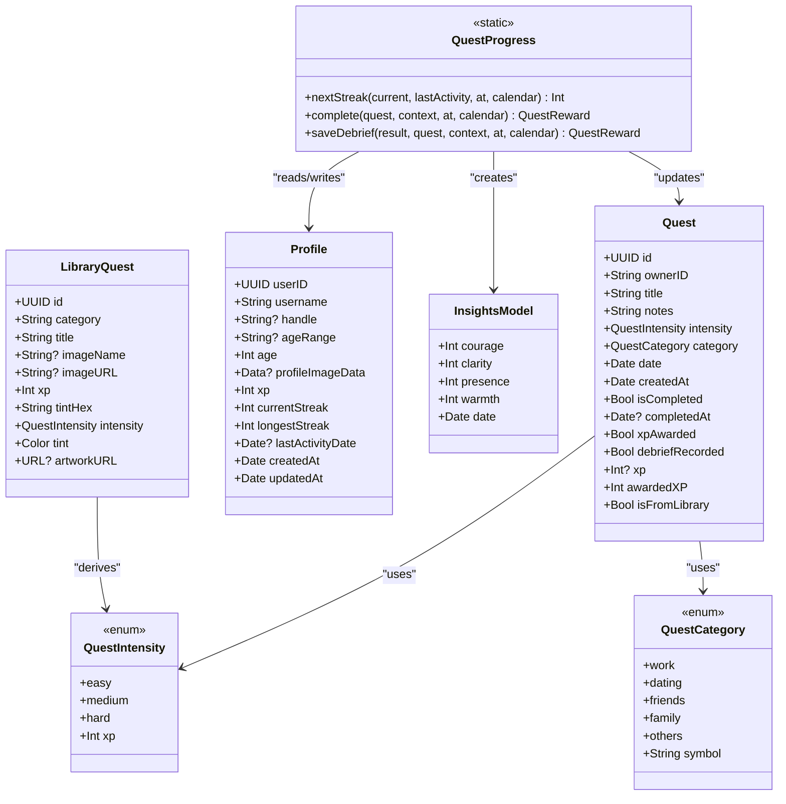
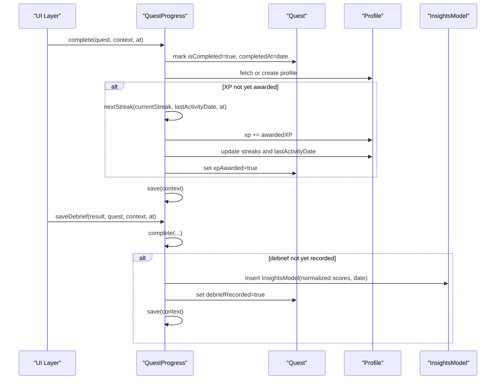
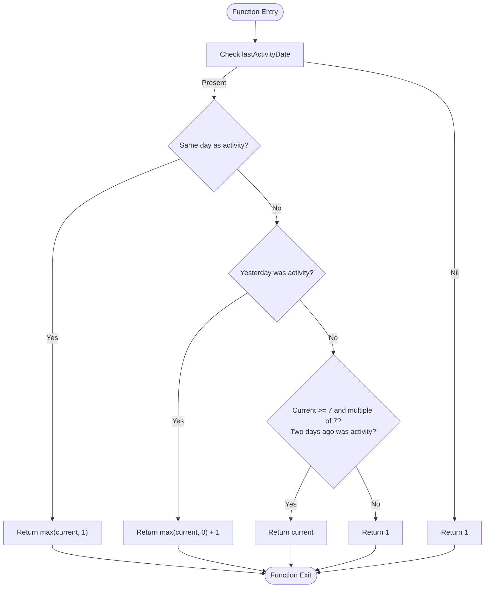
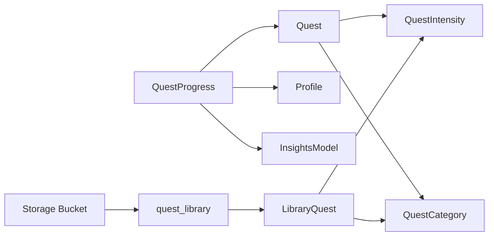

# Quest Data Models

<cite>
**Referenced Files in This Document**
- [QuestModels.swift](file://Moko/Moko/Models/QuestModels.swift)
- [QuestProgress.swift](file://Moko/Moko/Models/QuestProgress.swift)
- [QuestLibraryModels.swift](file://Moko/Moko/Models/QuestLibraryModels.swift)
- [Profile.swift](file://Moko/Moko/Models/Profile.swift)
- [InsightsModel.swift](file://Moko/Moko/Models/InsightsModel.swift)
- [20261101120000_create_quest_library.sql](file://supabase/migrations/20261101120000_create_quest_library.sql)
- [20261101130000_add_quest_image_url_and_storage.sql](file://supabase/migrations/20261101130000_add_quest_image_url_and_storage.sql)
</cite>

## Table of Contents
1. [Introduction](#introduction)
2. [Project Structure](#project-structure)
3. [Core Components](#core-components)
4. [Architecture Overview](#architecture-overview)
5. [Detailed Component Analysis](#detailed-component-analysis)
6. [Dependency Analysis](#dependency-analysis)
7. [Performance Considerations](#performance-considerations)
8. [Troubleshooting Guide](#troubleshooting-guide)
9. [Conclusion](#conclusion)
10. [Appendices](#appendices)

## Introduction
This document explains the data models behind the Quest system: how quests are defined, categorized, tracked, and persisted; how progress, XP, streaks, and insights are calculated; and how the local SwiftData models relate to the read-only Supabase quest library. It is intended for developers and product contributors who need to understand the structure, constraints, lifecycle, and evolution strategy for quest-related data.

## Project Structure
The Quest system spans three layers:
- Local domain models and persistence using SwiftData.
- Progress calculation and cross-entity updates (quests, profile, insights).
- Read-only quest library content from Supabase.

**Diagram sources**
- [QuestModels.swift:51-100](file://Moko/Moko/Models/QuestModels.swift#L51-L100)
- [QuestProgress.swift:49-119](file://Moko/Moko/Models/QuestProgress.swift#L49-L119)
- [Profile.swift:12-58](file://Moko/Moko/Models/Profile.swift#L12-L58)
- [InsightsModel.swift:11-24](file://Moko/Moko/Models/InsightsModel.swift#L11-L24)
- [20261101120000_create_quest_library.sql:6-27](file://supabase/migrations/20261101120000_create_quest_library.sql#L6-L27)
- [20261101130000_add_quest_image_url_and_storage.sql:6-32](file://supabase/migrations/20261101130000_add_quest_image_url_and_storage.sql#L6-L32)

**Section sources**
- [QuestModels.swift:12-166](file://Moko/Moko/Models/QuestModels.swift#L12-L166)
- [QuestLibraryModels.swift:10-83](file://Moko/Moko/Models/QuestLibraryModels.swift#L10-L83)
- [20261101120000_create_quest_library.sql:1-78](file://supabase/migrations/20261101120000_create_quest_library.sql#L1-L78)
- [20261101130000_add_quest_image_url_and_storage.sql:1-35](file://supabase/migrations/20261101130000_add_quest_image_url_and_storage.sql#L1-L35)

## Core Components
- Quest: The primary user-owned task entity with scheduling, categorization, intensity, completion state, and optional library-derived XP.
- QuestCategory: Enumerates life domains used to organize quests.
- QuestIntensity: Enumerates difficulty levels that determine default XP values.
- QuestProgress: Shared logic for completing quests, calculating rewards, updating streaks, and recording debrief insights.
- Profile: User-level aggregate metrics including XP, streaks, and last activity date.
- InsightsModel: Time-stamped reflection scores derived from quest debriefs.
- LibraryQuest and QuestSection: Read-only representations of Supabase quest library content.

Key responsibilities:
- Quest defines identity, ownership, metadata, and derived properties such as awarded XP and whether it came from the library.
- QuestCategory provides semantic grouping by life domains.
- QuestProgress encapsulates side effects of completing a quest and saving a debrief.
- Profile stores cumulative progress.
- InsightsModel persists debrief reflections.
- LibraryQuest maps remote rows into app-friendly types.

**Section sources**
- [QuestModels.swift:13-100](file://Moko/Moko/Models/QuestModels.swift#L13-L100)
- [QuestProgress.swift:11-139](file://Moko/Moko/Models/QuestProgress.swift#L11-L139)
- [Profile.swift:12-58](file://Moko/Moko/Models/Profile.swift#L12-L58)
- [InsightsModel.swift:11-24](file://Moko/Moko/Models/InsightsModel.swift#L11-L24)
- [QuestLibraryModels.swift:10-83](file://Moko/Moko/Models/QuestLibraryModels.swift#L10-L83)

## Architecture Overview
The Quest system combines local persistence with read-only remote content:
- Local data: Quest, Profile, and InsightsModel are SwiftData entities stored on-device.
- Remote data: The quest library is read-only via Supabase and includes category ordering, sorting, visibility flags, and optional artwork URLs.
- Progress engine: QuestProgress coordinates updates across Quest, Profile, and InsightsModel.

**Diagram sources**
- [QuestModels.swift:13-100](file://Moko/Moko/Models/QuestModels.swift#L13-L100)
- [QuestProgress.swift:11-139](file://Moko/Moko/Models/QuestProgress.swift#L11-L139)
- [Profile.swift:12-58](file://Moko/Moko/Models/Profile.swift#L12-L58)
- [InsightsModel.swift:11-24](file://Moko/Moko/Models/InsightsModel.swift#L11-L24)
- [QuestLibraryModels.swift:10-49](file://Moko/Moko/Models/QuestLibraryModels.swift#L10-L49)

## Detailed Component Analysis

### Quest Model
Purpose:
- Represents a single user-owned quest with scheduling, categorization, intensity, and completion tracking.

Important fields:
- Identity and ownership: id (unique), ownerID.
- Content: title, notes.
- Classification: intensity (QuestIntensity), category (QuestCategory).
- Scheduling: date, createdAt.
- Completion state: isCompleted, completedAt, xpAwarded, debriefRecorded.
- XP source: xp (optional; when set, indicates library origin), awardedXP (derived).

Derived behavior:
- awardedXP returns the explicit library XP or the intensity-based default.
- isFromLibrary is true when xp is explicitly set.
- overviewMission selects the next relevant quest for the active user, prioritizing overdue/today incomplete custom quests or awaiting-debrief completed ones, excluding library quests.

Validation and constraints:
- id is unique per model instance.
- ownerID ties each quest to a specific user session.
- Date fields represent scheduled and creation timestamps.

Lifecycle highlights:
- Created with defaults: not completed, no completion time, no XP awarded, no debief recorded.
- Completed via QuestProgress.complete, which sets completion state and awards XP/streak once.
- Debrief recorded via QuestProgress.saveDebrief, which also ensures XP/streak are awarded before persisting an InsightsModel entry.

Example states:
- New: isCompleted=false, completedAt=nil, xpAwarded=false, debriefRecorded=false.
- Completed but awaiting debrief: isCompleted=true, completedAt set, xpAwarded=true, debriefRecorded=false.
- Fully processed: isCompleted=true, completedAt set, xpAwarded=true, debriefRecorded=true.

**Section sources**
- [QuestModels.swift:51-127](file://Moko/Moko/Models/QuestModels.swift#L51-L127)

### QuestCategory and QuestIntensity
QuestCategory:
- Values: work, dating, friends, family, others.
- Purpose: Organize quests by life domains. Each value has a corresponding SF Symbol for UI presentation.
- Mapping: Library rows map string categories to this enum, falling back to others when unknown.

QuestIntensity:
- Values: easy, medium, hard.
- Purpose: Define default XP values for custom quests.
- Default XP mapping: easy=100, medium=150, hard=200.
- Library quests derive intensity from their XP amount.

Significance:
- Category drives grouping and visual symbols.
- Intensity drives default XP unless overridden by library content.

**Section sources**
- [QuestModels.swift:13-48](file://Moko/Moko/Models/QuestModels.swift#L13-L48)
- [QuestLibraryModels.swift:22-29](file://Moko/Moko/Models/QuestLibraryModels.swift#L22-L29)

### QuestProgress Tracking System
Responsibilities:
- Calculate next streak based on last activity and current date.
- Complete a quest exactly once for XP and streak purposes.
- Save debrief results as InsightsModel entries without duplicating records.

Completion algorithm:
- Ensures the quest is attached to a context.
- Marks the quest completed and sets completedAt if missing.
- If XP has not been awarded:
  - Compute next streak using current streak, last activity date, and calendar boundaries.
  - Add awarded XP to Profile.xp.
  - Update Profile.currentStreak, longestStreak, lastActivityDate, and updatedAt.
  - Mark quest.xpAwarded = true.
- Persist changes.

Streak rules:
- Same-day activity keeps or raises the streak.
- Next-day activity extends the streak.
- One rest day is allowed after building a weekly streak (every multiple of seven days).
- Otherwise, a gap resets the streak to one.

Debrief recording:
- Calls complete first to ensure XP/streak are applied.
- Guards against duplicate debriefs via debriefRecorded flag.
- Normalizes debrief scores to minimum meaningful values.
- Creates an InsightsModel entry with normalized scores and the activity date.
- Marks quest.debriefRecorded = true and persists.

Error handling:
- Save failures are logged rather than thrown, preventing UI crashes while preserving retry opportunities.

**Section sources**
- [QuestProgress.swift:17-139](file://Moko/Moko/Models/QuestProgress.swift#L17-L139)

### Profile Model
Role:
- Stores cumulative user progress: total XP, current streak, longest streak, and last activity timestamp.

Key fields:
- xp: accumulated XP from completed quests.
- currentStreak: active streak count.
- longestStreak: historical maximum streak.
- lastActivityDate: most recent activity date used for streak calculations.
- Timestamps: createdAt, updatedAt.

Integration:
- Updated by QuestProgress.complete whenever a quest’s XP is awarded.
- Used by QuestProgress.nextStreak to compute streak continuity.

**Section sources**
- [Profile.swift:12-58](file://Moko/Moko/Models/Profile.swift#L12-L58)
- [QuestProgress.swift:61-79](file://Moko/Moko/Models/QuestProgress.swift#L61-L79)

### InsightsModel
Role:
- Persists debrief reflection scores tied to a date.

Fields:
- courage, clarity, presence, warmth: numeric scores.
- date: associated activity date.

Integration:
- Created by QuestProgress.saveDebrief with normalized score values.
- Linked to a quest indirectly through the debrief flow; the quest marks debriefRecorded to prevent duplication.

**Section sources**
- [InsightsModel.swift:11-24](file://Moko/Moko/Models/InsightsModel.swift#L11-L24)
- [QuestProgress.swift:85-119](file://Moko/Moko/Models/QuestProgress.swift#L85-L119)

### Quest Library Models and Supabase Integration
LibraryQuest:
- Maps remote rows to local types.
- Derives intensity from XP ranges.
- Parses tint colors and constructs artwork URLs.

QuestSection:
- Groups library quests by category while preserving server-defined order.
- Falls back to .others when encountering unknown categories.

Supabase schema:
- quest_library table defines sections, ordering, visibility, and metadata.
- RLS policies allow public read access for active rows.
- Storage bucket quest-library holds artwork images with public read policy.

Constraints and ordering:
- Unique constraint on (category, title).
- category_sort_order controls section order.
- sort_order controls card order within a category.
- is_active hides inactive quests without deletion.

Artwork:
- image_name is a stable slug; image_url is the public URL populated after upload.
- Fallback behavior uses category symbols when artwork is unavailable.

**Section sources**
- [QuestLibraryModels.swift:10-83](file://Moko/Moko/Models/QuestLibraryModels.swift#L10-L83)
- [20261101120000_create_quest_library.sql:6-41](file://supabase/migrations/20261101120000_create_quest_library.sql#L6-L41)
- [20261101120000_create_quest_library.sql:62-78](file://supabase/migrations/20261101120000_create_quest_library.sql#L62-L78)
- [20261101130000_add_quest_image_url_and_storage.sql:6-32](file://supabase/migrations/20261101130000_add_quest_image_url_and_storage.sql#L6-L32)

### Quest Lifecycle Flow

**Diagram sources**
- [QuestProgress.swift:49-119](file://Moko/Moko/Models/QuestProgress.swift#L49-L119)
- [Profile.swift:12-58](file://Moko/Moko/Models/Profile.swift#L12-L58)
- [InsightsModel.swift:11-24](file://Moko/Moko/Models/InsightsModel.swift#L11-L24)

### Streak Calculation Flowchart

**Diagram sources**
- [QuestProgress.swift:22-47](file://Moko/Moko/Models/QuestProgress.swift#L22-L47)

## Dependency Analysis
Relationships:
- Quest depends on QuestIntensity and QuestCategory for classification and XP defaults.
- QuestProgress depends on Quest, Profile, and InsightsModel to coordinate completion and analytics.
- LibraryQuest derives QuestIntensity from its XP field and maps to QuestCategory.
- Supabase tables provide read-only content consumed by LibraryQuest.

Coupling and cohesion:
- QuestProgress centralizes side effects, improving cohesion around completion and debrief workflows.
- Quest remains lightweight, delegating complex logic to QuestProgress.
- Library models are decoupled from local persistence, focusing on mapping and display.

Potential circular dependencies:
- None observed; QuestProgress reads Profile and writes Quest and InsightsModel without reverse references.

External integrations:
- Supabase quest library and storage bucket provide read-only content and artwork.

**Diagram sources**
- [QuestModels.swift:13-100](file://Moko/Moko/Models/QuestModels.swift#L13-L100)
- [QuestProgress.swift:11-139](file://Moko/Moko/Models/QuestProgress.swift#L11-L139)
- [QuestLibraryModels.swift:10-49](file://Moko/Moko/Models/QuestLibraryModels.swift#L10-L49)
- [20261101120000_create_quest_library.sql:6-41](file://supabase/migrations/20261101120000_create_quest_library.sql#L6-L41)
- [20261101130000_add_quest_image_url_and_storage.sql:6-32](file://supabase/migrations/20261101130000_add_quest_image_url_and_storage.sql#L6-L32)

**Section sources**
- [QuestModels.swift:13-100](file://Moko/Moko/Models/QuestModels.swift#L13-L100)
- [QuestProgress.swift:11-139](file://Moko/Moko/Models/QuestProgress.swift#L11-L139)
- [QuestLibraryModels.swift:10-83](file://Moko/Moko/Models/QuestLibraryModels.swift#L10-L83)
- [20261101120000_create_quest_library.sql:1-78](file://supabase/migrations/20261101120000_create_quest_library.sql#L1-L78)
- [20261101130000_add_quest_image_url_and_storage.sql:1-35](file://supabase/migrations/20261101130000_add_quest_image_url_and_storage.sql#L1-L35)

## Performance Considerations
- Quest selection uses simple filtering and min-by-date operations; complexity is linear in the number of quests considered.
- Streak computation is constant-time with calendar checks.
- Saving operations batch updates to Quest, Profile, and InsightsModel within a single context save.
- Library content is read-only and grouped client-side; large libraries may benefit from pagination or server-side ordering already provided by category_sort_order and sort_order.

[No sources needed since this section provides general guidance]

## Troubleshooting Guide
Common issues and resolutions:
- Duplicate XP or streak increments:
  - Ensure QuestProgress.complete is called only once per quest completion. The xpAwarded flag prevents re-application.
- Missing debrief insights:
  - Verify QuestProgress.saveDebrief is invoked after completion and that debriefRecorded is false before insertion.
- Streak not extending:
  - Confirm lastActivityDate and date parameters align with expected calendar boundaries.
  - Check that the weekly rest rule applies only after reaching multiples of seven days.
- Save failures:
  - Inspect logs for “Quest progress save failed” messages and retry or rollback as appropriate.

**Section sources**
- [QuestProgress.swift:49-139](file://Moko/Moko/Models/QuestProgress.swift#L49-L139)

## Conclusion
The Quest system cleanly separates local domain modeling, progress computation, and read-only library content. Quest captures user intent and scheduling; QuestProgress enforces consistent reward mechanics and analytics integration; Profile aggregates long-term progress; InsightsModel preserves reflective data. The Supabase quest library enables content updates without app releases, while SwiftData ensures reliable local persistence. For future evolution, maintain backward compatibility in enums and migrations, and keep progression logic centralized in QuestProgress.

[No sources needed since this section summarizes without analyzing specific files]

## Appendices

### Data Migration and Versioning Strategy
- Local SwiftData models:
  - Use default values for new fields to support older saved data.
  - Avoid changing existing field semantics; prefer additive changes.
  - When renaming or removing fields, implement migration logic in the database container setup.
- Supabase quest library:
  - Use category_sort_order and sort_order gaps to insert new categories/cards without renumbering.
  - Use is_active to hide content instead of deleting rows.
  - Preserve image_name as a stable identifier while adding image_url for dynamic artwork.
  - Apply row-level security to restrict writes to service role and allow public reads for active content.
- Versioning:
  - Tag migrations with timestamps and descriptive names.
  - Keep client-side enums stable; introduce new values carefully and map unknown values to safe defaults (e.g., .others).

**Section sources**
- [20261101120000_create_quest_library.sql:6-41](file://supabase/migrations/20261101120000_create_quest_library.sql#L6-L41)
- [20261101120000_create_quest_library.sql:62-78](file://supabase/migrations/20261101120000_create_quest_library.sql#L62-L78)
- [20261101130000_add_quest_image_url_and_storage.sql:6-32](file://supabase/migrations/20261101130000_add_quest_image_url_and_storage.sql#L6-L32)
- [QuestLibraryModels.swift:64-82](file://Moko/Moko/Models/QuestLibraryModels.swift#L64-L82)