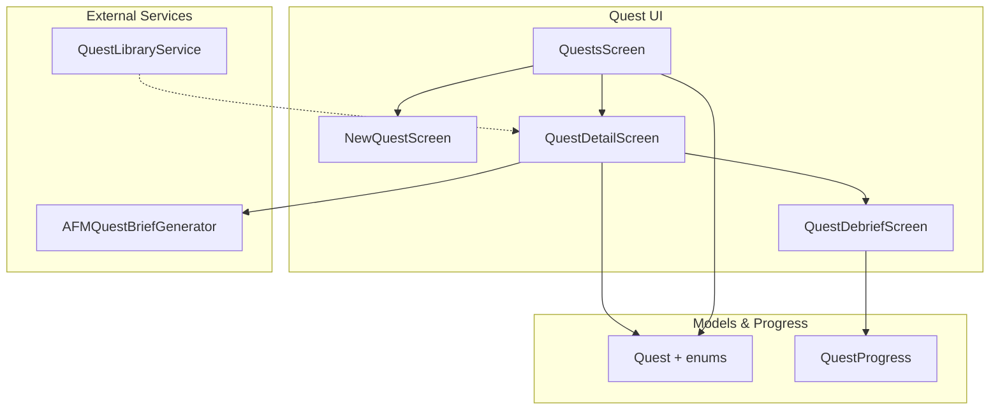
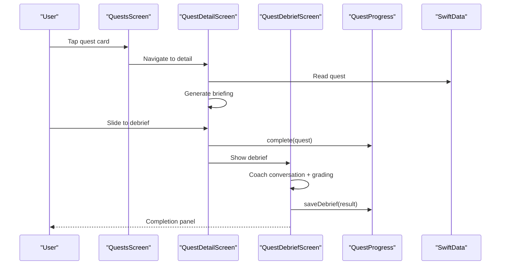
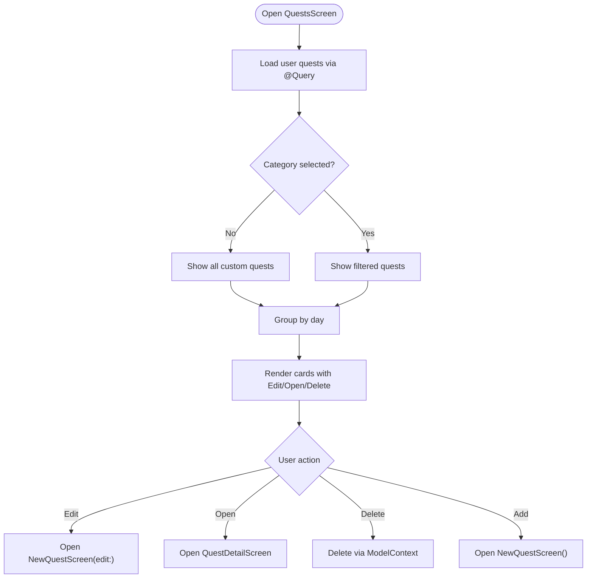
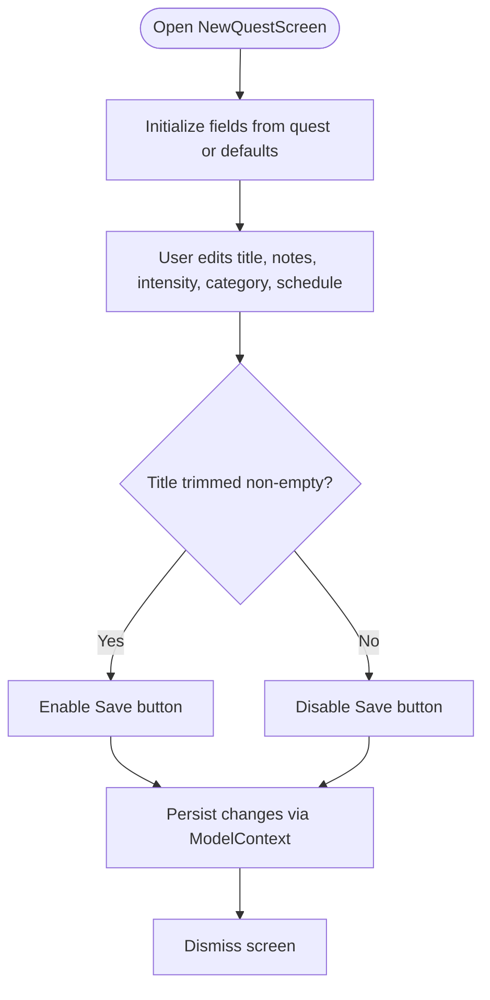
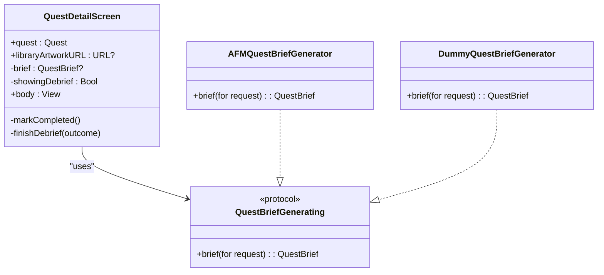
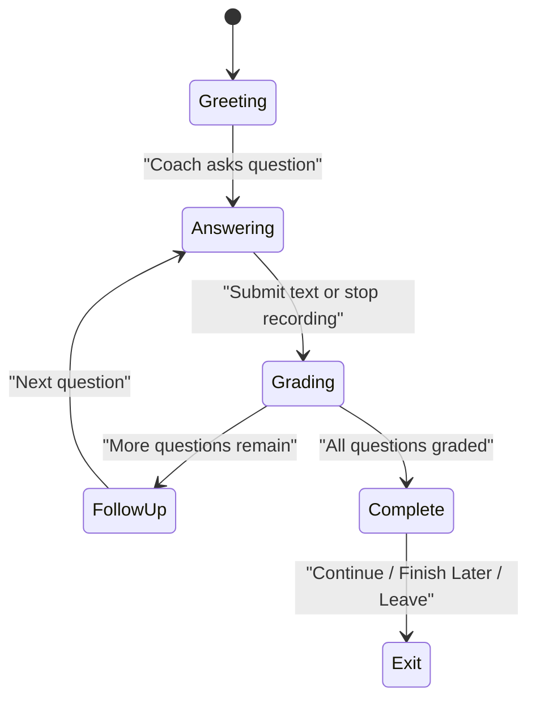
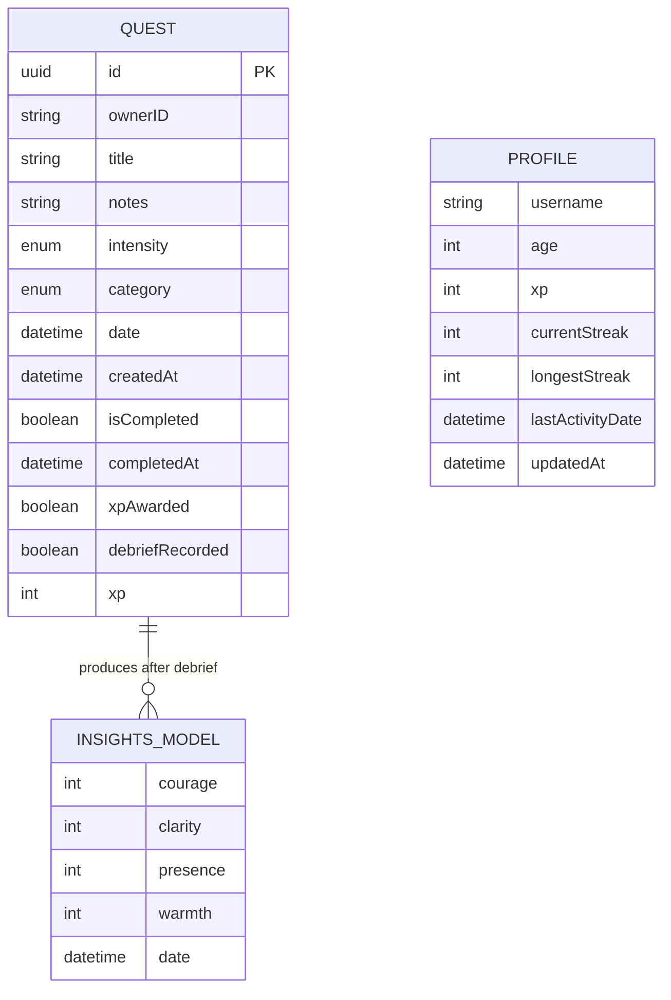
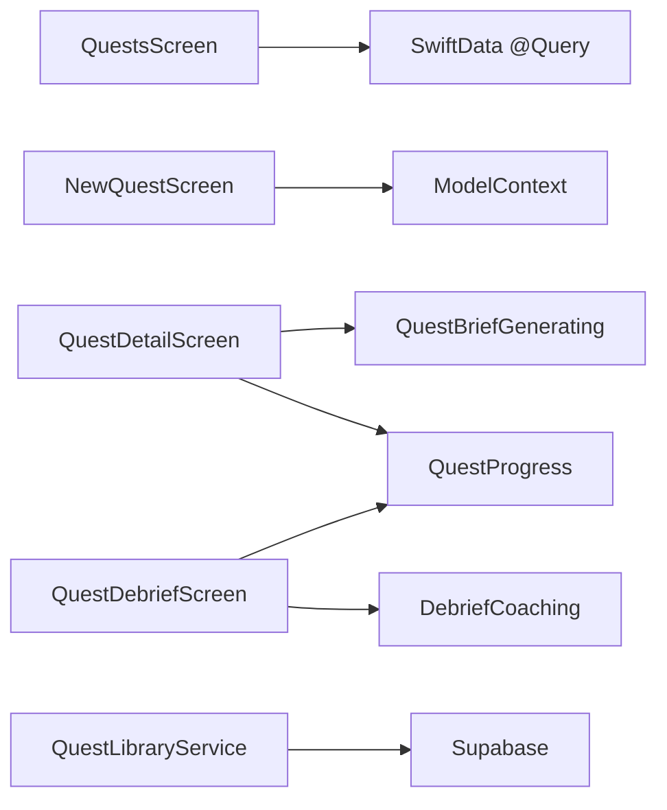

# Quest UI Components

<cite>
**Referenced Files in This Document**   
- [Questsscreen.swift](file://Moko/Moko/UIScreens/Quests/Questsscreen.swift)
- [Newquestscreen.swift](file://Moko/Moko/UIScreens/Quests/Newquestscreen.swift)
- [Questdetailscreen.swift](file://Moko/Moko/UIScreens/Quests/Questdetailscreen.swift)
- [Questdebrief.swift](file://Moko/Moko/UIScreens/Quests/Questdebrief.swift)
- [QuestModels.swift](file://Moko/Moko/Models/QuestModels.swift)
- [QuestProgress.swift](file://Moko/Moko/Models/QuestProgress.swift)
- [QuestLibraryService.swift](file://Moko/Moko/Features/QuestLibrary/QuestLibraryService.swift)
</cite>

## Table of Contents
1. [Introduction](#introduction)
2. [Project Structure](#project-structure)
3. [Core Components](#core-components)
4. [Architecture Overview](#architecture-overview)
5. [Detailed Component Analysis](#detailed-component-analysis)
6. [Dependency Analysis](#dependency-analysis)
7. [Performance Considerations](#performance-considerations)
8. [Troubleshooting Guide](#troubleshooting-guide)
9. [Conclusion](#conclusion)

## Introduction
This document explains the Quest-related user interface in the Moko iOS app. It covers:
- The main Quests screen for listing, filtering, and managing custom quests.
- The New Quest creation and editing interface.
- The Quest Details screen that shows a generated briefing and transitions into debrief.
- The Quest Debrief flow, including coaching conversation, voice input, rating systems, and post-completion insights.
It also documents state management, navigation patterns, integration with SwiftData models and services, accessibility considerations, responsive design, and animation behavior.

## Project Structure
The Quest UI lives under `Moko/Moko/UIScreens/Quests` and is backed by data models and progress utilities under `Moko/Moko/Models`. The Quest Library service is separate and used when browsing curated scenarios.

**Diagram sources**
- [Questsscreen.swift:26-114](file://Moko/Moko/UIScreens/Quests/Questsscreen.swift#L26-L114)
- [Newquestscreen.swift:12-32](file://Moko/Moko/UIScreens/Quests/Newquestscreen.swift#L12-L32)
- [Questdetailscreen.swift:130-191](file://Moko/Moko/UIScreens/Quests/Questdetailscreen.swift#L130-L191)
- [Questdebrief.swift:484-584](file://Moko/Moko/UIScreens/Quests/Questdebrief.swift#L484-L584)
- [QuestModels.swift:50-100](file://Moko/Moko/Models/QuestModels.swift#L50-L100)
- [QuestProgress.swift:17-83](file://Moko/Moko/Models/QuestProgress.swift#L17-L83)
- [QuestLibraryService.swift:13-32](file://Moko/Moko/Features/QuestLibrary/QuestLibraryService.swift#L13-L32)

**Section sources**
- [Questsscreen.swift:1-114](file://Moko/Moko/UIScreens/Quests/Questsscreen.swift#L1-L114)
- [Newquestscreen.swift:1-32](file://Moko/Moko/UIScreens/Quests/Newquestscreen.swift#L1-L32)
- [Questdetailscreen.swift:1-49](file://Moko/Moko/UIScreens/Quests/Questdetailscreen.swift#L1-L49)
- [Questdebrief.swift:1-100](file://Moko/Moko/UIScreens/Quests/Questdebrief.swift#L1-L100)
- [QuestModels.swift:1-100](file://Moko/Moko/Models/QuestModels.swift#L1-L100)
- [QuestProgress.swift:1-83](file://Moko/Moko/Models/QuestProgress.swift#L1-L83)
- [QuestLibraryService.swift:1-32](file://Moko/Moko/Features/QuestLibrary/QuestLibraryService.swift#L1-L32)

## Core Components
- QuestsScreen: Lists user quests grouped by day, supports category chips, swipe-to-delete, edit/new flows, and navigation to details.
- NewQuestScreen: Form-based creation/editing with title validation, intensity/category pickers, and scheduling.
- QuestDetailScreen: Displays quest metadata, category artwork, and an AI-generated briefing; completes the quest and transitions to debrief.
- QuestDebriefScreen: Coaching conversation, voice or text input, confidence scoring, parameter ratings, leave options, and completion panel.
- Quest model and enums: Define quest attributes, categories, intensities, formatting helpers, and current user identity.
- QuestProgress: Centralizes XP, streak, activity date updates, and debrief insight persistence.
- QuestLibraryService: Loads curated library quests from Supabase (used outside this screen set).

**Section sources**
- [Questsscreen.swift:26-354](file://Moko/Moko/UIScreens/Quests/Questsscreen.swift#L26-L354)
- [Newquestscreen.swift:12-128](file://Moko/Moko/UIScreens/Quests/Newquestscreen.swift#L12-L128)
- [Questdetailscreen.swift:130-597](file://Moko/Moko/UIScreens/Quests/Questdetailscreen.swift#L130-L597)
- [Questdebrief.swift:246-584](file://Moko/Moko/UIScreens/Quests/Questdebrief.swift#L246-L584)
- [QuestModels.swift:13-100](file://Moko/Moko/Models/QuestModels.swift#L13-L100)
- [QuestProgress.swift:17-139](file://Moko/Moko/Models/QuestProgress.swift#L17-L139)
- [QuestLibraryService.swift:13-32](file://Moko/Moko/Features/QuestLibrary/QuestLibraryService.swift#L13-L32)

## Architecture Overview
The Quest UI follows a layered SwiftUI architecture:
- Views observe SwiftData via `@Query` and mutate through `ModelContext`.
- State changes propagate automatically to dependent views.
- Navigation uses `NavigationStack`, full-screen covers, and environment values.
- Data generation is abstracted behind protocols (`QuestBriefGenerating`, `DebriefCoaching`) so implementations can be swapped.
- Progress and rewards are centralized in `QuestProgress`.

**Diagram sources**
- [Questsscreen.swift:230-293](file://Moko/Moko/UIScreens/Quests/Questsscreen.swift#L230-L293)
- [Questdetailscreen.swift:159-247](file://Moko/Moko/UIScreens/Quests/Questdetailscreen.swift#L159-L247)
- [Questdebrief.swift:586-618](file://Moko/Moko/UIScreens/Quests/Questdebrief.swift#L586-L618)
- [QuestProgress.swift:49-119](file://Moko/Moko/Models/QuestProgress.swift#L49-L119)

## Detailed Component Analysis

### QuestsScreen
Responsibilities:
- Query and display the current user’s custom quests using SwiftData.
- Group quests by calendar day and render cards with Edit and Open actions.
- Provide horizontal category filter chips and an “All” option.
- Support swipe-to-delete and floating Add button.
- Navigate to NewQuestScreen (create/edit) and QuestDetailScreen.

Key behaviors:
- Filtering resets when a new custom quest is added.
- Completed debrief cards are muted and non-interactive except for deletion.
- Uses native List swipe actions for destructive delete.
- Hides tab bar during related flows to avoid conflicting visibility.

Accessibility:
- Buttons have explicit accessibility labels.
- Cards use `accessibilityElement(children: .contain)` and hint for debrief status.

Responsive design:
- Horizontal scrollable chip list.
- List rows with consistent insets and separators hidden for custom styling.
- Floating action button positioned over content with safe area padding.

Animations:
- Chip selection animates with ease-in-out.
- Delete wraps context mutation in `withAnimation`.

**Diagram sources**
- [Questsscreen.swift:26-114](file://Moko/Moko/UIScreens/Quests/Questsscreen.swift#L26-L114)
- [Questsscreen.swift:116-152](file://Moko/Moko/UIScreens/Quests/Questsscreen.swift#L116-L152)
- [Questsscreen.swift:193-331](file://Moko/Moko/UIScreens/Quests/Questsscreen.swift#L193-L331)

**Section sources**
- [Questsscreen.swift:26-354](file://Moko/Moko/UIScreens/Quests/Questsscreen.swift#L26-L354)

### NewQuestScreen
Responsibilities:
- Create or edit a custom quest.
- Validate title presence before saving.
- Allow selecting intensity, category, and scheduled date/time.
- Persist changes directly to SwiftData.

Form validation and constraints:
- Title must not be empty; Save/Create is disabled otherwise.
- For new quests, scheduling cannot be in the past; editing keeps existing dates.

State management:
- Local `@State` fields mirror form inputs.
- Editing mode toggles based on whether a quest is passed in.

Persistence:
- Updates existing quest properties or inserts a new `Quest`.
- Saves via `modelContext.save()` and dismisses the sheet.

**Diagram sources**
- [Newquestscreen.swift:12-32](file://Moko/Moko/UIScreens/Quests/Newquestscreen.swift#L12-L32)
- [Newquestscreen.swift:45-127](file://Moko/Moko/UIScreens/Quests/Newquestscreen.swift#L45-L127)

**Section sources**
- [Newquestscreen.swift:12-128](file://Moko/Moko/UIScreens/Quests/Newquestscreen.swift#L12-L128)

### QuestDetailScreen
Responsibilities:
- Display quest title, XP, category, intensity, and generated briefing.
- Show category artwork or library-provided image.
- Complete the quest via a slide-to-debrief control.
- Transition to the debrief flow and manage outcomes.

Briefing generation:
- Uses `QuestBriefGenerating` protocol.
- Default implementation integrates with AFM; fallback generator uses mission templates.

Artwork handling:
- If opened from the Quest Library, show the provided image URL.
- Otherwise, show a category-specific placeholder gradient and symbol.

Completion and debrief transition:
- Sliding completes the quest and awards XP/streak.
- Debrief slides in from the right; detail slides out to the left.

Outcomes:
- Completed: play success sound, open overview debrief-done.
- Finish Later: save pending debrief, open resume overview.
- Leave: clear pending, open todo overview.

**Diagram sources**
- [Questdetailscreen.swift:130-191](file://Moko/Moko/UIScreens/Quests/Questdetailscreen.swift#L130-L191)
- [Questdetailscreen.swift:31-71](file://Moko/Moko/UIScreens/Quests/Questdetailscreen.swift#L31-L71)

**Section sources**
- [Questdetailscreen.swift:130-597](file://Moko/Moko/UIScreens/Quests/Questdetailscreen.swift#L130-L597)

### QuestDebriefScreen
Responsibilities:
- Host a structured coaching conversation with one opening story and three follow-up questions.
- Accept typed or simulated voice answers.
- Grade each answer with confidence and parameter scores.
- Provide leave options: keep going, finish later, or leave without penalty.
- Present a completion panel with XP, streak, and four parameter scores.

Session state:
- `DebriefSession` drives message flow, typing indicators, recording simulation, grading, and finalization.
- Supports pausing while the leave sheet is shown.

Scoring:
- Confidence reflects answer length and quality heuristics.
- Parameter scores include Courage, Clarity, Presence, Warmth.
- Final scores aggregate per-parameter maximums and ensure minimum meaningful values.

Integration:
- Persists debrief results and updates profile streak/XP via `QuestProgress`.
- Syncs reward display with saved progress.

**Diagram sources**
- [Questdebrief.swift:246-481](file://Moko/Moko/UIScreens/Quests/Questdebrief.swift#L246-L481)
- [Questdebrief.swift:586-618](file://Moko/Moko/UIScreens/Quests/Questdebrief.swift#L586-L618)

**Section sources**
- [Questdebrief.swift:246-584](file://Moko/Moko/UIScreens/Quests/Questdebrief.swift#L246-L584)
- [Questdebrief.swift:800-1555](file://Moko/Moko/UIScreens/Quests/Questdebrief.swift#L800-L1555)

### Data Models and Progress
- Quest: Represents a custom or library quest with ownership, scheduling, completion flags, and XP.
- QuestIntensity: Maps difficulty to displayed XP.
- QuestCategory: Provides label and system icon for UI tags.
- CurrentUser: Device-scoped user ID persisted in UserDefaults.
- QuestFormat: Formatting helpers for default schedules and group titles.
- QuestProgress: Centralized logic for completing quests, awarding XP/streak, and persisting debrief insights.

**Diagram sources**
- [QuestModels.swift:50-100](file://Moko/Moko/Models/QuestModels.swift#L50-L100)
- [QuestProgress.swift:85-119](file://Moko/Moko/Models/QuestProgress.swift#L85-L119)

**Section sources**
- [QuestModels.swift:13-100](file://Moko/Moko/Models/QuestModels.swift#L13-L100)
- [QuestModels.swift:168-235](file://Moko/Moko/Models/QuestModels.swift#L168-L235)
- [QuestProgress.swift:17-139](file://Moko/Moko/Models/QuestProgress.swift#L17-L139)

## Dependency Analysis
- QuestsScreen depends on SwiftData `@Query` and `ModelContext` for reading and deleting quests.
- NewQuestScreen writes to SwiftData via `ModelContext`.
- QuestDetailScreen depends on `QuestBriefGenerating` (AFM or dummy) and `QuestProgress.complete`.
- QuestDebriefScreen depends on `DebriefCoaching` (AFM or dummy), `QuestProgress.saveDebrief`, and `Profile` queries.
- QuestLibraryService is independent and fetches curated content from Supabase.

**Diagram sources**
- [Questsscreen.swift:26-42](file://Moko/Moko/UIScreens/Quests/Questsscreen.swift#L26-L42)
- [Newquestscreen.swift:16-32](file://Moko/Moko/UIScreens/Quests/Newquestscreen.swift#L16-L32)
- [Questdetailscreen.swift:31-49](file://Moko/Moko/UIScreens/Quests/Questdetailscreen.swift#L31-L49)
- [Questdetailscreen.swift:244-247](file://Moko/Moko/UIScreens/Quests/Questdetailscreen.swift#L244-L247)
- [Questdebrief.swift:93-100](file://Moko/Moko/UIScreens/Quests/Questdebrief.swift#L93-L100)
- [Questdebrief.swift:606-618](file://Moko/Moko/UIScreens/Quests/Questdebrief.swift#L606-L618)
- [QuestLibraryService.swift:13-32](file://Moko/Moko/Features/QuestLibrary/QuestLibraryService.swift#L13-L32)

**Section sources**
- [Questsscreen.swift:26-114](file://Moko/Moko/UIScreens/Quests/Questsscreen.swift#L26-L114)
- [Newquestscreen.swift:12-128](file://Moko/Moko/UIScreens/Quests/Newquestscreen.swift#L12-L128)
- [Questdetailscreen.swift:130-247](file://Moko/Moko/UIScreens/Quests/Questdetailscreen.swift#L130-L247)
- [Questdebrief.swift:484-618](file://Moko/Moko/UIScreens/Quests/Questdebrief.swift#L484-L618)
- [QuestLibraryService.swift:13-32](file://Moko/Moko/Features/QuestLibrary/QuestLibraryService.swift#L13-L32)

## Performance Considerations
- Use `@Query` to avoid manual refreshes; rely on reactive updates.
- Avoid heavy work on the main thread; async generators and coach methods run off-main where possible.
- Skeleton placeholders provide perceived performance during brief loading.
- Minimum loader duration prevents flicker for fast network responses in the Quest Library.
- Animations are lightweight and use built-in SwiftUI transitions and springs.

[No sources needed since this section provides general guidance]

## Troubleshooting Guide
Common issues and resolutions:
- Quests not appearing: Ensure the correct user ID is used and the query filters by `ownerID`.
- Debrief not persisting: Confirm `saveDebrief` is called only once per debrief and that `debriefRecorded` prevents duplication.
- Streak not updating: Verify `QuestProgress.complete` runs before debrief completion and that profile exists in context.
- Artwork missing: For library quests, check the provided URL; for custom quests, verify category assets exist.
- Voice input not submitting: Simulated recording auto-sends after quiet period; confirm recording task is not cancelled.

**Section sources**
- [Questsscreen.swift:326-331](file://Moko/Moko/UIScreens/Quests/Questsscreen.swift#L326-L331)
- [QuestProgress.swift:49-119](file://Moko/Moko/Models/QuestProgress.swift#L49-L119)
- [Questdetailscreen.swift:331-412](file://Moko/Moko/UIScreens/Quests/Questdetailscreen.swift#L331-L412)
- [Questdebrief.swift:333-399](file://Moko/Moko/UIScreens/Quests/Questdebrief.swift#L333-L399)

## Conclusion
The Quest UI provides a cohesive experience for creating, viewing, completing, and reflecting on personal quests. It combines reactive SwiftData binding, clear navigation patterns, and extensible AI-backed generation. The debrief flow offers structured reflection with measurable outcomes, while progress utilities ensure consistent tracking of XP, streaks, and insights. Accessibility and animations enhance usability without compromising performance.

[No sources needed since this section summarizes without analyzing specific files]