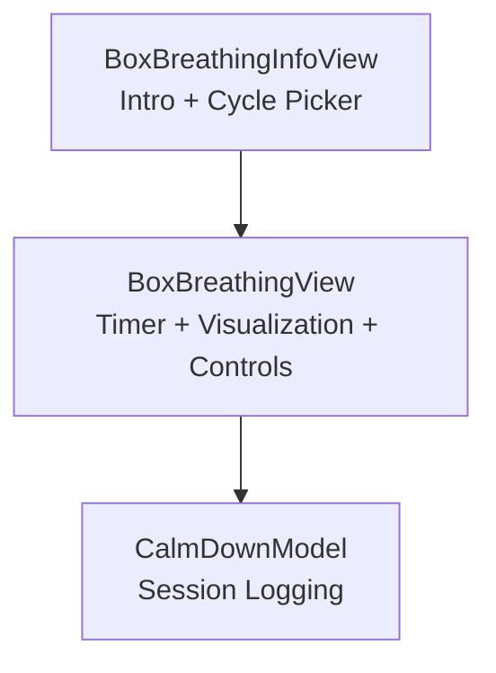
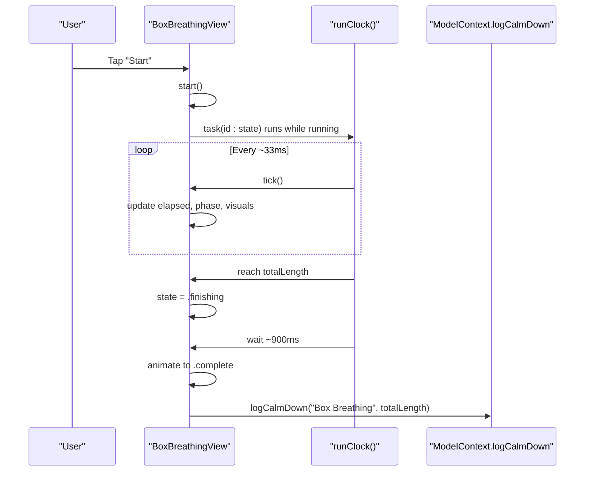
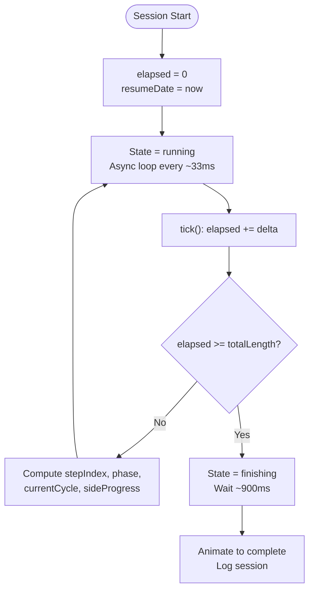
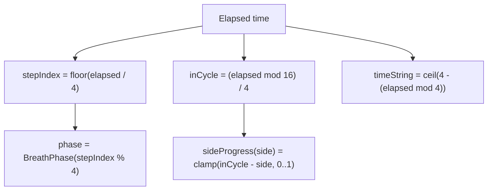
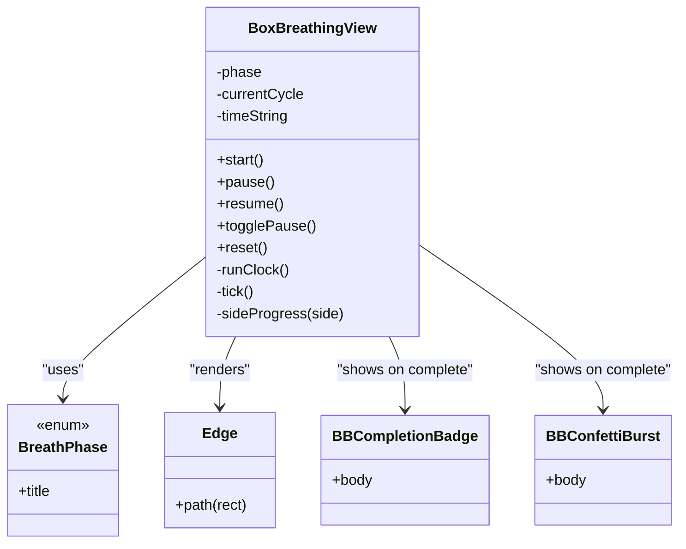
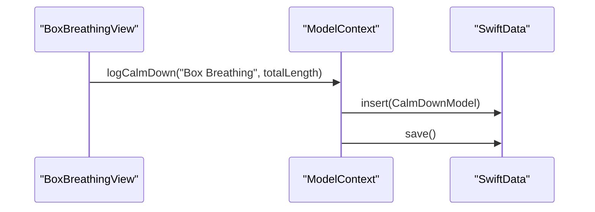
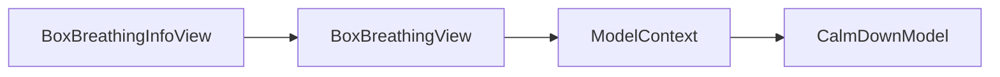

# Box Breathing Exercise

<cite>
**Referenced Files in This Document**
- [BoxBreathingView.swift](file://Moko/Moko/UIScreens/relaxScreens/BoxBreathing/BoxBreathingView.swift)
- [BoxBreathingInfoView.swift](file://Moko/Moko/UIScreens/relaxScreens/BoxBreathing/BoxBreathingInfoView.swift)
- [CalmDownModel.swift](file://Moko/Moko/Models/CalmDownModel.swift)
</cite>

## Table of Contents
1. [Introduction](#introduction)
2. [Project Structure](#project-structure)
3. [Core Components](#core-components)
4. [Architecture Overview](#architecture-overview)
5. [Detailed Component Analysis](#detailed-component-analysis)
6. [Dependency Analysis](#dependency-analysis)
7. [Performance Considerations](#performance-considerations)
8. [Troubleshooting Guide](#troubleshooting-guide)
9. [Conclusion](#conclusion)

## Introduction
This document explains the Box Breathing exercise implementation. It covers the breathing timer, visual guidance, timing controls, cycle management, UI components, animation synchronization, session tracking, and accessibility. It also addresses performance considerations for real-time animations and battery efficiency.

The Box Breathing exercise guides users through a repeating four-phase pattern: inhale, hold full, exhale, hold empty. Each phase lasts 4 seconds, forming one 16-second cycle. Users choose how many cycles to complete before starting.

## Project Structure
The Box Breathing feature is implemented as two SwiftUI views plus a shared data model for session logging:

- BoxBreathingView: Main exercise screen with timer, visualization, controls, and completion state.
- BoxBreathingInfoView: Intro sheet where users configure cycles and read instructions.
- CalmDownModel: SwiftData model used to log completed sessions.

**Diagram sources**
- [BoxBreathingInfoView.swift:1-106](file://Moko/Moko/UIScreens/relaxScreens/BoxBreathing/BoxBreathingInfoView.swift#L1-L106)
- [BoxBreathingView.swift:61-387](file://Moko/Moko/UIScreens/relaxScreens/BoxBreathing/BoxBreathingView.swift#L61-L387)
- [CalmDownModel.swift:11-37](file://Moko/Moko/Models/CalmDownModel.swift#L11-L37)

**Section sources**
- [BoxBreathingView.swift:61-387](file://Moko/Moko/UIScreens/relaxScreens/BoxBreathing/BoxBreathingView.swift#L61-L387)
- [BoxBreathingInfoView.swift:1-106](file://Moko/Moko/UIScreens/relaxScreens/BoxBreathing/BoxBreathingInfoView.swift#L1-L106)
- [CalmDownModel.swift:11-37](file://Moko/Moko/Models/CalmDownModel.swift#L11-L37)

## Core Components
- BoxBreathingView
  - Manages session lifecycle: idle, running, paused, finishing, complete.
  - Implements the 4-second phase timer and 16-second cycle logic.
  - Renders the box visualization, phase label, countdown timer, and controls.
  - Provides haptic feedback on phase transitions and completion.
  - Logs completed sessions via the shared model context.

- BoxBreathingInfoView
  - Presents instructions and a cycle picker (1–20).
  - Exposes callbacks to continue or dismiss the intro.

- CalmDownModel
  - Represents a finished calm-down exercise with title, duration, and timestamp.
  - Provides a convenience method to insert and save a new record.

Key behaviors:
- Phase sequence: Inhale → Hold Full → Exhale → Hold Empty.
- Timing: 4 seconds per phase; total session time equals initialCycles × 16 seconds.
- Visuals: Four edges of a box progressively fill per phase; corner dots mark vertices.
- Timer arc: Shows remaining seconds within the current phase.
- Controls: Start, Pause/Resume, Reset, Complete.

**Section sources**
- [BoxBreathingView.swift:17-35](file://Moko/Moko/UIScreens/relaxScreens/BoxBreathing/BoxBreathingView.swift#L17-L35)
- [BoxBreathingView.swift:61-146](file://Moko/Moko/UIScreens/relaxScreens/BoxBreathing/BoxBreathingView.swift#L61-L146)
- [BoxBreathingView.swift:172-264](file://Moko/Moko/UIScreens/relaxScreens/BoxBreathing/BoxBreathingView.swift#L172-L264)
- [BoxBreathingView.swift:331-387](file://Moko/Moko/UIScreens/relaxScreens/BoxBreathing/BoxBreathingView.swift#L331-L387)
- [BoxBreathingInfoView.swift:4-100](file://Moko/Moko/UIScreens/relaxScreens/BoxBreathing/BoxBreathingInfoView.swift#L4-L100)
- [CalmDownModel.swift:11-37](file://Moko/Moko/Models/CalmDownModel.swift#L11-L37)

## Architecture Overview
The Box Breathing flow coordinates user input, timer updates, and UI rendering. The view owns all state and uses an async loop to drive progress. Completion triggers a short delay, animated transition, and session logging.

**Diagram sources**
- [BoxBreathingView.swift:331-387](file://Moko/Moko/UIScreens/relaxScreens/BoxBreathing/BoxBreathingView.swift#L331-L387)
- [CalmDownModel.swift:27-37](file://Moko/Moko/Models/CalmDownModel.swift#L27-L37)

## Detailed Component Analysis

### Breathing Timer and Cycle Management
- Phase length: 4 seconds.
- Cycle length: 16 seconds (4 phases).
- Total session length: initialCycles × 16 seconds.
- Step index and phase are derived from elapsed time.
- Current cycle displayed as “Cycle X of N”.

**Diagram sources**
- [BoxBreathingView.swift:78-117](file://Moko/Moko/UIScreens/relaxScreens/BoxBreathing/BoxBreathingView.swift#L78-L117)
- [BoxBreathingView.swift:331-387](file://Moko/Moko/UIScreens/relaxScreens/BoxBreathing/BoxBreathingView.swift#L331-L387)

**Section sources**
- [BoxBreathingView.swift:78-117](file://Moko/Moko/UIScreens/relaxScreens/BoxBreathing/BoxBreathingView.swift#L78-L117)
- [BoxBreathingView.swift:331-387](file://Moko/Moko/UIScreens/relaxScreens/BoxBreathing/BoxBreathingView.swift#L331-L387)

### Breathing Pattern Algorithm
- Sequence: Inhale → Hold Full → Exhale → Hold Empty.
- Phase selection: stepIndex % 4 maps to BreathPhase.
- Side progress: Each edge fills based on its position within the 16-second cycle.
- Time string: Displays remaining seconds in the current phase.

**Diagram sources**
- [BoxBreathingView.swift:84-112](file://Moko/Moko/UIScreens/relaxScreens/BoxBreathing/BoxBreathingView.swift#L84-L112)

**Section sources**
- [BoxBreathingView.swift:84-112](file://Moko/Moko/UIScreens/relaxScreens/BoxBreathing/BoxBreathingView.swift#L84-L112)

### UI Components and Interaction Patterns
- Header: Title, total cycles, and live “Cycle X of N” counter.
- Box visualization: Four background edges and four progressive foreground edges with corner dots.
- Phase label: Large text showing current phase and duration hint.
- Timer arc: Circular arc overlay with countdown digits.
- Controls:
  - Idle: Start button.
  - Running/Paused/Finishing: Pause/Resume and Reset buttons.
  - Complete: Complete and Reset buttons.

Accessibility notes:
- Visual elements like the box are hidden from VoiceOver.
- Phase label groups children for combined announcements.
- RoundIconButton provides explicit accessibility labels.

**Section sources**
- [BoxBreathingView.swift:172-264](file://Moko/Moko/UIScreens/relaxScreens/BoxBreathing/BoxBreathingView.swift#L172-L264)
- [BoxBreathingView.swift:266-329](file://Moko/Moko/UIScreens/relaxScreens/BoxBreathing/BoxBreathingView.swift#L266-L329)
- [BoxBreathingView.swift:406-421](file://Moko/Moko/UIScreens/relaxScreens/BoxBreathing/BoxBreathingView.swift#L406-L421)

### Animation Synchronization
- Progress-driven visuals: Edge `.trim` values reflect computed sideProgress.
- State transitions: Opacity transitions between breathing content and completion content.
- Haptics: Light impact when advancing to a new phase during running; success feedback on completion.
- Completion badge: Animated checkmark, ripple rings, and confetti burst.

**Diagram sources**
- [BoxBreathingView.swift:25-57](file://Moko/Moko/UIScreens/relaxScreens/BoxBreathing/BoxBreathingView.swift#L25-L57)
- [BoxBreathingView.swift:61-387](file://Moko/Moko/UIScreens/relaxScreens/BoxBreathing/BoxBreathingView.swift#L61-L387)
- [BoxBreathingView.swift:427-583](file://Moko/Moko/UIScreens/relaxScreens/BoxBreathing/BoxBreathingView.swift#L427-L583)

**Section sources**
- [BoxBreathingView.swift:121-146](file://Moko/Moko/UIScreens/relaxScreens/BoxBreathing/BoxBreathingView.swift#L121-L146)
- [BoxBreathingView.swift:201-235](file://Moko/Moko/UIScreens/relaxScreens/BoxBreathing/BoxBreathingView.swift#L201-L235)
- [BoxBreathingView.swift:427-583](file://Moko/Moko/UIScreens/relaxScreens/BoxBreathing/BoxBreathingView.swift#L427-L583)

### Session Tracking
- On completion, the view logs the exercise with its total duration using the shared model context.
- The logged record includes title, duration in seconds, and timestamp.

**Diagram sources**
- [BoxBreathingView.swift:341-342](file://Moko/Moko/UIScreens/relaxScreens/BoxBreathing/BoxBreathingView.swift#L341-L342)
- [CalmDownModel.swift:27-37](file://Moko/Moko/Models/CalmDownModel.swift#L27-L37)

**Section sources**
- [BoxBreathingView.swift:341-342](file://Moko/Moko/UIScreens/relaxScreens/BoxBreathing/BoxBreathingView.swift#L341-L342)
- [CalmDownModel.swift:11-37](file://Moko/Moko/Models/CalmDownModel.swift#L11-L37)

### Audio Cues Integration
- No dedicated audio cues are present in the Box Breathing implementation.
- Haptic feedback is used to indicate phase changes and completion.

**Section sources**
- [BoxBreathingView.swift:140-145](file://Moko/Moko/UIScreens/relaxScreens/BoxBreathing/BoxBreathingView.swift#L140-L145)

### Accessibility Features
- Visual-only decorations are hidden from assistive technologies.
- Important textual elements are grouped for combined announcements.
- Icon buttons expose explicit accessibility labels.

**Section sources**
- [BoxBreathingView.swift:220-220](file://Moko/Moko/UIScreens/relaxScreens/BoxBreathing/BoxBreathingView.swift#L220-L220)
- [BoxBreathingView.swift:249-249](file://Moko/Moko/UIScreens/relaxScreens/BoxBreathing/BoxBreathingView.swift#L249-L249)
- [BoxBreathingView.swift:420-420](file://Moko/Moko/UIScreens/relaxScreens/BoxBreathing/BoxBreathingView.swift#L420-L420)

## Dependency Analysis
- BoxBreathingView depends on:
  - SwiftUI framework for layout, animation, and state management.
  - SwiftData’s ModelContext for session logging.
- BoxBreathingInfoView is independent except for shared color tokens and callbacks.
- CalmDownModel is a data model consumed by multiple relaxation features.

**Diagram sources**
- [BoxBreathingView.swift:341-342](file://Moko/Moko/UIScreens/relaxScreens/BoxBreathing/BoxBreathingView.swift#L341-L342)
- [CalmDownModel.swift:27-37](file://Moko/Moko/Models/CalmDownModel.swift#L27-L37)

**Section sources**
- [BoxBreathingView.swift:341-342](file://Moko/Moko/UIScreens/relaxScreens/BoxBreathing/BoxBreathingView.swift#L341-L342)
- [CalmDownModel.swift:27-37](file://Moko/Moko/Models/CalmDownModel.swift#L27-L37)

## Performance Considerations
- Timer cadence: The async loop sleeps approximately every 33 milliseconds, providing smooth updates without excessive CPU usage.
- Computed properties: Phase, cycle, and side progress are derived from elapsed time, avoiding redundant calculations.
- Animations: SwiftUI animations are declarative and GPU-friendly; edge trimming and opacity transitions are lightweight.
- Battery efficiency:
  - Pausing stops the timer loop.
  - Backgrounding pauses the session automatically via scene phase change handling.
  - Avoid continuous audio playback; rely on haptics instead.
- Memory footprint: Views and shapes are small and stateless where possible; confetti and completion animations are transient.

[No sources needed since this section provides general guidance]

## Troubleshooting Guide
- Session does not advance:
  - Verify that the view is active and not paused.
  - Ensure the async loop is running (state == .running).
- Timer appears stuck after resuming:
  - Confirm resumeDate and elapsedAtResume are set correctly.
  - Check that tick computes elapsed using the stored start time.
- Session not logged:
  - Ensure completion path reaches the finish delay and calls logCalmDown.
  - Validate that ModelContext.save succeeds.
- Haptics not felt:
  - Confirm device supports haptics and is not in silent mode if required.
  - Verify sensoryFeedback triggers are bound to changing values.

**Section sources**
- [BoxBreathingView.swift:331-387](file://Moko/Moko/UIScreens/relaxScreens/BoxBreathing/BoxBreathingView.swift#L331-L387)
- [CalmDownModel.swift:27-37](file://Moko/Moko/Models/CalmDownModel.swift#L27-L37)

## Conclusion
The Box Breathing exercise provides a clear, accessible, and performant guided breathing experience. It uses a simple yet robust timer algorithm synchronized with visual progress indicators and haptic feedback. Sessions are tracked via a shared data model, enabling summary reporting. The design balances responsiveness and battery efficiency, making it suitable for everyday mindfulness practice.

[No sources needed since this section summarizes without analyzing specific files]