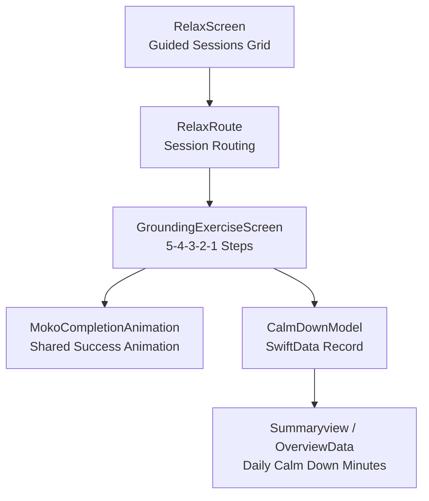
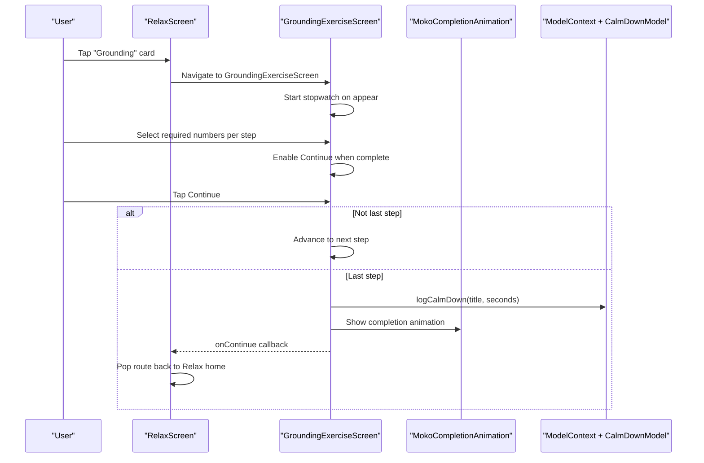
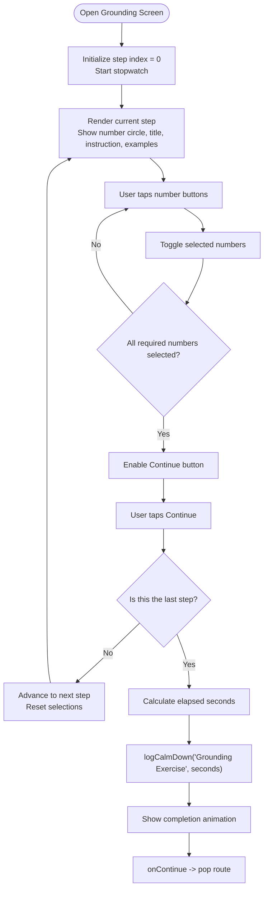
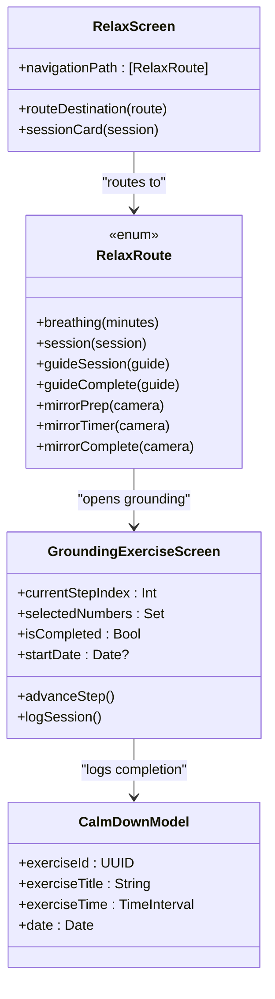

# Grounding Techniques

<cite>
**Referenced Files in This Document**
- [GroundingExerciseScreen.swift](file://Moko/Moko/UIScreens/relaxScreens/Grounding/GroundingExerciseScreen.swift)
- [RelaxScreen.swift](file://Moko/Moko/UIScreens/relaxScreens/RelaxScreen.swift)
- [CalmDownModel.swift](file://Moko/Moko/Models/CalmDownModel.swift)
- [OverviewData.swift](file://Moko/Moko/Models/OverviewData.swift)
- [Summaryview.swift](file://Moko/Moko/UIScreens/homeScreens/Summary_CalmDown/Summaryview.swift)
- [MokoCompletionAnimation.swift](file://Moko/Moko/Features/Animation/MokoCompletionAnimation.swift)
</cite>

## Table of Contents
1. [Introduction](#introduction)
2. [Project Structure](#project-structure)
3. [Core Components](#core-components)
4. [Architecture Overview](#architecture-overview)
5. [Detailed Component Analysis](#detailed-component-analysis)
6. [Dependency Analysis](#dependency-analysis)
7. [Performance Considerations](#performance-considerations)
8. [Troubleshooting Guide](#troubleshooting-guide)
9. [Conclusion](#conclusion)
10. [Appendices](#appendices)

## Introduction
This document explains the Grounding exercise system built for anxiety relief. It focuses on the 5-4-3-2-1 sensory grounding technique, how users are guided through each sense, how input is handled, and how progress is tracked. It also covers UI design patterns, accessibility considerations, integration with the relaxation framework, and ways to customize or extend the exercise for different therapeutic approaches.

The implementation centers on a SwiftUI screen that walks users through five steps: seeing, touching, hearing, smelling, and tasting. Each step asks the user to select a fixed number of items using interactive buttons. When all required selections are made, the user can continue to the next step. After completing the final step, the app records the elapsed time and shows a completion animation before returning to the Relax home screen.

## Project Structure
The grounding feature lives under the Relax tab. The Relax screen presents a grid of guided sessions, including Grounding. Selecting Grounding opens the grounding exercise screen. On completion, the exercise logs its duration into SwiftData so it appears in summary views.

**Diagram sources**
- [RelaxScreen.swift:12-98](file://Moko/Moko/UIScreens/relaxScreens/RelaxScreen.swift#L12-L98)
- [RelaxScreen.swift:199-229](file://Moko/Moko/UIScreens/relaxScreens/RelaxScreen.swift#L199-L229)
- [GroundingExerciseScreen.swift:15-25](file://Moko/Moko/UIScreens/relaxScreens/Grounding/GroundingExerciseScreen.swift#L15-L25)
- [GroundingExerciseScreen.swift:417-463](file://Moko/Moko/UIScreens/relaxScreens/Grounding/GroundingExerciseScreen.swift#L417-L463)
- [CalmDownModel.swift:11-37](file://Moko/Moko/Models/CalmDownModel.swift#L11-L37)
- [OverviewData.swift:11-42](file://Moko/Moko/Models/OverviewData.swift#L11-L42)
- [Summaryview.swift:188-239](file://Moko/Moko/UIScreens/homeScreens/Summary_CalmDown/Summaryview.swift#L188-L239)

**Section sources**
- [RelaxScreen.swift:12-98](file://Moko/Moko/UIScreens/relaxScreens/RelaxScreen.swift#L12-L98)
- [RelaxScreen.swift:199-229](file://Moko/Moko/UIScreens/relaxScreens/RelaxScreen.swift#L199-L229)

## Core Components
- GroundingExerciseScreen: Implements the 5-4-3-2-1 flow, visual prompts, selection controls, progress indicators, and completion state.
- MokoCompletionAnimation: Shared success animation used by relaxation flows.
- CalmDownModel: SwiftData model storing completed calm-down exercises with title, duration, and date.
- RelaxScreen: Entry point for the Grounding session from the Relax tab.
- OverviewData and Summaryview: Display daily calm-down minutes and historical charts based on logged sessions.

Key responsibilities:
- Guiding users through sensory categories with clear instructions and examples.
- Enforcing step requirements before allowing progression.
- Tracking elapsed time and persisting it as a calm-down record.
- Providing consistent visual feedback and accessible interactions.

**Section sources**
- [GroundingExerciseScreen.swift:15-114](file://Moko/Moko/UIScreens/relaxScreens/Grounding/GroundingExerciseScreen.swift#L15-L114)
- [MokoCompletionAnimation.swift:1-59](file://Moko/Moko/Features/Animation/MokoCompletionAnimation.swift#L1-L59)
- [CalmDownModel.swift:11-37](file://Moko/Moko/Models/CalmDownModel.swift#L11-L37)
- [RelaxScreen.swift:199-229](file://Moko/Moko/UIScreens/relaxScreens/RelaxScreen.swift#L199-L229)
- [OverviewData.swift:11-42](file://Moko/Moko/Models/OverviewData.swift#L11-L42)
- [Summaryview.swift:188-239](file://Moko/Moko/UIScreens/homeScreens/Summary_CalmDown/Summaryview.swift#L188-L239)

## Architecture Overview
The grounding exercise is a self-contained SwiftUI view integrated into the Relax navigation stack. It uses local state for step tracking and selection, and integrates with SwiftData via ModelContext to log completion.

**Diagram sources**
- [RelaxScreen.swift:199-229](file://Moko/Moko/UIScreens/relaxScreens/RelaxScreen.swift#L199-L229)
- [GroundingExerciseScreen.swift:142-146](file://Moko/Moko/UIScreens/relaxScreens/Grounding/GroundingExerciseScreen.swift#L142-L146)
- [GroundingExerciseScreen.swift:374-401](file://Moko/Moko/UIScreens/relaxScreens/Grounding/GroundingExerciseScreen.swift#L374-L401)
- [GroundingExerciseScreen.swift:491-513](file://Moko/Moko/UIScreens/relaxScreens/Grounding/GroundingExerciseScreen.swift#L491-L513)
- [CalmDownModel.swift:27-37](file://Moko/Moko/Models/CalmDownModel.swift#L27-L37)

## Detailed Component Analysis

### Grounding Exercise Flow
The exercise defines five steps, each with a target count, title, instruction, and example hints. Users interact by selecting numbered buttons corresponding to the current step’s requirement. A large circular badge displays the current step’s number, while a top bar indicates “Step X of Y.” Progress bars show completed steps. An “Everyday anchors” card provides contextual guidance for each sense.

**Diagram sources**
- [GroundingExerciseScreen.swift:64-114](file://Moko/Moko/UIScreens/relaxScreens/Grounding/GroundingExerciseScreen.swift#L64-L114)
- [GroundingExerciseScreen.swift:190-213](file://Moko/Moko/UIScreens/relaxScreens/Grounding/GroundingExerciseScreen.swift#L190-L213)
- [GroundingExerciseScreen.swift:217-264](file://Moko/Moko/UIScreens/relaxScreens/Grounding/GroundingExerciseScreen.swift#L217-L264)
- [GroundingExerciseScreen.swift:288-321](file://Moko/Moko/UIScreens/relaxScreens/Grounding/GroundingExerciseScreen.swift#L288-L321)
- [GroundingExerciseScreen.swift:323-372](file://Moko/Moko/UIScreens/relaxScreens/Grounding/GroundingExerciseScreen.swift#L323-L372)
- [GroundingExerciseScreen.swift:374-401](file://Moko/Moko/UIScreens/relaxScreens/Grounding/GroundingExerciseScreen.swift#L374-L401)
- [GroundingExerciseScreen.swift:491-513](file://Moko/Moko/UIScreens/relaxScreens/Grounding/GroundingExerciseScreen.swift#L491-L513)

#### Visual Prompts and Interactive Elements
- Number Circle: Displays the current step’s required count prominently.
- Header: Shows “Grounding Exercise” and “5-4-3-2-1 SENSORY RESET.”
- Step Badge: Top-right pill showing “STEP X OF Y.”
- Progress Bars: Capsule segments indicating completed steps.
- Everyday Anchors Card: Provides tailored examples for each sense.
- Number Buttons: One-to-one mapping to the required count; toggles selection with visual feedback.
- Continue Button: Disabled until all required selections are made; label changes to “Finish” on the last step.

These elements create a predictable layout where content transitions do not shift unexpectedly, improving focus during grounding.

**Section sources**
- [GroundingExerciseScreen.swift:190-213](file://Moko/Moko/UIScreens/relaxScreens/Grounding/GroundingExerciseScreen.swift#L190-L213)
- [GroundingExerciseScreen.swift:217-264](file://Moko/Moko/UIScreens/relaxScreens/Grounding/GroundingExerciseScreen.swift#L217-L264)
- [GroundingExerciseScreen.swift:288-321](file://Moko/Moko/UIScreens/relaxScreens/Grounding/GroundingExerciseScreen.swift#L288-L321)
- [GroundingExerciseScreen.swift:323-372](file://Moko/Moko/UIScreens/relaxScreens/Grounding/GroundingExerciseScreen.swift#L323-L372)
- [GroundingExerciseScreen.swift:374-401](file://Moko/Moko/UIScreens/relaxScreens/Grounding/GroundingExerciseScreen.swift#L374-L401)

#### User Input Handling
- Selection State: A Set stores selected numbers for the current step.
- Toggle Logic: Tapping a number adds or removes it from the set.
- Validation: The Continue button is enabled only when the number of selected items equals the step’s required count.
- Step Advancement: Advancing resets selections for the next step and animates the transition.

This approach ensures users cannot skip steps and reinforces mindful engagement with each sense.

**Section sources**
- [GroundingExerciseScreen.swift:19-25](file://Moko/Moko/UIScreens/relaxScreens/Grounding/GroundingExerciseScreen.swift#L19-L25)
- [GroundingExerciseScreen.swift:403-413](file://Moko/Moko/UIScreens/relaxScreens/Grounding/GroundingExerciseScreen.swift#L403-L413)
- [GroundingExerciseScreen.swift:482-504](file://Moko/Moko/UIScreens/relaxScreens/Grounding/GroundingExerciseScreen.swift#L482-L504)

#### Progress Tracking
- Stopwatch: Starts when the screen appears and stops when the exercise completes.
- Logging: On completion, elapsed seconds are saved via ModelContext.logCalmDown with the title “Grounding Exercise.”
- Persistence: CalmDownModel stores exerciseId, exerciseTitle, exerciseTime, and date.
- Summary Integration: OverviewData aggregates daily calm-down minutes; Summaryview renders charts over day/month/year ranges.

This allows users to see their grounding practice over time alongside other relaxation activities.

**Section sources**
- [GroundingExerciseScreen.swift:142-146](file://Moko/Moko/UIScreens/relaxScreens/Grounding/GroundingExerciseScreen.swift#L142-L146)
- [GroundingExerciseScreen.swift:506-513](file://Moko/Moko/UIScreens/relaxScreens/Grounding/GroundingExerciseScreen.swift#L506-L513)
- [CalmDownModel.swift:11-37](file://Moko/Moko/Models/CalmDownModel.swift#L11-L37)
- [OverviewData.swift:11-42](file://Moko/Moko/Models/OverviewData.swift#L11-L42)
- [Summaryview.swift:188-239](file://Moko/Moko/UIScreens/homeScreens/Summary_CalmDown/Summaryview.swift#L188-L239)

#### Completion Experience
After finishing the final step, the screen switches to a completion view featuring:
- A “COMPLETE” badge.
- A centered success animation with rings, checkmark, and falling lemons.
- Encouraging text confirming completion of the 5-4-3-2-1 sensory reset.
- A “Complete” button that triggers the parent’s onContinue callback to return to the Relax home.

**Section sources**
- [GroundingExerciseScreen.swift:417-463](file://Moko/Moko/UIScreens/relaxScreens/Grounding/GroundingExerciseScreen.swift#L417-L463)
- [MokoCompletionAnimation.swift:1-59](file://Moko/Moko/Features/Animation/MokoCompletionAnimation.swift#L1-L59)

### UI Design Patterns
- Consistent Layout: Fixed spacing and reserved frame heights prevent layout shifts between steps.
- Color System: Uses a calming palette with green tones, brown titles, and neutral subtext.
- Animations: Smooth transitions for step changes and completion state.
- Guidance Cards: “Everyday anchors” provide contextual examples without overwhelming the main prompt.
- Navigation: Immersive session mode hides the tab bar to keep focus on the exercise.

These patterns support a calm, focused experience appropriate for anxiety relief.

**Section sources**
- [GroundingExerciseScreen.swift:27-61](file://Moko/Moko/UIScreens/relaxScreens/Grounding/GroundingExerciseScreen.swift#L27-L61)
- [GroundingExerciseScreen.swift:122-146](file://Moko/Moko/UIScreens/relaxScreens/Grounding/GroundingExerciseScreen.swift#L122-L146)
- [GroundingExerciseScreen.swift:190-213](file://Moko/Moko/UIScreens/relaxScreens/Grounding/GroundingExerciseScreen.swift#L190-L213)

### Accessibility Considerations
- Clear Labels: Large, readable fonts and high-contrast colors improve legibility.
- Touch Targets: Buttons have generous height and spacing for easier interaction.
- Motion Feedback: Animations are smooth and optional; the completion animation includes an accessibility label describing the visual outcome.
- Focus Management: The layout avoids unexpected shifts, reducing disorientation for users with cognitive or vestibular sensitivities.
- VoiceOver Readability: Text labels and structured hierarchy help assistive technologies convey step context and progress.

For further improvements, consider:
- Adding explicit accessibility identifiers for test automation.
- Supporting Dynamic Type scaling more aggressively across all text.
- Providing reduced motion preferences to disable animations.

**Section sources**
- [GroundingExerciseScreen.swift:190-213](file://Moko/Moko/UIScreens/relaxScreens/Grounding/GroundingExerciseScreen.swift#L190-L213)
- [GroundingExerciseScreen.swift:323-372](file://Moko/Moko/UIScreens/relaxScreens/Grounding/GroundingExerciseScreen.swift#L323-L372)
- [MokoCompletionAnimation.swift:54-59](file://Moko/Moko/Features/Animation/MokoCompletionAnimation.swift#L54-L59)

### Integration with the Relaxation Framework
The Grounding exercise is one of several guided sessions in the Relax tab. RelaxScreen manages routing to different exercises and shares common UI patterns. Completion callbacks ensure consistent navigation behavior across sessions.

**Diagram sources**
- [RelaxScreen.swift:12-98](file://Moko/Moko/UIScreens/relaxScreens/RelaxScreen.swift#L12-L98)
- [RelaxScreen.swift:199-229](file://Moko/Moko/UIScreens/relaxScreens/RelaxScreen.swift#L199-L229)
- [GroundingExerciseScreen.swift:15-25](file://Moko/Moko/UIScreens/relaxScreens/Grounding/GroundingExerciseScreen.swift#L15-L25)
- [GroundingExerciseScreen.swift:491-513](file://Moko/Moko/UIScreens/relaxScreens/Grounding/GroundingExerciseScreen.swift#L491-L513)
- [CalmDownModel.swift:11-37](file://Moko/Moko/Models/CalmDownModel.swift#L11-L37)

**Section sources**
- [RelaxScreen.swift:12-98](file://Moko/Moko/UIScreens/relaxScreens/RelaxScreen.swift#L12-L98)
- [RelaxScreen.swift:199-229](file://Moko/Moko/UIScreens/relaxScreens/RelaxScreen.swift#L199-L229)

## Dependency Analysis
- GroundingExerciseScreen depends on:
  - SwiftUI for UI composition and animations.
  - SwiftData ModelContext for persistence.
  - MokoCompletionAnimation for shared success visuals.
- RelaxScreen depends on:
  - RelaxRoute enum for navigation.
  - GroundingExerciseScreen for the grounding flow.
- CalmDownModel is consumed by:
  - Summaryview and OverviewData for analytics and summaries.

Potential coupling points:
- The grounding screen directly calls logCalmDown, tightly coupling UI to data logging.
- RelaxScreen constructs GroundingExerciseScreen with callbacks, which is clean but could be abstracted if more sessions share similar lifecycle behaviors.

Recommendations:
- Extract a small protocol for exercise lifecycle (start, advance, complete) to reduce duplication across relaxation features.
- Centralize color and typography tokens to ensure consistency across screens.

**Section sources**
- [GroundingExerciseScreen.swift:12-13](file://Moko/Moko/UIScreens/relaxScreens/Grounding/GroundingExerciseScreen.swift#L12-L13)
- [GroundingExerciseScreen.swift:506-513](file://Moko/Moko/UIScreens/relaxScreens/Grounding/GroundingExerciseScreen.swift#L506-L513)
- [RelaxScreen.swift:199-229](file://Moko/Moko/UIScreens/relaxScreens/RelaxScreen.swift#L199-L229)
- [OverviewData.swift:11-42](file://Moko/Moko/Models/OverviewData.swift#L11-L42)
- [Summaryview.swift:188-239](file://Moko/Moko/UIScreens/homeScreens/Summary_CalmDown/Summaryview.swift#L188-L239)

## Performance Considerations
- Minimal State: Only essential state is kept locally, avoiding unnecessary recompositions.
- Efficient Selection: Using a Set for selected numbers provides O(1) membership checks.
- Controlled Animations: Animations use ease-in-out and spring curves with modest durations to keep interactions responsive.
- Data Logging: Logging occurs once at completion, preventing repeated writes.

Optimization opportunities:
- Precompute static step data outside the view body to avoid recreating arrays on every render.
- Use lazy rendering for any future list-based extensions (e.g., adding more steps).

[No sources needed since this section provides general guidance]

## Troubleshooting Guide
Common issues and resolutions:
- Continue button never enables:
  - Ensure the number of selected items matches the step’s required count.
  - Verify toggleSelection updates the selectedNumbers set correctly.
- Session not logged after completion:
  - Confirm startDate is initialized on screen appear.
  - Check that logSession runs only once and that ModelContext.save succeeds.
- Summary does not reflect grounding time:
  - Verify CalmDownModel records are inserted and saved.
  - Ensure OverviewData filters records by date and sums exerciseTime correctly.
- Navigation does not return to Relax home:
  - Confirm onContinue callback is wired in RelaxScreen and pops the route.

Debugging tips:
- Add print statements around toggleSelection, advanceStep, and logSession to trace state changes.
- Inspect SwiftData container in previews or debug builds to verify persisted records.

**Section sources**
- [GroundingExerciseScreen.swift:403-413](file://Moko/Moko/UIScreens/relaxScreens/Grounding/GroundingExerciseScreen.swift#L403-L413)
- [GroundingExerciseScreen.swift:491-513](file://Moko/Moko/UIScreens/relaxScreens/Grounding/GroundingExerciseScreen.swift#L491-L513)
- [CalmDownModel.swift:27-37](file://Moko/Moko/Models/CalmDownModel.swift#L27-L37)
- [OverviewData.swift:11-42](file://Moko/Moko/Models/OverviewData.swift#L11-L42)

## Conclusion
The Grounding exercise provides a structured, visually supportive 5-4-3-2-1 sensory grounding technique. It guides users through each sense with clear prompts, enforces mindful input, and tracks progress for long-term insight. Integrated into the Relax framework, it contributes to a cohesive relaxation experience and supports customization for different therapeutic needs.

[No sources needed since this section summarizes without analyzing specific files]

## Appendices

### Customizing Grounding Exercises
- Modify step definitions:
  - Change the number, title, instruction, and examples for each sense.
  - Add new senses or reorder existing ones to match therapeutic goals.
- Adjust visual prompts:
  - Update colors, fonts, and card layouts to align with branding or accessibility needs.
- Extend interaction patterns:
  - Replace number buttons with free-text inputs or image-based choices.
  - Add timers or breathing cues within each step.

Example paths for customization:
- Step data structure and array: [GroundingExerciseScreen.swift:64-102](file://Moko/Moko/UIScreens/relaxScreens/Grounding/GroundingExerciseScreen.swift#L64-L102)
- Sensory content rendering: [GroundingExerciseScreen.swift:190-213](file://Moko/Moko/UIScreens/relaxScreens/Grounding/GroundingExerciseScreen.swift#L190-L213)
- Everyday anchors card: [GroundingExerciseScreen.swift:288-321](file://Moko/Moko/UIScreens/relaxScreens/Grounding/GroundingExerciseScreen.swift#L288-L321)
- Number buttons and selection logic: [GroundingExerciseScreen.swift:323-372](file://Moko/Moko/UIScreens/relaxScreens/Grounding/GroundingExerciseScreen.swift#L323-L372)

### Extending for Different Therapeutic Approaches
- Cognitive Behavioral Therapy (CBT):
  - Add thought-labeling prompts after each sensory step.
  - Include brief reflection fields to capture automatic thoughts.
- Mindfulness-Based Stress Reduction (MBSR):
  - Incorporate breath cues and body scan prompts within steps.
  - Provide optional audio narration for guided attention.
- Trauma-Informed Care:
  - Offer optional “pause” and “skip” controls.
  - Emphasize safety cues and grounding resources in the everyday anchors card.

Integration points:
- Extend GroundingExerciseScreen with additional state for reflections or timers.
- Reuse CalmDownModel to log richer metadata (e.g., therapy type, notes).
- Leverage MokoCompletionAnimation for consistent success feedback.

**Section sources**
- [GroundingExerciseScreen.swift:64-102](file://Moko/Moko/UIScreens/relaxScreens/Grounding/GroundingExerciseScreen.swift#L64-L102)
- [GroundingExerciseScreen.swift:288-321](file://Moko/Moko/UIScreens/relaxScreens/Grounding/GroundingExerciseScreen.swift#L288-L321)
- [CalmDownModel.swift:11-37](file://Moko/Moko/Models/CalmDownModel.swift#L11-L37)
- [MokoCompletionAnimation.swift:1-59](file://Moko/Moko/Features/Animation/MokoCompletionAnimation.swift#L1-L59)