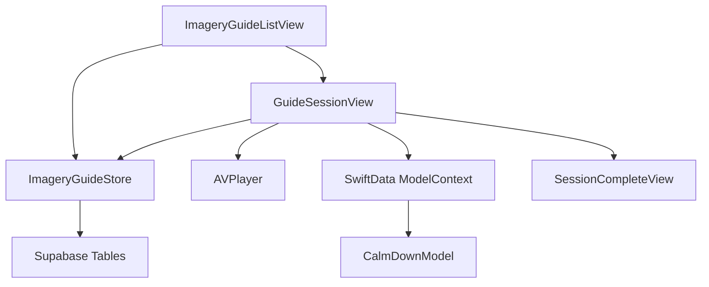
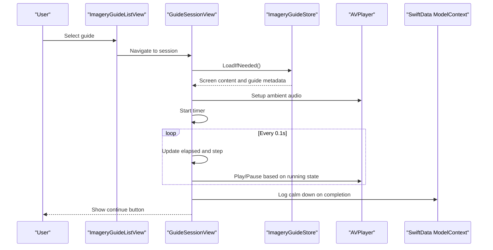
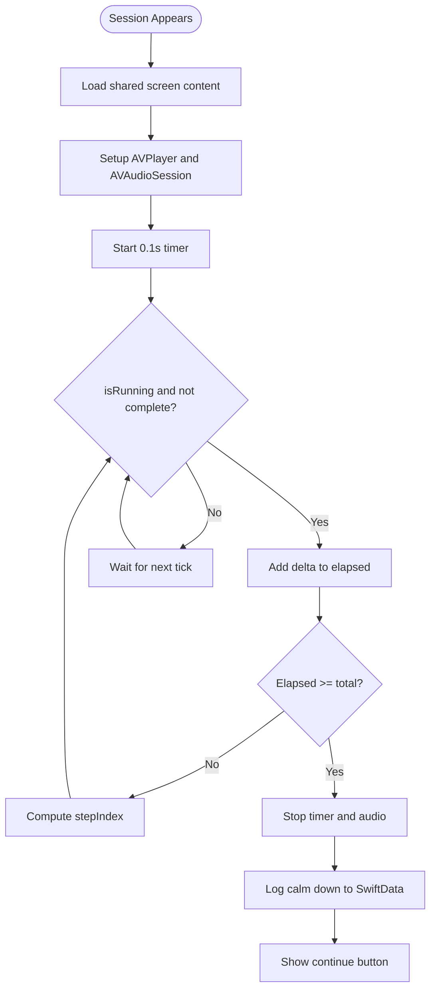
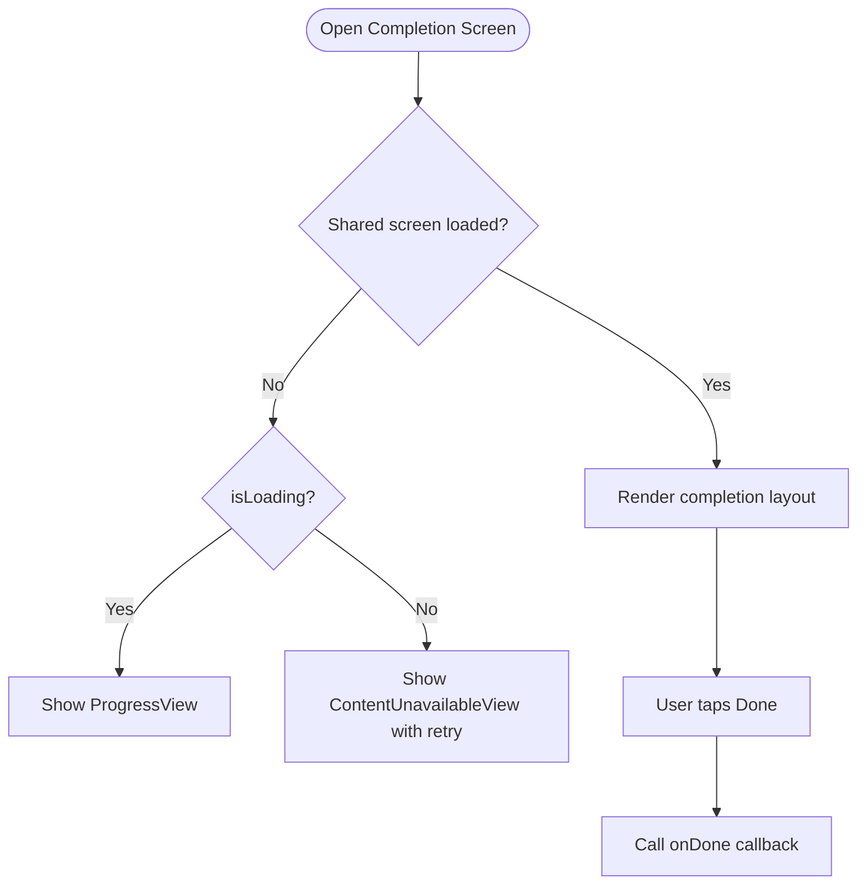
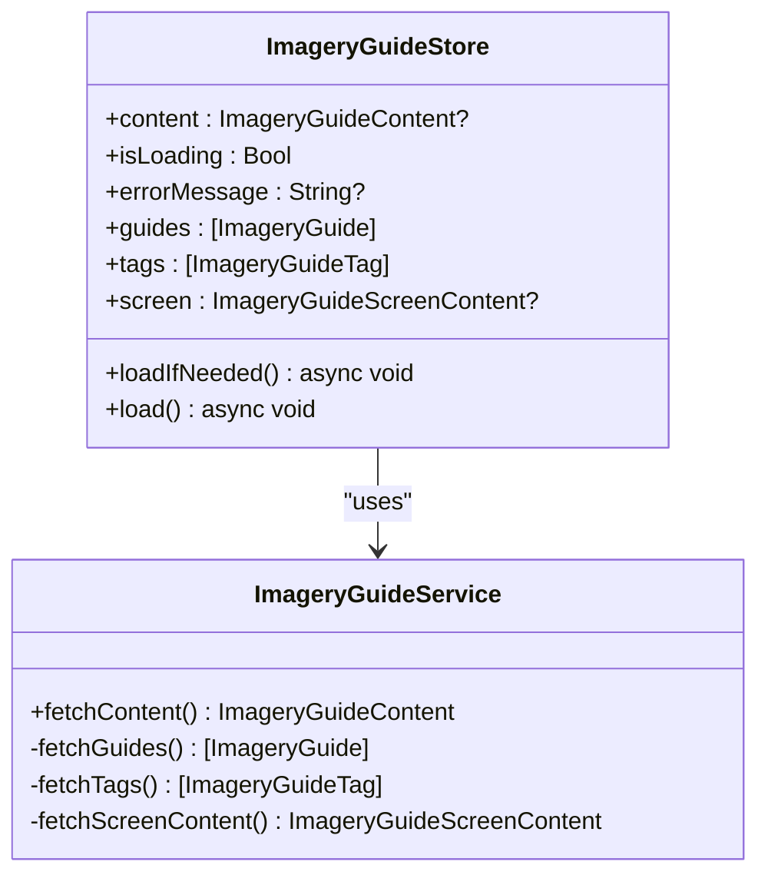
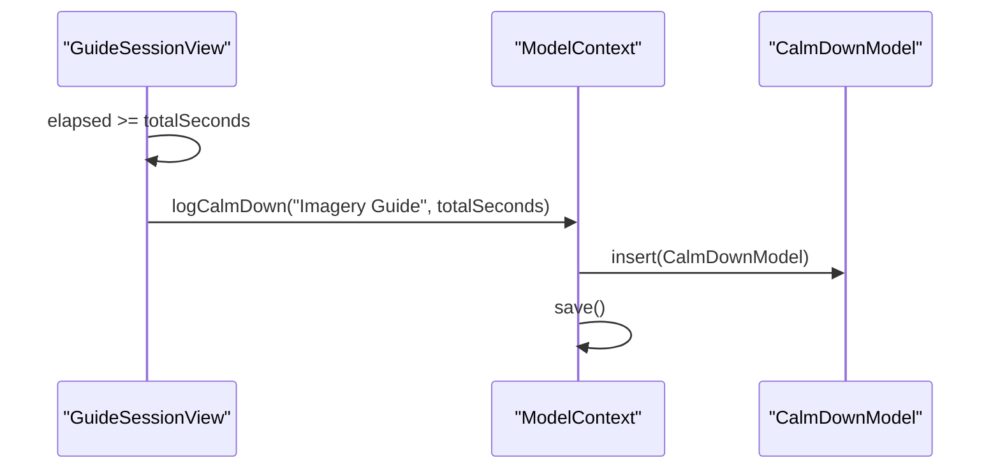
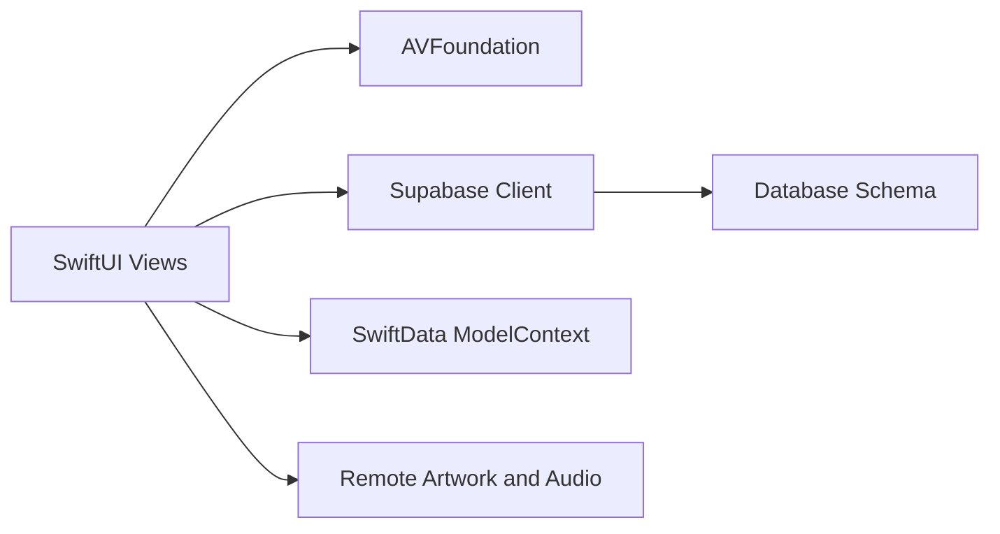

# Guided Session Interface

<cite>
**Referenced Files in This Document**
- [GuideSessionView.swift](file://Moko/Moko/UIScreens/relaxScreens/ImageryGuide/GuideSessionView.swift)
- [SessionCompleteView.swift](file://Moko/Moko/UIScreens/relaxScreens/ImageryGuide/SessionCompleteView.swift)
- [ImageryGuideStore.swift](file://Moko/Moko/UIScreens/relaxScreens/ImageryGuide/ImageryGuideStore.swift)
- [ImageryGuideListView.swift](file://Moko/Moko/UIScreens/relaxScreens/ImageryGuide/ImageryGuideListView.swift)
- [CalmDownModel.swift](file://Moko/Moko/Models/CalmDownModel.swift)
- [DebriefSoundPlayer.swift](file://Moko/Moko/Features/Audio/DebriefSoundPlayer.swift)
- [20261103120000_create_imagery_guides.sql](file://supabase/migrations/20261103120000_create_imagery_guides.sql)
- [20261106130000_add_imagery_guide_audio_url.sql](file://supabase/migrations/20261106130000_add_imagery_guide_audio_url.sql)
- [imagery_guides_seed.sql](file://supabase/imagery_guides_seed.sql)
</cite>

## Table of Contents
1. [Introduction](#introduction)
2. [Project Structure](#project-structure)
3. [Core Components](#core-components)
4. [Architecture Overview](#architecture-overview)
5. [Detailed Component Analysis](#detailed-component-analysis)
6. [Dependency Analysis](#dependency-analysis)
7. [Performance Considerations](#performance-considerations)
8. [Troubleshooting Guide](#troubleshooting-guide)
9. [Conclusion](#conclusion)

## Introduction
This document explains the guided session user interface for the Imagery Guide feature. It focuses on two main screens:

- **GuideSessionView**: The immersive session screen that displays background imagery, step-by-step instructions, a progress indicator, play/pause/restart controls, and looping ambient audio.
- **SessionCompleteView**: The post-session completion screen that shows feedback copy, an animation, and a done action.

The implementation is content-driven from Supabase. Screen labels, session formats, guide metadata, artwork URLs, and optional audio URLs are loaded at runtime. The session tracks elapsed time, advances through steps, logs completed sessions to local storage, and provides accessibility and sensory feedback.

## Project Structure
The guided session UI lives under the Relax > Imagery section of the app. The relevant files are:

| Area | File | Responsibility |
|---|---|---|
| Session screen | `GuideSessionView.swift` | Timer, imagery, progress, controls, ambient audio, completion logging |
| Completion screen | `SessionCompleteView.swift` | Post-session message, animation, navigation |
| Shared store | `ImageryGuideStore.swift` | Loads guides, tags, and shared screen copy from Supabase |
| List entry point | `ImageryGuideListView.swift` | Shows available guides and navigates into a session |
| Analytics model | `CalmDownModel.swift` | Persists finished calm-down exercises including imagery sessions |
| Short success sound | `DebriefSoundPlayer.swift` | Plays a bundled success sound (not used by imagery sessions directly) |
| Database schema | `20261103120000_create_imagery_guides.sql` | Defines imagery guides, tags, and screen content tables |
| Audio migration | `20261106130000_add_imagery_guide_audio_url.sql` | Adds the audio URL column for ambient playback |
| Seed data | `imagery_guides_seed.sql` | Provides default screen copy and example content |

**Diagram sources**
- [ImageryGuideListView.swift:1-373](file://Moko/Moko/UIScreens/relaxScreens/ImageryGuide/ImageryGuideListView.swift#L1-L373)
- [GuideSessionView.swift:13-106](file://Moko/Moko/UIScreens/relaxScreens/ImageryGuide/GuideSessionView.swift#L13-L106)
- [GuideSessionView.swift:274-349](file://Moko/Moko/UIScreens/relaxScreens/ImageryGuide/GuideSessionView.swift#L274-L349)
- [SessionCompleteView.swift:1-100](file://Moko/Moko/UIScreens/relaxScreens/ImageryGuide/SessionCompleteView.swift#L1-L100)
- [ImageryGuideStore.swift:14-103](file://Moko/Moko/UIScreens/relaxScreens/ImageryGuide/ImageryGuideStore.swift#L14-L103)
- [CalmDownModel.swift:12-37](file://Moko/Moko/Models/CalmDownModel.swift#L12-L37)

**Section sources**
- [ImageryGuideListView.swift:1-54](file://Moko/Moko/UIScreens/relaxScreens/ImageryGuide/ImageryGuideListView.swift#L1-L54)
- [ImageryGuideStore.swift:14-103](file://Moko/Moko/UIScreens/relaxScreens/ImageryGuide/ImageryGuideStore.swift#L14-L103)

## Core Components
This section summarizes the responsibilities of each core component.

### GuideSessionView
- Displays the selected guide’s title as the navigation title.
- Loads shared screen copy via `ImageryGuideStore`.
- Renders full-screen background imagery with configurable scale and shift.
- Shows step-by-step instructions derived from the guide’s steps array.
- Tracks elapsed time using a 0.1-second timer.
- Computes current step index based on elapsed time and total duration.
- Shows a progress bar, elapsed time, remaining time, and completion state.
- Provides restart, play, and pause controls.
- Manages looping ambient audio with `AVPlayer`.
- Logs completed sessions to SwiftData.
- Uses sensory feedback for step changes and completion.

### SessionCompleteView
- Shows loading, error, and retry states using the shared store.
- Displays completion title, subtitle, headline, and message.
- Includes a completion animation.
- Calls the provided `onDone` callback to navigate away.

### ImageryGuideStore
- Loads guides, tags, and shared screen content concurrently from Supabase.
- Exposes guides, tags, and screen copy to views.
- Handles loading state and error messages.
- Supports one-time load and manual refresh.

### CalmDownModel
- Represents a finished calm-down exercise.
- Stores exercise title, duration in seconds, and timestamp.
- Is written when a guided session completes.

**Section sources**
- [GuideSessionView.swift:13-106](file://Moko/Moko/UIScreens/relaxScreens/ImageryGuide/GuideSessionView.swift#L13-L106)
- [GuideSessionView.swift:108-225](file://Moko/Moko/UIScreens/relaxScreens/ImageryGuide/GuideSessionView.swift#L108-L225)
- [GuideSessionView.swift:241-349](file://Moko/Moko/UIScreens/relaxScreens/ImageryGuide/GuideSessionView.swift#L241-L349)
- [SessionCompleteView.swift:10-93](file://Moko/Moko/UIScreens/relaxScreens/ImageryGuide/SessionCompleteView.swift#L10-L93)
- [ImageryGuideStore.swift:14-103](file://Moko/Moko/UIScreens/relaxScreens/ImageryGuide/ImageryGuideStore.swift#L14-L103)
- [CalmDownModel.swift:12-37](file://Moko/Moko/Models/CalmDownModel.swift#L12-L37)

## Architecture Overview
The guided session flow connects list navigation, shared store, session UI, media playback, and analytics persistence.

**Diagram sources**
- [ImageryGuideListView.swift:160-185](file://Moko/Moko/UIScreens/relaxScreens/ImageryGuide/ImageryGuideListView.swift#L160-L185)
- [GuideSessionView.swift:73-106](file://Moko/Moko/UIScreens/relaxScreens/ImageryGuide/GuideSessionView.swift#L73-L106)
- [GuideSessionView.swift:274-349](file://Moko/Moko/UIScreens/relaxScreens/ImageryGuide/GuideSessionView.swift#L274-L349)
- [ImageryGuideStore.swift:82-102](file://Moko/Moko/UIScreens/relaxScreens/ImageryGuide/ImageryGuideStore.swift#L82-L102)
- [CalmDownModel.swift:27-37](file://Moko/Moko/Models/CalmDownModel.swift#L27-L37)

## Detailed Component Analysis

### GuideSessionView Implementation
`GuideSessionView` is the central session controller. It combines SwiftUI state, timers, AVFoundation audio, and SwiftData analytics.

#### Key Responsibilities
- **Content binding**: Reads `guide` metadata and shared `screen` copy from the environment store.
- **Timer logic**: Advances `elapsed` every 0.1 seconds while the session is running and not complete.
- **Step mapping**: Divides total duration by the number of steps to compute the active instruction.
- **UI composition**: Background image, guidance panel, progress bar, time labels, and controls.
- **Audio lifecycle**: Creates, plays, pauses, loops, and stops ambient audio.
- **Completion behavior**: Stops the timer, disables playback, and logs the session.

#### State and Derived Values
| State or Property | Purpose |
|---|---|
| `elapsed` | Seconds passed since session start |
| `isRunning` | Controls whether the timer and audio should advance |
| `lastTick` | Prevents large jumps when the timer resumes |
| `audioPlayer` | Holds the `AVPlayer` instance |
| `loopObserver` | Observes player end-of-item events for seamless looping |
| `totalSeconds` | Total session duration from guide metadata |
| `steps` | Ordered instruction strings |
| `stepIndex` | Current instruction index based on elapsed time |
| `isComplete` | Whether elapsed time has reached total duration |

#### UI Layout Patterns
- **Background layer**: A full-screen image loaded asynchronously with fallback icon and placeholder.
- **Guidance panel**: A rounded, semi-transparent panel anchored at the bottom containing header text, instruction text, progress bar, time labels, and controls.
- **Progress tracking**: A capsule-shaped track with an accent-colored fill proportional to `elapsed / totalSeconds`.
- **Controls**: Restart and play/pause buttons with accessible labels.
- **Completion transition**: A continue button appears after the timer completes.

#### Accessibility
- Control buttons use `accessibilityLabel`.
- Sensory feedback triggers provide haptic cues for step changes and completion.
- Screen copy and formatting come from shared content, enabling consistent labels and hints across the feature.

#### Audio Synchronization
- Ambient audio is configured through `AVAudioSession` with playback category and mixing options.
- The player volume is set to a soft level.
- Looping is implemented by observing the player item’s end-of-play event and seeking back to zero.
- Playback state follows the session’s `isRunning` flag.
- Resetting the session seeks the audio to the beginning and restarts playback if needed.

**Diagram sources**
- [GuideSessionView.swift:73-106](file://Moko/Moko/UIScreens/relaxScreens/ImageryGuide/GuideSessionView.swift#L73-L106)
- [GuideSessionView.swift:274-349](file://Moko/Moko/UIScreens/relaxScreens/ImageryGuide/GuideSessionView.swift#L274-L349)

**Section sources**
- [GuideSessionView.swift:13-106](file://Moko/Moko/UIScreens/relaxScreens/ImageryGuide/GuideSessionView.swift#L13-L106)
- [GuideSessionView.swift:108-225](file://Moko/Moko/UIScreens/relaxScreens/ImageryGuide/GuideSessionView.swift#L108-L225)
- [GuideSessionView.swift:241-349](file://Moko/Moko/UIScreens/relaxScreens/ImageryGuide/GuideSessionView.swift#L241-L349)

### SessionCompleteView Implementation
`SessionCompleteView` presents post-session feedback and handles loading and error states.

#### Behavior
- If shared screen content is available, it renders the completion layout.
- While loading, it shows a progress indicator.
- On error, it shows an unavailable-content view with a retry action that reloads the store.
- The completion message can be overridden by an injected `message`; otherwise, it uses the default message from shared content.
- Tapping Done calls `onDone`, which typically returns the user to the guide list.

#### Layout
- Full-screen background color.
- Vertical stack with title, subtitle, completion animation, headline, message, and a prominent Done button.
- Toolbar hidden to keep the experience immersive until the user exits.

**Diagram sources**
- [SessionCompleteView.swift:19-45](file://Moko/Moko/UIScreens/relaxScreens/ImageryGuide/SessionCompleteView.swift#L19-L45)
- [SessionCompleteView.swift:47-93](file://Moko/Moko/UIScreens/relaxScreens/ImageryGuide/SessionCompleteView.swift#L47-L93)

**Section sources**
- [SessionCompleteView.swift:10-93](file://Moko/Moko/UIScreens/relaxScreens/ImageryGuide/SessionCompleteView.swift#L10-L93)

### ImageryGuideStore and Data Flow
The store coordinates three concurrent Supabase queries:

1. Guides: Active guides ordered by sort order.
2. Tags: Active filter tags ordered by sort order.
3. Screen content: Shared copy for labels, formats, and states.

The resulting `ImageryGuideContent` exposes guides, tags, and screen copy to the UI. Views call `loadIfNeeded()` on first appearance and `load()` for pull-to-refresh or retry actions.

**Diagram sources**
- [ImageryGuideStore.swift:14-103](file://Moko/Moko/UIScreens/relaxScreens/ImageryGuide/ImageryGuideStore.swift#L14-L103)

**Section sources**
- [ImageryGuideStore.swift:14-103](file://Moko/Moko/UIScreens/relaxScreens/ImageryGuide/ImageryGuideStore.swift#L14-L103)

### Analytics and Post-Session Tracking
When a guided imagery session reaches its total duration, the view logs a calm-down record. The log includes:

- Exercise title: `"Imagery Guide"`
- Duration: total seconds from the guide metadata
- Timestamp: current date

The `CalmDownModel` persists this information through `ModelContext.logCalmDown`, making it available to summary and insights screens.

**Diagram sources**
- [GuideSessionView.swift:90-99](file://Moko/Moko/UIScreens/relaxScreens/ImageryGuide/GuideSessionView.swift#L90-L99)
- [CalmDownModel.swift:27-37](file://Moko/Moko/Models/CalmDownModel.swift#L27-L37)

**Section sources**
- [GuideSessionView.swift:90-99](file://Moko/Moko/UIScreens/relaxScreens/ImageryGuide/GuideSessionView.swift#L90-L99)
- [CalmDownModel.swift:12-37](file://Moko/Moko/Models/CalmDownModel.swift#L12-L37)

### UI Layout Patterns and Responsive Design
- **Full-screen immersion**: The session hides the tab bar and uses a background image that ignores safe area insets.
- **Bottom-anchored panel**: The guidance panel is positioned at the bottom with rounded corners, subtle shadow, and padding.
- **Responsive typography and spacing**: Instruction text adapts to width; progress and time labels use monospaced digits for stable timing visuals.
- **Fallback assets**: When artwork fails to load, the UI falls back to a system icon and gradient background.
- **List responsiveness**: The guide list uses horizontal scrolling chips, lazy vertical stacking, and scroll transitions for smooth interactions.

**Section sources**
- [GuideSessionView.swift:73-106](file://Moko/Moko/UIScreens/relaxScreens/ImageryGuide/GuideSessionView.swift#L73-L106)
- [GuideSessionView.swift:108-225](file://Moko/Moko/UIScreens/relaxScreens/ImageryGuide/GuideSessionView.swift#L108-L225)
- [ImageryGuideListView.swift:24-54](file://Moko/Moko/UIScreens/relaxScreens/ImageryGuide/ImageryGuideListView.swift#L24-L54)
- [ImageryGuideListView.swift:160-185](file://Moko/Moko/UIScreens/relaxScreens/ImageryGuide/ImageryGuideListView.swift#L160-L185)

### Accessibility Implementations
- **Labels**: Control buttons expose accessible labels derived from shared screen content.
- **Hints**: The guide list provides accessibility hints for opening cards.
- **Sensory feedback**: Haptic feedback highlights step changes and completion.
- **Dynamic content**: Labels, icons, and messages are driven by shared content, supporting consistent localization and accessibility strings.

**Section sources**
- [GuideSessionView.swift:262-272](file://Moko/Moko/UIScreens/relaxScreens/ImageryGuide/GuideSessionView.swift#L262-L272)
- [GuideSessionView.swift:104-105](file://Moko/Moko/UIScreens/relaxScreens/ImageryGuide/GuideSessionView.swift#L104-L105)
- [ImageryGuideListView.swift:175-177](file://Moko/Moko/UIScreens/relaxScreens/ImageryGuide/ImageryGuideListView.swift#L175-L177)
- [ImageryGuideListView.swift:188-197](file://Moko/Moko/UIScreens/relaxScreens/ImageryGuide/ImageryGuideListView.swift#L188-L197)

## Dependency Analysis
The guided session feature depends on several layers:

| Layer | Dependency | Role |
|---|---|---|
| UI | SwiftUI views | Renders session, completion, and list interfaces |
| Media | AVFoundation | Manages ambient audio playback and session |
| Storage | Supabase client | Loads guides, tags, and screen content |
| Persistence | SwiftData | Persists completed calm-down sessions |
| Schema | SQL migrations | Defines database structure and relationships |
| Assets | App bundle and remote storage | Provides images, icons, and optional audio |

**Diagram sources**
- [GuideSessionView.swift:8-11](file://Moko/Moko/UIScreens/relaxScreens/ImageryGuide/GuideSessionView.swift#L8-L11)
- [ImageryGuideStore.swift:8-10](file://Moko/Moko/UIScreens/relaxScreens/ImageryGuide/ImageryGuideStore.swift#L8-L10)
- [CalmDownModel.swift:8-9](file://Moko/Moko/Models/CalmDownModel.swift#L8-L9)
- [20261103120000_create_imagery_guides.sql:104-113](file://supabase/migrations/20261103120000_create_imagery_guides.sql#L104-L113)

**Section sources**
- [GuideSessionView.swift:8-11](file://Moko/Moko/UIScreens/relaxScreens/ImageryGuide/GuideSessionView.swift#L8-L11)
- [ImageryGuideStore.swift:8-10](file://Moko/Moko/UIScreens/relaxScreens/ImageryGuide/ImageryGuideStore.swift#L8-L10)
- [20261103120000_create_imagery_guides.sql:104-113](file://supabase/migrations/20261103120000_create_imagery_guides.sql#L104-L113)

## Performance Considerations
The guided session balances smooth media playback with efficient UI updates.

### Timer and UI Updates
- The timer fires every 0.1 seconds, providing smooth progress without excessive redraw cost.
- Elapsed time is clamped to total duration to avoid overshooting.
- Step changes trigger sensory feedback but do not force heavy recomputation.

### Audio Playback
- Ambient audio is created once per session and reused.
- The player loops seamlessly by seeking to zero on end-of-item events.
- Audio session configuration allows playback even when the device is silent and mixes with other audio.
- Cleanup removes observers, pauses playback, resets position, and releases the player reference.

### Image Loading
- Background imagery uses asynchronous loading with placeholder and failure fallbacks.
- Framing is controlled by scale and shift values from the guide metadata.
- Fallback icons prevent blank screens when remote images fail.

### Memory Management
- Long sessions benefit from reusing a single `AVPlayer` instance rather than creating new players per interaction.
- The store loads content once and caches it during the session.
- Completion logging writes a single record instead of frequent incremental updates.

### Optimization Recommendations
- Consider preloading the ambient audio asset before starting the timer to reduce initial latency.
- Use audio buffering checks before playing to handle network delays gracefully.
- Debounce rapid control interactions to avoid redundant seek/play operations.
- Monitor memory usage during very long sessions and consider releasing background resources if the session is interrupted.

[No sources needed since this section provides general guidance]

## Troubleshooting Guide
Common issues and their likely causes:

| Symptom | Likely Cause | Resolution |
|---|---|---|
| No ambient audio plays | Missing or invalid `audio_url` in guide metadata | Verify Supabase row and storage bucket access |
| Audio does not loop | End-of-item observer not firing or player released early | Ensure observer is attached and player remains alive |
| Audio conflicts with other apps | Incorrect audio session category | Confirm playback category with mixing options |
| Progress jumps or stalls | Large time deltas between ticks | Keep timer interval small and clamp elapsed updates |
| Session completes but no analytics | `logCalmDown` not called or save failed | Check completion branch and SwiftData save errors |
| Completion screen shows error | Shared screen content failed to load | Retry loading or check Supabase connection |
| Background image missing | Remote artwork URL broken or inaccessible | Check storage bucket and fallback icon behavior |

**Section sources**
- [GuideSessionView.swift:274-349](file://Moko/Moko/UIScreens/relaxScreens/ImageryGuide/GuideSessionView.swift#L274-L349)
- [GuideSessionView.swift:90-99](file://Moko/Moko/UIScreens/relaxScreens/ImageryGuide/GuideSessionView.swift#L90-L99)
- [SessionCompleteView.swift:19-45](file://Moko/Moko/UIScreens/relaxScreens/ImageryGuide/SessionCompleteView.swift#L19-L45)
- [CalmDownModel.swift:27-37](file://Moko/Moko/Models/CalmDownModel.swift#L27-L37)

## Conclusion
The guided session interface combines a content-driven UI, precise timing, immersive visuals, and looping ambient audio. `GuideSessionView` manages the session lifecycle, while `SessionCompleteView` delivers post-session feedback. The shared store decouples UI from Supabase data, and SwiftData captures analytics for completed sessions. With careful attention to audio synchronization, progress tracking, accessibility, and performance, the feature provides a smooth, focused relaxation experience suitable for long guided imagery sessions.

[No sources needed since this section summarizes without analyzing specific files]