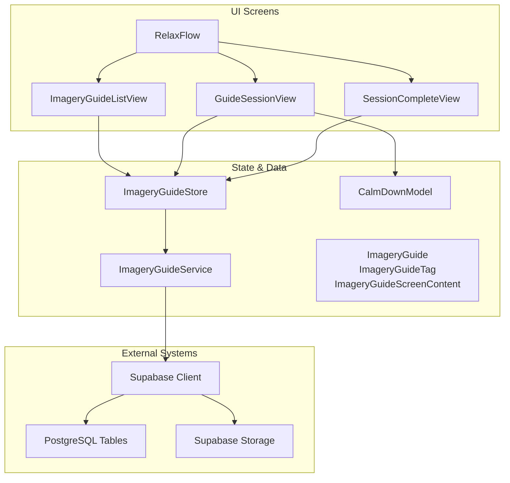
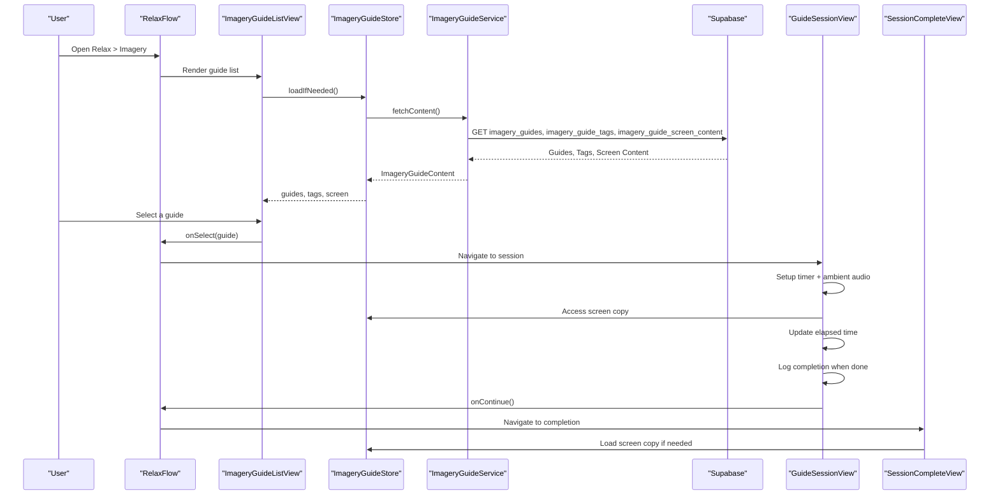
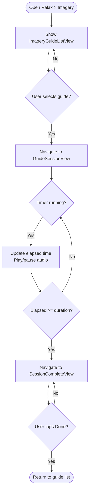
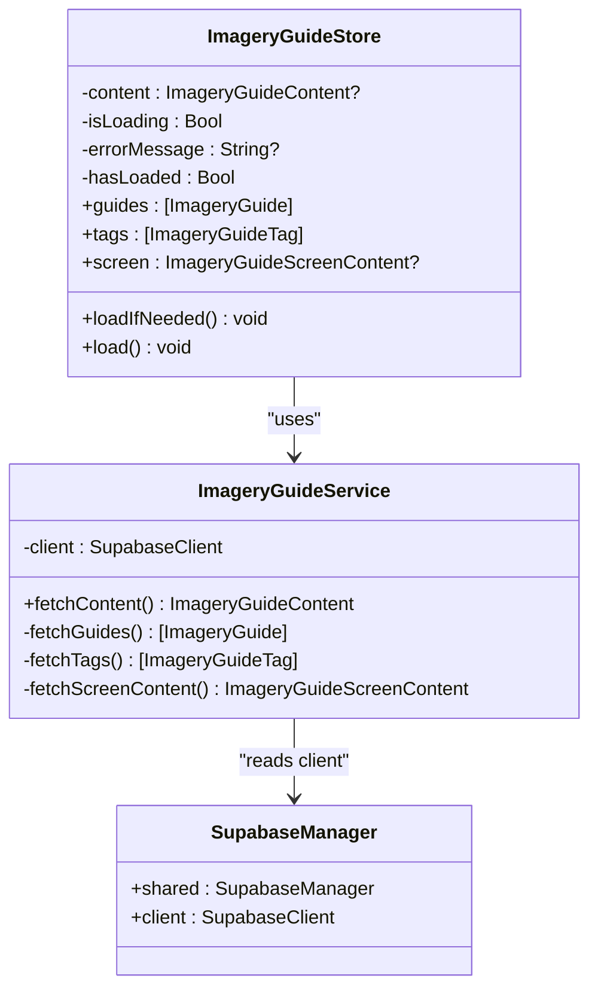
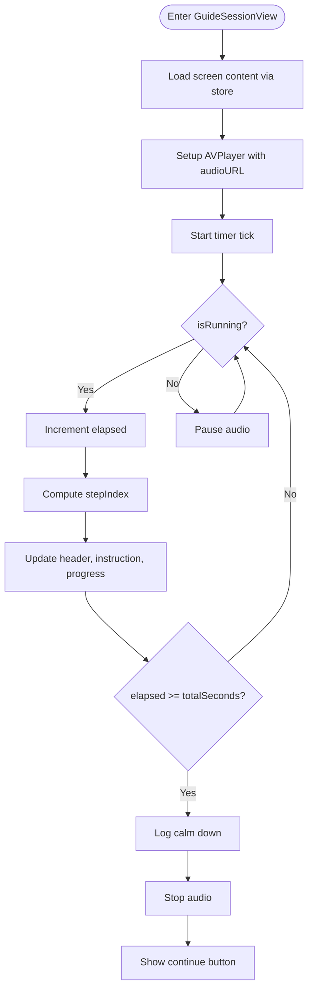
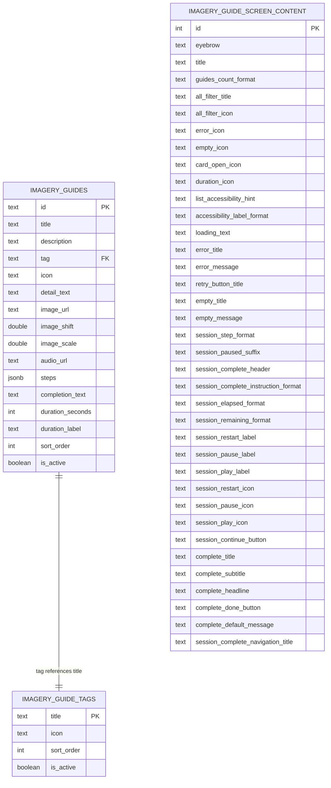
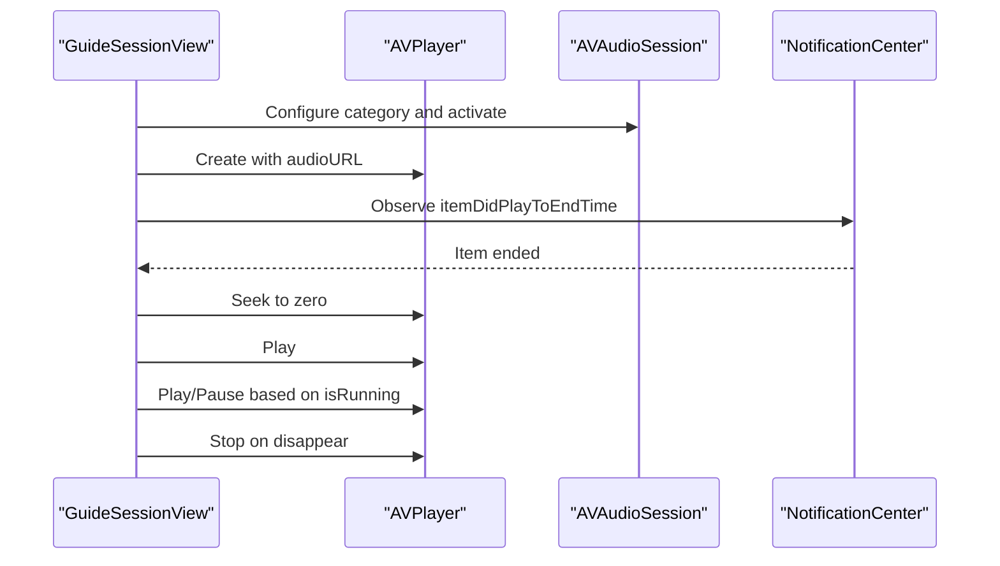
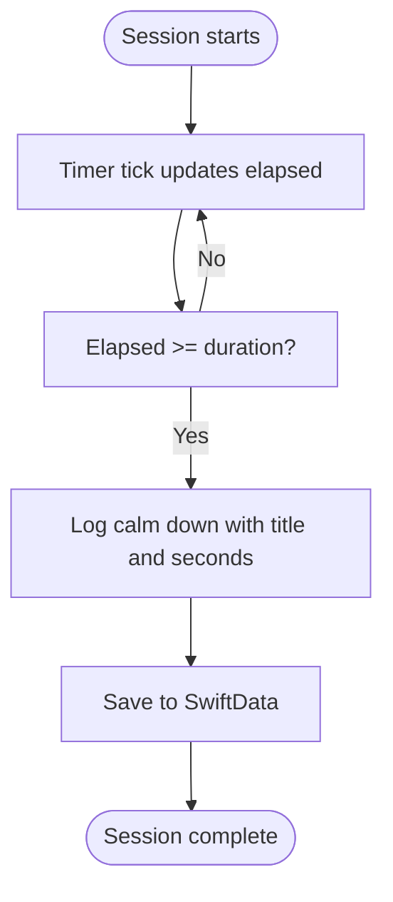
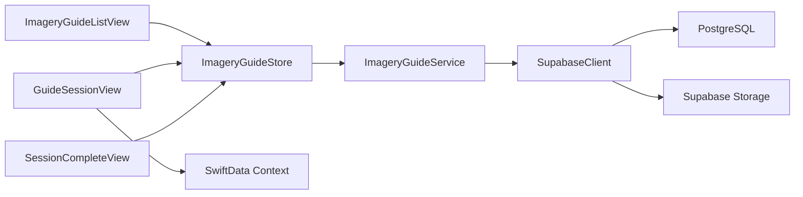

# Imagery Guidance System

<cite>
**Referenced Files in This Document**
- [GuideSessionView.swift](file://Moko/Moko/UIScreens/relaxScreens/ImageryGuide/GuideSessionView.swift)
- [ImageryGuideStore.swift](file://Moko/Moko/UIScreens/relaxScreens/ImageryGuide/ImageryGuideStore.swift)
- [RelaxFlow.swift](file://Moko/Moko/UIScreens/relaxScreens/ImageryGuide/RelaxFlow.swift)
- [ImageryGuide.swift](file://Moko/Moko/UIScreens/relaxScreens/ImageryGuide/ImageryGuide.swift)
- [ImageryGuideListView.swift](file://Moko/Moko/UIScreens/relaxScreens/ImageryGuide/ImageryGuideListView.swift)
- [SessionCompleteView.swift](file://Moko/Moko/UIScreens/relaxScreens/ImageryGuide/SessionCompleteView.swift)
- [CalmDownModel.swift](file://Moko/Moko/Models/CalmDownModel.swift)
- [SupabaseManager.swift](file://Moko/Moko/SupabaseManager.swift)
- [20261103120000_create_imagery_guides.sql](file://supabase/migrations/20261103120000_create_imagery_guides.sql)
- [imagery_guides_seed.sql](file://supabase/imagery_guides_seed.sql)
</cite>

## Table of Contents
1. [Introduction](#introduction)
2. [Project Structure](#project-structure)
3. [Core Components](#core-components)
4. [Architecture Overview](#architecture-overview)
5. [Detailed Component Analysis](#detailed-component-analysis)
6. [Dependency Analysis](#dependency-analysis)
7. [Performance Considerations](#performance-considerations)
8. [Troubleshooting Guide](#troubleshooting-guide)
9. [Conclusion](#conclusion)

## Introduction
The Imagery Guidance system provides guided visualization sessions within the Relax section of the app. Users select an imagery guide, follow timed instructions, listen to looping ambient audio, and track progress until completion. The feature is content-driven: guides, tags, artwork URLs, audio URLs, session steps, and all screen copy are loaded from Supabase at runtime. Session persistence records completed exercises locally through SwiftData so they can be reviewed later.

This document explains the complete workflow from guide selection to session completion, the data model for imagery guides, audio playback integration, progress tracking, accessibility features, internationalization support, and performance considerations for media playback.

## Project Structure
The Imagery Guidance feature lives under the Relax screens and consists of:
- A navigation flow that routes between the guide list, the active session, and the completion screen.
- A store that loads guides, filter tags, and shared screen copy from Supabase.
- A SwiftUI view for the guided session with timer, progress bar, controls, and ambient audio.
- A list view for browsing and filtering guides.
- A completion view shown after a session finishes.
- A local SwiftData model used to log completed calm-down exercises.
- Database migrations and seed data defining the read-only content schema.

**Diagram sources**
- [RelaxFlow.swift:8-45](file://Moko/Moko/UIScreens/relaxScreens/ImageryGuide/RelaxFlow.swift#L8-L45)
- [ImageryGuideListView.swift:3-54](file://Moko/Moko/UIScreens/relaxScreens/ImageryGuide/ImageryGuideListView.swift#L3-L54)
- [GuideSessionView.swift:13-106](file://Moko/Moko/UIScreens/relaxScreens/ImageryGuide/GuideSessionView.swift#L13-L106)
- [SessionCompleteView.swift:10-45](file://Moko/Moko/UIScreens/relaxScreens/ImageryGuide/SessionCompleteView.swift#L10-L45)
- [ImageryGuideStore.swift:14-103](file://Moko/Moko/UIScreens/relaxScreens/ImageryGuide/ImageryGuideStore.swift#L14-L103)
- [ImageryGuide.swift:7-175](file://Moko/Moko/UIScreens/relaxScreens/ImageryGuide/ImageryGuide.swift#L7-L175)
- [CalmDownModel.swift:12-37](file://Moko/Moko/Models/CalmDownModel.swift#L12-L37)

**Section sources**
- [RelaxFlow.swift:1-56](file://Moko/Moko/UIScreens/relaxScreens/ImageryGuide/RelaxFlow.swift#L1-L56)
- [ImageryGuideStore.swift:1-104](file://Moko/Moko/UIScreens/relaxScreens/ImageryGuide/ImageryGuideStore.swift#L1-L104)
- [ImageryGuide.swift:1-202](file://Moko/Moko/UIScreens/relaxScreens/ImageryGuide/ImageryGuide.swift#L1-L202)
- [ImageryGuideListView.swift:1-373](file://Moko/Moko/UIScreens/relaxScreens/ImageryGuide/ImageryGuideListView.swift#L1-L373)
- [GuideSessionView.swift:1-356](file://Moko/Moko/UIScreens/relaxScreens/ImageryGuide/GuideSessionView.swift#L1-L356)
- [SessionCompleteView.swift:1-100](file://Moko/Moko/UIScreens/relaxScreens/ImageryGuide/SessionCompleteView.swift#L1-L100)
- [CalmDownModel.swift:1-38](file://Moko/Moko/Models/CalmDownModel.swift#L1-L38)
- [20261103120000_create_imagery_guides.sql:1-206](file://supabase/migrations/20261103120000_create_imagery_guides.sql#L1-L206)
- [imagery_guides_seed.sql:1-222](file://supabase/imagery_guides_seed.sql#L1-L222)

## Core Components
- **RelaxFlow**: Navigation controller for the Imagery feature. It manages a navigation stack with three states: guide list, active session, and completion.
- **ImageryGuideStore**: Observable state holder that loads guides, tags, and shared screen copy from Supabase. It exposes loading state, errors, and cached content.
- **ImageryGuideService**: HTTP client wrapper around Supabase queries for guides, tags, and screen content.
- **GuideSessionView**: Main guided visualization UI. It renders background artwork, instruction text, step indicators, progress bar, elapsed/remaining time, play/pause/restart controls, and completes the session when the timer reaches the configured duration.
- **ImageryGuideListView**: Browse-and-filter UI for available guides. It shows cards with artwork or icon fallbacks, tag chips, duration pills, and accessibility labels.
- **SessionCompleteView**: Completion screen showing a success animation, headline, personalized message, and a Done button.
- **ImageryGuide / ImageryGuideTag / ImageryGuideScreenContent**: Decodable data models representing database rows and shared templates.
- **CalmDownModel**: Local SwiftData record used to persist completed calm-down sessions, including title, duration, and timestamp.

**Section sources**
- [RelaxFlow.swift:8-45](file://Moko/Moko/UIScreens/relaxScreens/ImageryGuide/RelaxFlow.swift#L8-L45)
- [ImageryGuideStore.swift:14-103](file://Moko/Moko/UIScreens/relaxScreens/ImageryGuide/ImageryGuideStore.swift#L14-L103)
- [GuideSessionView.swift:13-106](file://Moko/Moko/UIScreens/relaxScreens/ImageryGuide/GuideSessionView.swift#L13-L106)
- [ImageryGuideListView.swift:3-54](file://Moko/Moko/UIScreens/relaxScreens/ImageryGuide/ImageryGuideListView.swift#L3-L54)
- [SessionCompleteView.swift:10-45](file://Moko/Moko/UIScreens/relaxScreens/ImageryGuide/SessionCompleteView.swift#L10-L45)
- [ImageryGuide.swift:7-175](file://Moko/Moko/UIScreens/relaxScreens/ImageryGuide/ImageryGuide.swift#L7-L175)
- [CalmDownModel.swift:12-37](file://Moko/Moko/Models/CalmDownModel.swift#L12-L37)

## Architecture Overview
The Imagery Guidance system follows a layered architecture:
- Presentation layer: SwiftUI views render user interfaces and handle user interactions.
- State layer: `ImageryGuideStore` holds application state and coordinates loading.
- Service layer: `ImageryGuideService` performs network requests to Supabase.
- Data layer: PostgreSQL tables define read-only content; Supabase Storage hosts images and audio.
- Persistence layer: SwiftData persists completed exercise logs locally.

**Diagram sources**
- [RelaxFlow.swift:17-45](file://Moko/Moko/UIScreens/relaxScreens/ImageryGuide/RelaxFlow.swift#L17-L45)
- [ImageryGuideListView.swift:51-54](file://Moko/Moko/UIScreens/relaxScreens/ImageryGuide/ImageryGuideListView.swift#L51-L54)
- [ImageryGuideStore.swift:82-103](file://Moko/Moko/UIScreens/relaxScreens/ImageryGuide/ImageryGuideStore.swift#L82-L103)
- [GuideSessionView.swift:85-106](file://Moko/Moko/UIScreens/relaxScreens/ImageryGuide/GuideSessionView.swift#L85-L106)
- [SessionCompleteView.swift:44-45](file://Moko/Moko/UIScreens/relaxScreens/ImageryGuide/SessionCompleteView.swift#L44-L45)

## Detailed Component Analysis

### RelaxFlow Navigation System
`RelaxFlow` defines the navigation path for the Imagery feature using a typed navigation stack. It maintains:
- A binding to the selected tab.
- A navigation path containing either a session or completion step.
- An environment-provided `ImageryGuideStore`.

Navigation behavior:
- Tapping a guide navigates to `GuideSessionView`.
- When the session completes, it navigates to `SessionCompleteView`.
- The completion screen’s Done action clears the navigation stack to return to the guide list.

**Diagram sources**
- [RelaxFlow.swift:8-45](file://Moko/Moko/UIScreens/relaxScreens/ImageryGuide/RelaxFlow.swift#L8-L45)
- [GuideSessionView.swift:90-106](file://Moko/Moko/UIScreens/relaxScreens/ImageryGuide/GuideSessionView.swift#L90-L106)
- [SessionCompleteView.swift:79-86](file://Moko/Moko/UIScreens/relaxScreens/ImageryGuide/SessionCompleteView.swift#L79-L86)

**Section sources**
- [RelaxFlow.swift:1-56](file://Moko/Moko/UIScreens/relaxScreens/ImageryGuide/RelaxFlow.swift#L1-L56)

### ImageryGuideStore and ImageryGuideService
`ImageryGuideStore` is a main-actor observable store that:
- Loads content once per lifecycle via `loadIfNeeded`.
- Exposes guides, tags, and screen content.
- Tracks loading state and error messages.
- Retries loading on demand.

`ImageryGuideService` uses the shared Supabase client to:
- Fetch active guides ordered by sort order.
- Fetch active tags ordered by sort order.
- Fetch shared screen content (single row with id 1).

All three queries run concurrently using async let, reducing total load time.

**Diagram sources**
- [ImageryGuideStore.swift:64-103](file://Moko/Moko/UIScreens/relaxScreens/ImageryGuide/ImageryGuideStore.swift#L64-L103)
- [ImageryGuideStore.swift:14-60](file://Moko/Moko/UIScreens/relaxScreens/ImageryGuide/ImageryGuideStore.swift#L14-L60)
- [SupabaseManager.swift:6-19](file://Moko/Moko/SupabaseManager.swift#L6-L19)

**Section sources**
- [ImageryGuideStore.swift:1-104](file://Moko/Moko/UIScreens/relaxScreens/ImageryGuide/ImageryGuideStore.swift#L1-L104)
- [SupabaseManager.swift:1-19](file://Moko/Moko/SupabaseManager.swift#L1-L19)

### GuideSessionView Implementation
`GuideSessionView` implements the guided visualization interface:
- Background artwork loaded asynchronously with fallback icons.
- Instruction text updated based on current step index.
- Progress bar reflecting elapsed time versus total duration.
- Elapsed and remaining time labels formatted from shared screen templates.
- Controls for restart, play, and pause.
- Ambient audio looped during the session using AVPlayer.
- Completion logging into SwiftData when the timer reaches the target duration.

Key behaviors:
- Timer ticks every 0.1 seconds, capping delta to avoid large jumps.
- Audio session configured for playback with ducking and mixing.
- Loop observer restarts audio seamlessly.
- Sensory feedback triggers on step changes and completion.

**Diagram sources**
- [GuideSessionView.swift:85-106](file://Moko/Moko/UIScreens/relaxScreens/ImageryGuide/GuideSessionView.swift#L85-L106)
- [GuideSessionView.swift:278-349](file://Moko/Moko/UIScreens/relaxScreens/ImageryGuide/GuideSessionView.swift#L278-L349)

**Section sources**
- [GuideSessionView.swift:1-356](file://Moko/Moko/UIScreens/relaxScreens/ImageryGuide/GuideSessionView.swift#L1-L356)

### ImageryGuideListView Implementation
`ImageryGuideListView` presents:
- Header with eyebrow and title from shared screen content.
- Horizontal filter chips for tags plus an “All” chip.
- Cards with artwork or icon fallbacks, tag pill, duration pill, and open indicator.
- Loading, error, and empty states driven by store state.
- Accessibility labels and hints using templates from shared screen content.
- Pull-to-refresh to reload content.

Filtering logic:
- If no tag is selected, show all guides.
- If a tag is selected, filter guides by matching tag.

**Section sources**
- [ImageryGuideListView.swift:1-373](file://Moko/Moko/UIScreens/relaxScreens/ImageryGuide/ImageryGuideListView.swift#L1-L373)

### SessionCompleteView Implementation
`SessionCompleteView` displays:
- Title, subtitle, and headline from shared screen content.
- A completion animation.
- A resolved message that falls back to a default message if none is provided.
- A Done button that clears the navigation stack.
- Error and retry handling if screen content fails to load.

**Section sources**
- [SessionCompleteView.swift:1-100](file://Moko/Moko/UIScreens/relaxScreens/ImageryGuide/SessionCompleteView.swift#L1-L100)

### Data Model for Imagery Guides
The data model maps directly to Supabase tables:
- `ImageryGuide`: Represents a single guide card, including metadata, artwork URL, audio URL, framing parameters, steps, completion text, duration, and label.
- `ImageryGuideTag`: Represents a filter chip with title and SF Symbol name.
- `ImageryGuideScreenContent`: Holds shared labels and template strings for all screens. It includes a helper method to replace placeholders like `{count}`, `{current}`, `{total}`, `{duration}`, `{title}`, and `{tag}`.
- `ImageryGuideContent`: Aggregates guides, tags, and screen content into one value returned by the service.

**Diagram sources**
- [20261103120000_create_imagery_guides.sql:7-105](file://supabase/migrations/20261103120000_create_imagery_guides.sql#L7-L105)
- [ImageryGuide.swift:7-175](file://Moko/Moko/UIScreens/relaxScreens/ImageryGuide/ImageryGuide.swift#L7-L175)

**Section sources**
- [ImageryGuide.swift:1-202](file://Moko/Moko/UIScreens/relaxScreens/ImageryGuide/ImageryGuide.swift#L1-L202)
- [20261103120000_create_imagery_guides.sql:1-206](file://supabase/migrations/20261103120000_create_imagery_guides.sql#L1-L206)

### Audio Playback Integration
Audio playback is handled inside `GuideSessionView`:
- On appear, ambient audio is set up if not already created.
- AVAudioSession is configured for playback with mix and duck options.
- AVPlayer is initialized with the guide’s audio URL.
- A notification observer loops the audio by seeking to zero and playing again when playback ends.
- Play/pause state is synchronized with the session timer.
- On stop, observers are removed, player paused, seeked to zero, and released.

**Diagram sources**
- [GuideSessionView.swift:278-349](file://Moko/Moko/UIScreens/relaxScreens/ImageryGuide/GuideSessionView.swift#L278-L349)

**Section sources**
- [GuideSessionView.swift:274-349](file://Moko/Moko/UIScreens/relaxScreens/ImageryGuide/GuideSessionView.swift#L274-L349)

### Progress Tracking and Session Persistence
Progress tracking occurs in `GuideSessionView`:
- A timer updates elapsed time while the session is running.
- When elapsed reaches total duration, the session stops and logs completion.
- Completion is recorded via `modelContext.logCalmDown`, which inserts a `CalmDownModel` with title, duration, and timestamp.

Persistence model:
- `CalmDownModel` stores exercise title, duration in seconds, and date.
- `ModelContext.logCalmDown` wraps insertion and save operations.

**Diagram sources**
- [GuideSessionView.swift:90-106](file://Moko/Moko/UIScreens/relaxScreens/ImageryGuide/GuideSessionView.swift#L90-L106)
- [CalmDownModel.swift:27-37](file://Moko/Moko/Models/CalmDownModel.swift#L27-L37)

**Section sources**
- [GuideSessionView.swift:85-106](file://Moko/Moko/UIScreens/relaxScreens/ImageryGuide/GuideSessionView.swift#L85-L106)
- [CalmDownModel.swift:1-38](file://Moko/Moko/Models/CalmDownModel.swift#L1-L38)

### Accessibility Features
Accessibility is integrated across the feature:
- Control buttons expose accessibility labels derived from shared screen templates.
- Guide cards expose accessibility labels using a template that includes title, tag, and duration.
- List items include an accessibility hint for opening guides.
- Session controls use SF Symbols and labels for screen readers.
- Completion screen uses clear titles and headlines for assistive technologies.

**Section sources**
- [GuideSessionView.swift:262-272](file://Moko/Moko/UIScreens/relaxScreens/ImageryGuide/GuideSessionView.swift#L262-L272)
- [ImageryGuideListView.swift:188-197](file://Moko/Moko/UIScreens/relaxScreens/ImageryGuide/ImageryGuideListView.swift#L188-L197)
- [ImageryGuide.swift:82-166](file://Moko/Moko/UIScreens/relaxScreens/ImageryGuide/ImageryGuide.swift#L82-L166)

### Internationalization Support
Internationalization is supported through shared screen content:
- All user-facing labels, templates, and messages are stored in `imagery_guide_screen_content`.
- Templates use placeholders such as `{count}`, `{current}`, `{total}`, `{duration}`, `{title}`, and `{tag}`.
- The `format` method replaces placeholders with runtime values.
- This design allows content editors to update labels without code changes.

**Section sources**
- [ImageryGuide.swift:82-166](file://Moko/Moko/UIScreens/relaxScreens/ImageryGuide/ImageryGuide.swift#L82-L166)
- [20261103120000_create_imagery_guides.sql:65-105](file://supabase/migrations/20261103120000_create_imagery_guides.sql#L65-L105)
- [imagery_guides_seed.sql:123-213](file://supabase/imagery_guides_seed.sql#L123-L213)

### Performance Optimization for Media Playback
Optimizations implemented:
- Concurrent loading of guides, tags, and screen content reduces network latency.
- AsyncImage handles artwork loading with progress and failure fallbacks.
- AVPlayer is reused and looped via notification observer to avoid repeated initialization.
- Audio session configuration ensures consistent playback behavior across devices.
- Timer delta is capped to prevent large jumps and reduce UI churn.
- Sensory feedback is triggered only on meaningful state changes.

**Section sources**
- [ImageryGuideStore.swift:22-29](file://Moko/Moko/UIScreens/relaxScreens/ImageryGuide/ImageryGuideStore.swift#L22-L29)
- [GuideSessionView.swift:90-106](file://Moko/Moko/UIScreens/relaxScreens/ImageryGuide/GuideSessionView.swift#L90-L106)
- [GuideSessionView.swift:278-349](file://Moko/Moko/UIScreens/relaxScreens/ImageryGuide/GuideSessionView.swift#L278-L349)

## Dependency Analysis
The Imagery Guidance system has clear separation of concerns:
- Views depend on the store for state and shared content.
- Store depends on service for data fetching.
- Service depends on Supabase client for HTTP access.
- Session view depends on SwiftData context for persistence.
- Database schema defines read-only content relationships.

**Diagram sources**
- [ImageryGuideListView.swift:6-54](file://Moko/Moko/UIScreens/relaxScreens/ImageryGuide/ImageryGuideListView.swift#L6-L54)
- [GuideSessionView.swift:17-24](file://Moko/Moko/UIScreens/relaxScreens/ImageryGuide/GuideSessionView.swift#L17-L24)
- [SessionCompleteView.swift:14-45](file://Moko/Moko/UIScreens/relaxScreens/ImageryGuide/SessionCompleteView.swift#L14-L45)
- [ImageryGuideStore.swift:14-103](file://Moko/Moko/UIScreens/relaxScreens/ImageryGuide/ImageryGuideStore.swift#L14-L103)
- [SupabaseManager.swift:6-19](file://Moko/Moko/SupabaseManager.swift#L6-L19)

**Section sources**
- [ImageryGuideStore.swift:1-104](file://Moko/Moko/UIScreens/relaxScreens/ImageryGuide/ImageryGuideStore.swift#L1-L104)
- [SupabaseManager.swift:1-19](file://Moko/Moko/SupabaseManager.swift#L1-L19)

## Performance Considerations
- Use concurrent async queries to minimize total load time.
- Prefer AsyncImage for artwork with graceful fallbacks.
- Reuse AVPlayer instances and loop via notifications to avoid overhead.
- Cap timer deltas to reduce unnecessary UI updates.
- Avoid heavy animations during long-running sessions.
- Ensure audio session configuration is robust across device states.

[No sources needed since this section provides general guidance]

## Troubleshooting Guide
Common issues and resolutions:
- No guides loaded: Check network connectivity and retry via the store’s load function.
- Artwork missing: Verify public storage bucket permissions and image URLs.
- Audio not playing: Confirm audio URL validity and AVAudioSession configuration.
- Session does not complete: Verify duration settings and timer logic.
- Labels not updating: Ensure shared screen content row exists and templates are correct.

Operational checks:
- Inspect store loading state and error messages.
- Review console logs for audio status and failures.
- Validate database policies allow public reads for active content.
- Confirm storage bucket policy permits anonymous and authenticated reads.

**Section sources**
- [ImageryGuideStore.swift:88-103](file://Moko/Moko/UIScreens/relaxScreens/ImageryGuide/ImageryGuideStore.swift#L88-L103)
- [GuideSessionView.swift:312-324](file://Moko/Moko/UIScreens/relaxScreens/ImageryGuide/GuideSessionView.swift#L312-L324)
- [20261103120000_create_imagery_guides.sql:147-206](file://supabase/migrations/20261103120000_create_imagery_guides.sql#L147-L206)

## Conclusion
The Imagery Guidance system delivers a polished guided visualization experience backed by content-driven data and robust media playback. Its architecture cleanly separates UI, state, service, and persistence layers. Shared screen content enables flexible internationalization and easy content updates. Progress tracking integrates with SwiftData for session history. With careful attention to accessibility, performance, and error handling, the feature provides a reliable and calming user experience.

[No sources needed since this section summarizes without analyzing specific files]