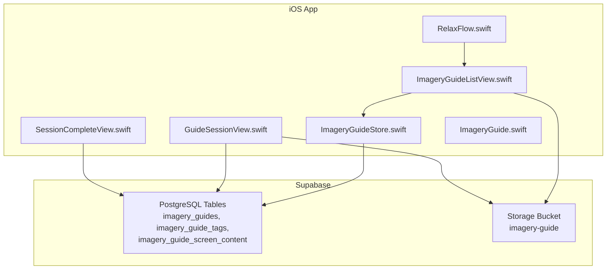
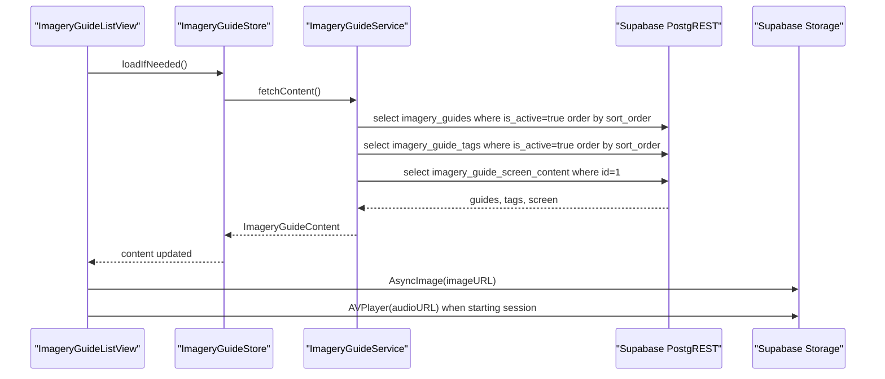
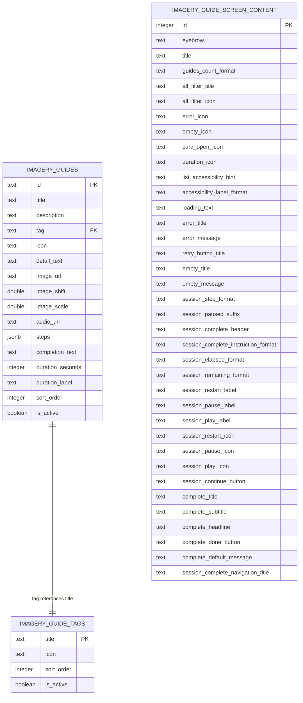
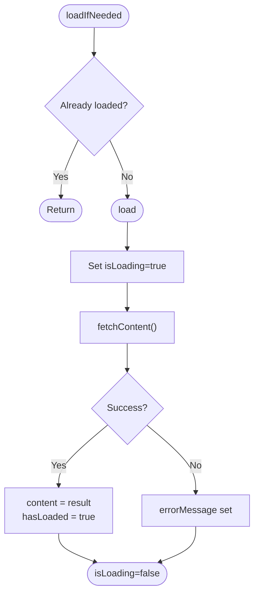
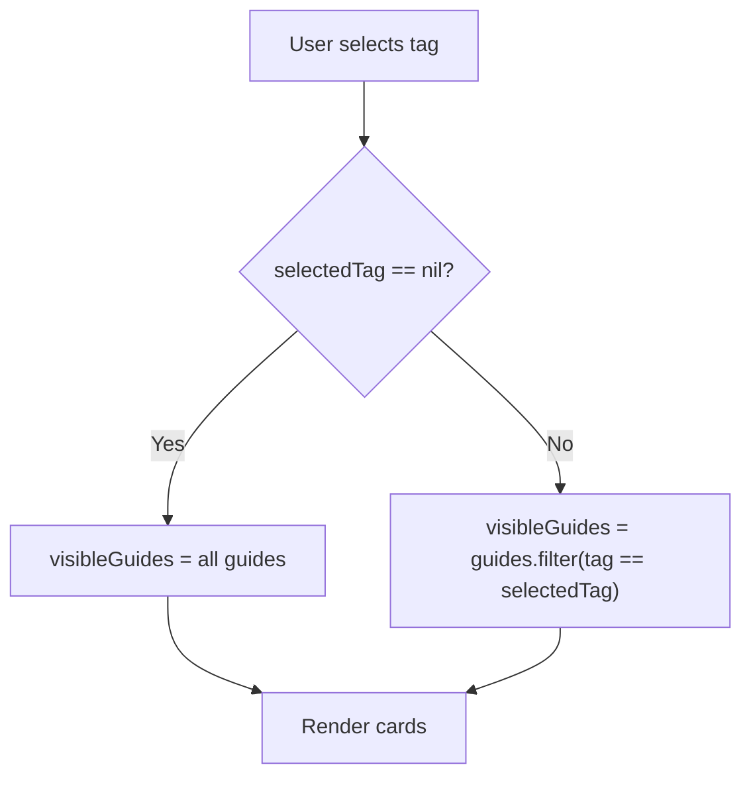
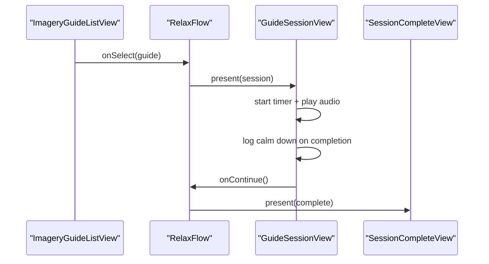
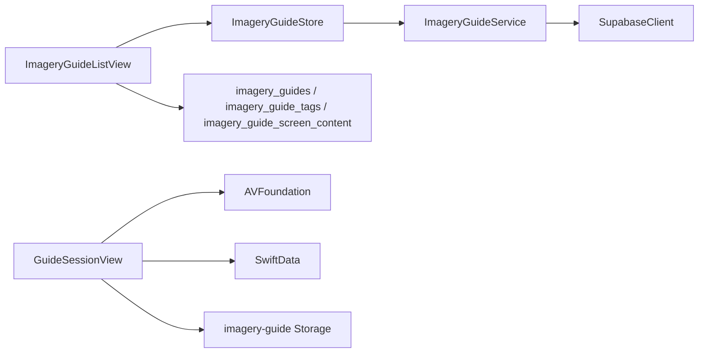
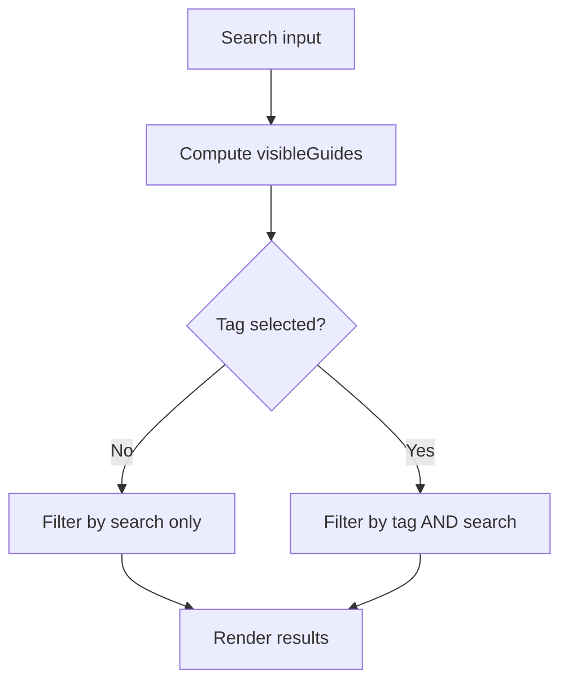

# Imagery Library & Data Management

<cite>
**Referenced Files in This Document**
- [ImageryGuide.swift](file://Moko/Moko/UIScreens/relaxScreens/ImageryGuide/ImageryGuide.swift)
- [ImageryGuideStore.swift](file://Moko/Moko/UIScreens/relaxScreens/ImageryGuide/ImageryGuideStore.swift)
- [ImageryGuideListView.swift](file://Moko/Moko/UIScreens/relaxScreens/ImageryGuide/ImageryGuideListView.swift)
- [GuideSessionView.swift](file://Moko/Moko/UIScreens/relaxScreens/ImageryGuide/GuideSessionView.swift)
- [SessionCompleteView.swift](file://Moko/Moko/UIScreens/relaxScreens/ImageryGuide/SessionCompleteView.swift)
- [RelaxFlow.swift](file://Moko/Moko/UIScreens/relaxScreens/ImageryGuide/RelaxFlow.swift)
- [20261103120000_create_imagery_guides.sql](file://supabase/migrations/20261103120000_create_imagery_guides.sql)
- [20261106120000_remove_imagery_guide_detail_columns.sql](file://supabase/migrations/20261106120000_remove_imagery_guide_detail_columns.sql)
- [20261106130000_add_imagery_guide_audio_url.sql](file://supabase/migrations/20261106130000_add_imagery_guide_audio_url.sql)
- [imagery_guides_seed.sql](file://supabase/imagery_guides_seed.sql)
</cite>

## Table of Contents
1. [Introduction](#introduction)
2. [Project Structure](#project-structure)
3. [Core Components](#core-components)
4. [Architecture Overview](#architecture-overview)
5. [Detailed Component Analysis](#detailed-component-analysis)
6. [Dependency Analysis](#dependency-analysis)
7. [Performance Considerations](#performance-considerations)
8. [Troubleshooting Guide](#troubleshooting-guide)
9. [Conclusion](#conclusion)
10. [Appendices](#appendices)

## Introduction
This document explains the imagery library management system used by the Relax > Imagery feature. It covers:
- The ImageryGuide data model and related types.
- The store implementation that loads guide collections from Supabase.
- Database schema, metadata structure, and persistence strategy.
- Relationship to the broader app flow and how guides are presented and played.
- Data loading mechanisms, filtering, search-like behavior, and asset handling.
- Practical examples for adding new guides, managing audio assets, and extending filters.
- Migration patterns and version compatibility considerations.

The system is designed so that content can be updated through Supabase without requiring an app update. The iOS app reads read-only content and uses Supabase Storage for images and ambient audio.

## Project Structure
The imagery feature lives under the Relax screens and integrates with the app’s navigation flow.

**Diagram sources**
- [RelaxFlow.swift:1-56](file://Moko/Moko/UIScreens/relaxScreens/ImageryGuide/RelaxFlow.swift#L1-L56)
- [ImageryGuideListView.swift:1-373](file://Moko/Moko/UIScreens/relaxScreens/ImageryGuide/ImageryGuideListView.swift#L1-L373)
- [ImageryGuideStore.swift:1-104](file://Moko/Moko/UIScreens/relaxScreens/ImageryGuide/ImageryGuideStore.swift#L1-L104)
- [GuideSessionView.swift:1-356](file://Moko/Moko/UIScreens/relaxScreens/ImageryGuide/GuideSessionView.swift#L1-L356)
- [SessionCompleteView.swift:1-100](file://Moko/Moko/UIScreens/relaxScreens/ImageryGuide/SessionCompleteView.swift#L1-L100)
- [20261103120000_create_imagery_guides.sql:22-47](file://supabase/migrations/20261103120000_create_imagery_guides.sql#L22-L47)

**Section sources**
- [RelaxFlow.swift:1-56](file://Moko/Moko/UIScreens/relaxScreens/ImageryGuide/RelaxFlow.swift#L1-L56)
- [ImageryGuideListView.swift:1-373](file://Moko/Moko/UIScreens/relaxScreens/ImageryGuide/ImageryGuideListView.swift#L1-L373)
- [ImageryGuideStore.swift:1-104](file://Moko/Moko/UIScreens/relaxScreens/ImageryGuide/ImageryGuideStore.swift#L1-L104)
- [GuideSessionView.swift:1-356](file://Moko/Moko/UIScreens/relaxScreens/ImageryGuide/GuideSessionView.swift#L1-L356)
- [SessionCompleteView.swift:1-100](file://Moko/Moko/UIScreens/relaxScreens/ImageryGuide/SessionCompleteView.swift#L1-L100)
- [20261103120000_create_imagery_guides.sql:1-206](file://supabase/migrations/20261103120000_create_imagery_guides.sql#L1-L206)

## Core Components
This section documents the primary data models and their responsibilities.

### ImageryGuide
Represents one guided imagery session. Key fields include:
- Stable identifier, title, description, tag, icon.
- Optional image URL and optional ambient audio URL.
- Framing controls for full-screen artwork (shift and scale).
- Ordered steps shown during the session.
- Completion text, duration in seconds, and short duration label.

Derived properties provide convenient accessors for artwork and audio URLs.

**Section sources**
- [ImageryGuide.swift:7-65](file://Moko/Moko/UIScreens/relaxScreens/ImageryGuide/ImageryGuide.swift#L7-L65)

### ImageryGuideTag
Represents a filter chip above the guide list. Each tag has a title and an SF Symbol name.

**Section sources**
- [ImageryGuide.swift:69-76](file://Moko/Moko/UIScreens/relaxScreens/ImageryGuide/ImageryGuide.swift#L69-L76)

### ImageryGuideScreenContent
Holds shared labels and copy for every Imagery Guide screen. Includes templates for counts, accessibility labels, session messages, and completion messages. Provides a helper to replace placeholders like `{title}` or `{duration}`.

**Section sources**
- [ImageryGuide.swift:80-166](file://Moko/Moko/UIScreens/relaxScreens/ImageryGuide/ImageryGuide.swift#L80-L166)

### ImageryGuideContent
A container grouping guides, tags, and screen content loaded together.

**Section sources**
- [ImageryGuide.swift:170-175](file://Moko/Moko/UIScreens/relaxScreens/ImageryGuide/ImageryGuide.swift#L170-L175)

## Architecture Overview
The feature follows a simple layered architecture:
- UI layer: SwiftUI views render lists, sessions, and completion screens.
- Store/service layer: Loads data from Supabase via PostgREST and exposes state to the UI.
- Data layer: PostgreSQL tables define guides, tags, and screen copy; Supabase Storage holds images and audio.

**Diagram sources**
- [ImageryGuideStore.swift:21-59](file://Moko/Moko/UIScreens/relaxScreens/ImageryGuide/ImageryGuideStore.swift#L21-L59)
- [ImageryGuideListView.swift:20-22](file://Moko/Moko/UIScreens/relaxScreens/ImageryGuide/ImageryGuideListView.swift#L20-L22)
- [GuideSessionView.swift:278-328](file://Moko/Moko/UIScreens/relaxScreens/ImageryGuide/GuideSessionView.swift#L278-L328)

## Detailed Component Analysis

### Data Model and Metadata Structure
The database defines three core tables:
- imagery_guide_tags: Filter chips with title, icon, sort order, and active flag.
- imagery_guides: One row per guide with rich metadata including optional image and audio URLs, framing parameters, steps JSON, completion text, duration, and ordering.
- imagery_guide_screen_content: Single-row configuration for shared labels and templates.

**Diagram sources**
- [20261103120000_create_imagery_guides.sql:7-47](file://supabase/migrations/20261103120000_create_imagery_guides.sql#L7-L47)
- [20261103120000_create_imagery_guides.sql:65-105](file://supabase/migrations/20261103120000_create_imagery_guides.sql#L65-L105)

**Section sources**
- [20261103120000_create_imagery_guides.sql:1-206](file://supabase/migrations/20261103120000_create_imagery_guides.sql#L1-L206)

### Store Implementation and Data Loading
The store coordinates loading of guides, tags, and screen content:
- ImageryGuideService performs concurrent requests for guides, tags, and screen content.
- Guides and tags are filtered to active rows and ordered by sort_order.
- Screen content is fetched as a single row with id = 1.
- ImageryGuideStore exposes content, loading state, and error message to the UI. It loads once on first appearance and supports refresh.

**Diagram sources**
- [ImageryGuideStore.swift:82-102](file://Moko/Moko/UIScreens/relaxScreens/ImageryGuide/ImageryGuideStore.swift#L82-L102)
- [ImageryGuideStore.swift:21-59](file://Moko/Moko/UIScreens/relaxScreens/ImageryGuide/ImageryGuideStore.swift#L21-L59)

**Section sources**
- [ImageryGuideStore.swift:1-104](file://Moko/Moko/UIScreens/relaxScreens/ImageryGuide/ImageryGuideStore.swift#L1-L104)

### List View, Filtering, and Search-like Behavior
The list view:
- Displays header, filter chips, and cards.
- Supports “All” plus dynamic tags from imagery_guide_tags.
- Filters guides client-side by selected tag.
- Uses template strings from screen content for counts and accessibility labels.
- Handles loading, error, and empty states using screen content.

Filtering is implemented by comparing each guide’s tag field to the selected tag. There is no free-text search; if needed, additional filtering logic can be added to the view.

**Diagram sources**
- [ImageryGuideListView.swift:19-22](file://Moko/Moko/UIScreens/relaxScreens/ImageryGuide/ImageryGuideListView.swift#L19-L22)
- [ImageryGuideListView.swift:78-98](file://Moko/Moko/UIScreens/relaxScreens/ImageryGuide/ImageryGuideListView.swift#L78-L98)

**Section sources**
- [ImageryGuideListView.swift:1-373](file://Moko/Moko/UIScreens/relaxScreens/ImageryGuide/ImageryGuideListView.swift#L1-L373)

### Session Flow and Audio Playback
When a user taps a guide:
- RelaxFlow navigates to GuideSessionView with the selected guide.
- The session view shows background artwork, instructions, progress, and controls.
- Ambient audio plays while the session runs and loops until completion.
- On completion, the user proceeds to SessionCompleteView.

**Diagram sources**
- [RelaxFlow.swift:17-45](file://Moko/Moko/UIScreens/relaxScreens/ImageryGuide/RelaxFlow.swift#L17-L45)
- [GuideSessionView.swift:73-106](file://Moko/Moko/UIScreens/relaxScreens/ImageryGuide/GuideSessionView.swift#L73-L106)
- [GuideSessionView.swift:278-328](file://Moko/Moko/UIScreens/relaxScreens/ImageryGuide/GuideSessionView.swift#L278-L328)

**Section sources**
- [RelaxFlow.swift:1-56](file://Moko/Moko/UIScreens/relaxScreens/ImageryGuide/RelaxFlow.swift#L1-L56)
- [GuideSessionView.swift:1-356](file://Moko/Moko/UIScreens/relaxScreens/ImageryGuide/GuideSessionView.swift#L1-L356)
- [SessionCompleteView.swift:1-100](file://Moko/Moko/UIScreens/relaxScreens/ImageryGuide/SessionCompleteView.swift#L1-L100)

### Relationship to the Quest Library System
Within this repository, the imagery guides are independent of the quest library. The imagery feature:
- Reads its own content from imagery-related tables.
- Does not import or reference quest library models in the analyzed files.
- Integrates with the app’s relaxation flow rather than the quest flow.

If future integration is desired, it would require explicit mapping between imagery guides and quests, such as linking guide IDs to quest IDs or sharing common metadata. As implemented, there is no direct coupling.

[No sources needed since this section does not analyze specific files]

## Dependency Analysis
Key dependencies:
- ImageryGuideStore depends on SupabaseClient to query PostgREST endpoints.
- UI components depend on ImageryGuideStore via environment injection.
- GuideSessionView depends on AVFoundation for audio playback and SwiftData for logging calm-down events.
- Database schema enforces relationships and RLS policies for public read access.

**Diagram sources**
- [ImageryGuideStore.swift:14-19](file://Moko/Moko/UIScreens/relaxScreens/ImageryGuide/ImageryGuideStore.swift#L14-L19)
- [GuideSessionView.swift:8-11](file://Moko/Moko/UIScreens/relaxScreens/ImageryGuide/GuideSessionView.swift#L8-L11)
- [20261103120000_create_imagery_guides.sql:146-165](file://supabase/migrations/20261103120000_create_imagery_guides.sql#L146-L165)

**Section sources**
- [ImageryGuideStore.swift:1-104](file://Moko/Moko/UIScreens/relaxScreens/ImageryGuide/ImageryGuideStore.swift#L1-L104)
- [GuideSessionView.swift:1-356](file://Moko/Moko/UIScreens/relaxScreens/ImageryGuide/GuideSessionView.swift#L1-L356)
- [20261103120000_create_imagery_guides.sql:146-165](file://supabase/migrations/20261103120000_create_imagery_guides.sql#L146-L165)

## Performance Considerations
- Concurrent loading: The service fetches guides, tags, and screen content concurrently to reduce latency.
- Client-side filtering: Tag filtering is O(n) over visible guides; acceptable for small datasets.
- Image loading: Uses AsyncImage with fallbacks; consider caching strategies at the app level if needed.
- Audio playback: AVPlayer is created once per session and looped; ensure proper cleanup on view disappearance.
- Sorting: Server-side ordering by sort_order avoids client-side sorting overhead.

[No sources needed since this section provides general guidance]

## Troubleshooting Guide
Common issues and resolutions:
- Network errors: The store sets an error message and UI displays a retry action. Verify connectivity and Supabase permissions.
- Missing images: If image_url is null or fails to load, the UI falls back to the guide icon. Check storage bucket policy and file names.
- Missing audio: If audio_url is null, the session starts silently. Verify the audio file exists in the imagery-guide bucket and the URL is valid.
- Empty list: Ensure rows exist with is_active = true and correct tag values. Seed script can populate sample data.

Operational checks:
- Confirm RLS policies allow anonymous and authenticated users to select imagery tables.
- Confirm storage bucket imagery-guide is public and allows required MIME types.
- Validate that seed data matches expected tag titles and guide ids.

**Section sources**
- [ImageryGuideStore.swift:88-102](file://Moko/Moko/UIScreens/relaxScreens/ImageryGuide/ImageryGuideStore.swift#L88-L102)
- [ImageryGuideListView.swift:133-185](file://Moko/Moko/UIScreens/relaxScreens/ImageryGuide/ImageryGuideListView.swift#L133-L185)
- [GuideSessionView.swift:278-328](file://Moko/Moko/UIScreens/relaxScreens/ImageryGuide/GuideSessionView.swift#L278-L328)
- [20261103120000_create_imagery_guides.sql:167-202](file://supabase/migrations/20261103120000_create_imagery_guides.sql#L167-L202)

## Conclusion
The imagery library management system cleanly separates content definition (database), presentation (SwiftUI), and runtime behavior (store and services). Content updates can be made in Supabase without app releases. Guides support optional images and ambient audio, with robust fallbacks and clear error states. Filtering is tag-based and efficient for typical usage. Migrations and seed scripts provide safe, repeatable setup and evolution of the schema.

[No sources needed since this section summarizes without analyzing specific files]

## Appendices

### Adding a New Imagery Guide
Steps:
1. Add a new row to imagery_guides with:
   - id: stable slug.
   - title, description, tag matching an existing imagery_guide_tags title.
   - icon: SF Symbol name.
   - detail_text: introductory text.
   - image_url: public URL in imagery-guide bucket.
   - image_shift, image_scale: framing adjustments.
   - audio_url: public URL in imagery-guide bucket for ambient music.
   - steps: array of instruction strings.
   - completion_text: final message.
   - duration_seconds and duration_label.
   - sort_order and is_active = true.
2. Upload the image and audio files to the imagery-guide bucket.
3. Optionally run the seed script to keep sample data synchronized.

**Section sources**
- [20261103120000_create_imagery_guides.sql:22-47](file://supabase/migrations/20261103120000_create_imagery_guides.sql#L22-L47)
- [imagery_guides_seed.sql:17-121](file://supabase/imagery_guides_seed.sql#L17-L121)

### Managing Audio Assets
- Store ambient audio files in the imagery-guide bucket.
- Provide a public URL in audio_url for each guide.
- The session view configures AVAudioSession for playback and loops the track until completion.
- If audio_url is missing, the session runs without background music.

**Section sources**
- [20261106130000_add_imagery_guide_audio_url.sql:1-11](file://supabase/migrations/20261106130000_add_imagery_guide_audio_url.sql#L1-L11)
- [GuideSessionView.swift:278-328](file://Moko/Moko/UIScreens/relaxScreens/ImageryGuide/GuideSessionView.swift#L278-L328)

### Implementing Search or Additional Filters
Current behavior:
- Tag-based filtering is implemented client-side.
- No free-text search is present.

To add search:
- Add a search string state variable in ImageryGuideListView.
- Extend visibleGuides to filter by both tag and search string against title/description.
- Debounce input to avoid excessive recomputation.

Conceptual example:

[No sources needed since this diagram shows conceptual workflow, not actual code structure]

### Data Migration Patterns and Version Compatibility
- Schema changes are managed via migrations:
  - Initial creation of imagery tables and storage bucket.
  - Removal of unused detail columns from screen content.
  - Addition of audio_url column to imagery_guides.
- Triggers maintain updated_at timestamps.
- Row-level security grants read access to clients and restricts writes to service roles.
- Seed script uses upsert semantics to safely re-run and keep content in sync.

Best practices:
- Always add migration files for schema changes.
- Use idempotent inserts and upserts in seed scripts.
- Keep is_active flags to enable/disable content without deleting rows.
- Test RLS policies after schema changes.

**Section sources**
- [20261103120000_create_imagery_guides.sql:112-144](file://supabase/migrations/20261103120000_create_imagery_guides.sql#L112-L144)
- [20261103120000_create_imagery_guides.sql:167-202](file://supabase/migrations/20261103120000_create_imagery_guides.sql#L167-L202)
- [20261106120000_remove_imagery_guide_detail_columns.sql:1-10](file://supabase/migrations/20261106120000_remove_imagery_guide_detail_columns.sql#L1-L10)
- [20261106130000_add_imagery_guide_audio_url.sql:1-11](file://supabase/migrations/20261106130000_add_imagery_guide_audio_url.sql#L1-L11)
- [imagery_guides_seed.sql:1-222](file://supabase/imagery_guides_seed.sql#L1-L222)