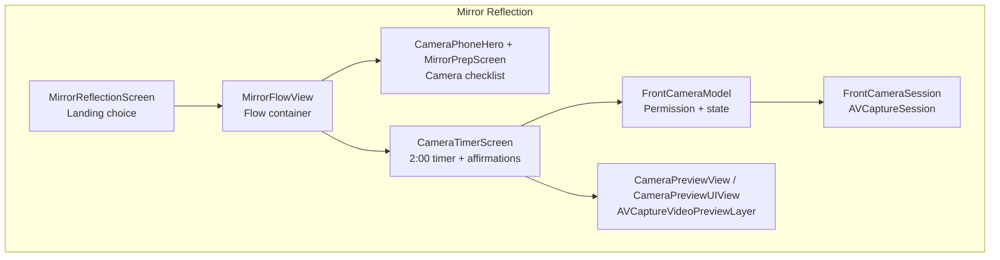
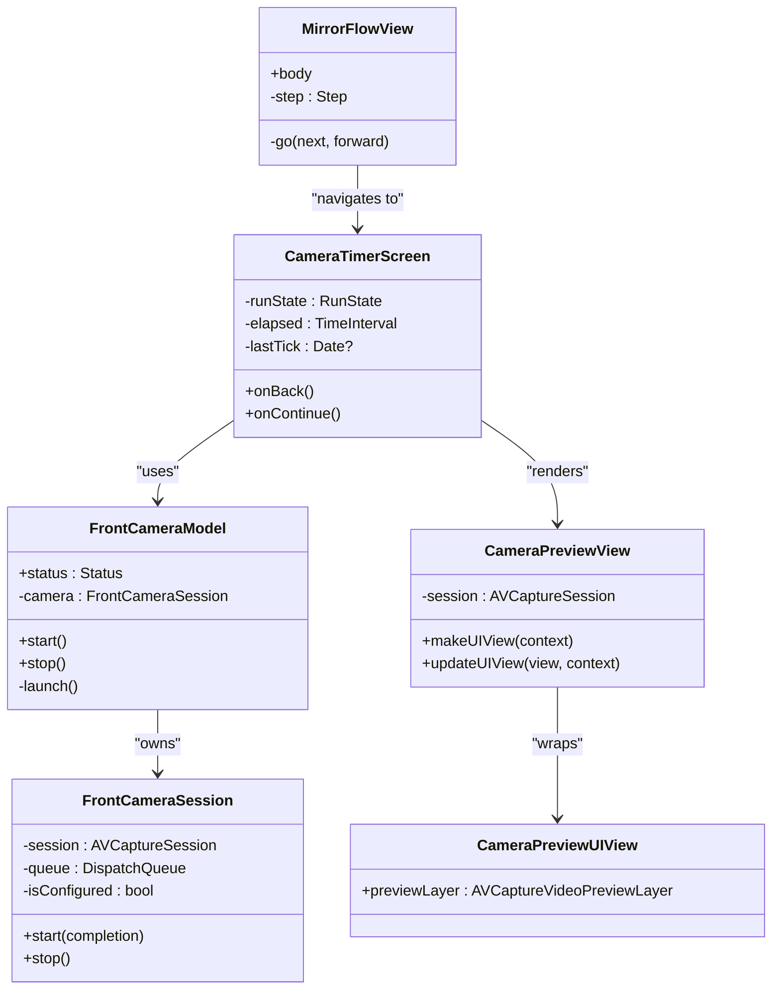
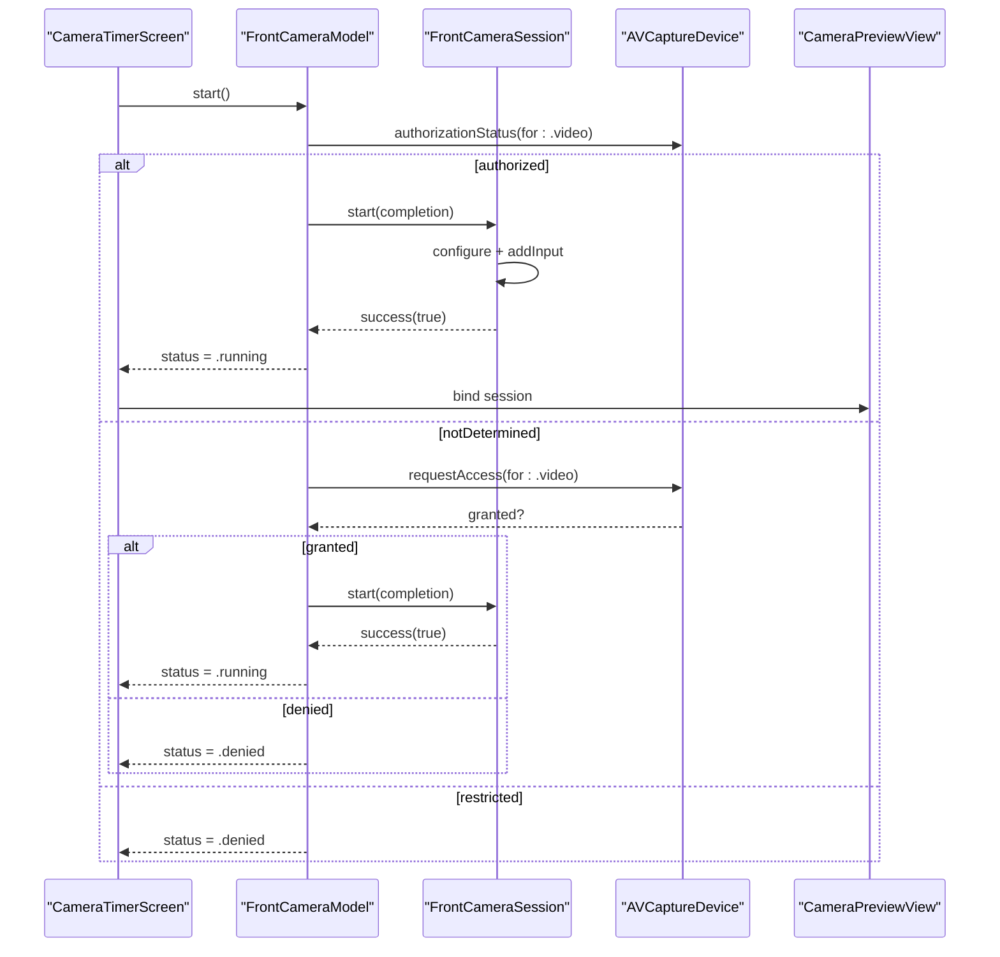
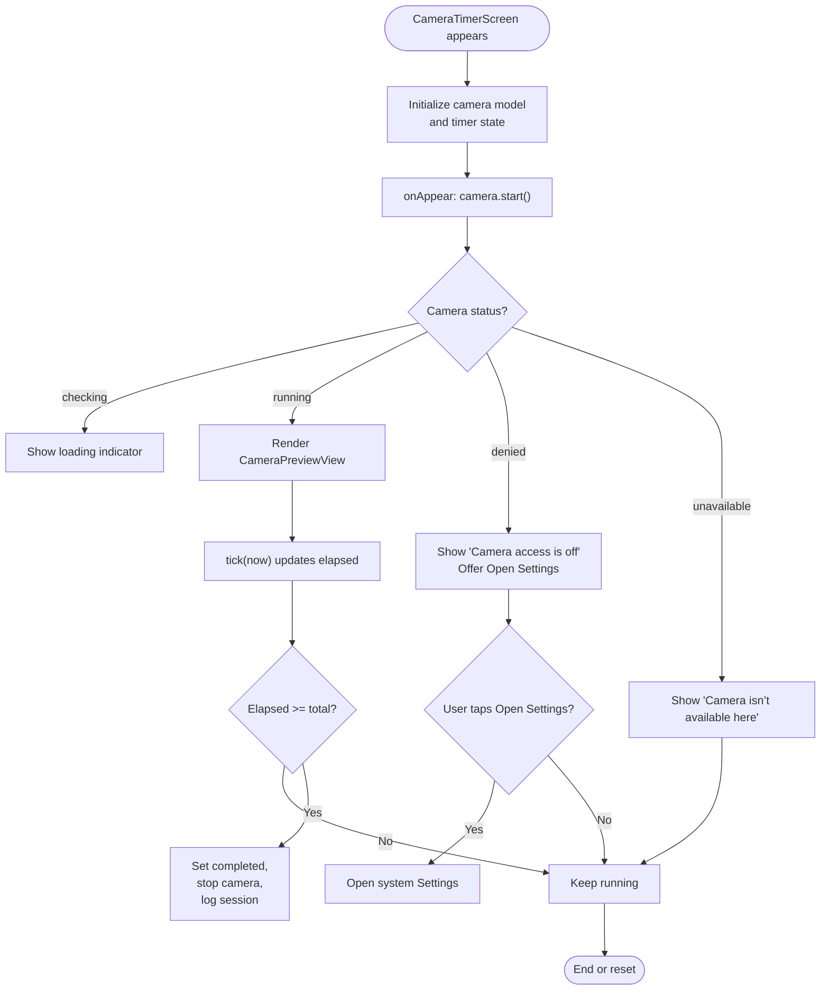
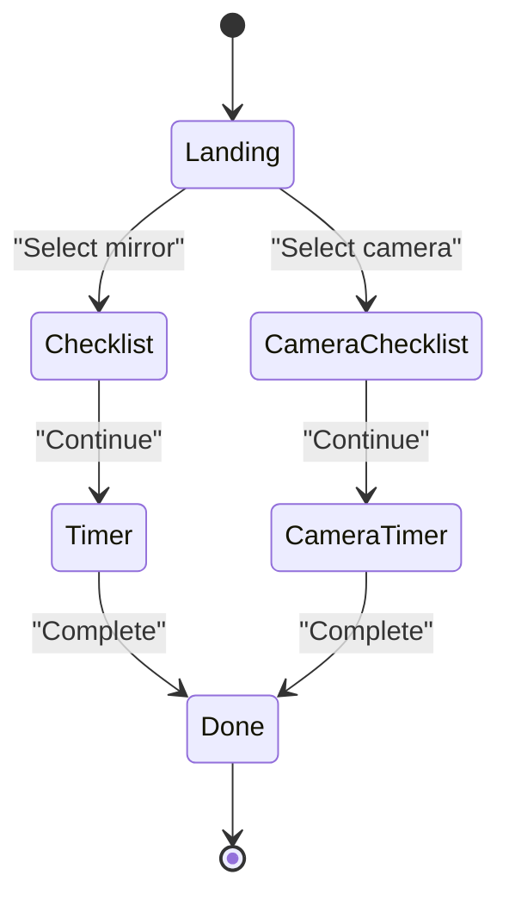
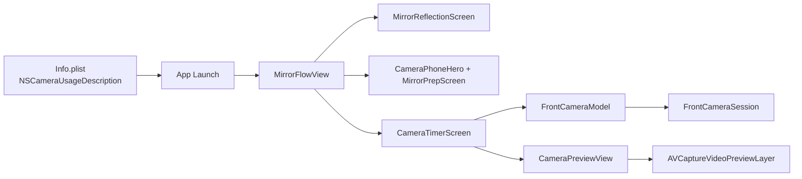

# Camera Integration & Permissions

<cite>
**Referenced Files in This Document**
- [Frontcamera.swift](file://Moko/Moko/UIScreens/relaxScreens/MirrorReflection/Frontcamera.swift)
- [Mirrorcameraflow.swift](file://Moko/Moko/UIScreens/relaxScreens/MirrorReflection/Mirrorcameraflow.swift)
- [Mirrorflow.swift](file://Moko/Moko/UIScreens/relaxScreens/MirrorReflection/Mirrorflow.swift)
- [Mirrorreflectionscreen.swift](file://Moko/Moko/UIScreens/relaxScreens/MirrorReflection/Mirrorreflectionscreen.swift)
- [Info.plist](file://Moko/Moko/Info.plist)
</cite>

## Table of Contents
1. [Introduction](#introduction)
2. [Project Structure](#project-structure)
3. [Core Components](#core-components)
4. [Architecture Overview](#architecture-overview)
5. [Detailed Component Analysis](#detailed-component-analysis)
6. [Dependency Analysis](#dependency-analysis)
7. [Performance Considerations](#performance-considerations)
8. [Troubleshooting Guide](#troubleshooting-guide)
9. [Conclusion](#conclusion)

## Introduction
This document explains the camera integration used by the Mirror Reflection exercise. It focuses on how the app requests and handles camera permissions, accesses the front camera, renders a live preview, handles permission denials, manages session state, and preserves user privacy. It also covers iOS-specific AVFoundation usage, background behavior, and performance considerations for real-time camera operations.

The camera feature is optional: users can choose between a mirror-based reflection or a camera-based reflection. When the camera path is selected, the app shows a short preparation screen and then a two-minute timer with a live front-camera preview behind affirmations. The implementation does not record, store, or transmit video frames.

## Project Structure
The camera-related code lives under the Mirror Reflection feature:

- `Mirrorreflectionscreen.swift` presents the landing choice between mirror-only and camera-based reflection.
- `Mirrorflow.swift` orchestrates the full flow, including the camera checklist and camera timer screens.
- `Mirrorcameraflow.swift` implements the camera checklist illustration and the camera timer screen with live preview.
- `Frontcamera.swift` contains the AVFoundation session, permission model, and SwiftUI preview wrapper.
- `Info.plist` declares the camera usage description required by iOS.

**Diagram sources**
- [Mirrorreflectionscreen.swift:11-116](file://Moko/Moko/UIScreens/relaxScreens/MirrorReflection/Mirrorreflectionscreen.swift#L11-L116)
- [Mirrorflow.swift:31-133](file://Moko/Moko/UIScreens/relaxScreens/MirrorReflection/Mirrorflow.swift#L31-L133)
- [Mirrorcameraflow.swift:15-167](file://Moko/Moko/UIScreens/relaxScreens/MirrorReflection/Mirrorcameraflow.swift#L15-L167)
- [Mirrorcameraflow.swift:170-460](file://Moko/Moko/UIScreens/relaxScreens/MirrorReflection/Mirrorcameraflow.swift#L170-L460)
- [Frontcamera.swift:19-106](file://Moko/Moko/UIScreens/relaxScreens/MirrorReflection/Frontcamera.swift#L19-L106)
- [Frontcamera.swift:109-129](file://Moko/Moko/UIScreens/relaxScreens/MirrorReflection/Frontcamera.swift#L109-L129)

**Section sources**
- [Mirrorreflectionscreen.swift:11-116](file://Moko/Moko/UIScreens/relaxScreens/MirrorReflection/Mirrorreflectionscreen.swift#L11-L116)
- [Mirrorflow.swift:31-133](file://Moko/Moko/UIScreens/relaxScreens/MirrorReflection/Mirrorflow.swift#L31-L133)
- [Mirrorcameraflow.swift:170-460](file://Moko/Moko/UIScreens/relaxScreens/MirrorReflection/Mirrorcameraflow.swift#L170-L460)
- [Frontcamera.swift:19-129](file://Moko/Moko/UIScreens/relaxScreens/MirrorReflection/Frontcamera.swift#L19-L129)
- [Info.plist:5-6](file://Moko/Moko/Info.plist#L5-L6)

## Core Components
- FrontCameraSession: A nonisolated, thread-safe session manager that configures and runs an AVCaptureSession for the front camera. It starts and stops the session off the main thread and reports whether a usable front camera was found.
- FrontCameraModel: A MainActor ObservableObject that owns camera permission checks, status transitions, and lifecycle calls to the session.
- CameraPreviewView and CameraPreviewUIView: A UIViewRepresentable that hosts an AVCaptureVideoPreviewLayer to render the live camera feed into SwiftUI.
- CameraTimerScreen: The UI for the camera-based practice, combining the preview, affirmation text, timer controls, and error states.
- MirrorFlowView: The flow controller that navigates between landing, checklist, and timer screens for both mirror and camera paths.
- Info.plist: Declares NSCameraUsageDescription so iOS can present the permission prompt.

Key responsibilities:
- Permission handling: Check authorization status, request access when needed, and handle denied/restricted states.
- Front camera access: Select the built-in wide-angle front camera and configure a high-quality session preset.
- Preview rendering: Bind the session to a preview layer and scale it appropriately.
- Error handling: Show clear messages for denied or unavailable cameras and provide a Settings link when access is denied.
- Privacy: No recording, saving, or uploading of camera frames; only local, temporary preview.

**Section sources**
- [Frontcamera.swift:19-106](file://Moko/Moko/UIScreens/relaxScreens/MirrorReflection/Frontcamera.swift#L19-L106)
- [Frontcamera.swift:109-129](file://Moko/Moko/UIScreens/relaxScreens/MirrorReflection/Frontcamera.swift#L109-L129)
- [Mirrorcameraflow.swift:170-460](file://Moko/Moko/UIScreens/relaxScreens/MirrorReflection/Mirrorcameraflow.swift#L170-L460)
- [Mirrorflow.swift:31-133](file://Moko/Moko/UIScreens/relaxScreens/MirrorReflection/Mirrorflow.swift#L31-L133)
- [Info.plist:5-6](file://Moko/Moko/Info.plist#L5-L6)

## Architecture Overview
The camera integration follows a layered approach:

- UI Layer: SwiftUI views (MirrorReflectionScreen, MirrorFlowView, CameraTimerScreen).
- State Layer: FrontCameraModel exposes a published status for the UI.
- Session Layer: FrontCameraSession encapsulates AVFoundation setup and lifecycle.
- Rendering Layer: CameraPreviewView bridges to UIKit’s AVCaptureVideoPreviewLayer.

**Diagram sources**
- [Frontcamera.swift:19-106](file://Moko/Moko/UIScreens/relaxScreens/MirrorReflection/Frontcamera.swift#L19-L106)
- [Frontcamera.swift:109-129](file://Moko/Moko/UIScreens/relaxScreens/MirrorReflection/Frontcamera.swift#L109-L129)
- [Mirrorcameraflow.swift:170-460](file://Moko/Moko/UIScreens/relaxScreens/MirrorReflection/Mirrorcameraflow.swift#L170-L460)
- [Mirrorflow.swift:31-133](file://Moko/Moko/UIScreens/relaxScreens/MirrorReflection/Mirrorflow.swift#L31-L133)

## Detailed Component Analysis

### Frontcamera.swift: Session, Permissions, and Preview
Frontcamera.swift centralizes all camera logic:

- FrontCameraSession
  - Runs configuration and start/stop operations on a dedicated queue to avoid blocking the UI.
  - Configures a high-preset AVCaptureSession and selects the front-facing wide-angle camera.
  - Reports success or failure based on device availability.
- FrontCameraModel
  - Tracks UI state through a Status enum: checking, running, denied, unavailable.
  - Checks AVCaptureDevice.authorizationStatus and requests access if not determined.
  - Transitions to .denied when access is denied or restricted, and to .unavailable when no front camera is available.
  - Calls session.start and updates the UI accordingly.
- CameraPreviewView and CameraPreviewUIView
  - Provide a SwiftUI bridge to an AVCaptureVideoPreviewLayer.
  - Set the session and use aspect-fill scaling to fill the card area.
- Settings helper
  - Provides a URL to open the app’s system settings page when camera access is denied.

**Diagram sources**
- [Frontcamera.swift:76-105](file://Moko/Moko/UIScreens/relaxScreens/MirrorReflection/Frontcamera.swift#L76-L105)
- [Frontcamera.swift:25-50](file://Moko/Moko/UIScreens/relaxScreens/MirrorReflection/Frontcamera.swift#L25-L50)
- [Mirrorcameraflow.swift:320-367](file://Moko/Moko/UIScreens/relaxScreens/MirrorReflection/Mirrorcameraflow.swift#L320-L367)

**Section sources**
- [Frontcamera.swift:19-106](file://Moko/Moko/UIScreens/relaxScreens/MirrorReflection/Frontcamera.swift#L19-L106)
- [Frontcamera.swift:109-134](file://Moko/Moko/UIScreens/relaxScreens/MirrorReflection/Frontcamera.swift#L109-L134)

### Mirrorcameraflow.swift: Camera Checklist and Timer Screen
This file provides:

- CameraPhoneHero: An animated phone illustration used during the camera checklist.
- CameraTimerScreen: The core camera experience, including:
  - A fixed two-minute timer with pause/reset controls.
  - Live camera preview inside a rounded card.
  - Affirmation text overlaid on the preview with improved readability via a gradient overlay.
  - Progress outline around the card.
  - Completion animation and logging of session duration.
  - Handling of camera permission errors and navigation to Settings when denied.

**Diagram sources**
- [Mirrorcameraflow.swift:170-460](file://Moko/Moko/UIScreens/relaxScreens/MirrorReflection/Mirrorcameraflow.swift#L170-L460)
- [Frontcamera.swift:76-105](file://Moko/Moko/UIScreens/relaxScreens/MirrorReflection/Frontcamera.swift#L76-L105)

**Section sources**
- [Mirrorcameraflow.swift:15-167](file://Moko/Moko/UIScreens/relaxScreens/MirrorReflection/Mirrorcameraflow.swift#L15-L167)
- [Mirrorcameraflow.swift:170-460](file://Moko/Moko/UIScreens/relaxScreens/MirrorReflection/Mirrorcameraflow.swift#L170-L460)

### Mirrorflow.swift: Flow Navigation and Shared UI
MirrorFlowView coordinates the entire Mirror Reflection experience:

- Step enumeration includes both mirror-only and camera variants: landing, checklist, timer, done, cameraChecklist, cameraTimer.
- Handles slide transitions and forwards/back navigation.
- Routes user selection from the landing screen to either the mirror path or the camera path.
- Presents the camera checklist with the phone hero illustration and then the camera timer screen.

**Diagram sources**
- [Mirrorflow.swift:31-133](file://Moko/Moko/UIScreens/relaxScreens/MirrorReflection/Mirrorflow.swift#L31-L133)

**Section sources**
- [Mirrorflow.swift:31-133](file://Moko/Moko/UIScreens/relaxScreens/MirrorReflection/Mirrorflow.swift#L31-L133)

### Mirrorreflectionscreen.swift: Landing Choice
The landing screen offers two options:

- Mirror-only reflection.
- Camera-based reflection.

When the user selects the camera option, the flow moves to the camera checklist and then the camera timer.

**Section sources**
- [Mirrorreflectionscreen.swift:11-116](file://Moko/Moko/UIScreens/relaxScreens/MirrorReflection/Mirrorreflectionscreen.swift#L11-L116)

## Dependency Analysis
The following diagram maps runtime dependencies among the key components:

**Diagram sources**
- [Info.plist:5-6](file://Moko/Moko/Info.plist#L5-L6)
- [Mirrorflow.swift:31-133](file://Moko/Moko/UIScreens/relaxScreens/MirrorReflection/Mirrorflow.swift#L31-L133)
- [Mirrorreflectionscreen.swift:11-116](file://Moko/Moko/UIScreens/relaxScreens/MirrorReflection/Mirrorreflectionscreen.swift#L11-L116)
- [Mirrorcameraflow.swift:170-460](file://Moko/Moko/UIScreens/relaxScreens/MirrorReflection/Mirrorcameraflow.swift#L170-L460)
- [Frontcamera.swift:19-129](file://Moko/Moko/UIScreens/relaxScreens/MirrorReflection/Frontcamera.swift#L19-L129)

**Section sources**
- [Info.plist:5-6](file://Moko/Moko/Info.plist#L5-L6)
- [Mirrorflow.swift:31-133](file://Moko/Moko/UIScreens/relaxScreens/MirrorReflection/Mirrorflow.swift#L31-L133)
- [Mirrorcameraflow.swift:170-460](file://Moko/Moko/UIScreens/relaxScreens/MirrorReflection/Mirrorcameraflow.swift#L170-L460)
- [Frontcamera.swift:19-129](file://Moko/Moko/UIScreens/relaxScreens/MirrorReflection/Frontcamera.swift#L19-L129)

## Performance Considerations
- Off-main-thread session management: FrontCameraSession performs configuration and start/stop on a dedicated queue, preventing UI jank during AVFoundation setup.
- Minimal UI work: CameraPreviewView delegates heavy rendering to UIKit’s AVCaptureVideoPreviewLayer.
- Efficient timer updates: The timer uses a high-frequency publisher but only updates state and progress; the preview remains bound to the session without per-frame SwiftUI work.
- Resource cleanup: The camera session is stopped when the timer completes or when the view disappears, releasing the camera resource promptly.
- Avoid unnecessary recomposition: The preview binding is stable; the UI switches between loading, preview, and error states rather than recreating the session repeatedly.

Recommendations for further optimization:
- Consider using a lower session preset if battery or thermal constraints are observed on older devices.
- Avoid additional image processing pipelines unless explicitly required; keep the pipeline strictly preview-only.
- Monitor memory and CPU usage on low-end devices and adjust UI complexity accordingly.

[No sources needed since this section provides general guidance]

## Troubleshooting Guide

Common issues and resolutions:

- App crashes when requesting camera permission
  - Cause: Missing NSCameraUsageDescription in Info.plist.
  - Resolution: Ensure NSCameraUsageDescription is present and descriptive. The current project already includes this key.
  - Reference: [Info.plist:5-6](file://Moko/Moko/Info.plist#L5-L6), [Frontcamera.swift:9-10](file://Moko/Moko/UIScreens/relaxScreens/MirrorReflection/Frontcamera.swift#L9-L10)

- Camera access is off
  - Symptom: UI shows “Camera access is off” and offers “Open Settings”.
  - Cause: User denied permission or device policy restricts camera access.
  - Resolution: Direct user to system Settings to enable camera access for the app.
  - Reference: [Mirrorcameraflow.swift:330-367](file://Moko/Moko/UIScreens/relaxScreens/MirrorReflection/Mirrorcameraflow.swift#L330-L367), [Frontcamera.swift:76-92](file://Moko/Moko/UIScreens/relaxScreens/MirrorReflection/Frontcamera.swift#L76-L92)

- Camera isn’t available here
  - Symptom: UI shows “Camera isn’t available here”.
  - Cause: No front camera detected (e.g., simulator or unsupported device).
  - Resolution: Inform users to try on an iPhone; allow them to continue without camera.
  - Reference: [Mirrorcameraflow.swift:330-367](file://Moko/Moko/UIScreens/relaxScreens/MirrorReflection/Mirrorcameraflow.swift#L330-L367), [Frontcamera.swift:25-50](file://Moko/Moko/UIScreens/relaxScreens/MirrorReflection/Frontcamera.swift#L25-L50)

- Preview not appearing
  - Symptom: Loading spinner persists or preview is blank.
  - Causes:
    - Permission still being checked.
    - Session failed to start due to device constraints.
    - View disappeared before session started.
  - Resolution: Verify status transitions and ensure camera.start is called on appear and stop on disappear.
  - Reference: [Mirrorcameraflow.swift:244-245](file://Moko/Moko/UIScreens/relaxScreens/MirrorReflection/Mirrorcameraflow.swift#L244-L245), [Frontcamera.swift:76-105](file://Moko/Moko/UIScreens/relaxScreens/MirrorReflection/Frontcamera.swift#L76-L105)

- Camera stays active after completion
  - Symptom: Camera continues running after the timer completes.
  - Resolution: Ensure camera.stop is called on completion and on view disappearance.
  - Reference: [Mirrorcameraflow.swift:434-440](file://Moko/Moko/UIScreens/relaxScreens/MirrorReflection/Mirrorcameraflow.swift#L434-L440), [Mirrorcameraflow.swift:244-245](file://Moko/Moko/UIScreens/relaxScreens/MirrorReflection/Mirrorcameraflow.swift#L244-L245)

**Section sources**
- [Info.plist:5-6](file://Moko/Moko/Info.plist#L5-L6)
- [Frontcamera.swift:9-10](file://Moko/Moko/UIScreens/relaxScreens/MirrorReflection/Frontcamera.swift#L9-L10)
- [Frontcamera.swift:25-50](file://Moko/Moko/UIScreens/relaxScreens/MirrorReflection/Frontcamera.swift#L25-L50)
- [Frontcamera.swift:76-105](file://Moko/Moko/UIScreens/relaxScreens/MirrorReflection/Frontcamera.swift#L76-L105)
- [Mirrorcameraflow.swift:244-245](file://Moko/Moko/UIScreens/relaxScreens/MirrorReflection/Mirrorcameraflow.swift#L244-L245)
- [Mirrorcameraflow.swift:330-367](file://Moko/Moko/UIScreens/relaxScreens/MirrorReflection/Mirrorcameraflow.swift#L330-L367)
- [Mirrorcameraflow.swift:434-440](file://Moko/Moko/UIScreens/relaxScreens/MirrorReflection/Mirrorcameraflow.swift#L434-L440)

## Conclusion
The Mirror Reflection camera integration is designed to be private, performant, and resilient to common iOS permission scenarios. It uses AVFoundation only for a local, temporary front-camera preview, never recording or storing video. The architecture cleanly separates UI, state, and session concerns, while providing clear user feedback and a direct path to system Settings when permissions are denied. For production, monitor device performance and consider adjusting session presets or UI complexity based on device capabilities.

[No sources needed since this section summarizes without analyzing specific files]