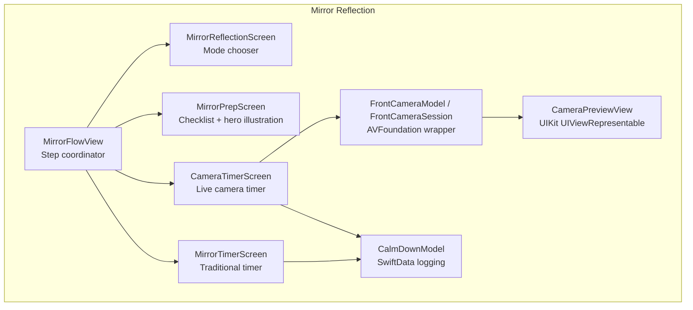
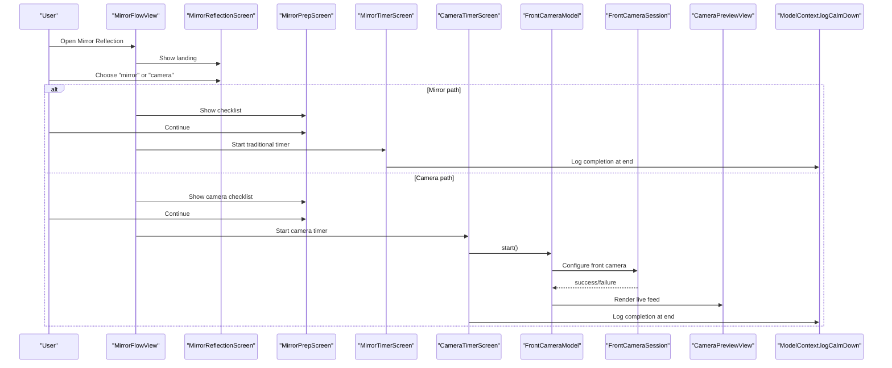
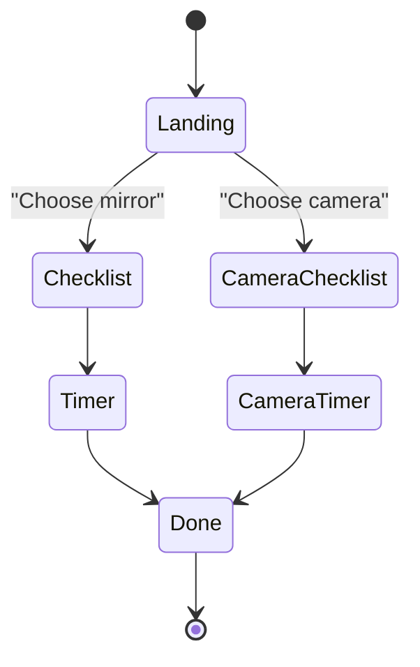
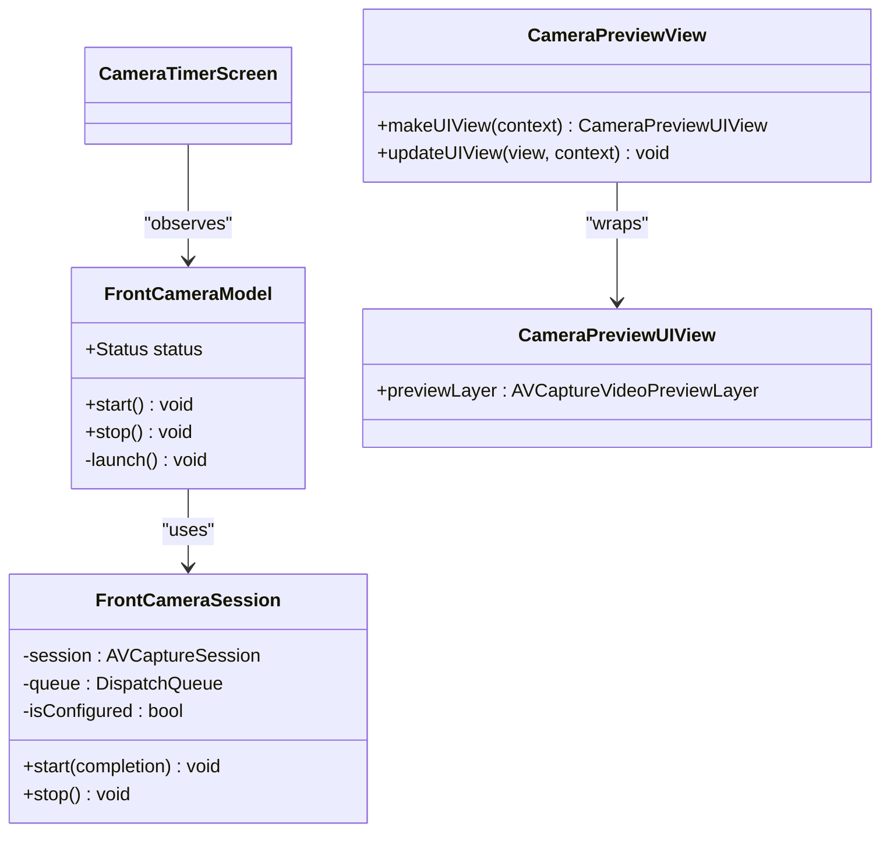
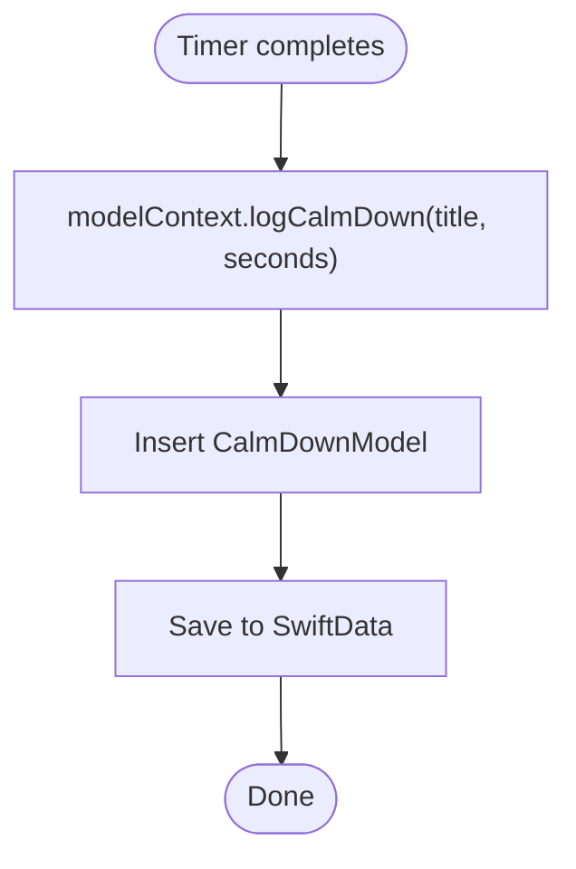
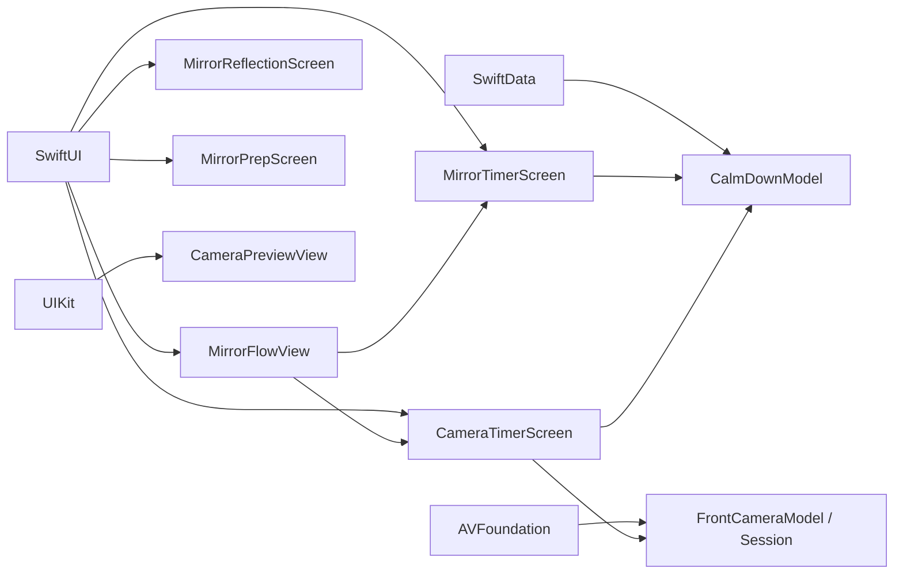

# Mirror Reflection Exercise

<cite>
**Referenced Files in This Document**
- [Mirrorreflectionscreen.swift](file://Moko/Moko/UIScreens/relaxScreens/MirrorReflection/Mirrorreflectionscreen.swift)
- [Frontcamera.swift](file://Moko/Moko/UIScreens/relaxScreens/MirrorReflection/Frontcamera.swift)
- [Mirrorcameraflow.swift](file://Moko/Moko/UIScreens/relaxScreens/MirrorReflection/Mirrorcameraflow.swift)
- [Mirrorflow.swift](file://Moko/Moko/UIScreens/relaxScreens/MirrorReflection/Mirrorflow.swift)
- [CalmDownModel.swift](file://Moko/Moko/Models/CalmDownModel.swift)
- [Info.plist](file://Moko/Moko/Info.plist)
</cite>

## Table of Contents
1. [Introduction](#introduction)
2. [Project Structure](#project-structure)
3. [Core Components](#core-components)
4. [Architecture Overview](#architecture-overview)
5. [Detailed Component Analysis](#detailed-component-analysis)
6. [Dependency Analysis](#dependency-analysis)
7. [Performance Considerations](#performance-considerations)
8. [Troubleshooting Guide](#troubleshooting-guide)
9. [Conclusion](#conclusion)

## Introduction
The Mirror Reflection exercise is a self-reflective confidence practice that supports two modes:
- Traditional mirror mode: users look into a physical mirror and follow guided affirmations.
- Camera-based mode: users use the device’s front camera as a digital mirror while following affirmations.

Both modes share a consistent flow: landing, preparation checklist, timed affirmation session, and completion tracking. The camera mode adds live preview handling, permission management, and privacy safeguards.

## Project Structure
The Mirror Reflection feature lives under the Relax Screens module and is composed of:
- A shared flow container that coordinates steps and transitions.
- A landing screen for choosing between mirror or camera.
- Preparation screens with animated bullet points and themed illustrations.
- Timer screens for both traditional and camera modes.
- A camera subsystem built on AVFoundation wrapped for SwiftUI.
- Completion tracking via SwiftData.

**Diagram sources**
- [Mirrorflow.swift:30-133](file://Moko/Moko/UIScreens/relaxScreens/MirrorReflection/Mirrorflow.swift#L30-L133)
- [Mirrorreflectionscreen.swift:11-116](file://Moko/Moko/UIScreens/relaxScreens/MirrorReflection/Mirrorreflectionscreen.swift#L11-L116)
- [Mirrorflow.swift:187-325](file://Moko/Moko/UIScreens/relaxScreens/MirrorReflection/Mirrorflow.swift#L187-L325)
- [Mirrorflow.swift:327-510](file://Moko/Moko/UIScreens/relaxScreens/MirrorReflection/Mirrorflow.swift#L327-L510)
- [Mirrorcameraflow.swift:169-460](file://Moko/Moko/UIScreens/relaxScreens/MirrorReflection/Mirrorcameraflow.swift#L169-L460)
- [Frontcamera.swift:18-106](file://Moko/Moko/UIScreens/relaxScreens/MirrorReflection/Frontcamera.swift#L18-L106)
- [Frontcamera.swift:109-134](file://Moko/Moko/UIScreens/relaxScreens/MirrorReflection/Frontcamera.swift#L109-L134)
- [CalmDownModel.swift:11-37](file://Moko/Moko/Models/CalmDownModel.swift#L11-L37)

**Section sources**
- [Mirrorflow.swift:30-133](file://Moko/Moko/UIScreens/relaxScreens/MirrorReflection/Mirrorflow.swift#L30-L133)
- [Mirrorreflectionscreen.swift:11-116](file://Moko/Moko/UIScreens/relaxScreens/MirrorReflection/Mirrorreflectionscreen.swift#L11-L116)
- [Mirrorcameraflow.swift:169-460](file://Moko/Moko/UIScreens/relaxScreens/MirrorReflection/Mirrorcameraflow.swift#L169-L460)
- [Frontcamera.swift:18-134](file://Moko/Moko/UIScreens/relaxScreens/MirrorReflection/Frontcamera.swift#L18-L134)
- [CalmDownModel.swift:11-37](file://Moko/Moko/Models/CalmDownModel.swift#L11-L37)

## Core Components
- MirrorFlowView: Orchestrates the full experience across steps (landing, prep, timer, done) and routes to either traditional or camera flows.
- MirrorReflectionScreen: Presents the initial choice between using a physical mirror or continuing with the phone camera.
- MirrorPrepScreen: Shows setup instructions with staggered reveal animations and a themed hero illustration.
- MirrorTimerScreen: Traditional mode timer with rotating affirmations, progress ring, and completion animation.
- CameraTimerScreen: Camera mode timer with live front-camera preview, permission handling, and error states.
- FrontCameraModel and FrontCameraSession: Encapsulate AVFoundation camera lifecycle, permissions, and state.
- CameraPreviewView: Bridges UIKit AVCaptureVideoPreviewLayer into SwiftUI.
- CalmDownModel and ModelContext extension: Persist completed sessions for summary reporting.

Key responsibilities:
- Mode selection and navigation coordination.
- Permission and availability checks for the front camera.
- Timed affirmation display and user controls.
- Privacy-safe camera usage without recording or saving media.
- Local data persistence for exercise completion.

**Section sources**
- [Mirrorflow.swift:30-133](file://Moko/Moko/UIScreens/relaxScreens/MirrorReflection/Mirrorflow.swift#L30-L133)
- [Mirrorreflectionscreen.swift:11-116](file://Moko/Moko/UIScreens/relaxScreens/MirrorReflection/Mirrorreflectionscreen.swift#L11-L116)
- [Mirrorflow.swift:187-325](file://Moko/Moko/UIScreens/relaxScreens/MirrorReflection/Mirrorflow.swift#L187-L325)
- [Mirrorflow.swift:327-510](file://Moko/Moko/UIScreens/relaxScreens/MirrorReflection/Mirrorflow.swift#L327-L510)
- [Mirrorcameraflow.swift:169-460](file://Moko/Moko/UIScreens/relaxScreens/MirrorReflection/Mirrorcameraflow.swift#L169-L460)
- [Frontcamera.swift:18-134](file://Moko/Moko/UIScreens/relaxScreens/MirrorReflection/Frontcamera.swift#L18-L134)
- [CalmDownModel.swift:11-37](file://Moko/Moko/Models/CalmDownModel.swift#L11-L37)

## Architecture Overview
The system uses a step-based flow with clear separation between UI presentation and camera operations.

**Diagram sources**
- [Mirrorflow.swift:30-133](file://Moko/Moko/UIScreens/relaxScreens/MirrorReflection/Mirrorflow.swift#L30-L133)
- [Mirrorreflectionscreen.swift:11-116](file://Moko/Moko/UIScreens/relaxScreens/MirrorReflection/Mirrorreflectionscreen.swift#L11-L116)
- [Mirrorcameraflow.swift:169-460](file://Moko/Moko/UIScreens/relaxScreens/MirrorReflection/Mirrorcameraflow.swift#L169-L460)
- [Frontcamera.swift:18-106](file://Moko/Moko/UIScreens/relaxScreens/MirrorReflection/Frontcamera.swift#L18-L106)
- [CalmDownModel.swift:27-37](file://Moko/Moko/Models/CalmDownModel.swift#L27-L37)

## Detailed Component Analysis

### Dual-mode Implementation and Flow
MirrorFlowView defines the complete sequence:
- Landing: choose mirror or camera.
- Checklist: tailored instructions per mode.
- Timer: fixed 2-minute affirmation session.
- Done: completion screen.

Transitions are animated with directional slide effects. The flow hides the tab bar during immersive sessions.

**Diagram sources**
- [Mirrorflow.swift:30-133](file://Moko/Moko/UIScreens/relaxScreens/MirrorReflection/Mirrorflow.swift#L30-L133)

**Section sources**
- [Mirrorflow.swift:30-133](file://Moko/Moko/UIScreens/relaxScreens/MirrorReflection/Mirrorflow.swift#L30-L133)

### Landing Screen and Mode Selection
MirrorReflectionScreen presents:
- A welcoming header and description.
- Two options: “I have access to a mirror” and “I want to continue with my camera”.
- An animated hero illustration representing a mirror.

It emits an onSelectOption callback used by the flow to navigate to the appropriate checklist and timer.

**Section sources**
- [Mirrorreflectionscreen.swift:11-116](file://Moko/Moko/UIScreens/relaxScreens/MirrorReflection/Mirrorreflectionscreen.swift#L11-L116)

### Preparation Screen
MirrorPrepScreen shows:
- A title and list of setup items.
- Staggered reveal of bullet points with subtle animations.
- A themed hero illustration that responds to progress.
- A persistent Continue button.

Accessibility is supported through combined accessibility elements for each bullet row.

**Section sources**
- [Mirrorflow.swift:187-325](file://Moko/Moko/UIScreens/relaxScreens/MirrorReflection/Mirrorflow.swift#L187-L325)

### Traditional Timer Screen
MirrorTimerScreen implements:
- A fixed 2-minute timer with pause/resume/reset controls.
- Rotating affirmations highlighted based on elapsed time.
- A circular progress ring with breathing animation.
- Completion animation and local logging via modelContext.logCalmDown.

The timer uses a high-frequency ticker for smooth updates and sensory feedback for state changes.

**Section sources**
- [Mirrorflow.swift:327-510](file://Moko/Moko/UIScreens/relaxScreens/MirrorReflection/Mirrorflow.swift#L327-L510)

### Camera-Based Timer Screen
CameraTimerScreen extends the timer concept with:
- Live front-camera preview inside a card.
- Permission checking and status handling (checking, running, denied, unavailable).
- Error messaging and a link to open Settings when access is denied.
- Affirmations overlaid on the camera feed with contrast adjustments.
- Completion animation and local logging.

The camera layer switches between preview, loading indicator, and error UI depending on camera status.

**Section sources**
- [Mirrorcameraflow.swift:169-460](file://Moko/Moko/UIScreens/relaxScreens/MirrorReflection/Mirrorcameraflow.swift#L169-L460)

### Camera Permission Handling and Front Camera Integration
FrontCameraModel manages:
- Authorization status checks for video input.
- Requesting permission when not determined.
- Transitioning to running state upon successful configuration.
- Exposing a simple Status enum for UI binding.

FrontCameraSession encapsulates:
- AVCaptureSession configuration and lifecycle.
- Selecting the front-facing wide-angle camera.
- Running and stopping the capture session off the main thread.

CameraPreviewView bridges UIKit’s AVCaptureVideoPreviewLayer into SwiftUI.

**Diagram sources**
- [Frontcamera.swift:18-106](file://Moko/Moko/UIScreens/relaxScreens/MirrorReflection/Frontcamera.swift#L18-L106)
- [Frontcamera.swift:109-134](file://Moko/Moko/UIScreens/relaxScreens/MirrorReflection/Frontcamera.swift#L109-L134)

**Section sources**
- [Frontcamera.swift:18-106](file://Moko/Moko/UIScreens/relaxScreens/MirrorReflection/Frontcamera.swift#L18-L106)
- [Frontcamera.swift:109-134](file://Moko/Moko/UIScreens/relaxScreens/MirrorReflection/Frontcamera.swift#L109-L134)

### Completion Tracking and Data Persistence
When a timer completes (either traditional or camera), the flow logs the session:
- Title: “Mirror Reflection”
- Duration: total seconds (fixed 120s)
- Date: current timestamp

This creates a CalmDownModel entry persisted via SwiftData. The Summary screen can read these records.

**Diagram sources**
- [CalmDownModel.swift:27-37](file://Moko/Moko/Models/CalmDownModel.swift#L27-L37)
- [Mirrorflow.swift:474-492](file://Moko/Moko/UIScreens/relaxScreens/MirrorReflection/Mirrorflow.swift#L474-L492)
- [Mirrorcameraflow.swift:422-441](file://Moko/Moko/UIScreens/relaxScreens/MirrorReflection/Mirrorcameraflow.swift#L422-L441)

**Section sources**
- [CalmDownModel.swift:11-37](file://Moko/Moko/Models/CalmDownModel.swift#L11-L37)
- [Mirrorflow.swift:474-492](file://Moko/Moko/UIScreens/relaxScreens/MirrorReflection/Mirrorflow.swift#L474-L492)
- [Mirrorcameraflow.swift:422-441](file://Moko/Moko/UIScreens/relaxScreens/MirrorReflection/Mirrorcameraflow.swift#L422-L441)

### UI Components and Accessibility
Shared UI components include:
- MirrorHeader: consistent header styling.
- MirrorPrimaryButton and MirrorCircleButton: reusable action buttons.
- MirrorTimerRing: animated progress ring with completion badge.
- MirrorConfettiBurst: celebratory burst animation.

Accessibility features:
- Sensory feedback for state transitions.
- Combined accessibility elements for bullet rows.
- Clear labels and readable text sizes.
- High-contrast overlays for readability over camera feed.

**Section sources**
- [Mirrorflow.swift:135-185](file://Moko/Moko/UIScreens/relaxScreens/MirrorReflection/Mirrorflow.swift#L135-L185)
- [Mirrorflow.swift:512-595](file://Moko/Moko/UIScreens/relaxScreens/MirrorReflection/Mirrorflow.swift#L512-L595)
- [Mirrorflow.swift:597-637](file://Moko/Moko/UIScreens/relaxScreens/MirrorReflection/Mirrorflow.swift#L597-L637)
- [Mirrorflow.swift:639-707](file://Moko/Moko/UIScreens/relaxScreens/MirrorReflection/Mirrorflow.swift#L639-L707)
- [Mirrorflow.swift:286-310](file://Moko/Moko/UIScreens/relaxScreens/MirrorReflection/Mirrorflow.swift#L286-L310)

### Privacy Considerations
- The app requests only the front camera for this exercise.
- No images or videos are recorded or saved; the preview is live-only.
- Info.plist includes NSCameraUsageDescription explaining purpose.
- If permission is denied, users are guided to Settings to enable camera access.
- The camera session is stopped when the session ends or resets.

**Section sources**
- [Info.plist:5-8](file://Moko/Moko/Info.plist#L5-L8)
- [Frontcamera.swift:9-10](file://Moko/Moko/UIScreens/relaxScreens/MirrorReflection/Frontcamera.swift#L9-L10)
- [Mirrorcameraflow.swift:330-366](file://Moko/Moko/UIScreens/relaxScreens/MirrorReflection/Mirrorcameraflow.swift#L330-L366)

## Dependency Analysis
The Mirror Reflection feature depends on:
- SwiftUI for UI composition and animations.
- AVFoundation for camera access and preview.
- SwiftData for persisting exercise completion.
- UIKit for bridging the camera preview layer.

**Diagram sources**
- [Mirrorflow.swift:12-14](file://Moko/Moko/UIScreens/relaxScreens/MirrorReflection/Mirrorflow.swift#L12-L14)
- [Mirrorcameraflow.swift:10-13](file://Moko/Moko/UIScreens/relaxScreens/MirrorReflection/Mirrorcameraflow.swift#L10-L13)
- [Frontcamera.swift:13-16](file://Moko/Moko/UIScreens/relaxScreens/MirrorReflection/Frontcamera.swift#L13-L16)
- [CalmDownModel.swift:8-9](file://Moko/Moko/Models/CalmDownModel.swift#L8-L9)

**Section sources**
- [Mirrorflow.swift:12-14](file://Moko/Moko/UIScreens/relaxScreens/MirrorReflection/Mirrorflow.swift#L12-L14)
- [Mirrorcameraflow.swift:10-13](file://Moko/Moko/UIScreens/relaxScreens/MirrorReflection/Mirrorcameraflow.swift#L10-L13)
- [Frontcamera.swift:13-16](file://Moko/Moko/UIScreens/relaxScreens/MirrorReflection/Frontcamera.swift#L13-L16)
- [CalmDownModel.swift:8-9](file://Moko/Moko/Models/CalmDownModel.swift#L8-L9)

## Performance Considerations
- Camera session runs off the main thread to avoid UI jank.
- High-resolution preset is used for better preview quality.
- Ticker publishes at ~30Hz for smooth timer updates without excessive overhead.
- Animations use lightweight transforms and opacity changes where possible.
- Camera preview is disposed when the view disappears to free resources.
- Battery efficiency:
  - Stop the camera session when paused or reset to reduce power draw.
  - Avoid unnecessary recompositions by isolating camera state.
  - Keep animations minimal and bounded to essential visual cues.

[No sources needed since this section provides general guidance]

## Troubleshooting Guide
Common issues and resolutions:
- Camera permission denied:
  - The UI displays a message and a button to open Settings.
  - Ensure NSCameraUsageDescription is present in Info.plist.
- Camera unavailable (e.g., simulator):
  - The UI indicates unavailability and suggests trying on an iPhone.
  - Users can still proceed without the camera.
- Preview not starting:
  - Verify authorization status and that the front camera exists.
  - Check that the session is started and committed correctly.
- Timer not completing:
  - Confirm the ticker is active and runState is running.
  - Ensure logCalmDown is called on completion.

**Section sources**
- [Mirrorcameraflow.swift:330-366](file://Moko/Moko/UIScreens/relaxScreens/MirrorReflection/Mirrorcameraflow.swift#L330-L366)
- [Frontcamera.swift:76-106](file://Moko/Moko/UIScreens/relaxScreens/MirrorReflection/Frontcamera.swift#L76-L106)
- [Info.plist:5-8](file://Moko/Moko/Info.plist#L5-L8)

## Conclusion
The Mirror Reflection exercise offers a thoughtful dual-mode experience:
- Traditional mirror mode focuses on reflection with guided affirmations.
- Camera mode integrates a privacy-safe live preview with robust permission handling.

Both modes provide a consistent, accessible, and engaging flow with clear preparation steps, timed affirmation prompts, and completion tracking. The implementation emphasizes performance and battery efficiency while maintaining strong privacy safeguards.

[No sources needed since this section summarizes without analyzing specific files]