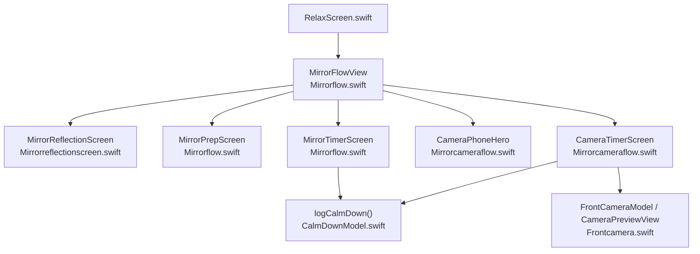
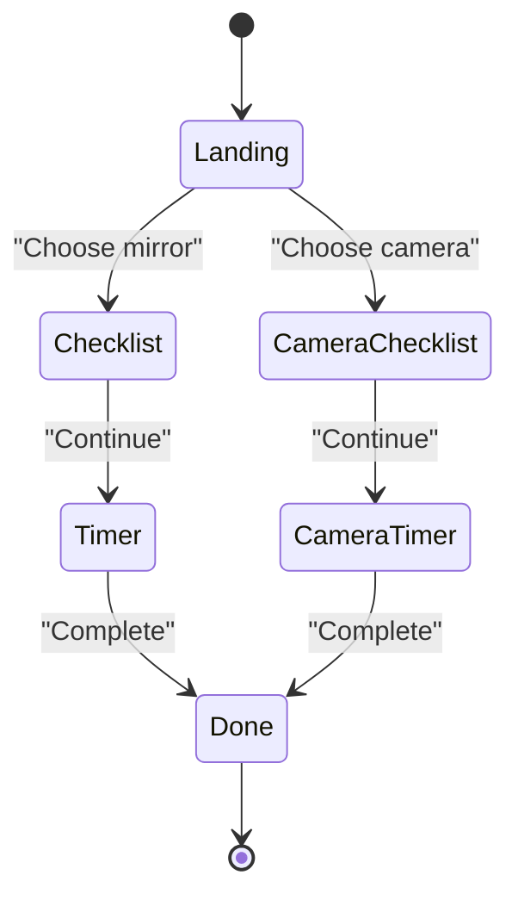
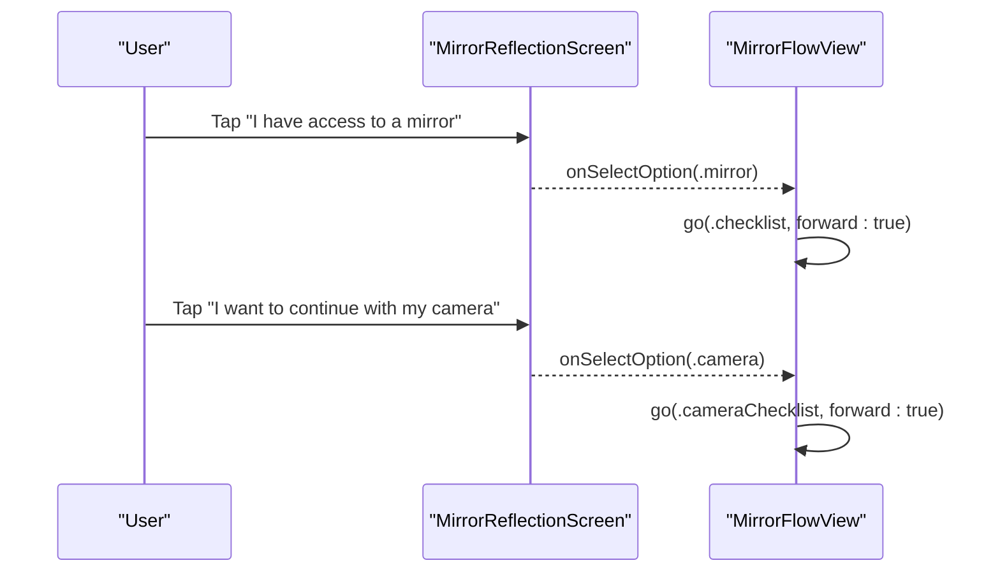
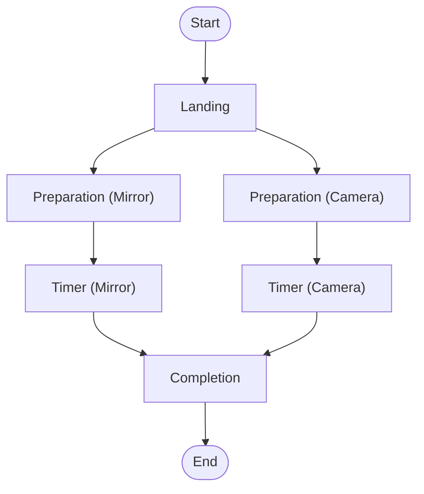
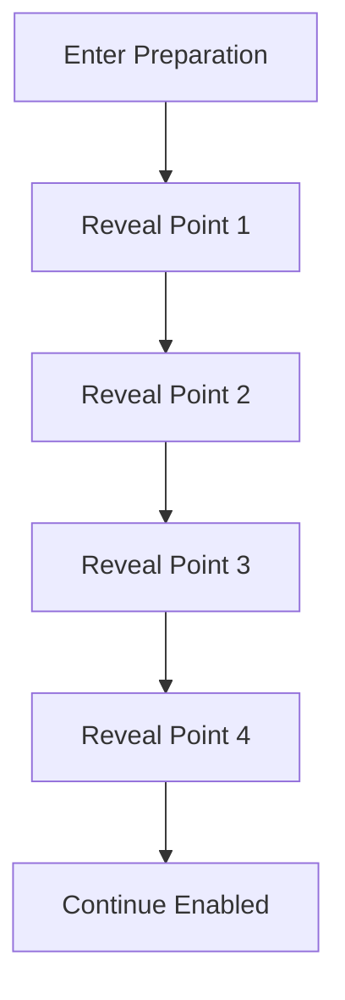
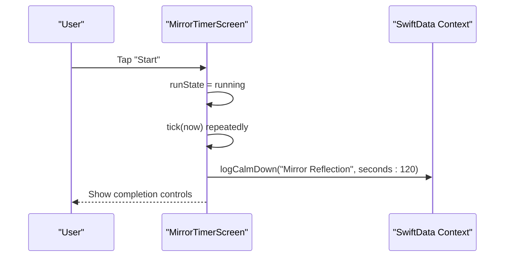
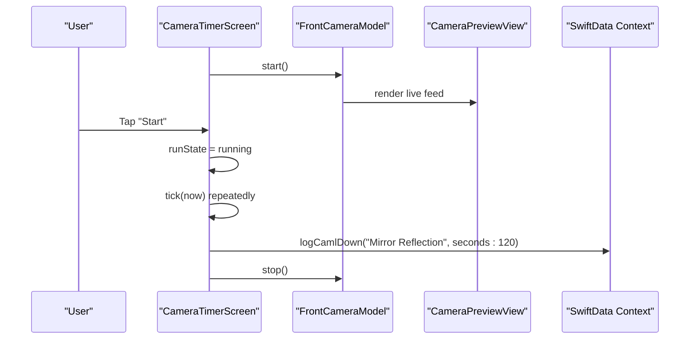
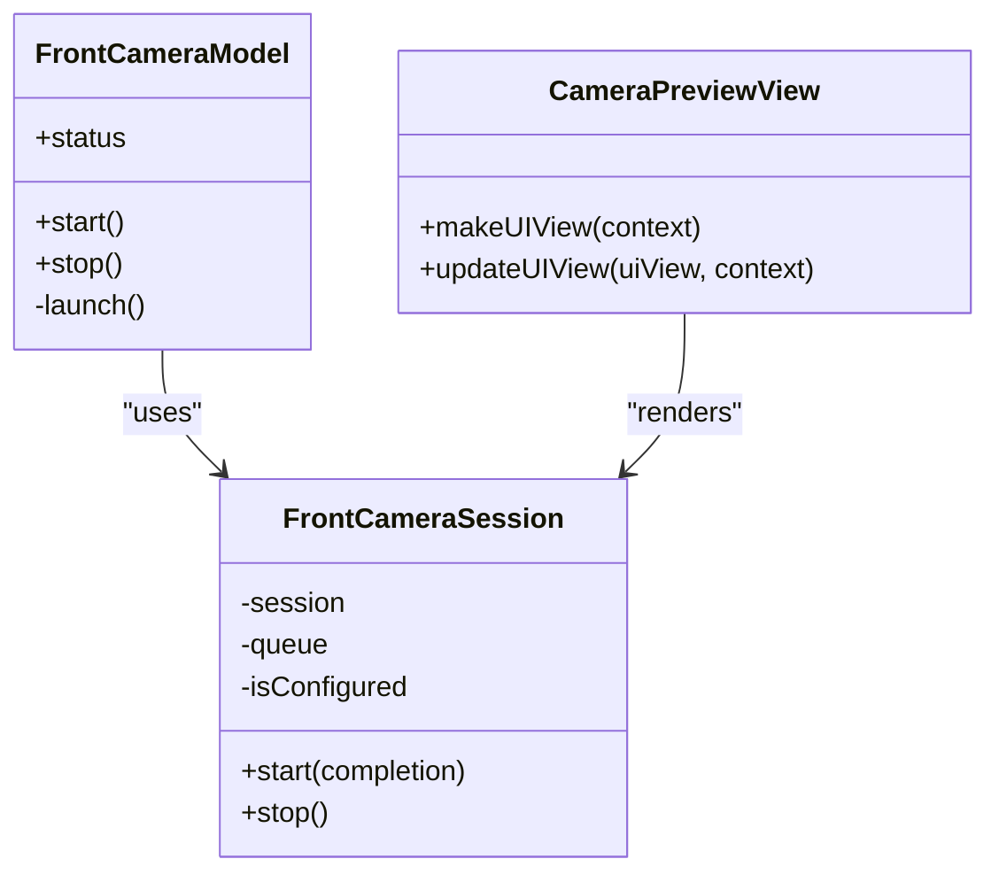
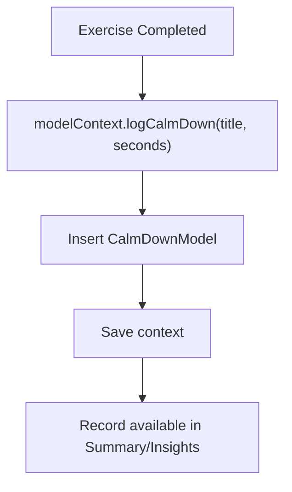
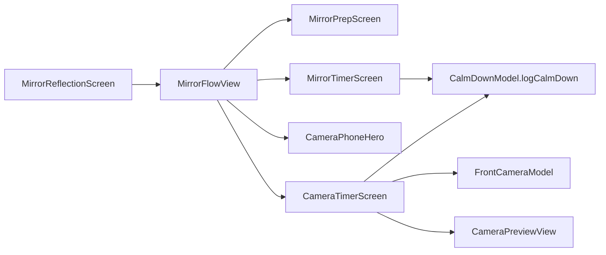

# Reflection Exercise Flow

<cite>
**Referenced Files in This Document**
- [Mirrorreflectionscreen.swift](file://Moko/Moko/UIScreens/relaxScreens/MirrorReflection/Mirrorreflectionscreen.swift)
- [Mirrorflow.swift](file://Moko/Moko/UIScreens/relaxScreens/MirrorReflection/Mirrorflow.swift)
- [Mirrorcameraflow.swift](file://Moko/Moko/UIScreens/relaxScreens/MirrorReflection/Mirrorcameraflow.swift)
- [Frontcamera.swift](file://Moko/Moko/UIScreens/relaxScreens/MirrorReflection/Frontcamera.swift)
- [CalmDownModel.swift](file://Moko/Moko/Models/CalmDownModel.swift)
- [RelaxScreen.swift](file://Moko/Moko/UIScreens/relaxScreens/RelaxScreen.swift)
</cite>

## Table of Contents
1. [Introduction](#introduction)
2. [Project Structure](#project-structure)
3. [Core Components](#core-components)
4. [Architecture Overview](#architecture-overview)
5. [Detailed Component Analysis](#detailed-component-analysis)
6. [Dependency Analysis](#dependency-analysis)
7. [Performance Considerations](#performance-considerations)
8. [Troubleshooting Guide](#troubleshooting-guide)
9. [Conclusion](#conclusion)

## Introduction
This document explains the core reflection exercise flow for Mirror Reflection. It covers both traditional mirror mode and camera-based mode, user interaction patterns, preparation steps, timer-driven affirmation practice, completion handling, progress tracking, and session persistence. It also documents UI design patterns, accessibility considerations, inclusive design principles, cultural sensitivity, and user experience optimization for mindfulness practices.

## Project Structure
The Mirror Reflection feature is implemented under the relax screens with a dedicated subfolder:

**Diagram sources**
- [Mirrorflow.swift:30-133](file://Moko/Moko/UIScreens/relaxScreens/MirrorReflection/Mirrorflow.swift#L30-L133)
- [Mirrorreflectionscreen.swift:11-116](file://Moko/Moko/UIScreens/relaxScreens/MirrorReflection/Mirrorreflectionscreen.swift#L11-L116)
- [Mirrorcameraflow.swift:15-127](file://Moko/Moko/UIScreens/relaxScreens/MirrorReflection/Mirrorcameraflow.swift#L15-L127)
- [Frontcamera.swift:19-106](file://Moko/Moko/UIScreens/relaxScreens/MirrorReflection/Frontcamera.swift#L19-L106)
- [CalmDownModel.swift:27-36](file://Moko/Moko/Models/CalmDownModel.swift#L27-L36)

**Section sources**
- [Mirrorflow.swift:1-133](file://Moko/Moko/UIScreens/relaxScreens/MirrorReflection/Mirrorflow.swift#L1-L133)
- [Mirrorreflectionscreen.swift:1-116](file://Moko/Moko/UIScreens/relaxScreens/MirrorReflection/Mirrorreflectionscreen.swift#L1-L116)
- [Mirrorcameraflow.swift:1-127](file://Moko/Moko/UIScreens/relaxScreens/MirrorReflection/Mirrorcameraflow.swift#L1-L127)
- [Frontcamera.swift:1-106](file://Moko/Moko/UIScreens/relaxScreens/MirrorReflection/Frontcamera.swift#L1-L106)
- [CalmDownModel.swift:1-38](file://Moko/Moko/Models/CalmDownModel.swift#L1-L38)

## Core Components
- MirrorReflectionScreen: Landing screen that introduces the exercise and lets users choose between mirror or camera modes.
- MirrorFlowView: Orchestrates the full flow, including landing, preparation, timer, and completion for both modes.
- MirrorPrepScreen: Guided preparation checklist with progressive reveal animations.
- MirrorTimerScreen: Traditional mirror timer with affirmations and progress ring.
- CameraPhoneHero: Illustration used during camera-mode preparation.
- CameraTimerScreen: Camera-mode timer with live front-camera preview and affirmations.
- FrontCameraModel and CameraPreviewView: AVFoundation-backed live camera preview with permission handling.
- CalmDownModel: SwiftData model and logging helper for persisting completed exercises.

Key responsibilities:
- Mode switching at the landing screen.
- Preparation guidance before starting the timer.
- Fixed-duration affirmation practice (2 minutes).
- Completion celebration and navigation back to the parent flow.
- Progress tracking via SwiftData.

**Section sources**
- [Mirrorreflectionscreen.swift:11-116](file://Moko/Moko/UIScreens/relaxScreens/MirrorReflection/Mirrorreflectionscreen.swift#L11-L116)
- [Mirrorflow.swift:30-133](file://Moko/Moko/UIScreens/relaxScreens/MirrorReflection/Mirrorflow.swift#L30-L133)
- [Mirrorflow.swift:187-325](file://Moko/Moko/UIScreens/relaxScreens/MirrorReflection/Mirrorflow.swift#L187-L325)
- [Mirrorflow.swift:327-510](file://Moko/Moko/UIScreens/relaxScreens/MirrorReflection/Mirrorflow.swift#L327-L510)
- [Mirrorcameraflow.swift:15-127](file://Moko/Moko/UIScreens/relaxScreens/MirrorReflection/Mirrorcameraflow.swift#L15-L127)
- [Mirrorcameraflow.swift:169-460](file://Moko/Moko/UIScreens/relaxScreens/MirrorReflection/Mirrorcameraflow.swift#L169-L460)
- [Frontcamera.swift:19-106](file://Moko/Moko/UIScreens/relaxScreens/MirrorReflection/Frontcamera.swift#L19-L106)
- [CalmDownModel.swift:11-36](file://Moko/Moko/Models/CalmDownModel.swift#L11-L36)

## Architecture Overview
Mirror Reflection uses a state-driven SwiftUI flow. The top-level container decides which step to show based on an internal enum. Each step is a composable view. Timer logic runs on a high-frequency publisher, while camera operations are isolated off the main thread.

**Diagram sources**
- [Mirrorflow.swift:36-133](file://Moko/Moko/UIScreens/relaxScreens/MirrorReflection/Mirrorflow.swift#L36-L133)

## Detailed Component Analysis

### MirrorReflectionScreen: Landing and Mode Selection
MirrorReflectionScreen presents the exercise introduction and two options:
- Traditional mirror mode
- Camera mode

It renders a hero illustration and accessible option rows with sensory feedback. The parent receives the selected option through a callback.

User interaction pattern:
- Read the header and description.
- Choose one of the two options.
- The parent navigates to the corresponding preparation step.

Accessibility and inclusive design:
- Clear headings and descriptive text.
- Large tap targets with visual affordances.
- Sensory feedback for selection.

**Diagram sources**
- [Mirrorreflectionscreen.swift:11-116](file://Moko/Moko/UIScreens/relaxScreens/MirrorReflection/Mirrorreflectionscreen.swift#L11-L116)
- [Mirrorflow.swift:54-63](file://Moko/Moko/UIScreens/relaxScreens/MirrorReflection/Mirrorflow.swift#L54-L63)

**Section sources**
- [Mirrorreflectionscreen.swift:11-116](file://Moko/Moko/UIScreens/relaxScreens/MirrorReflection/Mirrorreflectionscreen.swift#L11-L116)
- [Mirrorflow.swift:54-63](file://Moko/Moko/UIScreens/relaxScreens/MirrorReflection/Mirrorflow.swift#L54-L63)

### MirrorFlowView: Navigation System and Step Management
MirrorFlowView manages the complete exercise lifecycle:
- Landing
- Preparation checklist (mirror or camera)
- Timer (mirror or camera)
- Completion

It uses a simple state machine and animated transitions to guide users smoothly between steps.

**Diagram sources**
- [Mirrorflow.swift:36-133](file://Moko/Moko/UIScreens/relaxScreens/MirrorReflection/Mirrorflow.swift#L36-L133)

Implementation highlights:
- Forward/backward slide transitions controlled by a direction flag.
- Consistent palette and typography across steps.
- Completion triggers onFinish for parent navigation.

**Section sources**
- [Mirrorflow.swift:30-133](file://Moko/Moko/UIScreens/relaxScreens/MirrorReflection/Mirrorflow.swift#L30-L133)

### MirrorPrepScreen: Preparation Steps
MirrorPrepScreen guides users through four preparation points:
- Find a comfortable spot
- Take a gentle breath or hold your phone comfortably
- Look at yourself kindly/gently
- Let go of judgement

It progressively reveals each point with spring animations and updates the hero illustration’s glow intensity based on progress.

Design patterns:
- Progressive disclosure reduces cognitive load.
- Visual cues reinforce readiness.
- A persistent Continue button appears when all points are revealed.

Accessibility:
- Bullet items are grouped for assistive technology.
- Text contrast follows the app’s color tokens.

**Diagram sources**
- [Mirrorflow.swift:187-325](file://Moko/Moko/UIScreens/relaxScreens/MirrorReflection/Mirrorflow.swift#L187-L325)

**Section sources**
- [Mirrorflow.swift:187-325](file://Moko/Moko/UIScreens/relaxScreens/MirrorReflection/Mirrorflow.swift#L187-L325)

### MirrorTimerScreen: Traditional Mirror Timer
MirrorTimerScreen implements a fixed 2-minute affirmation practice:
- Starts with a “Start” action.
- Displays rotating affirmations with emphasis on the active phrase.
- Shows a circular progress indicator with a breathing face.
- Supports pause/resume and reset.
- On completion, logs the exercise and allows continuing to the completion screen.

Timer behavior:
- High-frequency ticker updates elapsed time.
- Affirmation index advances proportionally over the total duration.
- Completion triggers persistence and UI transition.

**Diagram sources**
- [Mirrorflow.swift:327-510](file://Moko/Moko/UIScreens/relaxScreens/MirrorReflection/Mirrorflow.swift#L327-L510)
- [CalmDownModel.swift:27-36](file://Moko/Moko/Models/CalmDownModel.swift#L27-L36)

**Section sources**
- [Mirrorflow.swift:327-510](file://Moko/Moko/UIScreens/relaxScreens/MirrorReflection/Mirrorflow.swift#L327-L510)

### CameraPhoneHero and CameraTimerScreen: Camera Mode
CameraPhoneHero provides a phone-themed illustration for the camera preparation step.

CameraTimerScreen integrates a live front-camera preview:
- Starts the camera on appear and stops it on disappear.
- Handles permissions and device availability gracefully.
- Displays affirmations over the camera feed with a gradient overlay for readability.
- Tracks progress around the card edge.
- Logs completion and stops the camera.

Error handling:
- If camera access is denied, shows instructions and a link to open Settings.
- If no front camera is available, suggests using an iPhone.

**Diagram sources**
- [Mirrorcameraflow.swift:169-460](file://Moko/Moko/UIScreens/relaxScreens/MirrorReflection/Mirrorcameraflow.swift#L169-L460)
- [Frontcamera.swift:19-106](file://Moko/Moko/UIScreens/relaxScreens/MirrorReflection/Frontcamera.swift#L19-L106)
- [CalmDownModel.swift:27-36](file://Moko/Moko/Models/CalmDownModel.swift#L27-L36)

**Section sources**
- [Mirrorcameraflow.swift:15-127](file://Moko/Moko/UIScreens/relaxScreens/MirrorReflection/Mirrorcameraflow.swift#L15-L127)
- [Mirrorcameraflow.swift:169-460](file://Moko/Moko/UIScreens/relaxScreens/MirrorReflection/Mirrorcameraflow.swift#L169-L460)
- [Frontcamera.swift:19-106](file://Moko/Moko/UIScreens/relaxScreens/MirrorReflection/Frontcamera.swift#L19-L106)

### FrontCameraModel and CameraPreviewView: Live Camera Integration
FrontCameraSession configures and runs an AVCaptureSession off the main thread. FrontCameraModel exposes status and handles permission requests. CameraPreviewView bridges UIKit’s AVCaptureVideoPreviewLayer into SwiftUI.

Key behaviors:
- Permission check and request flow.
- Running/unavailable/denied states.
- Safe start/stop lifecycle tied to screen visibility.

**Diagram sources**
- [Frontcamera.swift:19-106](file://Moko/Moko/UIScreens/relaxScreens/MirrorReflection/Frontcamera.swift#L19-L106)
- [Frontcamera.swift:109-134](file://Moko/Moko/UIScreens/relaxScreens/MirrorReflection/Frontcamera.swift#L109-L134)

**Section sources**
- [Frontcamera.swift:19-106](file://Moko/Moko/UIScreens/relaxScreens/MirrorReflection/Frontcamera.swift#L19-L106)
- [Frontcamera.swift:109-134](file://Moko/Moko/UIScreens/relaxScreens/MirrorReflection/Frontcamera.swift#L109-L134)

### Session Persistence and Progress Tracking
Completed sessions are persisted using SwiftData. Both timer screens call a shared logging helper that inserts a record and saves the context.

Persistence details:
- Title identifies the exercise.
- Duration is recorded in seconds.
- Timestamp captures completion date.

**Diagram sources**
- [CalmDownModel.swift:27-36](file://Moko/Moko/Models/CalmDownModel.swift#L27-L36)
- [Mirrorflow.swift:486-491](file://Moko/Moko/UIScreens/relaxScreens/MirrorReflection/Mirrorflow.swift#L486-L491)
- [Mirrorcameraflow.swift:434-440](file://Moko/Moko/UIScreens/relaxScreens/MirrorReflection/Mirrorcameraflow.swift#L434-L440)

**Section sources**
- [CalmDownModel.swift:11-36](file://Moko/Moko/Models/CalmDownModel.swift#L11-L36)
- [Mirrorflow.swift:486-491](file://Moko/Moko/UIScreens/relaxScreens/MirrorReflection/Mirrorflow.swift#L486-L491)
- [Mirrorcameraflow.swift:434-440](file://Moko/Moko/UIScreens/relaxScreens/MirrorReflection/Mirrorcameraflow.swift#L434-L440)

### Integration with RelaxScreen
RelaxScreen can present mirror preparation directly without the full flow, supporting both camera and non-camera paths. It constructs the same preparation views and navigates to the appropriate timer destination.

**Section sources**
- [RelaxScreen.swift:279-315](file://Moko/Moko/UIScreens/relaxScreens/RelaxScreen.swift#L279-L315)

## Dependency Analysis
The following diagram maps key dependencies among components:

**Diagram sources**
- [Mirrorreflectionscreen.swift:11-116](file://Moko/Moko/UIScreens/relaxScreens/MirrorReflection/Mirrorreflectionscreen.swift#L11-L116)
- [Mirrorflow.swift:30-133](file://Moko/Moko/UIScreens/relaxScreens/MirrorReflection/Mirrorflow.swift#L30-L133)
- [Mirrorcameraflow.swift:169-460](file://Moko/Moko/UIScreens/relaxScreens/MirrorReflection/Mirrorcameraflow.swift#L169-L460)
- [Frontcamera.swift:19-106](file://Moko/Moko/UIScreens/relaxScreens/MirrorReflection/Frontcamera.swift#L19-L106)
- [CalmDownModel.swift:27-36](file://Moko/Moko/Models/CalmDownModel.swift#L27-L36)

**Section sources**
- [Mirrorflow.swift:30-133](file://Moko/Moko/UIScreens/relaxScreens/MirrorReflection/Mirrorflow.swift#L30-L133)
- [Mirrorcameraflow.swift:169-460](file://Moko/Moko/UIScreens/relaxScreens/MirrorReflection/Mirrorcameraflow.swift#L169-L460)
- [Frontcamera.swift:19-106](file://Moko/Moko/UIScreens/relaxScreens/MirrorReflection/Frontcamera.swift#L19-L106)
- [CalmDownModel.swift:27-36](file://Moko/Moko/Models/CalmDownModel.swift#L27-L36)

## Performance Considerations
- Timer updates use a high-frequency publisher; ensure animations remain lightweight to avoid jank.
- Camera session configuration runs off the main thread to keep UI responsive.
- Avoid unnecessary recompositions by keeping state local to relevant views.
- Use minimal overlays and gradients to maintain smooth rendering during live camera preview.

[No sources needed since this section provides general guidance]

## Troubleshooting Guide
Common issues and resolutions:
- Camera not available:
  - The UI informs the user and suggests trying on an iPhone.
- Camera access denied:
  - The UI offers a direct link to open Settings so users can enable camera access.
- Simulator limitations:
  - No front camera is available; the flow still works without the camera.

Best practices:
- Always handle camera permission states explicitly.
- Stop the camera when leaving the screen to conserve resources.
- Provide clear fallback messaging for devices without cameras.

**Section sources**
- [Mirrorcameraflow.swift:320-367](file://Moko/Moko/UIScreens/relaxScreens/MirrorReflection/Mirrorcameraflow.swift#L320-L367)
- [Frontcamera.swift:76-106](file://Moko/Moko/UIScreens/relaxScreens/MirrorReflection/Frontcamera.swift#L76-L106)

## Conclusion
Mirror Reflection provides a calm, guided self-reflection experience with two modes: traditional mirror and camera-based. The flow emphasizes clarity, gentle pacing, and supportive visuals. Preparation steps reduce anxiety, the timer supports mindful affirmations, and completion is celebrated. Progress is persisted for later review. The implementation balances accessibility, inclusive design, and cultural sensitivity, ensuring a respectful and empowering practice for diverse users.

[No sources needed since this section summarizes without analyzing specific files]