# Relaxation Suite

<cite>
**Referenced Files in This Document**   
- [CalmDownModel.swift](file://Moko/Moko/Models/CalmDownModel.swift)
- [RelaxScreen.swift](file://Moko/Moko/UIScreens/relaxScreens/RelaxScreen.swift)
- [BoxBreathingView.swift](file://Moko/Moko/UIScreens/relaxScreens/BoxBreathing/BoxBreathingView.swift)
- [Breathingsessionscreen.swift](file://Moko/Moko/UIScreens/relaxScreens/Breathing/Breathingsessionscreen.swift)
- [GroundingExerciseScreen.swift](file://Moko/Moko/UIScreens/relaxScreens/Grounding/GroundingExerciseScreen.swift)
- [ImageryGuide.swift](file://Moko/Moko/UIScreens/relaxScreens/ImageryGuide/ImageryGuide.swift)
- [GuideSessionView.swift](file://Moko/Moko/UIScreens/relaxScreens/ImageryGuide/GuideSessionView.swift)
- [RelaxFlow.swift](file://Moko/Moko/UIScreens/relaxScreens/ImageryGuide/RelaxFlow.swift)
- [Mirrorreflectionscreen.swift](file://Moko/Moko/UIScreens/relaxScreens/MirrorReflection/Mirrorreflectionscreen.swift)
- [Frontcamera.swift](file://Moko/Moko/UIScreens/relaxScreens/MirrorReflection/Frontcamera.swift)
- [Mirrorcameraflow.swift](file://Moko/Moko/UIScreens/relaxScreens/MirrorReflection/Mirrorcameraflow.swift)
- [Mirrorflow.swift](file://Moko/Moko/UIScreens/relaxScreens/MirrorReflection/Mirrorflow.swift)
</cite>

## Table of Contents
1. [Introduction](#introduction)
2. [Project Structure](#project-structure)
3. [Core Components](#core-components)
4. [Architecture Overview](#architecture-overview)
5. [Detailed Component Analysis](#detailed-component-analysis)
6. [Dependency Analysis](#dependency-analysis)
7. [Performance Considerations](#performance-considerations)
8. [Troubleshooting Guide](#troubleshooting-guide)
9. [Conclusion](#conclusion)

## Introduction
This document explains Moko’s Relaxation Suite, a set of wellness exercises designed to help users pause, breathe, ground themselves, visualize calming scenes, and practice self-awareness through mirror reflection. The suite includes:

- **Box Breathing**: A four-phase breathing exercise with visual box guidance, phase timing, cycle tracking, and completion feedback.
- **Gentle Breathing**: A customizable timer session that animates the mascot and tracks progress.
- **Grounding Exercise**: A 5-4-3-2-1 sensory grounding flow for anxiety relief.
- **Imagery Guidance**: Guided visualization sessions with background imagery and optional looping ambient audio.
- **Mirror Reflection**: A self-awareness practice with either a real mirror or a live front-camera preview, affirmations, and a fixed-duration timer.

All completed sessions are persisted as calm-down records so they can be reviewed later.

## Project Structure
The relaxation features live under `Moko/Moko/UIScreens/relaxScreens`. Each exercise has its own folder, while shared navigation, data models, and UI patterns are reused across screens.

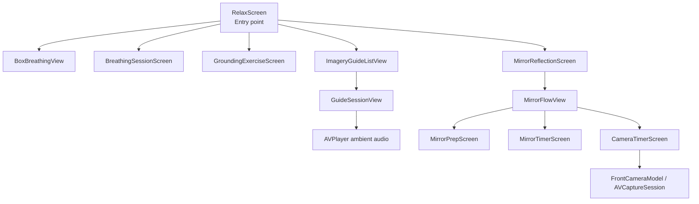

**Diagram sources**
- [RelaxScreen.swift:10-98](file://Moko/Moko/UIScreens/relaxScreens/RelaxScreen.swift#L10-L98)
- [RelaxScreen.swift:191-276](file://Moko/Moko/UIScreens/relaxScreens/RelaxScreen.swift#L191-L276)
- [GuideSessionView.swift:13-106](file://Moko/Moko/UIScreens/relaxScreens/ImageryGuide/GuideSessionView.swift#L13-L106)
- [Mirrorflow.swift:31-133](file://Moko/Moko/UIScreens/relaxScreens/MirrorReflection/Mirrorflow.swift#L31-L133)
- [Frontcamera.swift:19-106](file://Moko/Moko/UIScreens/relaxScreens/MirrorReflection/Frontcamera.swift#L19-L106)

**Section sources**
- [RelaxScreen.swift:10-98](file://Moko/Moko/UIScreens/relaxScreens/RelaxScreen.swift#L10-L98)
- [RelaxScreen.swift:100-197](file://Moko/Moko/UIScreens/relaxScreens/RelaxScreen.swift#L100-L197)

## Core Components
The relaxation suite is built around a few core responsibilities:

| Component | Responsibility | Key Behavior |
|---|---|---|
| `RelaxScreen` | Entry screen and navigation hub | Shows breathing card, guided session cards, bottom sheets, and routes to each exercise. |
| `CalmDownModel` | Session persistence | SwiftData model storing exercise title, duration, and timestamp; exposes `logCalmDown`. |
| `BoxBreathingView` | Visual box breathing | Four-phase timer, animated box edges, cycle counter, completion animation, and logging. |
| `BreathingSessionScreen` | Customizable gentle breathing | Rive mascot animation, progress ring, pause/reset, and logging. |
| `GroundingExerciseScreen` | 5-4-3-2-1 grounding | Step-by-step sensory prompts, number selection, completion badge, and logging. |
| `ImageryGuide` + `GuideSessionView` | Guided visualization | Loads guide metadata, shows steps, image, optional looping audio, and logs completion. |
| `MirrorFlowView` + related screens | Mirror reflection flow | Landing, prep checklist, affirmation timer, camera option, and completion. |
| `FrontCameraModel` + `FrontCameraSession` | Live camera preview | Requests camera permission, starts/stops `AVCaptureSession`, exposes status to SwiftUI. |

**Section sources**
- [CalmDownModel.swift:11-37](file://Moko/Moko/Models/CalmDownModel.swift#L11-L37)
- [RelaxScreen.swift:100-197](file://Moko/Moko/UIScreens/relaxScreens/RelaxScreen.swift#L100-L197)
- [BoxBreathingView.swift:61-146](file://Moko/Moko/UIScreens/relaxScreens/BoxBreathing/BoxBreathingView.swift#L61-L146)
- [Breathingsessionscreen.swift:16-112](file://Moko/Moko/UIScreens/relaxScreens/Breathing/Breathingsessionscreen.swift#L16-L112)
- [GroundingExerciseScreen.swift:15-146](file://Moko/Moko/UIScreens/relaxScreens/Grounding/GroundingExerciseScreen.swift#L15-L146)
- [ImageryGuide.swift:7-65](file://Moko/Moko/UIScreens/relaxScreens/ImageryGuide/ImageryGuide.swift#L7-L65)
- [GuideSessionView.swift:13-106](file://Moko/Moko/UIScreens/relaxScreens/ImageryGuide/GuideSessionView.swift#L13-L106)
- [Mirrorflow.swift:31-133](file://Moko/Moko/UIScreens/relaxScreens/MirrorReflection/Mirrorflow.swift#L31-L133)
- [Frontcamera.swift:19-106](file://Moko/Moko/UIScreens/relaxScreens/MirrorReflection/Frontcamera.swift#L19-L106)

## Architecture Overview
The relaxation architecture separates navigation, exercise state, media playback, and persistence:

- **Navigation layer**: `RelaxScreen` owns a `NavigationStack` and maps user actions to destinations such as breathing timers, imagery sessions, and mirror flows.
- **Exercise layer**: Each exercise manages its own state (idle, running, paused, complete), timer logic, and UI transitions.
- **Media layer**: Gentle breathing uses a Rive animation; imagery sessions use `AVPlayer` for looping ambient audio; mirror camera uses `AVCaptureSession`.
- **Persistence layer**: All exercises call `modelContext.logCalmDown` when a session finishes.

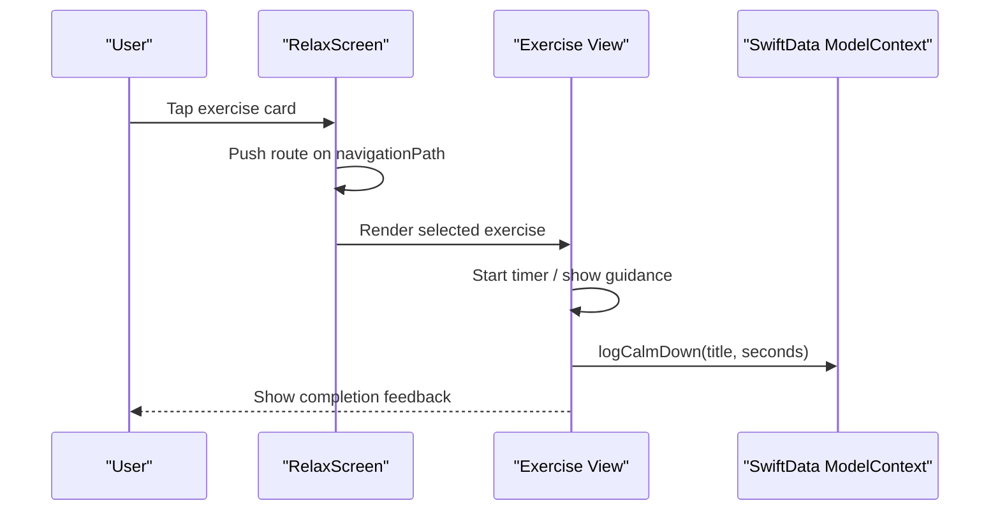

**Diagram sources**
- [RelaxScreen.swift:191-276](file://Moko/Moko/UIScreens/relaxScreens/RelaxScreen.swift#L191-L276)
- [CalmDownModel.swift:27-37](file://Moko/Moko/Models/CalmDownModel.swift#L27-L37)

## Detailed Component Analysis

### Relax Screen and Exercise Selection Interface
`RelaxScreen` is the main relaxation entry point. It displays:

- A breathing card with a stepper to choose minutes.
- A grid of guided sessions: Box Breathing, Grounding, Imagery, Mirror.
- Bottom sheets for quick previews and configuration.
- A navigation stack that pushes full-screen exercise views.

Key behaviors:

- `RelaxSession` defines the four guided exercises and their descriptions, banner images, and colors.
- `ActiveRelaxSheet` controls whether the sheet is for the generic breathing timer or a specific guided session.
- `RelaxRoute` centralizes all destinations, including imagery sessions, mirror preparation, mirror timers, and completion screens.
- When a sheet is dismissed, pending navigation is applied so the app pushes the chosen exercise after the sheet closes.

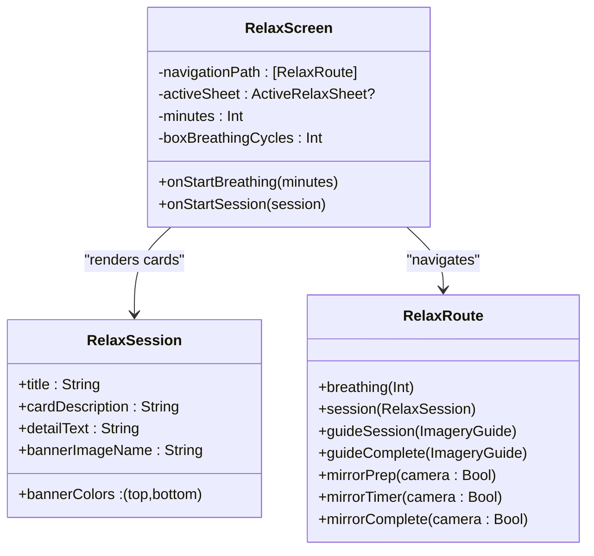

**Diagram sources**
- [RelaxScreen.swift:12-98](file://Moko/Moko/UIScreens/relaxScreens/RelaxScreen.swift#L12-L98)
- [RelaxScreen.swift:100-197](file://Moko/Moko/UIScreens/relaxScreens/RelaxScreen.swift#L100-L197)
- [RelaxScreen.swift:191-276](file://Moko/Moko/UIScreens/relaxScreens/RelaxScreen.swift#L191-L276)

**Section sources**
- [RelaxScreen.swift:12-98](file://Moko/Moko/UIScreens/relaxScreens/RelaxScreen.swift#L12-L98)
- [RelaxScreen.swift:100-197](file://Moko/Moko/UIScreens/relaxScreens/RelaxScreen.swift#L100-L197)
- [RelaxScreen.swift:331-456](file://Moko/Moko/UIScreens/relaxScreens/RelaxScreen.swift#L331-L456)
- [RelaxScreen.swift:491-684](file://Moko/Moko/UIScreens/relaxScreens/RelaxScreen.swift#L491-L684)

### Shared CalmDownModel for Session Tracking
`CalmDownModel` is a SwiftData model representing one finished relaxation exercise. It stores:

- A unique identifier.
- The exercise title.
- Duration in seconds.
- Completion date.

The `ModelContext` extension provides `logCalmDown`, which inserts a record and saves it. If saving fails, it prints an error instead of crashing.

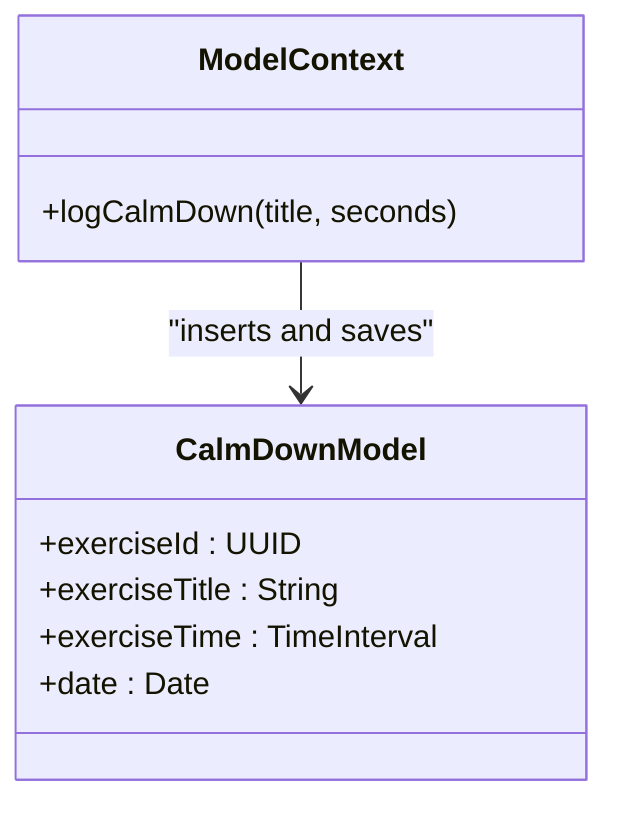

**Diagram sources**
- [CalmDownModel.swift:11-37](file://Moko/Moko/Models/CalmDownModel.swift#L11-L37)

**Section sources**
- [CalmDownModel.swift:11-37](file://Moko/Moko/Models/CalmDownModel.swift#L11-L37)

### Box Breathing Exercise
Box Breathing guides users through inhale, hold, exhale, and hold-empty phases. It provides:

- A visual box whose edges fill progressively.
- Phase labels and countdown timers.
- Cycle counting based on configured cycles.
- Pause, resume, reset, and completion states.
- Haptic feedback when phases change and on completion.
- Logging of total duration when finishing.

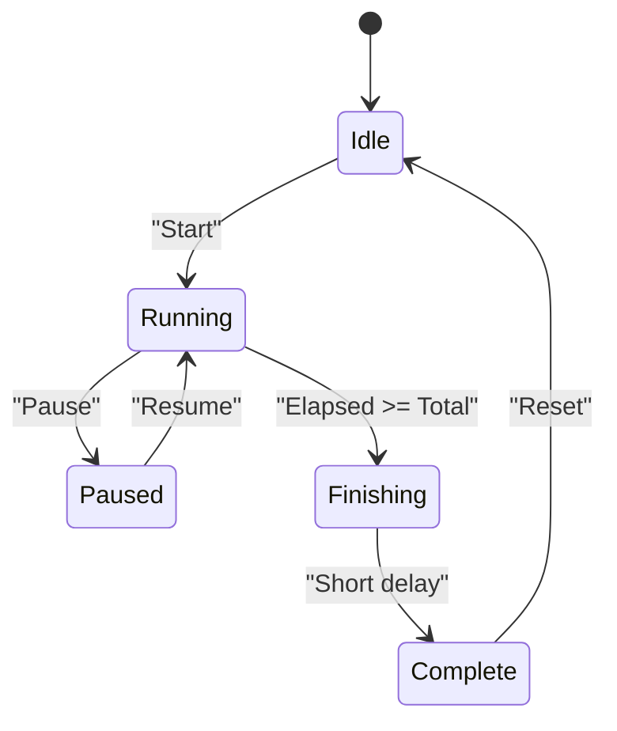

**Diagram sources**
- [BoxBreathingView.swift:17-23](file://Moko/Moko/UIScreens/relaxScreens/BoxBreathing/BoxBreathingView.swift#L17-L23)
- [BoxBreathingView.swift:331-386](file://Moko/Moko/UIScreens/relaxScreens/BoxBreathing/BoxBreathingView.swift#L331-L386)

Implementation highlights:

- The timer loop runs every ~33 milliseconds while running.
- Phase progression is derived from elapsed time divided by phase length.
- The box geometry defines four corners and four edges used for drawing.
- Completion triggers a success haptic and logs the full cycle duration.

**Section sources**
- [BoxBreathingView.swift:4-44](file://Moko/Moko/UIScreens/relaxScreens/BoxBreathing/BoxBreathingView.swift#L4-L44)
- [BoxBreathingView.swift:61-146](file://Moko/Moko/UIScreens/relaxScreens/BoxBreathing/BoxBreathingView.swift#L61-L146)
- [BoxBreathingView.swift:201-289](file://Moko/Moko/UIScreens/relaxScreens/BoxBreathing/BoxBreathingView.swift#L201-L289)
- [BoxBreathingView.swift:331-386](file://Moko/Moko/UIScreens/relaxScreens/BoxBreathing/BoxBreathingView.swift#L331-L386)

### Gentle Breathing Session
The gentle breathing session is a customizable meditation timer. It differs from Box Breathing by using:

- A configurable minute duration.
- A Rive-based mascot animation that pauses/resumes with the session.
- A circular progress ring.
- Inhale/exhale rhythm hints.
- Completion feedback and logging.

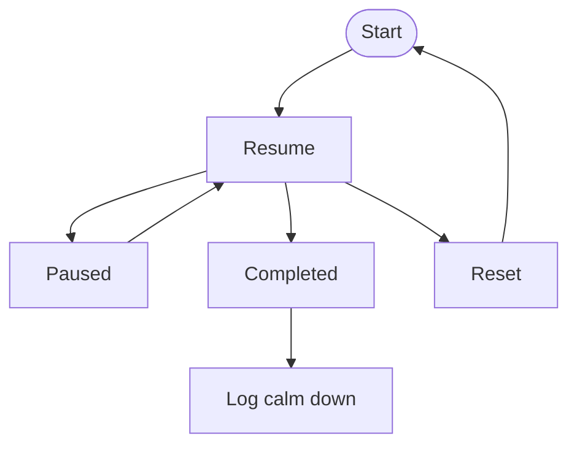

**Diagram sources**
- [Breathingsessionscreen.swift:24-26](file://Moko/Moko/UIScreens/relaxScreens/Breathing/Breathingsessionscreen.swift#L24-L26)
- [Breathingsessionscreen.swift:272-328](file://Moko/Moko/UIScreens/relaxScreens/Breathing/Breathingsessionscreen.swift#L272-L328)

**Section sources**
- [Breathingsessionscreen.swift:16-112](file://Moko/Moko/UIScreens/relaxScreens/Breathing/Breathingsessionscreen.swift#L16-L112)
- [Breathingsessionscreen.swift:114-178](file://Moko/Moko/UIScreens/relaxScreens/Breathing/Breathingsessionscreen.swift#L114-L178)
- [Breathingsessionscreen.swift:272-328](file://Moko/Moko/UIScreens/relaxScreens/Breathing/Breathingsessionscreen.swift#L272-L328)

### Grounding Exercise for Anxiety Relief
The grounding exercise walks users through the 5-4-3-2-1 technique:

- See five things.
- Touch four things.
- Hear three things.
- Smell two things.
- Taste one thing.

Each step requires selecting the required number of items before continuing. On completion, it logs the elapsed time.

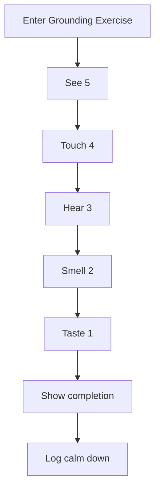

**Diagram sources**
- [GroundingExerciseScreen.swift:64-102](file://Moko/Moko/UIScreens/relaxScreens/Grounding/GroundingExerciseScreen.swift#L64-L102)
- [GroundingExerciseScreen.swift:491-513](file://Moko/Moko/UIScreens/relaxScreens/Grounding/GroundingExerciseScreen.swift#L491-L513)

**Section sources**
- [GroundingExerciseScreen.swift:15-146](file://Moko/Moko/UIScreens/relaxScreens/Grounding/GroundingExerciseScreen.swift#L15-L146)
- [GroundingExerciseScreen.swift:188-213](file://Moko/Moko/UIScreens/relaxScreens/Grounding/GroundingExerciseScreen.swift#L188-L213)
- [GroundingExerciseScreen.swift:323-401](file://Moko/Moko/UIScreens/relaxScreens/Grounding/GroundingExerciseScreen.swift#L323-L401)
- [GroundingExerciseScreen.swift:491-513](file://Moko/Moko/UIScreens/relaxScreens/Grounding/GroundingExerciseScreen.swift#L491-L513)

### Imagery Guidance Sessions
Imagery guidance combines guided visualization with optional ambient audio. The system loads:

- Guides from Supabase.
- Tags for filtering.
- Screen content for localized copy and accessibility strings.
- Optional artwork URLs and audio URLs.

`GuideSessionView` manages:

- A timer that advances through steps.
- Background imagery with scaling and shifting.
- Play/pause/restart controls.
- Looping ambient audio via `AVPlayer`.
- Completion logging.

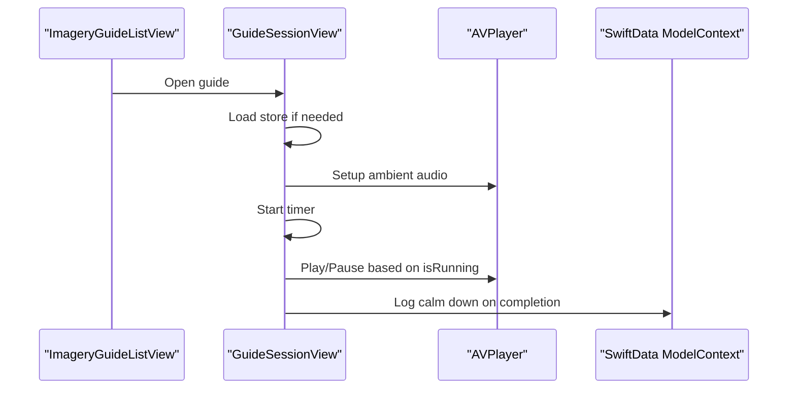

**Diagram sources**
- [ImageryGuide.swift:7-65](file://Moko/Moko/UIScreens/relaxScreens/ImageryGuide/ImageryGuide.swift#L7-L65)
- [GuideSessionView.swift:13-106](file://Moko/Moko/UIScreens/relaxScreens/ImageryGuide/GuideSessionView.swift#L13-L106)
- [GuideSessionView.swift:274-349](file://Moko/Moko/UIScreens/relaxScreens/ImageryGuide/GuideSessionView.swift#L274-L349)

**Section sources**
- [ImageryGuide.swift:7-65](file://Moko/Moko/UIScreens/relaxScreens/ImageryGuide/ImageryGuide.swift#L7-L65)
- [ImageryGuide.swift:80-175](file://Moko/Moko/UIScreens/relaxScreens/ImageryGuide/ImageryGuide.swift#L80-L175)
- [GuideSessionView.swift:13-106](file://Moko/Moko/UIScreens/relaxScreens/ImageryGuide/GuideSessionView.swift#L13-L106)
- [GuideSessionView.swift:108-225](file://Moko/Moko/UIScreens/relaxScreens/ImageryGuide/GuideSessionView.swift#L108-L225)
- [GuideSessionView.swift:274-349](file://Moko/Moko/UIScreens/relaxScreens/ImageryGuide/GuideSessionView.swift#L274-L349)

### Mirror Reflection Exercises
Mirror reflection supports two modes:

- **Real mirror mode**: A prepared checklist followed by a 2-minute affirmation timer.
- **Camera mode**: A setup illustration, then a 2-minute timer with a live front-camera preview and rotating affirmations.

The flow is managed by `MirrorFlowView`, which transitions between landing, checklist, timer, and completion screens.

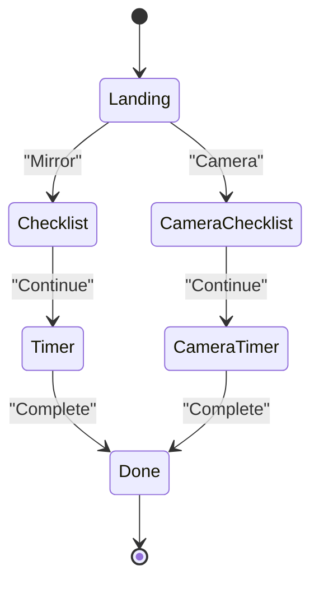

**Diagram sources**
- [Mirrorflow.swift:31-133](file://Moko/Moko/UIScreens/relaxScreens/MirrorReflection/Mirrorflow.swift#L31-L133)

#### Camera Permissions and Live Preview
The camera version uses:

- `FrontCameraModel` to manage authorization and lifecycle.
- `FrontCameraSession` to configure and run `AVCaptureSession`.
- `CameraPreviewView` as a SwiftUI wrapper around `AVCaptureVideoPreviewLayer`.

If camera access is denied, the UI offers an “Open Settings” button. If no front camera is available, it shows an unavailable message.

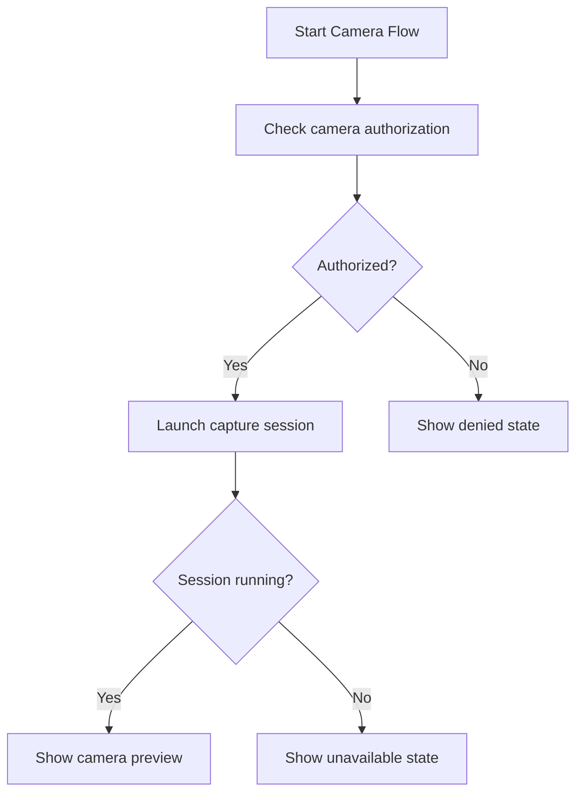

**Diagram sources**
- [Frontcamera.swift:63-106](file://Moko/Moko/UIScreens/relaxSessions/MirrorReflection/Frontcamera.swift#L63-L106)
- [Mirrorcameraflow.swift:170-256](file://Moko/Moko/UIScreens/relaxScreens/MirrorReflection/Mirrorcameraflow.swift#L170-L256)

**Section sources**
- [Mirrorreflectionscreen.swift:11-116](file://Moko/Moko/UIScreens/relaxScreens/MirrorReflection/Mirrorreflectionscreen.swift#L11-L116)
- [Mirrorflow.swift:31-133](file://Moko/Moko/UIScreens/relaxScreens/MirrorReflection/Mirrorflow.swift#L31-L133)
- [Mirrorflow.swift:187-325](file://Moko/Moko/UIScreens/relaxScreens/MirrorReflection/Mirrorflow.swift#L187-L325)
- [Mirrorflow.swift:327-510](file://Moko/Moko/UIScreens/relaxScreens/MirrorReflection/Mirrorflow.swift#L327-L510)
- [Frontcamera.swift:19-106](file://Moko/Moko/UIScreens/relaxScreens/MirrorReflection/Frontcamera.swift#L19-L106)
- [Mirrorcameraflow.swift:170-460](file://Moko/Moko/UIScreens/relaxScreens/MirrorReflection/Mirrorcameraflow.swift#L170-L460)

## Dependency Analysis
The relaxation suite has clear separation between UI, state, media, and persistence:

- `RelaxScreen` depends on `RelaxSession`, `RelaxRoute`, and exercise views.
- Exercise views depend on `SwiftData`’s `ModelContext` for logging.
- Imagery sessions depend on `ImageryGuideStore`, `ImageryGuide`, and `AVPlayer`.
- Mirror camera depends on `AVFoundation` and UIKit’s `AVCaptureVideoPreviewLayer`.

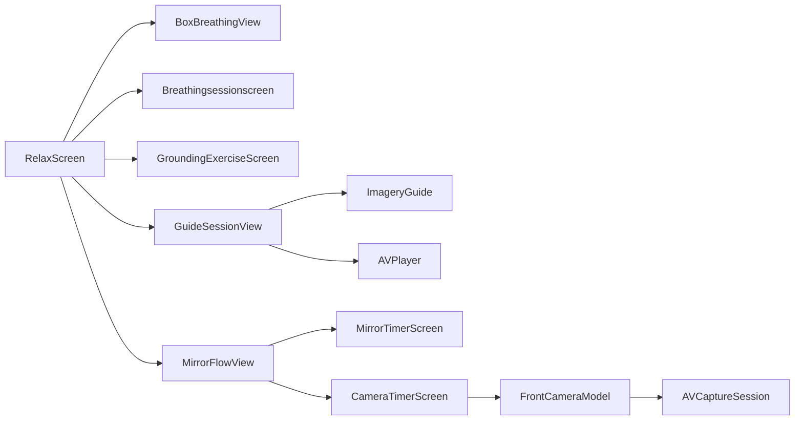

**Diagram sources**
- [RelaxScreen.swift:191-276](file://Moko/Moko/UIScreens/relaxScreens/RelaxScreen.swift#L191-L276)
- [GuideSessionView.swift:13-106](file://Moko/Moko/UIScreens/relaxScreens/ImageryGuide/GuideSessionView.swift#L13-L106)
- [Frontcamera.swift:19-106](file://Moko/Moko/UIScreens/relaxScreens/MirrorReflection/Frontcamera.swift#L19-L106)

**Section sources**
- [RelaxScreen.swift:191-276](file://Moko/Moko/UIScreens/relaxScreens/RelaxScreen.swift#L191-L276)
- [GuideSessionView.swift:13-106](file://Moko/Moko/UIScreens/relaxScreens/ImageryGuide/GuideSessionView.swift#L13-L106)
- [Frontcamera.swift:19-106](file://Moko/Moko/UIScreens/relaxScreens/MirrorReflection/Frontcamera.swift#L19-L106)

## Performance Considerations
Several design choices optimize performance for real-time animations and media:

- **Timer precision**: Gentle breathing and mirror timers use a high-frequency `Timer.publish` to update elapsed time smoothly.
- **Animation control**: Rive animations pause when not running; SwiftUI animations are scoped to state changes.
- **Audio lifecycle**: Imagery sessions create one `AVPlayer`, loop it, and clean up observers and players on disappear.
- **Camera lifecycle**: The camera session starts only when entering camera mode and stops when leaving.
- **Accessibility**: Progress rings and buttons include labels and hints where appropriate.

Recommendations:

- Avoid creating new players or capture sessions on every render.
- Keep heavy work off the main thread; the camera session already uses a dedicated queue.
- Use monospaced digits for timers to prevent layout shifts.
- Limit repeated network calls by loading imagery content once per session.

[No sources needed since this section provides general guidance]

## Troubleshooting Guide

### No Calm Down Records Appear
Possible causes:

- The exercise did not reach completion.
- `logCalmDown` was not called.
- SwiftData save failed silently.

Checkpoints:

- Verify the exercise reaches its completion state.
- Confirm the exercise calls `modelContext.logCalmDown`.
- Look for saved errors printed by `logCalmDown`.

**Section sources**
- [CalmDownModel.swift:27-37](file://Moko/Moko/Models/CalmDownModel.swift#L27-L37)

### Imagery Audio Does Not Play
Possible causes:

- Missing `audioURL`.
- Invalid URL.
- Audio session configuration failure.

Checkpoints:

- Inspect logs for “No audioURL” messages.
- Inspect logs for “Failed to load” messages.
- Ensure the audio URL points to a valid public resource.

**Section sources**
- [GuideSessionView.swift:274-349](file://Moko/Moko/UIScreens/relaxScreens/ImageryGuide/GuideSessionView.swift#L274-L349)

### Camera Permission Denied or Unavailable
Possible causes:

- User denied camera access.
- Device lacks a front camera.
- Missing privacy description in Info.plist.

Checkpoints:

- If denied, open Settings from the provided button.
- If unavailable, switch to mirror mode.
- Add the camera usage description to avoid crashes.

**Section sources**
- [Frontcamera.swift:9-10](file://Moko/Moko/UIScreens/relaxScreens/MirrorReflection/Frontcamera.swift#L9-L10)
- [Frontcamera.swift:63-106](file://Moko/Moko/UIScreens/relaxScreens/MirrorReflection/Frontcamera.swift#L63-L106)
- [Mirrorcameraflow.swift:320-367](file://Moko/Moko/UIScreens/relaxScreens/MirrorReflection/Mirrorcameraflow.swift#L320-L367)

### Timer Drift or Inaccurate Timing
Possible causes:

- Using wall-clock differences without resuming correctly.
- State changes not resetting tick counters.

Checkpoints:

- Ensure `lastTick` is reset on pause/resume.
- Ensure completion sets elapsed to total and clears tick state.
- Prefer delta-based accumulation rather than recomputing from start time alone.

**Section sources**
- [Breathingsessionscreen.swift:272-328](file://Moko/Moko/UIScreens/relaxScreens/Breathing/Breathingsessionscreen.swift#L272-L328)
- [Mirrorflow.swift:474-510](file://Moko/Moko/UIScreens/relaxScreens/MirrorReflection/Mirrorflow.swift#L474-L510)
- [Mirrorcameraflow.swift:422-460](file://Moko/Moko/UIScreens/relaxScreens/MirrorReflection/Mirrorcameraflow.swift#L422-L460)

## Conclusion
Moko’s Relaxation Suite provides a cohesive set of wellness exercises with consistent navigation, clear state management, and persistent session tracking. The architecture separates concerns cleanly:

- `RelaxScreen` coordinates exercise selection and navigation.
- Each exercise implements its own timer, visuals, and completion behavior.
- `CalmDownModel` standardizes how sessions are recorded.
- Media integration is handled per feature: Rive for mascot breathing, `AVPlayer` for imagery audio, and `AVCaptureSession` for mirror camera.

For future improvements, consider:

- Centralizing timer utilities to reduce duplication.
- Adding analytics events for engagement insights.
- Extending imagery guides with more structured metadata.
- Improving error handling for camera and audio failures with user-friendly recovery flows.

[No sources needed since this section summarizes without analyzing specific files]