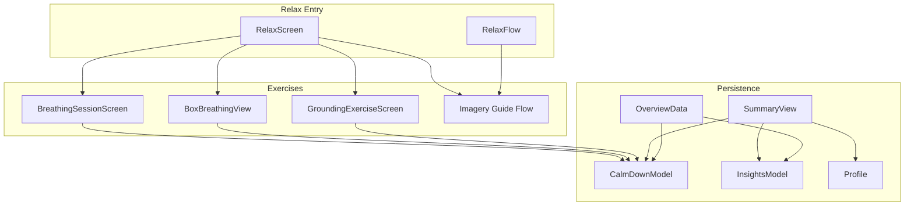
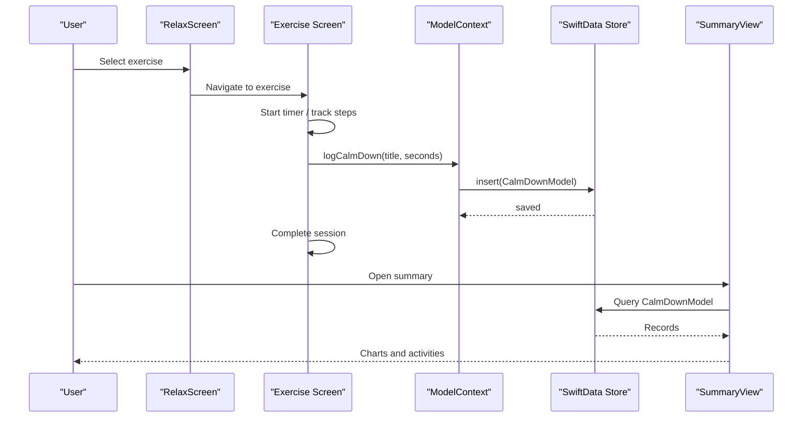
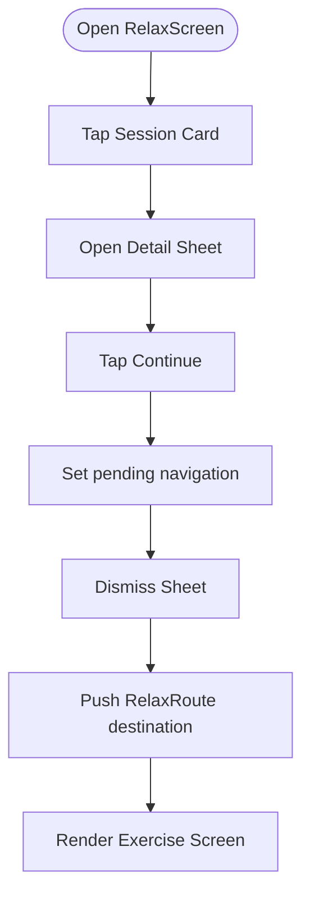
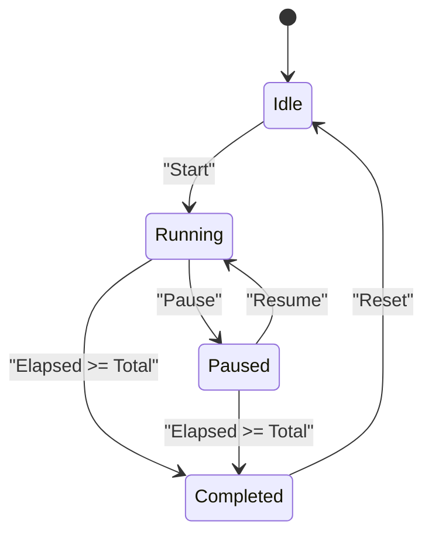
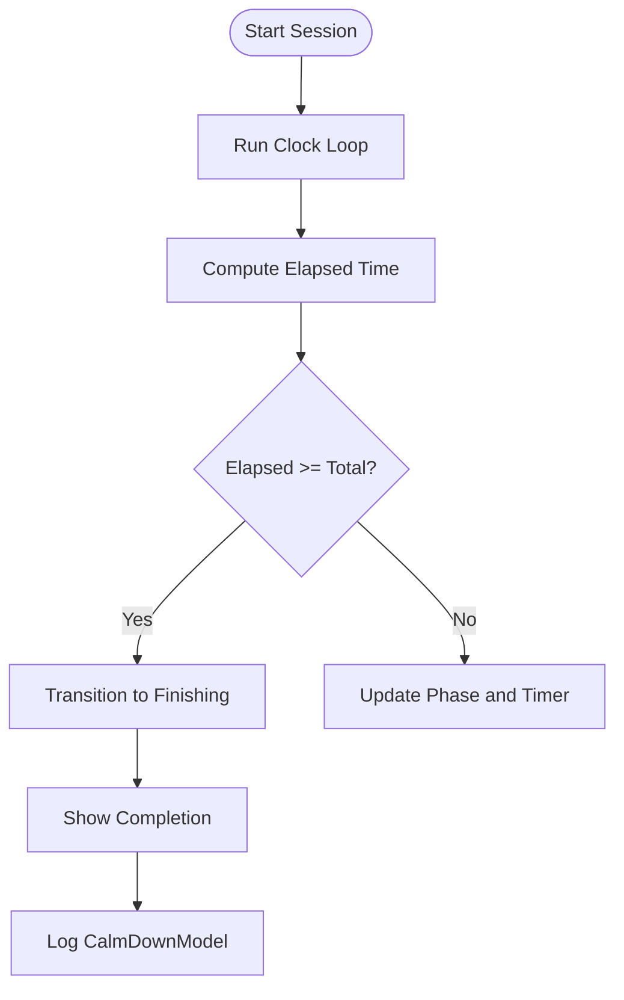
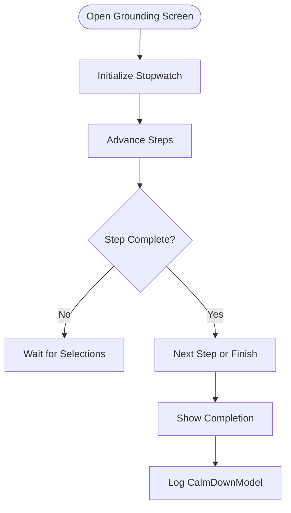
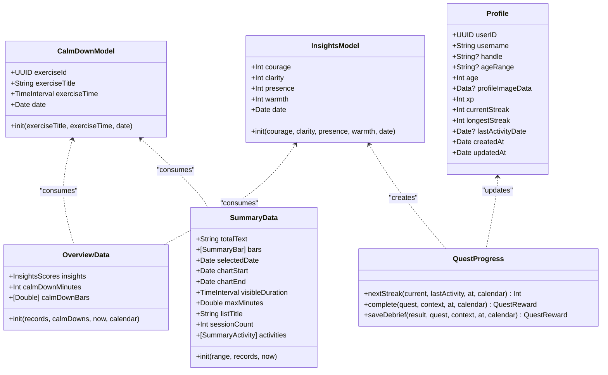

# Session Management & Tracking

<cite>
**Referenced Files in This Document**   
- [CalmDownModel.swift](file://Moko/Moko/Models/CalmDownModel.swift)
- [RelaxScreen.swift](file://Moko/Moko/UIScreens/relaxScreens/RelaxScreen.swift)
- [Breathingsessionscreen.swift](file://Moko/Moko/UIScreens/relaxScreens/Breathing/Breathingsessionscreen.swift)
- [BoxBreathingView.swift](file://Moko/Moko/UIScreens/relaxScreens/BoxBreathing/BoxBreathingView.swift)
- [GroundingExerciseScreen.swift](file://Moko/Moko/UIScreens/relaxScreens/Grounding/GroundingExerciseScreen.swift)
- [Summaryview.swift](file://Moko/Moko/UIScreens/homeScreens/Summary_CalmDown/Summaryview.swift)
- [OverviewData.swift](file://Moko/Moko/Models/OverviewData.swift)
- [InsightsModel.swift](file://Moko/Moko/Models/InsightsModel.swift)
- [QuestProgress.swift](file://Moko/Moko/Models/QuestProgress.swift)
- [Profile.swift](file://Moko/Moko/Models/Profile.swift)
- [RelaxFlow.swift](file://Moko/Moko/UIScreens/relaxScreens/ImageryGuide/RelaxFlow.swift)
- [SupabaseManager.swift](file://Moko/Moko/SupabaseManager.swift)
- [context.md](file://context.md)
</cite>

## Table of Contents
1. [Introduction](#introduction)
2. [Project Structure](#project-structure)
3. [Core Components](#core-components)
4. [Architecture Overview](#architecture-overview)
5. [Detailed Component Analysis](#detailed-component-analysis)
6. [Dependency Analysis](#dependency-analysis)
7. [Performance Considerations](#performance-considerations)
8. [Troubleshooting Guide](#troubleshooting-guide)
9. [Conclusion](#conclusion)
10. [Appendices](#appendices)

## Introduction
This document explains the session management and tracking system used across relaxation exercises in the app. It covers how sessions are started, tracked, persisted, summarized, and visualized, as well as how progress metrics like streaks and insights are maintained. The focus is on:

- The CalmDownModel data structure for storing completed exercise records with duration and timestamp.
- RelaxScreen as the central coordinator for different exercise types and navigation flow.
- The session lifecycle from initiation to completion, including timer logic and persistence.
- Data persistence using SwiftData and integration points with the insights and profile systems.
- Implementation details for session counting, streak tracking, and progress visualization.
- Data migration patterns, backup strategies, and privacy considerations for health-related data.

## Project Structure
The session management system spans models, UI screens, and shared progression utilities:

- Models:
  - CalmDownModel stores individual calm-down exercise records.
  - InsightsModel stores emotional state scores over time.
  - Profile holds user-level gamification state such as XP and streaks.
  - OverviewData computes daily and weekly summaries from stored records.
- Relaxation screens:
  - RelaxScreen coordinates entry into breathing, box breathing, grounding, imagery, and mirror exercises.
  - BreathingSessionScreen implements a guided breathing timer.
  - BoxBreathingView implements a timed box-breathing cycle.
  - GroundingExerciseScreen implements the 5-4-3-2-1 sensory grounding exercise.
  - RelaxFlow manages imagery guide navigation and completion.
- Summary and insights:
  - SummaryView renders charts and activity lists based on CalmDownModel records.
  - QuestProgress updates streaks and insights when quests or debriefs complete.

**Diagram sources**
- [RelaxScreen.swift:12-98](file://Moko/Moko/UIScreens/relaxScreens/RelaxScreen.swift#L12-L98)
- [Breathingsessionscreen.swift:16-51](file://Moko/Moko/UIScreens/relaxScreens/Breathing/Breathingsessionscreen.swift#L16-L51)
- [BoxBreathingView.swift:61-80](file://Moko/Moko/UIScreens/relaxScreens/BoxBreathing/BoxBreathingView.swift#L61-L80)
- [GroundingExerciseScreen.swift:15-26](file://Moko/Moko/UIScreens/relaxScreens/Grounding/GroundingExerciseScreen.swift#L15-L26)
- [RelaxFlow.swift:3-45](file://Moko/Moko/UIScreens/relaxScreens/ImageryGuide/RelaxFlow.swift#L3-L45)
- [CalmDownModel.swift:12-37](file://Moko/Moko/Models/CalmDownModel.swift#L12-L37)
- [InsightsModel.swift:11-26](file://Moko/Moko/Models/InsightsModel.swift#L11-L26)
- [Profile.swift:12-58](file://Moko/Moko/Models/Profile.swift#L12-L58)
- [OverviewData.swift:11-42](file://Moko/Moko/Models/OverviewData.swift#L11-L42)
- [Summaryview.swift:561-597](file://Moko/Moko/UIScreens/homeScreens/Summary_CalmDown/Summaryview.swift#L561-L597)

**Section sources**
- [RelaxScreen.swift:12-98](file://Moko/Moko/UIScreens/relaxScreens/RelaxScreen.swift#L12-L98)
- [Breathingsessionscreen.swift:16-51](file://Moko/Moko/UIScreens/relaxScreens/Breathing/Breathingsessionscreen.swift#L16-L51)
- [BoxBreathingView.swift:61-80](file://Moko/Moko/UIScreens/relaxScreens/BoxBreathing/BoxBreathingView.swift#L61-L80)
- [GroundingExerciseScreen.swift:15-26](file://Moko/Moko/UIScreens/relaxScreens/Grounding/GroundingExerciseScreen.swift#L15-L26)
- [RelaxFlow.swift:3-45](file://Moko/Moko/UIScreens/relaxScreens/ImageryGuide/RelaxFlow.swift#L3-L45)
- [CalmDownModel.swift:12-37](file://Moko/Moko/Models/CalmDownModel.swift#L12-L37)
- [InsightsModel.swift:11-26](file://Moko/Moko/Models/InsightsModel.swift#L11-L26)
- [Profile.swift:12-58](file://Moko/Moko/Models/Profile.swift#L12-L58)
- [OverviewData.swift:11-42](file://Moko/Moko/Models/OverviewData.swift#L11-L42)
- [Summaryview.swift:561-597](file://Moko/Moko/UIScreens/homeScreens/Summary_CalmDown/Summaryview.swift#L561-L597)

## Core Components
This section documents the core data structures and services that underpin session management and tracking.

### CalmDownModel
CalmDownModel represents one finished calm-down exercise. It stores:

- A unique identifier for the record.
- The exercise title (e.g., “Gentle Breathing”, “Box Breathing”, “Grounding Exercise”).
- Duration in seconds.
- Timestamp of completion.

It also provides an extension on ModelContext to log a completed session and persist it via SwiftData.

Key responsibilities:
- Persisting per-session duration and timestamp.
- Providing a simple API for screens to log completion.

Complexity:
- Insertion is O(1).
- Query performance depends on indexes; currently sorted by date in reverse order for summary views.

Error handling:
- Save failures are caught and logged.

**Section sources**
- [CalmDownModel.swift:12-37](file://Moko/Moko/Models/CalmDownModel.swift#L12-L37)

### InsightsModel
InsightsModel captures emotional state scores at a point in time:

- Courage, clarity, presence, warmth scores.
- Date of the insight.

Used primarily when completing quest debriefs to maintain longitudinal emotional metrics.

**Section sources**
- [InsightsModel.swift:11-26](file://Moko/Moko/Models/InsightsModel.swift#L11-L26)

### Profile
Profile holds user-level gamification and identity data:

- User ID, username, handle, age range, age.
- Profile image data marked for external storage.
- XP, current streak, longest streak, last activity date.
- Creation and update timestamps.

Streaks are updated through QuestProgress.

**Section sources**
- [Profile.swift:12-58](file://Moko/Moko/Models/Profile.swift#L12-L58)

### OverviewData
OverviewData aggregates today’s calm-down minutes and the last six days’ totals:

- Computes today’s average warmth from InsightsModel records.
- Computes today’s total calm-down minutes.
- Produces a six-day bar series for calm-down minutes.

It filters records by calendar day and sums durations.

**Section sources**
- [OverviewData.swift:11-42](file://Moko/Moko/Models/OverviewData.swift#L11-L42)

### SummaryData and SummaryView
SummaryData builds summary statistics for calm-down exercises across ranges:

- Day, week, month, year.
- Total text representation of duration.
- Chart bars with labels and selected dates.
- Activity list grouped by exercise type.

SummaryView binds to CalmDownModel records and renders charts and activity lists.

**Section sources**
- [Summaryview.swift:35-153](file://Moko/Moko/UIScreens/homeScreens/Summary_CalmDown/Summaryview.swift#L35-L153)
- [Summaryview.swift:561-597](file://Moko/Moko/UIScreens/homeScreens/Summary_CalmDown/Summaryview.swift#L561-L597)

### QuestProgress
QuestProgress manages gamification updates:

- Calculates next streak based on last activity date and current streak.
- Marks quests complete once and awards XP and streak.
- Saves debrief results as InsightsModel entries with minimum score thresholds.
- Persists changes via ModelContext.

**Section sources**
- [QuestProgress.swift:17-83](file://Moko/Moko/Models/QuestProgress.swift#L17-L83)
- [QuestProgress.swift:85-119](file://Moko/Moko/Models/QuestProgress.swift#L85-L119)
- [QuestProgress.swift:121-137](file://Moko/Moko/Models/QuestProgress.swift#L121-L137)

## Architecture Overview
The architecture centers around RelaxScreen coordinating multiple exercise flows, each responsible for its own timing and completion logging. Completed sessions are persisted as CalmDownModel records. SummaryView and OverviewData consume these records to visualize progress. Streaks and insights are managed through Profile and InsightsModel, updated by QuestProgress during quest completions and debriefs.

**Diagram sources**
- [RelaxScreen.swift:191-277](file://Moko/Moko/UIScreens/relaxScreens/RelaxScreen.swift#L191-L277)
- [Breathingsessionscreen.swift:272-290](file://Moko/Moko/UIScreens/relaxScreens/Breathing/Breathingsessionscreen.swift#L272-L290)
- [BoxBreathingView.swift:331-346](file://Moko/Moko/UIScreens/relaxScreens/BoxBreathing/BoxBreathingView.swift#L331-L346)
- [GroundingExerciseScreen.swift:491-513](file://Moko/Moko/UIScreens/relaxScreens/Grounding/GroundingExerciseScreen.swift#L491-L513)
- [CalmDownModel.swift:27-37](file://Moko/Moko/Models/CalmDownModel.swift#L27-L37)
- [Summaryview.swift:561-597](file://Moko/Moko/UIScreens/homeScreens/Summary_CalmDown/Summaryview.swift#L561-L597)

## Detailed Component Analysis

### RelaxScreen Coordination
RelaxScreen defines the RelaxSession enum and routes for different exercises. It manages:

- A sheet-based detail view for each session.
- Navigation stack routing to specific exercise screens.
- State synchronization between sheet dismissal and pushing destinations.

Key behaviors:
- Opening a session card shows a detail sheet.
- Dismissing the sheet triggers navigation to the actual exercise screen.
- Imagery guides use a separate RelaxFlow with its own navigation path.

**Diagram sources**
- [RelaxScreen.swift:100-197](file://Moko/Moko/UIScreens/relaxScreens/RelaxScreen.swift#L100-L197)
- [RelaxScreen.swift:191-277](file://Moko/Moko/UIScreens/relaxScreens/RelaxScreen.swift#L191-L277)

**Section sources**
- [RelaxScreen.swift:12-98](file://Moko/Moko/UIScreens/relaxScreens/RelaxScreen.swift#L12-L98)
- [RelaxScreen.swift:100-197](file://Moko/Moko/UIScreens/relaxScreens/RelaxScreen.swift#L100-L197)
- [RelaxScreen.swift:191-277](file://Moko/Moko/UIScreens/relaxScreens/RelaxScreen.swift#L191-L277)

### BreathingSessionScreen Timer and Logging
BreathingSessionScreen implements a guided breathing timer with states: idle, running, paused, completed. It tracks elapsed time and uses a ticker to update UI. On completion, it logs the session duration.

Key behaviors:
- Starts timer on user action.
- Pauses/resumes based on user interaction.
- Completes after total duration and logs to SwiftData.

**Diagram sources**
- [Breathingsessionscreen.swift:24-51](file://Moko/Moko/UIScreens/relaxScreens/Breathing/Breathingsessionscreen.swift#L24-L51)
- [Breathingsessionscreen.swift:272-290](file://Moko/Moko/UIScreens/relaxScreens/Breathing/Breathingsessionscreen.swift#L272-L290)

**Section sources**
- [Breathingsessionscreen.swift:16-51](file://Moko/Moko/UIScreens/relaxScreens/Breathing/Breathingsessionscreen.swift#L16-L51)
- [Breathingsessionscreen.swift:272-290](file://Moko/Moko/UIScreens/relaxScreens/Breathing/Breathingsessionscreen.swift#L272-L290)

### BoxBreathingView Cycle Logic
BoxBreathingView manages a multi-cycle box-breathing routine with four phases per cycle: inhale, hold full, exhale, hold empty. It calculates phase index, current cycle, and side progress for the animated box.

Key behaviors:
- Runs a clock loop while running.
- Transitions to finishing then complete.
- Logs total duration upon completion.

**Diagram sources**
- [BoxBreathingView.swift:61-80](file://Moko/Moko/UIScreens/relaxScreens/BoxBreathing/BoxBreathingView.swift#L61-L80)
- [BoxBreathingView.swift:331-346](file://Moko/Moko/UIScreens/relaxScreens/BoxBreathing/BoxBreathingView.swift#L331-L346)

**Section sources**
- [BoxBreathingView.swift:61-80](file://Moko/Moko/UIScreens/relaxScreens/BoxBreathing/BoxBreathingView.swift#L61-L80)
- [BoxBreathingView.swift:331-346](file://Moko/Moko/UIScreens/relaxScreens/BoxBreathing/BoxBreathingView.swift#L331-L346)

### GroundingExerciseScreen Step Progression
GroundingExerciseScreen implements the 5-4-3-2-1 sensory grounding exercise. It tracks step index, selected numbers, and completion state. It starts a stopwatch on appear and logs elapsed time upon completion.

Key behaviors:
- Validates step completion before advancing.
- Shows completion animation and allows continuing.
- Logs session duration to SwiftData.

**Diagram sources**
- [GroundingExerciseScreen.swift:15-26](file://Moko/Moko/UIScreens/relaxScreens/Grounding/GroundingExerciseScreen.swift#L15-L26)
- [GroundingExerciseScreen.swift:491-513](file://Moko/Moko/UIScreens/relaxScreens/Grounding/GroundingExerciseScreen.swift#L491-L513)

**Section sources**
- [GroundingExerciseScreen.swift:15-26](file://Moko/Moko/UIScreens/relaxScreens/Grounding/GroundingExerciseScreen.swift#L15-L26)
- [GroundingExerciseScreen.swift:491-513](file://Moko/Moko/UIScreens/relaxScreens/Grounding/GroundingExerciseScreen.swift#L491-L513)

### Imagery Guide Flow
RelaxFlow manages imagery guide sessions and completion screens. It maintains a navigation path and environment store for imagery content.

Key behaviors:
- Navigates to guide session and completion.
- Uses native back bar styling.
- Clears path on done.

**Section sources**
- [RelaxFlow.swift:3-45](file://Moko/Moko/UIScreens/relaxScreens/ImageryGuide/RelaxFlow.swift#L3-L45)

### SummaryView Visualization
SummaryView reads CalmDownModel records and renders:

- Range selector (day, week, month, year).
- Empty state guidance.
- Chart showing minutes per period.
- Activity list grouped by exercise type.

It uses SummaryData to compute chart bars, axis labels, and max values.

**Section sources**
- [Summaryview.swift:35-153](file://Moko/Moko/UIScreens/homeScreens/Summary_CalmDown/Summaryview.swift#L35-L153)
- [Summaryview.swift:561-597](file://Moko/Moko/UIScreens/homeScreens/Summary_CalmDown/Summaryview.swift#L561-L597)
- [Summaryview.swift:671-771](file://Moko/Moko/UIScreens/homeScreens/Summary_CalmDown/Summaryview.swift#L671-L771)

## Dependency Analysis
The following diagram maps dependencies among core components involved in session management and tracking.

**Diagram sources**
- [CalmDownModel.swift:12-37](file://Moko/Moko/Models/CalmDownModel.swift#L12-L37)
- [InsightsModel.swift:11-26](file://Moko/Moko/Models/InsightsModel.swift#L11-L26)
- [Profile.swift:12-58](file://Moko/Moko/Models/Profile.swift#L12-L58)
- [OverviewData.swift:11-42](file://Moko/Moko/Models/OverviewData.swift#L11-L42)
- [Summaryview.swift:35-153](file://Moko/Moko/UIScreens/homeScreens/Summary_CalmDown/Summaryview.swift#L35-L153)
- [QuestProgress.swift:17-119](file://Moko/Moko/Models/QuestProgress.swift#L17-L119)

**Section sources**
- [CalmDownModel.swift:12-37](file://Moko/Moko/Models/CalmDownModel.swift#L12-L37)
- [InsightsModel.swift:11-26](file://Moko/Moko/Models/InsightsModel.swift#L11-L26)
- [Profile.swift:12-58](file://Moko/Moko/Models/Profile.swift#L12-L58)
- [OverviewData.swift:11-42](file://Moko/Moko/Models/OverviewData.swift#L11-L42)
- [Summaryview.swift:35-153](file://Moko/Moko/UIScreens/homeScreens/Summary_CalmDown/Summaryview.swift#L35-L153)
- [QuestProgress.swift:17-119](file://Moko/Moko/Models/QuestProgress.swift#L17-L119)

## Performance Considerations
- Timer precision:
  - BreathingSessionScreen uses a high-frequency ticker to update elapsed time smoothly.
  - BoxBreathingView uses async loops with sleep intervals to drive phase transitions.
- Data queries:
  - SummaryView sorts CalmDownModel by date in reverse order to optimize recent-first rendering.
  - OverviewData filters records by calendar day; consider indexing by date if datasets grow large.
- UI animations:
  - Rive animations are paused/resumed based on session state to reduce unnecessary processing.
- Memory usage:
  - External storage attribute on profile image data helps manage local storage footprint.

Recommendations:
- Batch save operations where possible to reduce I/O overhead.
- Use background queues for heavy computations like chart data generation.
- Monitor memory usage during long-running sessions to avoid leaks.

[No sources needed since this section provides general guidance]

## Troubleshooting Guide
Common issues and resolutions:

- Session not persisting:
  - Ensure modelContext.logCalmDown is called on completion.
  - Verify save() succeeds; check error logs for save failures.
- Incorrect duration logged:
  - Confirm stopwatch start and stop times are correctly captured.
  - For timed exercises, ensure total duration calculation matches intended length.
- Streak not updating:
  - Verify QuestProgress.complete is invoked and debriefRecorded guard prevents duplication.
  - Check lastActivityDate and currentStreak fields in Profile.
- Summary chart empty:
  - Confirm CalmDownModel records exist for the selected range.
  - Validate calendar filtering logic in SummaryData and OverviewData.

**Section sources**
- [CalmDownModel.swift:27-37](file://Moko/Moko/Models/CalmDownModel.swift#L27-L37)
- [Breathingsessionscreen.swift:272-290](file://Moko/Moko/UIScreens/relaxScreens/Breathing/Breathingsessionscreen.swift#L272-L290)
- [BoxBreathingView.swift:331-346](file://Moko/Moko/UIScreens/relaxScreens/BoxBreathing/BoxBreathingView.swift#L331-L346)
- [GroundingExerciseScreen.swift:491-513](file://Moko/Moko/UIScreens/relaxScreens/Grounding/GroundingExerciseScreen.swift#L491-L513)
- [QuestProgress.swift:49-83](file://Moko/Moko/Models/QuestProgress.swift#L49-L83)
- [Summaryview.swift:561-597](file://Moko/Moko/UIScreens/homeScreens/Summary_CalmDown/Summaryview.swift#L561-L597)

## Conclusion
The session management and tracking system integrates multiple components to provide a cohesive experience for relaxation exercises. CalmDownModel serves as the foundation for recording session history and duration. RelaxScreen orchestrates navigation and state across different exercise types. Timers and step progressors ensure accurate tracking, while SummaryView and OverviewData render meaningful insights. Streaks and insights are maintained through Profile and InsightsModel, updated by QuestProgress. The system leverages SwiftData for persistence and supports visualization of progress over time. Future enhancements may include advanced analytics, improved privacy controls, and more robust data migration strategies.

[No sources needed since this section summarizes without analyzing specific files]

## Appendices

### Session Lifecycle Summary
- Initiation:
  - User selects an exercise from RelaxScreen.
  - Detail sheet opens; user confirms to proceed.
- Execution:
  - Exercise screen starts timer or step progression.
  - UI reflects current phase and progress.
- Completion:
  - Exercise logs duration via modelContext.logCalmDown.
  - SummaryView displays updated charts and activities.

**Section sources**
- [RelaxScreen.swift:100-197](file://Moko/Moko/UIScreens/relaxScreens/RelaxScreen.swift#L100-L197)
- [Breathingsessionscreen.swift:272-290](file://Moko/Moko/UIScreens/relaxScreens/Breathing/Breathingsessionscreen.swift#L272-L290)
- [BoxBreathingView.swift:331-346](file://Moko/Moko/UIScreens/relaxScreens/BoxBreathing/BoxBreathingView.swift#L331-L346)
- [GroundingExerciseScreen.swift:491-513](file://Moko/Moko/UIScreens/relaxScreens/Grounding/GroundingExerciseScreen.swift#L491-L513)
- [Summaryview.swift:561-597](file://Moko/Moko/UIScreens/homeScreens/Summary_CalmDown/Summaryview.swift#L561-L597)

### Data Migration Patterns
- Local device-scoped user ID stored in UserDefaults.
- Separate ModelContainer for preview vs. runtime databases.
- Supabase migrations and seeds define remote schema.

**Section sources**
- [context.md:160-184](file://context.md#L160-L184)

### Backup Strategies
- No explicit backup implementation found in referenced files.
- Consider exporting SwiftData snapshots or syncing to secure cloud storage with user consent.

[No sources needed since this section provides general guidance]

### Privacy Considerations
- Health-related data includes exercise durations and emotional state scores.
- Profile image data is marked for external storage.
- Supabase client configuration exists; ensure service keys are secured and access policies are enforced.

**Section sources**
- [Profile.swift:21-22](file://Moko/Moko/Models/Profile.swift#L21-L22)
- [SupabaseManager.swift:6-19](file://Moko/Moko/SupabaseManager.swift#L6-L19)